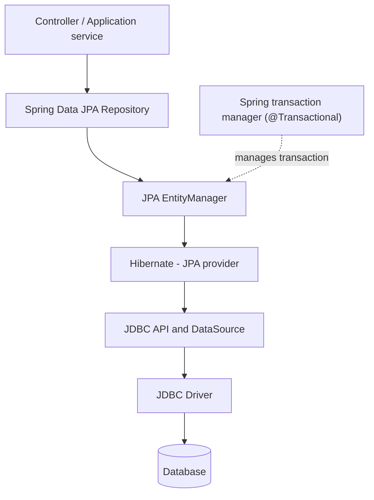

# Relationships Between Spring Data, JPA, Hibernate, JDBC, and the Database

## Objectives

After this lesson, you will be able to distinguish the roles of Spring Data JPA, JPA, Hibernate, JDBC, and the database management system; describe the path of a read/write operation; understand transactions and the persistence context; and know when to use a repository or JDBC directly.

## 1. The Big Picture

In a Spring Boot application using Spring Data JPA, a call from the business layer typically passes through the following layers:



This is the typical chain of responsibility, though not every application must call a repository. An application can use `EntityManager` directly or use JDBC. When using default Spring Data JPA in Spring Boot, Hibernate is typically the preconfigured JPA provider.

Key point: Spring Data JPA provides the repository-level programming model; JPA defines the persistence contract; Hibernate implements that contract; Hibernate uses JDBC to exchange SQL with the database; the JDBC driver translates JDBC calls into the protocol understood by the database.

## 2. Role of Each Component

### Spring Data JPA: Spring's Repository Layer

Spring Data JPA helps applications interact with data through repository interfaces instead of having to write most CRUD code manually. For example, an interface extending `JpaRepository<Customer, Long>` comes with `save`, `findById`, `findAll`, `deleteById`, pagination, and sorting.

Spring Data JPA can also derive queries from method names like `findByEmail`, accept JPQL via `@Query`, or accept native SQL when genuinely needed. It creates a proxy for the repository and delegates calls to the JPA API. It is not a database, not a JDBC driver, and not an ORM engine directly generating all SQL.

### JPA: Java's Persistence Specification

JPA (Java Persistence API, now under Jakarta Persistence) is a **specification**, meaning a contract for how to map Java objects to relational data and manage the entity lifecycle. JPA defines concepts/APIs such as `@Entity`, `@Id`, `@OneToMany` relationships, `EntityManager`, the persistence context, JPQL, and transaction integration.

JPA does not execute SQL itself. A JPA provider must implement this specification. As a result, application code can rely on the JPA API without depending entirely on a specific provider.

### Hibernate: JPA Provider and ORM

Hibernate ORM is a popular implementation of JPA. It reads metadata from entities, manages entity state, tracks changes (dirty checking), handles relationships, and generates SQL suited to the database/dialect in use. Hibernate also manages many details such as fetching, batching, and the persistence context's first-level cache.

Hibernate is not synonymous with JPA. JPA is the specification; Hibernate is a product that implements that specification. An application can use another JPA provider, though Spring Boot typically selects Hibernate in the default configuration of the Data JPA starter.

### JDBC: Low-Level Database Access API

JDBC (Java Database Connectivity) is the standard Java API for working with databases using SQL. Familiar types include `DataSource`, `Connection`, `PreparedStatement`, and `ResultSet`. When using JDBC directly, developers typically write SQL themselves, bind parameters, and map results back to objects.

JDBC is neither the database nor the driver. JDBC is the API; a JDBC driver is the library specific to each database engine (for example PostgreSQL or MySQL) that implements the JDBC interfaces and translates calls into the network protocol supported by the corresponding database.

Spring's `JdbcTemplate` is a JDBC helper layer: it manages acquiring/closing resources, binding parameters, and translating certain JDBC errors into Spring's exception hierarchy. `JdbcTemplate` is still JDBC; it does not turn SQL statements into JPA operations.

### Database: Storage and SQL Execution Engine

The database (such as PostgreSQL, MySQL, SQL Server, or Oracle) stores tables, rows, columns, indexes, and constraints, and executes SQL. It is responsible for data integrity, locks, transactions, isolation, and query execution plans.

Java entities are only a model inside the application. Persistent data ultimately resides in the database; ORM mapping does not replace schema design, indexes, constraints, or migrations.

## 3. How Does a Repository Operation Reach the Database?

Suppose a service calls `customerRepository.save(customer)` inside a transaction:

1. The service calls a method on the repository interface.
2. The proxy generated by Spring Data JPA receives the call and runs repository logic. For `save`, Spring Data JPA determines whether the entity is new or existing to choose the appropriate JPA call, typically `EntityManager.persist()` or `EntityManager.merge()`.
3. `EntityManager` interacts with the persistence context. The persistence context tracks managed entities within its scope and ensures a single identity per entity in that context.
4. Hibernate implements the JPA provider contract. When changes need to be synchronized, Hibernate inspects entity state and generates `INSERT`, `UPDATE`, or `DELETE` SQL statements.
5. Hibernate uses the JDBC API, obtains a connection from `DataSource`, creates a statement, and binds parameters.
6. The JDBC driver sends the call over the corresponding protocol to the database.
7. The database checks constraints, executes the SQL, and returns results. Results are passed back through the driver/JDBC to Hibernate, then to JPA/Spring Data and the service.

SQL does not always run right on the `save()` line. With many ID generation strategies and update operations, SQL may be sent when Hibernate flushes the persistence context, usually before transaction commit. Some ID strategies like `IDENTITY` may force an earlier insert to obtain the primary key.

### Reading Data

When `findById(10L)` is called, the repository asks JPA to find the entity. If the entity is already in the current persistence context, the provider can return the managed instance without querying again. If not, Hibernate generates a `SELECT` SQL statement, executes it via JDBC, and maps the result row into an entity.

Therefore, one repository query does not necessarily always correspond to one new SQL statement. The persistence context, caching, fetching strategy, and how the query is written all affect the actual SQL.

### Writing and Dirty Checking

When a managed entity changes, Hibernate can detect the change without needing a separate `update()` method call. At flush time, Hibernate compares state and issues the necessary SQL. This is dirty checking.

`flush` means synchronizing pending changes in the persistence context to the database via SQL. `commit` ends the transaction and confirms it succeeded. Flush is not synonymous with commit: if a transaction rolls back after a flush, changes within that transaction are still reverted according to the database's transaction mechanism.

## 4. Spring Data JPA Example

The snippets below are files in a Spring Boot application with the `spring-boot-starter-data-jpa` dependency, the corresponding database driver, and a `DataSource` configuration. They use Jakarta Persistence, suitable for Spring Boot 3 and Java 17+.

### `Customer.java` - Entity Mapped to a Table

```java
package com.example.demo.customer;

import jakarta.persistence.Column;
import jakarta.persistence.Entity;
import jakarta.persistence.GeneratedValue;
import jakarta.persistence.GenerationType;
import jakarta.persistence.Id;
import jakarta.persistence.Table;

@Entity
@Table(name = "customers")
public class Customer {
    @Id
    @GeneratedValue(strategy = GenerationType.IDENTITY)
    private Long id;

    @Column(nullable = false, length = 120)
    private String name;

    protected Customer() {
        // No-arg constructor for JPA.
    }

    public Customer(String name) {
        this.name = name;
    }

    public Long getId() {
        return id;
    }

    public String getName() {
        return name;
    }

    public void rename(String name) {
        this.name = name;
    }
}
```

`@Entity` marks the class as managed by JPA; `@Table` specifies the table; `@Id` marks the primary key; `@GeneratedValue` declares the key generation strategy; `@Column` describes certain mapping constraints. These annotations belong to Jakarta Persistence, not Hibernate-specific annotations.

### `CustomerRepository.java` - Spring Data Layer Abstraction

```java
package com.example.demo.customer;

import java.util.Optional;
import org.springframework.data.jpa.repository.JpaRepository;

public interface CustomerRepository extends JpaRepository<Customer, Long> {
    Optional<Customer> findByName(String name);
}
```

There is no need to write a CRUD implementation class yourself. Spring Data JPA creates a proxy for the interface. The name `findByName` is parsed against the entity's property to create an appropriate query. The actual query and final SQL are handled by the JPA provider.

### `CustomerService.java` - Business and Transaction Boundary

```java
package com.example.demo.customer;

import java.util.Optional;
import org.springframework.stereotype.Service;
import org.springframework.transaction.annotation.Transactional;

@Service
public class CustomerService {
    private final CustomerRepository customers;

    public CustomerService(CustomerRepository customers) {
        this.customers = customers;
    }

    @Transactional
    public Long register(String name) {
        Customer saved = customers.save(new Customer(name));
        return saved.getId();
    }

    @Transactional(readOnly = true)
    public Optional<Customer> findByName(String name) {
        return customers.findByName(name);
    }
}
```

`@Transactional` places the transaction boundary at the business layer. When the method is called through a Spring proxy, the transaction manager starts or joins a transaction, then commits when the method finishes normally or rolls back according to rules when an exception occurs. Specific configuration and exception types affect the rollback policy.

`save()` returns the resulting entity. Use the returned value, especially because the `merge()` branch may return a different managed instance from the object passed in. When SQL executes also depends on flushing and the ID generation strategy.

## 5. How Do JPQL, Native SQL, and JDBC Differ?

| Access approach | What do you write? | At what level does it operate? | Who translates it to SQL? |
| --- | --- | --- | --- |
| Spring Data JPA derived query | `findByName(...)` | Method names and entity properties | Spring Data JPA creates a JPA query; provider generates SQL |
| JPQL | Query over entities and Java properties | Object/entity model | JPA provider, typically Hibernate |
| Native query | Database-specific SQL | Tables, columns, and SQL syntax | Database executes SQL; provider/JDBC sends the statement |
| JDBC / `JdbcTemplate` | SQL and parameters | Tables, columns, result rows | JDBC driver sends SQL to the database |

A JPQL example referencing the `Customer` entity and `name` property, not directly referencing table/column names:

```java
@Query("select c from Customer c where c.name = :name")
Optional<Customer> findCustomer(@Param("name") String name);
```

A native query example using SQL syntax and table names:

```java
@Query(value = "select * from customers where name = :name", nativeQuery = true)
List<Customer> findByNameWithSql(@Param("name") String name);
```

Native queries are useful when database-specific features or complex SQL statements are needed, but they couple code more tightly to the schema and dialect. JPQL targets the entity model and is therefore usually easier to port across databases.

## 6. Using JDBC Directly Alongside JPA

Sometimes an application needs explicit SQL for reporting, bulk queries, stored procedures, or specific optimizations. `JdbcTemplate` can be used alongside a Spring Data JPA application:

### `CustomerJdbcReader.java` - JDBC Query Example

```java
package com.example.demo.customer;

import java.sql.ResultSet;
import java.util.Optional;
import org.springframework.jdbc.core.JdbcTemplate;
import org.springframework.stereotype.Repository;

@Repository
public class CustomerJdbcReader {
    private final JdbcTemplate jdbc;

    public CustomerJdbcReader(JdbcTemplate jdbc) {
        this.jdbc = jdbc;
    }

    public Optional<String> findNameById(long id) {
        return jdbc.query(
            "select name from customers where id = ?",
            (ResultSet rs) -> rs.next()
                ? Optional.ofNullable(rs.getString("name"))
                : Optional.empty(),
            id
        );
    }
}
```

This snippet sends SQL via JDBC. The `?` is a parameter placeholder; `JdbcTemplate` binds the `id` value, avoiding manual SQL string concatenation. The example requires `spring-jdbc` on the classpath; `spring-boot-starter-jdbc` can be declared if the application does not already have that dependency.

JPA/Hibernate also uses JDBC underneath, but the two access approaches sit at different abstraction levels:

- With JPA, you operate on entities and let the provider manage mapping, state, relationships, and SQL.
- With JDBC, you control the SQL and how results are converted into objects more explicitly.
- `JdbcTemplate` and JPA can participate in the same transaction when they share the same `DataSource` and transactions are managed by Spring. The datasource/transaction manager configuration must be consistent.

Care must be taken when mixing both approaches in the same transaction. A direct JDBC update to a row does not automatically update a managed entity in the persistence context. That entity may retain stale data; if further modified and flushed, an `UPDATE` generated by Hibernate could even overwrite the data JDBC just updated. Establish a clear order: flush pending JPA changes first, run JDBC, then refresh affected entities or clear the persistence context when appropriate. `clear()` detaches all managed entities in that context, so use it only when you understand its impact.

## 7. Transaction, Persistence Context, and Database

These three concepts are related but not identical:

- **Transaction** is a unit of work that must be committed or rolled back. The database enforces transaction rules such as atomicity and isolation as configured.
- **Persistence context** is the area where JPA manages entities: tracking entities, state, and changes; typically bound to an `EntityManager`.
- **Database** is where SQL is executed and persistent data state is stored.

Inside a `@Transactional` method, Spring typically binds the `EntityManager` to the current transaction. Hibernate uses a connection obtained from the `DataSource` to send SQL. On flush, SQL is sent within the transaction; on a successful commit, the database confirms the transaction. On rollback, the database reverts the transaction's changes.

Some practical notes:

1. New, managed, detached, and removed entities have different lifecycles. Calling `save()` does not mean every entity is handled the same way.
2. `flush()` only synchronizes pending SQL; it does not commit the transaction on its own.
3. Lazy loading requires an active persistence context. Returning an entity outside the transaction and then accessing a lazy relationship can cause errors or unexpected queries.
4. Querying a list of entities with lazy relationships can cause the N+1 problem: one query to fetch the list, followed by many queries to fetch relationships for each entity. Choose a fetch strategy, fetch join, entity graph, or projection based on the use case.
5. Bulk updates/deletes via JPQL or native SQL usually bypass dirty checking of already loaded entities. Consider clearing/refreshing the persistence context afterward.

## 8. Schema and Database Configuration

ORM maps objects to tables, but it does not eliminate database design responsibilities. The application still needs appropriate primary keys, data types, nullability, unique constraints, foreign keys, and indexes suited to its queries.

In development environments, Hibernate can help generate/update the schema through DDL settings. For environments with real data, schema changes should be managed using versioned migrations such as Flyway or Liquibase; schema validation mode is typically used instead of letting the ORM alter database structure on application startup.

The database dialect affects how the provider generates SQL for each database engine. The JDBC driver must be compatible with the database and configured in the application. When a connection fails, distinguish URL/credentials/network/driver configuration errors from entity mapping or SQL errors.

## 9. Which Component Should You Use?

| Need | Usually suitable choice |
| --- | --- |
| Standard CRUD and business queries on entities | Spring Data JPA repository |
| Need control over entities/persistence context or custom JPA queries | `EntityManager` (JPA) |
| Need Hibernate-specific features | Hibernate API, limited to where genuinely needed |
| Explicit SQL, reporting, bulk operations, or stored procedures | JDBC / `JdbcTemplate` |
| Storage, constraints, indexes, transactions, and SQL execution | Database |

There is no single option that is always best. Repositories typically reduce boilerplate and suit CRUD. JDBC is useful when SQL is central to the operation or fine-grained query control is required. Both can be combined, provided transactions are unified and the impact on the persistence context is understood.

**Further distinction:** Spring Data JDBC is a different Spring Data module. It also provides repositories, but it is not based on JPA/Hibernate and does not have the same persistence context/dirty checking model as JPA. You should not use the names Spring Data JPA and Spring Data JDBC as if they were the same technology.

## 10. Common Misconceptions

- **“JPA is Hibernate.”** False: JPA/Jakarta Persistence is a specification; Hibernate is a provider that implements the specification.
- **“Spring Data JPA is JPA.”** Inaccurate: Spring Data JPA is Spring's repository support layer built on top of JPA.
- **“Hibernate connects directly to the database without JDBC.”** In typical JDBC usage, Hibernate uses the JDBC API and a JDBC driver to communicate with the database.
- **“JDBC is a database driver.”** False: JDBC is a standard API; a driver is a library implementing that API for a specific database.
- **“Calling `save()` guarantees SQL runs immediately.”** Not always; SQL may be sent at flush or commit time, depending on the operation and ID generation strategy.
- **“JPQL and SQL are the same.”** JPQL queries entities and properties; SQL queries tables and columns.
- **“Using repositories means you don't need to understand SQL.”** The ORM still generates real SQL. You need to inspect queries, indexes, round-trips, and execution plans when performance issues arise.
- **“`flush()` is `commit()`.”** False: flush sends changes to the database within a transaction; commit finishes the transaction successfully.

## Conclusion

Remember the chain of responsibility: **Spring Data JPA provides repositories → JPA defines the API/specification → Hibernate implements JPA and generates SQL → JDBC API and driver send SQL → database executes and stores data**. Understanding each layer clearly helps you know whether to place logic in a repository or service, when to use `EntityManager`, when direct JDBC is needed, and how to avoid transaction or out-of-sync entity state bugs.