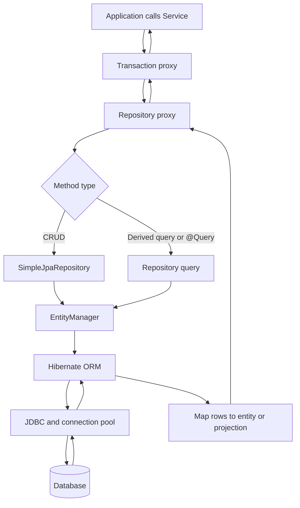

# Processing Flow from a Repository Call to the SQL Query and Returned Result

## Objectives

Spring Data JPA enables applications to work with data through Repository interfaces. When calling `repository.findByEmail(...)` or `repository.save(...)`, the application does not write JDBC code itself, nor does it send Java method names directly to the database. Spring Data JPA intercepts the call, selects the appropriate execution mechanism, uses the JPA `EntityManager` to work with the persistence context, and relies on a JPA provider (typically Hibernate in Spring Boot) to translate the operation into SQL. JDBC sends the SQL and parameters to the database; the result is then mapped back into an entity, projection, or data type declared by the Repository.

This lesson traces that entire path, from the moment the application calls the Repository until the result is received, while explaining transactions, the persistence context, and when SQL is actually sent.

## Big Picture

Typical flow of a read query:



This is a conceptual model. Some steps may be skipped or altered: an entity may already be in the persistence context, a cache may satisfy an operation, and SQL statements that write data may only be sent on flush.

## 1. Spring Initializes the JPA Infrastructure

When a Spring Boot application has the `spring-boot-starter-data-jpa` dependency, auto-configuration typically sets up the following components:

- `DataSource`: provides connections to the database. Spring Boot usually configures HikariCP as the connection pool if that dependency is present.
- `EntityManagerFactory`: creates `EntityManager` instances and manages entity mapping configuration.
- JPA provider: typically Hibernate, responsible for implementing JPA and generating SQL.
- `PlatformTransactionManager`: for JPA, usually `JpaTransactionManager`, which manages transactions.
- Repository beans: Spring Data scans interfaces extending `Repository`, `CrudRepository`, or `JpaRepository`, and creates beans that can be injected into Services.

In Spring Boot, Repository scanning is usually auto-configured based on the package of the `@SpringBootApplication` class. Manually configured applications can use `@EnableJpaRepositories` to specify which packages to scan.

Example of a Repository:

```java
public interface CustomerRepository extends JpaRepository<Customer, Long> {
    Optional<Customer> findByEmail(String email);
}
```

This interface does not require writing an implementation class for `findByEmail`. Spring Data creates a proxy bean at application startup and prepares execution mechanisms for the methods it recognizes.

## 2. A Repository Is Actually a Proxy

The bean injected into a Service is a proxy generated by Spring Data. When code calls `repository.findByEmail(email)`, the call goes through the proxy's interceptors. Spring Data uses Repository metadata to determine which group the method belongs to.

| Method group | Common handling approach |
| --- | --- |
| CRUD inherited from `JpaRepository` | Implemented by `SimpleJpaRepository` and calls `EntityManager` APIs. |
| Derived queries like `findByEmail` | Spring Data parses the method name, builds a JPA query, and executes it. |
| Methods with `@Query` | Uses the declared JPQL or native SQL statement. |
| Custom repository fragment | Delegates to the application's custom implementation. |

A Repository proxy and an entity proxy are two different concepts. A Repository proxy dispatches method calls. An entity proxy is typically used by Hibernate for lazily loaded (`LAZY`) relationships or attributes.

## 3. How Spring Data Determines Method Execution

### CRUD Methods

For inherited methods such as `findById`, `deleteById`, or `save`, `SimpleJpaRepository` invokes the corresponding JPA APIs. For example:

- `findById(id)` typically uses `EntityManager.find(...)`. If the entity is already managed in the persistence context, JPA can return the existing instance without querying the database.
- `save(entity)` checks whether the entity is new. A new entity usually goes through `EntityManager.persist(...)`; an existing entity usually goes through `EntityManager.merge(...)`.
- `delete(entity)` asks `EntityManager` to remove the entity from the persistence context and the database on flush.

`merge()` may return a managed instance different from the input object. Therefore, always use the object returned by `save()` when you need to continue working with the managed entity.

### Derived Queries

For `findByEmail(String email)`, Spring Data parses the method name into a condition on the `email` property of the `Customer` entity. This mechanism is typically implemented via `PartTree` and a JPA query creator. Hibernate then translates that JPA query into SQL suitable for the database.

The property name must match the entity's Java property. For instance, if the entity has `email` while the database column is named `email_address`, the method is still typically `findByEmail`, because derived queries operate on entity properties and the mapping handles column names.

### `@Query`

`@Query` lets you declare a query directly. By default, the string is JPQL: JPQL uses entity names and Java properties, not SQL table and column names.

```java
@Query("select c from Customer c where c.email = :email")
Optional<Customer> findUsingJpql(@Param("email") String email);
```

To write SQL using table and column names, declare `nativeQuery = true`:

```java
@Query(value = "select * from customers where email = :email", nativeQuery = true)
Optional<Customer> findNativeByEmail(@Param("email") String email);
```

For bulk update or delete queries, annotate with `@Modifying` and set an appropriate transaction:

```java
@Modifying
@Query("update Customer c set c.name = :name where c.email = :email")
int renameByEmail(@Param("email") String email, @Param("name") String name);
```

Bulk updates act directly on the database and can leave managed entities in the persistence context stale. When needed, consider `flushAutomatically` or `clearAutomatically` on `@Modifying`, and manage transactions in the Service layer.

## 4. Transactions and the Persistence Context

In real-world applications, transactions are usually placed at the Service layer using `@Transactional`. When a Service method is called through a Spring proxy, the transaction manager starts a transaction, acquires or creates an appropriate `EntityManager`, and binds the persistence context to the current transaction.

```java
@Service
public class CustomerService {
    private final CustomerRepository repository;

    public CustomerService(CustomerRepository repository) {
        this.repository = repository;
    }

    @Transactional
    public Customer create(String name, String email) {
        return repository.save(new Customer(name, email));
    }

    @Transactional(readOnly = true)
    public Optional<Customer> findByEmail(String email) {
        return repository.findByEmail(email);
    }
}
```

The persistence context is the region that tracks managed entities. It plays important roles:

- **Identity map:** within the same persistence context, a record with the same entity type and primary key is typically represented by the same managed instance.
- **Dirty checking:** Hibernate tracks changes on managed entities. On flush, changes can be turned into an `UPDATE` without calling a separate `update` method.
- **First-level cache:** an already-managed entity can be returned from the persistence context without re-reading from the database.
- **State tracking:** an entity can be in the transient, managed, detached, or removed state. This state affects how `persist`, `merge`, and `remove` behave.

CRUD methods inherited from `SimpleJpaRepository` have a default transaction configuration. Query methods declared by the application do not automatically receive a transaction configuration in every case. Placing `@Transactional` on the Service makes transaction boundaries explicit and allows multiple Repository operations to participate in the same transaction.

`readOnly = true` is an optimization hint for read transactions to Spring and the JPA provider; it should not be treated as a security mechanism or a guarantee that the database can never be written to.

## 5. Hibernate Translates the JPA Query into SQL

Repositories work with the JPA abstraction. Hibernate handles the database-dependent parts:

1. Receives operations from `EntityManager`, such as finding an entity, running JPQL, or executing a Criteria query.
2. Uses mapping metadata: `@Entity`, `@Table`, `@Column`, relationships, data types, and key generation strategies.
3. Uses the database dialect to generate compatible SQL.
4. Creates a prepared statement and binds parameters to `?` placeholders.
5. Requests a connection from the pool and uses JDBC to send the statement to the database.

For example, a JPA query finding a customer by email might be translated into SQL similar to:

```sql
select c.id, c.name, c.email
from customers c
where c.email = ?
```

The actual SQL may differ in aliases, column names, column order, quoting, or syntax depending on the Hibernate version and database dialect. The email value is typically bound separately as a JDBC parameter rather than concatenated directly into the SQL string. Parameter binding handles data types properly and prevents SQL injection caused by string concatenation of input.

## 6. The Database Executes and Hibernate Reads the Result

The database receives the SQL and parameters, validates syntax and permissions, chooses an execution plan, reads or writes data, and returns the result via JDBC.

For read queries, Hibernate reads each row in the `ResultSet`, converts column values to Java types, applies the entity mapping, and creates or updates entity state in the persistence context. `LAZY` relationships may be represented by proxies or collection wrappers so related data is loaded only when accessed.

Spring Data then returns the result according to the type declared in the Repository:

- `Optional<Customer>`: may contain an entity or `Optional.empty()`.
- `Customer`: returns the entity or `null` depending on the API and query; when a record is not guaranteed to exist, `Optional` is usually clearer.
- `List<Customer>`: a list of results, possibly empty.
- Projection or DTO: returns only the necessary fields according to the declared projection.
- `Page<Customer>`: page data and total count information; usually requires an additional count query.
- `Slice<Customer>`: information on whether a next page exists, usually avoiding a total count query.

Once the Repository method returns to the Service, the Service can continue processing the result and return it to the controller or original caller. If the entity has lazily loaded properties, ensure they are loaded inside the transaction or use a fetch join, `@EntityGraph`, or an appropriate projection before the transaction ends.

## 7. When Is the SQL Actually Sent?

Not every `save()` call immediately issues an `INSERT` statement on that exact line of code. JPA uses a write-behind mechanism: changes are recorded in the persistence context and SQL is sent on flush.

Flush typically occurs in the following cases:

- Transaction commit: the transaction manager tells the persistence context to synchronize changes with the database before committing.
- The application calls `EntityManager.flush()` or the Repository calls `saveAndFlush()`.
- With flush mode `AUTO`, the provider may flush before a query when pending changes could affect that query's result.

Flush only synchronizes SQL statements to the database within the current transaction; flush does not mean commit. The transaction can still roll back after a flush. Only upon a successful commit does the database confirm the transaction according to its rules.

When SQL is sent also depends on the ID generation strategy. With `GenerationType.IDENTITY`, Hibernate typically has to insert early to obtain the database-generated key. With a sequence, Hibernate can fetch the sequence value first and defer the insert until flush. Therefore, observe the actual SQL rather than assuming all strategies insert at the same moment.

## 8. Runnable Example with Java 17+, Spring Boot, and H2

This example creates a customer and then looks it up using the derived query `findByEmail`. The project uses Spring Boot 3.x, Java 17, and an H2 in-memory database.

### Project Structure

```text
jpa-flow/
├── pom.xml
└── src/
    └── main/
        ├── java/com/example/jpaflow/
        │   ├── JpaFlowApplication.java
        │   ├── Customer.java
        │   ├── CustomerRepository.java
        │   └── CustomerService.java
        └── resources/
            └── application.properties
```

### `pom.xml`

```xml
<?xml version="1.0" encoding="UTF-8"?>
<project xmlns="http://maven.apache.org/POM/4.0.0"
         xmlns:xsi="http://www.w3.org/2001/XMLSchema-instance"
         xsi:schemaLocation="http://maven.apache.org/POM/4.0.0 https://maven.apache.org/xsd/maven-4.0.0.xsd">
    <modelVersion>4.0.0</modelVersion>
    <parent>
        <groupId>org.springframework.boot</groupId>
        <artifactId>spring-boot-starter-parent</artifactId>
        <version>3.4.5</version>
        <relativePath/>
    </parent>
    <groupId>com.example</groupId>
    <artifactId>jpa-flow</artifactId>
    <version>0.0.1-SNAPSHOT</version>
    <properties>
        <java.version>17</java.version>
    </properties>
    <dependencies>
        <dependency>
            <groupId>org.springframework.boot</groupId>
            <artifactId>spring-boot-starter-data-jpa</artifactId>
        </dependency>
        <dependency>
            <groupId>com.h2database</groupId>
            <artifactId>h2</artifactId>
            <scope>runtime</scope>
        </dependency>
    </dependencies>
    <build>
        <plugins>
            <plugin>
                <groupId>org.springframework.boot</groupId>
                <artifactId>spring-boot-maven-plugin</artifactId>
            </plugin>
        </plugins>
    </build>
</project>
```

### `src/main/resources/application.properties`

```properties
spring.datasource.url=jdbc:h2:mem:jpaflow;DB_CLOSE_DELAY=-1
spring.datasource.username=sa
spring.datasource.password=
spring.jpa.hibernate.ddl-auto=create-drop
spring.jpa.open-in-view=false
logging.level.org.hibernate.SQL=DEBUG
logging.level.org.hibernate.orm.jdbc.bind=TRACE
```

`org.hibernate.SQL` displays SQL. The `org.hibernate.orm.jdbc.bind` logger displays bound parameter values in Hibernate 6; only enable `TRACE` level when debugging test data because logs may contain sensitive information.

### `Customer.java`

```java
package com.example.jpaflow;

import jakarta.persistence.Column;
import jakarta.persistence.Entity;
import jakarta.persistence.GeneratedValue;
import jakarta.persistence.GenerationType;
import jakarta.persistence.Id;
import jakarta.persistence.SequenceGenerator;
import jakarta.persistence.Table;

@Entity
@Table(name = "customers")
@SequenceGenerator(name = "customer_seq_gen", sequenceName = "customer_seq", allocationSize = 1)
public class Customer {
    @Id
    @GeneratedValue(strategy = GenerationType.SEQUENCE, generator = "customer_seq_gen")
    private Long id;

    @Column(nullable = false, length = 120)
    private String name;

    @Column(nullable = false, unique = true, length = 180)
    private String email;

    protected Customer() {
    }

    public Customer(String name, String email) {
        this.name = name;
        this.email = email;
    }

    public Long getId() {
        return id;
    }

    public String getName() {
        return name;
    }

    public String getEmail() {
        return email;
    }

    @Override
    public String toString() {
        return "Customer{id=" + id + ", name=" + name + ", email=" + email + "}";
    }
}
```

### `CustomerRepository.java`

```java
package com.example.jpaflow;

import java.util.Optional;
import org.springframework.data.jpa.repository.JpaRepository;

public interface CustomerRepository extends JpaRepository<Customer, Long> {
    Optional<Customer> findByEmail(String email);
}
```

### `CustomerService.java`

```java
package com.example.jpaflow;

import java.util.Optional;
import org.springframework.stereotype.Service;
import org.springframework.transaction.annotation.Transactional;

@Service
public class CustomerService {
    private final CustomerRepository repository;

    public CustomerService(CustomerRepository repository) {
        this.repository = repository;
    }

    @Transactional
    public Customer create(String name, String email) {
        return repository.save(new Customer(name, email));
    }

    @Transactional(readOnly = true)
    public Optional<Customer> findByEmail(String email) {
        return repository.findByEmail(email);
    }
}
```

### `JpaFlowApplication.java`

```java
package com.example.jpaflow;

import org.springframework.boot.CommandLineRunner;
import org.springframework.boot.SpringApplication;
import org.springframework.boot.autoconfigure.SpringBootApplication;
import org.springframework.context.annotation.Bean;

@SpringBootApplication
public class JpaFlowApplication {
    public static void main(String[] args) {
        SpringApplication.run(JpaFlowApplication.class, args);
    }

    @Bean
    CommandLineRunner demo(CustomerService service) {
        return args -> {
            Customer saved = service.create("An", "an@example.com");
            Customer found = service.findByEmail("an@example.com").orElseThrow();

            System.out.println("Saved: " + saved);
            System.out.println("Found: " + found);
        };
    }
}
```

### Running the Program

```bash
mvn spring-boot:run
```

With a fresh H2 database, the application output looks like:

```text
Saved: Customer{id=1, name=An, email=an@example.com}
Found: Customer{id=1, name=An, email=an@example.com}
```

Typical SQL logged by Hibernate:

```sql
select next value for customer_seq
insert into customers (email, name, id) values (?, ?, ?)
select c1_0.id, c1_0.email, c1_0.name
from customers c1_0
where c1_0.email = ?
```

Column order, aliases, and SQL syntax can vary by Hibernate version and dialect. In this example, the `create()` call opens a transaction and calls `save()`. The sequence allocates an ID; when the transaction finishes, Hibernate flushes the insert statement and commits. Next, `findByEmail()` opens a read transaction, Spring Data builds a query from the method name, Hibernate issues the select statement, maps the row to `Customer`, and returns `Optional<Customer>` to the Service.

## 9. Common Misunderstandings

1. **Repositories do not generate SQL directly by concatenating method names.** Spring Data parses the method into a JPA query; Hibernate then translates that query into SQL.
2. **`save()` does not always mean an immediate INSERT on that line.** SQL may be deferred until flush; the ID strategy can change this timing.
3. **`flush()` is not `commit()`.** Flush sends pending changes within a transaction; the transaction can still roll back.
4. **`merge()` is not guaranteed to return the exact input object.** Always use the return value of `save()`.
5. **JPQL does not use SQL table/column names.** JPQL uses entity names and properties; native queries are written against the database schema.
6. **Lazy loading can generate extra SQL.** Accessing lazy relationships in a loop easily causes the N+1 problem; consider fetch joins, `@EntityGraph`, or projections.
7. **`Page` can trigger a count query.** If you only need to know whether a next page exists, `Slice` may be more appropriate.
8. **Bulk updates do not automatically update entities already in the persistence context.** Consider flushing and clearing to avoid reading stale state.
9. **Calling a `@Transactional` method from another method on the same object can bypass the Spring proxy.** Transaction annotations usually take effect when the call goes through the Spring proxy.

## 10. How to Observe the Flow While Debugging

- Enable `logging.level.org.hibernate.SQL=DEBUG` to view SQL emitted by Hibernate.
- Enable `logging.level.org.hibernate.orm.jdbc.bind=TRACE` to view bound parameters in Hibernate 6; use only in development environments or with test data.
- Set breakpoints in the Service to verify transaction boundaries, on the Repository method to observe calls, and where results are handled to inspect returned entities/projections.
- Check the SQL and query count when encountering N+1 issues, slow queries, or unexpected results.

Chain to remember: **Service and transaction → Repository proxy → CRUD implementation or query method → EntityManager and persistence context → Hibernate generates SQL → JDBC sends SQL → database returns rows → Hibernate maps results → Repository returns result to Service.**