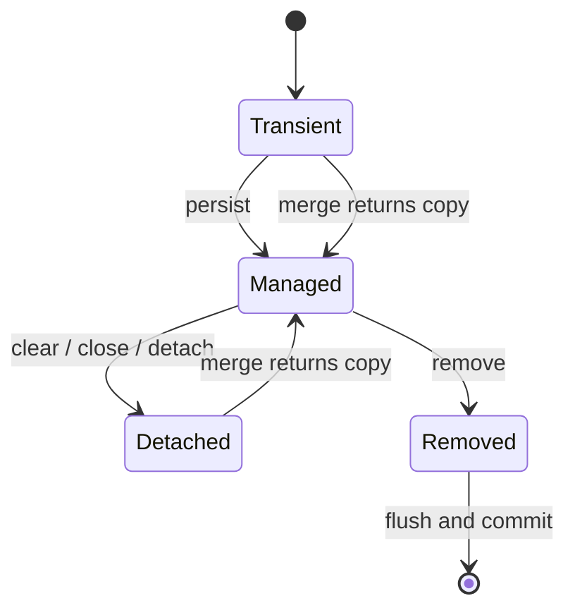

# persist, merge, remove, find, and getReference

## Objective

`EntityManager` is the JPA API for managing the entity lifecycle and working with the persistence context. The five operations `persist`, `merge`, `remove`, `find`, and `getReference` appear frequently in Spring Data JPA code, yet each has different rules regarding entity state, database queries, and when SQL is written.

- `persist`: places a new entity into the managed state.
- `merge`: copies state from a transient or detached entity into a managed entity and returns the managed instance.
- `remove`: marks a managed entity for deletion.
- `find`: looks up an entity by primary key and returns `null` if it does not exist.
- `getReference`: obtains a reference to an entity by primary key; the provider may defer loading data until needed.

Understanding these operations accurately helps avoid detached entity errors, unintended data overwrites, redundant queries, and confusion between flush and commit.

## 1. Entity lifecycle states

JPA typically describes four main states:

| State | Meaning |
| --- | --- |
| Transient / New | A new Java object, not yet managed by a persistence context and with no corresponding managed record. |
| Managed | An entity currently managed by a persistence context; changes can be synchronized on flush. |
| Detached | An entity that was previously managed but is no longer attached to a persistence context. |
| Removed | A managed entity marked for deletion; a DELETE statement will be synchronized on flush. |

For example, an object just created with `new Customer(...)` is transient. After `persist`, it becomes managed. When the transaction ends and the persistence context closes, the object becomes detached. If `remove` is called on a managed entity, it transitions to removed.



`merge` does not make the passed-in object itself managed. It returns a managed instance containing the state copied from the input object. Always use the return value of `merge`.

## 2. persist(): saving a new entity

`EntityManager.persist(entity)` instructs JPA to manage a new entity. After a successful call, the entity becomes managed in the current persistence context.

```java
Customer customer = new Customer("An", "an@example.com");
entityManager.persist(customer);
```

Within the same transaction, you can continue modifying the entity:

```java
customer.setName("An Nguyen");
```

Because the entity is managed, Hibernate tracks the change and can generate an `INSERT` or `UPDATE` on flush.

### persist does not mean INSERT always runs immediately

JPA commonly uses write-behind: changes are recorded in the persistence context and synchronized to the database on flush. Flush can happen when:

- The transaction commits.
- Code calls `entityManager.flush()`.
- The provider needs to synchronize before a query according to the current flush mode.

The ID generation strategy can affect INSERT timing. With `GenerationType.IDENTITY`, the provider usually must insert early to retrieve the database-generated ID. With sequences, the provider can fetch the sequence value first and defer the INSERT.

### When is persist inappropriate?

- Do not use `persist` to update an existing detached entity.
- Do not use `persist` as a general-purpose upsert operation.
- Calling `persist` on a detached entity can lead to `EntityExistsException` or another persistence error, depending on when the provider detects it.
- Calling `persist` on an already managed entity does not create an additional record.

For new entities with relationships, `cascade = PERSIST` or `cascade = ALL` can propagate the persist operation to related entities. Enable cascade only when the lifecycle of the related entity fits.

## 3. merge(): copying state into a managed entity

`EntityManager.merge(entity)` is used when bringing state from a transient or detached entity into the current persistence context. JPA returns a managed instance that the application should continue using.

```java
Customer detached = loadCustomerInPreviousTransaction();
detached.setName("An Nguyen");

Customer managed = entityManager.merge(detached);
managed.setEmail("an.nguyen@example.com");
```

Important points:

- `detached` remains a detached object after `merge` is called.
- `managed` is the object managed by the persistence context.
- If the persistence context already has an entity with the same primary key, the provider copies the input state into that managed instance.
- If there is no managed instance yet, the provider usually loads or creates a managed instance and copies the state.
- When passed a transient entity, `merge` can create a new managed copy and eventually insert it.

### Example illustrating the returned instance

```java
Customer detached = ...; // entity from an ended transaction
Customer managed = entityManager.merge(detached);

System.out.println(detached == managed); // false for detached input
```

Do not continue modifying `detached` expecting Hibernate to track it automatically. Modify `managed` or return the managed object to the appropriate caller.

### Risk of merging an object containing only partial data

Suppose an API receives JSON with only `id` and `name`, and the code constructs a new entity:

```java
Customer partial = new Customer();
partial.setId(10L);
partial.setName("New name");
entityManager.merge(partial);
```

Other properties missing from the payload may be `null` or default values. When merging, the object's state is copied into the managed instance; missing fields can overwrite existing data. This is a common cause of unintended data loss when using merge directly for partial updates.

For partial updates, the safe approach is usually to load the managed entity and apply only the permitted fields:

```java
Customer customer = entityManager.find(Customer.class, id);
if (customer == null) {
    throw new EntityNotFoundException("Customer not found: " + id);
}
customer.setName(request.name());
```

Dirty checking will write the change on flush. There is no need to call `merge` for an entity just retrieved via `find` in the same persistence context.

## 4. remove(): marking an entity for deletion

`EntityManager.remove(entity)` transitions a managed entity to the removed state. SQL `DELETE` is typically sent on flush.

```java
Customer customer = entityManager.find(Customer.class, id);
if (customer != null) {
    entityManager.remove(customer);
}
```

`remove` requires a managed entity. Passing a detached entity directly can throw `IllegalArgumentException`. If you only have an ID, call `find` first and then remove, or merge to obtain a managed instance and then remove if copying state is genuinely needed.

### remove and cascade relationships

If an entity has an association configured with `cascade = REMOVE` or `ALL`, the remove operation can propagate to related entities. This must be evaluated according to business ownership: deleting an order may delete its order lines, whereas deleting a department should generally not automatically delete a shared or independently lifecycled employee.

`orphanRemoval = true` differs from cascade remove: it deletes a child entity when it is removed from the association under orphan removal rules. Do not enable it if the child entity can be transferred to another parent.

## 5. find(): loading an entity by primary key

`EntityManager.find(EntityClass.class, id)` looks up an entity by primary key:

```java
Customer customer = entityManager.find(Customer.class, 10L);
if (customer == null) {
    // No record exists with this primary key.
}
```

Characteristics:

- If the entity is already in the persistence context, `find` usually returns the existing managed instance without a new SELECT.
- If not present, the provider queries the database and hydrates the entity.
- If no record exists, `find` returns `null`.
- The returned entity is managed in the current persistence context.

`find` is the right choice when you need to know whether a record exists and need to load the entity for reading or updating.

## 6. getReference(): obtaining a potentially lazy-loaded reference

`EntityManager.getReference(EntityClass.class, id)` returns a reference to an entity with a known primary key. The provider typically uses a proxy or equivalent mechanism to defer loading the entity's state until the application accesses a property that requires the data.

```java
Customer reference = entityManager.getReference(Customer.class, 10L);
```

Common differences:

| Criterion | find | getReference |
| --- | --- | --- |
| Result when record exists | Managed entity | Managed reference/entity that may be a proxy |
| When record does not exist | Returns `null` | May throw `EntityNotFoundException` when the reference is accessed; the provider may also detect it earlier |
| Data loading | Usually loads immediately if not already in the persistence context | May defer loading until state is accessed |
| Common usage | Reading, checking existence, updating entity | Assigning associations when the ID is known and reading the target entity's state is unnecessary |

### Using getReference to assign relationships

Suppose creating a `PurchaseOrder` for a customer whose ID is already known:

```java
Customer customerRef = entityManager.getReference(Customer.class, customerId);
PurchaseOrder order = new PurchaseOrder(customerRef);
entityManager.persist(order);
```

The provider can write `customer_id` without loading the entire customer, because the primary key is already known. However, `getReference` is not a guaranteed existence check at the moment of the call. If the ID does not actually exist, an error may appear when the proxy is accessed or when the database checks the foreign key at flush/commit.

### When should getReference NOT be used?

- When you need to verify the record exists and handle the missing case explicitly, use `find`.
- When you need to read entity properties, a reference may still trigger a SELECT upon access.
- When handling untrusted input, do not treat creating a reference as ID validation.
- When the transaction has ended and code still accesses an uninitialized proxy, you may encounter `LazyInitializationException`.

## 7. Comparison table of the five operations

| Operation | Typical input | State after operation | Return value |
| --- | --- | --- | --- |
| `persist` | Transient entity | Managed | `void` |
| `merge` | Detached or transient entity | Returned instance is managed; input remains detached/transient | Managed copy |
| `remove` | Managed entity | Removed | `void` |
| `find` | Entity class and primary key | Managed if found | Entity or `null` |
| `getReference` | Entity class and primary key | Managed reference, potentially lazy | Reference/entity |

## 8. Transaction, flush, and commit

Lifecycle operations must be executed within an appropriate transaction. Spring typically manages transactions at the Service layer using `@Transactional`.

- `persist`, `merge`, and `remove` change persistence context state.
- `find` and `getReference` read or create a reference in the persistence context.
- `flush` synchronizes pending changes to SQL within the current transaction.
- `commit` confirms the transaction in the database; if the transaction rolls back, flushed changes are also rolled back.

Do not treat calling `persist` or `remove` as proof that data has been committed. If you need to detect constraint errors early in a business flow, you can call `flush`, though commit can still fail afterward.

## 9. Runnable example with Java 17+, Spring Boot, and H2

This example demonstrates all five operations. The project uses Spring Boot 3.4.5, Java 17, and an H2 in-memory database.

### Project structure

```text
entity-manager-operations/
├── pom.xml
└── src/
    └── main/
        ├── java/com/example/entityoperations/
        │   ├── EntityOperationsApplication.java
        │   ├── Customer.java
        │   └── CustomerService.java
        └── resources/
            └── application.properties
```

### `pom.xml`

```xml
<?xml version="1.0" encoding="UTF-8"?>
<project xmlns="http://maven.apache.org/POM/4.0.0"
         xmlns:xsi="http://www.w3.org/2001/XMLSchema-instance"
         xsi:schemaLocation="http://maven.apache.org/POM/4.0.0 https://maven.apache.org/xsd/maven-4.0.0.xsd">
    <modelVersion>4.0.0</modelVersion>
    <parent>
        <groupId>org.springframework.boot</groupId>
        <artifactId>spring-boot-starter-parent</artifactId>
        <version>3.4.5</version>
        <relativePath/>
    </parent>
    <groupId>com.example</groupId>
    <artifactId>entity-manager-operations</artifactId>
    <version>0.0.1-SNAPSHOT</version>
    <properties>
        <java.version>17</java.version>
    </properties>
    <dependencies>
        <dependency>
            <groupId>org.springframework.boot</groupId>
            <artifactId>spring-boot-starter-data-jpa</artifactId>
        </dependency>
        <dependency>
            <groupId>com.h2database</groupId>
            <artifactId>h2</artifactId>
            <scope>runtime</scope>
        </dependency>
    </dependencies>
    <build>
        <plugins>
            <plugin>
                <groupId>org.springframework.boot</groupId>
                <artifactId>spring-boot-maven-plugin</artifactId>
            </plugin>
        </plugins>
    </build>
</project>
```

### `src/main/resources/application.properties`

```properties
spring.datasource.url=jdbc:h2:mem:entityops;DB_CLOSE_DELAY=-1
spring.datasource.username=sa
spring.datasource.password=
spring.jpa.hibernate.ddl-auto=create-drop
spring.jpa.open-in-view=false
logging.level.org.hibernate.SQL=DEBUG
```

### `Customer.java`

```java
package com.example.entityoperations;

import jakarta.persistence.Column;
import jakarta.persistence.Entity;
import jakarta.persistence.GeneratedValue;
import jakarta.persistence.GenerationType;
import jakarta.persistence.Id;
import jakarta.persistence.Table;

@Entity
@Table(name = "customers")
public class Customer {
    @Id
    @GeneratedValue(strategy = GenerationType.IDENTITY)
    private Long id;

    @Column(nullable = false)
    private String name;

    @Column(nullable = false, unique = true)
    private String email;

    protected Customer() {
    }

    public Customer(String name, String email) {
        this.name = name;
        this.email = email;
    }

    public Long getId() {
        return id;
    }

    public String getName() {
        return name;
    }

    public void setName(String name) {
        this.name = name;
    }

    public String getEmail() {
        return email;
    }

    @Override
    public String toString() {
        return "Customer{id=" + id + ", name=" + name + ", email=" + email + "}";
    }
}
```

### `CustomerService.java`

```java
package com.example.entityoperations;

import jakarta.persistence.EntityManager;
import jakarta.persistence.EntityNotFoundException;
import jakarta.persistence.PersistenceContext;
import org.springframework.stereotype.Service;
import org.springframework.transaction.annotation.Transactional;

@Service
public class CustomerService {
    @PersistenceContext
    private EntityManager entityManager;

    @Transactional
    public Long create(String name, String email) {
        Customer customer = new Customer(name, email);
        entityManager.persist(customer);
        entityManager.flush();
        return customer.getId();
    }

    @Transactional(readOnly = true)
    public String findSummary(Long id) {
        Customer customer = entityManager.find(Customer.class, id);
        return customer == null ? "NOT_FOUND" : customer.toString();
    }

    @Transactional(readOnly = true)
    public String referenceSummary(Long id) {
        Customer reference = entityManager.getReference(Customer.class, id);
        return reference.toString();
    }

    @Transactional(readOnly = true)
    public Customer loadDetached(Long id) {
        Customer customer = entityManager.find(Customer.class, id);
        if (customer == null) {
            throw new EntityNotFoundException("Customer not found: " + id);
        }
        return customer;
    }

    @Transactional
    public String mergeDetached(Customer detached) {
        Customer managed = entityManager.merge(detached);
        entityManager.flush();
        return managed.toString() + " | same instance: " + (managed == detached);
    }

    @Transactional
    public boolean remove(Long id) {
        Customer managed = entityManager.find(Customer.class, id);
        if (managed == null) {
            return false;
        }
        entityManager.remove(managed);
        entityManager.flush();
        return true;
    }
}
```

`loadDetached()` returns the entity after the transaction ends, so the object becomes detached. `mergeDetached()` receives that object, copies its state into a managed instance, and returns the result from the managed instance.

### `EntityOperationsApplication.java`

```java
package com.example.entityoperations;

import org.springframework.boot.CommandLineRunner;
import org.springframework.boot.SpringApplication;
import org.springframework.boot.autoconfigure.SpringBootApplication;
import org.springframework.context.annotation.Bean;

@SpringBootApplication
public class EntityOperationsApplication {
    public static void main(String[] args) {
        SpringApplication.run(EntityOperationsApplication.class, args);
    }

    @Bean
    CommandLineRunner demo(CustomerService service) {
        return args -> {
            Long id = service.create("An", "an@example.com");
            System.out.println("Created id: " + id);
            System.out.println("find(): " + service.findSummary(id));
            System.out.println("getReference(): " + service.referenceSummary(id));

            Customer detached = service.loadDetached(id);
            detached.setName("An Nguyen");
            System.out.println("merge(): " + service.mergeDetached(detached));
            System.out.println("find() after merge: " + service.findSummary(id));

            System.out.println("remove(): " + service.remove(id));
            System.out.println("find() after remove: " + service.findSummary(id));
        };
    }
}
```

### Running the program

```bash
mvn spring-boot:run
```

Output printed by the application:

```text
Created id: 1
find(): Customer{id=1, name=An, email=an@example.com}
getReference(): Customer{id=1, name=An, email=an@example.com}
merge(): Customer{id=1, name=An Nguyen, email=an@example.com} | same instance: false
find() after merge: Customer{id=1, name=An Nguyen, email=an@example.com}
remove(): true
find() after remove: NOT_FOUND
```

Output IDs start from 1 in a fresh H2 database. `getReference()` typically creates a proxy and loads data when `toString()` accesses properties; the provider may choose to load earlier. `merge()` returns a managed instance, and because the input was detached, the two references differ.

## 10. Common mistakes

1. **Using `persist` to update a detached entity:** `persist` is for new entities. For detached entities, use `merge` and use the returned instance.
2. **Ignoring the return value of `merge`:** the input remains detached; all subsequent changes must be applied to the managed instance.
3. **Merging an object with missing fields:** fields absent from the payload can overwrite existing data with null or default values. For partial updates, load the managed entity and modify the necessary fields.
4. **Calling `remove` on a detached entity:** `remove` requires a managed entity; call `find` first or merge then remove.
5. **Assuming `find` always issues a SELECT:** the entity may already be in the persistence context's first-level cache.
6. **Assuming `getReference` always checks existence immediately:** errors may appear when accessing the proxy or when the database checks the FK.
7. **Confusing flush with commit:** flush sends SQL within the transaction; commit confirms the transaction.
8. **Not managing cascade:** cascade can propagate persist, merge, or remove; only enable it according to the entity's actual lifecycle.

## 11. Best practices

- Use `persist` for new entities.
- Use `merge` for detached entities when you genuinely need to synchronize the entire state; always use the returned instance.
- For partial updates, find the managed entity and modify only permitted properties.
- Use `find` when you need to know whether the entity exists and need the data immediately.
- Use `getReference` when you already have the ID and only need a reference to assign an association; still handle FK or missing-entity errors.
- Only call `remove` on a managed entity and control cascade remove.
- Place operations in an appropriate Service transaction; use flush intentionally when early SQL error detection is needed.

Summary to remember: **persist brings a new entity into managed state; merge copies state and returns a managed instance; remove marks a managed entity for deletion; find loads by ID and can return null; getReference provides a potentially lazy-loaded reference.**