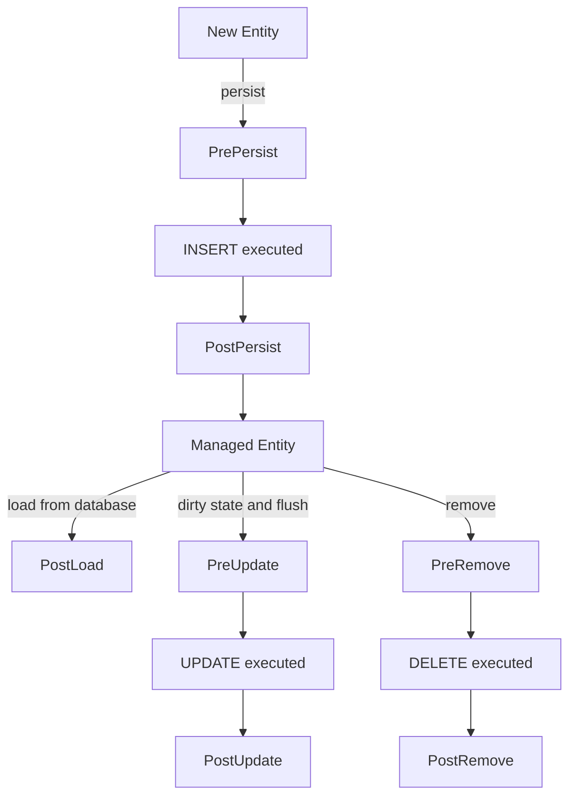
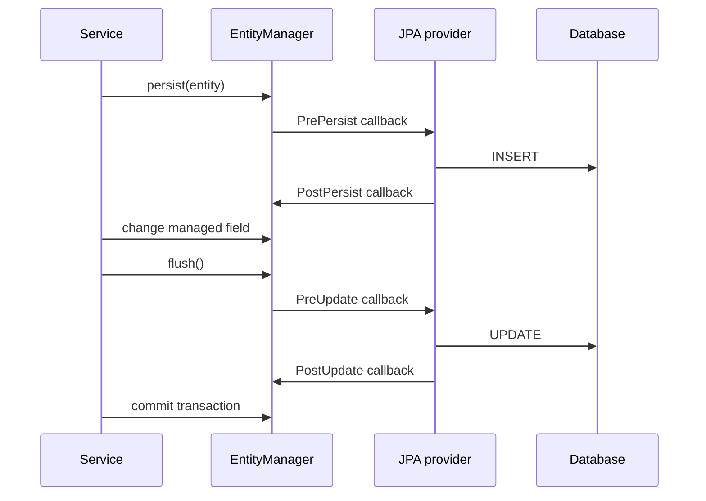

# Entity Callbacks with @PrePersist, @PreUpdate, @PostLoad, and Related Hooks

## 1. Objective

JPA provides lifecycle callbacks to run a method at specific points in an Entity's lifecycle. These callbacks are useful when you need to automatically set timestamps, normalize local data, compute transient properties after loading, or record an action before/after an Entity is saved or deleted.

This lesson covers the main callback hooks:
- `@PrePersist` and `@PostPersist` when creating an Entity.
- `@PreUpdate` and `@PostUpdate` when updating an Entity.
- `@PostLoad` when an Entity is loaded into the persistence context.
- `@PreRemove` and `@PostRemove` when deleting an Entity.

After this lesson, you will understand when callbacks are invoked, how to place callbacks in an Entity or entity listener, how to use callbacks in Spring Data JPA, how to test them with H2, and how to recognize data operations that bypass callbacks.

## 2. Entity lifecycle and callback positions

JPA manages Entities through core states:

| State | Meaning |
| --- | --- |
| New / transient | New Java object, not yet managed by a persistence context. |
| Managed | Managed by an EntityManager; state changes can be written to the database on flush. |
| Detached | Previously managed, but no longer belongs to a persistence context. |
| Removed | Marked for deletion; a DELETE statement is executed on appropriate synchronization. |

Callbacks are tied to state transitions or data-loading operations. Do not assume that every call to a Java method such as `save()` produces one corresponding callback. Spring Data JPA delegates to the JPA provider; callbacks run according to actual persistence events.



The diagram illustrates conceptual milestones. Actual SQL timing depends on the ID generation strategy, flush mode, JPA provider, and transaction.

## 3. Core callbacks

| Callback | Timing | Common uses |
| --- | --- | --- |
| `@PrePersist` | Before the INSERT operation is executed for a new Entity. | Setting `createdAt`, default values, normalizing fields. |
| `@PostPersist` | After the INSERT operation is executed. | Local processing requiring the generated ID, updating transient state. |
| `@PreUpdate` | Before the UPDATE operation is executed. | Updating `updatedAt`, local state validation. |
| `@PostUpdate` | After the UPDATE operation is executed. | Recording local results after an update. |
| `@PostLoad` | After the Entity is loaded into the persistence context or after refresh. | Computing `@Transient` properties from newly loaded data. |
| `@PreRemove` | Before the DELETE operation is executed. | Checking or preparing state before deletion. |
| `@PostRemove` | After the DELETE operation is executed. | Updating transient state of the deleted object. |

### 3.1. @PrePersist

`@PrePersist` is invoked when JPA prepares to persist a new Entity. This is an appropriate place to:
- Assign initial `createdAt` and `updatedAt`.
- Normalize string properties of the Entity itself.
- Assign a default value that does not depend on a database query.

Do not use this callback to query other Entities or orchestrate a multi-step business workflow. That belongs in a Service.

For database-generated keys, do not rely on the ID already being present in `@PrePersist`. When the ID becomes available depends on the key generation strategy and provider; if you need the inserted ID, `@PostPersist` is the more appropriate hook.

### 3.2. @PostPersist

`@PostPersist` is invoked after the INSERT operation is executed. With auto-generated keys, the ID is usually available at this point. Still, this callback occurs while the transaction is in progress; it does not mean the transaction has committed successfully.

Do not use `@PostPersist` as a mechanism to send emails or call external services that must only run after commit. If the transaction later rolls back, the external side effect would have already occurred even though the data was not committed. Use an appropriate transaction event, transactional outbox, or post-commit handler for those tasks.

### 3.3. @PreUpdate and @PostUpdate

`@PreUpdate` and `@PostUpdate` are tied to UPDATE operations executed by the JPA provider. Typically, property changes on a managed Entity are detected by dirty checking at flush.

This leads to important points:
- `@PreUpdate` is usually invoked during flush when the provider prepares to issue an UPDATE statement.
- `@PostUpdate` is invoked after the UPDATE operation.
- Simply calling `repository.save()` does not guarantee update callbacks will run; the outcome depends on whether the Entity is new or existing, managed/detached state, and whether an actual UPDATE occurs.
- If there is no change in persistent state and thus no UPDATE, do not expect `@PreUpdate` to run.

Therefore, `@PreUpdate` is commonly used to update `updatedAt`. Do not use it to replace business logic such as calculating order pricing or checking permissions.

### 3.4. @PostLoad

`@PostLoad` is invoked after JPA loads an Entity's state from the database into the persistence context. The callback can also be invoked after a refresh operation.

Appropriate uses:
- Building a transient display label from persistent fields.
- Initializing a local cache not stored in the database.
- Preparing a derived value for use during the object's current lifecycle.

`@PostLoad` does not run again on every `findById()` call. If the Entity is already managed in the persistence context, JPA may return the same instance without reloading data. After `EntityManager.clear()`, a fresh load gives the callback a chance to run again.

Do not use `@PostLoad` to silently mutate persistent data. If data needs to be modified and saved, use a business method inside a transaction.

### 3.5. @PreRemove and @PostRemove

`@PreRemove` is invoked before deletion; `@PostRemove` is invoked after the DELETE operation is executed. They can be useful for local checks or updating an instance's transient state.

Do not call external services directly inside removal callbacks if those side effects must be synchronized with the commit outcome. Use post-commit events or an outbox for safer handling.

## 4. Placing callbacks inside an Entity

Callbacks can be declared directly in the Entity class or in a mapped superclass. A callback method in an Entity takes no parameters and returns `void`.

The following example uses a mapped superclass to manage timestamps and a `Product` Entity to demonstrate the remaining callbacks.

### 4.1. Mapped superclass for audit timestamps

`src/main/java/com/example/catalog/product/AuditedEntity.java`:

```java
package com.example.catalog.product;

import jakarta.persistence.Column;
import jakarta.persistence.MappedSuperclass;
import jakarta.persistence.PrePersist;
import jakarta.persistence.PreUpdate;
import java.time.Instant;

@MappedSuperclass
public abstract class AuditedEntity {
    @Column(name = "created_at", nullable = false, updatable = false)
    private Instant createdAt;

    @Column(name = "updated_at", nullable = false)
    private Instant updatedAt;

    @PrePersist
    protected void beforeInsert() {
        Instant now = Instant.now();
        if (createdAt == null) {
            createdAt = now;
        }
        updatedAt = now;
    }

    @PreUpdate
    protected void beforeUpdate() {
        updatedAt = Instant.now();
    }

    public Instant getCreatedAt() {
        return createdAt;
    }

    public Instant getUpdatedAt() {
        return updatedAt;
    }
}
```

`@MappedSuperclass` does not create a separate table. Its mappings are inherited into the tables of child Entities. `@PrePersist` and `@PreUpdate` callbacks also apply to Entities inheriting those mappings.

`createdAt` has `updatable = false` so JPA does not include this column in normal UPDATE statements. The `beforeUpdate()` callback only modifies `updatedAt`.

### 4.2. Product Entity with callback hooks

`src/main/java/com/example/catalog/product/Product.java`:

```java
package com.example.catalog.product;

import jakarta.persistence.Column;
import jakarta.persistence.Entity;
import jakarta.persistence.GeneratedValue;
import jakarta.persistence.GenerationType;
import jakarta.persistence.Id;
import jakarta.persistence.PostLoad;
import jakarta.persistence.PostPersist;
import jakarta.persistence.PostRemove;
import jakarta.persistence.PostUpdate;
import jakarta.persistence.PreRemove;
import jakarta.persistence.Table;
import jakarta.persistence.Transient;

@Entity
@Table(name = "products")
public class Product extends AuditedEntity {
    @Id
    @GeneratedValue(strategy = GenerationType.IDENTITY)
    private Long id;

    @Column(nullable = false, unique = true, length = 40)
    private String sku;

    @Column(nullable = false, length = 160)
    private String name;

    @Transient
    private String displayLabel;

    @Transient
    private Long idObservedAfterPersist;

    @Transient
    private boolean updateCallbackInvoked;

    @Transient
    private boolean preRemoveInvoked;

    @Transient
    private boolean postRemoveInvoked;

    protected Product() {
        // JPA requires a no-arg constructor.
    }

    public Product(String sku, String name) {
        if (sku == null || sku.isBlank() || sku.length() > 40) {
            throw new IllegalArgumentException("SKU is required");
        }
        if (name == null || name.isBlank() || name.length() > 160) {
            throw new IllegalArgumentException("Product name is required");
        }
        this.sku = sku.trim();
        this.name = name.trim();
    }

    public void rename(String newName) {
        if (newName == null || newName.isBlank() || newName.length() > 160) {
            throw new IllegalArgumentException("Product name is required");
        }
        this.name = newName.trim();
    }

    @PostLoad
    protected void afterLoad() {
        displayLabel = sku + " - " + name;
    }

    @PostPersist
    protected void afterInsert() {
        idObservedAfterPersist = id;
    }

    @PostUpdate
    protected void afterUpdate() {
        updateCallbackInvoked = true;
    }

    @PreRemove
    protected void beforeDelete() {
        preRemoveInvoked = true;
    }

    @PostRemove
    protected void afterDelete() {
        postRemoveInvoked = true;
    }

    public Long getId() {
        return id;
    }

    public String getSku() {
        return sku;
    }

    public String getName() {
        return name;
    }

    public String getDisplayLabel() {
        return displayLabel;
    }

    public Long getIdObservedAfterPersist() {
        return idObservedAfterPersist;
    }

    public boolean isUpdateCallbackInvoked() {
        return updateCallbackInvoked;
    }

    public boolean isPreRemoveInvoked() {
        return preRemoveInvoked;
    }

    public boolean isPostRemoveInvoked() {
        return postRemoveInvoked;
    }
}
```

In this example:
- `@PrePersist` and `@PreUpdate` are inherited from `AuditedEntity` to manage timestamps.
- `@PostPersist` stores the generated ID in a transient field to demonstrate that the callback runs after INSERT.
- `@PostLoad` builds `displayLabel` from `sku` and `name`; this field is not stored in the database.
- `@PostUpdate`, `@PreRemove`, and `@PostRemove` mark executed hooks for testing.

Fields marked `@Transient` are not mapped to columns by JPA. The callback-tracking fields exist solely for illustration and testing; do not use them as long-lived business state.

## 5. Using entity listeners with @EntityListeners

When callback logic needs to be reused across multiple Entities, it can be extracted into a listener class and attached via `@EntityListeners`.

Example listener normalizing a SKU code before persist or update:

```java
package com.example.catalog.product;

import jakarta.persistence.PrePersist;
import jakarta.persistence.PreUpdate;

public class ProductCodeListener {
    @PrePersist
    @PreUpdate
    public void normalizeSku(Product product) {
        product.normalizeSku();
    }
}
```

In the Entity:

```java
@Entity
@EntityListeners(ProductCodeListener.class)
public class Product {
    // Other mappings and properties.
}
```

The listener example above assumes the Entity has a `normalizeSku()` method with appropriate visibility. In a listener class, a callback method receives exactly one parameter—the Entity being processed; a callback method placed directly on the Entity takes no parameters.

There is no need to create a separate listener if the logic applies to only one Entity. Use listeners for shared logic or clear separation of concerns.

JPA supports default entity listeners, listeners declared on Entities or mapped superclasses, and callback methods on the Entity itself. Listener ordering is governed by default configuration and declaration/inheritance order; avoid designing multiple callbacks that implicitly depend on one another's ordering. You can exclude default or superclass listeners using `@ExcludeDefaultListeners` and `@ExcludeSuperclassListeners` when needed.

## 6. Callback rules and limitations

Callback methods must follow basic rules:

- Must return `void`.
- Callbacks in an Entity or mapped superclass take no parameters.
- Callbacks in an entity listener take one parameter for the target Entity.
- Must not be declared `static` or `final`.
- Each lifecycle event should have one clear callback per class; avoid having multiple methods in the same class handle the same event because ordering may not behave as expected.

Callbacks are persistence-level hooks, not replacements for Services. According to JPA portability guidelines, callbacks should not invoke `EntityManager` or `Query` operations, access other Entities, or modify relationships between Entities in the persistence context. Limit callbacks to the non-relationship state of the Entity itself.

Suitable examples:
- Normalizing a string on the Entity itself.
- Assigning timestamps.
- Computing a transient field from loaded data.

Examples that belong in a Service or event handler:
- Creating additional related Entities.
- Calling other repositories to query data.
- Sending emails, making HTTP API calls, or publishing messages to external systems.
- Executing business workflows coordinating multiple aggregates.

If a callback throws a runtime exception, the persistence operation may fail and the transaction may be marked rollback-only per current transaction rules. Do not use callbacks to swallow exceptions or mask data errors.

## 7. Callbacks and flush/commit timing

JPA uses the persistence context to track managed Entities. When persistent properties change, the provider may not send SQL immediately. SQL is typically synchronized at flush, such as before certain queries or when the transaction commits.



Key points:
- `persist()` does not necessarily mean SQL INSERT has been sent immediately under every key generation strategy. With `GenerationType.IDENTITY`, the provider usually needs an early INSERT to obtain the ID.
- `@PreUpdate` and `@PostUpdate` are tied to an actual UPDATE. If there is no change to persistent state, the provider may not issue an UPDATE and update callbacks will not run.
- `flush()` synchronizes SQL but does not commit the transaction. After flush, the transaction can still roll back.
- `@PostPersist`, `@PostUpdate`, and `@PostRemove` are not signals that the transaction has committed.

Therefore, callbacks are unsuitable for sending irreversible notifications. If you need to send emails or messages only after data commits, use post-commit transaction synchronization, transactional event listeners, or a transactional outbox.

## 8. Do callbacks run for every kind of data update?

No. Lifecycle callbacks only apply to Entity operations going through the JPA persistence lifecycle.

The following operations can bypass per-Entity callbacks:
- JPQL bulk updates or bulk deletes via `@Modifying`.
- Native SQL updates/deletes.
- Direct JDBC or operations from another application.
- Database changes made by triggers or external jobs.

Bulk update example:

```java
@Modifying
@Query("update Product p set p.name = :name where p.id = :id")
int renameDirectly(@Param("id") Long id, @Param("name") String name);
```

This bulk query updates data directly via the JPQL statement. It does not load individual Products, so each Entity's `@PreUpdate` and `@PostUpdate` are not invoked. The persistence context may still hold stale state; after a bulk operation, consider clearing or refreshing managed Entities depending on the transaction and use case.

If the system requires `updatedAt` to be updated even on bulk queries, include the timestamp update in the bulk statement itself or use an appropriate database mechanism. Do not assume callbacks will run automatically.

## 9. Spring Data JPA Auditing

For common audit fields such as creator, creation timestamp, modifier, and modification timestamp, Spring Data JPA provides auditing. This mechanism is based on an entity listener and is usually cleaner than manually writing callbacks for every Entity.

### 9.1. Enabling auditing

`src/main/java/com/example/catalog/config/JpaAuditingConfig.java`:

```java
package com.example.catalog.config;

import org.springframework.context.annotation.Configuration;
import org.springframework.data.jpa.repository.config.EnableJpaAuditing;

@Configuration
@EnableJpaAuditing
public class JpaAuditingConfig {
}
```

### 9.2. Creating an audit mapped superclass

```java
package com.example.catalog.common;

import jakarta.persistence.Column;
import jakarta.persistence.EntityListeners;
import jakarta.persistence.MappedSuperclass;
import java.time.Instant;
import org.springframework.data.annotation.CreatedDate;
import org.springframework.data.annotation.LastModifiedDate;
import org.springframework.data.jpa.domain.support.AuditingEntityListener;

@MappedSuperclass
@EntityListeners(AuditingEntityListener.class)
public abstract class Auditable {
    @CreatedDate
    @Column(name = "created_at", nullable = false, updatable = false)
    private Instant createdAt;

    @LastModifiedDate
    @Column(name = "updated_at", nullable = false)
    private Instant updatedAt;

    public Instant getCreatedAt() {
        return createdAt;
    }

    public Instant getUpdatedAt() {
        return updatedAt;
    }
}
```

To track the creator and modifier, add `@CreatedBy` and `@LastModifiedBy`, and provide an `AuditorAware<T>` bean so Spring Data knows the current user. Type `T` must match the type of the property storing the actor, such as `String` or `Long`.

Do not let manual callbacks and Spring Data auditing write two different values to the same timestamp field. Choose one mechanism to be responsible for each audit field.

## 10. Testing lifecycle callbacks

The example below uses Spring Boot 3.5.0, Java 17+, `spring-boot-starter-data-jpa`, H2, and `spring-boot-starter-test`. `@DataJpaTest` creates a test slice for Entities and Repositories.

`src/main/resources/application.properties`:

```properties
spring.datasource.url=jdbc:h2:mem:callbackdb;DB_CLOSE_DELAY=-1
spring.datasource.driver-class-name=org.h2.Driver
spring.datasource.username=sa
spring.datasource.password=
spring.jpa.hibernate.ddl-auto=create-drop
spring.jpa.open-in-view=false
spring.jpa.show-sql=true
```

`src/main/java/com/example/catalog/product/ProductRepository.java`:

```java
package com.example.catalog.product;

import org.springframework.data.jpa.repository.JpaRepository;

public interface ProductRepository extends JpaRepository<Product, Long> {
}
```

`src/test/java/com/example/catalog/product/ProductLifecycleTest.java`:

```java
package com.example.catalog.product;

import static org.assertj.core.api.Assertions.assertThat;

import org.junit.jupiter.api.Test;
import org.springframework.beans.factory.annotation.Autowired;
import org.springframework.boot.test.autoconfigure.orm.jpa.DataJpaTest;
import org.springframework.boot.test.autoconfigure.orm.jpa.TestEntityManager;

@DataJpaTest
class ProductLifecycleTest {
    @Autowired
    private ProductRepository productRepository;

    @Autowired
    private TestEntityManager entityManager;

    @Test
    void invokesCallbacksAtPersistLoadUpdateAndRemove() {
        Product product = new Product("SKU-1", "Mechanical Keyboard");
        productRepository.save(product);
        entityManager.flush();

        Long id = product.getId();
        assertThat(id).isNotNull();
        assertThat(product.getIdObservedAfterPersist()).isEqualTo(id);
        assertThat(product.getCreatedAt()).isNotNull();
        assertThat(product.getUpdatedAt()).isNotNull();

        entityManager.clear();

        Product loaded = productRepository.findById(id).orElseThrow();
        assertThat(loaded.getDisplayLabel()).isEqualTo("SKU-1 - Mechanical Keyboard");

        loaded.rename("Mechanical Keyboard Pro");
        entityManager.flush();

        assertThat(loaded.isUpdateCallbackInvoked()).isTrue();
        assertThat(loaded.getUpdatedAt()).isNotNull();

        entityManager.remove(loaded);
        entityManager.flush();

        assertThat(loaded.isPreRemoveInvoked()).isTrue();
        assertThat(loaded.isPostRemoveInvoked()).isTrue();
    }
}
```

Run tests:

```bash
mvn test
```

The expected result is `BUILD SUCCESS`. The test verifies that timestamps are assigned before INSERT/UPDATE, the ID is observed after persist, `@PostLoad` builds the label after reloading the Entity, and pre/post remove callbacks are invoked. This is the expected outcome when running the project with the stated configuration; the lesson itself did not execute Maven in a live environment.

## 11. Common errors

| Symptom | Cause | Resolution |
| --- | --- | --- |
| `@PreUpdate` does not run | No actual UPDATE occurred or changes were only on `@Transient` fields. | Modify persistent state of a managed Entity and flush. |
| Callbacks run later than expected | SQL is deferred until flush. | Understand flush modes and transaction boundaries; do not rely on callbacks as commit events. |
| `@PostLoad` does not run when calling `findById` | The Entity is already in the persistence context. | Clear the context or use a fresh EntityManager to verify a fresh load. |
| Timestamps get overwritten | Multiple callbacks or auditing manage the same field. | Designate one mechanism responsible for each field. |
| Callback sends email yet transaction rolls back | Side effect ran before commit. | Use post-commit events or a transactional outbox. |
| Bulk update does not update audit fields | Bulk DML bypasses Entity callbacks. | Update the fields inside the bulk statement or use a database mechanism. |
| Entity listener is not called | Missing `@EntityListeners`, invalid callback signature, or entity did not go through JPA. | Check annotations, method signatures, and persistence path. |
| Test fails to observe `@PostLoad` | Entity is still in the persistence context. | Call `clear()` before reloading. |

## 12. Design principles

1. Use callbacks for local, repetitive tasks directly tied to the Entity's persistence lifecycle.
2. Use Services for business rules, querying other repositories, and coordinating multiple Entities.
3. Use post-commit events or an outbox for external side effects that must align with a committed transaction.
4. Understand that `@PreUpdate` and `@PostUpdate` are tied to an actual UPDATE on flush, not every call to `save()`.
5. Do not rely on callbacks for bulk JPQL, native SQL, or JDBC; those operations bypass per-Entity lifecycles.
6. Place shared callbacks in a mapped superclass or entity listener when appropriate, while keeping ordering dependencies minimal.
7. Prefer Spring Data auditing for standard created/modified fields and configure `AuditorAware` when an actor is needed.
8. Test callbacks by flushing and clearing the persistence context to observe the exact timing.

## 13. Completion checklist

- [ ] Can distinguish `@PrePersist` and `@PostPersist`.
- [ ] Can explain when `@PreUpdate` and `@PostUpdate` run.
- [ ] Know that `@PostLoad` does not run again if the Entity is already managed.
- [ ] Can distinguish `@PreRemove` and `@PostRemove`.
- [ ] Can place callbacks in an Entity, mapped superclass, or entity listener.
- [ ] Can state the restrictions on querying or modifying relationships inside callbacks.
- [ ] Recognize that bulk updates/deletes bypass Entity callbacks.
- [ ] Know when to use Spring Data JPA Auditing.
- [ ] Can test callback hooks using `@DataJpaTest`.

Upon completion, you can place logic at the right Entity lifecycle hooks, leverage callbacks for auditing and data normalization, and avoid mistakenly relying on flush or commit timing.