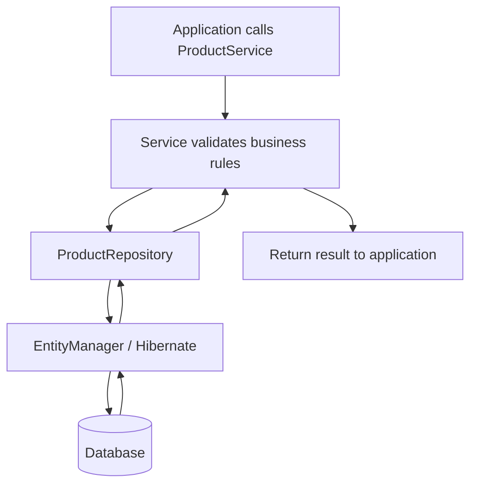

# Initializing Your First Entity, JpaRepository, and Business Service

## 1. Objectives

In this step, we build a small business slice with Spring Data JPA: an Entity representing product data, a JpaRepository for database access, and a Service containing business rules. The example uses the `Product` domain with price, stock, and a stock reservation operation.

After completing this lesson, you will be able to:
- Map a Java class to a database table using Jakarta Persistence.
- Use `JpaRepository` to perform CRUD operations and derived queries by method name.
- Place business logic in a Service and manage transaction boundaries.
- Understand why a managed Entity can be updated automatically when a transaction completes.
- Verify the product creation and stock reservation flow with integration tests.

## 2. How It Works

Basic flow of a business request:



- **Entity** describes the data and maps Java properties to table columns.
- **Repository** provides the data access API. Spring Data JPA generates the implementation at application startup.
- **Service** coordinates operations and enforces business rules within transactions.
- **Database** stores data persistently. Hibernate is a popular JPA implementation responsible for translating Entity operations into SQL.

Do not place rules like stock validation inside the Repository. The Repository focuses on data access; the Service decides which operations are valid in the business domain.

## 3. Preparing the Project

The examples below use Java 17+, Maven, and Spring Boot 3.5.0. Spring Boot 3 uses the `jakarta.persistence` and `jakarta.validation` namespaces; do not use `javax.persistence` imports from older Spring Boot projects.

If the project was already generated with Spring Initializr, keep your existing Spring Boot version and add the necessary dependencies. For a minimal Maven project, `pom.xml` can look like this:

```xml
<?xml version="1.0" encoding="UTF-8"?>
<project xmlns="http://maven.apache.org/POM/4.0.0"
         xmlns:xsi="http://www.w3.org/2001/XMLSchema-instance"
         xsi:schemaLocation="http://maven.apache.org/POM/4.0.0 https://maven.apache.org/xsd/maven-4.0.0.xsd">
    <modelVersion>4.0.0</modelVersion>

    <parent>
        <groupId>org.springframework.boot</groupId>
        <artifactId>spring-boot-starter-parent</artifactId>
        <version>3.5.0</version>
        <relativePath/>
    </parent>

    <groupId>com.example</groupId>
    <artifactId>store-jpa</artifactId>
    <version>0.0.1-SNAPSHOT</version>
    <name>store-jpa</name>

    <properties>
        <java.version>17</java.version>
    </properties>

    <dependencies>
        <dependency>
            <groupId>org.springframework.boot</groupId>
            <artifactId>spring-boot-starter-data-jpa</artifactId>
        </dependency>
        <dependency>
            <groupId>org.springframework.boot</groupId>
            <artifactId>spring-boot-starter-validation</artifactId>
        </dependency>
        <dependency>
            <groupId>com.h2database</groupId>
            <artifactId>h2</artifactId>
            <scope>runtime</scope>
        </dependency>
        <dependency>
            <groupId>org.springframework.boot</groupId>
            <artifactId>spring-boot-starter-test</artifactId>
            <scope>test</scope>
        </dependency>
    </dependencies>

    <build>
        <plugins>
            <plugin>
                <groupId>org.springframework.boot</groupId>
                <artifactId>spring-boot-maven-plugin</artifactId>
            </plugin>
        </plugins>
    </build>
</project>
```

Roles of the dependencies:
- `spring-boot-starter-data-jpa`: Spring Data JPA, JPA API, and Hibernate.
- `spring-boot-starter-validation`: Bean Validation for annotation-based data validation.
- `h2`: lightweight database used in examples and tests.
- `spring-boot-starter-test`: JUnit, Spring Test, and AssertJ.

## 4. Creating the Package Structure

Place the application class in the root package so Spring Boot can automatically discover Entities, Repositories, and Services in subpackages.

```text
src/
  main/
    java/com/example/store/
      StoreApplication.java
      product/
        Product.java
        ProductRepository.java
        ProductService.java
        ProductNotFoundException.java
    resources/
      application.properties
  test/
    java/com/example/store/product/
      ProductServiceIntegrationTest.java
```

### Startup Class

`src/main/java/com/example/store/StoreApplication.java`:

```java
package com.example.store;

import org.springframework.boot.SpringApplication;
import org.springframework.boot.autoconfigure.SpringBootApplication;

@SpringBootApplication
public class StoreApplication {
    public static void main(String[] args) {
        SpringApplication.run(StoreApplication.class, args);
    }
}
```

`@SpringBootApplication` enables auto-configuration and component scanning from the `com.example.store` package downward. Therefore, classes in `com.example.store.product` are discovered without manual configuration.

## 5. Creating the Product Entity

An Entity is a Java class managed by JPA and mapped to a table. A basic Entity requires `@Entity`, a primary key marked with `@Id`, and a no-argument constructor. With Hibernate, the no-argument constructor can be `protected`.

`src/main/java/com/example/store/product/Product.java`:

```java
package com.example.store.product;

import jakarta.persistence.Column;
import jakarta.persistence.Entity;
import jakarta.persistence.GeneratedValue;
import jakarta.persistence.GenerationType;
import jakarta.persistence.Id;
import jakarta.persistence.Table;
import jakarta.validation.constraints.DecimalMin;
import jakarta.validation.constraints.Digits;
import jakarta.validation.constraints.Min;
import jakarta.validation.constraints.NotBlank;
import jakarta.validation.constraints.NotNull;
import jakarta.validation.constraints.Size;
import java.math.BigDecimal;

@Entity
@Table(name = "products")
public class Product {
    @Id
    @GeneratedValue(strategy = GenerationType.IDENTITY)
    private Long id;

    @NotBlank
    @Size(max = 120)
    @Column(nullable = false, length = 120)
    private String name;

    @NotNull
    @DecimalMin("0.01")
    @Digits(integer = 10, fraction = 2)
    @Column(nullable = false, precision = 12, scale = 2)
    private BigDecimal price;

    @Min(0)
    @Column(nullable = false)
    private int stock;

    protected Product() {
        // JPA requires a no-argument constructor to instantiate the Entity.
    }

    public Product(String name, BigDecimal price, int stock) {
        if (name == null || name.isBlank()) {
            throw new IllegalArgumentException("Product name is required");
        }
        if (price == null || price.signum() <= 0) {
            throw new IllegalArgumentException("Price must be greater than zero");
        }
        if (stock < 0) {
            throw new IllegalArgumentException("Stock cannot be negative");
        }

        String normalizedName = name.trim();
        if (normalizedName.length() > 120) {
            throw new IllegalArgumentException("Product name is too long");
        }

        this.name = normalizedName;
        this.price = price;
        this.stock = stock;
    }

    public void reserveStock(int quantity) {
        if (quantity <= 0) {
            throw new IllegalArgumentException("Quantity must be positive");
        }
        if (quantity > stock) {
            throw new IllegalStateException("Insufficient stock");
        }
        stock -= quantity;
    }

    public Long getId() {
        return id;
    }

    public String getName() {
        return name;
    }

    public BigDecimal getPrice() {
        return price;
    }

    public int getStock() {
        return stock;
    }
}
```

Explanation of annotations and design choices:
- `@Entity` marks the class as JPA-managed. `@Table(name = "products")` specifies the table name.
- `@Id` marks the primary key. `@GeneratedValue(strategy = GenerationType.IDENTITY)` delegates ID generation to the database's identity mechanism.
- `@Column` describes column name and mapping constraints such as `nullable`, `length`, `precision`, and `scale`.
- `BigDecimal` is more suitable for monetary values than `double`, because binary floating-point representation in `double` can cause rounding errors.
- `@NotBlank`, `@NotNull`, `@DecimalMin`, `@Digits`, `@Min`, and `@Size` are Bean Validation constraints. They validate data when validation is triggered; checks inside the constructor and business methods still protect core invariants whenever the object is created or modified.
- The `protected` constructor lets JPA instantiate the object. The public constructor is used when creating products from business code.
- Public setters are not provided for every field. Changing stock goes through `reserveStock`, where positive quantity and sufficient stock rules are enforced.

Do not blindly use `@Data` on Entities. Auto-generated `equals`, `hashCode`, and `toString` can cause issues when an Entity has an ID generated after saving or has lazy relationships. Design these methods according to your domain's identity rules.

## 6. Creating JpaRepository

`JpaRepository<T, ID>` provides common operations without writing an implementation class. `T` is the Entity type and `ID` is the primary key type.

`src/main/java/com/example/store/product/ProductRepository.java`:

```java
package com.example.store.product;

import java.util.List;
import java.util.Optional;
import org.springframework.data.jpa.repository.JpaRepository;

public interface ProductRepository extends JpaRepository<Product, Long> {
    Optional<Product> findByNameIgnoreCase(String name);

    List<Product> findByStockLessThan(int stock);
}
```

Commonly used built-in methods:

| Method | Purpose |
| --- | --- |
| `save(entity)` | Saves a new Entity or updates an Entity following Spring Data JPA semantics. |
| `findById(id)` | Finds by primary key, returning `Optional<T>`. |
| `findAll()` | Retrieves all records. |
| `existsById(id)` | Checks whether the primary key exists. |
| `delete(entity)` | Deletes the Entity. |
| `count()` | Counts the number of records. |

Spring Data JPA also derives queries from method names:
- `findByNameIgnoreCase` searches by name, ignoring uppercase and lowercase.
- `findByStockLessThan` finds products with stock below the passed value.
- `Optional<Product>` represents a result that may not exist, helping callers handle the not-found case explicitly.

Property names in query methods must match the Java property of the Entity. For example, `findByStockLessThan` uses `stock`, not the SQL column name if the column name differs from the property name.

When complex queries are needed, `@Query` with JPQL or native SQL can be used. Start with derived queries when expressions are simple and readable.

## 7. Creating the Service and First Business Rule

The Service coordinates Repositories and enforces business rules. This example provides three operations: creating a product, viewing the product list or details, and reserving a quantity in stock.

### Exception When Product Is Not Found

`src/main/java/com/example/store/product/ProductNotFoundException.java`:

```java
package com.example.store.product;

public class ProductNotFoundException extends RuntimeException {
    public ProductNotFoundException(Long id) {
        super("Product with id " + id + " was not found");
    }
}
```

### ProductService

`src/main/java/com/example/store/product/ProductService.java`:

```java
package com.example.store.product;

import java.math.BigDecimal;
import java.util.List;
import org.springframework.data.domain.Sort;
import org.springframework.stereotype.Service;
import org.springframework.transaction.annotation.Transactional;

@Service
@Transactional(readOnly = true)
public class ProductService {
    private final ProductRepository productRepository;

    public ProductService(ProductRepository productRepository) {
        this.productRepository = productRepository;
    }

    public Product getProduct(Long id) {
        return productRepository.findById(id)
                .orElseThrow(() -> new ProductNotFoundException(id));
    }

    public List<Product> getProducts() {
        return productRepository.findAll(Sort.by(Sort.Direction.ASC, "name"));
    }

    @Transactional
    public Product createProduct(String name, BigDecimal price, int initialStock) {
        Product product = new Product(name, price, initialStock);
        return productRepository.save(product);
    }

    @Transactional
    public Product reserveStock(Long productId, int quantity) {
        Product product = getProduct(productId);
        product.reserveStock(quantity);
        return product;
    }
}
```

Key takeaways:
- `@Service` registers the class as a Spring bean. Constructor injection keeps dependencies explicit and easy to test.
- `@Transactional(readOnly = true)` at the class level sets the default for read operations.
- `@Transactional` on `createProduct` and `reserveStock` opens a write transaction. The method-level annotation overrides the class-level `readOnly` setting.
- `createProduct` creates an Entity and calls `save` to put the new Entity into the persistence context and persist it in the transaction.
- `reserveStock` loads the Entity inside the transaction and calls the business method on the Entity. Because the Entity is managed, Hibernate tracks changes. When the transaction commits, dirty checking detects that `stock` changed and issues an UPDATE statement. Calling `save` again is unnecessary in this case.
- If the ID is not found, the Service throws `ProductNotFoundException`. If the quantity is invalid or stock is insufficient, the business method throws an exception before decrementing stock.

By Spring's default, transactions usually roll back on unchecked exceptions (`RuntimeException` or `Error`). Checked exceptions do not automatically trigger rollback by default; if business logic needs rollback on checked exceptions, configure `rollbackFor` accordingly.

`@Transactional` is typically applied via a Spring proxy. Therefore, call transactional methods from another Spring bean or through the proxy. An internal call between methods of the same object does not pass through the proxy to trigger a separate transaction. In the example, `reserveStock` has already opened a transaction, so the internal call to `getProduct` runs within that transaction.

## 8. Configuring the H2 Database

`src/main/resources/application.properties`:

```properties
spring.datasource.url=jdbc:h2:mem:storedb;DB_CLOSE_DELAY=-1
spring.datasource.driver-class-name=org.h2.Driver
spring.datasource.username=sa
spring.datasource.password=

spring.jpa.hibernate.ddl-auto=create-drop
spring.jpa.open-in-view=false
spring.jpa.show-sql=true
```

The application uses in-memory H2 so the example can run without installing a separate database server. Hibernate creates the schema at application startup and drops it when the application stops.

`ddl-auto=create-drop` is suitable for examples or testing. Do not use this setting indiscriminately in production because the schema could be recreated and data lost. For real systems, manage schema changes with Flyway or Liquibase, then set `ddl-auto=validate` or a mode aligned with your deployment pipeline.

`spring.jpa.open-in-view=false` avoids keeping the persistence context open across the web layer. When the application has lazy relationships, load the required data inside the Service transaction or use appropriate projections/DTOs.

## 9. Testing the Business Flow

The integration test below boots the Spring context, uses H2, and invokes the real Service. It verifies that the product is created, stock decreases upon reservation, and the rule forbids reserving more than available stock.

`src/test/java/com/example/store/product/ProductServiceIntegrationTest.java`:

```java
package com.example.store.product;

import static org.assertj.core.api.Assertions.assertThat;
import static org.assertj.core.api.Assertions.assertThatThrownBy;

import java.math.BigDecimal;
import org.junit.jupiter.api.BeforeEach;
import org.junit.jupiter.api.Test;
import org.springframework.beans.factory.annotation.Autowired;
import org.springframework.boot.test.context.SpringBootTest;
import org.springframework.transaction.annotation.Transactional;

@SpringBootTest
@Transactional
class ProductServiceIntegrationTest {
    @Autowired
    private ProductService productService;

    @Autowired
    private ProductRepository productRepository;

    @BeforeEach
    void clearProducts() {
        productRepository.deleteAll();
    }

    @Test
    void createsProductAndReservesStock() {
        Product created = productService.createProduct(
                "Keyboard", new BigDecimal("79.90"), 10);

        Product updated = productService.reserveStock(created.getId(), 3);

        assertThat(updated.getStock()).isEqualTo(7);
        Product saved = productRepository.findById(created.getId()).orElseThrow();
        assertThat(saved.getStock()).isEqualTo(7);
    }

    @Test
    void rejectsReservationWhenStockIsInsufficient() {
        Product created = productService.createProduct(
                "Mouse", new BigDecimal("25.00"), 2);

        assertThatThrownBy(() -> productService.reserveStock(created.getId(), 3))
                .isInstanceOf(IllegalStateException.class)
                .hasMessage("Insufficient stock");

        Product unchanged = productRepository.findById(created.getId()).orElseThrow();
        assertThat(unchanged.getStock()).isEqualTo(2);
    }
}
```

Run tests in the directory containing `pom.xml`:

```bash
mvn test
```

The expected result is Maven finishing with `BUILD SUCCESS`; both tests pass. The first test verifies the write and read data flow. The second test verifies that the stock rule is enforced and the quantity is not decremented on an invalid request.

You can start the application with:

```bash
mvn spring-boot:run
```

This example focuses on the Entity, Repository, and Service, so no REST Controller was created yet. When adding an API, the Controller should accept requests, call the Service, and convert results to DTOs; do not place stock reservation rules in the Controller.

## 10. Common Errors

| Symptom | Common Cause | How to Fix |
| --- | --- | --- |
| `Entity` or `Id` annotations not found | Wrong namespace or missing JPA dependency. | With Spring Boot 3, use `jakarta.persistence.*` and add `spring-boot-starter-data-jpa`. |
| Spring does not create Repository bean | Repository is outside component scan scope or package configuration is wrong. | Place Repository under the root package of the `@SpringBootApplication` class; if needed, configure `@EnableJpaRepositories`. |
| Entity not discovered | Entity is outside the default scan region. | Place Entity in a subpackage or configure `@EntityScan`. |
| Error when Hibernate instantiates Entity | Missing no-arg constructor or class/field declared incompatibly with JPA. | Keep the Entity non-final and provide a `protected` or `public` no-argument constructor. |
| Cannot connect to database | Missing driver, wrong URL, or mismatched connection credentials. | Check the driver dependency and `spring.datasource.*` properties. |
| `findById` returns no data | ID does not exist. | Handle `Optional` with `orElseThrow` or return a result appropriate for business logic. |
| Entity changes not saved | Entity is detached or changes occur outside an appropriate transaction. | Load the Entity and perform changes inside a `@Transactional` Service method. |
| Cannot save data due to constraints | Data violates validation or database constraints. | Check input values, Bean Validation, and column configuration. |

## 11. Principles to Remember

1. An Entity describes state and behaviors tied to the object itself. Do not turn Entities into containers for database queries.
2. A Repository is the data access gateway. Prefer `JpaRepository` and derived queries for simple queries.
3. A Service is the boundary of a business use case. Place transactions in the Service so related operations commit or roll back together.
4. Enforce rules in the right place. Bean Validation is useful for data constraints; Entity methods protect invariants; the Service orchestrates the workflow.
5. Use `BigDecimal` for currency and explicitly define column precision/scale.
6. Only call `save` when persisting a new Entity or when required by persistence state. For a managed Entity inside a transaction, JPA dirty checking automatically records changes.
7. Use automatic schema generation for development or test environments. Production requires controlled migrations and data backups.

## 12. Completion Checklist

- [ ] Spring Boot application starts.
- [ ] `Product` is annotated with `@Entity`, has a primary key, and has a no-argument constructor.
- [ ] `ProductRepository` extends `JpaRepository<Product, Long>`.
- [ ] `ProductService` uses constructor injection and has transactions for write operations.
- [ ] `reserveStock` rejects invalid quantities or quantities exceeding stock.
- [ ] Integration tests verify data is persisted and business rules work.

Once the items above are met, you have the foundation for a complete Spring Data JPA flow: an Entity describing data, a Repository accessing data, and a Service implementing your first business use case.