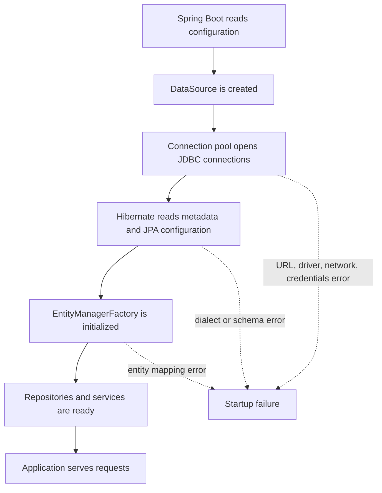

# Testing Connectivity, Creating a Test Schema, and Common Startup Errors

## 1. Goal of the Initialization Step

A Spring Data JPA application can only work with data when several components are configured correctly at the same time: the DataSource configuration, the JDBC driver, a running and reachable database, an account with appropriate permissions, the JPA provider successfully initializing EntityManagerFactory, and a database schema compatible with the entities.

When application startup fails, the error displayed at the end of the stack trace is often just a wrapper. The root cause may lie in the connection URL, driver, network, credentials, database permissions, schema, migrations, or entity mappings. Therefore, inspect layer by layer instead of changing multiple properties at random.

In this lesson, we perform three tasks:

1. Verify that the application can connect to the database via JDBC.
2. Create a dedicated test schema and choose an appropriate schema management strategy.
3. Read logs to identify common errors when Spring Boot and Hibernate initialize.

The examples use Spring Boot 3.x, Spring Data JPA, Hibernate 6, and Java 17 or higher. The Gradle syntax and configuration apply to Spring Boot 3.3 applications.

## 2. Components That Must Work Together

Basic initialization flow:



- **JDBC driver** translates JDBC calls into the protocol understood by the database. For example, PostgreSQL requires the PostgreSQL JDBC Driver; MySQL requires MySQL Connector/J.
- **DataSource** supplies connections to the application. Spring Boot typically auto-configures DataSource from `spring.datasource.*` properties.
- **HikariCP** is the popular default connection pool in Spring Boot. The pool reuses connections rather than opening a new connection for every operation.
- **JPA provider** such as Hibernate builds the EntityManagerFactory, reads database metadata, manages the persistence context, and converts entity operations into SQL.
- **Schema** is the database structure shared by SQL statements and entities: tables, columns, keys, indexes, sequences, and constraints.

A valid DataSource configuration does not guarantee valid JPA mappings. Conversely, properly written entities cannot function if the database is unreachable or the schema is missing tables.

## 3. Declaring Dependencies and the JDBC Driver

With Gradle and Spring Boot dependency management, basic dependencies can be written as follows:

```groovy
dependencies {
    implementation 'org.springframework.boot:spring-boot-starter-data-jpa'

    runtimeOnly 'org.postgresql:postgresql'

    testImplementation 'org.springframework.boot:spring-boot-starter-test'
    testRuntimeOnly 'com.h2database:h2'
}
```

Spring Boot manages compatible versions for dependencies within its ecosystem. Do not manually add a Hibernate version different from the one managed by Spring Boot without a clear reason.

The driver must be present on the runtime classpath. If using PostgreSQL, declare the PostgreSQL driver; if using MySQL, substitute MySQL Connector/J:

```groovy
runtimeOnly 'com.mysql:mysql-connector-j'
```

There is no need to declare both drivers if the application only connects to one database type. Nor do you need to set `spring.datasource.driver-class-name` in most cases: Spring Boot can infer the driver from the JDBC URL and the driver on the classpath. Only declare it manually when there is a specific reason.

## 4. Configuring and Testing Database Connectivity

### 4.1. DataSource Configuration

Example `application-local.yml` for PostgreSQL:

```yaml
spring:
  datasource:
    url: jdbc:postgresql://localhost:5432/jpa_demo
    username: ${DB_USERNAME}
    password: ${DB_PASSWORD}
    hikari:
      pool-name: JpaDemoPool
      maximum-pool-size: 10
      minimum-idle: 2
      connection-timeout: 30000

  jpa:
    open-in-view: false
    hibernate:
      ddl-auto: validate
```

Meaning of key properties:

- `spring.datasource.url`: JDBC URL containing driver type, host, port, and database name.
- `username`, `password`: database credentials. In real applications, pull sensitive credentials from environment variables or a secret manager; do not commit passwords to Git.
- `maximum-pool-size`: maximum number of connections in HikariCP. The value must be weighed against application load and database connection limits.
- `minimum-idle`: minimum number of idle connections maintained by the pool.
- `connection-timeout`: maximum time to wait for a connection from the pool, in milliseconds.
- `ddl-auto: validate`: instructs Hibernate to verify that the existing schema is compatible with entity mappings; Hibernate does not automatically create or update the schema with this option.
- `open-in-view: false`: closes the persistence context along transaction boundaries rather than keeping it open until response rendering. This is an explicit choice for many API applications, preventing lazy queries outside service transactions.

JDBC URL syntax depends on the database:

| Database | Example URL |
|---|---|
| PostgreSQL | `jdbc:postgresql://localhost:5432/jpa_demo` |
| MySQL | `jdbc:mysql://localhost:3306/jpa_demo` |
| MariaDB | `jdbc:mariadb://localhost:3306/jpa_demo` |
| H2 in-memory | `jdbc:h2:mem:jpa_demo;DB_CLOSE_DELAY=-1` |

Database name, port, and URL parameters must match the runtime environment. When the application runs inside a container on the same network as the database, the host is usually the service name, such as `db`, instead of `localhost`. Inside a container, `localhost` points to the application container itself.

### 4.2. Using Profiles to Separate Configuration

Do not share a single URL across local, test, and production. You can separate them into:

- `application.yml`: shared configuration without secrets.
- `application-local.yml`: local database.
- `application-test.yml`: test database.
- `application-prod.yml`: production configuration sourced from the deployment environment.

Activate the local profile:

```bash
./gradlew bootRun --args='--spring.profiles.active=local'
```

Or set the `SPRING_PROFILES_ACTIVE=local` environment variable. When inspecting logs, confirm which profile is active; a valid configuration in `application-local.yml` will have no effect if the application runs with a different profile.

### 4.3. Checking the Database Externally

Before investigating JPA, verify that the database is running and reachable from the exact environment of the application.

For PostgreSQL, you can use `psql`:

```bash
psql "host=localhost port=5432 dbname=jpa_demo user=app"
```

After connecting, check the current database and account permissions. If the application runs in Docker, check from the corresponding network/container; a successful connection from your development machine does not prove the application container can connect as well.

Points to verify:

1. Database process or container is ready to accept connections.
2. Host and port are reachable from where the application runs.
3. Database name already exists.
4. Username and password are correct.
5. Account has CONNECT privilege on the database and required permissions on schemas/tables.
6. Firewalls, network policies, or Docker networks do not block the connection.

### 4.4. Checking via Spring Boot Actuator

If the application includes Actuator, the health endpoint can report whether the DataSource is reachable. Add the dependency:

```groovy
implementation 'org.springframework.boot:spring-boot-starter-actuator'
```

Configure exposing the health endpoint over HTTP:

```yaml
management:
  endpoints:
    web:
      exposure:
        include: health
  endpoint:
    health:
      show-details: when_authorized
```

Call:

```http
GET /actuator/health
```

When JDBC and health indicators are configured, Spring Boot can include the database status in the health result. Do not expose health details to all users in production; configure access permissions and visibility levels appropriate for the environment.

A health check is useful evidence of connectivity at the time of inspection. It does not replace integration tests for business queries, table permissions, or schema correctness.

### 4.5. Checking with an Integration Test

A small test can run a simple SQL statement to prove DataSource acquires a connection and the database can execute statements:

```java
@SpringBootTest
class DatabaseConnectionTest {

    @Autowired
    private JdbcTemplate jdbcTemplate;

    @Test
    void canExecuteSimpleQuery() {
        Integer result = jdbcTemplate.queryForObject(
            "select 1",
            Integer.class
        );

        assertThat(result).isEqualTo(1);
    }
}
```

This test exercises the path through Spring DataSource/JDBC. It does not yet test entity mappings, repository queries, or business schemas; those parts require separate tests.

## 5. Creating a Test Schema

A test schema should be independent of real data and reproducibly recreated. There are three common approaches: an in-memory database, a real database running in a container, or a separate schema on a shared test database.

### 5.1. Using In-Memory H2 for Fast Tests

H2 is a relational database running inside the JVM that can create an in-memory database. With the dependency:

```groovy
testRuntimeOnly 'com.h2database:h2'
```

Create `src/test/resources/application-test.yml`:

```yaml
spring:
  datasource:
    url: jdbc:h2:mem:jpa_demo_test;DB_CLOSE_DELAY=-1
    driver-class-name: org.h2.Driver
    username: sa
    password:

  jpa:
    hibernate:
      ddl-auto: create-drop
    show-sql: false
```

`DB_CLOSE_DELAY=-1` keeps the in-memory database alive throughout the JVM lifetime even when no open connections remain. The database is still lost when the JVM exits.

In tests, activate the profile:

```java
@DataJpaTest
@ActiveProfiles("test")
class CustomerRepositoryTest {

    @Autowired
    private CustomerRepository customerRepository;

    @Test
    void savesAndFindsCustomer() {
        Customer customer = new Customer();
        customer.setName("Lan");

        Customer saved = customerRepository.save(customer);

        assertThat(customerRepository.findById(saved.getId()))
            .isPresent()
            .get()
            .extracting(Customer::getName)
            .isEqualTo("Lan");
    }
}
```

`@DataJpaTest` creates a test slice focused on JPA: entities and repositories are configured for testing; tests typically run in a transaction and roll back after each method. When an embedded database is on the classpath, Spring Boot Test may replace the DataSource with the embedded database for tests.

H2 is suitable for fast tests and basic repository logic. However, H2 is not identical to PostgreSQL, MySQL, or Oracle. Differences in data types, sequences, JSON, collation, functions, SQL dialects, constraints, and locking can cause tests to pass on H2 but fail on the production database.

### 5.2. Using Testcontainers to Test on the Same Database Type as Production

When you need to verify database-specific behavior, use Testcontainers to spin up a real database in a container during tests. PostgreSQL example:

Add dependencies:

```groovy
dependencies {
    testImplementation 'org.springframework.boot:spring-boot-starter-test'
    testImplementation 'org.testcontainers:junit-jupiter'
    testImplementation 'org.testcontainers:postgresql'
}
```

Sample test:

```java
@Testcontainers
@DataJpaTest
@AutoConfigureTestDatabase(
    replace = AutoConfigureTestDatabase.Replace.NONE
)
class CustomerRepositoryPostgresTest {

    @Container
    static final PostgreSQLContainer<?> postgres =
        new PostgreSQLContainer<>("postgres:16-alpine")
            .withDatabaseName("jpa_test")
            .withUsername("test")
            .withPassword("test");

    @DynamicPropertySource
    static void configureDatasource(DynamicPropertyRegistry registry) {
        registry.add("spring.datasource.url", postgres::getJdbcUrl);
        registry.add("spring.datasource.username", postgres::getUsername);
        registry.add("spring.datasource.password", postgres::getPassword);
    }

    @Autowired
    private CustomerRepository customerRepository;

    @Test
    void persistsCustomerInPostgres() {
        Customer customer = new Customer();
        customer.setName("Lan");

        Customer saved = customerRepository.save(customer);

        assertThat(customerRepository.findById(saved.getId()))
            .isPresent();
    }
}
```

Key points:

- `@Testcontainers` integrates container lifecycle with JUnit Jupiter.
- `@Container` declares a container managed within the test.
- `@DynamicPropertySource` injects the URL and connection credentials provided by the container into the Spring Environment.
- `replace = NONE` tells Spring not to replace the configured DataSource with an embedded database.
- Docker must be running and the test machine must be able to pull the image if it is not already cached.

Testcontainers is slower than H2 but increases confidence when the application depends on behavior specific to PostgreSQL or your production database. You can run a fast suite with H2 and a targeted integration test suite with Testcontainers.

### 5.3. Creating a Separate Schema Instead of Sharing a Real Schema

If tests require a shared database server, create a dedicated database or schema for tests, such as `jpa_demo_test`. The test account should only have permissions on the test data area. Never point automated tests at a production database.

Name databases, schemas, and profiles clearly to avoid confusion. Before running destructive tests, confirm the URL points to the test environment. Do not use `create`, `create-drop`, or table-dropping scripts on databases containing data you need to keep.

## 6. Choosing How to Create and Manage the Schema

Hibernate can create or validate the schema based on entities, or the application can manage the schema using SQL scripts or a migration tool. Pick one clear source of structural ownership.

### 6.1. Values of `spring.jpa.hibernate.ddl-auto`

| Value | Behavior | Typical Usage |
|---|---|---|
| `none` | Does not automatically create, update, or validate schema | When the schema is managed by another tool |
| `validate` | Verifies entity mappings are compatible with the current schema | Local with migrations and production |
| `update` | Attempts to update the schema to match mappings | Controlled local experimentation or development |
| `create` | Creates the schema on initialization; may drop old structures before recreating | Dedicated database where data can be discarded |
| `create-drop` | Creates the schema on initialization and drops it when EntityManagerFactory closes | Tests with a dedicated database |

Do not use `create` or `create-drop` on databases containing data that must be retained. `update` is also not a reliable migration mechanism for production: it does not replace reviewed schema change history, does not fully express data transformations, and does not provide a clear rollback workflow.

If `ddl-auto` is omitted, Spring Boot's default depends on the database type and schema initialization setup. Set it explicitly per environment instead of relying on implicit defaults.

### 6.2. Using schema.sql and data.sql

Spring Boot supports executing SQL scripts on initialization. Example:

```text
src/main/resources/
  schema.sql
  data.sql
```

Configuration:

```yaml
spring:
  sql:
    init:
      mode: always
      schema-locations: classpath:schema.sql
      data-locations: classpath:data.sql
```

- `schema.sql` contains statements creating tables, sequences, or constraints.
- `data.sql` contains required seed data.

By default, script execution differs between embedded databases and standard databases; `spring.sql.init.mode=always` forces scripts to run for all database types. Only enable this intentionally.

If Hibernate creates tables first and `data.sql` needs to insert into those tables, you can use:

```yaml
spring:
  jpa:
    defer-datasource-initialization: true
```

This property defers SQL script initialization until after JPA has initialized the schema. If scripts are used to create the schema before Hibernate validation, do not enable deferral blindly. The ordering must match whichever mechanism owns the schema.

Do not let Hibernate `create`, SQL scripts, and Flyway/Liquibase manage the same table simultaneously without a clear convention. Multiple mechanisms altering the schema easily cause conflicts, duplicate seed data, and ordering errors.

### 6.3. Using Flyway or Liquibase for Versioned Schemas

For applications that must preserve data across versions, migrations provide a reviewable and repeatable way to manage schemas.

Flyway uses versioned migration files, for example:

```text
src/main/resources/db/migration/
  V1__create_customer.sql
  V2__add_customer_status.sql
```

Example contents of `V1__create_customer.sql`:

```sql
create table customer (
    id bigint generated by default as identity primary key,
    name varchar(150) not null
);
```

Flyway records executed migrations in its metadata table. Each migration has an order and is applied according to Flyway's rules. Liquibase solves the same migration problem but uses changelogs and changesets.

When migrations own the schema, Hibernate is typically configured in validation mode:

```yaml
spring:
  jpa:
    hibernate:
      ddl-auto: validate
```

This catches entity mappings that do not match the schema after migrations. For environments that do not need startup mapping validation, `none` can be chosen, provided appropriate schema tests are in place.

Do not edit migrations that have already been applied in shared or production environments. Create a new migration to change the schema. Before releasing, check data conversions, indexes, constraints, and deployment ordering compatibility with the application version.

## 7. Step-by-Step Initialization Checklist

When setting up a new module, follow this sequence:

1. **Check dependencies:** the JPA starter and the right JDBC driver for the database are on the runtime classpath.
2. **Check profile:** confirm the active profile and that the right configuration file is loaded.
3. **Check URL:** confirm the JDBC URL, host, port, and database name.
4. **Check the database independently:** the database is running, reachable from the application's runtime environment, and the account has permissions.
5. **Check DataSource:** start the application or run a simple JDBC test.
6. **Check schema:** confirm migrations/scripts ran or schema creation configuration matches the environment.
7. **Check mappings:** let Hibernate validate the schema or run repository tests.
8. **Check health:** if using Actuator, confirm the database health indicator.
9. **Check logs:** read the first meaningful cause in the error chain, not just the final `APPLICATION FAILED TO START` line.

Proceeding in order helps isolate faults. If a `select 1` JDBC test fails, there is no need to inspect entity annotations yet. If JDBC succeeds but Hibernate reports missing tables, focus on schema and migrations.

## 8. Common Startup Errors and Troubleshooting

| Log Symptom | Common Cause | How to Check |
|---|---|---|
| `Failed to configure a DataSource` or missing URL | Missing `spring.datasource.url`, no embedded database, wrong profile | Check active profile, configuration, and database dependencies |
| `Cannot load driver class` or driver not found | Missing JDBC driver or wrong driver class configured | Check runtime classpath and matching database dependency |
| `Connection refused` | Database not running, wrong port, or network unreachable | Check process/container, port mapping, and host |
| `UnknownHostException` | Host in URL cannot be resolved | Check DNS, Docker service name, and network |
| `password authentication failed` or `Access denied` | Wrong username/password or account locked | Verify secrets and account privileges |
| `Unknown database` or database does not exist | URL points to a database not yet created | Create the database or fix the database name |
| `permission denied for schema` / `permission denied for table` | Connection account lacks privileges | Grant CONNECT, USAGE, CREATE, or needed table permissions per database |
| `Schema-validation: missing table` | Migration has not run, wrong schema, or wrong table name | Check migration history, default schema, and mappings |
| `Schema-validation: wrong column type` | Database column type differs from expected mapping type | Check DDL, Java type, converters, and dialect |
| `relation does not exist` | Table not yet created or query uses wrong schema | Check schema search path, migrations, and table names |
| `Not a managed type` | Entity not scanned or class missing `@Entity` | Check package scan, annotations, and persistence unit config |
| `Not a single result` / query validation error | Invalid JPQL or repository method, unexpected result cardinality | Check property names, parameter types, JPQL, and cardinality |
| `Unable to determine Dialect` | Hibernate cannot retrieve JDBC metadata or dialect cannot be inferred | Check connectivity first; only configure dialect explicitly when needed |
| `BeanCreationException` creating repository | Query method, entity mapping, or dependency initialization failed | Find the deepest cause in nested causes |

### 8.1. Missing DataSource Error

Message such as:

```text
Failed to configure a DataSource:
'url' attribute is not specified and no embedded datasource could be configured.
```

Usually caused by a missing URL and no embedded database on the classpath. Check:

- Is `spring.datasource.url` declared in the active profile?
- Are environment variables passed into the process?
- Is the filename `application-{profile}.yml` spelled correctly?
- Is the profile activated?
- Is the driver dependency or H2 on the appropriate classpath?

Do not add H2 to runtime just to make the error disappear if the application needs to connect to real PostgreSQL.

### 8.2. Database Connection Failure

For example, `Connection refused` usually indicates no service is listening at that host/port or the network denies access. Check the database process, container health, port mapping, and URL.

If using Docker Compose, distinguish two cases:

- Application running directly on the development machine: usually connects via `localhost` and the published port.
- Application running inside a container on the same Compose network: uses the database service name and internal port, such as `db:5432`.

Using `depends_on` alone does not guarantee the database is ready to accept connections. You may need healthchecks and waiting for the service to become healthy, or an appropriate retry mechanism.

### 8.3. Authentication or Permission Errors

If logs report authentication failed, confirm the username/password actually received by the process. Do not place passwords in logs or committed config files. If login succeeds but reports permission denied, check permissions at the database, schema, sequence, and table levels. An application may connect successfully yet still fail to create tables because the account only has read access.

### 8.4. Schema Validation Errors

When Hibernate reports missing tables, columns, or wrong data types, check in order:

1. Is the application connecting to the right database and schema?
2. Did migrations run successfully?
3. Does migration history record the expected version?
4. Do table/column names and schemas in mappings match the DDL?
5. Are Java types, converters, enum mappings, and column types compatible?

Do not fix validation errors by immediately switching to `ddl-auto=update`. First identify the source of schema ownership. If migrations are the authoritative source, update migrations or mappings through a controlled change.

### 8.5. Unmanaged Entity Errors

`Not a managed type` typically occurs when a repository references a class not recognized by JPA as an entity. Check whether the class has `@Entity`, resides in a component/entity-scanned package, and whether the repository uses the right entity type. If the entity lies outside the `@SpringBootApplication` class's package, explicit `@EntityScan` configuration may be required.

### 8.6. Query Errors in Repositories

Spring Data JPA can validate and initialize queries when creating repository beans. A JPQL query referencing a wrong property name, wrong parameter type, or wrong entity name can fail application startup immediately.

JPQL uses entity names and Java property names, not SQL table/column names directly unless writing a native query. Example:

```java
@Query("select c from Customer c where c.name = :name")
List<Customer> findByName(@Param("name") String name);
```

Here `Customer` is the entity name and `name` is the Java property. If `nativeQuery = true` is used, the query must follow database syntax and table/column names.

## 9. Reading Logs Effectively

When the application fails to start, look for the **root cause** in the `Caused by` chain. A `BeanCreationException` may simply wrap a Hibernate exception, and the Hibernate exception may wrap a JDBC exception. Read from the first meaningful message regarding connectivity or schema.

In local environments, you can enable SQL logging:

```yaml
logging:
  level:
    org.hibernate.SQL: DEBUG
    org.hibernate.orm.jdbc.bind: TRACE
```

`org.hibernate.SQL` displays SQL emitted by Hibernate; `org.hibernate.orm.jdbc.bind` displays bind parameter values in Hibernate 6. Bind logging can expose sensitive data, so only enable it in a controlled manner in development and turn it off in production.

Other helpful diagnostic properties:

- `spring.jpa.show-sql=true`: quick way to view SQL on the local console; logger categories are usually more flexible.
- `logging.level.com.zaxxer.hikari=DEBUG`: helps see how the pool initializes or what errors it encounters; enable only temporarily when needed.
- `logging.level.org.springframework.jdbc=DEBUG`: provides extra details about Spring's JDBC activity.

Do not leave every log at TRACE continuously. Excessive logging can obscure the real cause and increase the risk of exposing sensitive data.

## 10. Sample Configuration for Each Environment

### Local development

Local environments can use a database running in Docker or installed directly. If the database holds data worth keeping, use migrations and `validate`. If the schema is completely disposable, `create-drop` can be used with a dedicated database.

Example local profile using PostgreSQL:

```yaml
spring:
  datasource:
    url: jdbc:postgresql://localhost:5432/jpa_demo
    username: ${DB_USERNAME}
    password: ${DB_PASSWORD}
  jpa:
    hibernate:
      ddl-auto: validate
    open-in-view: false
```

### Automated test

Fast tests can use in-memory H2 and `create-drop`; critical integration tests should use Testcontainers with the same database type as production. Every test must clearly know which database it is running against.

### Production

Production should have reviewed and managed migrations, a database account with minimal required privileges, secrets supplied by the deployment environment, and a connection pool sized to workload and database limits. Hibernate is usually set to `ddl-auto=validate` or `none`; never auto-create or drop schemas on startup.

Do not use a single configuration file containing the URL, username, password, and DDL strategy for all environments.

## 11. Checklist Before Concluding Initialization Succeeded

- [ ] Correct JDBC driver for the database is on the runtime classpath.
- [ ] Active profile and configuration file are verified.
- [ ] JDBC URL points to the right host, port, and database.
- [ ] Database is ready and reachable from the application's runtime environment.
- [ ] Account authenticates successfully and has appropriate permissions.
- [ ] DataSource/connection pool initializes cleanly.
- [ ] Schema has been created via the chosen mechanism.
- [ ] Hibernate mappings match the schema.
- [ ] Repository queries initialize without errors.
- [ ] Integration tests execute queries against an appropriate database.
- [ ] Health endpoint works if the application provides Actuator.
- [ ] Logs contain no unresolved startup errors.

## 12. Conclusion

To initialize Spring Data JPA reliably, check dependencies, profiles, JDBC URL, database/network, credentials, DataSource, schema, and entity mappings in order. Use H2 for fast tests, Testcontainers to test closely against production databases, and migrations like Flyway or Liquibase for versioned schema management.

Choose `create-drop` for dedicated disposable test databases, `validate` when you want Hibernate to verify migration-managed schemas, and `none` when Hibernate should not touch or check the schema. When startup errors occur, locate the root cause in nested exceptions and inspect the corresponding layer. An orderly approach separates connectivity, permission, schema, and mapping errors without blindly tweaking settings.