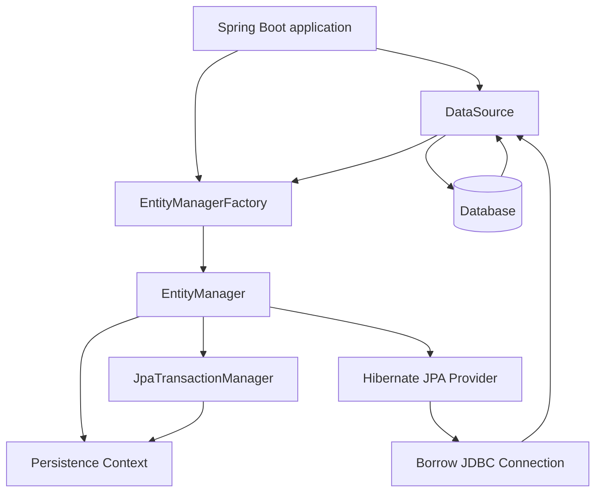

# Roles of DataSource, EntityManagerFactory, and EntityManager

## Objectives

In a Spring Data JPA application, the three components `DataSource`, `EntityManagerFactory`, and `EntityManager` work together to connect to the database, create the JPA working environment, and manage entities within a unit of work. They reside at three different layers of responsibility:

- `DataSource` provides JDBC connections to the database, typically through a connection pool.
- `EntityManagerFactory` initializes and manages JPA configuration, mapping metadata, and creates `EntityManager` instances.
- `EntityManager` performs operations on entities and manages the persistence context within the current working scope.

Understanding this boundary properly helps configure Spring Boot, manage transactions, handle connection errors, and avoid accidentally sharing non-thread-safe objects across threads.

## Overall Picture



This is a conceptual diagram. Hibernate is the common JPA provider in Spring Boot, though an application can use a different provider. `DataSource` is a JDBC abstraction; it is not an `EntityManager` and does not understand entities on its own.

## 1. DataSource: Where JDBC Connections Are Provided

`javax.sql.DataSource` is the standard Java interface for obtaining JDBC connections. In a JPA application, Hibernate uses the DataSource to acquire a `java.sql.Connection` when it needs to send SQL to the database.

A DataSource is typically configured with a URL, username, password, and JDBC driver. In Spring Boot, if `spring-boot-starter-data-jpa` or a JDBC starter is present, HikariCP is normally the default connection pool when the library is on the classpath.

### How Does a Connection Pool Work?

Opening a physical connection to a database has overhead: TCP setup, authentication, configuration negotiation, and resource allocation on both sides. A connection pool keeps a number of already-opened connections for reuse.

1. Hibernate requests a connection from the DataSource.
2. The pool provides an idle connection; if needed and within limits, the pool may create a new physical connection.
3. JDBC uses that connection to create statements, bind parameters, and send SQL.
4. When Hibernate or the transaction manager returns the connection, the pool typically resets any necessary state and puts the connection back into the idle list.

The application should let the pool manage the connection lifecycle. Do not store a shared `Connection` in a field of a singleton Service, and do not manually close a DataSource managed by Spring.

### Configuring DataSource in Spring Boot

Example `application.properties` for an in-memory H2 database:

```properties
spring.datasource.url=jdbc:h2:mem:jpa-infra;DB_CLOSE_DELAY=-1
spring.datasource.username=sa
spring.datasource.password=
spring.datasource.driver-class-name=org.h2.Driver

spring.datasource.hikari.maximum-pool-size=10
spring.datasource.hikari.minimum-idle=2
spring.datasource.hikari.connection-timeout=30000
```

Spring Boot reads the `spring.datasource.*` properties, creates the DataSource, and configures the pool. For HikariCP, provider-specific properties reside under `spring.datasource.hikari.*`. The driver class can usually be inferred from the JDBC URL, so `driver-class-name` can be omitted if the driver is recognized.

In production, supply credentials via environment variables or a secret manager. Pool size should be chosen based on the database connection limit, the number of application instances, and the workload; increasing the pool infinitely does not make the database process queries faster.

## 2. EntityManagerFactory: The Factory That Creates EntityManager

`jakarta.persistence.EntityManagerFactory` is the object that creates `EntityManager` instances. A factory is configured for a persistence unit and holds the metadata that the JPA provider needs to work with entities.

At initialization, the factory/provider prepares information such as:

- Classes annotated with `@Entity` and the relationships between them.
- Mappings between Java properties and tables, columns, primary keys, and foreign keys.
- JPA provider configuration, dialect, naming strategy, and Hibernate properties.
- The metamodel used to describe entities and attributes at the JPA level.

In Spring Boot, auto-configuration usually builds `EntityManagerFactory` via `LocalContainerEntityManagerFactoryBean`. This bean integrates the factory with the Spring container. Typical applications only need to declare dependencies and configure properties; you should not manually create additional factories unless you require multiple persistence units or special configuration.

### Lifecycle and Thread Safety

`EntityManagerFactory` is a heavyweight object designed to be long-lived and used concurrently by multiple threads. Typically, an application has one factory per persistence unit. Spring manages initializing and closing the factory when the application context shuts down.

Do not create a new factory per request or per Repository call. Doing so repeats the cost of initializing metadata and provider resources.

### When Do You Need Direct Access to the Factory?

Most business code only needs a Repository or `EntityManager`. You can inject the factory when you need to inspect the metamodel or when proactively managing an `EntityManager` outside Spring's transaction-scoped model:

```java
import jakarta.persistence.EntityManager;
import jakarta.persistence.EntityManagerFactory;
import org.springframework.stereotype.Component;

@Component
public class EntityManagerFactoryInspector {
    private final EntityManagerFactory entityManagerFactory;

    public EntityManagerFactoryInspector(EntityManagerFactory entityManagerFactory) {
        this.entityManagerFactory = entityManagerFactory;
    }

    public int mappedEntityCount() {
        return entityManagerFactory.getMetamodel().getEntities().size();
    }

    public void runStandaloneWork() {
        EntityManager entityManager = entityManagerFactory.createEntityManager();
        try {
            // Perform JPA work with appropriate transaction management.
        } finally {
            entityManager.close();
        }
    }
}
```

The `runStandaloneWork()` snippet only illustrates the EntityManager closing lifecycle. When calling `createEntityManager()` yourself, your code must manage transactions manually and always close the EntityManager in a `finally` block or `try-with-resources` if supported by the API/version. Do not use this approach in place of the Spring-managed EntityManager in regular Services.

## 3. EntityManager: The Interface for Working with Entities

`jakarta.persistence.EntityManager` is the primary API for an application to interact with the persistence context and perform JPA operations.

Commonly used operations:

| API | Role |
| --- | --- |
| `persist(entity)` | Transitions a new entity into the managed state. |
| `find(Type.class, id)` | Finds an entity by primary key. |
| `getReference(Type.class, id)` | Obtains a potentially lazily loaded reference to an entity. |
| `merge(entity)` | Copies state from the input entity into a managed instance and returns that managed instance. |
| `remove(entity)` | Marks a managed entity for deletion upon synchronization. |
| `createQuery(...)` | Creates and executes a JPQL or Criteria query. |
| `flush()` | Synchronizes pending changes in the persistence context to the database. |
| `clear()` | Detaches all entities currently managed in the persistence context. |

EntityManager is not a JDBC connection. EntityManager operates at the object and JPA layer; the provider decides when to borrow a connection from the DataSource to run SQL. A single EntityManager can execute multiple operations within the same transaction and share the same persistence context.

### Persistence Context

Each EntityManager is associated with a persistence context. This is the area that tracks managed entities.

- **Identity map:** within a persistence context, an entity type and primary key typically correspond to only one managed instance. Two `find(Customer.class, 1L)` calls within the same context usually return the same object.
- **First-level cache:** if an entity is already managed, `find` can return the object from the persistence context without querying the database again.
- **Dirty checking:** the provider tracks changes on managed entities. Upon flush, Hibernate can generate an `UPDATE` without needing an explicit update method call.
- **Entity lifecycle:** an entity can be in the transient, managed, detached, or removed state. The state determines how `persist`, `merge`, and `remove` behave.

For example, after `entityManager.find(Customer.class, id)`, the entity is managed. If the code changes `customer.setName("Mai")` inside a transaction, Hibernate can detect the change and emit an `UPDATE` on flush. If the entity is detached, changes to that object are not automatically written to the database.

### Is EntityManager Thread-Safe?

No. An EntityManager is not designed to be used concurrently by multiple threads. Do not create a singleton holding a real EntityManager and share it across requests.

In a Spring application, the standard approach is to inject EntityManager via `@PersistenceContext`. Spring provides a shared proxy; this proxy delegates calls to the EntityManager bound to the current transaction. The proxy object can be injected into a singleton bean because doing so does not mean a single real EntityManager is shared across all threads.

```java
@PersistenceContext
private EntityManager entityManager;
```

Do not call `close()` yourself on an EntityManager injected this way. Spring and the transaction manager manage the underlying real EntityManager. If you create one yourself using `EntityManagerFactory.createEntityManager()`, the code that created it must close it.

## 4. How the Three Components Coordinate in a Spring Transaction

In Spring Boot, `JpaTransactionManager` typically manages transactions for an EntityManagerFactory. When a `@Transactional` method is invoked through a Spring proxy, the high-level flow is:

1. The transaction manager starts a new transaction or joins an existing one.
2. Spring obtains or creates an EntityManager associated with the transaction's persistence context and binds it to the thread's synchronization context.
3. The Service calls a Repository or EntityManager. Operations within the same transaction normally share the same EntityManager/persistence context.
4. When SQL is needed, Hibernate borrows a JDBC connection from the DataSource and executes the statement.
5. When the transaction commits, the provider flushes necessary changes and the transaction manager commits the transaction.
6. The EntityManager is released from the transaction; the connection is returned to the pool according to the provider and transaction manager's management mechanism.

The actual flow may acquire the connection lazily, only when the first SQL statement is issued. The exact timing of acquiring/returning connections depends on the transaction, Hibernate, and connection handling configuration.

### Placing Transactions at the Service Layer

Example Service using EntityManager:

```java
import jakarta.persistence.EntityManager;
import jakarta.persistence.PersistenceContext;
import java.util.Optional;
import org.springframework.stereotype.Service;
import org.springframework.transaction.annotation.Transactional;

@Service
public class CustomerService {
    @PersistenceContext
    private EntityManager entityManager;

    @Transactional
    public Customer create(String name, String email) {
        Customer customer = new Customer(name, email);
        entityManager.persist(customer);
        return customer;
    }

    @Transactional(readOnly = true)
    public Optional<Customer> findById(Long id) {
        return Optional.ofNullable(entityManager.find(Customer.class, id));
    }
}
```

Placing transactions in the Service layer allows a business operation consisting of multiple Repository/EntityManager operations to form an atomic unit. If a later operation fails and the exception triggers a rollback, changes within the same transaction are rolled back together.

`@Transactional` typically operates via a proxy. Therefore, calling another transactional method via `this.someMethod()` inside the same object can bypass the proxy and fail to create a transaction as expected. Place transaction boundaries on public service methods called from another bean, or use a structure compatible with the configured proxy mechanism.

`readOnly = true` is a hint to Spring and the JPA provider to optimize read operations. It should not be treated as an authorization mechanism or a guarantee that every write statement will be rejected by the database.

## 5. How Does Spring Boot Auto-Configure These Beans?

With `spring-boot-starter-data-jpa`, Spring Boot typically auto-configures the main components:

| Component | Role in the application |
| --- | --- |
| `DataSource` | Provides JDBC connections and manages the pool. |
| JPA provider (typically Hibernate) | Implements JPA, maps entities, and generates SQL. |
| `EntityManagerFactory` | Represents the persistence unit and creates EntityManager instances. |
| `JpaTransactionManager` | Manages transactions associated with the EntityManagerFactory. |
| Spring Data repositories | Creates proxies for scanned Repository interfaces. |

Auto-configuration is based on the classpath, properties, and beans already declared by the application. If an application-provided DataSource or EntityManagerFactory already exists, some default configurations may back off.

Entities are typically scanned from the package of the `@SpringBootApplication` class downward. Placing the main class in the application's root package helps component scanning and entity scanning work predictably. If entities reside outside the default scan area, you can configure `@EntityScan`; if Repositories reside outside the scan area, you can use `@EnableJpaRepositories`.

With multiple databases or multiple persistence units, each group of entities/Repositories must be wired to the correct DataSource, EntityManagerFactory, and transaction manager. In that case, you must explicitly configure beans, `@Primary`, `entityManagerFactoryRef`, and `transactionManagerRef` rather than relying solely on default auto-configuration.

## 6. Runnable Example with Java 17+, Spring Boot, and H2

The example below uses the DataSource created by Spring Boot, injects EntityManagerFactory to inspect the metamodel, and uses EntityManager in a Service to write and then read a customer.

### Directory Structure

```text
jpa-infrastructure/
├── pom.xml
└── src/
    └── main/
        ├── java/com/example/jpainfrastructure/
        │   ├── JpaInfrastructureApplication.java
        │   ├── Customer.java
        │   └── CustomerService.java
        └── resources/
            └── application.properties
```

### `pom.xml`

```xml
<?xml version="1.0" encoding="UTF-8"?>
<project xmlns="http://maven.apache.org/POM/4.0.0"
         xmlns:xsi="http://www.w3.org/2001/XMLSchema-instance"
         xsi:schemaLocation="http://maven.apache.org/POM/4.0.0 https://maven.apache.org/xsd/maven-4.0.0.xsd">
    <modelVersion>4.0.0</modelVersion>
    <parent>
        <groupId>org.springframework.boot</groupId>
        <artifactId>spring-boot-starter-parent</artifactId>
        <version>3.4.5</version>
        <relativePath/>
    </parent>
    <groupId>com.example</groupId>
    <artifactId>jpa-infrastructure</artifactId>
    <version>0.0.1-SNAPSHOT</version>
    <properties>
        <java.version>17</java.version>
    </properties>
    <dependencies>
        <dependency>
            <groupId>org.springframework.boot</groupId>
            <artifactId>spring-boot-starter-data-jpa</artifactId>
        </dependency>
        <dependency>
            <groupId>com.h2database</groupId>
            <artifactId>h2</artifactId>
            <scope>runtime</scope>
        </dependency>
    </dependencies>
    <build>
        <plugins>
            <plugin>
                <groupId>org.springframework.boot</groupId>
                <artifactId>spring-boot-maven-plugin</artifactId>
            </plugin>
        </plugins>
    </build>
</project>
```

### `src/main/resources/application.properties`

```properties
spring.datasource.url=jdbc:h2:mem:jpa-infra;DB_CLOSE_DELAY=-1
spring.datasource.username=sa
spring.datasource.password=
spring.jpa.hibernate.ddl-auto=create-drop
spring.jpa.open-in-view=false
logging.level.org.hibernate.SQL=DEBUG
```

`create-drop` is suitable for temporary in-memory database examples. In production, use a migration tool such as Flyway or Liquibase to manage schemas and choose an appropriate `ddl-auto` strategy; do not casually let Hibernate drop/recreate schemas on real data.

### `Customer.java`

```java
package com.example.jpainfrastructure;

import jakarta.persistence.Column;
import jakarta.persistence.Entity;
import jakarta.persistence.GeneratedValue;
import jakarta.persistence.GenerationType;
import jakarta.persistence.Id;
import jakarta.persistence.Table;

@Entity
@Table(name = "customers")
public class Customer {
    @Id
    @GeneratedValue(strategy = GenerationType.IDENTITY)
    private Long id;

    @Column(nullable = false, length = 120)
    private String name;

    @Column(nullable = false, unique = true, length = 180)
    private String email;

    protected Customer() {
    }

    public Customer(String name, String email) {
        this.name = name;
        this.email = email;
    }

    public Long getId() {
        return id;
    }

    public String getName() {
        return name;
    }

    public String getEmail() {
        return email;
    }

    @Override
    public String toString() {
        return "Customer{id=" + id + ", name=" + name + ", email=" + email + "}";
    }
}
```

### `CustomerService.java`

```java
package com.example.jpainfrastructure;

import jakarta.persistence.EntityManager;
import jakarta.persistence.PersistenceContext;
import java.util.Optional;
import org.springframework.stereotype.Service;
import org.springframework.transaction.annotation.Transactional;

@Service
public class CustomerService {
    @PersistenceContext
    private EntityManager entityManager;

    @Transactional
    public Customer create(String name, String email) {
        Customer customer = new Customer(name, email);
        entityManager.persist(customer);
        return customer;
    }

    @Transactional(readOnly = true)
    public Optional<Customer> findById(Long id) {
        return Optional.ofNullable(entityManager.find(Customer.class, id));
    }
}
```

### `JpaInfrastructureApplication.java`

```java
package com.example.jpainfrastructure;

import javax.sql.DataSource;
import jakarta.persistence.EntityManagerFactory;
import org.springframework.boot.CommandLineRunner;
import org.springframework.boot.SpringApplication;
import org.springframework.boot.autoconfigure.SpringBootApplication;
import org.springframework.context.annotation.Bean;

@SpringBootApplication
public class JpaInfrastructureApplication {
    public static void main(String[] args) {
        SpringApplication.run(JpaInfrastructureApplication.class, args);
    }

    @Bean
    CommandLineRunner demonstrate(
            DataSource dataSource,
            EntityManagerFactory entityManagerFactory,
            CustomerService customerService) {
        return args -> {
            System.out.println("DataSource: " + dataSource.getClass().getSimpleName());
            System.out.println("Mapped entity count: "
                    + entityManagerFactory.getMetamodel().getEntities().size());

            Customer saved = customerService.create("An", "an@example.com");
            System.out.println("Created customer id: " + saved.getId());

            Customer found = customerService.findById(saved.getId()).orElseThrow();
            System.out.println("Found: " + found);
        };
    }
}
```

### Running the Program

```bash
mvn spring-boot:run
```

With a fresh H2 database and the example above, the output printed by the application looks like:

```text
DataSource: HikariDataSource
Mapped entity count: 1
Created customer id: 1
Found: Customer{id=1, name=An, email=an@example.com}
```

The DataSource class name may differ if the application uses a different pool or implementation. IDs start at 1 in the example's fresh H2 database.

### What Happens When It Runs?

1. Spring Boot reads `application.properties`, locates the H2 driver, and creates a DataSource with HikariCP.
2. Hibernate reads the `Customer` entity, creates mapping metadata, and Spring builds the EntityManagerFactory.
3. Spring configures `JpaTransactionManager` and creates the `CustomerService` bean.
4. When `customerService.create(...)` is called via the proxy, a transaction starts. The EntityManager proxy points to the EntityManager bound to the transaction.
5. `persist()` places `Customer` into the persistence context. With `IDENTITY`, the provider typically needs to execute an INSERT early to obtain the database-generated ID.
6. When the method finishes, the transaction manager completes the commit; the EntityManager is released from the transaction and the connection is returned to the pool.
7. The `findById()` call opens a new read transaction. EntityManager looks up the entity by ID, and Hibernate sends a SELECT over JDBC if the entity is not yet in the current persistence context.
8. Hibernate maps the row into a `Customer`, and the Service returns the result to the `CommandLineRunner`.

## 7. Distinguishing Lifecycles and Responsibilities

| Characteristic | DataSource | EntityManagerFactory | EntityManager |
| --- | --- | --- | --- |
| Responsibility layer | JDBC connectivity | JPA bootstrap and factory | Entity operations and persistence context |
| Object created/managed | Connection | EntityManager | Managed entities, queries, and changes |
| Typical lifecycle | One long-lived bean/pool | One long-lived bean per persistence unit | Scoped to a transaction or unit of work |
| Thread-safe | Implementation/pool supports concurrent use | Yes | No |
| Managed by Spring | Yes in standard Boot configuration | Yes | Yes via proxy and transaction integration |
| Manually created in business code? | Usually not | Rarely | Do not manually create in typical Services |

Do not confuse `EntityManagerFactory` with `EntityManager`: the factory is a long-lived shared object, while EntityManager is a unit of work with its own persistence context. Similarly, do not confuse DataSource with a connection: DataSource provides connections; each connection is borrowed and returned according to the operation/transaction lifecycle.

## 8. Common Errors and Troubleshooting

1. **Missing JDBC driver or wrong URL:** check driver dependency, `spring.datasource.url`, username, and database connection permissions.
2. **Connection pool exhaustion:** check whether connections are held too long, transactions are overly long, code manually opens connections without closing them, and whether pool size matches database limits.
3. **Creating EntityManagerFactory too many times:** let Spring Boot manage one factory per persistence unit instead of creating one per request.
4. **Using a real EntityManager across multiple threads:** use `@PersistenceContext` or Spring's transaction-scoped mechanism; do not store a manually created EntityManager in a singleton.
5. **Closing a Spring-injected EntityManager:** do not call `close()` on the shared proxy; only close an EntityManager that your code manually created from the factory.
6. **`No EntityManager with actual transaction available` or operations requiring a transaction failing:** check `@Transactional`, the transaction manager, and whether the call goes through a Spring proxy.
7. **Entity not mapped:** check package scanning, `@Entity`, JPA dependencies, and `@EntityScan` if entities live outside the default package.
8. **LazyInitializationException:** lazy data is accessed after the persistence context closes. Load data inside the transaction, use fetch joins, `@EntityGraph`, or an appropriate projection.
9. **Schema does not match entity:** check migrations, table/column names, data types, and the `ddl-auto` strategy; avoid using `create` or `create-drop` on production data.

## 9. Usage Principles in Projects

- Let Spring Boot create and manage DataSource, EntityManagerFactory, and the transaction manager unless there are special configuration requirements.
- Use Repositories for standard data operations; use `@PersistenceContext` when direct JPA APIs are needed.
- Place transactions at business boundaries in the Service layer so multiple data operations share the same commit/rollback unit.
- Keep EntityManager short-lived per transaction and never share a real EntityManager across threads.
- Size the connection pool according to workload and database limits; monitor active connections, idle connections, timeouts, and transaction duration.
- Disable Open Session in View when you want explicit control over data loading in the service layer; prepare DTOs/projections or fetch plans before returning data outward.
- Use migrations to manage production schemas and store credentials in secure secrets/configuration.

Chain of responsibilities to remember: **DataSource provides JDBC connection → EntityManagerFactory creates EntityManager → EntityManager manages persistence context and entity operations → Hibernate uses connection to execute SQL → transaction manager completes commit or rollback.**