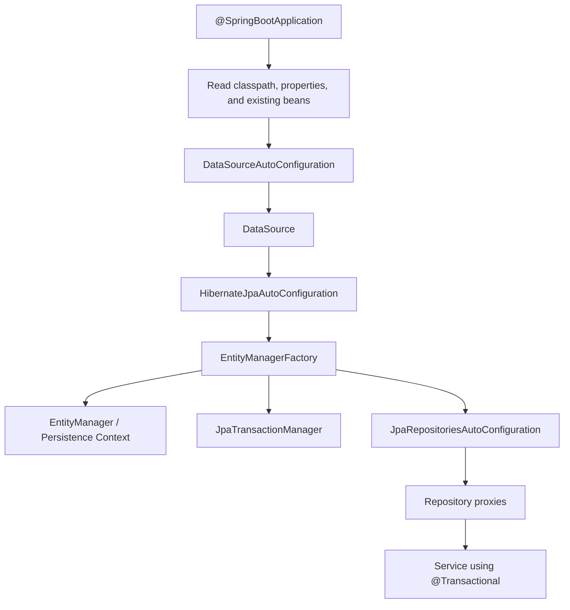

# Spring Boot JPA Auto-Configuration Mechanism

## Objectives

After this lesson, you can explain how Spring Boot automatically sets up Spring Data JPA; identify the main beans created during startup; understand the roles of dependencies, package scanning, and `application.yml` configuration; know when auto-configuration applies or backs off in favor of custom configuration; and diagnose common errors.

## 1. What Is Auto-Configuration?

Spring Boot auto-configuration is a mechanism that automatically configures an application based on what is present on the classpath, configured properties, and existing declared beans. The goal is to provide sensible defaults so the application can run with minimal manual configuration.

`@SpringBootApplication` is a composite annotation consisting of three important parts:

- `@SpringBootConfiguration`: marks the main configuration class of the application.
- `@EnableAutoConfiguration`: enables loading appropriate auto-configuration classes.
- `@ComponentScan`: scans Spring components in the application class's package and its subpackages.

Auto-configuration is not a fixed configuration set that is always enabled. Each configuration typically has conditions such as: required libraries are on the classpath, a bean of a certain type already exists, a property is enabled, or no custom bean overrides it. Spring Boot evaluates those conditions when creating the `ApplicationContext`.

For example, if the application includes `spring-boot-starter-data-jpa`, Spring Data JPA, Hibernate, and the required JPA classes will be on the classpath. If a suitable `DataSource` is also available, Spring Boot can configure `EntityManagerFactory`, the transaction manager, and JPA repositories.

## 2. Dependencies That Trigger JPA Infrastructure

In Maven, the commonly used dependency is `spring-boot-starter-data-jpa`. This starter brings in Spring Data JPA, Spring ORM/JDBC, Hibernate ORM, and required supporting components. Spring Boot manages compatible versions through the dependency management of the Boot version used by the project.

Example dependencies section in `pom.xml`:

```xml
<dependencies>
    <dependency>
        <groupId>org.springframework.boot</groupId>
        <artifactId>spring-boot-starter-data-jpa</artifactId>
    </dependency>

    <dependency>
        <groupId>org.postgresql</groupId>
        <artifactId>postgresql</artifactId>
        <scope>runtime</scope>
    </dependency>
</dependencies>
```

The JPA starter provides the ORM and repositories; the PostgreSQL driver provides connectivity to PostgreSQL. If using MySQL, H2, or another database management system, add the corresponding driver. Having the JPA dependency does not mean the application automatically knows which database to connect to: the application still needs a `DataSource`, usually configured via a URL and credentials.

In testing or learning environments, H2 can be used instead of PostgreSQL:

```xml
<dependency>
    <groupId>com.h2database</groupId>
    <artifactId>h2</artifactId>
    <scope>runtime</scope>
</dependency>
```

Do not declare separate explicit versions for Hibernate or Spring Data JPA when using Spring Boot dependency management, unless there is a specific compatibility reason. Upgrading an individual component manually can create an incompatible combination of libraries.

## 3. Auto-Configuration Chain on Application Startup

For a simple Spring Boot application with a single database, the main flow can be visualized as follows:



This diagram summarizes the common components. In practice, Spring Boot loads many conditional auto-configurations, and some configurations are applied in dependency order. If a project has multiple databases or custom beans, this chain becomes more complex.

### 3.1. DataSourceAutoConfiguration Creates Database Connectivity

`DataSource` is the JDBC abstraction representing a source of connections. Hibernate uses `DataSource` to acquire a JDBC connection when it needs to read or write data.

`DataSourceAutoConfiguration` can create a `DataSource` if the matching conditions are met and the application has not declared its own `DataSource` bean. Spring Boot usually selects HikariCP as the connection pool when the library is present, as in standard starter setups.

Spring Boot accepts configuration from properties such as:

- `spring.datasource.url`: JDBC URL of the database.
- `spring.datasource.username`: connection username.
- `spring.datasource.password`: password.
- `spring.datasource.driver-class-name`: JDBC driver class name; usually inferred from the URL.
- `spring.datasource.hikari.*`: HikariCP-specific options such as pool size and timeout.

If an embedded database such as H2 is on the classpath and no URL is declared, Boot can auto-configure an embedded database. If there is no embedded database and no valid URL, the application usually fails to start with an error indicating it cannot determine a driver or configure a datasource.

### 3.2. HibernateJpaAutoConfiguration Creates EntityManagerFactory

When JPA and Hibernate classes are present, a suitable `DataSource` has been created, and no custom `EntityManagerFactory` exists, Hibernate JPA auto-configuration can set up the JPA infrastructure.

The central bean is `EntityManagerFactory`. In a standard Hibernate setup, Spring uses `LocalContainerEntityManagerFactoryBean` to build the factory. This factory is configured with the `DataSource`, Hibernate provider, entity metadata, JPA/Hibernate properties, and related customizations.

`EntityManagerFactory` creates `EntityManager`. `EntityManager` is the primary JPA API to persist, find, merge, remove, and create queries. EntityManager works with the persistence context to manage entity state within the scope of the persistence context.

Hibernate is the provider implementing the JPA APIs. It reads mapping annotations, tracks entity changes, generates SQL, and uses JDBC through `DataSource` to send statements to the database.

### 3.3. Entity Scanning Finds @Entity Classes

Spring Boot needs to know which packages contain entities. By default, Boot uses the package of the class annotated with `@SpringBootApplication` as the root package for entity discovery. Therefore, a simple organization usually places the application class in a parent package of the entities:

```text
com.example.learning
├── LearningApplication.java
├── customer
│   ├── Customer.java
│   ├── CustomerRepository.java
│   └── CustomerService.java
└── order
    ├── PurchaseOrder.java
    └── OrderRepository.java
```

Entity scanning and component scanning are related but not the same thing. `@ComponentScan` finds Spring components such as `@Service`, `@Repository`, and `@Controller`; entity scanning finds persistence classes annotated with `@Entity` to include in JPA metadata.

If entities reside outside the root package, they can be specified explicitly:

```java
package com.example.learning;

import org.springframework.boot.autoconfigure.SpringBootApplication;
import org.springframework.boot.autoconfigure.domain.EntityScan;

@SpringBootApplication
@EntityScan(basePackages = {
    "com.example.learning.customer",
    "com.example.shared.persistence"
})
public class LearningApplication {
    public static void main(String[] args) {
        org.springframework.boot.SpringApplication.run(
            LearningApplication.class, args
        );
    }
}
```

Only add `@EntityScan` when the package structure actually requires it. If declared incorrectly or too narrowly, entities may not be managed and repositories will report errors such as `Not a managed type`.

### 3.4. JpaRepositoriesAutoConfiguration Creates Repository Proxies

Spring Data JPA provides a mechanism to generate implementations for repository interfaces. For example:

```java
package com.example.learning.customer;

import org.springframework.data.jpa.repository.JpaRepository;

public interface CustomerRepository
        extends JpaRepository<Customer, Long> {
}
```

You only declare the interface. Spring Data JPA creates a proxy bean to perform operations such as `save`, `findById`, `findAll`, `deleteById`, pagination, and query methods.

Boot normally scans repositories starting from the application's root package. If repositories are in another package, you can configure:

```java
import org.springframework.boot.autoconfigure.SpringBootApplication;
import org.springframework.data.jpa.repository.config.EnableJpaRepositories;

@SpringBootApplication
@EnableJpaRepositories(basePackages = "com.example.data.repositories")
public class LearningApplication {
    // main method
}
```

In simple applications, there is no need to add `@EnableJpaRepositories` because auto-configuration already handles this. When declaring the annotation manually, make sure the specified package is accurate and avoid creating two overlapping scan configurations.

### 3.5. Transaction Manager Supporting @Transactional

In a standard JPA setup with a single `EntityManagerFactory`, Spring Boot can create `JpaTransactionManager` as the `PlatformTransactionManager` implementation.

A Service can declare transactions as follows:

```java
package com.example.learning.customer;

import org.springframework.stereotype.Service;
import org.springframework.transaction.annotation.Transactional;

@Service
public class CustomerService {
    private final CustomerRepository customers;

    public CustomerService(CustomerRepository customers) {
        this.customers = customers;
    }

    @Transactional
    public Long register(String name) {
        Customer customer = new Customer(name);
        return customers.save(customer).getId();
    }
}
```

`@Transactional` is handled via Spring's proxy mechanism. When a method is called through the Spring proxy, the transaction manager starts a new transaction or joins an existing one. When the method completes normally, the transaction is committed; when an exception matching the rollback rules occurs, the transaction is rolled back.

With Spring Boot, transaction management is usually configured automatically. Ordinary applications do not need to manually add `@EnableTransactionManagement`. Remember that calling another transactional method on the same object via `this.method()` bypasses the default proxy, so it may not trigger a transaction as expected.

## 4. Minimal Configuration Using application.yml

PostgreSQL configuration example:

```yaml
spring:
  datasource:
    url: jdbc:postgresql://localhost:5432/learning
    username: ${DB_USERNAME}
    password: ${DB_PASSWORD}
  jpa:
    hibernate:
      ddl-auto: validate
    open-in-view: false
    show-sql: false
    properties:
      hibernate:
        format_sql: true
```

Explanation:

- `spring.datasource.*` configures the JDBC connection.
- `spring.jpa.hibernate.ddl-auto` controls how Hibernate handles the schema during startup.
- `validate` instructs Hibernate to verify mappings against the existing schema; it does not create tables.
- `spring.jpa.open-in-view=false` disables keeping the persistence context open until the end of the web request lifecycle; this makes data access boundaries clearer, though services must load required data before returning the response.
- `spring.jpa.properties.hibernate.*` passes specific properties down to Hibernate.

Credentials should be retrieved from environment variables or a secret manager. Do not commit real passwords to the repository. Kebab-case property names are the canonical Spring Boot format; relaxed binding also supports equivalent notations in certain configuration sources.

### 4.1. Some Common Properties

| Property | Meaning |
| --- | --- |
| `spring.datasource.url` | JDBC URL connecting to the database |
| `spring.datasource.username` / `password` | Login credentials |
| `spring.datasource.hikari.maximum-pool-size` | Maximum number of connections in the Hikari pool |
| `spring.jpa.hibernate.ddl-auto` | Hibernate strategy for creating, updating, or validating the schema |
| `spring.jpa.show-sql` | Prints SQL to console logs according to JPA configuration |
| `spring.jpa.open-in-view` | Enables/disables Open EntityManager in View in web applications |
| `spring.jpa.database-platform` | Specifies the Hibernate dialect when needed; in many cases the provider auto-detects it |
| `spring.jpa.properties.hibernate.format_sql` | Formats SQL generated by Hibernate |
| `spring.data.jpa.repositories.enabled` | Enables/disables JPA repository auto-configuration |

Not all properties belong to the same layer. `spring.datasource.*` controls connectivity; `spring.jpa.*` is JPA configuration provided by Boot; `spring.jpa.properties.hibernate.*` are properties forwarded to the provider; `spring.data.jpa.*` controls Spring Data JPA behavior.

## 5. Example of Auto-Configured Components

Suppose a project has an entity:

```java
package com.example.learning.customer;

import jakarta.persistence.Entity;
import jakarta.persistence.GeneratedValue;
import jakarta.persistence.GenerationType;
import jakarta.persistence.Id;
import jakarta.persistence.Table;

@Entity
@Table(name = "customers")
public class Customer {
    @Id
    @GeneratedValue(strategy = GenerationType.IDENTITY)
    private Long id;

    private String name;

    protected Customer() {
    }

    public Customer(String name) {
        this.name = name;
    }

    public Long getId() {
        return id;
    }

    public String getName() {
        return name;
    }
}
```

Repository:

```java
package com.example.learning.customer;

import java.util.List;
import org.springframework.data.jpa.repository.JpaRepository;

public interface CustomerRepository
        extends JpaRepository<Customer, Long> {
    List<Customer> findByNameContainingIgnoreCase(String keyword);
}
```

Application class:

```java
package com.example.learning;

import org.springframework.boot.SpringApplication;
import org.springframework.boot.autoconfigure.SpringBootApplication;

@SpringBootApplication
public class LearningApplication {
    public static void main(String[] args) {
        SpringApplication.run(LearningApplication.class, args);
    }
}
```

With valid dependencies and datasource, Boot automatically configures the entity manager factory, transaction manager, and repository proxy. You do not need to write an implementation for `CustomerRepository` or manually initialize `EntityManagerFactory` in a basic application.

To inspect the beans that exist, you can inject or check the context in a test:

```java
package com.example.learning;

import jakarta.persistence.EntityManagerFactory;
import javax.sql.DataSource;
import org.junit.jupiter.api.Test;
import org.springframework.beans.factory.annotation.Autowired;
import org.springframework.boot.test.context.SpringBootTest;
import org.springframework.transaction.PlatformTransactionManager;

import static org.assertj.core.api.Assertions.assertThat;

@SpringBootTest
class JpaAutoConfigurationTest {
    @Autowired DataSource dataSource;
    @Autowired EntityManagerFactory entityManagerFactory;
    @Autowired PlatformTransactionManager transactionManager;
    @Autowired CustomerRepository customerRepository;

    @Test
    void jpaInfrastructureIsAvailable() {
        assertThat(dataSource).isNotNull();
        assertThat(entityManagerFactory).isNotNull();
        assertThat(transactionManager).isNotNull();
        assertThat(customerRepository).isNotNull();
    }
}
```

This is a verification example in a Spring Boot application with test dependencies and test database configuration. `PlatformTransactionManager` is the abstraction; in a single-database JPA configuration, the bean is typically `JpaTransactionManager`.

## 6. Conditional Auto-Configuration and the Back-Off Mechanism

A core principle of Spring Boot is providing defaults when appropriate while allowing the application to replace them with its own defined beans. This mechanism is commonly called back-off.

| Component | Common Default Behavior | When the Application Configures Manually |
| --- | --- | --- |
| `DataSource` | Boot creates a datasource from properties or an embedded database | A custom `DataSource` bean typically causes datasource auto-configuration to back off |
| `EntityManagerFactory` | Hibernate JPA auto-configuration creates the factory | A custom `EntityManagerFactory` or factory bean can cause default Hibernate configuration to back off |
| Transaction manager | Boot creates a manager suitable for JPA | A custom `PlatformTransactionManager` bean can replace the default manager |
| JPA repositories | Boot automatically scans repositories in the default package | `@EnableJpaRepositories` allows specifying packages and corresponding factory/transaction manager; custom repository configuration may cause default auto-configuration to back off |

Back-off does not mean all JPA beans are disabled just because you add an arbitrary bean. Conditions depend on each specific auto-configuration and the bean types checked. When customizing, inspect which beans are created, which beans are excluded by conditions, and their dependencies.

### 6.1. Custom DataSource Example

In basic applications, properties are usually enough. If special pool or datasource configuration is needed, you can declare a bean yourself:

```java
@Configuration
public class DatabaseConfiguration {
    @Bean
    @ConfigurationProperties("app.datasource")
    public DataSource dataSource() {
        return DataSourceBuilder.create().build();
    }
}
```

The example above requires appropriate Spring Boot imports and `app.datasource.*` properties with sufficient information for the chosen datasource implementation. When creating multiple datasources manually or using HikariCP directly, it is usually better to declare the specific datasource type and pool property binding rather than relying on a mismatched generic setup.

When creating a `DataSource` manually, you are responsible for configuring the URL, credentials, pool, driver, and lifecycle. Boot may no longer create a default datasource. The downstream JPA infrastructure can still be auto-configured if it sees a suitable datasource and all other conditions remain satisfied.

### 6.2. When Explicit Repository Configuration Is Needed

Multi-module or multi-persistence-unit applications may require explicit specification:

```java
@Configuration
@EnableJpaRepositories(
    basePackages = "com.example.learning.customer.repository",
    entityManagerFactoryRef = "customerEntityManagerFactory",
    transactionManagerRef = "customerTransactionManager"
)
public class CustomerJpaConfiguration {
    // Define the matching EntityManagerFactory and transaction manager beans.
}
```

This is only a configuration skeleton showing bean name bindings. With multiple databases, each `DataSource`, `EntityManagerFactory`, transaction manager, and corresponding entity/repository package must be fully defined. You cannot simply add `@EnableJpaRepositories` without providing the referenced beans.

## 7. Auto-Configuration and Package Scan: Boundaries to Distinguish

Three scan mechanisms are frequently confused:

1. **Component scan** finds Spring beans such as `@Component`, `@Service`, `@Repository`, and `@Controller`.
2. **Entity scan** finds `@Entity` classes for Hibernate/JPA to include in persistence metadata.
3. **Repository scan** finds Spring Data interfaces such as `JpaRepository` and creates proxies.

Placing the `@SpringBootApplication` class at the root package allows subpackages to be discovered by default. If the application class is nested too deeply, sibling packages may be missed. In that case, move the application class up to the root package or explicitly specify scan scopes using `scanBasePackages`, `@EntityScan`, and `@EnableJpaRepositories` according to their respective responsibilities.

`scanBasePackages` on `@SpringBootApplication` controls component scanning; do not assume it automatically changes all entity and repository scanning in every case. Use the right annotation for the scan scope you need to adjust.

## 8. Schema Initialization and Migration

JPA auto-configuration is also involved in when the schema is validated or created. The `spring.jpa.hibernate.ddl-auto` property has common values:

| Value | Behavior |
| --- | --- |
| `none` | Does not ask Hibernate to manage DDL |
| `validate` | Verifies whether the existing schema matches the mappings |
| `update` | Attempts to adjust the schema to match mappings |
| `create` | Recreates the schema at startup according to provider configuration |
| `create-drop` | Creates the schema at startup and drops it when EntityManagerFactory closes |

The default value is inferred by Boot from the database type and whether a schema initialization tool like Flyway/Liquibase is present. Embedded databases may receive a different default than external databases; therefore, do not rely on this default for production environments.

In real environments, schema changes should be managed via versioned migrations, such as Flyway or Liquibase. When using migrations, configure Hibernate in `validate` or `none` mode depending on project policy to avoid two mechanisms modifying the schema simultaneously.

If using `schema.sql` or `data.sql` alongside JPA, pay attention to initialization order. When you want Hibernate to create the schema first and data scripts to run afterward, `spring.jpa.defer-datasource-initialization=true` may be needed. For non-embedded databases, running SQL scripts may require `spring.sql.init.mode=always`. Before enabling these, clearly determine the environment and schema owner to avoid unintended data creation or structural modifications.

## 9. Multiple DataSources and Multiple EntityManagerFactories

Default auto-configuration targets the common case: one datasource and one persistence unit. When an application has multiple databases, multiple `DataSource` beans of the same type may prevent Boot from determining the right bean. In that case, you need to designate the primary datasource with `@Primary` if there is a default datasource, or explicitly configure each persistence unit.

A multi-database configuration typically must specify:

- A `DataSource` bean for each database.
- A `LocalContainerEntityManagerFactoryBean` or `EntityManagerFactory` bean for each persistence unit.
- Corresponding entity packages for each factory.
- `@EnableJpaRepositories` for each repository group, with exact `entityManagerFactoryRef` and `transactionManagerRef`.
- The transaction manager matching the database on which the business operation operates.

Do not let a repository accidentally use the wrong `EntityManagerFactory` or transaction manager. Doing so can cause queries to run against the wrong database or transactions to fail to cover all intended operations.

## 10. How to Inspect What Spring Boot Has Auto-Configured

### 10.1. Enabling the Condition Evaluation Report

Run the application with the `--debug` argument so Spring Boot prints the auto-configuration condition report:

```bash
./mvnw spring-boot:run -Dspring-boot.run.arguments=--debug
```

On Windows PowerShell, you can use `./mvnw.cmd spring-boot:run -Dspring-boot.run.arguments=--debug` if the project has Maven Wrapper. With Gradle Wrapper, use `./gradlew bootRun --args='--debug'` or `./gradlew.bat bootRun --args='--debug'` on Windows.

In the Condition Evaluation Report, pay attention to the positive matches and negative matches sections. Positive matches show which conditions were satisfied; negative matches show which auto-configurations were skipped, typically with reasons such as missing classes, missing beans, or mismatched properties.

### 10.2. Checking Beans in ApplicationContext

In tests or during debugging, you can inspect beans via `ApplicationContext` or directly inject the types to verify:

- `DataSource` to confirm the datasource was created.
- `EntityManagerFactory` to confirm the JPA provider initialized.
- `PlatformTransactionManager` to confirm a transaction manager is present.
- Specific repository interfaces to confirm repository scanning worked.

Actuator provides the `conditions` endpoint to observe auto-configuration conditions when Spring Boot Actuator is added and endpoint exposure is properly configured. This endpoint can reveal internal configuration details; only expose it in accordance with the application's security policy, especially in production.

### 10.3. Enabling Targeted Logging

To inspect SQL and parameters during development, you can configure:

```yaml
logging:
  level:
    org.hibernate.SQL: DEBUG
    org.hibernate.orm.jdbc.bind: TRACE
```

The `org.hibernate.SQL` logger displays SQL statements; the Hibernate 6 bind logger can display parameter values. Bind logs may contain personal data or secrets, so only enable them temporarily in development environments and never expose them in production logs.

## 11. Common Errors and Troubleshooting

| Symptom | Common Cause | Inspection Approach |
| --- | --- | --- |
| `Failed to determine a suitable driver class` | Missing JDBC driver or invalid URL | Check driver dependency, `spring.datasource.url`, and runtime classpath |
| `Failed to configure a DataSource` | No URL and no suitable embedded database | Add driver and datasource configuration or H2 dependency for test environment |
| Repository bean not found | Repository is outside package scan or repository auto-config is disabled | Check root package, `@EnableJpaRepositories`, and `spring.data.jpa.repositories.enabled` |
| `Not a managed type` | Entity was not entity-scanned or lacks `@Entity` | Check annotations and `@EntityScan` |
| `No qualifying bean of type EntityManagerFactory` | Hibernate JPA auto-config did not run or backed off | Check condition report, dependencies, datasource, and custom beans |
| `NoUniqueBeanDefinitionException` for DataSource or transaction manager | Multiple beans of the same type without a clear selection | Use `@Primary` when appropriate or reference beans by name |
| Schema validation failed | Actual schema does not match entity mappings | Check migrations, table/column names, data types, and constraints |
| Application starts but queries fail | Incorrect SQL, mapping, database permissions, or schema | Check SQL/logs, account permissions, and current schema |

Do not fix the above errors by randomly adding annotations or dependencies. Identify which auto-configuration did not match, which bean is missing, or which bean caused the default configuration to back off.

## 12. Common Misconceptions

- **“Just adding `@Entity` makes JPA work automatically.”** Incorrect. The application needs a JPA provider, a valid `DataSource`, an entity manager factory, and the corresponding dependencies.
- **“The JPA starter creates a database server.”** Incorrect. The starter provides integration libraries; the database server must exist or the application must use an embedded database like H2.
- **“`@SpringBootApplication` scans every package in the project.”** By default, it scans the application class's package and its subpackages. Packages outside that tree require explicit scan configuration.
- **“Component scan automatically replaces entity scan.”** The two mechanisms serve different purposes. Entities must be registered into JPA metadata.
- **“You must always declare `@EnableJpaRepositories`.”** Not necessary in simple applications using default auto-configuration.
- **“Declaring any custom bean disables all JPA auto-configuration.”** Back-off depends on the conditions of each configuration and each bean type.
- **“`ddl-auto=update` is a safe choice for production.”** It should not be treated as a controlled migration mechanism. Manage schemas with migrations.
- **“Enable SQL and bind parameter logging in all environments.”** Bind parameters can expose sensitive data; restrict them by environment.
- **“Multiple databases just require adding multiple URLs.”** Multi-database applications require corresponding datasource, persistence unit, repository, and transaction manager configurations.

## 13. Checklist When Creating a Spring Data JPA Application

- [ ] Added `spring-boot-starter-data-jpa`.
- [ ] Added the JDBC driver matching the database management system.
- [ ] Configured URL, username, and password through secure properties.
- [ ] `@SpringBootApplication` class is placed in a sensible root package.
- [ ] Entities have `@Entity` and lie within entity scan scope.
- [ ] Repositories extend `JpaRepository` and lie within repository scan scope.
- [ ] `EntityManagerFactory` and transaction manager are created properly.
- [ ] Schema configuration matches the environment; production uses controlled migrations.
- [ ] Checked the condition report when auto-configuration does not behave as expected.
- [ ] Credentials or sensitive bind parameters are not exposed in logs.

## Conclusion

Spring Boot JPA auto-configuration connects multiple components into a complete persistence infrastructure: dependencies put libraries on the classpath; datasource auto-configuration supplies JDBC connectivity; Hibernate JPA auto-configuration creates `EntityManagerFactory`; entity scanning registers entities into metadata; Spring Data JPA creates repository proxies; the transaction manager supports `@Transactional`. Understanding activation conditions, package scanning, and back-off helps you leverage default configuration, customize in the right places, and diagnose root causes when the application fails to start or repositories do not work.