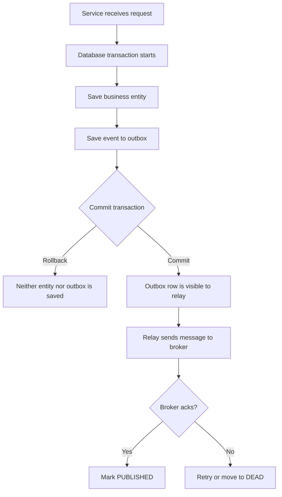

# The Transactional Outbox Pattern for Data Changes and Message Publishing

A business operation often needs to both update a database and send a message to another system. For example: creating an order in Spring Data JPA and emitting an `OrderPlaced` event for inventory, payment, or notification services to process next.

If an application writes to the database and sends to a message broker as two independent operations, the two systems can fall out of sync. The transactional outbox solves this by writing business changes and an event record into the same database transaction. A relay process reads committed outbox rows and sends messages to the broker.

## 1. The dual-write problem

Suppose a service does:

```java
@Transactional
public void placeOrder(CreateOrder command) {
    PurchaseOrder order = orders.save(PurchaseOrder.from(command));
    messageBroker.publish(new OrderPlaced(order.getId()));
}
```

The code above has two operations that must succeed together:

1. Save the order in the database.
2. Send the event to the message broker.

A JPA transaction controls only database resources managed by the transaction manager. It does not automatically make calls to Kafka, RabbitMQ, or an HTTP service part of the same transaction.

There are two classic failure scenarios:

- **Database commits but publish fails:** the order exists, yet other systems never receive the event. For instance, the warehouse never learns it needs to prepare items.
- **Publish succeeds but database rolls back:** other systems processed an order that was never successfully saved in the database.

This is the dual-write problem: one business action must write to two independent systems without a shared atomic mechanism. Sending the message before or after commit does not eliminate all failure windows.

## 2. How does the transactional outbox work?

Instead of sending a message directly inside the business transaction, the application persists an outbox record alongside the business data:

1. The service updates business entities.
2. The service builds an event DTO describing what happened.
3. The service saves the event to the `outbox_event` table.
4. Both the business entity and the outbox row commit in the same database transaction.
5. A separate relay reads committed outbox rows and sends messages to the broker.
6. Once the broker acknowledges receipt, the relay marks the outbox row published.

If the transaction rolls back, both the business change and the outbox row roll back. If the transaction commits, both exist so the relay can process them.



The outbox serves as a durable source for replaying events. The relay can pause or the application can restart without losing events already written to the database.

## 3. Designing the outbox table

An outbox table typically stores event identity, the originating aggregate, event type, payload, and delivery state.

| Column | Meaning |
|---|---|
| `id` | Unique event ID; used as the event ID and idempotency key. |
| `aggregate_type` | Aggregate type, e.g., `PurchaseOrder`. |
| `aggregate_id` | ID of the aggregate producing the event. |
| `event_type` | Event name, e.g., `OrderPlaced`. |
| `schema_version` | Payload structure version. |
| `payload` | Serialized event content, typically JSON. |
| `occurred_at` | Business timestamp when the event occurred. |
| `status` | Delivery status: `PENDING`, `IN_PROGRESS`, `PUBLISHED`, or `DEAD`. |
| `attempts` | Number of failed sends or retry attempts. |
| `next_attempt_at` | Earliest time another attempt is allowed. |
| `claimed_until` | Lease expiration time for the worker currently claiming the event. |
| `claim_token` | Token identifying the claim attempt, preventing stale workers from overwriting newer claims. |
| `published_at` | Timestamp when the broker acknowledged the message. |
| `last_error` | Most recent error for investigation and operations. |

A UUID can be used for the event ID so an identifier can be generated right in the application. The payload should be an immutable event DTO; do not serialize a JPA entity directly because entities may contain lazy proxies, circular references, or data that should not be exposed externally.

Condensed outbox entity example:

```java
import jakarta.persistence.*;
import java.time.Instant;
import java.util.UUID;

@Entity
@Table(name = "outbox_event")
public class OutboxEvent {

    @Id
    private UUID id;

    @Column(name = "aggregate_type", nullable = false, length = 100)
    private String aggregateType;

    @Column(name = "aggregate_id", nullable = false, length = 100)
    private String aggregateId;

    @Column(name = "event_type", nullable = false, length = 160)
    private String eventType;

    @Column(name = "schema_version", nullable = false)
    private int schemaVersion;

    @Lob
    @Column(nullable = false)
    private String payload;

    @Column(name = "occurred_at", nullable = false)
    private Instant occurredAt;

    @Enumerated(EnumType.STRING)
    @Column(nullable = false, length = 20)
    private OutboxStatus status;

    @Column(nullable = false)
    private int attempts;

    @Column(name = "next_attempt_at", nullable = false)
    private Instant nextAttemptAt;

    @Column(name = "claimed_until")
    private Instant claimedUntil;

    @Column(name = "claim_token")
    private UUID claimToken;

    @Column(name = "published_at")
    private Instant publishedAt;

    @Lob
    @Column(name = "last_error")
    private String lastError;

    protected OutboxEvent() {
    }

    public static OutboxEvent pending(
            String aggregateType,
            String aggregateId,
            String eventType,
            int schemaVersion,
            String payload,
            Instant occurredAt) {

        OutboxEvent event = new OutboxEvent();
        event.id = UUID.randomUUID();
        event.aggregateType = aggregateType;
        event.aggregateId = aggregateId;
        event.eventType = eventType;
        event.schemaVersion = schemaVersion;
        event.payload = payload;
        event.occurredAt = occurredAt;
        event.status = OutboxStatus.PENDING;
        event.attempts = 0;
        event.nextAttemptAt = occurredAt;
        return event;
    }

    // Getters and state transition methods omitted.
}
```

Status enum:

```java
public enum OutboxStatus {
    PENDING,
    IN_PROGRESS,
    PUBLISHED,
    DEAD
}
```

This is an illustrative structure; production schema migrations need database-appropriate column types, payload sizing, indexes, and retention policies. An index is usually helpful for querying due events, such as on `status`, `next_attempt_at`, and `occurred_at`. You can add an index on `aggregate_type`, `aggregate_id` to trace an aggregate's history.

## 4. Writing business changes and outbox in the same transaction

This is the most critical part of the outbox pattern. Both repositories must participate in the same transaction manager and the same database transaction.

Example event DTO:

```java
import java.math.BigDecimal;
import java.time.Instant;
import java.util.UUID;

public record OrderPlaced(
        UUID orderId,
        BigDecimal total,
        Instant occurredAt) {
}
```

Service saving the order and event:

```java
import com.fasterxml.jackson.core.JsonProcessingException;
import com.fasterxml.jackson.databind.ObjectMapper;
import java.time.Clock;
import java.time.Instant;
import java.util.UUID;
import org.springframework.stereotype.Service;
import org.springframework.transaction.annotation.Transactional;

@Service
public class OrderService {

    private final PurchaseOrderRepository orders;
    private final OutboxEventRepository outbox;
    private final ObjectMapper objectMapper;
    private final Clock clock;

    public OrderService(
            PurchaseOrderRepository orders,
            OutboxEventRepository outbox,
            ObjectMapper objectMapper,
            Clock clock) {
        this.orders = orders;
        this.outbox = outbox;
        this.objectMapper = objectMapper;
        this.clock = clock;
    }

    @Transactional
    public UUID placeOrder(CreateOrder command) {
        PurchaseOrder order = PurchaseOrder.from(command);
        PurchaseOrder saved = orders.save(order);

        Instant now = clock.instant();
        OrderPlaced event = new OrderPlaced(
                saved.getId(), saved.getTotal(), now);

        String payload;
        try {
            payload = objectMapper.writeValueAsString(event);
        } catch (JsonProcessingException ex) {
            throw new IllegalStateException(
                    "Unable to serialize OrderPlaced", ex);
        }

        outbox.save(OutboxEvent.pending(
                "PurchaseOrder",
                saved.getId().toString(),
                "OrderPlaced",
                1,
                payload,
                now));

        return saved.getId();
    }
}
```

In this example, `PurchaseOrderRepository` and `OutboxEventRepository` are both Spring Data JPA repositories using the same database and transaction manager. When `placeOrder()` commits, both the order and the outbox row commit together.

If payload serialization fails, `IllegalStateException` is an unchecked exception so the transaction rolls back by default. The order saved earlier in the transaction is not committed on its own either.

If the entity uses a database-generated ID, the ID value is typically available after calling `save()` and persisting according to the configured ID strategy. Ensure the aggregate ID is ready before creating the payload and outbox row. You can use application-assigned UUIDs if you want an identifier prior to persisting.

Do not place broker sends inside `placeOrder()`. If the broker is slow or fails, the database transaction is prolonged while still failing to provide atomicity across the two systems.

**Do not split the outbox insert into an independent transaction.** If `REQUIRES_NEW` is used for saving the outbox, the outbox row could commit while the business transaction rolls back, causing the relay to emit an event for a change that was never saved.

## 5. Outbox repository and transaction boundaries

The repository can be a standard JPA interface:

```java
import java.util.UUID;
import org.springframework.data.jpa.repository.JpaRepository;

public interface OutboxEventRepository
        extends JpaRepository<OutboxEvent, UUID> {
}
```

The transaction must satisfy these conditions:

- The service has `@Transactional` or an equivalent transaction boundary.
- The business repository and outbox repository participate in the same transaction manager.
- Both tables are inside the same database transaction.
- No independent commit occurs between saving the business entity and the outbox row.
- The relay reads only committed events for external publication.

If an application has multiple datasources or multiple `PlatformTransactionManager` beans, specify the proper manager explicitly and verify both repositories actually share the same transaction. Putting two `save()` calls inside the same Java method does not automatically guarantee they belong to the same transaction.

## 6. Relay reading the outbox and sending messages

The relay is a separate process responsible for turning outbox rows into message broker messages. It can be implemented as a scheduled worker within the application or as a standalone service.

Basic flow:

1. Find `PENDING` events that are due.
2. Claim a batch so only one worker processes each event at a time.
3. Commit the claim state and extract event data into a DTO.
4. Send the payload to the broker and await acknowledgment per the broker's mechanism.
5. If the broker acknowledges, update status to `PUBLISHED`.
6. If sending fails or times out, schedule a retry or move the event to `DEAD` after maximum attempts.

A broker abstraction can model sending and awaiting acknowledgment:

```java
import java.util.UUID;

public interface MessageBroker {

    // Completes normally only after the broker acknowledges the message.
    void publishAndAwaitAck(
            String topic,
            String key,
            UUID eventId,
            String eventType,
            int schemaVersion,
            String payload);
}
```

When sending, include the event ID in headers or an envelope so consumers can detect duplicate messages. You can use `aggregateId` as the message key so events for the same aggregate route to the same partition if the broker supports key-based partitioning.

### Why claim events?

If multiple workers read `PENDING` rows simultaneously, two workers could send the same event. A common approach is transitioning status to `IN_PROGRESS` in a short transaction with a token and lease:

- `claim_token`: UUID identifying the claim attempt.
- `claimed_until`: timestamp when the claim expires.
- A worker updates the final result only if the token still matches.
- If a worker dies, the claim expires and another worker can pick up the event.

With PostgreSQL, a native query like the following can claim multiple rows concurrently while skipping rows already locked by other workers:

```sql
WITH candidates AS (
    SELECT id
    FROM outbox_event
    WHERE (status = 'PENDING' AND next_attempt_at <= :now)
       OR (status = 'IN_PROGRESS' AND claimed_until < :now)
    ORDER BY occurred_at, id
    LIMIT :batch_size
    FOR UPDATE SKIP LOCKED
)
UPDATE outbox_event e
SET status = 'IN_PROGRESS',
    claim_token = :claim_token,
    claimed_until = :lease_until
FROM candidates c
WHERE e.id = c.id
RETURNING e.id, e.aggregate_id, e.event_type,
          e.schema_version, e.payload;
```

This is a PostgreSQL-specific example, not portable JPQL. On other databases, use an equivalent locking or atomic claim update mechanism. The claim transaction should finish before calling the broker so row locks are not held across network waits.

The lease must be longer than the expected send time or renewed when needed. If the lease expires while the old worker is still sending, another worker can reclaim the row and produce a duplicate send. The token prevents the old worker from overwriting the state of the newer claim, though it cannot retract a message already sent to the broker.

## 7. Marking published and handling errors

After broker acknowledgment, the relay marks the event published inside a database transaction:

```java
@Transactional
public void markPublished(
        UUID eventId, UUID claimToken, Instant publishedAt) {
    // Update only if the event is still IN_PROGRESS
    // and claim_token matches the current processing attempt.
}
```

Filtering by the claim token prevents a stale worker from updating status after another worker has reclaimed the event.

If broker delivery fails, the relay records attempt count, latest error, and next retry timestamp:

```java
@Transactional
public void scheduleRetry(
        UUID eventId,
        UUID claimToken,
        String error,
        Instant nextAttemptAt,
        int maxAttempts) {
    // Increment attempts, save last_error and next_attempt_at.
    // If maxAttempts is reached, transition status to DEAD.
}
```

Exponential backoff can be used:

```text
delay = min(maxDelay, baseDelay * 2^attempts)
```

Add random jitter so many events failing simultaneously do not all retry at the exact same moment. Configuration errors or invalid payloads may need to transition directly to `DEAD` for investigation instead of retrying endlessly.

A simple relay can be structured as follows:

```java
@Component
public class OutboxRelay {

    private final OutboxClaimService claims;
    private final MessageBroker broker;
    private final OutboxStateService states;
    private final Clock clock;

    public OutboxRelay(
            OutboxClaimService claims,
            MessageBroker broker,
            OutboxStateService states,
            Clock clock) {
        this.claims = claims;
        this.broker = broker;
        this.states = states;
        this.clock = clock;
    }

    @Scheduled(fixedDelayString = "${outbox.poll-delay:1000}")
    public void publishPending() {
        var batch = claims.claimBatch(100, clock.instant());

        for (var event : batch) {
            try {
                broker.publishAndAwaitAck(
                        "orders",
                        event.aggregateId(),
                        event.id(),
                        event.eventType(),
                        event.schemaVersion(),
                        event.payload());

                states.markPublished(
                        event.id(), event.claimToken(), clock.instant());
            } catch (Exception ex) {
                states.scheduleRetry(
                        event.id(),
                        event.claimToken(),
                        ex.getMessage(),
                        clock.instant(),
                        10);
            }
        }
    }
}
```

`OutboxClaimService` and `OutboxStateService` should be separate Spring beans with appropriate transaction boundaries. `claimBatch()` should perform atomic claiming as described above; `markPublished()` and `scheduleRetry()` update state in separate transactions. The relay example merely illustrates wiring the components together; claim queries, backoff calculations, error length truncation, and broker settings must be implemented for your actual database and broker.

## 8. Why does the transactional outbox typically guarantee at-least-once?

An outbox ensures events are not lost between database changes and emission requests: if business logic commits, the outbox row commits as well. However, sending to the broker and marking `PUBLISHED` remain two separate operations.

An important scenario:

1. The relay sends the message.
2. The broker receives and acknowledges it.
3. The relay crashes before updating the outbox row to `PUBLISHED`.
4. The lease expires, and another worker reclaims the event.
5. The message is sent again.

Hence, the relay can produce duplicate sends. This is at-least-once semantics: events will be retried until delivery succeeds or a stop policy triggers, while consumers may receive the same event multiple times.

Do not claim that an outbox provides exactly-once delivery across the database and broker. Design idempotent consumers to handle repeated messages safely.

## 9. Idempotent consumers and the inbox pattern

A consumer can store processed event IDs in an inbox or processed-message table. This table needs a unique constraint on the event ID.

Processing flow:

1. Receive a message along with its event ID.
2. Inside the consumer's transaction, record the unprocessed event ID using an atomic insert operation.
3. If the event ID already exists, skip the duplicate message.
4. If the insert succeeds, apply the consumer's business changes.
5. Commit business changes and the inbox record in the same transaction.

Structural example:

```java
@Entity
@Table(name = "processed_message")
public class ProcessedMessage {

    @Id
    private UUID eventId;

    private Instant processedAt;

    protected ProcessedMessage() {
    }

    public ProcessedMessage(UUID eventId, Instant processedAt) {
        this.eventId = eventId;
        this.processedAt = processedAt;
    }
}
```

At the database level, use an insert with a unique constraint to resolve contention when two consumer workers receive the same event concurrently. On PostgreSQL, `INSERT ... ON CONFLICT DO NOTHING` combined with checking the inserted row count works well. Do not rely solely on `existsById()` followed by `save()` as a concurrency guarantee: two transactions can both observe the record as absent before either writes.

The inbox record and the consumer's business changes must commit together. If business processing fails and the transaction rolls back, the inbox record rolls back too, allowing the broker to redeliver the message. If commit succeeds, any subsequent duplicate delivery recognizes the event ID and avoids reprocessing.

If the consumer calls yet another external system, that call introduces a new dual-write problem. The consumer may need its own outbox, or an idempotency mechanism supported by the target system.

## 10. Event ordering per aggregate

Many workflows need to preserve event order for a given aggregate, for example:

1. `OrderPlaced`
2. `OrderPaid`
3. `OrderShipped`

Sorting the outbox by `occurred_at` does not guarantee ordering when multiple workers are running. An older event may be retrying while a newer event is already sent.

If per-aggregate ordering is required:

- Record a sequence number or aggregate version in each event.
- Use `aggregate_id` as the message key so the broker routes events for the same aggregate to the same partition.
- Restrict the relay to sequential processing per aggregate, or avoid claiming a subsequent event until the prior one completes.
- Have consumers check the sequence to detect out-of-order or missing events.

Do not assume global ordering across all aggregates. Usually ordering is only needed within a single aggregate's scope; global ordering reduces parallelism.

## 11. Using CDC instead of a polling relay

As an alternative to a polling relay, Change Data Capture (CDC) can read the database transaction log. For example, Debezium can read the write-ahead log or binlog and stream changes to the outbox table into message broker messages.

Comparison:

| Criterion | Polling relay | CDC |
|---|---|---|
| How events are read | Queries outbox table by status | Reads database transaction log |
| Infrastructure | Can run inside the Spring application | Requires a CDC connector and supporting infrastructure |
| Claim/retry | Application manages status, leases, and retries | Connector manages offsets; requires connector operations and monitoring |
| Latency | Depends on polling interval and batching | Usually near real-time |
| Cleanup | Can delete or archive published rows per policy | Needs retention aligned with connector and logs |
| Operations | Simpler at small scale | Fits systems with existing CDC infrastructure and high throughput |

Even with CDC, events must still be written in the same transaction as business data. CDC only replaces how outbox rows are read and detected; it does not eliminate the need for idempotent consumers or schema evolution handling.

## 12. Why is @TransactionalEventListener(AFTER_COMMIT) not enough?

Spring provides `@TransactionalEventListener(phase = AFTER_COMMIT)` to invoke a listener after the transaction commits:

```java
@TransactionalEventListener(phase = TransactionPhase.AFTER_COMMIT)
public void onOrderPlaced(OrderPlaced event) {
    messageBroker.publishAndAwaitAck(
            "orders",
            event.orderId().toString(),
            /* eventId */ null,
            "OrderPlaced",
            1,
            serialize(event));
}
```

This ensures the listener runs only after commit as long as the listener is registered and the transaction completes normally. However, it does not create a durable record for replay if the process dies after commit but before the listener sends the message.

An application event or `@TransactionalEventListener` can be used to wake the relay early after commit, yet the outbox row must remain the durable source of truth. If the listener does not run, the scheduled relay or CDC still picks up the committed event.

## 13. Managing payloads and the outbox lifecycle

The outbox is long-lived operational data and needs clear policies:

- **Schema version:** store the event version so consumers know how to interpret older payloads.
- **Event DTO:** use clear, stable types; avoid serializing JPA entities and lazy relations.
- **Sensitive information:** include only necessary data in payloads, and apply access controls and retention policies.
- **Correlation ID:** include a request ID or trace ID to link producer, relay, and consumer logs.
- **Monitoring:** track `PENDING` count, oldest event age, retry count, `DEAD` count, publish latency, and broker error rates.
- **Cleanup:** archive or purge `PUBLISHED` events according to audit/retention policies; never delete pending or currently claimed events.
- **Replay:** establish a controlled procedure to replay `DEAD` events while keeping the same event ID if consumers should treat it as the same event.

When changing event schemas, add fields in a backward-compatible way or increment `schema_version`. Consumers need to support versions still within retention, or apply payload upcasting.

## 14. Testing the transactional outbox

Tests must verify both database atomicity and relay behavior.

| Scenario | What to verify |
|---|---|
| Order creation succeeds | One order and one corresponding outbox row exist after commit. |
| Error before commit | Neither the order nor the outbox row exists. |
| Event serialization fails | Transaction rolls back; no partial business data is saved. |
| Broker send succeeds | Relay marks the event `PUBLISHED` after receiving ack. |
| Transient broker failure | Event is scheduled for retry and payload is preserved. |
| Worker crashes after broker acks message | Event may be sent twice; consumer applies business logic once via idempotency. |
| Two workers claim concurrently | One event cannot be held under valid claims by two workers simultaneously. |
| Event exhausts retries | Transitions to `DEAD` with error details for investigation and a replay path. |
| Events for same aggregate | Ordering is preserved if business logic requires it and relay/broker are configured accordingly. |

Use integration tests with a real database or Testcontainers to verify transactions, locking, and native claim queries. Mocked repositories cannot prove that two tables actually roll back together or that locking clauses behave properly on the target database.

For rollback tests, let an exception escape the transaction or mark it rollback-only explicitly, then inspect both tables after the transaction completes. For the relay, mock the broker to simulate errors, verify retries, and test the case where the broker accepts the message before the relay updates status.

## 15. Implementation checklist

- Write business entities and outbox rows in the same database transaction.
- Use the same transaction manager for both repositories.
- Serialize immutable event DTOs with event ID, event type, and schema version.
- Do not send messages directly inside the business transaction.
- Claim events atomically before publishing if multiple workers run.
- Mark `PUBLISHED` only after broker acknowledgment.
- Use leases, backoff retries, and a `DEAD` status.
- Design idempotent consumers using event IDs and unique constraints.
- Define per-aggregate ordering requirements.
- Monitor backlog, event age, delivery failures, and retention policies.
- Test rollbacks, retries, duplicate sends, concurrent claims, and replay.

The transactional outbox turns message publishing into a durable workflow: the database transaction records both business changes and the intent to emit an event; the relay delivers the event after commit. This pattern closes the event-loss window between two independent writes, while requiring the system to accept at-least-once delivery and design idempotent consumers to handle duplicate messages safely.