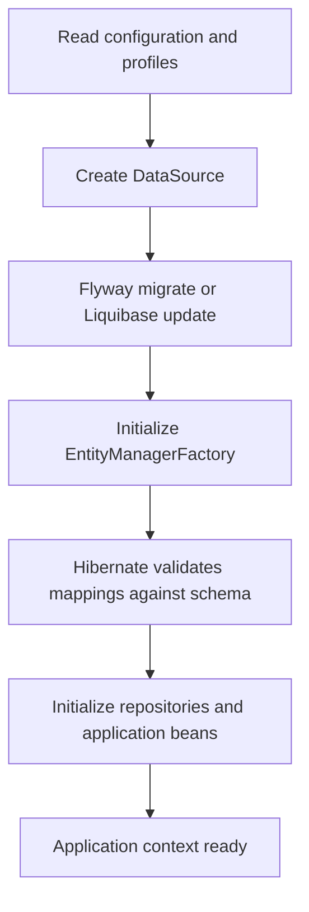

# Coordinating Migrations, Mapping Validation, and Application Startup

## Objectives

In a Spring Data JPA application, entity mappings describe how Java objects correspond to tables and columns; migrations manage the actual database structure; and Spring Boot coordinates database connections, migration execution, JPA initialization, and repository bean creation.

These three parts must stay aligned. If Hibernate initializes `EntityManagerFactory` before migrations create tables, the application can fail immediately at startup. If a migration creates a column with a different name or type than the entity, Hibernate can report a schema validation failure. If Hibernate modifies the schema on its own while Flyway or Liquibase also manages DDL, the database can drift away from controlled migration history.

This lesson explains how to coordinate migrations, mappings, and startup in a repeatable sequence across developer machines, CI, staging, and production.

After this lesson, you will be able to:

- Distinguish the responsibilities of the migration tool, Hibernate, and Spring Data JPA.
- Choose a single mechanism to manage the schema.
- Configure Flyway or Liquibase to run before JPA.
- Use `spring.jpa.hibernate.ddl-auto=validate` to detect mapping mismatches.
- Reconcile entities, tables, columns, types, constraints, and associations.
- Understand the startup order of DataSource, migrations, EntityManagerFactory, and repositories.
- Test migrations from both an empty database and an older-version database.
- Diagnose migration, schema validation, and application context startup failures.
- Deploy migrations safely when multiple application versions run concurrently.

Examples focus on Spring Boot 3.5, Spring Data JPA 3.x, Hibernate 6, and PostgreSQL. DDL, data types, and transaction behavior must be adapted to the actual DBMS.

## 1. Three Responsibilities That Must Work Together

### 1.1. The migration tool manages the real schema

Flyway or Liquibase is responsible for changing database structures:

- Creating and altering tables, columns, sequences, indexes, foreign keys, and constraints.
- Transforming or backfilling data when schemas change.
- Recording which migrations have executed in the database.
- Detecting modified migrations or mismatched history.
- Providing an ordered sequence of changes that can be reviewed and re-deployed.

Migrations are a versioned schema change history. Once a migration has run in a shared environment, create a new migration for subsequent changes; do not edit the contents of an old migration that has already been applied.

### 1.2. Entity mappings describe how JPA uses the schema

Entities and mapping annotations describe how Hibernate reads and writes data:

- `@Entity`, `@Table`: entity and table.
- `@Column`: column name, length, precision, scale, and mapping attributes.
- `@Id`, `@GeneratedValue`: primary key and ID generation strategy.
- `@ManyToOne`, `@OneToMany`, `@JoinColumn`: relationships and foreign key mappings.
- `@Enumerated`, `@Convert`: how Java types map to the database.
- `@Version`: optimistic locking column.

An entity alone does not prove the database already has the corresponding table or column. Annotations describe the mapping; migrations are what create or alter the schema in the database.

### 1.3. Spring Boot orchestrates startup

Spring Boot configures the DataSource, detects the migration tool, runs migrations, and initializes JPA. When Flyway or Liquibase is auto-configured, Spring Boot establishes dependencies so Hibernate waits for database initialization to finish before creating the EntityManagerFactory.

Spring Data JPA repositories are created in the application context based on entity mappings and initialized JPA infrastructure.

## 2. Choosing a Single Schema Management Mechanism

| Mechanism | Role | When Appropriate |
|---|---|---|
| Flyway | Versioned migrations using SQL or Java | Want a linear, clearly ordered migration history |
| Liquibase | Changelogs and changesets in XML, YAML, JSON, or SQL | Need changesets, contexts, labels, and rollback metadata |
| Hibernate DDL | Creates, updates, or validates schema from mappings | Prototypes, demos, or controlled tests |
| schema.sql/data.sql | Spring Boot's basic initialization scripts | Small databases or simple tests |

For applications with long-lived deployed databases, choose Flyway or Liquibase as the DDL owner. Hibernate should be used to verify mappings with `validate`; do not let Hibernate auto-update the schema while a migration tool also manages DDL.

### 2.1. ddl-auto values

`spring.jpa.hibernate.ddl-auto` controls Hibernate's schema tooling:

| Value | Behavior | Usage |
|---|---|---|
| `none` | Does not create, alter, or validate the schema | When the pipeline handles verification separately |
| `validate` | Compares parts of the schema with mappings without altering the schema | Suitable when Flyway/Liquibase manages DDL |
| `update` | Hibernate attempts to alter the schema to match mappings | Consider only for controlled development environments |
| `create` | Recreates the schema from mappings, potentially destroying the old schema | Demos or disposable test databases |
| `create-drop` | Creates the schema on initialization and drops it when SessionFactory closes | Tests/demos with temporary databases |

`validate` is neither a migration tool nor a full schema comparator. It catches many table/column/type mismatches that Hibernate checks, but does not replace verifying indexes, triggers, views, stored procedures, default expressions, privileges, and all database-specific constraints.

`update` does not create reviewable migration history and does not guarantee all mapping changes translate into safe DDL. Never use it as the production schema deployment mechanism.

Spring Boot has different defaults by environment: embedded databases may default to `create-drop` when no schema manager is detected; other databases typically default to `none`. Set the value explicitly rather than relying on defaults. See <https://docs.spring.io/spring-boot/3.5/how-to/data-initialization.html>.

## 3. Configuring Flyway in Spring Boot

### 3.1. Maven dependencies

Example for Spring Boot 3.5 and PostgreSQL:

```xml
<dependencies>
    <dependency>
        <groupId>org.springframework.boot</groupId>
        <artifactId>spring-boot-starter-data-jpa</artifactId>
    </dependency>

    <dependency>
        <groupId>org.flywaydb</groupId>
        <artifactId>flyway-core</artifactId>
    </dependency>

    <dependency>
        <groupId>org.flywaydb</groupId>
        <artifactId>flyway-database-postgresql</artifactId>
        <scope>runtime</scope>
    </dependency>

    <dependency>
        <groupId>org.postgresql</groupId>
        <artifactId>postgresql</artifactId>
        <scope>runtime</scope>
    </dependency>
</dependencies>
```

Let Spring Boot dependency management manage versions whenever possible. Do not manually pin Hibernate, Spring Data JPA, or Flyway versions incompatible with the Spring Boot BOM.

With modern Flyway, some databases require a separate module such as `flyway-database-postgresql` or `flyway-mysql`. Add the module matching the project's DBMS and Flyway version. See <https://docs.spring.io/spring-boot/3.5/how-to/data-initialization.html>.

### 3.2. Migration directory and naming

Flyway searches for versioned migrations by default in:

```text
src/
  main/
    resources/
      db/
        migration/
          V1__create_customer_schema.sql
          V2__add_customer_status.sql
          V3__create_customer_email_index.sql
```

Common naming convention:

```text
V<VERSION>__<DESCRIPTION>.sql
```

Versions must be unique and are applied in order. Flyway stores history and checksums in the `flyway_schema_history` table. Versioned migrations already applied to long-lived environments should remain unchanged; if schema fixes are needed, create a new version. See <https://documentation.red-gate.com/fd/versioned-migrations-273973333.html>.

### 3.3. application.yml configuration

```yaml
spring:
  datasource:
    url: ${DB_URL}
    username: ${DB_APP_USER}
    password: ${DB_APP_PASSWORD}

  flyway:
    enabled: true
    locations: classpath:db/migration
    validate-on-migrate: true
    default-schema: app
    schemas: app
    user: ${DB_MIGRATION_USER}
    password: ${DB_MIGRATION_PASSWORD}

  jpa:
    hibernate:
      ddl-auto: validate
    properties:
      hibernate:
        default_schema: app
    open-in-view: false
```

In this configuration:

- `spring.datasource.*` is the connection the application uses when accessing the database.
- `spring.flyway.*` configures migration locations and migration connection details.
- `spring.jpa.hibernate.ddl-auto=validate` instructs Hibernate to verify mappings when creating JPA infrastructure.
- `hibernate.default_schema` specifies the default schema Hibernate uses when a mapping does not specify a schema explicitly.
- `spring.flyway.default-schema` and `spring.flyway.schemas` control the schema managed by Flyway.

If using the same database user for Flyway and the application, you can omit `spring.flyway.user/password`; Flyway will use the primary DataSource. In production, consider a migration user with DDL privileges and a runtime user with only the privileges needed for application operations.

Never commit real passwords into the repository. Provide URL, username, and password via environment variables, a secret manager, or deployment configuration.

### 3.4. Example SQL migration

The `V1__create_customer_schema.sql` file below uses PostgreSQL:

```sql
CREATE SCHEMA IF NOT EXISTS app;

CREATE TABLE app.department (
    id BIGINT GENERATED BY DEFAULT AS IDENTITY PRIMARY KEY,
    name VARCHAR(120) NOT NULL
);

CREATE TABLE app.customer (
    id BIGINT GENERATED BY DEFAULT AS IDENTITY PRIMARY KEY,
    name VARCHAR(160) NOT NULL,
    email VARCHAR(320) NOT NULL,
    status VARCHAR(20) NOT NULL,
    created_at TIMESTAMP WITH TIME ZONE NOT NULL,
    department_id BIGINT,
    CONSTRAINT uk_customer_email UNIQUE (email),
    CONSTRAINT fk_customer_department
        FOREIGN KEY (department_id)
        REFERENCES app.department(id)
);

CREATE INDEX idx_customer_status_created_at
    ON app.customer(status, created_at);
```

This DDL creates the schema, tables, primary keys, unique constraint, foreign key, and index. Identity and timestamp syntax here are PostgreSQL; for MySQL, SQL Server, or Oracle, use appropriate types and DDL.

### 3.5. Validating migration history

Flyway stores checksums when applying versioned migrations. The validate command compares current migrations with stored history and detects migrations whose content changed, were renamed, or are missing from the deployed migration set.

If the Flyway CLI is installed:

```bash
flyway info
flyway validate
```

You can also run validate via Maven/Gradle if the project configures the corresponding plugin. Never edit the `flyway_schema_history` table directly to bypass checksum errors. When an applied migration has been edited, identify which environment ran it and create a new migration to fix the database state. See <https://documentation.red-gate.com/flyway/reference/commands/validate>.

## 4. If Using Liquibase

Liquibase is an alternative to Flyway. Do not run both tools to manage the same schema without an explicit architecture and clear ownership split.

### 4.1. Dependencies and configuration

```xml
<dependency>
    <groupId>org.liquibase</groupId>
    <artifactId>liquibase-core</artifactId>
</dependency>
```

```yaml
spring:
  liquibase:
    enabled: true
    change-log: classpath:/db/changelog/db.changelog-master.yaml

  jpa:
    hibernate:
      ddl-auto: validate
```

By default, Spring Boot looks for the master changelog at `db/changelog/db.changelog-master.yaml`; this can be overridden with `spring.liquibase.change-log`. When Liquibase is auto-configured, migrations run during startup before JPA initialization according to Spring Boot's dependency ordering. See <https://docs.spring.io/spring-boot/3.5/how-to/data-initialization.html>.

### 4.2. YAML changeset

```yaml
databaseChangeLog:
  - changeSet:
      id: 001-create-department
      author: team
      changes:
        - createTable:
            tableName: department
            columns:
              - column:
                  name: id
                  type: BIGINT
                  autoIncrement: true
                  constraints:
                    primaryKey: true
                    nullable: false
              - column:
                  name: name
                  type: VARCHAR(120)
                  constraints:
                    nullable: false
```

Each changeset is identified by `id`, `author`, and changelog path. Liquibase records executed changesets in `DATABASECHANGELOG` and uses checksums to detect unexpected content modifications.

Create a new changeset for subsequent changes. For DDL that requires rollback, define an appropriate rollback or prepare a forward-fix migration. Rollback is not always safe when a migration has transformed or deleted data. See <https://docs.liquibase.com/community/user-guide-5-0/what-is-a-changeset>.

## 5. Correct Startup Order

When Flyway or Liquibase is auto-configured by Spring Boot, the typical startup flow is:



Spring Boot detects database initialization beans such as Flyway, FlywayMigrationInitializer, and SpringLiquibase. EntityManagerFactory is configured to depend on the database initialization step so Hibernate does not run before migrations. See <https://docs.spring.io/spring-boot/3.5/how-to/data-initialization.html>.

### 5.1. Why must migrations run before Hibernate?

Suppose migration V2 adds the `status` column to the customer table. The new entity also has a `status` field.

If Hibernate validates the schema before V2 runs, it may report a missing column. If Hibernate auto-updates the schema to add the column before V2 runs, migration V2 may encounter an unexpected schema state.

When migrations run first:

1. The database is brought up to the latest schema version.
2. Hibernate reads metadata and validates mappings against the updated schema.
3. Repositories are initialized based on the valid EntityManagerFactory.
4. The application context completes startup.

If migration or schema validation fails, the application should fail startup so the error is caught during deployment rather than continuing to run against an incompatible schema.

### 5.2. Do not run migrations manually in CommandLineRunner

Do not place migrations in a `CommandLineRunner` or `ApplicationRunner` expecting them to run before Hibernate:

```java
@Bean
CommandLineRunner migrateDatabase(Flyway flyway) {
    return args -> flyway.migrate();
}
```

Runners are invoked after the application context has initialized the required beans. EntityManagerFactory may already have been created and schema validation may already have executed. Use auto-configuration or an initializer properly integrated into Spring Boot dependency ordering.

If writing a custom database initializer or custom DataSource, declare dependencies so beans needing the schema wait for the initializer to finish. Spring Boot provides `@DependsOnDatabaseInitialization` and detectors for custom beans when needed; use them only when auto-detection is insufficient. Refer to the Spring Boot database initialization documentation above.

## 6. Verifying Entity Mappings Match Migrations

Hibernate `validate` checks part of the compatibility between mappings and the schema. Beyond automated validation, review the following points.

### 6.1. Entity, table, and schema names

```java
@Entity
@Table(name = "customer", schema = "app")
public class Customer {
    // ...
}
```

Reconcile:

- Is the entity class scanned?
- Does `@Table` specify the right table and schema?
- How does the database handle case sensitivity or quoted identifiers?
- Do Hibernate's default schema and Flyway's default schema point to the same place?
- Could the database connection's search path cause queries to hit the wrong schema?

If entities reside outside the package of the `@SpringBootApplication` class, `@EntityScan` may be required. If repositories reside outside the default package, `@EnableJpaRepositories` may be required. Placing the application class in the root package typically simplifies component, entity, and repository scanning.

### 6.2. Column name, length, and nullability

```java
@Column(name = "name", nullable = false, length = 160)
private String name;

@Column(name = "email", nullable = false, length = 320)
private String email;
```

Migrations must create corresponding columns with matching names and appropriate database types. Check:

- Exact column names, including naming strategy.
- Compatibility between SQL types and Java types.
- Whether length/precision/scale cover real data.
- Whether NOT NULL, unique, and check constraints are created in the migration.
- Whether database default values align with how the application inserts rows.

`nullable = false` describes the mapping and can affect generated DDL; it does not by itself replace a migration creating the NOT NULL constraint in an existing schema.

### 6.3. ID and key generation strategy

```java
@Id
@GeneratedValue(strategy = GenerationType.IDENTITY)
private Long id;
```

If using IDENTITY, the migration must create the column with the DBMS's identity/auto-increment mechanism.

If using SEQUENCE, reconcile:

- Does the sequence exist?
- Are the schema and sequence name correct?
- Is the allocation size compatible between Hibernate and the sequence?
- Has the runtime user been granted permission to use the sequence?

Never change `GenerationType` on the entity alone while forgetting the migration. An ID generation mismatch may only surface on the first INSERT.

### 6.4. Enums and converters

```java
@Enumerated(EnumType.STRING)
@Column(name = "status", nullable = false, length = 20)
private CustomerStatus status;
```

With `EnumType.STRING`, the database stores the enum name such as `ACTIVE` or `SUSPENDED`. DDL should use a string type of sufficient length and an appropriate constraint if restricting allowed values.

Avoid `EnumType.ORDINAL` if enum values may be reordered; ordinal stores numeric positions and can cause existing data to change meaning if enum declaration order changes.

With `AttributeConverter`, verify the database type the converter actually reads/writes. If a converter stores UUIDs, JSON, or custom status codes, the migration must use the matching SQL type and test round-trips.

### 6.5. Precision, scale, and date/time

```java
@Column(name = "amount", precision = 19, scale = 2, nullable = false)
private BigDecimal amount;
```

Migrations should declare DECIMAL/NUMERIC with matching precision and scale. Avoid floating-point types for monetary values requiring exact decimal precision.

For temporal fields, define the exact semantics:

- `LocalDate`: calendar date without time of day or timezone.
- `LocalDateTime`: date and time without timezone.
- `Instant`: an instant on the UTC timeline.
- `OffsetDateTime`: date and time with an offset.

Databases may store timestamps with or without timezone depending on the DBMS. Check the JDBC driver, Hibernate dialect, and how the application normalizes timezones; do not rely solely on the Java type name.

### 6.6. Associations and foreign keys

```java
@ManyToOne(fetch = FetchType.LAZY)
@JoinColumn(name = "department_id")
private Department department;
```

The migration must include the `department_id` column and a foreign key referencing department's primary key.

For bidirectional relationships, `mappedBy` sits on the inverse side; the foreign key column usually belongs to the owning side. Join column names and nullability must match the migration.

Do not assume declaring `@ManyToOne` automatically creates a foreign key in the production database. The migration must create the actual constraint.

### 6.7. Indexes and constraints

Entity mappings may include `@Index` or `unique = true`, but when a migration tool manages DDL, review migrations to ensure indexes and constraints are created properly.

Verify:

- Do unique constraints have the right names and column scopes?
- Do foreign keys have the intended ON DELETE/ON UPDATE behavior?
- Do indexes have column ordering aligned with queries?
- Do check constraints reflect business invariants?
- Are database-specific partial or functional indexes needed?

Hibernate `validate` is no substitute for thoroughly checking indexes, triggers, and all database objects.

## 7. Example Mapping Matching the Migration

Enum:

```java
public enum CustomerStatus {
    ACTIVE,
    SUSPENDED
}
```

Department entity:

```java
@Entity
@Table(name = "department", schema = "app")
public class Department {

    @Id
    @GeneratedValue(strategy = GenerationType.IDENTITY)
    private Long id;

    @Column(name = "name", nullable = false, length = 120)
    private String name;

    protected Department() {
    }

    public Department(String name) {
        this.name = name;
    }

    public Long getId() {
        return id;
    }

    public String getName() {
        return name;
    }
}
```

Customer entity:

```java
@Entity
@Table(name = "customer", schema = "app")
public class Customer {

    @Id
    @GeneratedValue(strategy = GenerationType.IDENTITY)
    private Long id;

    @Column(name = "name", nullable = false, length = 160)
    private String name;

    @Column(name = "email", nullable = false, length = 320)
    private String email;

    @Enumerated(EnumType.STRING)
    @Column(name = "status", nullable = false, length = 20)
    private CustomerStatus status;

    @Column(name = "created_at", nullable = false)
    private Instant createdAt;

    @ManyToOne(fetch = FetchType.LAZY)
    @JoinColumn(name = "department_id")
    private Department department;

    protected Customer() {
    }

    public Customer(
            String name,
            String email,
            CustomerStatus status,
            Instant createdAt,
            Department department
    ) {
        this.name = name;
        this.email = email;
        this.status = status;
        this.createdAt = createdAt;
        this.department = department;
    }

    public Long getId() {
        return id;
    }

    public String getName() {
        return name;
    }

    public String getEmail() {
        return email;
    }

    public CustomerStatus getStatus() {
        return status;
    }

    public Instant getCreatedAt() {
        return createdAt;
    }

    public Department getDepartment() {
        return department;
    }
}
```

Repository:

```java
public interface CustomerRepository
        extends JpaRepository<Customer, Long> {
}
```

Migration V1 created the `app` schema, `department` and `customer` tables, IDENTITY primary keys, name/email/status/created_at/department_id columns, the unique constraint on email, the foreign key, and the index on status/created_at.

Entities and migrations must match in names, schemas, data types, and relationships. When modifying mappings later, create a new migration and re-verify with `ddl-auto=validate`.

## 8. Repository Scanning and Application Configuration

Spring Boot scans packages starting from the package containing the `@SpringBootApplication` class and its subpackages by default. Common layout:

```text
com.example.app
  Application.java
  customer
    Customer.java
    CustomerRepository.java
  department
    Department.java
```

```java
package com.example.app;

@SpringBootApplication
public class Application {

    public static void main(String[] args) {
        SpringApplication.run(Application.class, args);
    }
}
```

If entities or repositories live outside the default scan scope, declare them explicitly:

```java
@SpringBootApplication
@EntityScan(basePackageClasses = Customer.class)
@EnableJpaRepositories(basePackageClasses = CustomerRepository.class)
public class Application {
    // ...
}
```

Do not add these annotations if the package layout is already scanned properly. When a repository is not created or an entity is not recognized, inspect package boundaries before changing database configuration.

## 9. Do Not Mix Migrations with schema.sql and Hibernate update

An error-prone configuration occurs when all of the following run simultaneously:

- Flyway creates tables.
- Hibernate `ddl-auto=update` adds columns automatically.
- `schema.sql` also creates or modifies tables.
- `data.sql` inserts data depending on initialization order.

Initializers may run in different orders and produce divergent schemas between tests and production.

When Flyway or Liquibase is the schema owner:

```yaml
spring:
  flyway:
    enabled: true

  sql:
    init:
      mode: never

  jpa:
    hibernate:
      ddl-auto: validate
```

It is not mandatory to set `spring.sql.init.mode=never` if the project has no script initializers; this configuration is useful when making explicit that schema.sql/data.sql are disabled.

If using basic SQL scripts instead of a migration tool, design the execution order carefully. Spring Boot provides `spring.jpa.defer-datasource-initialization` to alter ordering when truly necessary. However, Spring Boot documentation recommends using a single schema initialization mechanism. See <https://docs.spring.io/spring-boot/3.5/how-to/data-initialization.html>.

## 10. Migrating Existing Databases

Not every database starts from an empty schema. When introducing Flyway or Liquibase to a legacy system, you must determine what state the existing database is in.

General workflow:

1. Back up and inspect the current schema.
2. Compare actual tables/columns/constraints/indexes against expected mappings and DDL.
3. Identify the migration version matching the existing schema.
4. Use baseline or changelog sync under a controlled procedure if supported by the tool and the database has been reviewed.
5. Run subsequent migrations against a copy of the database.
6. Enable Hibernate validate and run integration tests.
7. Deploy only when migration history aligns with the actual schema.

With Flyway, `baseline-on-migrate` can mark an existing schema at a baseline version. Do not enable it carelessly across every environment: if baselined at the wrong version, Flyway may skip required migrations and history will not reflect the actual schema.

With Liquibase, `changelog-sync` can record changesets as applied without executing them. Only use this after reconciling the schema and changelog against the real database.

Never drop the migration history table or edit checksums just to make startup pass. First determine the actual schema, which migrations have run, and which environment is in a divergent state.

## 11. Changing Schemas Safely While the Application Is Running

In systems with multiple instances or rolling deployments, two application versions may run simultaneously while migrations are applied. Migrations must remain compatible during the transition period.

The expand-and-contract pattern:

### Phase 1: Expand

Add the new column in a backward-compatible way:

```sql
ALTER TABLE app.customer
    ADD COLUMN display_name VARCHAR(180);
```

The new column allows null so older application instances can still INSERT.

### Phase 2: Deploy dual-compatible application code

The new application version can read `display_name` if present, or fall back to `name`. During this phase, if necessary, the application can write simultaneously to both the old and new columns.

### Phase 3: Backfill

Copy legacy data into the new column via a controlled migration or batch job:

```sql
UPDATE app.customer
SET display_name = name
WHERE display_name IS NULL;
```

For large tables, backfills may need to run in batches to reduce locking, long transactions, and database load. Never assume a single full-table UPDATE is always safe.

### Phase 4: Enforce constraint

After confirming data is complete:

```sql
ALTER TABLE app.customer
    ALTER COLUMN display_name SET NOT NULL;
```

### Phase 5: Contract

Drop the old column only after all old instances and consumers have stopped using it, and the new application version no longer depends on that column.

Never deploy a drop/rename migration before old versions have stopped running if two versions can access the database concurrently. Plan schema compatibility across the entire rollout lifecycle, not just a single startup sequence.

## 12. Testing Migrations and Mappings

A strong test suite must test both migrations and JPA mappings. Testing repository queries only on H2 can miss dialect issues or production DDL bugs.

### 12.1. Running migrations from an empty database

CI should create a fresh database, execute all migrations from the very first version, and initialize the application context with `spring.jpa.hibernate.ddl-auto=validate`.

If a migration is missing a table/column or a mapping mismatches, the application context will fail to start.

### 12.2. Testing with Testcontainers

PostgreSQL integration test example:

```java
@Testcontainers
@SpringBootTest
class DatabaseStartupIntegrationTest {

    @Container
    static final PostgreSQLContainer<?> postgres =
            new PostgreSQLContainer<>("postgres:16-alpine");

    @DynamicPropertySource
    static void configureDatabase(DynamicPropertyRegistry registry) {
        registry.add("spring.datasource.url", postgres::getJdbcUrl);
        registry.add("spring.datasource.username", postgres::getUsername);
        registry.add("spring.datasource.password", postgres::getPassword);
    }

    @Autowired
    private CustomerRepository customerRepository;

    @Test
    void migrationsAndJpaMappingAllowRepositoryAccess() {
        assertThat(customerRepository.count()).isZero();
    }
}
```

This example requires Testcontainers PostgreSQL, JUnit integration, and Spring Boot test support dependencies. In the test profile, if Flyway does not declare a separate user/password, it uses the DataSource provided by dynamic properties.

When Spring creates the application context, Flyway runs migrations on the PostgreSQL container and Hibernate validates mappings. The test method only runs after the context initializes successfully; calling the repository confirms database access works.

### 12.3. Testing upgrades from an old version

Migrating from an empty database only tests the fresh path. Add upgrade tests:

1. Create a database at schema version N.
2. Insert data representative of version N.
3. Run migrations N+1 through the latest version.
4. Verify legacy data is preserved or transformed accurately.
5. Initialize the application with Hibernate validate.
6. Verify repositories read and write using the new mappings.

This catches backfill bugs, type conversion errors, data loss, incompatible new constraints, and migrations that only succeed on an empty database.

### 12.4. Testing mappings and repositories

Beyond context startup, include tests for:

- Inserting new entities and generated IDs.
- Updating and re-reading after flush/clear.
- Unique, foreign key, NOT NULL, and check constraints.
- Enums, converters, UUIDs, and date/time fields.
- Association owning sides and join columns.
- Query methods, Specifications, and pagination.
- Transaction rollback on constraint violations.
- Native queries or database functions if used by the application.

### 12.5. Test-only migrations and test data

Flyway supports test-only migrations in `src/test/resources/db/migration`. Test-only files can run after production migrations when the test application starts.

Liquibase can use contexts to apply test-data changesets only under the test profile. Do not place test data or sample accounts into production migrations if they do not belong to real business data. See <https://docs.spring.io/spring-boot/3.5/how-to/data-initialization.html>.

## 13. Diagnosing Startup Failures

When an application fails to start, the outermost exception is often just a wrapper. Read the log down to the deepest root cause, typically starting with `Caused by`.

| Symptom | Common Cause | How to Check |
|---|---|---|
| Connection refused/timeout | Database not running, wrong URL/port, network or firewall | Check JDBC URL, DNS, port, and DB status |
| Authentication failed | Wrong credentials or secret not injected | Check environment/profile and database user |
| Flyway does not recognize database | Missing database-specific Flyway module or driver | Check dependencies and DBMS version |
| No migrations found | Wrong locations, filename, or resource path | Check classpath:db/migration and filenames |
| Validate checksum failed | Applied migration was modified or history differs | Compare checksums, files, and schema history |
| Migration failed | Dialect DDL error, missing privileges, object exists, or lock | Inspect the first failing SQL statement and DB error code |
| Missing table | Migration did not create table or wrong schema | Check Flyway history, default schema, and @Table |
| Missing column | Entity field lacks migration or wrong column name | Reconcile @Column against DDL |
| Wrong column type | SQL type incompatible with mapping/dialect | Check JDBC metadata, precision, scale, and converter |
| Duplicate key during migrate | Legacy data conflicts with new unique constraint | Inspect data before creating constraint |
| Repository bean not created | Repository outside scan scope or invalid query method | Check package, method signature, and startup cause |
| Entity not recognized | Entity outside scan scope | Check package or @EntityScan |
| Works locally, fails in prod | Different database, schema, collation, permissions, or profile | Run migrations and validate against matching DBMS |

### 13.1. Investigation sequence

When startup fails, check in order:

1. Can the database be reached using the application's exact URL/user?
2. Is the migration tool loaded and recognizing the right DBMS?
3. Does the migration location contain the required versioned files?
4. Which versions does migration history report as applied?
5. Which statement failed in the migration, and what vendor code did the database return?
6. Does the actual schema have the required tables, columns, sequences, and constraints?
7. Which property does Hibernate validate report as mismatched?
8. Are entities/repositories within the scanned packages?
9. Which repository query or bean startup fails next?

Fix the root cause and re-run from a reproducible database state. Never just increase timeouts or disable validate to hide schema errors.

## 14. Logging and Status Inspection

In development/test environments, enable migration and SQL logging:

```yaml
logging:
  level:
    org.flywaydb: INFO
    org.hibernate.SQL: DEBUG
    org.hibernate.orm.jdbc.bind: TRACE
```

Bind parameter logs may contain emails, tokens, personal data, or sensitive information. Do not enable TRACE broadly in production without masking and log access controls.

Points to observe:

- Database URL/DBMS version, without logging passwords.
- Current migration version and pending migrations.
- Execution duration of each migration.
- Count of succeeded/failed migrations.
- Schema validation result.
- EntityManagerFactory creation time.
- Connection pool and database permission errors.
- Startup readiness of application instances.

If health indicators exist for the database and migration tool, distinguish database connectivity status from migration status. Being able to connect to the database does not mean the schema is at the right version.

## 15. Production, Multiple DataSources, and Database Privileges

### 15.1. Separating migration and runtime privileges

A common design:

- Migration user: allowed CREATE/ALTER/DROP for required schemas and migrations.
- Application user: only SELECT/INSERT/UPDATE/DELETE and required sequence/function privileges.
- Read-only user: read-only access if the system uses a separate read datasource.

Flyway uses the primary DataSource by default; you can configure a separate user/password or a dedicated DataSource via `@FlywayDataSource`. Liquibase provides an equivalent mechanism via `@LiquibaseDataSource`. With multiple DataSources, explicitly map which migrations apply to which database/schema. See <https://docs.spring.io/spring-boot/3.5/how-to/data-initialization.html>.

### 15.2. Multiple instances starting simultaneously

If every replica runs migrations on startup, the migration tool must coordinate so two instances do not execute the same migration concurrently. Flyway and Liquibase have their own history/locking mechanisms, though they still require testing with your real database and deployment setup.

For systems with many replicas or long migrations, you can run migrations as a separate step in the deployment pipeline/job before rolling out application instances. The pipeline must confirm migration success before allowing the new application version to receive traffic.

### 15.3. Database DDL does not always roll back the same way

DDL transactional capability varies by DBMS and statement. Some databases support transactional DDL for many operations; some operations implicitly commit or cannot roll back as expected.

For multi-statement migrations:

- Check the DBMS's transaction behavior.
- Split migrations into manageable units of change.
- Prepare a recovery procedure if a migration stops mid-way.
- Back up critical data before destructive changes.
- Test mid-migration failures on a database copy.
- Never assume rollback scripts can always restore deleted data.

### 15.4. Multiple DataSources need separate migrations

If the application connects to multiple databases, never assume a single default Flyway bean manages them all. Determine which DataSource is primary, which migration tool binds to each DataSource, and which schemas are managed.

For each database:

1. Create a migration bean bound to the proper DataSource.
2. Specify the right locations/schemas and credentials.
3. Ensure the corresponding EntityManagerFactory depends on that initializer.
4. Prevent migrations for database A from accidentally running on database B.
5. Test startup when one database is unavailable and decide whether the application may serve partially or must fail completely.

## 15.5. Startup Coordination and Operational Observability

Running migrations before EntityManagerFactory must be explicitly observed and coordinated in deployed environments. Do not merely check that the application opened its HTTP port; confirm that the database connected, migrations finished, schema validation passed, and the application context is ready for traffic.

**Monitoring migration history and locks.** With Flyway, check the `flyway_schema_history` table, current version, success status, checksums, and pending migrations. With Liquibase, check `DATABASECHANGELOG` to see which changesets ran and `DATABASECHANGELOGLOCK` to see if any process holds the lock. Logs should record migration/changeset names, start-end timestamps, and the first error. If a migration is waiting on a lock, identify the holding instance/job and lock duration; never manually delete lock rows or edit the history table to force startup to proceed.

**Observing startup phases.** Track in sequence: DataSource connection, migration initializer, EntityManagerFactory creation, Hibernate schema validation, repository/application bean initialization, and readiness status. If a migration fails, EntityManagerFactory must not be considered ready. With multiple DataSources, logs and health indicators must identify which database/schema is initializing to avoid confusion across data sources.

**Diagnosing by specific root cause.** When a table or column is missing, reconcile entity mappings against the schema and applied migration versions. When a constraint or index is missing, inspect migration DDL and database metadata; Hibernate validate does not check every database object. When checksum drift occurs, compare migration files against the specific environment's history and create a follow-up fix migration if the old migration was already applied. Record the SQLState/vendor code, migration name, and failing statement—not just the outermost wrapper exception.

**Readiness and health checks.** Readiness should succeed only after required database dependencies, migrations, and JPA initialization have completed. Liveness should reflect whether the process is still alive; avoid tying liveness directly to the database so a database outage does not trigger continuous restart loops. Track database health, migration state, and application readiness separately. Never route traffic to an instance that is not ready.

**Safe restarts and retries.** When startup fails, fix the root cause first—such as credentials, DDL privileges, broken migration, checksum drift, or schema mismatch. Then inspect history and schema state before restarting. Retry only identified transient errors; never blindly retry syntax errors, missing privileges, or incompatible migrations. If a process stopped mid-migration, check DBMS transaction behavior and which statements already executed before re-running. Migrations must have appropriate repeatability/recoverability; never delete history or locks to bypass an unclear state. In multi-replica deployments, prefer a single migration job with a clear outcome before rolling out the application, or verify that the tool's locking mechanism works reliably on the target DBMS.

## 16. Pre-Startup and Pre-Deployment Checklist

**Dependencies and configuration**

- [ ] Spring Boot BOM manages Spring Data JPA, Hibernate, and migration tool versions.
- [ ] JDBC driver and Flyway module match the DBMS.
- [ ] DataSource URL, credentials, and profile are correct.
- [ ] Migration locations/changelog path are correct.
- [ ] Only one tool manages the schema.
- [ ] Hibernate uses `validate` or `none` according to the chosen strategy.

**Migrations**

- [ ] Migrations have unique versions/changeset IDs.
- [ ] Applied migrations are not arbitrarily edited.
- [ ] Schema history matches the actual schema.
- [ ] DDL and data backfills have been reviewed.
- [ ] Indexes, foreign keys, unique, and check constraints are created.
- [ ] Migration and runtime privileges are properly separated.
- [ ] Backup/forward-fix plans exist for destructive changes.

**Mappings**

- [ ] Entities are scanned.
- [ ] Repositories are scanned.
- [ ] Table/schema/column names match DDL.
- [ ] ID strategy matches identity/sequence.
- [ ] Enums and converters use the right SQL types.
- [ ] Precision, scale, length, and timezone have been checked.
- [ ] Join columns and foreign keys match the owning side.
- [ ] Naming strategy is consistent between mappings and migrations.

**Startup and testing**

- [ ] Migrations run before EntityManagerFactory.
- [ ] Hibernate validate succeeds.
- [ ] Application context initializes cleanly.
- [ ] Repository smoke tests pass.
- [ ] CI runs migrations from an empty database.
- [ ] Upgrade tests run from previous schema versions.
- [ ] Testcontainers uses a production-equivalent DBMS when needed.
- [ ] Logs do not leak secrets or sensitive bind parameters.

**Deployment**

- [ ] Migrations are compatible with currently running application versions.
- [ ] Rolling deployments use expand-and-contract when needed.
- [ ] Migration job completes before rolling out versions that depend on the new schema.
- [ ] Monitoring tracks migration duration, startup failures, and schema versions.

## 17. References

- [Spring Boot 3.5 — Database Initialization](https://docs.spring.io/spring-boot/3.5/how-to/data-initialization.html)
- [Spring Boot 3.5 — SQL Databases and JPA](https://docs.spring.io/spring-boot/3.5/reference/data/sql.html)
- [Flyway — Versioned Migrations](https://documentation.red-gate.com/fd/versioned-migrations-273973333.html)
- [Flyway — Validate](https://documentation.red-gate.com/flyway/reference/commands/validate)
- [Liquibase — Changesets](https://docs.liquibase.com/community/user-guide-5-0/what-is-a-changeset)
- [Hibernate ORM — Schema Validation](https://docs.hibernate.org/stable/orm/javadocs/org/hibernate/tool/schema/spi/SchemaValidator.html)

## Conclusion

The migration tool manages schema change history; entity mappings describe how JPA uses the schema; Spring Boot coordinates so the database is updated before Hibernate and repositories initialize. With Flyway or Liquibase, keep migrations as the DDL owner and set `spring.jpa.hibernate.ddl-auto=validate` to catch mapping mismatches at startup.

Verify table/schema/column names, ID generation, enums, data types, associations, indexes, and constraints. Test migrations from both an empty database and older-version databases using the real DBMS whenever behavior depends on dialect. For production rollouts, use backward-compatible migrations, separate DDL privileges from runtime, and admit application instances to traffic only after both migrations and schema validation have succeeded.