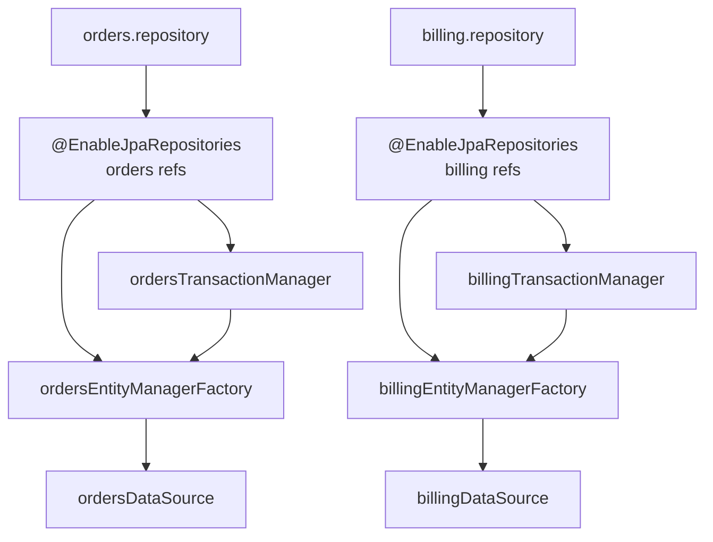

# Partitioning Repository Packages with entityManagerFactoryRef and transactionManagerRef

When a Spring Data JPA application connects to multiple databases, each repository group needs to know the exact DataSource, EntityManagerFactory, and transaction manager it uses. If Spring Data is left to choose by default bean names, repositories may end up pointing to the same persistence unit, or Spring may fail to resolve the right bean when multiple candidates exist.

@EnableJpaRepositories provides two key attributes for partitioning repositories:

- entityManagerFactoryRef specifies the EntityManagerFactory bean used to create repository proxies for the scanned package.
- transactionManagerRef specifies the PlatformTransactionManager bean used for the default transactions of repositories in that package.

This guide builds an example with two databases, orders and billing, each having its own entity package, repository package, EntityManagerFactory, and JpaTransactionManager.

> The Java snippets below are excerpts for Java 17+ projects using Spring Boot 3+ and spring-boot-starter-data-jpa. They illustrate configuration to integrate into an application, not standalone programs runnable directly via javac/java.

## 1. Understanding the three components per database

For each database using JPA, you typically configure three interrelated components:

| Component | Responsibility |
|---|---|
| DataSource | Provides JDBC connections to the corresponding database. |
| EntityManagerFactory | Creates EntityManagers and manages metadata and entity mappings belonging to that persistence unit. |
| PlatformTransactionManager | Manages transactions for the persistence unit. For local JPA, JpaTransactionManager is typically used. |

Each EntityManagerFactory must be bound to the right DataSource and the right entity package. Each repository group must be bound to the corresponding EntityManagerFactory and transaction manager.

Relationship diagram:



Do not share a single repository package across two configurations because the same interface could be scanned by both configurations.

## 2. Designing separate packages

An easy-to-manage package structure:

```text
com.example
├── orders
│   ├── domain
│   │   └── PurchaseOrder.java
│   └── repository
│       └── PurchaseOrderRepository.java
├── billing
│   ├── domain
│   │   └── Invoice.java
│   └── repository
│       └── InvoiceRepository.java
├── config
│   ├── OrdersJpaConfiguration.java
│   └── BillingJpaConfiguration.java
└── service
    └── OrderService.java
```

- com.example.orders.domain contains entities managed by the orders persistence unit.
- com.example.orders.repository contains repositories using the orders database.
- com.example.billing.domain contains entities managed by the billing persistence unit.
- com.example.billing.repository contains repositories using the billing database.

A JPA entity should belong to only one EntityManagerFactory in this design. JPA relationships such as @ManyToOne or @OneToMany cannot directly link entities managed by two independent persistence units. If an invoice references an order in another database, store orderId as a plain value and look it up through an appropriate service or API.

## 3. Declaring DataSource and EntityManagerFactory for the orders database

The example uses DataSourceProperties so Spring Boot handles the url property and translates it into HikariCP's jdbcUrl. Pool-specific settings are bound under a separate prefix.

**OrdersJpaConfiguration.java:**

```java
import javax.sql.DataSource;

import com.zaxxer.hikari.HikariDataSource;

import jakarta.persistence.EntityManagerFactory;

import org.springframework.beans.factory.annotation.Qualifier;
import org.springframework.boot.autoconfigure.jdbc.DataSourceProperties;
import org.springframework.boot.context.properties.ConfigurationProperties;
import org.springframework.boot.orm.jpa.EntityManagerFactoryBuilder;
import org.springframework.context.annotation.Bean;
import org.springframework.context.annotation.Configuration;
import org.springframework.context.annotation.Primary;
import org.springframework.data.jpa.repository.config.EnableJpaRepositories;
import org.springframework.orm.jpa.JpaTransactionManager;
import org.springframework.orm.jpa.LocalContainerEntityManagerFactoryBean;
import org.springframework.transaction.PlatformTransactionManager;

@Configuration(proxyBeanMethods = false)
@EnableJpaRepositories(
    basePackages = "com.example.orders.repository",
    entityManagerFactoryRef = "ordersEntityManagerFactory",
    transactionManagerRef = "ordersTransactionManager"
)
public class OrdersJpaConfiguration {

    @Bean
    @Primary
    @ConfigurationProperties("app.datasource.orders")
    DataSourceProperties ordersDataSourceProperties() {
        return new DataSourceProperties();
    }

    @Bean
    @Primary
    @ConfigurationProperties("app.datasource.orders.hikari")
    HikariDataSource ordersDataSource(
            @Qualifier("ordersDataSourceProperties")
            DataSourceProperties properties) {
        return properties.initializeDataSourceBuilder()
                .type(HikariDataSource.class)
                .build();
    }

    @Bean
    @Primary
    LocalContainerEntityManagerFactoryBean ordersEntityManagerFactory(
            EntityManagerFactoryBuilder builder,
            @Qualifier("ordersDataSource") DataSource dataSource) {
        return builder
                .dataSource(dataSource)
                .packages("com.example.orders.domain")
                .persistenceUnit("orders")
                .build();
    }

    @Bean
    @Primary
    PlatformTransactionManager ordersTransactionManager(
            @Qualifier("ordersEntityManagerFactory")
            EntityManagerFactory entityManagerFactory) {
        return new JpaTransactionManager(entityManagerFactory);
    }
}
```

Key points to note:

1. basePackages restricts repository scanning to the orders package.
2. entityManagerFactoryRef points to the bean named ordersEntityManagerFactory.
3. transactionManagerRef points to the bean named ordersTransactionManager.
4. packages("com.example.orders.domain") restricts entities registered in the orders persistence unit.
5. persistenceUnit("orders") sets the persistence unit name; this name can also be used when injecting an EntityManager via @PersistenceContext(unitName = "orders").
6. @Primary helps Spring Boot and injection points without qualifiers select a default bean group. It does not replace the explicit references in @EnableJpaRepositories.

Spring Boot provides EntityManagerFactoryBuilder in its JPA auto-configuration. When declaring multiple DataSources manually, mark one DataSource as @Primary so auto-configurations requiring a single candidate can pick a default bean. If JPA auto-configuration has been disabled or replaced, you must provide the builder or configure LocalContainerEntityManagerFactoryBean yourself.

## 4. Declaring configuration for the billing database

The second database uses a similar configuration but with its own bean names, entity package, repository package, and persistence unit. Do not mark these beans as @Primary:

**BillingJpaConfiguration.java:**

```java
import javax.sql.DataSource;

import com.zaxxer.hikari.HikariDataSource;

import jakarta.persistence.EntityManagerFactory;

import org.springframework.beans.factory.annotation.Qualifier;
import org.springframework.boot.autoconfigure.jdbc.DataSourceProperties;
import org.springframework.boot.context.properties.ConfigurationProperties;
import org.springframework.boot.orm.jpa.EntityManagerFactoryBuilder;
import org.springframework.context.annotation.Bean;
import org.springframework.context.annotation.Configuration;
import org.springframework.data.jpa.repository.config.EnableJpaRepositories;
import org.springframework.orm.jpa.JpaTransactionManager;
import org.springframework.orm.jpa.LocalContainerEntityManagerFactoryBean;
import org.springframework.transaction.PlatformTransactionManager;

@Configuration(proxyBeanMethods = false)
@EnableJpaRepositories(
    basePackages = "com.example.billing.repository",
    entityManagerFactoryRef = "billingEntityManagerFactory",
    transactionManagerRef = "billingTransactionManager"
)
public class BillingJpaConfiguration {

    @Bean
    @ConfigurationProperties("app.datasource.billing")
    DataSourceProperties billingDataSourceProperties() {
        return new DataSourceProperties();
    }

    @Bean
    @ConfigurationProperties("app.datasource.billing.hikari")
    HikariDataSource billingDataSource(
            @Qualifier("billingDataSourceProperties")
            DataSourceProperties properties) {
        return properties.initializeDataSourceBuilder()
                .type(HikariDataSource.class)
                .build();
    }

    @Bean
    LocalContainerEntityManagerFactoryBean billingEntityManagerFactory(
            EntityManagerFactoryBuilder builder,
            @Qualifier("billingDataSource") DataSource dataSource) {
        return builder
                .dataSource(dataSource)
                .packages("com.example.billing.domain")
                .persistenceUnit("billing")
                .build();
    }

    @Bean
    PlatformTransactionManager billingTransactionManager(
            @Qualifier("billingEntityManagerFactory")
            EntityManagerFactory entityManagerFactory) {
        return new JpaTransactionManager(entityManagerFactory);
    }
}
```

Both configurations use EntityManagerFactoryBuilder while passing different DataSources. The builder creates two independent LocalContainerEntityManagerFactoryBean instances, each managing its own entity package. Both JpaTransactionManagers are likewise bound to their respective EntityManagerFactories.

Do not reuse bean names across both databases. Qualifiers on configuration method parameters must match the declared bean names exactly.

## 5. Configuring connections in application.yml

Example with two PostgreSQL databases:

```yaml
app:
  datasource:
    orders:
      url: jdbc:postgresql://localhost:5432/orders_db
      username: app_user
      password: YOUR_ORDERS_DB_PASSWORD
      driver-class-name: org.postgresql.Driver
      hikari:
        pool-name: orders-pool
        maximum-pool-size: 12
        minimum-idle: 2

    billing:
      url: jdbc:postgresql://localhost:5432/billing_db
      username: billing_user
      password: YOUR_BILLING_DB_PASSWORD
      driver-class-name: org.postgresql.Driver
      hikari:
        pool-name: billing-pool
        maximum-pool-size: 8
        minimum-idle: 1
```

DataSourceProperties receives url, username, password, and driver. Properties under hikari are bound to HikariDataSource. Do not place URL directly under the Hikari prefix if binding HikariDataSource directly, as Hikari uses jdbcUrl; DataSourceProperties.initializeDataSourceBuilder() handles this conversion.

Password values in the example are solely to illustrate configuration structure. Never commit real passwords to the repository. Use environment variables, a secret manager, or appropriate security configuration per environment.

If the two databases need different Hibernate properties such as dialect, schema, naming strategy, or batch size, configure separate JPA properties for each EntityManagerFactory rather than assuming all spring.jpa.* properties apply suitably to both. The example configuration uses the same provider and the same basic JPA settings.

## 6. How are repositories partitioned?

Example repository for orders:

```java
package com.example.orders.repository;

import org.springframework.data.jpa.repository.JpaRepository;

import com.example.orders.domain.PurchaseOrder;

public interface PurchaseOrderRepository
        extends JpaRepository<PurchaseOrder, Long> {
}
```

Repository for billing:

```java
package com.example.billing.repository;

import org.springframework.data.jpa.repository.JpaRepository;

import com.example.billing.domain.Invoice;

public interface InvoiceRepository
        extends JpaRepository<Invoice, Long> {
}
```

When the application starts:

- Spring scans com.example.orders.repository and creates PurchaseOrderRepository with ordersEntityManagerFactory and ordersTransactionManager.
- Spring scans com.example.billing.repository and creates InvoiceRepository with billingEntityManagerFactory and billingTransactionManager.

The entityManagerFactoryRef and transactionManagerRef attributes accept bean names, not Java class names or persistence unit names. They default to entityManagerFactory and transactionManager respectively if unconfigured. In applications with multiple persistence units, declare them explicitly to prevent repositories from pointing to the wrong unit.

## 7. Selecting the transaction manager at the service layer

transactionManagerRef determines the transaction manager used for the configured repositories. When a service needs to open a transaction wrapping a use case, it must also select the right transaction manager:

```java
import org.springframework.stereotype.Service;
import org.springframework.transaction.annotation.Transactional;

@Service
public class OrderService {

    private final PurchaseOrderRepository orders;

    public OrderService(PurchaseOrderRepository orders) {
        this.orders = orders;
    }

    @Transactional(transactionManager = "ordersTransactionManager")
    public void confirmOrder(Long orderId) {
        PurchaseOrder order = orders.findById(orderId)
                .orElseThrow();
        order.confirm();
    }
}
```

Services operating on the billing database choose the other manager:

```java
import org.springframework.stereotype.Service;
import org.springframework.transaction.annotation.Transactional;

@Service
public class InvoiceService {

    private final InvoiceRepository invoices;

    public InvoiceService(InvoiceRepository invoices) {
        this.invoices = invoices;
    }

    @Transactional(transactionManager = "billingTransactionManager")
    public void markInvoicePaid(Long invoiceId) {
        Invoice invoice = invoices.findById(invoiceId)
                .orElseThrow();
        invoice.markPaid();
    }
}
```

If you omit the transactionManager attribute on @Transactional at the service layer, Spring picks the default transaction manager or the @Primary bean. If a service operates on a billing repository while the outer transaction uses the orders manager, the two managers may open two independent local transactions. Do not rely on the repository's own manager selection to assume the outer transaction is using the right database.

You can inject a specific EntityManager by persistence unit when custom queries are needed:

```java
import jakarta.persistence.EntityManager;
import jakarta.persistence.PersistenceContext;

public class BillingCustomDao {

    @PersistenceContext(unitName = "billing")
    private EntityManager entityManager;

    // Custom operations using the billing persistence unit.
}
```

The unitName value must match the name declared via .persistenceUnit("billing"). Do not inject an unqualified EntityManager in an application with multiple persistence units unless there is a clear default configuration.

## 8. Are transactions across two databases atomic?

The two JpaTransactionManager beans in the example are two local transaction managers. Each manager controls transactions for its respective persistence unit. Using both repositories inside the same Java method does not automatically create an atomic transaction covering both databases.

Example that does not guarantee global atomicity:

```java
@Transactional(transactionManager = "ordersTransactionManager")
public void createOrderAndInvoice(PurchaseOrder order, Invoice invoice) {
    orders.save(order);
    invoices.save(invoice);
}
```

The orders transaction is opened by ordersTransactionManager. When invoices.save() runs, the billing repository uses its own billingTransactionManager. The two transactions can commit or roll back independently. If billing commits while orders rolls back, data between the two databases can become inconsistent.

If atomic commit/rollback across multiple databases is required, a distributed transaction solution such as JTA/XA with XA-capable datasources and drivers, an appropriate transaction coordinator, and corresponding operational setup is needed. This approach is more complex in configuration, latency, and incident handling.

For many business systems, Saga or Transactional Outbox with retry/idempotency and business compensation mechanisms can be designed instead. Choose based on consistency requirements and recoverability; do not assume a regular @Transactional automatically spans all databases.

## 9. Migrations and schemas per database

Each datasource needs its corresponding schema and migrations. When using Flyway or Liquibase, configure migrations to run against the right datasource. Default auto-configuration typically focuses on the primary datasource; when there are multiple databases, explicitly define which migrations run for orders and which run for billing.

Do not let Hibernate auto-generate the schema for one persistence unit and assume the other database has also been updated. In deployed environments, each database's migration version must be tracked separately and must match the entity package bound to that EntityManagerFactory.

## 10. Testing wiring and common errors

An integration test should verify that repositories write to the right database and transaction managers match the right persistence unit:

1. Start two independent test databases, such as two PostgreSQL Testcontainers.
2. Apply separate schemas/migrations for each database.
3. Save an entity via the orders repository and verify it exists in the orders database.
4. Save an entity via the billing repository and verify it exists in the billing database.
5. Test rollback for each service with its respective transactionManager.
6. Verify repository packages are not scanned redundantly by two @EnableJpaRepositories annotations.

| Symptom | Common Cause | How to Check or Fix |
|---|---|---|
| Not a managed type | Entity is not in the package scanned by the EMF | Check .packages(...) of the right EMF |
| Repository connects to wrong database | entityManagerFactoryRef points wrongly or package scan overlaps | Check basePackages and referenced bean names |
| Transaction manager not found | Wrong transactionManagerRef name or undeclared bean | Cross-check bean names and qualifiers |
| Multiple beans of same type error | Multiple datasources/EMFs/transaction managers with unqualified injection or no primary | Add @Qualifier at injection points and pick @Primary intentionally |
| @Transactional rolls back wrong database | Service uses default transaction manager not matching repository | Declare @Transactional(transactionManager = "...") |
| Hikari fails to connect | Binding url directly to Hikari instead of jdbcUrl | Use DataSourceProperties.initializeDataSourceBuilder() |
| Entity relationship error across two databases | Two entities belong to two independent persistence units | Use ID references and coordinate via service/API |
| Data between two databases diverges after error | Two local transactions do not commit atomically together | Use JTA/XA or design an appropriate Saga/Outbox |

## 11. Implementation checklist

- Each database has its own DataSource and connection pool.
- Each EntityManagerFactory uses the right datasource and scans only its own entity package.
- Each repository package is managed by only one @EnableJpaRepositories configuration.
- entityManagerFactoryRef points to the right EMF bean.
- transactionManagerRef points to the right transaction manager bean.
- Bean names, qualifiers, and persistence unit names are named consistently.
- One bean group is marked @Primary when a default candidate is needed; remaining injection points use qualifiers.
- Services select the right transaction manager via @Transactional(transactionManager = "...").
- Never assume two local transaction managers create an atomic cross-database transaction.
- Migrations and tests are configured separately for each database.

entityManagerFactoryRef and transactionManagerRef are the two connection points determining which persistence unit and transaction manager a repository package uses. When repository packages, entity packages, and bean names are cleanly separated and consistent, an application can manage multiple databases clearly, testably, and without misrouting datasource or transaction manager errors.

## References

- [Spring Data JPA — EnableJpaRepositories API](https://docs.spring.io/spring-data/jpa/reference/api/java/org/springframework/data/jpa/repository/config/EnableJpaRepositories.html)
- [Spring Data JPA — Repository Configuration](https://docs.spring.io/spring-data/jpa/reference/repositories/create-instances.html)
- [Spring Boot 3.4 — Configure Two DataSources and Multiple EntityManagerFactories](https://docs.spring.io/spring-boot/3.4/how-to/data-access.html)
- [Spring Framework — Transaction Management](https://docs.spring.io/spring-framework/reference/data-access/transaction.html)