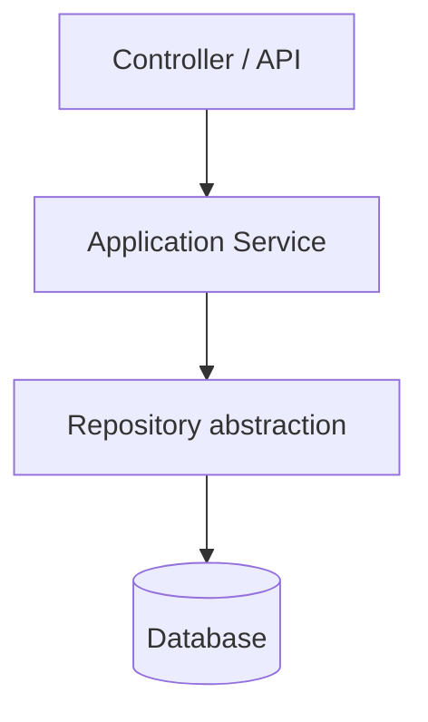
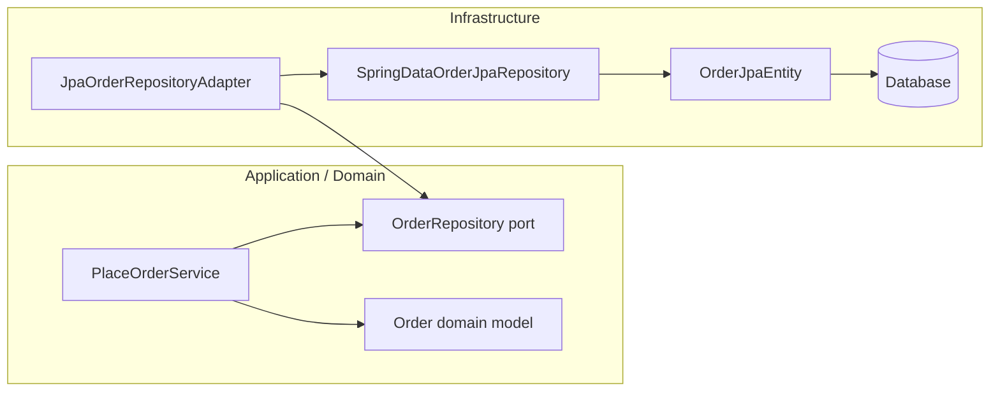

# Where Should Repositories Live in a Layered Spring Data JPA Application?

A Repository belongs to the data access boundary: it provides operations to save, find, update, and delete data for the business layer. The specific placement of the Repository interface depends on the architecture the application chooses.

In a traditional layered architecture, the Repository usually lives in the persistence/data access layer, and the Service depends on it. In Clean Architecture or Hexagonal Architecture, the repository interface is typically a port on the inside (application or domain), while the implementation using Spring Data JPA lives in infrastructure. Both approaches can be valid; what matters is that dependencies point in one clear direction and each layer preserves its proper responsibility.

## 1. Where Does the Repository Sit in the Processing Flow?

A common flow:



- **Controller** receives the HTTP request, validates input data at the API level, invokes the use case, and transforms the result into a response.
- **Service / Use case** orchestrates business logic, enforces rules, manages transaction boundaries, and calls the required abstractions.
- **Repository** provides data access in terms of business concepts or aggregates; it does not orchestrate the entire use case.
- **Infrastructure / persistence adapter** performs database access using Spring Data JPA, Hibernate, JDBC, or another technology.

A Repository is an abstraction, not synonymous with a database table or an entity. Spring Data JPA can generate an implementation proxy from an interface extending `JpaRepository`; we do not have to write a CRUD class manually for that interface.

For example:

```java
public interface OrderRepository
        extends JpaRepository<OrderEntity, Long> {
}
```

Spring Data detects the interface within the repository scan scope, creates a proxy, and provides CRUD operations. The Service calls the interface through dependency injection; the service does not need to know the SQL queries or how Hibernate generates statements.

## 2. Organizing in a Traditional Layered Architecture

For CRUD applications or systems of moderate complexity, a feature-based structure combined with layers is an easy-to-follow choice:

```text
com.example.shop
└── order
    ├── controller
    │   └── OrderController.java
    ├── service
    │   └── OrderService.java
    ├── repository
    │   └── OrderRepository.java
    ├── entity
    │   └── OrderEntity.java
    └── dto
        ├── CreateOrderRequest.java
        └── OrderResponse.java
```

In this approach, the Spring Data repository interface is usually placed in the `repository` or `persistence` package. The Service depends on that interface; the Controller depends only on the Service.

JPA Entity:

**OrderEntity.java**

```java
package com.example.shop.order.entity;

import jakarta.persistence.Column;
import jakarta.persistence.Entity;
import jakarta.persistence.GeneratedValue;
import jakarta.persistence.GenerationType;
import jakarta.persistence.Id;
import jakarta.persistence.Table;
import java.math.BigDecimal;

@Entity
@Table(name = "orders")
public class OrderEntity {

    @Id
    @GeneratedValue(strategy = GenerationType.IDENTITY)
    private Long id;

    @Column(nullable = false, unique = true)
    private String orderNumber;

    @Column(nullable = false, precision = 12, scale = 2)
    private BigDecimal total;

    @Column(nullable = false)
    private String status;

    protected OrderEntity() {
    }

    public OrderEntity(String orderNumber, BigDecimal total) {
        this.orderNumber = orderNumber;
        this.total = total;
        this.status = "NEW";
    }

    public Long getId() {
        return id;
    }

    public String getOrderNumber() {
        return orderNumber;
    }

    public BigDecimal getTotal() {
        return total;
    }

    public String getStatus() {
        return status;
    }

    public void confirm() {
        if (!"NEW".equals(status)) {
            throw new IllegalStateException("Only new orders can be confirmed");
        }
        status = "CONFIRMED";
    }
}
```

Repository:

**OrderRepository.java**

```java
package com.example.shop.order.repository;

import com.example.shop.order.entity.OrderEntity;
import java.util.Optional;
import org.springframework.data.jpa.repository.JpaRepository;

public interface OrderRepository
        extends JpaRepository<OrderEntity, Long> {

    Optional<OrderEntity> findByOrderNumber(String orderNumber);
}
```

Service:

**OrderService.java**

```java
package com.example.shop.order.service;

import com.example.shop.order.entity.OrderEntity;
import com.example.shop.order.repository.OrderRepository;
import java.math.BigDecimal;
import org.springframework.stereotype.Service;
import org.springframework.transaction.annotation.Transactional;

@Service
public class OrderService {

    private final OrderRepository orderRepository;

    public OrderService(OrderRepository orderRepository) {
        this.orderRepository = orderRepository;
    }

    @Transactional
    public OrderEntity create(String orderNumber, BigDecimal total) {
        if (orderNumber == null || orderNumber.isBlank()) {
            throw new IllegalArgumentException("orderNumber is required");
        }
        if (total == null || total.signum() < 0) {
            throw new IllegalArgumentException("total must be non-negative");
        }

        if (orderRepository.findByOrderNumber(orderNumber).isPresent()) {
            throw new IllegalArgumentException("orderNumber already exists");
        }

        return orderRepository.save(new OrderEntity(orderNumber, total));
    }

    @Transactional
    public void confirm(Long orderId) {
        OrderEntity order = orderRepository.findById(orderId)
            .orElseThrow(() -> new IllegalArgumentException("Order not found"));
        order.confirm();
        // The entity is managed; dirty checking persists the status when the transaction flushes.
    }
}
```

The Controller does not call the repository directly. Declare the request and response DTOs:

**CreateOrderRequest.java**

```java
package com.example.shop.order.dto;

import jakarta.validation.constraints.DecimalMin;
import jakarta.validation.constraints.NotBlank;
import jakarta.validation.constraints.NotNull;
import java.math.BigDecimal;

public record CreateOrderRequest(
    @NotBlank String orderNumber,
    @NotNull @DecimalMin("0.00") BigDecimal total
) {
}
```

**OrderResponse.java**

```java
package com.example.shop.order.dto;

import java.math.BigDecimal;

public record OrderResponse(
    Long id,
    String orderNumber,
    BigDecimal total
) {
}
```

Controller:

```java
package com.example.shop.order.controller;

import com.example.shop.order.dto.CreateOrderRequest;
import com.example.shop.order.dto.OrderResponse;
import com.example.shop.order.entity.OrderEntity;
import com.example.shop.order.service.OrderService;
import jakarta.validation.Valid;
import org.springframework.http.HttpStatus;
import org.springframework.web.bind.annotation.PostMapping;
import org.springframework.web.bind.annotation.RequestBody;
import org.springframework.web.bind.annotation.RequestMapping;
import org.springframework.web.bind.annotation.ResponseStatus;
import org.springframework.web.bind.annotation.RestController;

@RestController
@RequestMapping("/orders")
public class OrderController {

    private final OrderService orderService;

    public OrderController(OrderService orderService) {
        this.orderService = orderService;
    }

    @PostMapping
    @ResponseStatus(HttpStatus.CREATED)
    public OrderResponse create(@Valid @RequestBody CreateOrderRequest request) {
        OrderEntity order =
            orderService.create(request.orderNumber(), request.total());

        return new OrderResponse(
            order.getId(),
            order.getOrderNumber(),
            order.getTotal()
        );
    }
}
```

For request validation to work, the application needs the appropriate Bean Validation dependency, such as `spring-boot-starter-validation`. Even though the request is validated, the service/domain still needs to protect invariants because the use case may be invoked from a batch job, a message consumer, or tests without going through the HTTP controller.

The dependency flow of this organization is:

```text
Controller -> Service -> Spring Data Repository -> EntityManager/Database
```

This approach is pragmatic, easy to implement, and appropriate when the project accepts having the service depend directly on Spring Data JPA. In return, the service may become coupled to framework types such as `Pageable`, `Page`, `JpaSpecificationExecutor`, or JPA entities.

## 3. Organizing by Feature or by Layer?

Two common package layouts:

**Layer-first:**

```text
controller/
service/
repository/
entity/
dto/
```

**Feature-first:**

```text
order/
  controller/
  service/
  repository/
  entity/
  dto/
customer/
  controller/
  service/
  repository/
  entity/
  dto/
```

Layer-first is easy to read when the application is small and has few features. As a project grows, a single `service` or `repository` package can accumulate dozens of classes belonging to unrelated business areas. Feature-first groups components of the same business capability close together, reducing the need to navigate across many top-level packages.

Spring Data JPA does not enforce a single package style. Prefer a structure that helps readers find the code for a feature and identify the boundary between business logic and persistence.

## 4. Repositories in Clean Architecture or Hexagonal Architecture

When domain/application code must not depend on Spring Data JPA, place the repository interface on the inside as a **port**. Infrastructure provides an adapter implementing the port using Spring Data JPA.

Example structure:

```text
com.example.shop.order
├── domain
│   └── Order.java
├── application
│   ├── port
│   │   └── out
│   │       └── OrderRepository.java
│   └── usecase
│       └── PlaceOrderService.java
└── infrastructure
    └── persistence
        └── jpa
            ├── OrderJpaEntity.java
            ├── SpringDataOrderJpaRepository.java
            └── JpaOrderRepositoryAdapter.java
```

Interface in the application port:

**OrderRepository.java**

```java
package com.example.shop.order.application.port.out;

import com.example.shop.order.domain.Order;
import java.util.Optional;

public interface OrderRepository {

    Optional<Order> findById(Long id);

    Order save(Order order);
}
```

This is an application abstraction; it does not extend `JpaRepository` and does not import Spring annotations. It expresses the operations the use case needs without exposing database details.

Domain model:

**Order.java**

```java
package com.example.shop.order.domain;

import java.math.BigDecimal;

public record Order(
    Long id,
    String orderNumber,
    BigDecimal total
) {
    public static Order newOrder(String orderNumber, BigDecimal total) {
        return new Order(null, orderNumber, total);
    }
}
```

Use case depending on the port:

**PlaceOrderService.java**

```java
package com.example.shop.order.application.usecase;

import com.example.shop.order.application.port.out.OrderRepository;
import com.example.shop.order.domain.Order;
import java.math.BigDecimal;

public class PlaceOrderService {

    private final OrderRepository orderRepository;

    public PlaceOrderService(OrderRepository orderRepository) {
        this.orderRepository = orderRepository;
    }

    public Order place(String orderNumber, BigDecimal total) {
        if (orderNumber == null || orderNumber.isBlank()) {
            throw new IllegalArgumentException("orderNumber is required");
        }
        if (total == null || total.signum() < 0) {
            throw new IllegalArgumentException("total must be non-negative");
        }

        return orderRepository.save(Order.newOrder(orderNumber, total));
    }
}
```

Register the plain Java use case as a Spring bean via configuration in the outer ring:

**OrderUseCaseConfig.java**

```java
package com.example.shop.order.infrastructure.config;

import com.example.shop.order.application.port.out.OrderRepository;
import com.example.shop.order.application.usecase.PlaceOrderService;
import org.springframework.context.annotation.Bean;
import org.springframework.context.annotation.Configuration;

@Configuration(proxyBeanMethods = false)
public class OrderUseCaseConfig {

    @Bean
    PlaceOrderService placeOrderService(OrderRepository orderRepository) {
        return new PlaceOrderService(orderRepository);
    }
}
```

The infrastructure layer uses a separate JPA entity:

**OrderJpaEntity.java**

```java
package com.example.shop.order.infrastructure.persistence.jpa;

import jakarta.persistence.Column;
import jakarta.persistence.Entity;
import jakarta.persistence.GeneratedValue;
import jakarta.persistence.GenerationType;
import jakarta.persistence.Id;
import jakarta.persistence.Table;
import java.math.BigDecimal;

@Entity
@Table(name = "orders")
public class OrderJpaEntity {

    @Id
    @GeneratedValue(strategy = GenerationType.IDENTITY)
    private Long id;

    @Column(nullable = false, unique = true)
    private String orderNumber;

    @Column(nullable = false, precision = 12, scale = 2)
    private BigDecimal total;

    protected OrderJpaEntity() {
    }

    public OrderJpaEntity(Long id, String orderNumber, BigDecimal total) {
        this.id = id;
        this.orderNumber = orderNumber;
        this.total = total;
    }

    public Long getId() {
        return id;
    }

    public String getOrderNumber() {
        return orderNumber;
    }

    public BigDecimal getTotal() {
        return total;
    }
}
```

The Spring Data repository knows only the persistence entity:

**SpringDataOrderJpaRepository.java**

```java
package com.example.shop.order.infrastructure.persistence.jpa;

import java.util.Optional;
import org.springframework.data.jpa.repository.JpaRepository;

public interface SpringDataOrderJpaRepository
        extends JpaRepository<OrderJpaEntity, Long> {

    Optional<OrderJpaEntity> findByOrderNumber(String orderNumber);
}
```

The adapter converts between the domain model and the JPA entity:

**JpaOrderRepositoryAdapter.java**

```java
package com.example.shop.order.infrastructure.persistence.jpa;

import com.example.shop.order.application.port.out.OrderRepository;
import com.example.shop.order.domain.Order;
import java.util.Optional;
import org.springframework.stereotype.Repository;

@Repository
public class JpaOrderRepositoryAdapter implements OrderRepository {

    private final SpringDataOrderJpaRepository jpaRepository;

    public JpaOrderRepositoryAdapter(
            SpringDataOrderJpaRepository jpaRepository) {
        this.jpaRepository = jpaRepository;
    }

    @Override
    public Optional<Order> findById(Long id) {
        return jpaRepository.findById(id).map(this::toDomain);
    }

    @Override
    public Order save(Order order) {
        OrderJpaEntity entity = new OrderJpaEntity(
            order.id(),
            order.orderNumber(),
            order.total()
        );

        return toDomain(jpaRepository.save(entity));
    }

    private Order toDomain(OrderJpaEntity entity) {
        return new Order(
            entity.getId(),
            entity.getOrderNumber(),
            entity.getTotal()
        );
    }
}
```

In this model, the use case knows only the `OrderRepository` port. It has no knowledge of `JpaRepository`, `EntityManager`, Hibernate, or table names. The adapter is where persisting `OrderJpaEntity` and converting data to the domain model takes place.

Dependency diagram:



Source code dependency arrows point inward: the adapter implements the port. Application does not import infrastructure. When replacing Hibernate with JDBC or a remote API, the use case continues to use the same port as long as the business contract does not change.

## 5. Should the Interface Be Placed in Application or Domain?

There is no single rule for every project:

- **Application port:** appropriate when the repository serves a specific use case or application flow. The interface reflects the exact needs required by the application.
- **Domain repository:** appropriate when the repository is a natural abstraction of an aggregate in domain-driven design, for example `OrderRepository` working with the `Order` aggregate.
- **Infrastructure:** place the Spring Data interface and concrete adapter here because they depend on the framework, ORM, and database schema.

If an interface is just a generic set of CRUD methods that the domain does not actually need, there is no need to create a domain abstraction solely to mirror every method of `JpaRepository`. Create a port when it protects a meaningful boundary or keeps the application independent of storage technology.

## 6. Where Should Transactions Be Placed?

A transaction typically spans a use case, which may invoke multiple repositories and perform multiple changes that must be consistent with one another. Therefore, transaction boundaries are usually defined at the application service/use case level rather than attached piecemeal to individual repository statements.

In a traditional layered Spring application, the transaction usually wraps the entire use case. With `OrderEntity` having declared the `confirm()` method earlier:

```java
package com.example.shop.order.service;

import com.example.shop.order.entity.OrderEntity;
import com.example.shop.order.repository.OrderRepository;
import org.springframework.stereotype.Service;
import org.springframework.transaction.annotation.Transactional;

@Service
public class OrderConfirmationService {

    private final OrderRepository orderRepository;

    public OrderConfirmationService(OrderRepository orderRepository) {
        this.orderRepository = orderRepository;
    }

    @Transactional
    public void confirm(Long orderId) {
        OrderEntity order = orderRepository.findById(orderId)
            .orElseThrow(() -> new IllegalArgumentException("Order not found"));
        order.confirm();
    }
}
```

An entity loaded inside a transaction is managed; dirty checking persists state changes on flush. If a use case updates multiple repositories, place the transaction on the service method surrounding all operations so the changes participate in the same transaction manager.

In Clean Architecture, `@Transactional` can be placed directly on the application service as a pragmatic choice, accepting that the application layer depends on Spring transactions. If the application must remain framework-pure, transaction orchestration can be placed in a decorator/proxy outside the use case or handled via an appropriate adapter configuration. Regardless of the choice, the transaction must cover the entire business operation that requires atomicity.

Repository methods inherited from Spring Data have default transaction behavior depending on the method type, but that does not replace defining the use case's transaction boundary. When multiple repositories participate in a business operation, a service-level transaction clearly expresses the scope of work.

## 7. Which Layer Do Custom Queries and Business Logic Belong To?

Repositories are suited for data querying and persistence operations:

- Finding aggregates by ID or business key.
- Querying by criteria, pagination, and sorting.
- Saving aggregates and executing queries needed by the use case.
- Using a custom repository fragment when a query requires complex persistence logic.

Business logic belongs to the domain or application:

- Checking whether an order is allowed to transition from one state to another.
- Calculating fees, applying discount policies, or checking credit limits.
- Orchestrating order creation, stock reservation, and payment processing.
- Deciding when to publish an event or call an external port.

Do not put the entire `createOrder -> reserveStock -> chargePayment -> sendEmail` workflow inside a repository. A repository is not a workflow engine or a service layer.

If a complex query needs a custom implementation, a fragment can be used:

```java
public interface OrderSearch {
    List<OrderEntity> findOrdersReadyForDispatch();
}

public interface OrderRepository
        extends JpaRepository<OrderEntity, Long>, OrderSearch {
}
```

The fragment implementation uses `EntityManager`, the Criteria API, or an appropriate query and lives in infrastructure/persistence. It remains focused on querying and does not orchestrate the entire business process.

## 8. Testing Along the Right Boundaries

Organizing repositories properly also helps determine which tests to write:

| Layer | Testing goal | Appropriate testing approach |
|---|---|---|
| Controller | HTTP status, request validation, response mapping | `@WebMvcTest` or MockMvc |
| Application service/use case | Business rules and orchestration | Unit tests with a fake/mock repository port |
| Spring Data repository/adapter | JPQL, mapping, constraints, transaction persistence | `@DataJpaTest`, Testcontainers when a production database is needed |
| End-to-end | Wiring and flow from API to database | `@SpringBootTest` or appropriately scoped integration tests |

Unit tests for a Clean Architecture use case can use a fake repository:

```java
import com.example.shop.order.application.port.out.OrderRepository;
import com.example.shop.order.domain.Order;
import java.util.HashMap;
import java.util.Map;
import java.util.Optional;

class InMemoryOrderRepository
        implements OrderRepository {

    private final Map<Long, Order> orders = new HashMap<>();
    private long nextId = 1;

    @Override
    public Optional<Order> findById(Long id) {
        return Optional.ofNullable(orders.get(id));
    }

    @Override
    public Order save(Order order) {
        Order saved = new Order(
            order.id() == null ? nextId++ : order.id(),
            order.orderNumber(),
            order.total()
        );
        orders.put(saved.id(), saved);
        return saved;
    }
}
```

This fake supports unit testing and does not replace integration tests with JPA. Integration tests must verify the adapter, mappings, and actual database behavior. If production uses PostgreSQL, Testcontainers PostgreSQL generally provides better evidence than H2 for differences in dialect, constraints, sequences, and locking.

## 9. Spring Boot Repository Scanning

Spring Boot normally scans components, entities, and repositories starting from the package containing the `@SpringBootApplication` class and downward. Placing the main class in a common root package allows subpackages to be discovered:

```text
com.example.shop
├── ShopApplication.java
├── order
│   ├── service
│   ├── repository
│   └── entity
└── customer
    ├── service
    ├── repository
    └── entity
```

If repositories live outside the default scope, `@EnableJpaRepositories(basePackages = "...")` can be configured. With multiple persistence units, configure the appropriate `entityManagerFactoryRef` and `transactionManagerRef` for each repository package.

Spring Data repository interfaces usually do not need `@Repository` added manually to be discovered when inside the repository scan scope. `@Repository` is typically useful for custom DAO/adapter classes, and it also participates in Spring's exception translation mechanism when managed as a bean.

## 10. Common Design Mistakes

| Mistake | Consequence | Corrective direction |
|---|---|---|
| Controller injects `JpaRepository` directly | HTTP layer depends on persistence and easily absorbs business logic | Controller calls an application service |
| Putting all repositories in one global package in a large project | Hard to locate code by feature and easy to create cross-dependencies | Group packages by feature/module |
| Placing fee calculation or state transitions inside a repository | Persistence layer holds business rules, making them hard to test and reuse | Move rules into domain/application |
| Application port extends `JpaRepository` | Application depends on Spring Data and JPA | Create a small port tailored to needs; let infrastructure extend `JpaRepository` |
| Returning a JPA entity in an API response | Persistence schema leaks into the HTTP contract; prone to lazy-loading/serialization errors | Use request/response DTOs and a mapper |
| Using a generic `BaseRepository` for all entities too early | Abstraction becomes hard to understand and exposes unnecessary APIs | Start with concrete repositories and abstract when a real need arises |
| Putting transactions on individual repository methods without defining use cases | Multiple operations may not share the same transaction | Place transaction boundaries on the service/use case |
| Using a repository to call another service or send emails | Creates circular dependencies and mixes workflow with persistence | Use an application service and outbound ports |

## 11. Choosing the Right Organization

| Context | Repository placement |
|---|---|
| Simple CRUD application, single database | Spring Data interface in the `repository` package; service calls it directly |
| Large feature-based application | Repository in the corresponding module/feature, alongside service and entity |
| Clean Architecture/Hexagonal | Port in application/domain; Spring Data interface and adapter in infrastructure |
| Domain-driven design with aggregates | Repository abstraction focused on aggregate lifecycle; implementation in infrastructure |
| Multiple persistence technologies | Application depends on ports; each technology provides its own adapter |

There is no value in adding extra layers solely to duplicate identical interfaces. Use the traditional structure when simplicity matters and coupling to framework boundaries is acceptable. Use ports/adapters when you need to shield application/domain from Spring Data JPA, support multiple adapters, or test use cases independently of the database.

The core rule is that the Controller handles communication, the Service/use case orchestrates business logic, the Repository provides the data access abstraction, and infrastructure is responsible for implementing it with Spring Data JPA. Placing components in the right modules and keeping dependencies aligned with the chosen direction makes the application easier to read, test, and evolve.