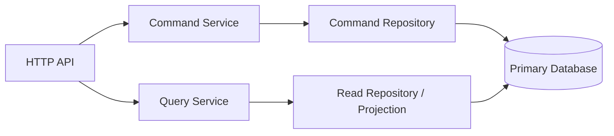
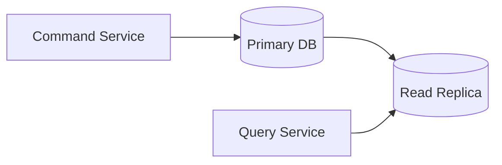

# Separating Read and Write Paths When Query Requirements Diverge

## 1. Objectives

As an application grows, how data is read often diverges from how it is written. The write path needs to enforce business rules, update Entities, and manage transactions. The read path needs to return data quickly for UI screens or APIs, often requiring projections, aggregations, filtering, and pagination in custom shapes.

Read/write separation gives each side a structure tailored to its job. This is the core idea of CQRS (Command Query Responsibility Segregation): commands mutate state, while queries only read data.

After this lesson, you will be able to:
- Distinguish commands from queries by their impact on state.
- Separate Repositories and Services for write and read paths in Spring Data JPA.
- Use managed Entities for write operations and DTO projections for read queries.
- Place appropriate transaction boundaries, including `@Transactional(readOnly = true)` for queries.
- Maintain consistency when both paths share a single database.
- Understand replication lag when querying via read replicas.
- Design dedicated read models and the transactional outbox when asynchronous updates are needed.
- Test read-after-write behavior, transactions, and projections.

## 2. How Do Commands and Queries Differ?

A command asks the system to change state. For example:

- Create a product.
- Change a product's price.
- Deactivate a product.
- Confirm an order.

A query only asks to read data and does not alter business state. For example:

- Fetch a list of active products.
- Find product details by SKU.
- Count orders by status.
- Find products priced within a range.

Practical convention:

| Path | Responsibility | Typical return value |
| --- | --- | --- |
| Command | Validate business rules and change state. | ID, processing status, command result, or domain event. |
| Query | Filter, sort, paginate, and shape read data. | DTO, projection, Page, Slice, or scalar. |

Commands and queries can live in the same Spring Boot application and share one database. Separating responsibilities does not require microservices or two separate databases.

## 3. When Should You Separate Reads and Writes?

Separating paths is helpful when:

- Read views require multiple joins, aggregations, or projections that differ from the write Entity model.
- Read APIs need lean DTOs, whereas commands need full Entities and domain methods.
- Multiple read screens need different data shapes.
- Queries require specialized tuning for indexes, pagination, or caching.
- The system has heavy read traffic and wants to add read replicas.
- The team wants a clear boundary between state-mutating logic and data-presentation logic.

There is no need to apply heavy CQRS to every simple CRUD module. If an Entity has only a few small queries and changes infrequently, a single Repository and Service may already be clear enough. Separate them when performance, modeling, or maintenance benefits outweigh the operational overhead.

## 4. Architectural Model

With a single database, you can split into two paths:



The Command Repository loads Entities to enforce business rules and write inside a transaction. The Read Repository returns projections or DTOs, selecting only the columns needed by the screen.

Initially, both Repositories can access the same schema and primary database. Later, if workload demands it, queries can read from replicas or a separate read store. At that stage, data consistency and synchronization must be designed explicitly.

## 5. Product Domain Example

The example uses Java 17+, Spring Boot 3.x, Spring Data JPA, and Hibernate managed by Spring Boot's dependency management. A `Product` has an SKU, name, price, active flag, and version.

`src/main/java/com/example/catalog/Product.java`:

```java
package com.example.catalog;

import jakarta.persistence.Column;
import jakarta.persistence.Entity;
import jakarta.persistence.GeneratedValue;
import jakarta.persistence.GenerationType;
import jakarta.persistence.Id;
import jakarta.persistence.Table;
import jakarta.persistence.Version;
import java.math.BigDecimal;

@Entity
@Table(name = "products")
public class Product {
    @Id
    @GeneratedValue(strategy = GenerationType.IDENTITY)
    private Long id;

    @Column(nullable = false, unique = true, length = 40)
    private String sku;

    @Column(nullable = false, length = 160)
    private String name;

    @Column(nullable = false, precision = 12, scale = 2)
    private BigDecimal price;

    @Column(nullable = false)
    private boolean active;

    @Version
    @Column(nullable = false)
    private long version;

    protected Product() {
        // JPA requires a no-arg constructor.
    }

    public Product(String sku, String name, BigDecimal price) {
        if (sku == null || sku.isBlank() || sku.length() > 40) {
            throw new IllegalArgumentException("SKU is required");
        }
        if (name == null || name.isBlank() || name.length() > 160) {
            throw new IllegalArgumentException("Name is required");
        }
        validatePrice(price);
        this.sku = sku.trim();
        this.name = name.trim();
        this.price = price;
        this.active = true;
    }

    public void changePrice(BigDecimal newPrice) {
        validatePrice(newPrice);
        this.price = newPrice;
    }

    public void deactivate() {
        this.active = false;
    }

    private static void validatePrice(BigDecimal price) {
        if (price == null || price.signum() < 0) {
            throw new IllegalArgumentException("Price must be zero or greater");
        }
    }

    public Long getId() { return id; }
    public String getSku() { return sku; }
    public String getName() { return name; }
    public BigDecimal getPrice() { return price; }
    public boolean isActive() { return active; }
    public long getVersion() { return version; }
}
```

`@Version` supports optimistic locking for standard Entity updates. The domain method `changePrice()` keeps pricing rules inside the Entity; the command service does not need to mutate private fields directly.

## 6. Separating Repositories for Commands and Queries

The Command Repository extends `JpaRepository` to load and save Entities:

`src/main/java/com/example/catalog/ProductCommandRepository.java`:

```java
package com.example.catalog;

import java.util.Optional;
import org.springframework.data.jpa.repository.JpaRepository;

public interface ProductCommandRepository extends JpaRepository<Product, Long> {
    Optional<Product> findBySku(String sku);
}
```

The Read Repository exposes only queries needed by the UI. For example, using a DTO record to select exactly four attributes:

`src/main/java/com/example/catalog/ProductListItem.java`:

```java
package com.example.catalog;

import java.math.BigDecimal;

public record ProductListItem(
        Long id,
        String sku,
        String name,
        BigDecimal price) {
}
```

`src/main/java/com/example/catalog/ProductReadRepository.java`:

```java
package com.example.catalog;

import java.util.Optional;
import org.springframework.data.domain.Pageable;
import org.springframework.data.domain.Slice;
import org.springframework.data.jpa.repository.Query;
import org.springframework.data.repository.Repository;
import org.springframework.data.repository.query.Param;

public interface ProductReadRepository extends Repository<Product, Long> {
    @Query("""
           select new com.example.catalog.ProductListItem(
               p.id, p.sku, p.name, p.price)
           from Product p
           where p.active = true
           """)
    Slice<ProductListItem> findActive(Pageable pageable);

    @Query("""
           select new com.example.catalog.ProductListItem(
               p.id, p.sku, p.name, p.price)
           from Product p
           where p.sku = :sku
           """)
    Optional<ProductListItem> findItemBySku(@Param("sku") String sku);
}
```

`ProductReadRepository` extends the minimal Spring Data `Repository` marker instead of `JpaRepository`, because the read path does not need `save`, `delete`, or Entity mutation methods. The JPQL constructor expression returns `ProductListItem`; the query does not need to hydrate a full managed Product for this list use case.

Spring Data can append the Sort from `Pageable` to the JPQL query. The service below adds `name` and `id` ordering so pagination remains deterministic when names repeat.

## 7. Command Service: Loading Entities and Mutating State

The Command Service establishes transaction boundaries for write operations:

`src/main/java/com/example/catalog/ProductCommandService.java`:

```java
package com.example.catalog;

import java.math.BigDecimal;
import java.util.Objects;
import org.springframework.stereotype.Service;
import org.springframework.transaction.annotation.Transactional;

@Service
public class ProductCommandService {
    private final ProductCommandRepository repository;

    public ProductCommandService(ProductCommandRepository repository) {
        this.repository = repository;
    }

    @Transactional
    public void changePrice(String sku, BigDecimal newPrice) {
        Objects.requireNonNull(sku, "sku is required");
        Product product = repository.findBySku(sku)
                .orElseThrow(() -> new IllegalArgumentException("Product not found"));
        product.changePrice(newPrice);
    }

    @Transactional
    public void deactivate(String sku) {
        Product product = repository.findBySku(sku)
                .orElseThrow(() -> new IllegalArgumentException("Product not found"));
        product.deactivate();
    }
}
```

The Entity is loaded inside a transaction, making it managed. When the method finishes and the transaction flushes/commits, Hibernate emits an UPDATE for the changes. Calling `save()` again on a managed Entity is unnecessary; you may call `save()` if project conventions prefer it, though dirty checking already tracks changes.

The Command Service is where permissions, valid states, and related business rules are verified. If an operation must update multiple Entities, keep them in the same transaction when business rules require atomicity.

## 8. Query Service: Projections and Read-Only Transactions

The Query Service orchestrates queries and returns DTOs/projections:

`src/main/java/com/example/catalog/ProductQueryService.java`:

```java
package com.example.catalog;

import java.util.Objects;
import org.springframework.data.domain.PageRequest;
import org.springframework.data.domain.Pageable;
import org.springframework.data.domain.Slice;
import org.springframework.data.domain.Sort;
import org.springframework.stereotype.Service;
import org.springframework.transaction.annotation.Transactional;

@Service
@Transactional(readOnly = true)
public class ProductQueryService {
    private static final int MAX_PAGE_SIZE = 100;

    private final ProductReadRepository repository;

    public ProductQueryService(ProductReadRepository repository) {
        this.repository = repository;
    }

    public Slice<ProductListItem> findActive(int page, int size) {
        Pageable pageable = validatedPageable(page, size);
        return repository.findActive(pageable);
    }

    public ProductListItem findBySku(String sku) {
        Objects.requireNonNull(sku, "sku is required");
        return repository.findItemBySku(sku)
                .orElseThrow(() -> new IllegalArgumentException("Product not found"));
    }

    private Pageable validatedPageable(int page, int size) {
        if (page < 0) {
            throw new IllegalArgumentException("Page index must be zero or greater");
        }
        if (size < 1 || size > MAX_PAGE_SIZE) {
            throw new IllegalArgumentException("Page size must be between 1 and 100");
        }
        return PageRequest.of(page, size,
                Sort.by(Sort.Order.asc("name"), Sort.Order.asc("id")));
    }
}
```

`@Transactional(readOnly = true)` signals that this transaction is read-only. With Hibernate, Spring can apply optimizations such as adjusting the flush mode to reduce dirty checking. This is a hint to the transaction manager/provider, not a security mechanism guaranteeing every database rejects writes. Never execute commands inside the Query Service.

Pagination uses `Slice` because the example only needs to know whether a next page exists, not the total product count. If the UI requires `totalElements` and `totalPages`, switch to `Page` and accept the count query cost when needed.

## 9. API Routing GET and Commands Separately

Example Controller routing GET requests to the Query Service and PATCH requests to the Command Service:

`src/main/java/com/example/catalog/ProductController.java`:

```java
package com.example.catalog;

import java.math.BigDecimal;
import org.springframework.data.domain.Slice;
import org.springframework.http.ResponseEntity;
import org.springframework.web.bind.annotation.GetMapping;
import org.springframework.web.bind.annotation.PatchMapping;
import org.springframework.web.bind.annotation.PathVariable;
import org.springframework.web.bind.annotation.RequestBody;
import org.springframework.web.bind.annotation.RequestMapping;
import org.springframework.web.bind.annotation.RequestParam;
import org.springframework.web.bind.annotation.RestController;

@RestController
@RequestMapping("/api/products")
public class ProductController {
    private final ProductCommandService commands;
    private final ProductQueryService queries;

    public ProductController(ProductCommandService commands, ProductQueryService queries) {
        this.commands = commands;
        this.queries = queries;
    }

    public record ChangePriceRequest(BigDecimal price) {
    }

    @GetMapping
    public Slice<ProductListItem> listActive(
            @RequestParam(defaultValue = "0") int page,
            @RequestParam(defaultValue = "20") int size) {
        return queries.findActive(page, size);
    }

    @GetMapping("/{sku}")
    public ProductListItem getBySku(@PathVariable String sku) {
        return queries.findBySku(sku);
    }

    @PatchMapping("/{sku}/price")
    public ResponseEntity<Void> changePrice(
            @PathVariable String sku,
            @RequestBody ChangePriceRequest request) {
        commands.changePrice(sku, request.price());
        return ResponseEntity.noContent().build();
    }
}
```

In a real application, add Bean Validation to request DTOs and an exception handler to map business errors to appropriate HTTP statuses. The Controller should not contain SQL queries or domain rules.

## 10. Consistency When Sharing a Single Database

When commands and queries hit the same primary database, the command's transaction commit is the critical boundary. A query running after a command commits, in a new transaction under standard isolation like `READ COMMITTED`, will observe the committed data.

Example flow:

1. Client calls PATCH to change a product's price.
2. `ProductCommandService` loads the Entity and updates the price in a transaction.
3. Spring commits the transaction.
4. Client calls GET afterward.
5. `ProductQueryService` runs a projection query against the same primary database and reads the new price.

Do not re-read from a cached Entity in the same persistence context if the query must reflect changes made via bulk SQL or stored procedures. When bulk DML/procedures modify tables outside dirty checking, clear or refresh the persistence context appropriately.

For a command followed immediately by a query within the same request, you can return the command result directly or read the projection after commit. Do not run an independent query and expect it to see uncommitted changes from another transaction.

## 11. When Queries Read from a Read Replica

When read traffic grows, database replicas can be configured to offload the primary. Commands write to the primary while queries can read from replicas.



Replication is typically asynchronous. Consequently, the following can happen:

- A command commits on the primary.
- The replica has not yet received or applied that transaction.
- A GET immediately following the command returns stale data or fails to find the record.

This is replication lag and leads to eventual consistency. If business logic requires read-your-writes, you can:

- Route reads to the primary for a short window after a command.
- Return the required data directly from the command result.
- Track a version/sequence number so the replica is queried only once caught up.
- Design the UI to tolerate synchronization delays where appropriate.

Do not assume `@Transactional(readOnly = true)` automatically routes queries to a replica. Routing to replicas requires explicit DataSource/transaction routing configuration, such as a custom `AbstractRoutingDataSource`, connection proxies, and source selection rules. Simply marking a transaction read-only neither creates read replicas nor guarantees routing.

### 11.1. Read-Only Routing Needs Correct Timing

If a custom routing datasource relies on `TransactionSynchronizationManager.isCurrentTransactionReadOnly()`, ensure the routing decision occurs after the transaction context is available. With some transaction manager setups, a connection may be acquired before transaction synchronization is published; `LazyConnectionDataSourceProxy` is commonly used to defer acquiring the physical connection until actually needed.

This is an infrastructure configuration detail, not something every application needs to add. Write integration tests proving queries route to the replica and commands route to the primary, especially testing query-after-command within the same request.

## 12. Separate Read Models and Advanced CQRS

When projections over the same schema are no longer enough, dedicated read models optimized for screens or reports can be introduced:

- Daily revenue summary tables.
- Denormalized product search tables.
- Documents in a search engine.
- Materialized views or dashboard tables.

Commands still update the write model as the source of truth. Another process updates the read model in response to events or messages. Read models may therefore lag behind the write model.

Never write to two independent databases in a single business operation without a reliability mechanism. If the primary database transaction commits but publishing the message fails, the read model will never be updated. If the message is published first and the database transaction rolls back, consumers may process an event with no corresponding source data.

### 12.1. Transactional Outbox

The transactional outbox solves dual-write issues by writing domain changes and an outbox record inside the same database transaction:

1. The command updates `Product`.
2. In the same transaction, write a `ProductPriceChanged` event to the outbox table.
3. Commit once for both `Product` and the outbox row.
4. A publisher reads the outbox and sends messages to the broker.
5. Consumers update read models, processing messages idempotently.

Example table structure:

```sql
create table outbox_event (
    id varchar(36) primary key,
    aggregate_type varchar(100) not null,
    aggregate_id varchar(100) not null,
    event_type varchar(150) not null,
    payload clob not null,
    occurred_at timestamp not null,
    published_at timestamp null
);
```

A publisher may redeliver an event if it fails after publishing but before marking `published_at`. Consumers must therefore deduplicate processing by event ID or version. Do not delete events immediately after sending without retry policies, retention rules, and error observability.

An outbox fits asynchronous read models or message-broker architectures. For small CRUD apps sharing a single database, adding an outbox can introduce unnecessary complexity.

## 13. Testing Read/Write Separation

Both query projections and write transactions must be tested. Simple repository tests can verify DTO projections return exact values; service tests can verify committed commands are visible to the query path.

Example using `spring-boot-starter-data-jpa`, H2, and `spring-boot-starter-test`. `@DataJpaTest` configures the test slice. Disable the outer test transaction so Service transactions actually commit:

`src/test/java/com/example/catalog/ProductReadWriteSeparationTest.java`:

```java
package com.example.catalog;

import static org.assertj.core.api.Assertions.assertThat;

import java.math.BigDecimal;
import java.util.List;
import org.junit.jupiter.api.BeforeEach;
import org.junit.jupiter.api.Test;
import org.springframework.beans.factory.annotation.Autowired;
import org.springframework.boot.test.autoconfigure.orm.jpa.DataJpaTest;
import org.springframework.context.annotation.Import;
import org.springframework.data.domain.Slice;
import org.springframework.data.domain.Sort;
import org.springframework.data.domain.PageRequest;
import org.springframework.transaction.PlatformTransactionManager;
import org.springframework.transaction.TransactionDefinition;
import org.springframework.transaction.annotation.Propagation;
import org.springframework.transaction.annotation.Transactional;
import org.springframework.transaction.support.TransactionTemplate;

@DataJpaTest
@Import({ProductCommandService.class, ProductQueryService.class})
@Transactional(propagation = Propagation.NOT_SUPPORTED)
class ProductReadWriteSeparationTest {
    @Autowired
    private ProductCommandRepository commandRepository;

    @Autowired
    private ProductCommandService commands;

    @Autowired
    private ProductQueryService queries;

    @Autowired
    private PlatformTransactionManager transactionManager;

    private TransactionTemplate transactions;

    @BeforeEach
    void cleanDatabase() {
        transactions = new TransactionTemplate(transactionManager);
        transactions.executeWithoutResult(status -> commandRepository.deleteAllInBatch());
    }

    private void insertProducts() {
        transactions.executeWithoutResult(status -> commandRepository.saveAll(List.of(
                new Product("KB-100", "Keyboard", new BigDecimal("120.00")),
                new Product("MS-200", "Mouse", new BigDecimal("35.00")),
                new Product("MN-300", "Monitor", new BigDecimal("250.00")))));
    }

    @Test
    void queryPathReturnsOnlyTheReadModelAfterCommandCommits() {
        insertProducts();

        commands.changePrice("KB-100", new BigDecimal("135.00"));

        ProductListItem result = queries.findBySku("KB-100");

        assertThat(result.name()).isEqualTo("Keyboard");
        assertThat(result.price()).isEqualByComparingTo("135.00");
    }

    @Test
    void queryPathUsesSliceAndStableOrdering() {
        insertProducts();

        Slice<ProductListItem> first = queries.findActive(0, 2);

        assertThat(first.getContent()).hasSize(2);
        assertThat(first.getContent()).extracting(ProductListItem::name)
                .containsExactly("Keyboard", "Monitor");
        assertThat(first.hasNext()).isTrue();
    }

    @Test
    void commandPathDoesNotReturnInactiveProductsFromReadModel() {
        insertProducts();

        commands.deactivate("MS-200");

        Slice<ProductListItem> result = queries.findActive(0, 10);

        assertThat(result.getContent()).extracting(ProductListItem::sku)
                .containsExactly("KB-100", "MN-300");
    }
}
```

The first test updates the price via the command service, commits the transaction, and reads the updated price via the query service's DTO projection. The second test verifies `Slice` and stable ordering. The third test checks that a status change through the command removes the product from the read query.

Run tests from the directory containing `pom.xml`:

```bash
mvn test
```

The expected result is Maven finishing with `BUILD SUCCESS` and all three tests passing. This describes the expected example outcome, not a build log captured from running in a live environment.

For applications using read replicas or asynchronous read models, add tests for replication lag, retry/outbox behavior, and read-your-writes. H2 does not simulate replication or production database transaction behavior.

## 14. Common Pitfalls

| Symptom | Cause | Resolution |
| --- | --- | --- |
| Query Service accidentally mutates an Entity | Shared managed Entity and calling domain methods on the read path. | Return DTOs/projections, keep query services read-only, and never invoke commands from the query path. |
| Read query fetches too many columns | Repository returns full Entities when the screen needs only a few fields. | Use closed interface projections or DTO constructor projections. |
| Write succeeds but GET returns stale data | GET hits a lagging replica or reads stale query cache/persistence context. | Read from primary for read-your-writes, return command results, or define explicit consistency guarantees. |
| `readOnly = true` fails to block UPDATEs | Read-only is primarily a transaction hint/provider optimization. | Do not issue writes from query services; if enforcement is required, configure separate database privileges. |
| Assuming `readOnly` auto-routes to replicas | Missing routing datasource or connections acquired at the wrong time. | Configure explicit routing and test primary/replica separation with integration tests. |
| Both paths share an overly broad Repository | Read path can accidentally call save/delete and becomes harder to review. | Split command and read interfaces, or restrict Repository APIs by responsibility. |
| DTO query mismatches constructor | Wrong parameter order/types in JPQL constructor expression. | Match the record canonical constructor against the field order in `select new`. |
| Page query generates expensive count query | UI does not need total counts, yet method returns `Page`. | Use `Slice` or `List` with `Pageable`. |
| Event published yet write transaction rolled back | Message publishing and database write are two separate operations. | Use a transactional outbox when reliable async synchronization is needed. |
| Consumer updates read model twice for one event | Publisher may retry after missing an acknowledgment. | Handle idempotently via event ID/version and store processing state. |
| Read model falls behind write model | Slow consumers, failing messages, or drifted projections. | Monitor lag, configure retries, dead-letter queues, and projection rebuild procedures. |
| Replica query lacks newly written data | Asynchronous replication. | Define read-after-write policies and route to primary when needed. |

## 15. Design Principles

1. Distinguish commands by whether they mutate state; queries only read and return data.
2. Separate Services by responsibility: commands guard domain/transaction rules, queries optimize read data shapes.
3. Use managed Entities for write operations; prefer DTOs/projections for lists and read screens.
4. Separate Repository interfaces when doing so restricts APIs and clarifies ownership; two databases are not mandatory from day one.
5. Use `@Transactional` for commands and `@Transactional(readOnly = true)` for queries; treat `readOnly` as a hint rather than universal enforcement.
6. Use `Slice` when totals are unneeded, `Page` when total metadata is required, and projections when full Entities are unnecessary.
7. Sharing a primary database simplifies read-after-write; still respect transaction commits and persistence context boundaries.
8. When using replicas, account for replication lag and read-your-writes handling.
9. When updating read models asynchronously, use an outbox to ensure atomicity between domain commits and event emission.
10. Design idempotent consumers with retries, lag monitoring, and read-model rebuild capabilities.
11. Enforce tenant/authorization filters on the query path too; separating paths must never bypass authorization.
12. Adopt advanced CQRS only when query complexity or system load delivers clear benefits.

## 16. Completion Checklist

- [ ] Distinguish commands and queries.
- [ ] Explain why CQRS does not mandate two databases.
- [ ] Create Command Repositories and Query Repositories with tailored APIs.
- [ ] Use Entities and domain methods on the write path.
- [ ] Use DTO projections on the read path.
- [ ] Create a Command Service with `@Transactional`.
- [ ] Create a Query Service with `@Transactional(readOnly = true)`.
- [ ] Choose Page/Slice/List based on required metadata.
- [ ] Verify read-after-write when both paths share the primary database.
- [ ] Explain replication lag and eventual consistency when reading from replicas.
- [ ] Understand that routing datasources need explicit configuration; `readOnly` does not auto-route.
- [ ] Describe the transactional outbox when read models update asynchronously.
- [ ] Test command commits and query projections with integration tests.
- [ ] Enforce authorization/tenant filters across both paths.

Once complete, you can separate write and read paths in Spring Data JPA according to real requirements, keeping write logic safe and read queries fast while understanding data consistency trade-offs.