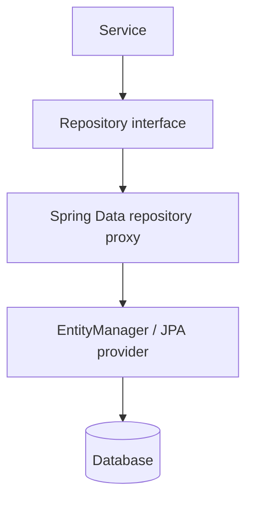
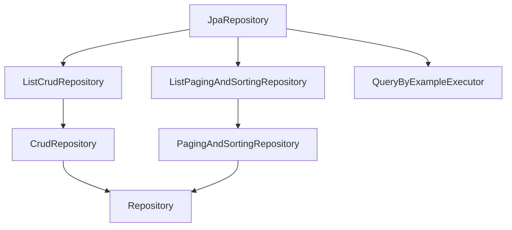

# ListCrudRepository, PagingAndSortingRepository, and JpaRepository

## 1. Objectives

Spring Data provides multiple Repository interfaces so applications can access data without writing CRUD implementation classes manually. The three interfaces to distinguish in this lesson are `ListCrudRepository`, `PagingAndSortingRepository`, and `JpaRepository`.

After this lesson, you will be able to:
- Distinguish the responsibilities of `CrudRepository`, `ListCrudRepository`, `PagingAndSortingRepository`, `ListPagingAndSortingRepository`, and `JpaRepository`.
- Choose the appropriate interface for CRUD, returning `List`, sorting, and pagination needs.
- Understand the important interface hierarchy change introduced in Spring Data 3.0.
- Write repositories with derived queries, `Sort`, `Pageable`, `Page`, and `Slice`.
- Purposefully use JPA-specific APIs such as `flush`, `saveAndFlush`, and batch delete operations.

## 2. How Do Repositories Work in Spring Data?

`Repository<T, ID>` is Spring Data's central marker interface. When the application starts, Spring Data discovers repository interfaces within its scan scope, creates proxies that execute data operations, and provides those proxies to Services via dependency injection.

You declare the interface and the methods you need. Spring Data generates implementations for inherited methods and parses the names of derived queries such as `findByTitleIgnoreCase`. For complex queries, you can use `@Query` or an appropriate extension mechanism.



`T` is the Entity or domain type; `ID` is the primary key type. For example, `JpaRepository<Book, Long>` manages the `Book` Entity with a `Long` ID.

## 3. Inheritance Tree and Changes Since Spring Data 3.0

In Spring Data 3.x, interfaces are split into two branches: the CRUD operations branch and the pagination/sorting branch. `JpaRepository` combines these branches for applications using JPA.



<badge>Key Point to Remember for Spring Data 3.0 and Later</badge>

Starting from Spring Data 3.0, `PagingAndSortingRepository` no longer extends `CrudRepository`. Therefore, extending only `PagingAndSortingRepository` will not automatically provide `save`, `findById`, or `delete`.

In earlier Spring Data 2.x versions, `PagingAndSortingRepository` used to extend `CrudRepository`. When upgrading to Spring Data 3.x, code relying on the old inheritance relationship may fail to compile. If you need both CRUD and pagination, extend both corresponding interfaces or use `JpaRepository` when the application uses JPA.

## 4. Distinguishing the Interfaces

### `CrudRepository<T, ID>`

This is the foundational choice for create, read, update, and delete operations. Commonly used methods include:

| Method | Meaning |
| --- | --- |
| `save(entity)` | Saves an Entity and returns the saved instance. |
| `saveAll(entities)` | Saves multiple Entities. |
| `findById(id)` | Finds by primary key; the result is `Optional<T>`. |
| `existsById(id)` | Checks whether a primary key exists. |
| `findAll()` | Retrieves all Entities, returning `Iterable<T>`. |
| `findAllById(ids)` | Retrieves Entities by a list of IDs. |
| `count()` | Counts the number of Entities. |
| `deleteById(id)`, `delete(entity)`, `deleteAll()` | Deletes by ID, by Entity, or deletes all. |

`CrudRepository` does not directly provide `findAll(Pageable)` or `findAll(Sort)` APIs. When only general CRUD is needed and keeping `Iterable` return types is acceptable, this interface is sufficient.

### `ListCrudRepository<T, ID>`

`ListCrudRepository` extends `CrudRepository` and overrides several collection-returning methods to use `List` instead of `Iterable`. Representative methods are:

- `List<T> findAll()`.
- `List<T> findAllById(Iterable<ID> ids)`.
- `<S extends T> List<S> saveAll(Iterable<S> entities)`.

The remaining CRUD operations are still inherited. `ListCrudRepository` fits well when the application frequently iterates, sorts, or processes results as a `List`.

### `PagingAndSortingRepository<T, ID>`

This interface adds operations to fetch data with sorting or pagination:

- `Iterable<T> findAll(Sort sort)` retrieves records in the requested order.
- `Page<T> findAll(Pageable pageable)` retrieves a page of data along with pagination information.

In Spring Data 3.x, it focuses solely on paging and sorting; to also have CRUD, combine it with `CrudRepository` or `ListCrudRepository`.

### `ListPagingAndSortingRepository<T, ID>`

This is the variant of `PagingAndSortingRepository` that returns `List<T>` for `findAll(Sort sort)`. The paginated method still returns `Page<T>` because the result must carry both the page content and metadata.

When you need `List`-based CRUD together with paging/sorting without JPA-specific APIs, you can combine `ListCrudRepository` and `ListPagingAndSortingRepository`.

### `JpaRepository<T, ID>`

`JpaRepository` is the standard choice for applications using JPA. In Spring Data JPA 3.x, this interface combines `ListCrudRepository`, `ListPagingAndSortingRepository`, and `QueryByExampleExecutor`.

As a result, it provides:
- CRUD operations with `List` return types for the corresponding collection methods.
- Sorting and pagination.
- JPA APIs such as `flush`, `saveAndFlush`, `saveAllAndFlush`, `getReferenceById`, and batch delete operations.
- Query by Example methods inherited from `QueryByExampleExecutor`.

Choose `JpaRepository` when the application's persistence layer is JPA/Hibernate and you need these capabilities. For MongoDB, Redis, or another store, use the appropriate interface from the corresponding module rather than depending on `JpaRepository`.

## 5. Which Interface Should You Choose?

| Need | Suitable Choice |
| --- | --- |
| General CRUD, collection results as `Iterable` | `CrudRepository` |
| General CRUD, wanting `List` | `ListCrudRepository` |
| Only sorting and pagination needed | `PagingAndSortingRepository` |
| Sorting/pagination and wanting sorted results as `List` | `ListPagingAndSortingRepository` |
| Using JPA and needing CRUD, List, paging, sorting, and JPA APIs | `JpaRepository` |
| Needing CRUD with paging/sorting on Spring Data 3.x without JPA APIs | Combine `CrudRepository` with `PagingAndSortingRepository`, or `ListCrudRepository` with `ListPagingAndSortingRepository` |

There is no need to extend every interface just to expose as many methods as possible. Choose the API level that matches the persistence technology and how Services consume the results.

## 6. Spring Data JPA Project Example

The example uses Java 17+, Maven, Spring Boot 3.5.0, Spring Data JPA, and H2. The domain model is `Book`, with a title, author, and availability status for borrowing.

### Directory Structure

```text
src/
  main/
    java/com/example/library/
      LibraryApplication.java
      book/
        Book.java
        BookRepository.java
    resources/
      application.properties
  test/
    java/com/example/library/book/
      BookRepositoryTest.java
pom.xml
```

### `pom.xml`

```xml
<?xml version="1.0" encoding="UTF-8"?>
<project xmlns="http://maven.apache.org/POM/4.0.0"
         xmlns:xsi="http://www.w3.org/2001/XMLSchema-instance"
         xsi:schemaLocation="http://maven.apache.org/POM/4.0.0 https://maven.apache.org/xsd/maven-4.0.0.xsd">
    <modelVersion>4.0.0</modelVersion>

    <parent>
        <groupId>org.springframework.boot</groupId>
        <artifactId>spring-boot-starter-parent</artifactId>
        <version>3.5.0</version>
        <relativePath/>
    </parent>

    <groupId>com.example</groupId>
    <artifactId>library-repository</artifactId>
    <version>0.0.1-SNAPSHOT</version>

    <properties>
        <java.version>17</java.version>
    </properties>

    <dependencies>
        <dependency>
            <groupId>org.springframework.boot</groupId>
            <artifactId>spring-boot-starter-data-jpa</artifactId>
        </dependency>
        <dependency>
            <groupId>com.h2database</groupId>
            <artifactId>h2</artifactId>
            <scope>runtime</scope>
        </dependency>
        <dependency>
            <groupId>org.springframework.boot</groupId>
            <artifactId>spring-boot-starter-test</artifactId>
            <scope>test</scope>
        </dependency>
    </dependencies>

    <build>
        <plugins>
            <plugin>
                <groupId>org.springframework.boot</groupId>
                <artifactId>spring-boot-maven-plugin</artifactId>
            </plugin>
        </plugins>
    </build>
</project>
```

### Startup Class

`src/main/java/com/example/library/LibraryApplication.java`:

```java
package com.example.library;

import org.springframework.boot.SpringApplication;
import org.springframework.boot.autoconfigure.SpringBootApplication;

@SpringBootApplication
public class LibraryApplication {
    public static void main(String[] args) {
        SpringApplication.run(LibraryApplication.class, args);
    }
}
```

`@SpringBootApplication` places component scanning on the `com.example.library` package, so Entities and Repositories in the `book` subpackage are discovered automatically.

### The `Book` Entity

`src/main/java/com/example/library/book/Book.java`:

```java
package com.example.library.book;

import jakarta.persistence.Column;
import jakarta.persistence.Entity;
import jakarta.persistence.GeneratedValue;
import jakarta.persistence.GenerationType;
import jakarta.persistence.Id;
import jakarta.persistence.Table;

@Entity
@Table(name = "books")
public class Book {
    @Id
    @GeneratedValue(strategy = GenerationType.IDENTITY)
    private Long id;

    @Column(nullable = false, length = 160)
    private String title;

    @Column(nullable = false, length = 120)
    private String author;

    @Column(nullable = false)
    private boolean available;

    protected Book() {
        // JPA requires a no-arg constructor.
    }

    public Book(String title, String author, boolean available) {
        String normalizedTitle = title == null ? "" : title.trim();
        String normalizedAuthor = author == null ? "" : author.trim();

        if (normalizedTitle.isEmpty() || normalizedTitle.length() > 160) {
            throw new IllegalArgumentException("Title must contain 1 to 160 characters");
        }
        if (normalizedAuthor.isEmpty() || normalizedAuthor.length() > 120) {
            throw new IllegalArgumentException("Author must contain 1 to 120 characters");
        }

        this.title = normalizedTitle;
        this.author = normalizedAuthor;
        this.available = available;
    }

    public Long getId() {
        return id;
    }

    public String getTitle() {
        return title;
    }

    public String getAuthor() {
        return author;
    }

    public boolean isAvailable() {
        return available;
    }
}
```

Key points:
- `@Entity` registers the class with JPA; `@Table` specifies the `books` table.
- `@Id` and `@GeneratedValue` declare an auto-generated primary key.
- JPA requires a no-arg constructor; a `protected` constructor is an appropriate choice.
- Fields are mapped using field access because `@Id` is placed on the field.
- The public constructor performs basic data validation to avoid creating objects with blank titles or authors.

### Repository Using `JpaRepository`

`src/main/java/com/example/library/book/BookRepository.java`:

```java
package com.example.library.book;

import java.util.List;
import org.springframework.data.domain.Page;
import org.springframework.data.domain.Pageable;
import org.springframework.data.domain.Slice;
import org.springframework.data.domain.Sort;
import org.springframework.data.jpa.repository.JpaRepository;

public interface BookRepository extends JpaRepository<Book, Long> {
    List<Book> findByAuthorIgnoreCase(String author);

    List<Book> findByAuthorIgnoreCase(String author, Sort sort);

    Page<Book> findByAvailableTrue(Pageable pageable);

    Slice<Book> findByTitleContainingIgnoreCase(String keyword, Pageable pageable);
}
```

You do not need to write a `BookRepositoryImpl` class for the methods above. Spring Data generates implementations for inherited operations and parses method names to create queries for the derived queries.

Meaning of the declared methods:
- `findByAuthorIgnoreCase` finds books by author, ignoring case.
- The overload with a `Sort` parameter lets the caller specify the result order.
- `findByAvailableTrue` retrieves only books with `available = true` and paginates the results.
- `findByTitleContainingIgnoreCase` searches titles containing a keyword, ignoring case; `Slice` is suitable when you only need to know whether a next page exists.

## 7. Combining CRUD with Paging/Sorting in Spring Data 3.x

If you are not using JPA but need both CRUD and paging/sorting, you can combine the interfaces explicitly.

Example if you want to use `Iterable` for CRUD:

```java
import org.springframework.data.repository.CrudRepository;
import org.springframework.data.repository.PagingAndSortingRepository;

public interface BookStoreRepository
        extends CrudRepository<Book, Long>,
                PagingAndSortingRepository<Book, Long> {
}
```

Example if you want to use `List` for collection results:

```java
import org.springframework.data.repository.ListCrudRepository;
import org.springframework.data.repository.ListPagingAndSortingRepository;

public interface BookListStoreRepository
        extends ListCrudRepository<Book, Long>,
                ListPagingAndSortingRepository<Book, Long> {
}
```

The two snippets above are alternative declarations illustrating the interface relationships. In a real application, choose the repository interface actually needed for each domain type and avoid creating redundant repositories just to bundle multiple APIs together.

## 8. Sorting with `Sort`

`Sort` describes result ordering based on Entity property names. You can sort ascending, descending, or combine multiple criteria.

```java
import org.springframework.data.domain.Sort;

Sort sortByAuthorThenTitle = Sort.by(
        Sort.Order.asc("author"),
        Sort.Order.asc("title"));

List<Book> books = bookRepository.findByAuthorIgnoreCase("Nguyen Van A", sortByAuthorThenTitle);
```

The example above requests results ordered by `author`, then by `title`. Names used in `Sort` are the Entity's Java property names, not necessarily database column names.

You can build an ordering by chaining `Sort` objects:

```java
Sort sort = Sort.by("title").ascending()
        .and(Sort.by("id").ascending());
```

When paginating, use a stable sort order. If multiple records share the same `title`, adding a unique property like `id` as a secondary criterion helps prevent duplicate or skipped records across pages when data is unchanged.

If accepting sort column names from external requests, restrict them using an allowlist of permitted properties. Do not pass raw client-supplied strings directly into `Sort`, as non-existent properties can cause query failures and make the API harder to control.

## 9. Pagination with `Pageable`, `Page`, and `Slice`

`Pageable` describes the page number, page size, and sort order. `PageRequest` is a common way to create a `Pageable`.

```java
import org.springframework.data.domain.Page;
import org.springframework.data.domain.PageRequest;
import org.springframework.data.domain.Pageable;
import org.springframework.data.domain.Sort;

Pageable pageable = PageRequest.of(
        0,
        20,
        Sort.by("title").ascending().and(Sort.by("id").ascending()));

Page<Book> page = bookRepository.findByAvailableTrue(pageable);

System.out.println("Elements in page: " + page.getNumberOfElements());
System.out.println("Total elements: " + page.getTotalElements());
System.out.println("Total pages: " + page.getTotalPages());
System.out.println("Has next page: " + page.hasNext());
```

`PageRequest.of(0, 20, ...)` requests the first page with at most 20 records. Page indices start at 0, not 1.

`Page<T>` contains page content and metadata such as:
- `getContent()`: list of Entities in the current page.
- `getNumber()`: current page index, starting from 0.
- `getSize()`: requested page size.
- `getNumberOfElements()`: actual number of elements in the current page.
- `getTotalElements()`: total number of matching records.
- `getTotalPages()`: total number of pages.
- `hasNext()` and `hasPrevious()`: checks whether a next or previous page exists.

To compute `getTotalElements()` and `getTotalPages()`, a `Page` query typically requires an additional count query. For large tables or expensive count queries, this can increase overhead.

### When to Use `Slice<T>`?

`Slice<T>` contains the page content and whether a next page exists, without providing the total record count or total page count. If the UI only needs a Next button and does not need to display the total number of pages, `Slice` is often more suitable.

```java
Slice<Book> slice = bookRepository.findByTitleContainingIgnoreCase(
        "spring",
        PageRequest.of(0, 20, Sort.by("title").ascending()));

List<Book> currentBooks = slice.getContent();
boolean hasMore = slice.hasNext();
```

`Page` is suitable when total result counts are needed; `Slice` is suitable when you only need to know if more data is available to load. Both can be used with `Pageable` in derived queries.

## 10. JPA-Specific APIs on `JpaRepository`

In addition to CRUD, paging, and sorting, `JpaRepository` provides several JPA-specific operations.

| API | Purpose | Notes |
| --- | --- | --- |
| `flush()` | Synchronizes pending changes in the persistence context to the database. | Does not mean the transaction has committed. |
| `saveAndFlush(entity)` | Saves an Entity and flushes immediately. | The transaction can still roll back afterward. |
| `saveAllAndFlush(entities)` | Saves a group of Entities and flushes. | Flushing does not replace JDBC batching strategies. |
| `getReferenceById(id)` | Gets a reference/proxy for an Entity by ID. | Does not necessarily query the database immediately; may throw `EntityNotFoundException` when the reference is accessed if the record does not exist. |
| `deleteAllInBatch()` | Deletes all Entities using a bulk operation. | Bypasses individual Entity lifecycles and can leave an open persistence context out of sync with the database. |
| `deleteAllByIdInBatch(ids)` | Deletes by a group of IDs using a bulk operation. | Requires understanding effects on caches and Entity relationships. |

### `flush()` vs. `commit()`

JPA maintains a persistence context to track managed Entities. When properties change, the provider can defer SQL until flush time. `flush()` instructs the provider to synchronize pending changes with the database.

Commit is the step that completes the transaction. A flush can occur before commit, and a transaction can still roll back after a flush. Use `saveAndFlush` when you need to force early synchronization—for example, to catch constraint errors before continuing another part of logic within the same transaction; do not call it habitually after every `save`.

### `findById()` vs. `getReferenceById()`

- `findById(id)` returns `Optional<T>` and is appropriate when you need to know for certain whether the record exists.
- `getReferenceById(id)` returns a reference managed by the JPA provider. The reference may be an uninitialized proxy; a not-found error may only appear when its properties are accessed.

When you need to return a clear business error for a non-existent ID, `findById(...).orElseThrow(...)` is usually clearer.

### Be Careful with Batch Delete Operations

Methods like `deleteAllInBatch` use a bulk query instead of calling delete on each Entity individually. Consequently, lifecycle callbacks such as `@PreRemove` do not run per object, and cascade remove rules from normal Entity deletion are not applied the same way as deleting Entities one by one. An open persistence context may also retain stale state after a bulk query.

Use batch deletes only when you clearly understand these effects. If callbacks, cascades, or per-record business logic are required, load the Entities and delete them in the standard way within an appropriate transaction.

## 11. Testing Repositories

`@DataJpaTest` creates a JPA test slice: configuring EntityManager, repositories, and an embedded database if present on the classpath. H2 in the example is used as the test database.

`src/main/resources/application.properties`:

```properties
spring.datasource.url=jdbc:h2:mem:librarydb;DB_CLOSE_DELAY=-1
spring.datasource.driver-class-name=org.h2.Driver
spring.datasource.username=sa
spring.datasource.password=
spring.jpa.hibernate.ddl-auto=create-drop
spring.jpa.open-in-view=false
spring.jpa.show-sql=true
```

`src/test/java/com/example/library/book/BookRepositoryTest.java`:

```java
package com.example.library.book;

import static org.assertj.core.api.Assertions.assertThat;

import java.util.List;
import org.junit.jupiter.api.Test;
import org.springframework.beans.factory.annotation.Autowired;
import org.springframework.boot.test.autoconfigure.orm.jpa.DataJpaTest;
import org.springframework.data.domain.Page;
import org.springframework.data.domain.PageRequest;
import org.springframework.data.domain.Sort;

@DataJpaTest
class BookRepositoryTest {
    @Autowired
    private BookRepository bookRepository;

    @Test
    void findsAuthorBooksAsSortedList() {
        bookRepository.saveAll(List.of(
                new Book("Zulu", "A. Writer", true),
                new Book("Alpha", "a. writer", true),
                new Book("Other", "B. Writer", true)));

        List<Book> books = bookRepository.findByAuthorIgnoreCase(
                "A. WRITER", Sort.by("title").ascending());

        assertThat(books)
                .extracting(Book::getTitle)
                .containsExactly("Alpha", "Zulu");
    }

    @Test
    void returnsPageContentAndTotalCount() {
        bookRepository.saveAll(List.of(
                new Book("Alpha", "Writer A", true),
                new Book("Beta", "Writer B", true),
                new Book("Gamma", "Writer C", true),
                new Book("Hidden", "Writer D", false)));

        Page<Book> page = bookRepository.findByAvailableTrue(
                PageRequest.of(0, 2, Sort.by("title").ascending().and(Sort.by("id").ascending())));

        assertThat(page.getContent())
                .extracting(Book::getTitle)
                .containsExactly("Alpha", "Beta");
        assertThat(page.getTotalElements()).isEqualTo(3);
        assertThat(page.getTotalPages()).isEqualTo(2);
        assertThat(page.hasNext()).isTrue();
    }
}
```

Run tests from the directory containing `pom.xml`:

```bash
mvn test
```

The expected result is Maven finishing with `BUILD SUCCESS` and both tests passing. The first test verifies a derived query with sorting. The second test verifies page content, total element count, and total page count.

## 12. Common Errors and How to Handle Them

| Symptom | Cause | Resolution |
| --- | --- | --- |
| `PagingAndSortingRepository` lacks `save` or `findById` | The project uses Spring Data 3.x, where this interface no longer extends `CrudRepository`. | Also extend `CrudRepository`/`ListCrudRepository`, or use `JpaRepository` if using JPA. |
| `ListCrudRepository` not found | Spring Data version is too old. | Use Spring Data 3.0 or later, or stick to interfaces supported by your current version. |
| Repository bean is not created | Interface is outside package scan or repository config is incorrect. | Place repository under the `@SpringBootApplication` class package or configure `@EnableJpaRepositories`. |
| Derived query fails | Property name in method does not match Entity or keyword is misplaced. | Check property name spelling and query derivation syntax. |
| `Sort` reports missing property | Database column name used instead of Java property, or an invalid field was sent. | Use the Entity property name and restrict allowed sort fields from input. |
| Duplicate or missing records across pages when data changes | Unstable pagination order or multiple records share the same sort value. | Add a unique tie-breaker like `id`; consider appropriate scrolling approaches when data is large and changing continuously. |
| `Page` query is slow | The count query for total elements is expensive. | Use `Slice` if only checking for a next page, or optimize the count query. |
| `getReferenceById` throws an error when reading properties | ID does not exist and the proxy is initialized lazily. | Use `findById` if existence needs to be checked upfront. |
| Batch delete leaves stale Entity state in persistence context | Bulk query does not synchronize individual managed Entities. | Run inside a controlled transaction; consider flush/clear and avoid reusing stale Entities after a bulk operation. |

## 13. Guidelines for Project Usage

1. Choose the interface according to actual needs. `JpaRepository` usually fits JPA applications; smaller interfaces help limit the API exposed by the repository layer.
2. Always check the Spring Data version before relying on inheritance relationships. Specifically, remember the `PagingAndSortingRepository` change since version 3.0.
3. Use `ListCrudRepository` when `List`-returning CRUD methods simplify Service code.
4. Use `Page` when total result counts are needed; use `Slice` when only checking whether more data follows.
5. Use a stable sort order when paginating and restrict which properties clients are allowed to sort by.
6. Call `flush` or `saveAndFlush` only when there is a specific reason regarding SQL synchronization timing; flushing does not commit the transaction.
7. Use batch deletes only when bulk behavior and its impact on lifecycle, cascades, and persistence context are acceptable.
8. For dynamic queries based on Specifications, additionally extend `JpaSpecificationExecutor<Book>` on the repository. `JpaRepository` does not extend this interface automatically.

## 14. Completion Checklist

- [ ] Can distinguish CRUD, List CRUD, paging/sorting, and JPA-specific APIs.
- [ ] Can explain why `PagingAndSortingRepository` in Spring Data 3.x does not include CRUD methods out of the box.
- [ ] Can choose between `CrudRepository`, `ListCrudRepository`, and `JpaRepository` based on requirements.
- [ ] Can write derived queries accepting `Sort` or `Pageable`.
- [ ] Can distinguish `Page` from `Slice` as well as the cost of the count query.
- [ ] Understands that `flush` differs from commit and knows the risks of bulk deletes.
- [ ] Can successfully run repository tests using `mvn test`.

Once completed, you can select the right Repository interface for each requirement and avoid common upgrade errors when migrating from Spring Data 2.x to 3.x.
