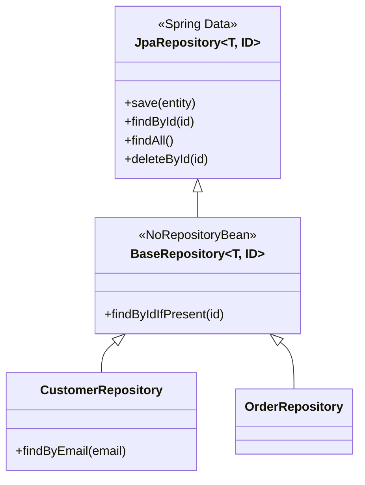

# Preventing Intermediate Repository Creation with `@NoRepositoryBean`

## 1. Why Do We Need Intermediate Repositories?

Spring Data JPA lets you create repository interfaces to access an entity's data. Normally, each concrete interface discovered by Spring Data gets a proxy bean created for the application to inject and use.

When multiple entities share a group of operations or conventions, we can create a generic base interface—such as `BaseRepository<T, ID>`—and have concrete repositories extend it. This centralizes shared methods and avoids repetitive declarations.

However, the intermediate interface is still a repository interface within Spring Data's scan scope. It contains type variables like `T` and `ID` without specifying a concrete entity. Spring Data should not create a standalone repository proxy for that generic interface because it cannot determine the exact domain type the repository would manage.

The `@NoRepositoryBean` annotation solves this exact problem: it marks the intermediate interface as a repository contract for other interfaces to extend, while instructing Spring Data not to create a repository bean directly from that interface itself.

The goal is:

- `BaseRepository<T, ID>`: shared interface, no standalone repository bean created.
- `CustomerRepository extends BaseRepository<Customer, Long>`: concrete repository, given a proxy normally by Spring Data.
- `OrderRepository extends BaseRepository<Order, UUID>`: another concrete repository, also given a proxy with its corresponding entity and ID types.

## 2. What Is `@NoRepositoryBean`?

`@NoRepositoryBean` is a Spring Data annotation located in the package:

```java
import org.springframework.data.repository.NoRepositoryBean;
```

It is placed on an intermediate repository interface so Spring Data skips creating a repository instance for that interface during repository scanning.

Minimal example:

```java
@NoRepositoryBean
public interface BaseRepository<T, ID>
        extends JpaRepository<T, ID> {
}
```

Here:

- `T` is the entity type a concrete repository will manage.
- `ID` is the type of the entity's identifier property.
- `JpaRepository<T, ID>` provides CRUD, pagination, sorting, and common JPA operations.
- `@NoRepositoryBean` tells Spring Data not to create a proxy for `BaseRepository` when encountering this generic interface alone.

The annotation does not create beans, replace `JpaRepository`, replace `@Entity`, or automatically add data access logic. It only controls whether Spring Data creates a repository proxy directly for the annotated interface.

## 3. How to Build `BaseRepository` and Concrete Repositories

### 3.1. Creating a Shared Generic Interface

For example, suppose the application wants all repositories to have a helper method that finds by ID while safely handling a null ID:

```java
import java.util.Optional;

import org.springframework.data.jpa.repository.JpaRepository;
import org.springframework.data.repository.NoRepositoryBean;

@NoRepositoryBean
public interface BaseRepository<T, ID>
        extends JpaRepository<T, ID> {

    default Optional<T> findByIdIfPresent(ID id) {
        if (id == null) {
            return Optional.empty();
        }
        return findById(id);
    }
}
```

The `findByIdIfPresent` method is a Java interface default method. It reuses `findById` inherited from `JpaRepository`. Every concrete repository extending `BaseRepository` can call this method.

Avoid placing a derived query in a generic interface if it depends on a property that only exists on certain entities. For example, if you declare `findAllByCreatedAtAfter(...)`, every entity using that repository must have the corresponding property according to Spring Data's naming rules. Put such a method in a base interface only when it is genuinely a shared convention across all inheriting domain types.

### 3.2. Creating Concrete Repositories

Suppose the application has a `Customer` entity with a `Long` primary key:

```java
import java.util.Optional;

import org.springframework.data.jpa.repository.EntityGraph;

public interface CustomerRepository
        extends BaseRepository<Customer, Long> {

    Optional<Customer> findByEmail(String email);
}
```

Spring Data sees that the generic types are resolved:

- `T = Customer`
- `ID = Long`

Therefore, it can create a repository proxy for `CustomerRepository`, map operations inherited from `JpaRepository` to the `Customer` entity, and implement the `findByEmail` query method based on the property name.

Another repository can use a different entity and ID:

```java
public interface OrderRepository
        extends BaseRepository<Order, UUID> {
}
```

Both repositories share common logic while keeping their own domain type and identifier type.

### 3.3. Interface Relationship Diagram



The diagram shows the inheritance hierarchy. `BaseRepository` is the generic contract in the middle; the two leaf interfaces are concrete repositories for which Spring Data creates proxies.

## 4. How Does Spring Data Handle `@NoRepositoryBean`?

During application startup, Spring Data performs repository scanning across configured packages. It finds interfaces meeting repository criteria and creates proxy beans for valid repositories.

If a generic intermediate interface is not annotated with `@NoRepositoryBean`, Spring Data may treat it as a repository candidate to instantiate. However, that interface has not specified a concrete entity. The type variable `T` cannot represent a JPA-managed entity yet, and `ID` has not specified a primary key type either.

When annotated with `@NoRepositoryBean`, Spring Data skips creating a repository proxy for the intermediate interface. Concrete child interfaces are still scanned and turned into beans if they satisfy standard repository conditions.

Importantly, this annotation does not remove the base interface's methods. Those methods are still inherited by child repositories. Only the bean for the generic interface itself is excluded from repository creation.

High-level flow:

1. Spring Data finds `BaseRepository<T, ID>`.
2. The `@NoRepositoryBean` annotation indicates not to create a proxy directly for this interface.
3. Spring Data finds `CustomerRepository extends BaseRepository<Customer, Long>`.
4. The generic types are concretized to `Customer` and `Long`.
5. Spring Data creates a proxy for `CustomerRepository`.
6. The application injects and calls `CustomerRepository` like a normal Spring bean.

## 5. What Happens If `@NoRepositoryBean` Is Missing?

Suppose we declare:

```java
public interface BaseRepository<T, ID>
        extends JpaRepository<T, ID> {
}
```

and this interface resides in a package Spring Data scans. Spring Data may attempt to create a repository for that generic interface. Without a concrete entity, resolving the domain type or initializing the repository can fail.

The exact message depends on the interface structure, query methods, Spring Data version, and when the error is detected. Symptoms can relate to:

- Inability to resolve the domain type for the generic repository.
- Inability to create queries because the entity type or property is unresolved.
- Errors like `Not a managed type` when a non-entity type is used as a domain type.
- Repository bean creation failure while starting the application context.

Do not rely on a single fixed error message to diagnose every case. Find the repository interface named in the nested cause and check whether it is a generic intermediate interface needing `@NoRepositoryBean`.

The typical fix is:

```java
@NoRepositoryBean
public interface BaseRepository<T, ID>
        extends JpaRepository<T, ID> {
}
```

Then keep the annotation on the intermediate interface, while concrete repositories remain without this annotation.

## 6. Placing the Annotation in the Right Place

### 6.1. Correct: Annotating a Generic Intermediate Interface

```java
@NoRepositoryBean
public interface BaseRepository<T, ID>
        extends JpaRepository<T, ID> {
}
```

This is the most common usage. The interface does not yet represent a concrete entity, so it does not need its own proxy bean.

### 6.2. Correct: Multiple Layers of Intermediate Interfaces

A project can build multiple contract layers:

```java
@NoRepositoryBean
public interface ReadRepository<T, ID>
        extends Repository<T, ID> {

    Optional<T> findById(ID id);

    List<T> findAll();
}
```

```java
@NoRepositoryBean
public interface WriteRepository<T, ID>
        extends ReadRepository<T, ID> {

    <S extends T> S save(S entity);

    void deleteById(ID id);
}
```

Concrete repository:

```java
public interface CustomerRepository
        extends WriteRepository<Customer, Long> {
}
```

Each generic intermediate interface that Spring Data should not instantiate directly needs `@NoRepositoryBean`. The leaf interface has fully resolved the entity and ID, so Spring Data creates its proxy.

### 6.3. Incorrect: Annotating a Concrete Repository

```java
@NoRepositoryBean
public interface CustomerRepository
        extends JpaRepository<Customer, Long> {
}
```

In this case, `CustomerRepository` is the concrete repository the application needs to inject. Annotating it with `@NoRepositoryBean` causes Spring Data to skip creating a repository bean for that interface. When a service injects `CustomerRepository`, the application may fail with no matching bean found.

Remove the annotation from the concrete repository:

```java
public interface CustomerRepository
        extends JpaRepository<Customer, Long> {
}
```

### 6.4. Incorrect: Using the Annotation Instead of `@Entity`

`@NoRepositoryBean` does not turn a class into an entity and does not help Hibernate recognize an entity. An entity still needs `@Entity` and must be within the JPA scan scope or declared via appropriate configuration.

If the error is `Not a managed type: Customer`, check the entity annotation and entity scanning. Add `@NoRepositoryBean` only when the error genuinely comes from a generic intermediate repository interface that Spring Data attempted to instantiate.

## 7. Generic Types Must Be Fully Specified

When a concrete repository extends a base interface, pass the exact entity type and ID type:

```java
public interface CustomerRepository
        extends BaseRepository<Customer, Long> {
}
```

Do not use raw types:

```java
// Avoid
public interface CustomerRepository
        extends BaseRepository {
}
```

Raw types lose generic type information and can lead to compiler warnings, difficulty resolving the domain type, or runtime failures.

The ID type must match the entity's `@Id` property:

```java
@Entity
public class Customer {

    @Id
    @GeneratedValue(strategy = GenerationType.IDENTITY)
    private Long id;

    private String email;

    // constructors, getters and setters
}
```

For the entity above, the repository should use `Customer, Long`. If the entity uses `UUID`, `String`, or another key type, the generic ID must reflect that exact type.

Avoid using `Object` as the ID type just to make the interface more general. Generic types exist to preserve accurate type information for each repository.

## 8. Shared Methods in a Base Interface

### 8.1. Reusing Methods from `JpaRepository`

If only standard CRUD is needed, there is no need to redeclare methods already present in `JpaRepository`. Concrete repositories inherit them automatically via the base interface.

### 8.2. Adding Default Methods Independent of Entity-Specific Properties

Example:

```java
@NoRepositoryBean
public interface BaseRepository<T, ID>
        extends JpaRepository<T, ID> {

    default Optional<T> findByIdIfPresent(ID id) {
        return id == null ? Optional.empty() : findById(id);
    }
}
```

Default methods fit small pieces of logic that can be shared across all domain types. Spring Data repository proxies support default methods on repository interfaces.

### 8.3. Be Careful with Derived Query Methods

Spring Data builds queries from method names based on the domain class's properties. Therefore, a method like:

```java
List<T> findByStatus(String status);
```

only works if every entity extending the base interface has a `status` property that Spring Data can resolve. Otherwise, the repository for an entity lacking that property may fail at startup.

If entities have different structures, place derived queries in their corresponding concrete repositories:

```java
public interface CustomerRepository
        extends BaseRepository<Customer, Long> {

    List<Customer> findByStatus(CustomerStatus status);
}
```

Do not put query methods belonging to a single entity into a base interface just to save a few lines of code.

### 8.4. When Shared Logic Becomes Complex

If substantial custom logic is needed, you can use a repository fragment or a custom repository base class. `@NoRepositoryBean` only prevents creating a proxy for the intermediate interface; it does not automatically provide implementations for custom abstract methods.

With a repository fragment, define a functional interface and corresponding implementation, then compose the fragment into the target repositories. With a custom base class, configure `repositoryBaseClass` in `@EnableJpaRepositories` so Spring Data uses the appropriate base implementation.

Do not turn `BaseRepository` into a dumping ground for business logic across every entity. Keep only behaviors that are genuinely universal and share the same semantics.

## 9. Repository Scanning Scope

Spring Boot usually scans for repositories in the package of the `@SpringBootApplication` class and its subpackages. If repositories live outside the default scope, configure them explicitly with `@EnableJpaRepositories`:

```java
@Configuration
@EnableJpaRepositories(
    basePackages = "com.example.app.repository"
)
public class JpaRepositoryConfig {
}
```

If `BaseRepository` and concrete repositories are within scanned packages, Spring Data applies `@NoRepositoryBean` while classifying repository candidates.

When encountering a missing repository bean error, check:

- Is the concrete interface inside a scanned package?
- Does an `@EnableJpaRepositories` configuration restrict packages?
- Was the concrete repository mistakenly annotated with `@NoRepositoryBean`?
- Does the repository extend a base interface with concretized generic types?
- Is a profile or configuration condition disabling JPA configuration?

You do not need to annotate every normal Spring Data repository interface with `@Repository`. Spring Data registers the repository proxy bean automatically when scanning succeeds.

## 10. Verifying Repositories Are Created Properly

You can use a JPA slice test to confirm Spring creates a bean for the concrete repository:

```java
@DataJpaTest
class CustomerRepositoryTest {

    @Autowired
    private CustomerRepository customerRepository;

    @Test
    void createsConcreteRepositoryBean() {
        assertThat(customerRepository).isNotNull();
    }
}
```

This test verifies that the JPA test slice application context can create and inject `CustomerRepository`. It does not require a separate bean for `BaseRepository`.

You can also test inherited behavior:

```java
@Test
void inheritedMethodCanBeUsed() {
    Customer customer = new Customer();
    customer.setEmail("lan@example.com");

    Customer saved = customerRepository.save(customer);

    assertThat(customerRepository.findByIdIfPresent(saved.getId()))
        .isPresent();
}
```

This test assumes the `Customer` entity has a `setEmail` setter, the primary key is generated on save, and a test database is configured. It demonstrates that the concrete repository can use both methods from `JpaRepository` and the default method from `BaseRepository`.

If you want to verify that no bean was created for the intermediate interface, you can query `ApplicationContext` by resolved generic types or inspect repository bean definitions. In typical designs, however, injecting and exercising the concrete repository is the most important check. Avoid writing tests that depend on internal Spring Data-generated bean names unless specifically required.

## 11. Diagnosing Common Errors

| Symptom | Possible Cause | Resolution |
|---|---|---|
| Spring tries to create a bean for the generic base repository | Missing `@NoRepositoryBean` on the intermediate interface | Add the annotation to the base interface that should be skipped |
| `CustomerRepository` bean not found | Concrete repository mistakenly annotated with `@NoRepositoryBean`, or package not scanned | Remove the annotation from the leaf interface and check repository scanning |
| `Not a managed type` | Entity is not JPA-managed, or base repository was initialized with an invalid domain type | Check `@Entity`, entity scan, and generic types |
| Cannot determine domain type | Repository extends a raw type or unresolved generics | Use `BaseRepository<Customer, Long>` |
| Query creation exception at startup | Derived query in base interface references a property missing on a child entity | Move the query to concrete repositories or ensure the property exists on all entities |
| ID type error | Generic ID does not match the `@Id` type | Declare the exact `Long`, `UUID`, `String`, or actual key type |
| Repository not discovered | Package is outside scan scope or `@EnableJpaRepositories` config is wrong | Adjust base packages and JPA configuration |
| Service reports missing bean on injection | Interface to inject was excluded from repository scanning or context config did not create repositories | Check the concrete interface and verify annotations/packages/profiles |

A useful diagnostic rule: if the error mentions the generic base interface, check `@NoRepositoryBean`; if the error mentions a specific entity, check mapping and entity scanning; if the error mentions a query method, check property names and parameter types.

## 12. What `@NoRepositoryBean` Does Not Do

To avoid misuse, clearly distinguish the scope of the annotation:

- It does not create repository beans. It prevents creating a bean directly for the annotated interface.
- It does not prevent child repositories from inheriting methods from the base interface.
- It does not replace `@Entity`, `@Id`, `@EnableJpaRepositories`, or DataSource configuration.
- It does not fix database connection errors, schema errors, or transaction errors.
- It does not implement custom methods automatically unless the method is a default method or backed by a fragment/base class implementation.
- It is not an annotation for marking services, components, or entity classes.
- It should not be placed on concrete repositories that the application needs to inject.

Understanding this scope helps isolate issues and prevents placing annotations on the wrong layer.

## 13. Checklist for Building Generic Repositories

- [ ] The base interface is genuinely shared by multiple entities.
- [ ] The base interface declares appropriate `T` and `ID` generic types.
- [ ] The base interface is annotated with `@NoRepositoryBean`.
- [ ] Concrete repositories extend the base interface with complete entity and ID types.
- [ ] Concrete repositories are not annotated with `@NoRepositoryBean`.
- [ ] Entities have `@Entity` and a properly typed `@Id` property.
- [ ] Derived queries in the base interface only use properties present on every inheriting entity.
- [ ] Repository scanning covers the packages of concrete repositories.
- [ ] Custom methods have an appropriate implementation: default method, fragment, or base class.
- [ ] A JPA slice test instantiates and injects the concrete repository.
- [ ] Tests verify that inherited methods behave properly.

## 14. Conclusion

`@NoRepositoryBean` is an essential annotation when building generic intermediate repository interfaces for Spring Data JPA. It stops Spring Data from creating proxies for interfaces whose concrete entity and ID are not yet specified, while still allowing child repositories to inherit shared methods.

Place the annotation on every intermediate interface that should be skipped, fully specify generic types on leaf repositories, and keep concrete repositories free of `@NoRepositoryBean`. When startup errors occur, distinguish between generic proxy creation errors, entity mapping errors, query method errors, and repository scanning errors to address the root cause accurately.
