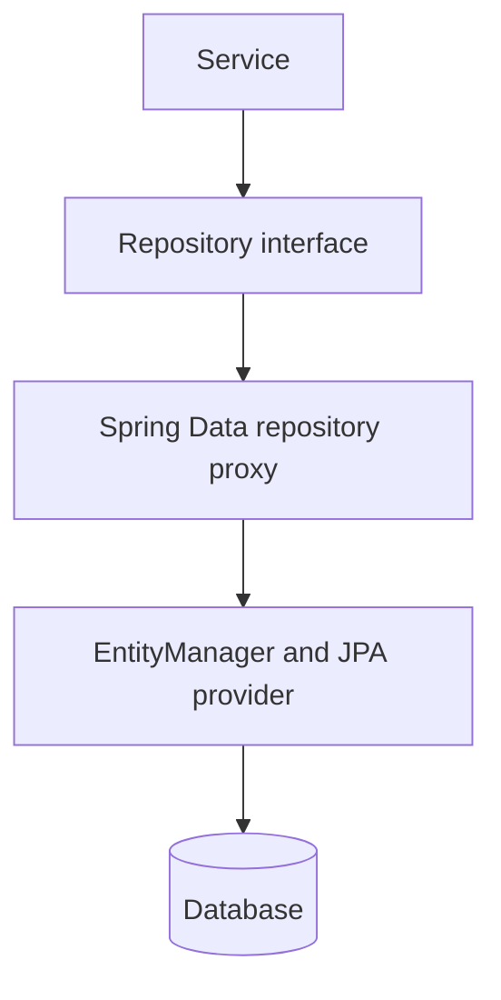
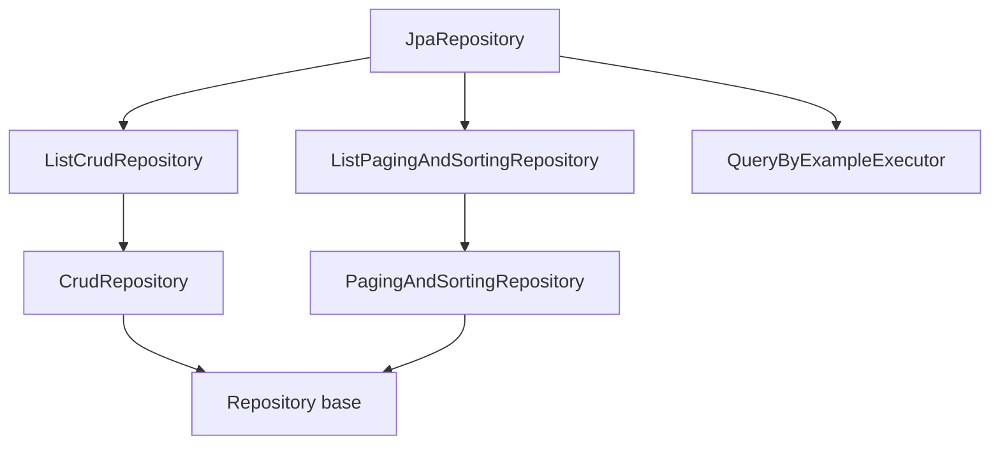

# ListCrudRepository, PagingAndSortingRepository, and JpaRepository

## 1. Objectives

Spring Data provides Repository interfaces so applications can access data without manually writing implementation classes for common operations. This lesson focuses on `ListCrudRepository`, `PagingAndSortingRepository`, and `JpaRepository`, while placing them in context with `CrudRepository` and `ListPagingAndSortingRepository`.

After this lesson, you will be able to:
- Distinguish the responsibilities of CRUD, List CRUD, paging, and sorting interfaces.
- Explain the key inheritance hierarchy change introduced in Spring Data 3.0.
- Choose the right interface based on persistence store type and the API the Service needs.
- Write repositories with derived queries, sorting, and pagination.
- Distinguish between `Page`, `Slice`, `flush`, `commit`, and JPA batch operations.

## 2. How Repositories Work in Spring Data

`Repository<T, ID>` is the central marker interface of Spring Data. When the application starts, Spring Data scans for repository interfaces within the configured scan scope, creates proxies that execute data operations, and registers those proxies as Spring beans so Services can inject them.

You only need to declare the interface and the methods you want to use. Spring Data provides implementations for inherited methods; for derived queries, the framework parses the method name to generate the query. For complex queries, you can use `@Query` or an appropriate extension mechanism.



`T` is the Entity or domain type; `ID` is the primary key type. For example, `JpaRepository<Book, Long>` manages the `Book` Entity with a primary key of type `Long`.

## 3. Inheritance Hierarchy and Changes Since Spring Data 3.0

In Spring Data 3.x, interfaces are split into a CRUD branch and a paging/sorting branch. `JpaRepository` combines the interfaces needed for JPA-based applications.



**Key takeaway from Spring Data 3.0:** `PagingAndSortingRepository` no longer extends `CrudRepository`. Therefore, extending only `PagingAndSortingRepository` will not automatically provide `save`, `findById`, or `delete`.

In earlier Spring Data 2.x versions, `PagingAndSortingRepository` used to extend `CrudRepository`. When upgrading to Spring Data 3.x, code relying on the old inheritance relationship may fail to compile. If you need both CRUD and paging/sorting, combine the corresponding interfaces or use `JpaRepository` in JPA applications.

`ListCrudRepository` and `ListPagingAndSortingRepository` were also added in Spring Data 3.0. If your project uses Spring Data 2.x, these List interfaces do not exist yet; check your actual Spring Data version before applying these examples.

## 4. Comparing the Interfaces

### `CrudRepository<T, ID>`

This is the baseline choice for create, read, update, and delete operations. Commonly used methods include:

| Method | Purpose |
| --- | --- |
| `save(entity)` | Saves an Entity and returns the saved instance. |
| `saveAll(entities)` | Saves multiple Entities. |
| `findById(id)` | Finds by primary key, returning `Optional<T>`. |
| `existsById(id)` | Checks whether a primary key exists. |
| `findAll()` | Retrieves all Entities, returning `Iterable<T>`. |
| `findAllById(ids)` | Retrieves Entities by a collection of IDs, returning `Iterable<T>`. |
| `count()` | Counts the number of Entities. |
| `deleteById(id)`, `delete(entity)`, `deleteAll()` | Deletes by ID, by Entity, or deletes all. |

`CrudRepository` does not directly provide `findAll(Pageable)` or `findAll(Sort)` APIs. When only general CRUD is needed and returning `Iterable` is acceptable, this interface is sufficient.

### `ListCrudRepository<T, ID>`

`ListCrudRepository` extends `CrudRepository` and overrides collection-returning methods to use `List` instead of `Iterable`. Representative methods:

- `<S extends T> List<S> saveAll(Iterable<S> entities)`.
- `List<T> findAll()`.
- `List<T> findAllById(Iterable<ID> ids)`.

All other CRUD operations are still inherited. This interface is suitable when the Service frequently needs to iterate, sort, or process results as a `List`.

### `PagingAndSortingRepository<T, ID>`

This interface adds sorted or paginated data retrieval operations:

- `Iterable<T> findAll(Sort sort)` retrieves records in the requested order.
- `Page<T> findAll(Pageable pageable)` retrieves a page of data along with pagination metadata.

In Spring Data 3.x, this interface focuses strictly on paging and sorting. To get CRUD methods, combine it with `CrudRepository` or `ListCrudRepository`.

### `ListPagingAndSortingRepository<T, ID>`

This is a variant of `PagingAndSortingRepository` that overrides `findAll(Sort sort)` to return `List<T>` instead of `Iterable<T>`. The pagination method still returns `Page<T>` because the result must carry both page content and metadata.

When you need List-based CRUD along with paging/sorting without JPA-specific APIs, you can combine `ListCrudRepository` and `ListPagingAndSortingRepository`.

### `JpaRepository<T, ID>`

`JpaRepository` is the standard choice for applications using Jakarta Persistence (JPA). In Spring Data JPA 3.x, this interface combines `ListCrudRepository`, `ListPagingAndSortingRepository`, and `QueryByExampleExecutor`.

As a result, it provides:
- CRUD operations with `List` return types on the corresponding collection methods.
- Sorting and pagination.
- JPA APIs such as `flush`, `saveAndFlush`, `saveAllAndFlush`, `getReferenceById`, and batch delete operations.
- Query by Example methods inherited from `QueryByExampleExecutor`.

Choose `JpaRepository` when the persistence layer uses JPA/Hibernate and you need these capabilities. For MongoDB, Redis, or another persistence store, use the interface provided by that module instead of depending on `JpaRepository`.

## 5. Which Interface Should You Choose?

| Requirement | Appropriate Choice |
| --- | --- |
| General CRUD, collection results as `Iterable` | `CrudRepository` |
| General CRUD, prefer `List` | `ListCrudRepository` |
| Only need sorting and pagination | `PagingAndSortingRepository` |
| Sorting/pagination and prefer `List` for sorted results | `ListPagingAndSortingRepository` |
| Using JPA and need CRUD, List, paging, sorting, and JPA APIs | `JpaRepository` |
| Need CRUD with paging/sorting on Spring Data 3.x without JPA APIs | Combine `CrudRepository` with `PagingAndSortingRepository`, or `ListCrudRepository` with `ListPagingAndSortingRepository` |

There is no need to extend every interface just to expose as many methods as possible. Choose the API level that matches your persistence technology and how the Service consumes results.

## 6. Spring Data JPA Project Example

This example uses Java 17+, Maven, Spring Boot 3.5.0, Spring Data JPA, and H2. The data domain is `Book`, with a title, author, and loan availability status.

### Directory Structure

```text
src/
  main/
    java/com/example/library/
      LibraryApplication.java
      book/
        Book.java
        BookRepository.java
    resources/
      application.properties
  test/
    java/com/example/library/book/
      BookRepositoryTest.java
pom.xml
```

### `pom.xml`

```xml
<?xml version="1.0" encoding="UTF-8"?>
<project xmlns="http://maven.apache.org/POM/4.0.0"
         xmlns:xsi="http://www.w3.org/2001/XMLSchema-instance"
         xsi:schemaLocation="http://maven.apache.org/POM/4.0.0 https://maven.apache.org/xsd/maven-4.0.0.xsd">
    <modelVersion>4.0.0</modelVersion>

    <parent>
        <groupId>org.springframework.boot</groupId>
        <artifactId>spring-boot-starter-parent</artifactId>
        <version>3.5.0</version>
        <relativePath/>
    </parent>

    <groupId>com.example</groupId>
    <artifactId>library-repository</artifactId>
    <version>0.0.1-SNAPSHOT</version>

    <properties>
        <java.version>17</java.version>
    </properties>

    <dependencies>
        <dependency>
            <groupId>org.springframework.boot</groupId>
            <artifactId>spring-boot-starter-data-jpa</artifactId>
        </dependency>
        <dependency>
            <groupId>com.h2database</groupId>
            <artifactId>h2</artifactId>
            <scope>runtime</scope>
        </dependency>
        <dependency>
            <groupId>org.springframework.boot</groupId>
            <artifactId>spring-boot-starter-test</artifactId>
            <scope>test</scope>
        </dependency>
    </dependencies>

    <build>
        <plugins>
            <plugin>
                <groupId>org.springframework.boot</groupId>
                <artifactId>spring-boot-maven-plugin</artifactId>
            </plugin>
        </plugins>
    </build>
</project>
```

### Startup Class

`src/main/java/com/example/library/LibraryApplication.java`:

```java
package com.example.library;

import org.springframework.boot.SpringApplication;
import org.springframework.boot.autoconfigure.SpringBootApplication;

@SpringBootApplication
public class LibraryApplication {
    public static void main(String[] args) {
        SpringApplication.run(LibraryApplication.class, args);
    }
}
```

`@SpringBootApplication` places component scanning on the `com.example.library` package, so Entities and Repositories in the `book` subpackage are discovered automatically.

### `Book` Entity

`src/main/java/com/example/library/book/Book.java`:

```java
package com.example.library.book;

import jakarta.persistence.Column;
import jakarta.persistence.Entity;
import jakarta.persistence.GeneratedValue;
import jakarta.persistence.GenerationType;
import jakarta.persistence.Id;
import jakarta.persistence.Table;

@Entity
@Table(name = "books")
public class Book {
    @Id
    @GeneratedValue(strategy = GenerationType.IDENTITY)
    private Long id;

    @Column(nullable = false, length = 160)
    private String title;

    @Column(nullable = false, length = 120)
    private String author;

    @Column(nullable = false)
    private boolean available;

    protected Book() {
        // JPA requires a no-arg constructor.
    }

    public Book(String title, String author, boolean available) {
        String normalizedTitle = title == null ? "" : title.trim();
        String normalizedAuthor = author == null ? "" : author.trim();

        if (normalizedTitle.isEmpty() || normalizedTitle.length() > 160) {
            throw new IllegalArgumentException("Title must contain 1 to 160 characters");
        }
        if (normalizedAuthor.isEmpty() || normalizedAuthor.length() > 120) {
            throw new IllegalArgumentException("Author must contain 1 to 120 characters");
        }

        this.title = normalizedTitle;
        this.author = normalizedAuthor;
        this.available = available;
    }

    public Long getId() {
        return id;
    }

    public String getTitle() {
        return title;
    }

    public String getAuthor() {
        return author;
    }

    public boolean isAvailable() {
        return available;
    }
}
```

Key points:
- `@Entity` registers the class with JPA; `@Table` specifies the `books` table.
- `@Id` and `@GeneratedValue` declare an auto-generated primary key.
- JPA requires a no-arg constructor; a `protected` constructor is a good choice.
- Fields are mapped using field access because `@Id` is placed on the field.
- The public constructor validates basic inputs to avoid creating objects with blank titles or authors.

### Repository Using `JpaRepository`

`src/main/java/com/example/library/book/BookRepository.java`:

```java
package com.example.library.book;

import java.util.List;
import org.springframework.data.domain.Page;
import org.springframework.data.domain.Pageable;
import org.springframework.data.domain.Slice;
import org.springframework.data.domain.Sort;
import org.springframework.data.jpa.repository.JpaRepository;

public interface BookRepository extends JpaRepository<Book, Long> {
    List<Book> findByAuthorIgnoreCase(String author);

    List<Book> findByAuthorIgnoreCase(String author, Sort sort);

    Page<Book> findByAvailableTrue(Pageable pageable);

    Slice<Book> findByTitleContainingIgnoreCase(String keyword, Pageable pageable);
}
```

You do not need to write a `BookRepositoryImpl` class for the methods above. Spring Data generates implementations for inherited operations and parses method names to build queries for derived queries.

Meaning of the declared custom methods:
- `findByAuthorIgnoreCase` finds books by author, case-insensitively.
- The overload with a `Sort` parameter lets the caller choose the result ordering.
- `findByAvailableTrue` retrieves only books with `available = true` and paginates the results.
- `findByTitleContainingIgnoreCase` searches titles containing a keyword, case-insensitively; `Slice` is suitable when you only need to know whether a next page exists.

## 7. Combining CRUD with Paging/Sorting in Spring Data 3.x

If you are not using JPA but need both CRUD and paging/sorting, you can explicitly combine the interfaces.

For example, to use `Iterable` for CRUD:

```java
import org.springframework.data.repository.CrudRepository;
import org.springframework.data.repository.PagingAndSortingRepository;

public interface BookCrudPagingRepository
        extends CrudRepository<Book, Long>,
                PagingAndSortingRepository<Book, Long> {
}
```

For example, to use `List` for collection results:

```java
import org.springframework.data.repository.ListCrudRepository;
import org.springframework.data.repository.ListPagingAndSortingRepository;

public interface BookListCrudPagingRepository
        extends ListCrudRepository<Book, Long>,
                ListPagingAndSortingRepository<Book, Long> {
}
```

The two snippets above are alternative declarations illustrating the interface relationships. In a real application, pick the repository interface you actually need for each domain type and avoid creating duplicate repositories just to bundle multiple APIs in one place.

## 8. Sorting with `Sort`

`Sort` describes the ordering of results based on Entity property names. You can sort ascending, descending, or chain multiple criteria.

```java
import org.springframework.data.domain.Sort;

Sort sortByAuthorThenTitle = Sort.by(
        Sort.Order.asc("author"),
        Sort.Order.asc("title"));

List<Book> books = bookRepository.findByAuthorIgnoreCase("Nguyen Van A", sortByAuthorThenTitle);
```

The example above requests results sorted by `author`, then by `title`. The names used in `Sort` are the Java property names on the Entity, not necessarily the database column names.

You can compose an ordering by chaining Sort objects:

```java
Sort sort = Sort.by("title").ascending()
        .and(Sort.by("id").ascending());
```

When paginating, you should use a deterministic ordering. If multiple records share the same `title`, adding a unique property like `id` as a secondary sort criterion helps prevent pages from duplicating or skipping records when data is unchanged.

If accepting sort field names from external requests, restrict them with an allowlist of permitted properties. Do not pass arbitrary client-supplied strings directly into `Sort` because nonexistent properties will cause query errors and make the API hard to control.

## 9. Pagination with `Pageable`, `Page`, and `Slice`

`Pageable` describes the page number, page size, and sort order. `PageRequest` is a common way to create a `Pageable`.

```java
import org.springframework.data.domain.Page;
import org.springframework.data.domain.PageRequest;
import org.springframework.data.domain.Pageable;
import org.springframework.data.domain.Sort;

Pageable pageable = PageRequest.of(
        0,
        20,
        Sort.by("title").ascending().and(Sort.by("id").ascending()));

Page<Book> page = bookRepository.findByAvailableTrue(pageable);

System.out.println("Number of records in page: " + page.getNumberOfElements());
System.out.println("Total records: " + page.getTotalElements());
System.out.println("Total pages: " + page.getTotalPages());
System.out.println("Has next page: " + page.hasNext());
```

`PageRequest.of(0, 20, ...)` requests the first page with up to 20 records. Page indices are zero-based, not one-based.

`Page<T>` contains the page content and metadata such as:
- `getContent()`: the list of Entities for the current page.
- `getNumber()`: the zero-based current page index.
- `getSize()`: the requested page size.
- `getNumberOfElements()`: the actual number of elements on the current page.
- `getTotalElements()`: the total number of records matching the criteria.
- `getTotalPages()`: the total number of pages.
- `hasNext()` and `hasPrevious()`: checks for a next or previous page.

To calculate the total number of records and pages, `Page` queries usually require an additional count query. Spring Data can optimize counting in certain cases, but the count query can still be a significant cost on large tables or complex filter conditions.

### When to Use `Slice<T>`?

`Slice<T>` contains the page content and whether a next page exists, without providing the total record count or total page count. If the UI only needs a Next button and does not need to display total pages, `Slice` is usually a better fit. The provider typically fetches one extra record to determine whether another page remains.

```java
Slice<Book> slice = bookRepository.findByTitleContainingIgnoreCase(
        "spring",
        PageRequest.of(0, 20, Sort.by("title").ascending()));

List<Book> currentBooks = slice.getContent();
boolean hasMore = slice.hasNext();
```

`Page` fits when you need the total result count; `Slice` fits when you only need to know whether more data can be loaded. Both can be used with `Pageable` in derived queries.

## 10. `JpaRepository`-Specific APIs

Beyond CRUD, paging, and sorting, `JpaRepository` provides several JPA-specific operations.

| API | Purpose | Notes |
| --- | --- | --- |
| `flush()` | Synchronizes pending changes in the persistence context to the database. | Does not mean the transaction has committed. |
| `saveAndFlush(entity)` | Saves the Entity and flushes immediately. | The transaction can still roll back afterward. |
| `saveAllAndFlush(entities)` | Saves a group of Entities and flushes. | Flushing does not replace a JDBC batching strategy. |
| `getReferenceById(id)` | Obtains a reference to an Entity by ID. | Does not necessarily query the database immediately; may throw `EntityNotFoundException` when the reference is accessed if the record does not exist. |
| `deleteAllInBatch()` | Deletes all Entities using a bulk operation. | Bypasses individual Entity lifecycles and can leave an open persistence context out of sync with the database. |
| `deleteAllByIdInBatch(ids)` | Deletes a group of IDs using a bulk operation. | Understand its impact on caches and Entity relationships. |

### `flush()` vs. `commit()`

JPA maintains a persistence context to track managed Entities. When properties change, the provider may defer SQL execution until flush time. `flush()` instructs the provider to synchronize pending changes with the database.

Commit is the step that finalizes the transaction. Flushing can occur before commit, and a transaction can still roll back after a flush. Use `saveAndFlush` when you need to force early synchronization, such as detecting a constraint violation before proceeding with other logic in the same transaction; do not call it routinely after every `save`.

### `findById()` vs. `getReferenceById()`

- `findById(id)` returns `Optional<T>` and is suitable when you need to know for certain whether the record exists.
- `getReferenceById(id)` returns a reference managed by the JPA provider. The reference may be an uninitialized proxy; a missing-record error may only surface when its properties are accessed.

When you need to throw a clear business error for a nonexistent ID, `findById(...).orElseThrow(...)` is usually clearer.

### Be Careful with Batch Delete Operations

Methods like `deleteAllInBatch` execute bulk queries rather than deleting each Entity individually. Consequently, lifecycle callbacks such as `@PreRemove` do not run per instance, and standard Entity delete cascade rules are not applied the same way as deleting Entities one by one. An open persistence context may also retain stale state after a bulk query.

Only use batch deletes when you understand these effects. If you need callbacks, cascades, or per-record business logic, load the Entities and delete them through standard Entity deletion within an appropriate transaction.

## 11. Testing Repositories

`@DataJpaTest` creates a JPA test slice: configuring EntityManager, repositories, and an embedded database if available on the classpath. H2 is used as the test database in this example.

`src/main/resources/application.properties`:

```properties
spring.datasource.url=jdbc:h2:mem:librarydb;DB_CLOSE_DELAY=-1
spring.datasource.driver-class-name=org.h2.Driver
spring.datasource.username=sa
spring.datasource.password=
spring.jpa.hibernate.ddl-auto=create-drop
spring.jpa.open-in-view=false
spring.jpa.show-sql=true
```

`src/test/java/com/example/library/book/BookRepositoryTest.java`:

```java
package com.example.library.book;

import static org.assertj.core.api.Assertions.assertThat;

import java.util.List;
import org.junit.jupiter.api.Test;
import org.springframework.beans.factory.annotation.Autowired;
import org.springframework.boot.test.autoconfigure.orm.jpa.DataJpaTest;
import org.springframework.data.domain.Page;
import org.springframework.data.domain.PageRequest;
import org.springframework.data.domain.Sort;

@DataJpaTest
class BookRepositoryTest {
    @Autowired
    private BookRepository bookRepository;

    @Test
    void findsAuthorBooksAsSortedList() {
        bookRepository.saveAll(List.of(
                new Book("Zulu", "A. Writer", true),
                new Book("Alpha", "a. writer", true),
                new Book("Other", "B. Writer", true)));
        bookRepository.flush();

        List<Book> books = bookRepository.findByAuthorIgnoreCase(
                "A. WRITER", Sort.by("title").ascending());

        assertThat(books)
                .extracting(Book::getTitle)
                .containsExactly("Alpha", "Zulu");
    }

    @Test
    void returnsPageContentAndTotalCount() {
        bookRepository.saveAll(List.of(
                new Book("Alpha", "Writer A", true),
                new Book("Beta", "Writer B", true),
                new Book("Gamma", "Writer C", true),
                new Book("Hidden", "Writer D", false)));
        bookRepository.flush();

        Page<Book> page = bookRepository.findByAvailableTrue(
                PageRequest.of(0, 2, Sort.by("title").ascending().and(Sort.by("id").ascending())));

        assertThat(page.getContent())
                .extracting(Book::getTitle)
                .containsExactly("Alpha", "Beta");
        assertThat(page.getTotalElements()).isEqualTo(3);
        assertThat(page.getTotalPages()).isEqualTo(2);
        assertThat(page.hasNext()).isTrue();
    }
}
```

Run tests from the directory containing `pom.xml`:

```bash
mvn test
```

The expected result is Maven finishing with `BUILD SUCCESS` and both tests passing. The first test verifies the derived query with sorting. The second test verifies page content, total element count, and total page count. This is the expected result when running the example with the stated dependencies and configuration; no build command has been executed in this lesson's environment.

## 12. Common Errors and How to Handle Them

| Symptom | Cause | Solution |
| --- | --- | --- |
| `PagingAndSortingRepository` lacks `save` or `findById` | The project uses Spring Data 3.x, where this interface no longer extends `CrudRepository`. | Also extend `CrudRepository`/`ListCrudRepository`, or use `JpaRepository` if using JPA. |
| `ListCrudRepository` not found | Spring Data version is too old. | Use Spring Data 3.0 or newer, or stick to the interface supported by your version. |
| Repository bean is not created | Interface is outside the scan package or repository configuration is incorrect. | Place the repository under the `@SpringBootApplication` package or configure `@EnableJpaRepositories`. |
| Derived query fails | Property name in the method does not match the Entity or keywords are misplaced. | Verify property name spelling and query derivation syntax. |
| `Sort` reports unknown property | Used a database column name instead of the Java property or accepted an invalid field. | Use the exact Entity property name and restrict input sort fields. |
| Paginated data shows duplicates or gaps when data changes | Unstable pagination sort order or multiple records share the same sort value. | Add a unique tie-breaker like `id`; consider appropriate scrolling approaches when data is large and constantly changing. |
| `Page` query is slow | Count query to calculate total results is expensive. | Use `Slice` if only checking for a next page, or optimize the count query. |
| `getReferenceById` fails when reading a property | ID does not exist and proxy was initialized lazily. | Use `findById` if you need to check existence beforehand. |
| Bulk delete leaves stale Entity state in persistence context | Bulk query does not synchronize individual managed Entities. | Use inside a controlled transaction; consider flush/clear and avoid reusing stale Entities after bulk operations. |

## 13. Project Usage Guidelines

1. Choose the interface based on actual needs. `JpaRepository` usually fits JPA applications; smaller interfaces help limit the API exposed by the repository layer.
2. Always check the Spring Data version before relying on inheritance relationships. In particular, remember the `PagingAndSortingRepository` change starting in version 3.0.
3. Use `ListCrudRepository` when returning `List` from CRUD methods simplifies Service code.
4. Use `Page` when total result counts are needed; use `Slice` when only checking whether more data exists.
5. Use deterministic sorting when paginating and restrict which properties clients are allowed to sort by.
6. Only call `flush` or `saveAndFlush` when there is a specific reason regarding SQL synchronization timing; flushing does not commit the transaction.
7. Only use batch deletes when you accept bulk behavior and its impact on lifecycles, cascades, and the persistence context.
8. For dynamic queries based on Specifications, also extend `JpaSpecificationExecutor<Book>` on the repository. `JpaRepository` does not extend this interface automatically.

## 14. Completion Checklist

- [ ] Can distinguish CRUD, List CRUD, paging/sorting, and JPA-specific APIs.
- [ ] Can explain why `PagingAndSortingRepository` in Spring Data 3.x does not include CRUD methods out of the box.
- [ ] Can choose among `CrudRepository`, `ListCrudRepository`, and `JpaRepository` based on requirements.
- [ ] Can write derived queries accepting `Sort` or `Pageable`.
- [ ] Can distinguish `Page` and `Slice` as well as count query costs.
- [ ] Understand that `flush` differs from commit and know the risks of bulk deletes.
- [ ] Successfully ran repository tests using `mvn test`.

Once completed, you can select the right Repository interface for each requirement and avoid common upgrade errors when migrating from Spring Data 2.x to 3.x.
