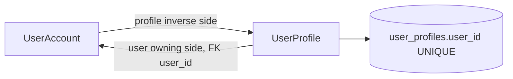

# Mapping One-to-One with @OneToOne

## 1. Objectives

In JPA, a one-to-one relationship represents an association in which a record in one table links to at most one record in another table, and vice versa. For example: a user account has at most one profile; a profile belongs to one user account.

After this lesson, you will be able to:
- Understand one-to-one relationships at both the object-model and database levels.
- Distinguish the owning side and inverse side of a bidirectional relationship.
- Map unidirectional and bidirectional one-to-one relationships using `@OneToOne`.
- Use `@JoinColumn`, `mappedBy`, `cascade`, and `orphanRemoval` appropriately.
- Understand `fetch`, `optional` options, and how to enforce uniqueness at the database level.
- Test saving, loading, and deleting related objects in Spring Data JPA.

## 2. One-to-One Relationships in the Database

Suppose a system has `user_accounts` and `user_profiles` tables. Each profile belongs to one account; an account may or may not have a profile yet.

One way to implement this relationship is to place the foreign key in the `user_profiles` table:

```sql
CREATE TABLE user_accounts (
    id BIGINT GENERATED BY DEFAULT AS IDENTITY PRIMARY KEY,
    email VARCHAR(180) NOT NULL UNIQUE
);

CREATE TABLE user_profiles (
    id BIGINT GENERATED BY DEFAULT AS IDENTITY PRIMARY KEY,
    user_id BIGINT NOT NULL UNIQUE,
    display_name VARCHAR(120) NOT NULL,
    CONSTRAINT fk_user_profiles_user
        FOREIGN KEY (user_id) REFERENCES user_accounts(id)
);
```

Three important constraints:
- `FOREIGN KEY (user_id)` ensures the profile references an existing account.
- `UNIQUE (user_id)` ensures an account cannot be referenced by multiple profiles.
- `NOT NULL` ensures every profile has an account.

This design allows an account to have 0 or 1 profile, while each profile must belong to exactly 1 account. Foreign key and unique constraints do not automatically force every account to have a profile; if business rules require every account to have a profile, enforce that rule in the creation workflow and consider an appropriate database design.

A one-to-one relationship can place the foreign key on either table. The table holding the foreign key is the owning side of the relationship in JPA. The foreign key location determines the owning side, not the class name or whichever side seems to be the business parent.

## 3. Owning Side and Inverse Side

In a bidirectional relationship, JPA distinguishes two sides:

- **Owning side:** the side that maps the foreign key column using `@JoinColumn`. This is the side that controls link changes written to the database.
- **Inverse side:** the side referencing back, declaring `mappedBy` pointing to the relationship property name on the owning side. This side does not create an extra foreign key column.

In the account and profile example:
- `UserProfile.user` is the owning side because it has `@JoinColumn(name = "user_id")`.
- `UserAccount.profile` is the inverse side because it uses `mappedBy = "user"`.

`mappedBy = "user"` points to the Java property name `user` in `UserProfile`, not the SQL column name `user_id`.



When a relationship is bidirectional, both sides must be synchronized in memory. If you only assign `userAccount.profile = profile` without assigning `profile.user = userAccount`, the owning side remains unset; the database may not persist the link as intended.

## 4. Unidirectional One-to-One Mapping

A unidirectional relationship means the application navigates from only one Entity to the other. For example, from an account you can retrieve its profile, while the profile needs no back-reference to the account.

```java
@Entity
@Table(name = "user_accounts")
public class UserAccount {
    @Id
    @GeneratedValue(strategy = GenerationType.IDENTITY)
    private Long id;

    @OneToOne(fetch = FetchType.LAZY, cascade = CascadeType.ALL, orphanRemoval = true)
    @JoinColumn(name = "profile_id", unique = true)
    private UserProfile profile;
}
```

In this unidirectional example, the `user_accounts` table contains a `profile_id` column referencing `user_profiles.id`. `unique = true` ensures a profile cannot be referenced by multiple accounts.

Do not declare `mappedBy` when the relationship is unidirectional. The side with `@JoinColumn` owns the link. If you only need to navigate from account to profile, this is a simpler model and avoids maintaining an unnecessary reverse relationship.

The remainder of this lesson uses the bidirectional model with the `user_profiles.user_id` foreign key, as it illustrates both the owning side and the inverse side.

## 5. Complete Bidirectional Example

This example uses Java 17+, Maven, Spring Boot 3.5.0, Spring Data JPA, and H2. `UserAccount` has at most one `UserProfile`; the profile depends on the account for its lifecycle.

### 5.1. Directory Structure

```text
src/
  main/
    java/com/example/library/
      LibraryApplication.java
      user/
        UserAccount.java
        UserProfile.java
        UserAccountRepository.java
        UserProfileRepository.java
    resources/
      application.properties
  test/
    java/com/example/library/user/
      UserOneToOneRepositoryTest.java
pom.xml
```

### 5.2. Maven Dependencies

Minimal `pom.xml` example:

```xml
<?xml version="1.0" encoding="UTF-8"?>
<project xmlns="http://maven.apache.org/POM/4.0.0"
         xmlns:xsi="http://www.w3.org/2001/XMLSchema-instance"
         xsi:schemaLocation="http://maven.apache.org/POM/4.0.0 https://maven.apache.org/xsd/maven-4.0.0.xsd">
    <modelVersion>4.0.0</modelVersion>

    <parent>
        <groupId>org.springframework.boot</groupId>
        <artifactId>spring-boot-starter-parent</artifactId>
        <version>3.5.0</version>
        <relativePath/>
    </parent>

    <groupId>com.example</groupId>
    <artifactId>one-to-one-jpa</artifactId>
    <version>0.0.1-SNAPSHOT</version>

    <properties>
        <java.version>17</java.version>
    </properties>

    <dependencies>
        <dependency>
            <groupId>org.springframework.boot</groupId>
            <artifactId>spring-boot-starter-data-jpa</artifactId>
        </dependency>
        <dependency>
            <groupId>com.h2database</groupId>
            <artifactId>h2</artifactId>
            <scope>runtime</scope>
        </dependency>
        <dependency>
            <groupId>org.springframework.boot</groupId>
            <artifactId>spring-boot-starter-test</artifactId>
            <scope>test</scope>
        </dependency>
    </dependencies>

    <build>
        <plugins>
            <plugin>
                <groupId>org.springframework.boot</groupId>
                <artifactId>spring-boot-maven-plugin</artifactId>
            </plugin>
        </plugins>
    </build>
</project>
```

### 5.3. Main Application Class

`src/main/java/com/example/library/LibraryApplication.java`:

```java
package com.example.library;

import org.springframework.boot.SpringApplication;
import org.springframework.boot.autoconfigure.SpringBootApplication;

@SpringBootApplication
public class LibraryApplication {
    public static void main(String[] args) {
        SpringApplication.run(LibraryApplication.class, args);
    }
}
```

Place the main class in the root package so Spring Boot automatically scans Entities and Repositories in subpackages.

### 5.4. UserAccount Entity — Inverse Side

`src/main/java/com/example/library/user/UserAccount.java`:

```java
package com.example.library.user;

import jakarta.persistence.CascadeType;
import jakarta.persistence.Column;
import jakarta.persistence.Entity;
import jakarta.persistence.FetchType;
import jakarta.persistence.GeneratedValue;
import jakarta.persistence.GenerationType;
import jakarta.persistence.Id;
import jakarta.persistence.OneToOne;
import jakarta.persistence.Table;
import java.util.Objects;

@Entity
@Table(name = "user_accounts")
public class UserAccount {
    @Id
    @GeneratedValue(strategy = GenerationType.IDENTITY)
    private Long id;

    @Column(nullable = false, unique = true, length = 180)
    private String email;

    @OneToOne(
            mappedBy = "user",
            cascade = CascadeType.ALL,
            orphanRemoval = true,
            fetch = FetchType.LAZY)
    private UserProfile profile;

    protected UserAccount() {
        // JPA requires a no-arg constructor.
    }

    public UserAccount(String email) {
        if (email == null || email.isBlank() || email.length() > 180) {
            throw new IllegalArgumentException("Email must contain 1 to 180 characters");
        }
        this.email = email.trim();
    }

    public void addProfile(UserProfile newProfile) {
        Objects.requireNonNull(newProfile, "profile is required");
        if (newProfile.getUser() != null && newProfile.getUser() != this) {
            throw new IllegalStateException("Profile already belongs to another account");
        }
        if (this.profile != null && this.profile != newProfile) {
            this.profile.setUser(null);
        }
        this.profile = newProfile;
        newProfile.setUser(this);
    }

    public void removeProfile() {
        if (this.profile != null) {
            UserProfile oldProfile = this.profile;
            this.profile = null;
            oldProfile.setUser(null);
        }
    }

    public Long getId() {
        return id;
    }

    public String getEmail() {
        return email;
    }

    public UserProfile getProfile() {
        return profile;
    }
}
```

`mappedBy = "user"` tells JPA that `UserProfile.user` is the property owning the link. `UserAccount` does not create a `profile_id` column in this bidirectional design.

`addProfile()` updates both `this.profile` and `newProfile.user`. `removeProfile()` removes the link on both sides. When replacing an old profile with a new one, the old profile is detached from the account and `orphanRemoval` instructs JPA to delete the orphaned object on flush.

The method above assumes the new profile does not already belong to another account. If business rules allow transferring a profile between accounts, a dedicated ownership transfer operation is needed to update both accounts within the same transaction.

### 5.5. UserProfile Entity — Owning Side

`src/main/java/com/example/library/user/UserProfile.java`:

```java
package com.example.library.user;

import jakarta.persistence.Column;
import jakarta.persistence.Entity;
import jakarta.persistence.FetchType;
import jakarta.persistence.GeneratedValue;
import jakarta.persistence.GenerationType;
import jakarta.persistence.Id;
import jakarta.persistence.JoinColumn;
import jakarta.persistence.OneToOne;
import jakarta.persistence.Table;

@Entity
@Table(name = "user_profiles")
public class UserProfile {
    @Id
    @GeneratedValue(strategy = GenerationType.IDENTITY)
    private Long id;

    @Column(name = "display_name", nullable = false, length = 120)
    private String displayName;

    @OneToOne(fetch = FetchType.LAZY, optional = false)
    @JoinColumn(name = "user_id", nullable = false, unique = true)
    private UserAccount user;

    protected UserProfile() {
        // JPA requires a no-arg constructor.
    }

    public UserProfile(String displayName) {
        if (displayName == null || displayName.isBlank() || displayName.length() > 120) {
            throw new IllegalArgumentException("Display name must contain 1 to 120 characters");
        }
        this.displayName = displayName.trim();
    }

    void setUser(UserAccount user) {
        this.user = user;
    }

    public Long getId() {
        return id;
    }

    public String getDisplayName() {
        return displayName;
    }

    public UserAccount getUser() {
        return user;
    }
}
```

`@JoinColumn` marks the owning side and specifies the `user_id` foreign key column. `nullable = false` requires every profile to reference an account. `unique = true` ensures one account cannot have multiple profiles.

`optional = false` indicates that the relationship from `UserProfile` to `UserAccount` is mandatory. `nullable = false` describes the column constraint when the schema is generated. In production, explicitly declare foreign keys and unique constraints in migrations using Flyway or Liquibase rather than relying solely on automatic schema generation.

### 5.6. Repositories

`src/main/java/com/example/library/user/UserAccountRepository.java`:

```java
package com.example.library.user;

import java.util.Optional;
import org.springframework.data.jpa.repository.JpaRepository;

public interface UserAccountRepository extends JpaRepository<UserAccount, Long> {
    Optional<UserAccount> findByEmailIgnoreCase(String email);
}
```

`src/main/java/com/example/library/user/UserProfileRepository.java`:

```java
package com.example.library.user;

import java.util.Optional;
import org.springframework.data.jpa.repository.JpaRepository;

public interface UserProfileRepository extends JpaRepository<UserProfile, Long> {
    Optional<UserProfile> findByUser_Id(Long userId);
}
```

`findByUser_Id` queries by the `id` property of the `user` relationship. The underscore clarifies the `user.id` path, avoiding ambiguity when Spring Data parses property names.

## 6. Persisting Data and Cascade

In the mapping above, `UserAccount` is the inverse side but is configured with `cascade = CascadeType.ALL`. Thus, saving an account can cascade persist/merge operations to the profile. However, the owning side must still be set so that the `user_id` column receives a value.

```java
UserAccount account = new UserAccount("reader@example.com");
UserProfile profile = new UserProfile("Reader One");
account.addProfile(profile);

UserAccount saved = userAccountRepository.save(account);
```

The `addProfile()` method synchronizes both sides. If `profile.setUser(account)` is skipped, the owning side will not know which account the profile belongs to, and writing may fail due to `user_id` being NOT NULL or fail to create the expected link.

`CascadeType.ALL` includes persist, merge, remove, refresh, and detach. Use it only when the profile truly belongs to the account's lifecycle. If the two objects have independent lifecycles or the profile is shared, do not cascade deletions indiscriminately.

`orphanRemoval = true` is appropriate when the profile is a private child object of the account: when the profile is removed from the relationship, JPA deletes the profile record upon synchronizing the persistence context. It does not mean setting a property to null is safe in every design; update both sides properly and execute within a transaction.

## 7. Fetch Strategy and Performance

JPA specifies `@OneToOne` to default to `FetchType.EAGER`, meaning the relationship is requested to load eagerly. With large datasets or many relationships, this can cause a query to load unnecessary extra data.

You can declare `fetch = FetchType.LAZY` to request deferred loading:

```java
@OneToOne(fetch = FetchType.LAZY)
@JoinColumn(name = "profile_id", unique = true)
private UserProfile profile;
```

However, understand the limitations:
- `LAZY` on to-one relationships is a hint in JPA; the provider may not support it in every situation.
- On the inverse side of a bidirectional `@OneToOne`, the provider needs to know whether the relationship exists. In some cases, Hibernate requires bytecode enhancement for effective lazy loading; otherwise, it may run an extra query or load eagerly.
- Accessing a proxy outside a transaction can throw `LazyInitializationException` if the data has not been loaded yet.

Control data returned from the Service layer using DTOs, projections, or appropriate fetch queries. Do not turn on EAGER for every relationship merely to avoid lazy errors; doing so can increase query count and fetch unnecessary data.

## 8. @MapsId: Sharing the Primary Key

If a profile has the same ID as its account, you can use a shared primary key. In that case, the `user_profiles` table uses `user_id` as both its primary key and its foreign key to `user_accounts.id`.

`@MapsId` maps the dependent Entity's primary key from the referenced Entity's primary key:

```java
@Entity
@Table(name = "user_profiles")
public class UserProfile {
    @Id
    private Long id;

    @OneToOne(fetch = FetchType.LAZY, optional = false)
    @MapsId
    @JoinColumn(name = "user_id")
    private UserAccount user;

    // Constructor and other fields.
}
```

In this example, `UserProfile`'s ID is derived from `UserAccount`'s ID; no separate `@GeneratedValue` is needed for the profile. `@MapsId` is not a new relationship type, but a way to map a shared key for appropriate one-to-one or many-to-one relationships.

A shared primary key fits when the dependent object cannot exist independently and shares the same identity as the main object. Design cascading and creation order so the parent Entity is persisted and receives its ID before the dependent key is synchronized.

## 9. Integration Testing with H2

The test example uses Spring Boot 3.5.0, `spring-boot-starter-data-jpa`, H2, and `spring-boot-starter-test`. `@DataJpaTest` configures a test slice for Entities and Repositories.

`src/main/resources/application.properties`:

```properties
spring.datasource.url=jdbc:h2:mem:onetoonedb;DB_CLOSE_DELAY=-1
spring.datasource.driver-class-name=org.h2.Driver
spring.datasource.username=sa
spring.datasource.password=
spring.jpa.hibernate.ddl-auto=create-drop
spring.jpa.open-in-view=false
spring.jpa.show-sql=true
```

`src/test/java/com/example/library/user/UserOneToOneRepositoryTest.java`:

```java
package com.example.library.user;

import static org.assertj.core.api.Assertions.assertThat;

import org.junit.jupiter.api.Test;
import org.springframework.beans.factory.annotation.Autowired;
import org.springframework.boot.test.autoconfigure.orm.jpa.DataJpaTest;
import org.springframework.boot.test.autoconfigure.orm.jpa.TestEntityManager;

@DataJpaTest
class UserOneToOneRepositoryTest {
    @Autowired
    private UserAccountRepository userAccountRepository;

    @Autowired
    private UserProfileRepository userProfileRepository;

    @Autowired
    private TestEntityManager entityManager;

    @Test
    void cascadesProfileAndRemovesOrphan() {
        UserAccount account = new UserAccount("reader@example.com");
        account.addProfile(new UserProfile("Reader One"));

        UserAccount saved = userAccountRepository.saveAndFlush(account);
        Long accountId = saved.getId();

        entityManager.clear();

        UserAccount loaded = userAccountRepository.findById(accountId).orElseThrow();
        assertThat(loaded.getProfile().getDisplayName()).isEqualTo("Reader One");
        assertThat(userProfileRepository.findByUser_Id(accountId)).isPresent();

        loaded.removeProfile();
        userAccountRepository.flush();

        assertThat(userProfileRepository.findByUser_Id(accountId)).isEmpty();
    }
}
```

Run tests from the directory containing `pom.xml`:

```bash
mvn test
```

The expected result is Maven finishing with `BUILD SUCCESS`. The test creates an account and profile in the same object graph, saves the account to verify cascade, clears the persistence context, and reloads to verify the bidirectional relationship. Finally, it removes the profile and confirms `orphanRemoval` deletes the dependent record. This is the expected outcome when running with the stated configuration; the build command was not executed within the lesson content.

## 10. Common Errors

| Symptom | Cause | Solution |
| --- | --- | --- |
| Hibernate reports an invalid key class error | `@Embeddable` or `@IdClass` lacks a no-arg constructor or does not implement `Serializable`. | Check JPA requirements and declare an appropriate constructor. |
| Entity is saved but the foreign key has no value | Only the inverse side was updated, not the owning side. | Synchronize both sides using a helper method in the Entity. |
| Multiple profiles point to one account | The foreign key column lacks a unique constraint. | Use `unique = true` and create an actual unique constraint in migrations. |
| `mappedBy` is not recognized | `mappedBy` uses a column name instead of the Java property name on the owning side. | Use the exact property name, e.g., `mappedBy = "user"`. |
| Derived query cannot find property | The path to the relationship is mistyped or lacks property boundaries. | For `Profile.user.id`, use `findByUser_Id`. |
| `findById` returns no result | A foreign key component or ID is missing/wrong. | Check the full primary key and passed values. |
| Lazy error when serializing response | An Entity with a lazy relationship is accessed after the transaction closes or creates a bidirectional JSON loop. | Convert to a DTO/projection within the transaction; avoid returning the Entity graph directly. |
| Deleting account does not delete profile as expected | Missing cascade remove or orphan removal, or both sides were not updated. | Identify lifecycle ownership and intentionally configure cascade/orphanRemoval. |

## 11. Design Principles

1. Only map `@OneToOne` when the database actually guarantees relationship uniqueness via a unique constraint on the foreign key.
2. The owning side is the side with `@JoinColumn`; `mappedBy` specifies the owning-side property on the other Entity.
3. For bidirectional relationships, provide add/remove methods to synchronize both sides.
4. Use cascade when one object genuinely manages the other's lifecycle. Only enable `orphanRemoval` when the dependent object cannot exist independently.
5. Understand the EAGER default of `@OneToOne` and consider LAZY, DTOs, or projections to control data loading.
6. Do not use `CascadeType.REMOVE` with an object that is shared or has an independent lifecycle.
7. Declare foreign keys and unique constraints in production migrations; annotations do not replace managing deployed schemas.
8. Use business methods to maintain two-way consistency instead of calling setters arbitrarily everywhere.

## 12. Completion Checklist

- [ ] Explain why `@OneToOne` needs a unique constraint on the foreign key.
- [ ] Distinguish the owning side and the inverse side.
- [ ] Write a unidirectional relationship using `@OneToOne` and `@JoinColumn`.
- [ ] Write a bidirectional relationship with `mappedBy` and synchronize both sides.
- [ ] Understand the meaning of `optional`, `nullable`, `cascade`, and `orphanRemoval`.
- [ ] Know the limitations of `FetchType.LAZY` for one-to-one relationships.
- [ ] Test cascade persist and orphan removal with `@DataJpaTest`.
- [ ] Return relationship data via DTOs/projections when needed to avoid lazy loading errors or JSON loops.

Once completed, you can map one-to-one relationships according to foreign key placement, guarantee uniqueness in the database, and manage related Entity lifecycles consistently.