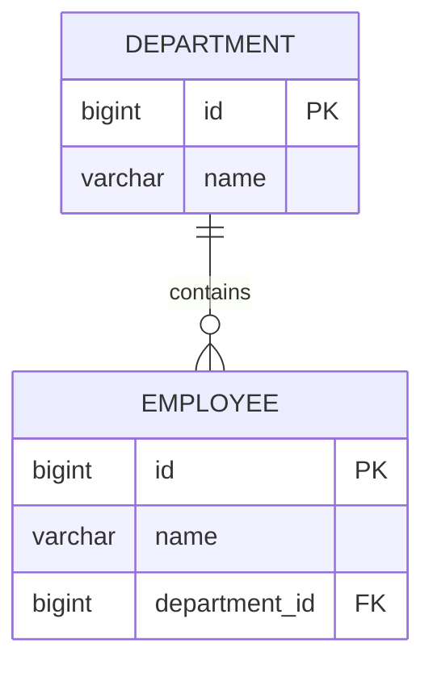

# The Role of mappedBy and Foreign Key Placement

## Objectives

In JPA entity relationships, both Java sides can reference each other, yet the database needs a concrete structure to represent the relationship: a foreign key in a table or a join table. JPA uses the concepts of **owning side** and **inverse side** to determine which side controls the relationship mapping.

`mappedBy` is declared on the inverse side and points to the relationship property name on the owning side. It tells JPA where the relationship is already mapped so JPA does not create an independent write mapping on the other side.

Key takeaway: the location of a collection in Java does not determine where the foreign key is stored. In a bidirectional `@OneToMany`/`@ManyToOne` relationship, the foreign key typically lives in the many-side table and the `@ManyToOne` property is the owning side.

## 1. What Are the Owning Side and Inverse Side?

In a relational database model, a foreign key lives in a specific table. JPA needs to know which property is responsible for updating that foreign key column or join table. That property belongs to the owning side.

- **Owning side:** the side that declares the physical mapping of the relationship, typically where `@JoinColumn` or `@JoinTable` is placed. Changes to this side are used by JPA to synchronize the relationship to the database.
- **Inverse side:** the side referencing a mapping already defined elsewhere. It declares `mappedBy` to specify the relationship property name on the owning side.

The owning side is an ORM mapping concept; it does not mean the object on that side is the business owner, domain data owner, or has the right to delete the object on the other side.

## 2. What Does mappedBy Point To?

`mappedBy` takes the **Java property name** on the owning-side entity. This value is not the table name, foreign key column name, class name, or property name on the inverse side.

```java
@Entity
public class Department {
    @OneToMany(mappedBy = "department")
    private List<Employee> employees = new ArrayList<>();
}

@Entity
public class Employee {
    @ManyToOne
    @JoinColumn(name = "department_id")
    private Department department;
}
```

`mappedBy = "department"` points to the `Employee.department` field. JPA looks at that property's mapping to see that the relationship is already defined on the `Employee` side.

If you rename the Java field from `department` to `team`, you must update `mappedBy = "team"`. The database column name can still remain `department_id`; these two names belong to different layers.

## 3. Bidirectional OneToMany / ManyToOne Relationship

This is the most common pattern: one department has many employees, and each employee belongs to one department.



The `employee.department_id` foreign key resides in the `employee` table because each employee row stores the department ID it references.

Corresponding mapping:

```java
@Entity
public class Department {
    @Id
    @GeneratedValue(strategy = GenerationType.IDENTITY)
    private Long id;

    private String name;

    @OneToMany(mappedBy = "department")
    private List<Employee> employees = new ArrayList<>();
}

@Entity
public class Employee {
    @Id
    @GeneratedValue(strategy = GenerationType.IDENTITY)
    private Long id;

    private String name;

    @ManyToOne(fetch = FetchType.LAZY)
    @JoinColumn(name = "department_id")
    private Department department;
}
```

`Employee.department` is the owning side because it declares `@JoinColumn`. `Department.employees` is the inverse side because it declares `mappedBy`. JPA updates the `department_id` column based on the value of `Employee.department`.

### Why Is ManyToOne Usually the Owning Side?

When many employees belong to one department, each `employee` row can directly store a single `department_id`. A single foreign key in the many-side table represents the relationship. Looking from the `department` table alone, since a department can have many employees, you cannot place a simple single `employee_id` column in each department row to represent the entire set of children.

Therefore, the natural model is for the foreign key to live in the many-side table. In a standard bidirectional mapping, the `@ManyToOne` property controls the foreign key and `@OneToMany(mappedBy=...)` is simply the reverse view.

## 4. Updating Both Sides in Java

Because the database only synchronizes from the owning side, code must update the `Employee.department` property. However, to keep the in-memory object graph consistent, you should also update the `Department.employees` collection.

Add helper methods:

```java
public void addEmployee(Employee employee) {
    employees.add(employee);
    employee.setDepartment(this);
}

public void removeEmployee(Employee employee) {
    employees.remove(employee);
    employee.setDepartment(null);
}
```

And in `Employee`:

```java
public void setDepartment(Department department) {
    this.department = department;
}
```

In a real project, helpers may check for nulls, prevent duplicate additions, handle employees currently belonging to another department, and enforce corresponding domain rules.

### What Happens If Only the Inverse Side Is Updated?

Suppose code only calls:

```java
department.getEmployees().add(employee);
```

without calling `employee.setDepartment(department)`. The in-memory collection may show the employee inside the department, but the owning side remains `null`. On flush, Hibernate has no owning-side value to write to `department_id`; the database outcome may not match expectations or may violate a `NOT NULL` constraint.

Conversely, if only `employee.department` is set, the foreign key may be written properly, but the `department.employees` collection in memory may not reflect the change yet. Therefore, synchronize both sides using helper methods.

## 5. @JoinColumn Defines the Foreign Key Column

`@JoinColumn` describes the column used to join to the target table. In the `Employee.department` example, declaring:

```java
@ManyToOne(fetch = FetchType.LAZY)
@JoinColumn(name = "department_id", nullable = false)
private Department department;
```

means the `employee` table has a `department_id` column referencing the primary key of `department`. `name` is the column name in the current table; `referencedColumnName` can be used when you need to reference a column other than the primary key in a valid mapping.

If `@JoinColumn` is omitted, the provider applies a default name according to its mapping rules. Explicit declarations usually keep the schema easier to read and migrations clearer.

Conceptual DDL example:

```sql
create table department (
    id bigint generated by default as identity primary key,
    name varchar(255)
);

create table employee (
    id bigint generated by default as identity primary key,
    name varchar(255),
    department_id bigint not null,
    constraint fk_employee_department
        foreign key (department_id) references department(id)
);
```

Actual DDL depends on the database dialect, ID type, and Hibernate configuration. `@JoinColumn` describes the mapping; a migration tool should manage production schemas.

## 6. Other Relationship Types and Foreign Key Placement

### OneToOne

In a one-to-one relationship, the owning side is the side defining the foreign key. For example, `User` has a `Profile`, and the `user_profile` table contains `user_id`:

```java
@Entity
public class User {
    @OneToOne(mappedBy = "user", fetch = FetchType.LAZY)
    private UserProfile profile;
}

@Entity
public class UserProfile {
    @OneToOne
    @JoinColumn(name = "user_id", unique = true)
    private User user;
}
```

`UserProfile.user` is the owning side; `User.profile` is the inverse side. The `user_profile.user_id` column resides in the `user_profile` table. The unique constraint helps the database ensure a user cannot be linked to multiple profiles.

If you want the foreign key in the `user` table instead, place the owning side and `@JoinColumn` on `User`, and have `UserProfile` reference it with `mappedBy`.

### ManyToMany

Many-to-many relationships typically use a join table containing two foreign keys. One side is the owning side and declares `@JoinTable`; the other side declares `mappedBy`.

```java
@Entity
public class Student {
    @ManyToMany
    @JoinTable(
        name = "student_course",
        joinColumns = @JoinColumn(name = "student_id"),
        inverseJoinColumns = @JoinColumn(name = "course_id")
    )
    private Set<Course> courses = new HashSet<>();
}

@Entity
public class Course {
    @ManyToMany(mappedBy = "courses")
    private Set<Student> students = new HashSet<>();
}
```

`Student.courses` is the owning side. The `student_course` table contains `student_id` and `course_id`. `Course.students` is merely the inverse side. If you need to add attributes to the relationship such as enrollment date, grade, or status, it is usually better to model the join table as a separate entity rather than continuing with a pure `@ManyToMany`.

### Unidirectional OneToMany

Not every `@OneToMany` must have `mappedBy`. In a unidirectional relationship, the collection can be the owning side, and JPA typically uses a join table under the default mapping. If you want to place the foreign key on the many-side table, you can declare `@JoinColumn` on the collection:

```java
@Entity
public class Department {
    @OneToMany
    @JoinColumn(name = "department_id")
    private List<Employee> employees = new ArrayList<>();
}
```

In this mapping, `Department.employees` controls the association and the `department_id` column resides in the `employee` table. There is no `Employee.department` field and therefore no `mappedBy`. Choosing unidirectional vs. bidirectional should be based on how the domain needs to navigate the relationship, not solely on collection placement.

## 7. When Is mappedBy Needed?

Use `mappedBy` when modeling a bidirectional relationship and the current side is the inverse side. Common patterns:

| Relationship | Owning side | Inverse side | Where the relationship is stored |
| --- | --- | --- | --- |
| Bidirectional OneToMany / ManyToOne | `@ManyToOne` | `@OneToMany(mappedBy = ...)` | FK in the many-side table |
| Bidirectional OneToOne | Side with `@JoinColumn` or `@JoinTable` | Side with `mappedBy` | FK or join table per owning mapping |
| Bidirectional ManyToMany | Side declaring `@JoinTable` | Side with `mappedBy` | Join table |
| Unidirectional OneToMany | OneToMany collection | No inverse field | Usually a join table; FK can be configured with `@JoinColumn` |

`mappedBy` is not a mandatory annotation for every bidirectional relationship if mapped differently, but in a standard mapping only one side controls the link structure. Both sides should not declare independent join columns for the same association.

## 8. Cascade and orphanRemoval Do Not Determine the Owning Side

`cascade` determines which operations propagate from this entity to related entities, such as `PERSIST`, `MERGE`, `REMOVE`, or `ALL`. `orphanRemoval = true` allows deleting a child entity when it is removed from the relationship under the mapping's conditions.

These attributes do not change which side owns the relationship. For example, if `Department.employees` has `cascade = CascadeType.ALL` and `mappedBy = "department"`, `Employee.department` is still the owning side. When adding an employee, code must still set the owning side.

Helper method example:

```java
public void addEmployee(Employee employee) {
    employees.add(employee);
    employee.setDepartment(this);
}
```

If using `orphanRemoval = true`, only enable it when the child entity truly belongs to the parent entity's lifecycle and removing it from the collection means deleting the child. Do not use it merely to synchronize collections.

## 9. Runnable Example with Java 17+, Spring Boot, and H2

The example below creates a department and two employees. `Employee.department` is the owning side, while `Department.employees` uses `mappedBy`. Helper methods update both sides; the service flushes and clears the persistence context before reading back to verify the data is hydrated from the database.

### Project Structure

```text
mapped-by-demo/
├── pom.xml
└── src/
    └── main/
        ├── java/com/example/mappedby/
        │   ├── MappedByApplication.java
        │   ├── Department.java
        │   ├── Employee.java
        │   ├── DepartmentRepository.java
        │   └── DepartmentService.java
        └── resources/
            └── application.properties
```

### `pom.xml`

```xml
<?xml version="1.0" encoding="UTF-8"?>
<project xmlns="http://maven.apache.org/POM/4.0.0"
         xmlns:xsi="http://www.w3.org/2001/XMLSchema-instance"
         xsi:schemaLocation="http://maven.apache.org/POM/4.0.0 https://maven.apache.org/xsd/maven-4.0.0.xsd">
    <modelVersion>4.0.0</modelVersion>
    <parent>
        <groupId>org.springframework.boot</groupId>
        <artifactId>spring-boot-starter-parent</artifactId>
        <version>3.4.5</version>
        <relativePath/>
    </parent>
    <groupId>com.example</groupId>
    <artifactId>mapped-by-demo</artifactId>
    <version>0.0.1-SNAPSHOT</version>
    <properties>
        <java.version>17</java.version>
    </properties>
    <dependencies>
        <dependency>
            <groupId>org.springframework.boot</groupId>
            <artifactId>spring-boot-starter-data-jpa</artifactId>
        </dependency>
        <dependency>
            <groupId>com.h2database</groupId>
            <artifactId>h2</artifactId>
            <scope>runtime</scope>
        </dependency>
    </dependencies>
    <build>
        <plugins>
            <plugin>
                <groupId>org.springframework.boot</groupId>
                <artifactId>spring-boot-maven-plugin</artifactId>
            </plugin>
        </plugins>
    </build>
</project>
```

### `src/main/resources/application.properties`

```properties
spring.datasource.url=jdbc:h2:mem:mappedby;DB_CLOSE_DELAY=-1
spring.datasource.username=sa
spring.datasource.password=
spring.jpa.hibernate.ddl-auto=create-drop
spring.jpa.open-in-view=false
logging.level.org.hibernate.SQL=DEBUG
```

### `Department.java`

```java
package com.example.mappedby;

import jakarta.persistence.CascadeType;
import jakarta.persistence.Entity;
import jakarta.persistence.GeneratedValue;
import jakarta.persistence.GenerationType;
import jakarta.persistence.Id;
import jakarta.persistence.OneToMany;
import jakarta.persistence.Table;
import java.util.ArrayList;
import java.util.List;

@Entity
@Table(name = "departments")
public class Department {
    @Id
    @GeneratedValue(strategy = GenerationType.IDENTITY)
    private Long id;

    private String name;

    @OneToMany(mappedBy = "department", cascade = CascadeType.ALL)
    private List<Employee> employees = new ArrayList<>();

    protected Department() {
    }

    public Department(String name) {
        this.name = name;
    }

    public void addEmployee(Employee employee) {
        employees.add(employee);
        employee.setDepartment(this);
    }

    public Long getId() {
        return id;
    }

    public String getName() {
        return name;
    }

    public List<Employee> getEmployees() {
        return employees;
    }
}
```

### `Employee.java`

```java
package com.example.mappedby;

import jakarta.persistence.Entity;
import jakarta.persistence.FetchType;
import jakarta.persistence.GeneratedValue;
import jakarta.persistence.GenerationType;
import jakarta.persistence.Id;
import jakarta.persistence.JoinColumn;
import jakarta.persistence.ManyToOne;
import jakarta.persistence.Table;

@Entity
@Table(name = "employees")
public class Employee {
    @Id
    @GeneratedValue(strategy = GenerationType.IDENTITY)
    private Long id;

    private String name;

    @ManyToOne(fetch = FetchType.LAZY)
    @JoinColumn(name = "department_id", nullable = false)
    private Department department;

    protected Employee() {
    }

    public Employee(String name) {
        this.name = name;
    }

    void setDepartment(Department department) {
        this.department = department;
    }

    public String getName() {
        return name;
    }
}
```

### `DepartmentRepository.java`

```java
package com.example.mappedby;

import org.springframework.data.jpa.repository.JpaRepository;

public interface DepartmentRepository extends JpaRepository<Department, Long> {
}
```

### `DepartmentService.java`

```java
package com.example.mappedby;

import jakarta.persistence.EntityManager;
import jakarta.persistence.PersistenceContext;
import org.springframework.stereotype.Service;
import org.springframework.transaction.annotation.Transactional;

@Service
public class DepartmentService {
    private final DepartmentRepository repository;

    @PersistenceContext
    private EntityManager entityManager;

    public DepartmentService(DepartmentRepository repository) {
        this.repository = repository;
    }

    @Transactional
    public String createAndRead() {
        Department department = new Department("Engineering");
        department.addEmployee(new Employee("An"));
        department.addEmployee(new Employee("Binh"));

        Department saved = repository.save(department);
        entityManager.flush();
        Long id = saved.getId();
        entityManager.clear();

        Department loaded = repository.findById(id).orElseThrow();
        String names = loaded.getEmployees().stream()
                .map(Employee::getName)
                .sorted()
                .reduce((left, right) -> left + ", " + right)
                .orElse("");

        return loaded.getName() + ": " + names;
    }
}
```

`entityManager.clear()` detaches the entities in the current persistence context. The subsequent `findById()` must re-hydrate the entity; when accessing the lazy collection within the same transaction, Hibernate loads the related employees.

### `MappedByApplication.java`

```java
package com.example.mappedby;

import org.springframework.boot.CommandLineRunner;
import org.springframework.boot.SpringApplication;
import org.springframework.boot.autoconfigure.SpringBootApplication;
import org.springframework.context.annotation.Bean;

@SpringBootApplication
public class MappedByApplication {
    public static void main(String[] args) {
        SpringApplication.run(MappedByApplication.class, args);
    }

    @Bean
    CommandLineRunner demo(DepartmentService service) {
        return args -> System.out.println(service.createAndRead());
    }
}
```

### Running the Program

```bash
mvn spring-boot:run
```

Output printed by the application:

```text
Engineering: An, Binh
```

Typical SQL executed by Hibernate looks like:

```sql
insert into departments (name, id) values (?, default)
insert into employees (department_id, name, id) values (?, ?, default)
insert into employees (department_id, name, id) values (?, ?, default)
select d1_0.id, d1_0.name from departments d1_0 where d1_0.id = ?
select e1_0.department_id, e1_0.id, e1_0.name
from employees e1_0 where e1_0.department_id = ?
```

Aliases and column order may vary depending on Hibernate version and dialect. What matters is that `department_id` appears in the `employees` INSERT statements, because `Employee.department` is the owning side.

## 10. Verifying Foreign Key Placement Using the Schema

When you need to confirm where the FK actually lives, inspect the DDL or database metadata:

```sql
select table_name, column_name
from information_schema.columns
where column_name like '%department%';
```

Metadata syntax may differ across database systems. You can also inspect foreign-key constraints via `information_schema` or a schema administration tool.

Do not infer FK placement solely from the Java collection name. Look for `@JoinColumn`, `@JoinTable`, `mappedBy`, and verify the actual DDL.

## 11. Common Errors

1. **Mistaking `mappedBy` for a column name:** `mappedBy` takes the Java property name on the owning side, e.g., `department`, not `department_id`.
2. **Adding only to the inverse-side collection:** the collection may change in memory, but the FK will not be updated. Set the owning-side reference.
3. **Placing `@JoinColumn` on both sides:** can create two physical mappings or a mapping error. Only one side owns a bidirectional association.
4. **Placing the FK on the wrong table:** in bidirectional `OneToMany`/`ManyToOne`, the FK typically resides in the many-side table, owned by `ManyToOne`.
5. **Using `mappedBy` in a unidirectional relationship:** there is no opposite-side property to reference; remove `mappedBy` and configure an appropriate unidirectional association.
6. **Forgetting to synchronize the object graph:** setting only the owning side may write the database correctly while leaving the in-memory inverse collection stale. Use helper methods that update both.
7. **Confusing cascade with ownership:** cascade propagates persist/merge/remove operations; it does not determine which side updates the FK column.
8. **Accessing a lazy collection after the transaction:** load data inside the transaction or use a fetch join, `@EntityGraph`, or DTO projection as appropriate.
9. **Assuming `mappedBy` creates the FK:** `mappedBy` describes the inverse side. The FK or join table is declared on the owning side.

## 12. Design Principles

- For bidirectional `OneToMany`/`ManyToOne`, typically place `@JoinColumn` on `ManyToOne` and `mappedBy` on `OneToMany`.
- Create helper methods on the aggregate to synchronize both sides in memory.
- Only enable cascade and orphan removal according to business lifecycles; do not use them to fix ownership issues.
- Use `LAZY` for to-one relationships when appropriate for the workload and proactively load needed data inside transactions.
- Verify the schema via migrations or DDL, especially when changing the owning side or join columns.
- Test both writing and reading in a fresh persistence context to catch bugs where only the inverse side was updated.

Core takeaway: **`mappedBy` identifies the inverse side and points to the association property on the owning side. In bidirectional `OneToMany`/`ManyToOne`, the foreign key typically lives in the `ManyToOne` table; only updating the owning side determines the FK value written to the database.**