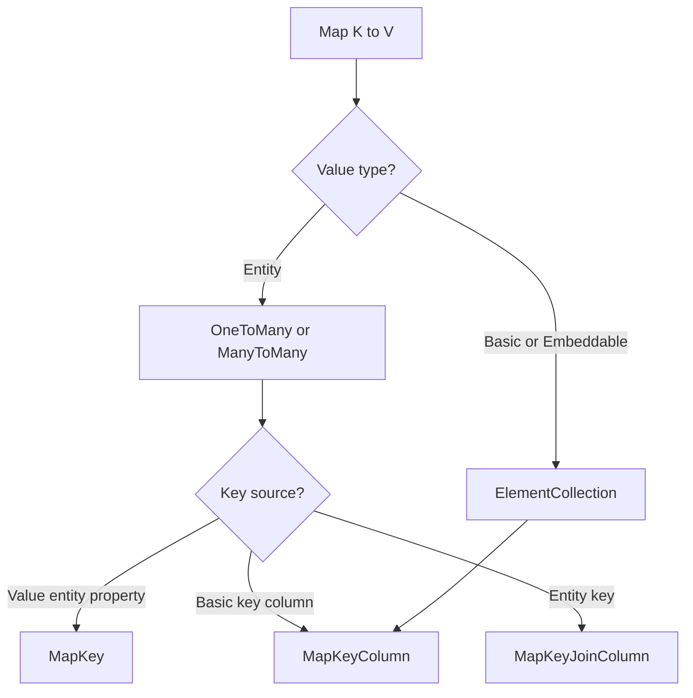

# Mapping Map Keys with @MapKey and Its Variants

## 1. Objectives

Java `Map<K, V>` stores data as key-value pairs. In JPA, a Map can represent many data shapes: a Map of Entities, a Map of basic values, a Map with enum keys, or a Map whose key is another Entity. The annotation used to map the key depends on the types of both the key and the value.

This lesson focuses on `@MapKey` and its related variants:
- `@MapKey`: derives the Map key from a property of the value Entity, or from the value Entity's primary key if no property name is specified.
- `@MapKeyColumn`: stores a basic key in a dedicated column of the join table or collection table.
- `@MapKeyEnumerated` and `@MapKeyTemporal`: specify how enum keys or legacy date/time keys are persisted.
- `@MapKeyJoinColumn` and `@MapKeyJoinColumns`: map a Map key that is an Entity.
- `@MapKeyClass`: declares the key type when using a raw Map where the type cannot be inferred from generics.

After this lesson, you will be able to choose the right annotation, properly model the relationship between Map key and Map value, design database constraints to prevent duplicate keys, and write repositories and tests for Map-valued associations.

## 2. What Does a Map in JPA Consist Of?

A Map property has two parts:

- **Map key (`K`)**: used to look up a value in the Map.
- **Map value (`V`)**: the object or value stored for that key.

For example, `Map<String, Course>` can use a course code as the key and a `Course` Entity as the value. `Map<String, String>` can use a setting name as the key and the setting content as the value.

JPA maps a Map differently depending on the value type:

| Value type | Typical mapping |
| --- | --- |
| Entity | `@OneToMany` or `@ManyToMany` |
| Basic type such as `String`, `Integer`, `BigDecimal` | `@ElementCollection` |
| Embeddable | `@ElementCollection` |

For a Map whose value is an Entity, the key can come from a property of the value Entity, be stored separately in a column, or be another Entity. For a Map whose value is a basic type or embeddable, key-value pairs are typically stored in a collection table.



## 3. @MapKey: Deriving the Key from the Value Entity

`@MapKey` is used when the Map value is an Entity and the key is taken from a persistent property of that Entity. No separate map-key column is created solely for the key: JPA uses the value of an existing property in the value Entity's table.

There are two ways to use it:

1. `@MapKey(name = "code")`: the key is taken from the `code` property of the value Entity.
2. `@MapKey` without `name`: the key is taken from the primary key of the value Entity.

For example, a department manages many courses. Within each department, the course code is unique. The Map uses the course code as the key and the `Course` Entity as the value.

### 3.1. Department Entity

`src/main/java/com/example/catalog/department/Department.java`:

```java
package com.example.catalog.department;

import jakarta.persistence.CascadeType;
import jakarta.persistence.Column;
import jakarta.persistence.Entity;
import jakarta.persistence.GeneratedValue;
import jakarta.persistence.GenerationType;
import jakarta.persistence.Id;
import jakarta.persistence.MapKey;
import jakarta.persistence.OneToMany;
import jakarta.persistence.Table;
import jakarta.persistence.UniqueConstraint;
import java.util.HashMap;
import java.util.Map;
import java.util.Objects;

@Entity
@Table(name = "departments")
public class Department {
    @Id
    @GeneratedValue(strategy = GenerationType.IDENTITY)
    private Long id;

    @Column(nullable = false, unique = true, length = 100)
    private String name;

    @OneToMany(
            mappedBy = "department",
            cascade = CascadeType.ALL,
            orphanRemoval = true)
    @MapKey(name = "code")
    private Map<String, Course> courses = new HashMap<>();

    protected Department() {
        // JPA requires a no-arg constructor.
    }

    public Department(String name) {
        if (name == null || name.isBlank() || name.length() > 100) {
            throw new IllegalArgumentException("Department name is required");
        }
        this.name = name.trim();
    }

    public void addCourse(Course course) {
        Objects.requireNonNull(course, "course is required");
        Course current = courses.get(course.getCode());
        if (current != null && current != course) {
            throw new IllegalArgumentException("Course code already exists in this department");
        }
        if (course.getDepartment() != null && course.getDepartment() != this) {
            throw new IllegalStateException("Course already belongs to another department");
        }
        courses.put(course.getCode(), course);
        course.setDepartment(this);
    }

    public void removeCourse(String code) {
        Course removed = courses.remove(code);
        if (removed != null) {
            removed.setDepartment(null);
        }
    }

    public Long getId() {
        return id;
    }

    public String getName() {
        return name;
    }

    public Map<String, Course> getCourses() {
        return courses;
    }
}
```

`@MapKey(name = "code")` tells JPA to take the key from the `code` property of each `Course`. The Map has type `Map<String, Course>` because `Course.code` is a `String`.

`mappedBy = "department"` indicates that `Course.department` is the owning side of the OneToMany relationship. The Map key and the owning side are two separate concerns: `@MapKey` determines the Map's key, whereas `mappedBy` determines which Entity writes the foreign key.

### 3.2. Course Entity

`src/main/java/com/example/catalog/department/Course.java`:

```java
package com.example.catalog.department;

import jakarta.persistence.Column;
import jakarta.persistence.Entity;
import jakarta.persistence.FetchType;
import jakarta.persistence.GeneratedValue;
import jakarta.persistence.GenerationType;
import jakarta.persistence.Id;
import jakarta.persistence.JoinColumn;
import jakarta.persistence.ManyToOne;
import jakarta.persistence.Table;
import jakarta.persistence.UniqueConstraint;

@Entity
@Table(
        name = "courses",
        uniqueConstraints = @UniqueConstraint(
                name = "uk_course_department_code",
                columnNames = {"department_id", "course_code"}))
public class Course {
    @Id
    @GeneratedValue(strategy = GenerationType.IDENTITY)
    private Long id;

    @Column(name = "course_code", nullable = false, length = 30)
    private String code;

    @Column(nullable = false, length = 160)
    private String title;

    @ManyToOne(fetch = FetchType.LAZY, optional = false)
    @JoinColumn(name = "department_id", nullable = false)
    private Department department;

    protected Course() {
        // JPA requires a no-arg constructor.
    }

    public Course(String code, String title) {
        if (code == null || code.isBlank() || code.length() > 30) {
            throw new IllegalArgumentException("Course code is required");
        }
        if (title == null || title.isBlank() || title.length() > 160) {
            throw new IllegalArgumentException("Course title is required");
        }
        this.code = code.trim();
        this.title = title.trim();
    }

    void setDepartment(Department department) {
        this.department = department;
    }

    public Long getId() {
        return id;
    }

    public String getCode() {
        return code;
    }

    public String getTitle() {
        return title;
    }

    public Department getDepartment() {
        return department;
    }
}
```

The unique constraint `(department_id, course_code)` ensures a course code cannot be duplicated within the same department. This constraint is important because a Map cannot hold two different values under the same key in a single Map.

`course_code` does not necessarily have to be globally unique across the entire table. If the code is only meaningful within a department, the unique constraint should include `department_id`.

### 3.3. Repositories

`src/main/java/com/example/catalog/department/DepartmentRepository.java`:

```java
package com.example.catalog.department;

import org.springframework.data.jpa.repository.JpaRepository;

public interface DepartmentRepository extends JpaRepository<Department, Long> {
}
```

`src/main/java/com/example/catalog/department/CourseRepository.java`:

```java
package com.example.catalog.department;

import org.springframework.data.jpa.repository.JpaRepository;

public interface CourseRepository extends JpaRepository<Course, Long> {
}
```

The generic ID type of `DepartmentRepository` and `CourseRepository` is `Long`, because each Entity has a single primary key. The Map key of `Department.courses` is `String`, which does not change the repository's ID type.

### 3.4. Saving and Loading the Map

```java
Department department = new Department("Computer Science");
department.addCourse(new Course("JAVA-101", "Java Fundamentals"));
department.addCourse(new Course("DB-201", "Database Systems"));

Department saved = departmentRepository.save(department);
```

Because `Department.courses` has `cascade = CascadeType.ALL`, persisting `Department` cascades to the `Course`s in the Map. The `addCourse` method also sets `Course.department`, updating the owning side.

Reading back:

```java
Department loaded = departmentRepository.findById(saved.getId())
        .orElseThrow();

Course javaCourse = loaded.getCourses().get("JAVA-101");
System.out.println(javaCourse.getTitle());
```

Inside an open transaction, `loaded.getCourses()` returns a JPA-managed Map. Because `@MapKey` uses `Course.code`, entry keys correspond to course codes.

## 4. @MapKey Without name

If `name` is omitted, `@MapKey` uses the primary key of the value Entity as the Map key.

Example:

```java
@OneToMany(mappedBy = "department")
@MapKey
private Map<Long, Course> coursesById = new HashMap<>();
```

Here the key is the ID of `Course`, so the Map type is `Map<Long, Course>`. This is useful when you want to access child Entities directly by their primary key.

Distinction:

| Declaration | Map key source | Example key type |
| --- | --- | --- |
| `@MapKey(name = "code")` | The `code` property of the value Entity | `String` |
| `@MapKey` | The primary key of the value Entity | `Long` |

`@MapKey` does not create a separate key column. The key is the value of an already existing property on the value Entity.

## 5. @MapKeyColumn: Storing a Basic Key in a Dedicated Column

Use `@MapKeyColumn` when the key is a basic type and is stored separately rather than taken from an existing property of the value Entity.

For example, a department wants to assign aliases to courses. The value is still a `Course` Entity, while keys like `core-java` or `sql-intro` are independent of `Course.code`.

```java
@OneToMany(cascade = CascadeType.ALL, orphanRemoval = true)
@JoinTable(
        name = "department_course_aliases",
        joinColumns = @JoinColumn(name = "department_id"),
        inverseJoinColumns = @JoinColumn(name = "course_id"))
@MapKeyColumn(name = "course_alias", nullable = false, length = 40)
private Map<String, Course> coursesByAlias = new HashMap<>();
```

With a unidirectional mapping using `@JoinTable`, the join table holds a foreign key to `Department`, a foreign key to `Course`, and the `course_alias` column storing the Map key. This key is independent of `Course`'s properties.

Do not use `@MapKey(name = "code")` on the same mapping because the two annotations represent two different strategies: deriving the key from a value Entity property vs. storing an independent key in a column.

### 5.1. Maps in @ElementCollection

`@MapKeyColumn` is also commonly used for Maps whose values are basic types or embeddables. In that case, `@ElementCollection` stores key-value pairs in a collection table.

```java
@ElementCollection
@CollectionTable(
        name = "department_settings",
        joinColumns = @JoinColumn(name = "department_id"))
@MapKeyColumn(name = "setting_key", nullable = false, length = 60)
@Column(name = "setting_value", nullable = false, length = 500)
private Map<String, String> settings = new HashMap<>();
```

This example creates a collection table with foreign key `department_id`, key column `setting_key`, and value column `setting_value`. Map entries are not separate Entities and have no independent repository.

## 6. @MapKeyEnumerated: Maps with Enum Keys

If the key is an enum, use `@MapKeyEnumerated` to specify how the enum value is stored. If omitted, JPA defaults to ordinal (numeric position). For long-lived data, `EnumType.STRING` is usually safer because adding or reordering enum constants will not alter the meaning of stored numbers.

```java
public enum PermissionType {
    READ,
    WRITE,
    ADMIN
}
```

```java
@ElementCollection
@CollectionTable(
        name = "role_permissions",
        joinColumns = @JoinColumn(name = "role_id"))
@MapKeyColumn(name = "permission_code", nullable = false, length = 20)
@MapKeyEnumerated(EnumType.STRING)
@Column(name = "description", nullable = false, length = 200)
private Map<PermissionType, String> permissions = new HashMap<>();
```

`@MapKeyEnumerated(EnumType.STRING)` applies to the enum key. `@MapKeyColumn` names the column holding the key; `@Column` names the column holding the value. These two columns play different roles.

## 7. @MapKeyTemporal: Maps with Legacy Date/Time Keys

For Map keys using `java.util.Date` or `Calendar`, `@MapKeyTemporal` specifies the temporal precision persisted, analogous to how `@Temporal` applies to Entity properties.

```java
@ElementCollection
@CollectionTable(
        name = "daily_metrics",
        joinColumns = @JoinColumn(name = "account_id"))
@MapKeyColumn(name = "metric_date")
@MapKeyTemporal(TemporalType.DATE)
@Column(name = "metric_value")
private Map<Date, BigDecimal> metricsByDate = new HashMap<>();
```

This example uses legacy date/time types. For new models, consider `java.time` types such as `LocalDate`, `LocalDateTime`, or `Instant`, which are directly supported by JPA and do not require `@MapKeyTemporal`.

## 8. @MapKeyJoinColumn: Maps Whose Key Is an Entity

If the Map key is another Entity, use `@MapKeyJoinColumn` to map the foreign key of the key Entity. For example, an employee works on projects where the Map is looked up by the department overseeing each project.

```java
@ManyToMany
@JoinTable(
        name = "employee_projects",
        joinColumns = @JoinColumn(name = "employee_id"),
        inverseJoinColumns = @JoinColumn(name = "project_id"))
@MapKeyJoinColumn(name = "department_id")
private Map<Department, Project> projectsByDepartment = new HashMap<>();
```

In this mapping:
- The Map key is the `Department` Entity.
- The Map value is the `Project` Entity.
- `employee_id` identifies the employee owning the relationship.
- `project_id` identifies the value project.
- `department_id` is the foreign key used to form the Map key.

The join table needs a unique constraint suited to the model, such as `(employee_id, department_id)` if an employee has only one project per department.

If the Entity used as the Map key has a composite primary key, use `@MapKeyJoinColumns` to map the multiple corresponding foreign key columns. Each `@MapKeyJoinColumn` specifies one key component of the key Entity.

## 9. @MapKeyClass: Declaring the Key Type for Raw Maps

In modern Java code, always declare full generics such as `Map<String, Course>`. When the key type cannot be inferred because of a raw `Map` in legacy code, `@MapKeyClass` can specify the key type for JPA.

```java
@ElementCollection
@CollectionTable(
        name = "legacy_settings",
        joinColumns = @JoinColumn(name = "owner_id"))
@MapKeyClass(String.class)
@MapKeyColumn(name = "setting_key")
@Column(name = "setting_value")
private Map settings;
```

This example is only for recognizing the annotation. Never write raw `Map`s in new code, as you lose compile-time type safety and must cast when reading data. Prefer `Map<String, String>` and let the Java compiler check keys and values.

## 10. Comparing Map Key Annotations

| Annotation | When to use | How is the Map key stored/represented? |
| --- | --- | --- |
| `@MapKey(name = "property")` | Value is an Entity; key comes from a property of that Entity. | Uses the existing property; adds no separate key column. |
| `@MapKey` | Value is an Entity; key comes from the value Entity's primary key. | Uses the value's primary key. |
| `@MapKeyColumn` | Key is a basic type like String or Integer. | Stores the key in a dedicated column in the corresponding join/collection table. |
| `@MapKeyEnumerated` | Key is an enum. | Chooses ordinal or enum name storage; consider STRING. |
| `@MapKeyTemporal` | Key is a legacy Date/Calendar. | Chooses DATE, TIME, or TIMESTAMP. |
| `@MapKeyJoinColumn` | Key is an Entity. | Stores the key Entity's foreign key in the appropriate join table. |
| `@MapKeyJoinColumns` | Key is an Entity with a composite key. | Stores multiple foreign key columns for the key components. |
| `@MapKeyClass` | Raw Map whose key type cannot be inferred. | Explicitly declares the key class for JPA; avoid in new code. |

You do not put all of these annotations on a single property. Pick one strategy matching the key type and value type. Supplemental annotations such as `@MapKeyEnumerated` or `@MapKeyTemporal` describe how to convert the key type and typically combine with the column storing the key.

## 11. Query Rules and Uniqueness

With `@MapKey(name = "code")`, the Map key comes from the `code` property of the value Entity. Therefore, within the scope of one `Department`, `code` must be unique. If two `Course`s in the same `Department` share the same code, a Map cannot represent both values as separate entries; database data should prevent this as well.

To protect uniqueness, you can place a unique constraint on `(department_id, course_code)` as in the `Course` Entity example. Create the actual constraint via migrations in production.

When the property used as a Map key is mutated, the key in an in-memory Map may no longer match the new value. Therefore, treat the property used as the Map key as immutable once the Entity is placed in the Map. If business rules require changing the code, remove the Entity from the Map under the old key, update it in a transaction, and re-insert it under the new key while upholding database constraints.

With `@MapKeyColumn`, key uniqueness must also be enforced within the owner's scope. For example, in a collection or join table, the appropriate constraint usually covers the owner's foreign key and the map key column.

Derived queries follow Entity property paths rather than Java Map keys automatically for every query. With `@MapKey(name = "code")`, queries filtering by `Course.code` can be declared directly in `CourseRepository`; queries filtering by `Department` can use the corresponding relationship path.

## 12. Fetching, Cascade, and Lifecycle

Map-valued `@OneToMany` associations default to LAZY. When accessing the Map, the provider can issue additional queries. If you load a list of many `Department`s and iterate over each `Department`'s Map, the application may hit N+1 queries.

Mitigations:
- Load the needed data within the Service transaction.
- Use `join fetch` or `@EntityGraph` for specific use cases.
- Return DTOs/projections instead of exposing Entity graphs directly to the web layer.
- Paginate owner queries carefully; fetching a collection alongside pagination can cause inefficient queries or unexpected results depending on the provider.

`cascade` controls which operations propagate from the owner to value Entities. `orphanRemoval = true` deletes a value Entity when it is removed from the collection association. Use them only when the value truly depends on the owner's lifecycle.

With `@ElementCollection`, values are not independent Entities; they are saved and deleted along with the owner's collection table. There is no Entity lifecycle cascade in the `@OneToMany` sense.

Java Maps such as `HashMap` do not guarantee iteration order. If business logic requires ordering, declare an explicit sort strategy using `@OrderBy` matching a value property or a provider-supported structure; never assume database order is always stable.

## 13. Testing with H2

The example uses Spring Boot 3.5.0, Java 17+, Spring Data JPA, H2, and Spring Boot Test.

`src/main/resources/application.properties`:

```properties
spring.datasource.url=jdbc:h2:mem:mapdb;DB_CLOSE_DELAY=-1
spring.datasource.driver-class-name=org.h2.Driver
spring.datasource.username=sa
spring.datasource.password=
spring.jpa.hibernate.ddl-auto=create-drop
spring.jpa.open-in-view=false
spring.jpa.show-sql=true
```

`src/test/java/com/example/catalog/department/DepartmentMapKeyTest.java`:

```java
package com.example.catalog.department;

import static org.assertj.core.api.Assertions.assertThat;

import org.junit.jupiter.api.Test;
import org.springframework.beans.factory.annotation.Autowired;
import org.springframework.boot.test.autoconfigure.orm.jpa.DataJpaTest;
import org.springframework.boot.test.autoconfigure.orm.jpa.TestEntityManager;

@DataJpaTest
class DepartmentMapKeyTest {
    @Autowired
    private DepartmentRepository departmentRepository;

    @Autowired
    private CourseRepository courseRepository;

    @Autowired
    private TestEntityManager entityManager;

    @Test
    void loadsCoursesUsingTheirCodeAsMapKey() {
        Department department = new Department("Computer Science");
        department.addCourse(new Course("JAVA-101", "Java Fundamentals"));
        department.addCourse(new Course("DB-201", "Database Systems"));

        Department saved = departmentRepository.saveAndFlush(department);
        Long departmentId = saved.getId();
        entityManager.clear();

        Department loaded = departmentRepository.findById(departmentId).orElseThrow();

        assertThat(loaded.getCourses()).containsKeys("JAVA-101", "DB-201");
        assertThat(loaded.getCourses().get("JAVA-101").getTitle())
                .isEqualTo("Java Fundamentals");
    }

    @Test
    void removesCourseWhenItIsRemovedFromTheMap() {
        Department department = new Department("Computer Science");
        department.addCourse(new Course("JAVA-101", "Java Fundamentals"));
        Department saved = departmentRepository.saveAndFlush(department);
        Long departmentId = saved.getId();
        Long courseId = saved.getCourses().get("JAVA-101").getId();
        entityManager.clear();

        Department loaded = departmentRepository.findById(departmentId).orElseThrow();
        loaded.removeCourse("JAVA-101");
        entityManager.flush();
        entityManager.clear();

        assertThat(courseRepository.findById(courseId)).isEmpty();
    }
}
```

Run tests from the directory containing `pom.xml`:

```bash
mvn test
```

The expected result is Maven finishing with `BUILD SUCCESS`. The first test verifies that `@MapKey(name = "code")` restores the Map with the right course codes after the persistence context is cleared. The second test verifies that `orphanRemoval` deletes the `Course` after it is removed from the Map and the transaction synchronizes. This is the expected outcome when running the example with the stated configuration; the build command was not executed within this lesson.

## 14. Common Mistakes

| Symptom | Cause | Fix |
| --- | --- | --- |
| Map keeps only one value even though the database has multiple rows | Multiple value Entities share the same value for the `@MapKey` property. | Enforce key uniqueness within the owner's scope using a unique constraint. |
| Map key does not update after changing the property | The property used as key was mutated while the Map was loaded. | Keep keys immutable or remove and re-add the entry inside a transaction. |
| Collection changes fail to write FK | Only the inverse side was updated or `mappedBy` points to the wrong property name. | Update the owning side and use the exact Java property name. |
| Hibernate creates an unexpected key column | Confusing `@MapKey` with `@MapKeyColumn`. | Use `@MapKey` for a property on the value Entity; use `@MapKeyColumn` for a separately stored basic key. |
| Enum keys change meaning after adding enum constants | Stored enum by ordinal. | Use `@MapKeyEnumerated(EnumType.STRING)` where appropriate. |
| Raw Map causes loss of type safety | Generics omitted, requiring `@MapKeyClass` or casting. | Use fully parameterized `Map<K, V>` in new code. |
| Queries load excessive data | LAZY Map accessed repeatedly causing N+1 or inappropriate fetch plan. | Use DTOs, projections, `@EntityGraph`, or fetch joins for specific use cases. |
| Constraint error when adding entry | Duplicate key or owner not properly linked. | Check the Map key, owning side, and unique constraint before persisting. |

## 15. Design Principles

1. Clearly determine the key type and value type before choosing an annotation.
2. Use `@MapKey(name = "...")` when the key is already a property on the value Entity.
3. Use `@MapKey` without a name when you want the key to be the value Entity's primary key.
4. Use `@MapKeyColumn` when a basic key must be stored in a dedicated column.
5. Use `@MapKeyEnumerated`, `@MapKeyTemporal`, or `@MapKeyJoinColumn(s)` when the key type requires specialized mapping.
6. For Map keys derived from an Entity property, ensure that property is unique within the owner's scope and not mutated arbitrarily.
7. Protect uniqueness with database constraints rather than relying solely on `Map.put()` in Java.
8. Only use cascade and orphan removal when value Entities have a lifecycle dependent on the owner.
9. Control fetch plans and avoid returning Entity Maps directly from APIs where lazy loading or JSON loops could occur.

## 16. Completion Checklist

- [ ] Distinguish Map key and Map value in JPA.
- [ ] Explain how `@MapKey` derives keys from a value Entity property.
- [ ] Distinguish `@MapKey` from `@MapKeyColumn`.
- [ ] Know how to use `@MapKeyEnumerated` for enum keys.
- [ ] Recognize when to use `@MapKeyTemporal` and `@MapKeyJoinColumn(s)`.
- [ ] Understand the role of `@MapKeyClass` and why raw Maps should be avoided.
- [ ] Design unique constraints for keys within the owner's scope.
- [ ] Test Map-valued associations after flushing and clearing the persistence context.

Once complete, you can map Maps in JPA according to the source of the key, choose annotations matching the data types, and ensure Map entries stay consistent with database constraints.