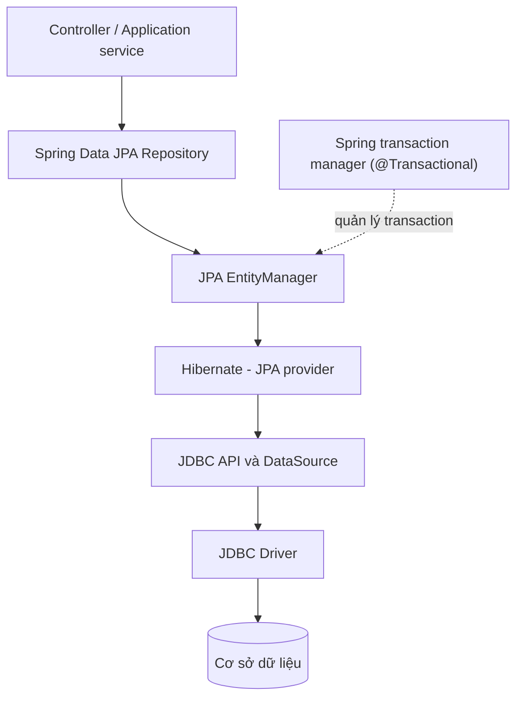

# Mối liên hệ giữa Spring Data, JPA, Hibernate, JDBC và cơ sở dữ liệu

## Mục tiêu

Sau bài này, bạn có thể phân biệt vai trò của Spring Data JPA, JPA, Hibernate, JDBC và hệ quản trị cơ sở dữ liệu; mô tả đường đi của một thao tác đọc/ghi; hiểu transaction và persistence context; đồng thời biết khi nào nên dùng repository hoặc JDBC trực tiếp.

## 1. Bức tranh tổng thể

Trong một ứng dụng Spring Boot dùng Spring Data JPA, lời gọi từ tầng nghiệp vụ thường đi qua các lớp sau:



Đây là chuỗi trách nhiệm điển hình, không phải mọi ứng dụng đều phải gọi repository. Ứng dụng có thể dùng `EntityManager` trực tiếp hoặc dùng JDBC. Khi dùng Spring Data JPA mặc định trong Spring Boot, Hibernate thường là JPA provider được cấu hình sẵn.

Điểm quan trọng: Spring Data JPA cung cấp cách làm việc ở mức repository; JPA định nghĩa hợp đồng persistence; Hibernate thực thi hợp đồng đó; Hibernate dùng JDBC để trao đổi SQL với database; JDBC driver chuyển lời gọi JDBC thành giao thức mà database hiểu.

## 2. Vai trò của từng thành phần

### Spring Data JPA: lớp repository của Spring

Spring Data JPA giúp ứng dụng thao tác dữ liệu qua interface repository thay vì phải tự viết phần lớn mã CRUD. Ví dụ, interface kế thừa `JpaRepository<Customer, Long>` có sẵn các thao tác `save`, `findById`, `findAll`, `deleteById`, phân trang và sắp xếp.

Spring Data JPA còn có thể tạo truy vấn từ tên phương thức như `findByEmail`, nhận JPQL qua `@Query`, hoặc nhận native SQL khi thật sự cần. Nó tạo proxy cho repository và điều phối lời gọi tới JPA API. Nó không phải database, không phải JDBC driver và cũng không phải ORM engine trực tiếp tạo toàn bộ SQL.

### JPA: đặc tả persistence của Java

JPA (Java Persistence API, hiện thuộc Jakarta Persistence) là **đặc tả**, tức là bộ hợp đồng về cách ánh xạ object Java với dữ liệu quan hệ và cách quản lý vòng đời entity. JPA quy định các khái niệm/API như `@Entity`, `@Id`, quan hệ `@OneToMany`, `EntityManager`, persistence context, JPQL và transaction integration.

JPA không tự thực thi SQL. Một JPA provider phải triển khai đặc tả này. Nhờ vậy, mã ứng dụng có thể dựa trên API JPA mà không phụ thuộc hoàn toàn vào một provider cụ thể.

### Hibernate: JPA provider và ORM

Hibernate ORM là một implementation phổ biến của JPA. Nó đọc metadata từ entity, quản lý trạng thái entity, theo dõi thay đổi (dirty checking), xử lý quan hệ và sinh SQL phù hợp với database/dialect đang dùng. Hibernate cũng quản lý nhiều chi tiết như fetching, batching và cache cấp một của persistence context.

Hibernate không đồng nghĩa với JPA. JPA là đặc tả; Hibernate là một sản phẩm triển khai đặc tả đó. Ứng dụng có thể dùng provider JPA khác, nhưng Spring Boot thường chọn Hibernate theo cấu hình mặc định của starter Data JPA.

### JDBC: API truy cập database ở mức thấp

JDBC (Java Database Connectivity) là API chuẩn của Java để làm việc với database bằng SQL. Các kiểu quen thuộc gồm `DataSource`, `Connection`, `PreparedStatement` và `ResultSet`. Khi dùng JDBC trực tiếp, lập trình viên thường tự viết SQL, truyền tham số và ánh xạ kết quả về object.

JDBC không phải database và cũng không phải driver. JDBC là API; JDBC driver là thư viện cụ thể cho từng hệ quản trị (ví dụ PostgreSQL hoặc MySQL), triển khai các giao diện JDBC và chuyển lời gọi thành giao thức mạng mà database tương ứng hỗ trợ.

`JdbcTemplate` của Spring là lớp hỗ trợ JDBC: nó quản lý việc lấy/đóng tài nguyên, bind tham số và chuyển một số lỗi JDBC thành hệ exception của Spring. `JdbcTemplate` vẫn là JDBC, không biến câu SQL thành thao tác JPA.

### Cơ sở dữ liệu: nơi lưu trữ và thực thi SQL

Database (chẳng hạn PostgreSQL, MySQL, SQL Server hoặc Oracle) lưu bảng, hàng, cột, index, constraint và thực thi SQL. Nó chịu trách nhiệm về tính toàn vẹn dữ liệu, khóa, transaction, isolation và kế hoạch thực thi truy vấn.

Entity Java chỉ là mô hình trong ứng dụng. Dữ liệu bền vững cuối cùng nằm trong database; mapping ORM không thay thế việc thiết kế schema, index, constraint hay migration.

## 3. Một thao tác repository đi đến database như thế nào?

Giả sử service gọi `customerRepository.save(customer)` trong một transaction:

1. Service gọi phương thức trên repository interface.
2. Proxy do Spring Data JPA tạo nhận lời gọi và thực hiện logic repository. Với `save`, Spring Data JPA xác định entity mới hay đã tồn tại để chọn cách gọi JPA phù hợp, thường là `EntityManager.persist()` hoặc `EntityManager.merge()`.
3. `EntityManager` làm việc với persistence context. Persistence context theo dõi các entity đang được quản lý trong phạm vi của nó và bảo đảm một identity cho mỗi entity trong context.
4. Hibernate thực thi JPA provider contract. Khi cần đồng bộ thay đổi, Hibernate kiểm tra trạng thái entity và tạo câu SQL `INSERT`, `UPDATE` hoặc `DELETE`.
5. Hibernate dùng JDBC API, lấy connection từ `DataSource`, tạo statement và bind các tham số.
6. JDBC driver chuyển lời gọi qua giao thức tương ứng tới database.
7. Database kiểm tra constraint, thực thi SQL và trả kết quả. Kết quả được driver/JDBC chuyển ngược lên Hibernate, rồi tới JPA/Spring Data và service.

Không phải lúc nào SQL cũng chạy đúng tại dòng `save()`. Với nhiều chiến lược sinh ID và thao tác cập nhật, SQL có thể được gửi khi Hibernate flush persistence context, thường trước lúc transaction commit. Một số chiến lược ID như `IDENTITY` có thể buộc insert diễn ra sớm hơn để lấy khóa chính.

### Đọc dữ liệu

Khi gọi `findById(10L)`, repository yêu cầu JPA tìm entity. Nếu entity có sẵn trong persistence context hiện tại, provider có thể trả lại instance đang được quản lý mà không cần truy vấn lại. Nếu chưa có, Hibernate tạo SQL `SELECT`, chạy qua JDBC và ánh xạ hàng kết quả thành entity.

Vì vậy, một truy vấn repository không nhất thiết luôn tương ứng với đúng một câu SQL mới. Persistence context, cache, fetching strategy và cách viết truy vấn đều ảnh hưởng đến SQL thực tế.

### Ghi và dirty checking

Khi entity đang được quản lý thay đổi, Hibernate có thể phát hiện thay đổi mà không cần gọi một phương thức `update()` riêng. Tại thời điểm flush, Hibernate so sánh trạng thái và phát SQL cần thiết. Đây là dirty checking.

`flush` có nghĩa là đồng bộ các thay đổi đang chờ trong persistence context xuống database bằng SQL. `commit` kết thúc transaction và xác nhận transaction thành công. Flush không đồng nghĩa với commit: nếu transaction rollback sau flush, các thay đổi trong transaction vẫn bị hủy theo cơ chế transaction của database.

## 4. Ví dụ Spring Data JPA

Các đoạn mã dưới đây là những tệp trong một ứng dụng Spring Boot có dependency `spring-boot-starter-data-jpa`, database driver tương ứng và cấu hình `DataSource`. Chúng dùng Jakarta Persistence, phù hợp với Spring Boot 3 và Java 17+.

### `Customer.java` - entity được ánh xạ vào bảng

```java
package com.example.demo.customer;

import jakarta.persistence.Column;
import jakarta.persistence.Entity;
import jakarta.persistence.GeneratedValue;
import jakarta.persistence.GenerationType;
import jakarta.persistence.Id;
import jakarta.persistence.Table;

@Entity
@Table(name = "customers")
public class Customer {
    @Id
    @GeneratedValue(strategy = GenerationType.IDENTITY)
    private Long id;

    @Column(nullable = false, length = 120)
    private String name;

    protected Customer() {
        // Constructor rỗng cho JPA.
    }

    public Customer(String name) {
        this.name = name;
    }

    public Long getId() {
        return id;
    }

    public String getName() {
        return name;
    }

    public void rename(String name) {
        this.name = name;
    }
}
```

`@Entity` đánh dấu lớp được JPA quản lý; `@Table` chỉ định bảng; `@Id` đánh dấu khóa chính; `@GeneratedValue` khai báo chiến lược sinh khóa; `@Column` mô tả một số ràng buộc ánh xạ. Các annotation này thuộc Jakarta Persistence, không phải annotation riêng của Hibernate.

### `CustomerRepository.java` - abstraction ở tầng Spring Data

```java
package com.example.demo.customer;

import java.util.Optional;
import org.springframework.data.jpa.repository.JpaRepository;

public interface CustomerRepository extends JpaRepository<Customer, Long> {
    Optional<Customer> findByName(String name);
}
```

Không cần tự viết class triển khai CRUD. Spring Data JPA tạo proxy cho interface. Tên `findByName` được phân tích theo thuộc tính entity để tạo truy vấn phù hợp. Truy vấn thực tế và SQL cuối cùng do JPA provider xử lý.

### `CustomerService.java` - ranh giới nghiệp vụ và transaction

```java
package com.example.demo.customer;

import java.util.Optional;
import org.springframework.stereotype.Service;
import org.springframework.transaction.annotation.Transactional;

@Service
public class CustomerService {
    private final CustomerRepository customers;

    public CustomerService(CustomerRepository customers) {
        this.customers = customers;
    }

    @Transactional
    public Long register(String name) {
        Customer saved = customers.save(new Customer(name));
        return saved.getId();
    }

    @Transactional(readOnly = true)
    public Optional<Customer> findByName(String name) {
        return customers.findByName(name);
    }
}
```

`@Transactional` đặt ranh giới transaction ở tầng nghiệp vụ. Khi phương thức được gọi qua Spring proxy, transaction manager bắt đầu hoặc tham gia transaction, rồi commit khi phương thức kết thúc bình thường hoặc rollback theo quy tắc khi có exception. Cấu hình cụ thể và loại exception ảnh hưởng tới chính sách rollback.

`save()` trả về entity kết quả. Hãy dùng giá trị trả về, đặc biệt vì nhánh `merge()` có thể trả về instance được quản lý khác với object truyền vào. Thời điểm SQL được thực thi còn phụ thuộc flush và chiến lược sinh ID.

## 5. Dùng JPQL, native SQL và JDBC khác nhau thế nào?

| Cách truy cập | Bạn viết gì? | Làm việc ở mức nào? | Ai chuyển thành SQL? |
| --- | --- | --- | --- |
| Derived query của Spring Data JPA | `findByName(...)` | Tên phương thức và thuộc tính entity | Spring Data JPA tạo truy vấn JPA; provider tạo SQL |
| JPQL | Truy vấn trên entity và thuộc tính Java | Mô hình object/entity | JPA provider, thường là Hibernate |
| Native query | SQL cụ thể của database | Bảng, cột và cú pháp SQL | Database thực thi SQL; provider/JDBC gửi câu lệnh |
| JDBC / `JdbcTemplate` | SQL và tham số | Bảng, cột, hàng kết quả | JDBC driver gửi SQL tới database |

Ví dụ JPQL tham chiếu entity `Customer` và thuộc tính `name`, không tham chiếu trực tiếp tên bảng/cột:

```java
@Query("select c from Customer c where c.name = :name")
Optional<Customer> findCustomer(@Param("name") String name);
```

Ví dụ native query dùng cú pháp SQL và tên bảng:

```java
@Query(value = "select * from customers where name = :name", nativeQuery = true)
List<Customer> findByNameWithSql(@Param("name") String name);
```

Native query hữu ích khi cần tính năng riêng của database hoặc câu SQL phức tạp, nhưng làm mã phụ thuộc nhiều hơn vào schema và dialect. JPQL hướng tới mô hình entity nên thường dễ chuyển database hơn.

## 6. Dùng JDBC trực tiếp bên cạnh JPA

Đôi khi ứng dụng cần SQL tường minh cho báo cáo, truy vấn bulk, stored procedure hoặc tối ưu đặc thù. Có thể dùng `JdbcTemplate` cùng ứng dụng Spring Data JPA:

### `CustomerJdbcReader.java` - ví dụ truy vấn bằng JDBC

```java
package com.example.demo.customer;

import java.sql.ResultSet;
import java.util.Optional;
import org.springframework.jdbc.core.JdbcTemplate;
import org.springframework.stereotype.Repository;

@Repository
public class CustomerJdbcReader {
    private final JdbcTemplate jdbc;

    public CustomerJdbcReader(JdbcTemplate jdbc) {
        this.jdbc = jdbc;
    }

    public Optional<String> findNameById(long id) {
        return jdbc.query(
            "select name from customers where id = ?",
            (ResultSet rs) -> rs.next()
                ? Optional.ofNullable(rs.getString("name"))
                : Optional.empty(),
            id
        );
    }
}
```

Đoạn mã này gửi SQL qua JDBC. Dấu `?` là vị trí tham số; `JdbcTemplate` bind giá trị `id`, giúp tránh nối chuỗi SQL thủ công. Ví dụ cần có `spring-jdbc` trên classpath; có thể khai báo `spring-boot-starter-jdbc` nếu ứng dụng chưa có dependency đó.

JPA/Hibernate cũng dùng JDBC ở bên dưới, nhưng hai cách truy cập có mức trừu tượng khác nhau:

- Với JPA, bạn thao tác entity và để provider quản lý mapping, trạng thái, quan hệ và SQL.
- Với JDBC, bạn kiểm soát SQL và việc chuyển kết quả thành object rõ ràng hơn.
- `JdbcTemplate` và JPA có thể tham gia cùng transaction khi chúng dùng chung `DataSource` và transaction được quản lý bởi Spring. Cấu hình datasource/transaction manager phải nhất quán.

Cần cẩn thận khi trộn hai cách trong cùng transaction. JDBC cập nhật trực tiếp một hàng không tự động cập nhật entity đang được quản lý trong persistence context. Entity đó có thể giữ dữ liệu cũ; nếu tiếp tục thay đổi và flush, câu UPDATE do Hibernate tạo còn có thể ghi đè dữ liệu JDBC vừa cập nhật. Hãy xác định thứ tự rõ ràng: flush thay đổi JPA cần được ghi trước, thực hiện JDBC, rồi refresh entity liên quan hoặc clear persistence context khi phù hợp. `clear()` detach tất cả entity đang được quản lý trong context đó, vì vậy chỉ dùng khi đã hiểu tác động.

## 7. Transaction, persistence context và database

Ba khái niệm này liên quan nhưng không giống nhau:

- **Transaction** là đơn vị công việc cần được commit hoặc rollback. Database bảo đảm các quy tắc transaction như atomicity và isolation theo cấu hình.
- **Persistence context** là vùng JPA quản lý entity: theo dõi entity, trạng thái và thay đổi; thường gắn với một `EntityManager`.
- **Database** là nơi thực thi SQL và lưu trạng thái dữ liệu bền vững.

Trong một phương thức `@Transactional`, Spring thường gắn `EntityManager` với transaction hiện tại. Hibernate sử dụng connection lấy từ `DataSource` để gửi SQL. Khi flush, SQL được gửi trong transaction; khi commit thành công, database xác nhận transaction. Nếu rollback, database hoàn tác các thay đổi của transaction.

Một số lưu ý thực tế:

1. Entity mới, entity đang managed, entity detached và entity đã bị xóa có vòng đời khác nhau. Gọi `save()` không có nghĩa mọi entity đều được xử lý giống nhau.
2. `flush()` chỉ đồng bộ SQL đang chờ; nó không tự commit transaction.
3. Lazy loading cần persistence context còn hoạt động. Trả entity ra ngoài transaction rồi truy cập quan hệ lazy có thể gây lỗi hoặc tạo truy vấn ngoài dự kiến.
4. Truy vấn danh sách entity có quan hệ lazy có thể tạo lỗi N+1: một truy vấn lấy danh sách, sau đó thêm nhiều truy vấn để lấy quan hệ từng entity. Cần chọn fetch strategy, fetch join, entity graph hoặc projection dựa trên use case.
5. Bulk update/delete bằng JPQL hoặc native SQL thường bỏ qua cơ chế dirty checking của các entity đã được load. Cần cân nhắc clear/refresh persistence context sau thao tác.

## 8. Schema và cấu hình database

ORM ánh xạ object sang bảng nhưng không loại bỏ trách nhiệm thiết kế database. Ứng dụng vẫn cần xác định khóa chính, kiểu dữ liệu, nullability, unique constraint, foreign key và index phù hợp với truy vấn.

Trong môi trường phát triển, Hibernate có thể hỗ trợ tạo/cập nhật schema bằng cấu hình DDL. Với môi trường dùng dữ liệu thật, nên quản lý thay đổi schema bằng migration có version như Flyway hoặc Liquibase; thường dùng chế độ kiểm tra schema thay vì để ORM tự ý thay đổi cấu trúc database khi ứng dụng khởi động.

Database dialect ảnh hưởng đến cách provider sinh SQL cho từng hệ quản trị. JDBC driver phải tương thích với database và được cấu hình trong ứng dụng. Nếu kết nối lỗi, cần phân biệt lỗi cấu hình URL/credentials/network/driver với lỗi mapping entity hoặc câu SQL.

## 9. Nên dùng thành phần nào?

| Nhu cầu | Lựa chọn thường phù hợp |
| --- | --- |
| CRUD và truy vấn nghiệp vụ thông thường trên entity | Spring Data JPA repository |
| Cần điều khiển entity/persistence context hoặc truy vấn JPA tùy biến | `EntityManager` (JPA) |
| Cần tính năng đặc thù của Hibernate | API Hibernate, giới hạn ở nơi thật sự cần |
| SQL tường minh, báo cáo, bulk operation hoặc stored procedure | JDBC / `JdbcTemplate` |
| Lưu trữ, constraint, index, transaction và thực thi SQL | Database |

Không có một lựa chọn luôn tốt nhất. Repository thường giảm mã lặp và phù hợp với CRUD. JDBC hữu ích khi SQL là trung tâm của thao tác hoặc cần kiểm soát truy vấn chi tiết. Có thể kết hợp, nhưng phải thống nhất transaction và hiểu ảnh hưởng tới persistence context.

**Phân biệt thêm:** Spring Data JDBC là một module khác của Spring Data. Nó cũng cung cấp repository nhưng không dựa trên JPA/Hibernate và không có cùng mô hình persistence context/dirty checking như JPA. Không nên dùng hai tên Spring Data JPA và Spring Data JDBC như thể chúng là một công nghệ.

## 10. Những nhầm lẫn thường gặp

- **“JPA là Hibernate.”** Sai: JPA/Jakarta Persistence là đặc tả; Hibernate là một provider triển khai đặc tả.
- **“Spring Data JPA là JPA.”** Chưa chính xác: Spring Data JPA là lớp hỗ trợ repository của Spring, xây dựng trên JPA.
- **“Hibernate kết nối thẳng tới database mà không cần JDBC.”** Trong cách dùng JDBC thông thường, Hibernate dùng JDBC API và JDBC driver để trao đổi với database.
- **“JDBC là database driver.”** Sai: JDBC là API chuẩn; driver là thư viện triển khai API cho một database cụ thể.
- **“Gọi `save()` là SQL chắc chắn chạy ngay.”** Không phải lúc nào cũng vậy; SQL có thể được gửi ở thời điểm flush hoặc commit, tùy thao tác và chiến lược sinh ID.
- **“JPQL và SQL giống nhau.”** JPQL truy vấn entity và thuộc tính; SQL truy vấn bảng và cột.
- **“Dùng repository thì không cần hiểu SQL.”** ORM vẫn sinh SQL thật. Cần kiểm tra truy vấn, index, số lần round-trip và kế hoạch thực thi khi hiệu năng có vấn đề.
- **“`flush()` là `commit()`.”** Sai: flush gửi thay đổi xuống database trong transaction; commit mới kết thúc transaction thành công.

## Kết luận

Hãy ghi nhớ chuỗi trách nhiệm: **Spring Data JPA cung cấp repository → JPA định nghĩa API/đặc tả → Hibernate triển khai JPA và sinh SQL → JDBC API cùng driver gửi SQL → database thực thi và lưu dữ liệu**. Khi hiểu rõ từng lớp, bạn sẽ biết nên đặt logic ở repository hay service, lúc nào dùng `EntityManager`, khi nào cần JDBC trực tiếp và cách tránh lỗi transaction hoặc trạng thái entity không đồng bộ.