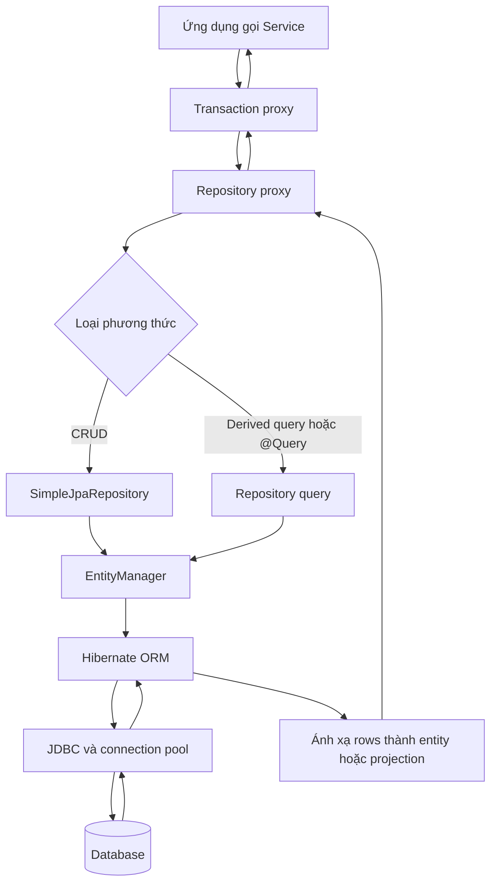

# Luồng xử lý từ lời gọi Repository đến câu SQL và kết quả trả về

## Mục tiêu

Spring Data JPA giúp ứng dụng thao tác với dữ liệu thông qua các interface Repository. Khi gọi `repository.findByEmail(...)` hoặc `repository.save(...)`, ứng dụng không tự viết JDBC và cũng không gửi trực tiếp tên phương thức Java xuống database. Spring Data JPA tiếp nhận lời gọi, chọn cách thực thi phù hợp, dùng JPA `EntityManager` để làm việc với persistence context, rồi nhờ JPA provider (thường là Hibernate trong Spring Boot) chuyển thao tác thành SQL. JDBC gửi SQL và tham số tới database; kết quả sau đó được ánh xạ trở lại thành entity, projection hoặc kiểu dữ liệu mà Repository khai báo.

Bài này lần theo toàn bộ đường đi đó, từ lúc ứng dụng gọi Repository cho đến khi nhận được kết quả, đồng thời giải thích transaction, persistence context và thời điểm SQL thực sự được gửi đi.

## Bức tranh tổng thể

Luồng phổ biến của một truy vấn đọc:



Đây là mô hình khái niệm. Một số bước có thể được bỏ qua hoặc thay đổi: entity có thể đã nằm trong persistence context, cache có thể đáp ứng một thao tác, và câu SQL ghi dữ liệu có thể chỉ được gửi khi flush.

## 1. Spring khởi tạo hạ tầng JPA

Khi ứng dụng Spring Boot có dependency `spring-boot-starter-data-jpa`, auto-configuration thường thiết lập các thành phần sau:

- `DataSource`: cung cấp kết nối tới database. Spring Boot thường cấu hình HikariCP làm connection pool nếu dependency này có mặt.
- `EntityManagerFactory`: tạo `EntityManager` và quản lý cấu hình mapping entity.
- JPA provider: thường là Hibernate, chịu trách nhiệm thực thi JPA và sinh SQL.
- `PlatformTransactionManager`: với JPA thường là `JpaTransactionManager`, quản lý transaction.
- Repository beans: Spring Data quét các interface kế thừa `Repository`, `CrudRepository` hoặc `JpaRepository`, rồi tạo bean có thể được inject vào Service.

Trong Spring Boot, việc quét Repository thường được auto-configure theo package của lớp `@SpringBootApplication`. Ứng dụng cấu hình thủ công có thể dùng `@EnableJpaRepositories` để chỉ rõ package cần quét.

Ví dụ một Repository:

```java
public interface CustomerRepository extends JpaRepository<Customer, Long> {
    Optional<Customer> findByEmail(String email);
}
```

Interface này không cần tự viết lớp triển khai cho `findByEmail`. Spring Data tạo bean proxy khi khởi động ứng dụng và chuẩn bị cơ chế thực thi cho các phương thức mà nó nhận diện được.

## 2. Repository thực chất là một proxy

Bean được inject vào Service là một proxy do Spring Data tạo ra. Khi code gọi `repository.findByEmail(email)`, lời gọi đi qua các interceptor của proxy. Spring Data dựa vào metadata của Repository để xác định phương thức thuộc nhóm nào.

| Nhóm phương thức | Cách xử lý thường gặp |
| --- | --- |
| CRUD kế thừa từ `JpaRepository` | Được triển khai bởi `SimpleJpaRepository` và gọi các API của `EntityManager`. |
| Derived query như `findByEmail` | Spring Data phân tích tên phương thức, tạo JPA query và thực thi query đó. |
| Phương thức có `@Query` | Dùng câu JPQL hoặc native SQL đã khai báo. |
| Custom repository fragment | Chuyển tới phần triển khai tùy chỉnh của ứng dụng. |

Proxy Repository và proxy entity là hai khái niệm khác nhau. Repository proxy điều phối lời gọi phương thức. Entity proxy thường được Hibernate dùng cho quan hệ hoặc thuộc tính tải trễ (`LAZY`).

## 3. Spring Data xác định cách thực thi phương thức

### Phương thức CRUD

Với các phương thức kế thừa như `findById`, `deleteById` hoặc `save`, `SimpleJpaRepository` gọi các API JPA tương ứng. Ví dụ:

- `findById(id)` thường dùng `EntityManager.find(...)`. Nếu entity đã được quản lý trong persistence context, JPA có thể trả lại instance đang có mà không cần truy vấn database.
- `save(entity)` kiểm tra entity có mới hay không. Entity mới thường đi qua `EntityManager.persist(...)`; entity đã tồn tại thường đi qua `EntityManager.merge(...)`.
- `delete(entity)` yêu cầu `EntityManager` xóa entity khỏi persistence context và database khi flush.

`merge()` có thể trả về một instance được quản lý khác với object đầu vào. Vì vậy, hãy dùng object mà `save()` trả về khi cần tiếp tục thao tác với entity đã được quản lý.

### Derived query

Với `findByEmail(String email)`, Spring Data phân tích tên phương thức thành điều kiện trên thuộc tính `email` của entity `Customer`. Cơ chế này thường được triển khai qua `PartTree` và bộ tạo JPA query. Hibernate tiếp tục chuyển query JPA đó thành SQL phù hợp với database.

Tên thuộc tính phải khớp với Java property của entity. Ví dụ entity có `email` nhưng cột database được đặt tên `email_address`, phương thức vẫn thường là `findByEmail`, vì derived query làm việc với thuộc tính entity và mapping sẽ xử lý tên cột.

### `@Query`

`@Query` cho phép khai báo query trực tiếp. Mặc định chuỗi là JPQL: JPQL dùng tên entity và thuộc tính Java, không dùng tên bảng và cột SQL.

```java
@Query("select c from Customer c where c.email = :email")
Optional<Customer> findUsingJpql(@Param("email") String email);
```

Muốn viết SQL theo tên bảng và cột, khai báo `nativeQuery = true`:

```java
@Query(value = "select * from customers where email = :email", nativeQuery = true)
Optional<Customer> findNativeByEmail(@Param("email") String email);
```

Với query cập nhật hoặc xóa theo dạng bulk, cần đánh dấu `@Modifying` và đặt transaction phù hợp:

```java
@Modifying
@Query("update Customer c set c.name = :name where c.email = :email")
int renameByEmail(@Param("email") String email, @Param("name") String name);
```

Bulk update tác động trực tiếp lên database và có thể khiến entity đang được quản lý trong persistence context bị cũ. Khi cần, cân nhắc `flushAutomatically` hoặc `clearAutomatically` trên `@Modifying`, và kiểm soát transaction ở Service.

## 4. Transaction và persistence context

Trong ứng dụng thực tế, transaction thường được đặt ở tầng Service bằng `@Transactional`. Khi một phương thức Service được gọi qua Spring proxy, transaction manager bắt đầu transaction, lấy hoặc tạo `EntityManager` phù hợp và gắn persistence context với transaction hiện tại.

```java
@Service
public class CustomerService {
    private final CustomerRepository repository;

    public CustomerService(CustomerRepository repository) {
        this.repository = repository;
    }

    @Transactional
    public Customer create(String name, String email) {
        return repository.save(new Customer(name, email));
    }

    @Transactional(readOnly = true)
    public Optional<Customer> findByEmail(String email) {
        return repository.findByEmail(email);
    }
}
```

Persistence context là vùng theo dõi các entity đang được quản lý. Nó có vai trò quan trọng:

- **Identity map:** trong cùng persistence context, một bản ghi có cùng entity type và primary key thường được đại diện bởi cùng một managed instance.
- **Dirty checking:** Hibernate theo dõi thay đổi trên managed entity. Khi flush, thay đổi có thể được chuyển thành `UPDATE` mà không cần gọi một phương thức `update` riêng.
- **First-level cache:** entity đã được quản lý có thể được trả lại từ persistence context mà không cần đọc lại database.
- **Theo dõi trạng thái:** entity có thể ở trạng thái transient, managed, detached hoặc removed. Trạng thái này ảnh hưởng đến cách `persist`, `merge` và `remove` hoạt động.

Các phương thức CRUD kế thừa từ `SimpleJpaRepository` có transaction configuration mặc định. Các query method do ứng dụng tự khai báo không tự động nhận transaction configuration trong mọi trường hợp. Đặt `@Transactional` ở Service giúp ranh giới transaction rõ ràng và cho phép nhiều thao tác Repository cùng tham gia một transaction.

`readOnly = true` là gợi ý tối ưu cho transaction đọc đối với Spring và JPA provider; không nên xem nó như cơ chế bảo mật hoặc cam kết rằng database tuyệt đối không thể bị ghi.

## 5. Hibernate chuyển JPA query thành SQL

Repository làm việc với abstraction của JPA. Hibernate đảm nhận phần phụ thuộc database:

1. Nhận thao tác từ `EntityManager`, chẳng hạn tìm entity, chạy JPQL hoặc thực hiện Criteria query.
2. Dựa vào metadata mapping: `@Entity`, `@Table`, `@Column`, quan hệ, kiểu dữ liệu và chiến lược sinh khóa.
3. Dùng dialect của database để tạo SQL tương thích.
4. Tạo prepared statement và bind tham số vào các placeholder `?`.
5. Yêu cầu connection từ pool rồi dùng JDBC gửi statement tới database.

Ví dụ query JPA tìm khách hàng theo email có thể được chuyển thành SQL tương tự:

```sql
select c.id, c.name, c.email
from customers c
where c.email = ?
```

SQL thực tế có thể khác về alias, tên cột, thứ tự cột, quoting hoặc cú pháp theo Hibernate version và database dialect. Giá trị email thường được bind riêng qua JDBC parameter, thay vì nối trực tiếp vào chuỗi SQL. Cách bind tham số giúp xử lý kiểu dữ liệu đúng và tránh lỗi SQL injection do ghép chuỗi đầu vào.

## 6. Database thực thi và Hibernate đọc kết quả

Database nhận SQL cùng các tham số, kiểm tra cú pháp và quyền truy cập, chọn execution plan, đọc hoặc ghi dữ liệu, rồi trả kết quả qua JDBC.

Với truy vấn đọc, Hibernate đọc từng row trong `ResultSet`, chuyển giá trị cột sang kiểu Java, áp dụng mapping của entity và tạo hoặc cập nhật trạng thái entity trong persistence context. Quan hệ `LAZY` có thể được biểu diễn bằng proxy hoặc collection wrapper để chỉ tải dữ liệu liên quan khi được truy cập.

Spring Data sau đó trả kết quả theo kiểu khai báo ở Repository:

- `Optional<Customer>`: có thể có một entity hoặc `Optional.empty()`.
- `Customer`: trả entity hoặc `null` tùy API và query; với kết quả không chắc chắn có bản ghi, `Optional` thường rõ ràng hơn.
- `List<Customer>`: danh sách kết quả, có thể rỗng.
- Projection hoặc DTO: chỉ trả các trường cần thiết theo projection đã khai báo.
- `Page<Customer>`: dữ liệu trang và thông tin tổng số; thường cần thêm count query.
- `Slice<Customer>`: thông tin có trang tiếp theo hay không, thường tránh count query tổng.

Khi phương thức Repository trả về Service, Service có thể tiếp tục xử lý kết quả rồi trả về controller hoặc lớp gọi ban đầu. Nếu entity có thuộc tính tải trễ, hãy bảo đảm chúng được tải trong transaction hoặc dùng fetch join, `@EntityGraph` hay projection phù hợp trước khi transaction kết thúc.

## 7. Khi nào câu SQL thực sự được gửi đi?

Không phải mọi lời gọi `save()` đều lập tức tạo một câu `INSERT` tại đúng dòng code đó. JPA dùng cơ chế write-behind: thay đổi được ghi nhận trong persistence context và SQL được gửi khi flush.

Flush thường xảy ra trong các trường hợp:

- Transaction commit: transaction manager yêu cầu persistence context đồng bộ thay đổi với database trước khi commit.
- Ứng dụng gọi `EntityManager.flush()` hoặc Repository gọi `saveAndFlush()`.
- Với flush mode `AUTO`, provider có thể flush trước một query khi thay đổi đang chờ có thể ảnh hưởng đến kết quả query đó.

Flush chỉ đồng bộ câu lệnh SQL xuống database trong transaction hiện tại; flush không đồng nghĩa với commit. Transaction vẫn có thể rollback sau flush. Khi commit thành công, database mới xác nhận transaction theo cơ chế của nó.

Thời điểm gửi SQL còn phụ thuộc chiến lược sinh ID. Với `GenerationType.IDENTITY`, Hibernate thường phải insert sớm để lấy khóa do database sinh. Với sequence, Hibernate có thể lấy giá trị sequence trước và trì hoãn insert đến flush. Vì vậy, hãy quan sát SQL thực tế thay vì giả định mọi chiến lược đều có cùng thời điểm insert.

## 8. Ví dụ chạy được với Java 17+, Spring Boot và H2

Ví dụ tạo một khách hàng, sau đó tìm lại bằng derived query `findByEmail`. Dự án dùng Spring Boot 3.x, Java 17 và H2 in-memory database.

### Cấu trúc dự án

```text
jpa-flow/
├── pom.xml
└── src/
    └── main/
        ├── java/com/example/jpaflow/
        │   ├── JpaFlowApplication.java
        │   ├── Customer.java
        │   ├── CustomerRepository.java
        │   └── CustomerService.java
        └── resources/
            └── application.properties
```

### `pom.xml`

```xml
<?xml version="1.0" encoding="UTF-8"?>
<project xmlns="http://maven.apache.org/POM/4.0.0"
         xmlns:xsi="http://www.w3.org/2001/XMLSchema-instance"
         xsi:schemaLocation="http://maven.apache.org/POM/4.0.0 https://maven.apache.org/xsd/maven-4.0.0.xsd">
    <modelVersion>4.0.0</modelVersion>
    <parent>
        <groupId>org.springframework.boot</groupId>
        <artifactId>spring-boot-starter-parent</artifactId>
        <version>3.4.5</version>
        <relativePath/>
    </parent>
    <groupId>com.example</groupId>
    <artifactId>jpa-flow</artifactId>
    <version>0.0.1-SNAPSHOT</version>
    <properties>
        <java.version>17</java.version>
    </properties>
    <dependencies>
        <dependency>
            <groupId>org.springframework.boot</groupId>
            <artifactId>spring-boot-starter-data-jpa</artifactId>
        </dependency>
        <dependency>
            <groupId>com.h2database</groupId>
            <artifactId>h2</artifactId>
            <scope>runtime</scope>
        </dependency>
    </dependencies>
    <build>
        <plugins>
            <plugin>
                <groupId>org.springframework.boot</groupId>
                <artifactId>spring-boot-maven-plugin</artifactId>
            </plugin>
        </plugins>
    </build>
</project>
```

### `src/main/resources/application.properties`

```properties
spring.datasource.url=jdbc:h2:mem:jpaflow;DB_CLOSE_DELAY=-1
spring.datasource.username=sa
spring.datasource.password=
spring.jpa.hibernate.ddl-auto=create-drop
spring.jpa.open-in-view=false
logging.level.org.hibernate.SQL=DEBUG
logging.level.org.hibernate.orm.jdbc.bind=TRACE
```

`org.hibernate.SQL` hiển thị SQL. Logger `org.hibernate.orm.jdbc.bind` hiển thị giá trị bind trong Hibernate 6; chỉ bật mức TRACE khi debug dữ liệu thử nghiệm vì log có thể chứa thông tin nhạy cảm.

### `Customer.java`

```java
package com.example.jpaflow;

import jakarta.persistence.Column;
import jakarta.persistence.Entity;
import jakarta.persistence.GeneratedValue;
import jakarta.persistence.GenerationType;
import jakarta.persistence.Id;
import jakarta.persistence.SequenceGenerator;
import jakarta.persistence.Table;

@Entity
@Table(name = "customers")
@SequenceGenerator(name = "customer_seq_gen", sequenceName = "customer_seq", allocationSize = 1)
public class Customer {
    @Id
    @GeneratedValue(strategy = GenerationType.SEQUENCE, generator = "customer_seq_gen")
    private Long id;

    @Column(nullable = false, length = 120)
    private String name;

    @Column(nullable = false, unique = true, length = 180)
    private String email;

    protected Customer() {
    }

    public Customer(String name, String email) {
        this.name = name;
        this.email = email;
    }

    public Long getId() {
        return id;
    }

    public String getName() {
        return name;
    }

    public String getEmail() {
        return email;
    }

    @Override
    public String toString() {
        return "Customer{id=" + id + ", name=" + name + ", email=" + email + "}";
    }
}
```

### `CustomerRepository.java`

```java
package com.example.jpaflow;

import java.util.Optional;
import org.springframework.data.jpa.repository.JpaRepository;

public interface CustomerRepository extends JpaRepository<Customer, Long> {
    Optional<Customer> findByEmail(String email);
}
```

### `CustomerService.java`

```java
package com.example.jpaflow;

import java.util.Optional;
import org.springframework.stereotype.Service;
import org.springframework.transaction.annotation.Transactional;

@Service
public class CustomerService {
    private final CustomerRepository repository;

    public CustomerService(CustomerRepository repository) {
        this.repository = repository;
    }

    @Transactional
    public Customer create(String name, String email) {
        return repository.save(new Customer(name, email));
    }

    @Transactional(readOnly = true)
    public Optional<Customer> findByEmail(String email) {
        return repository.findByEmail(email);
    }
}
```

### `JpaFlowApplication.java`

```java
package com.example.jpaflow;

import org.springframework.boot.CommandLineRunner;
import org.springframework.boot.SpringApplication;
import org.springframework.boot.autoconfigure.SpringBootApplication;
import org.springframework.context.annotation.Bean;

@SpringBootApplication
public class JpaFlowApplication {
    public static void main(String[] args) {
        SpringApplication.run(JpaFlowApplication.class, args);
    }

    @Bean
    CommandLineRunner demo(CustomerService service) {
        return args -> {
            Customer saved = service.create("An", "an@example.com");
            Customer found = service.findByEmail("an@example.com").orElseThrow();

            System.out.println("Saved: " + saved);
            System.out.println("Found: " + found);
        };
    }
}
```

### Chạy chương trình

```bash
mvn spring-boot:run
```

Với database H2 mới, phần output do ứng dụng in ra có dạng:

```text
Saved: Customer{id=1, name=An, email=an@example.com}
Found: Customer{id=1, name=An, email=an@example.com}
```

SQL tiêu biểu được Hibernate ghi log:

```sql
select next value for customer_seq
insert into customers (email, name, id) values (?, ?, ?)
select c1_0.id, c1_0.email, c1_0.name
from customers c1_0
where c1_0.email = ?
```

Thứ tự cột, alias và cách viết SQL có thể thay đổi theo phiên bản Hibernate và dialect. Với ví dụ này, lời gọi `create()` mở transaction và gọi `save()`. Sequence cấp ID; khi transaction kết thúc, Hibernate flush lệnh insert rồi commit. Sau đó `findByEmail()` mở transaction đọc, Spring Data tạo query từ tên phương thức, Hibernate phát lệnh select, ánh xạ row thành `Customer` và trả `Optional<Customer>` cho Service.

## 9. Những điểm dễ hiểu sai

1. **Repository không tự sinh SQL bằng cách nối tên phương thức.** Spring Data phân tích phương thức thành query JPA; Hibernate mới chuyển query đó thành SQL.
2. **`save()` không luôn đồng nghĩa với một câu INSERT ngay tại dòng gọi.** SQL có thể được trì hoãn đến flush; chiến lược ID có thể làm thay đổi thời điểm này.
3. **`flush()` không phải `commit()`.** Flush gửi các thay đổi đang chờ trong transaction; transaction vẫn có thể rollback.
4. **`merge()` không đảm bảo trả lại chính object đầu vào.** Hãy sử dụng giá trị trả về của `save()`.
5. **JPQL không dùng tên bảng/cột SQL.** JPQL dùng entity name và property; native query mới viết theo schema database.
6. **Lazy loading có thể phát sinh thêm SQL.** Truy cập từng quan hệ lazy trong vòng lặp dễ tạo lỗi N+1; cân nhắc fetch join, `@EntityGraph` hoặc projection.
7. **`Page` có thể phát sinh count query.** Nếu chỉ cần biết còn trang tiếp theo hay không, `Slice` có thể phù hợp hơn.
8. **Bulk update không tự cập nhật các entity đã nằm trong persistence context.** Cần cân nhắc flush và clear để tránh đọc trạng thái cũ.
9. **Tự gọi một phương thức `@Transactional` từ phương thức khác trong cùng object có thể bỏ qua Spring proxy.** Transaction annotation thường có hiệu lực khi lời gọi đi qua proxy của Spring.

## 10. Cách quan sát luồng khi debug

- Bật `logging.level.org.hibernate.SQL=DEBUG` để xem SQL Hibernate phát ra.
- Bật `logging.level.org.hibernate.orm.jdbc.bind=TRACE` để xem tham số bind trên Hibernate 6; chỉ dùng trong môi trường phát triển hoặc dữ liệu thử nghiệm.
- Đặt breakpoint tại Service để xác định transaction boundary, tại phương thức Repository để quan sát lời gọi, và tại nơi xử lý kết quả để xem entity/projection được trả về.
- Kiểm tra SQL và số lần truy vấn khi gặp N+1, truy vấn chậm hoặc khi kết quả không như mong đợi.

Chuỗi cần ghi nhớ: **Service và transaction → Repository proxy → triển khai CRUD hoặc query method → EntityManager và persistence context → Hibernate tạo SQL → JDBC gửi SQL → database trả rows → Hibernate ánh xạ → Repository trả kết quả cho Service.**