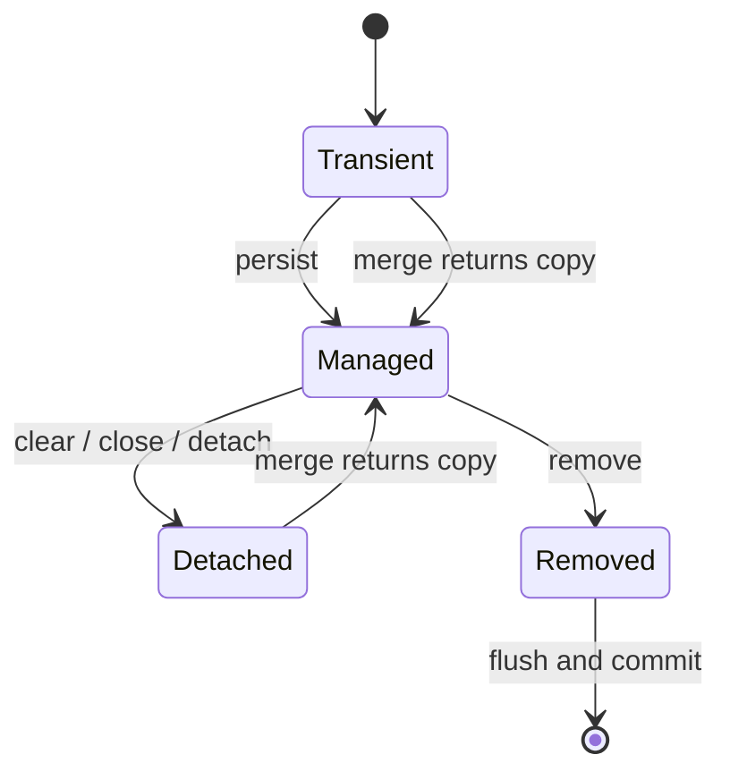

# persist, merge, remove, find và getReference

## Mục tiêu

`EntityManager` là API JPA để quản lý vòng đời entity và làm việc với persistence context. Năm thao tác `persist`, `merge`, `remove`, `find` và `getReference` thường xuất hiện trong code Spring Data JPA, nhưng mỗi thao tác có quy tắc khác nhau về trạng thái entity, truy vấn database và thời điểm ghi SQL.

- `persist`: đưa entity mới vào trạng thái managed.
- `merge`: sao chép trạng thái từ entity transient hoặc detached vào một entity managed và trả về instance managed.
- `remove`: đánh dấu entity managed để xóa.
- `find`: tìm entity theo khóa chính và trả `null` nếu không tồn tại.
- `getReference`: lấy tham chiếu tới entity theo khóa chính; provider có thể trì hoãn việc tải dữ liệu cho tới khi cần.

Hiểu đúng các thao tác này giúp tránh lỗi detached entity, ghi đè dữ liệu ngoài ý muốn, truy vấn thừa và nhầm lẫn giữa flush với commit.

## 1. Các trạng thái vòng đời entity

JPA thường mô tả bốn trạng thái chính:

| Trạng thái | Ý nghĩa |
| --- | --- |
| Transient / New | Object Java mới, chưa được persistence context quản lý và chưa có bản ghi tương ứng được quản lý. |
| Managed | Entity đang được một persistence context quản lý; thay đổi có thể được đồng bộ khi flush. |
| Detached | Entity từng được quản lý nhưng hiện không còn gắn với persistence context. |
| Removed | Entity managed đã được đánh dấu xóa; lệnh DELETE sẽ được đồng bộ khi flush. |

Ví dụ một object vừa tạo bằng `new Customer(...)` là transient. Sau `persist`, nó trở thành managed. Khi transaction kết thúc và persistence context đóng, object trở thành detached. Nếu một managed entity được gọi `remove`, nó chuyển sang removed.



`merge` không làm object truyền vào trở thành managed. Nó trả về instance managed chứa trạng thái được sao chép từ object đầu vào. Hãy luôn sử dụng giá trị trả về của `merge`.

## 2. persist(): lưu entity mới

`EntityManager.persist(entity)` yêu cầu JPA quản lý một entity mới. Sau khi gọi thành công, entity trở thành managed trong persistence context hiện tại.

```java
Customer customer = new Customer("An", "an@example.com");
entityManager.persist(customer);
```

Trong cùng transaction, có thể tiếp tục thay đổi entity:

```java
customer.setName("An Nguyen");
```

Vì entity đang managed, Hibernate theo dõi thay đổi và có thể phát sinh `INSERT` hoặc `UPDATE` khi flush.

### persist không có nghĩa là INSERT luôn chạy ngay

JPA thường dùng write-behind: thay đổi được ghi nhận trong persistence context rồi đồng bộ xuống database khi flush. Flush có thể xảy ra khi:

- Transaction commit.
- Code gọi `entityManager.flush()`.
- Provider cần đồng bộ trước query theo flush mode hiện tại.

Chiến lược sinh ID có thể ảnh hưởng thời điểm INSERT. Với `GenerationType.IDENTITY`, provider thường phải insert sớm để lấy ID do database tạo. Với sequence, provider có thể lấy sequence trước rồi trì hoãn INSERT.

### Khi nào persist không phù hợp?

- Không dùng `persist` để cập nhật một entity detached đã tồn tại.
- Không dùng `persist` như thao tác upsert tổng quát.
- Gọi `persist` trên entity detached có thể dẫn tới `EntityExistsException` hoặc lỗi persistence khác, tùy thời điểm provider phát hiện.
- Gọi `persist` trên entity đã managed không tạo thêm bản ghi mới.

Với entity mới có quan hệ, `cascade = PERSIST` hoặc `cascade = ALL` có thể truyền thao tác persist sang các entity liên quan. Chỉ bật cascade khi vòng đời của entity liên quan phù hợp.

## 3. merge(): sao chép trạng thái vào entity managed

`EntityManager.merge(entity)` dùng khi cần đưa trạng thái từ entity transient hoặc detached vào persistence context hiện tại. JPA trả về instance managed mà ứng dụng nên tiếp tục sử dụng.

```java
Customer detached = loadCustomerInPreviousTransaction();
detached.setName("An Nguyen");

Customer managed = entityManager.merge(detached);
managed.setEmail("an.nguyen@example.com");
```

Điểm quan trọng:

- `detached` vẫn là object detached sau khi gọi `merge`.
- `managed` là object được persistence context quản lý.
- Nếu persistence context đã có entity cùng khóa chính, provider sao chép trạng thái đầu vào vào instance managed đó.
- Nếu chưa có instance managed, provider thường tải hoặc tạo một instance managed rồi sao chép trạng thái.
- Khi truyền một entity transient, `merge` có thể tạo một bản sao managed mới và cuối cùng insert nó.

### Ví dụ minh họa instance trả về

```java
Customer detached = ...; // entity từ transaction đã kết thúc
Customer managed = entityManager.merge(detached);

System.out.println(detached == managed); // false với detached input
```

Không tiếp tục sửa `detached` với kỳ vọng Hibernate sẽ tự theo dõi. Hãy sửa `managed` hoặc trả managed object cho tầng gọi phù hợp.

### Rủi ro merge một object chỉ chứa một phần dữ liệu

Giả sử API nhận JSON chỉ có `id` và `name`, rồi code tạo entity mới:

```java
Customer partial = new Customer();
partial.setId(10L);
partial.setName("New name");
entityManager.merge(partial);
```

Các thuộc tính khác không có trong payload có thể là `null` hoặc giá trị mặc định. Khi merge, trạng thái của object được sao chép vào instance managed; các field thiếu có thể ghi đè dữ liệu đã có. Đây là nguyên nhân phổ biến làm mất dữ liệu ngoài ý muốn khi dùng merge trực tiếp cho partial update.

Với cập nhật một phần, cách an toàn thường là tải entity managed rồi áp dụng đúng các field được phép thay đổi:

```java
Customer customer = entityManager.find(Customer.class, id);
if (customer == null) {
    throw new EntityNotFoundException("Customer not found: " + id);
}
customer.setName(request.name());
```

Dirty checking sẽ ghi thay đổi khi flush. Không cần gọi `merge` cho entity vừa được `find` trong cùng persistence context.

## 4. remove(): đánh dấu entity để xóa

`EntityManager.remove(entity)` chuyển một entity managed sang trạng thái removed. SQL `DELETE` thường được gửi khi flush.

```java
Customer customer = entityManager.find(Customer.class, id);
if (customer != null) {
    entityManager.remove(customer);
}
```

`remove` yêu cầu entity managed. Truyền một entity detached trực tiếp có thể gây `IllegalArgumentException`. Nếu chỉ có ID, hãy `find` trước rồi remove, hoặc merge để lấy managed instance rồi mới remove nếu thực sự cần sao chép trạng thái.

### remove và quan hệ cascade

Nếu entity có association được cấu hình `cascade = REMOVE` hoặc `ALL`, thao tác remove có thể lan truyền sang entity liên quan. Điều này cần được cân nhắc theo ownership nghiệp vụ: xóa một order có thể xóa order lines, nhưng xóa một department thường không nên tự động xóa một employee dùng chung hoặc có vòng đời độc lập.

`orphanRemoval = true` khác với cascade remove: nó xóa entity con khi entity đó bị loại khỏi association theo quy tắc orphan removal. Không bật nếu entity con có thể được chuyển sang parent khác.

## 5. find(): tải entity theo khóa chính

`EntityManager.find(EntityClass.class, id)` tìm entity theo primary key:

```java
Customer customer = entityManager.find(Customer.class, 10L);
if (customer == null) {
    // Không có bản ghi mang khóa chính này.
}
```

Đặc điểm:

- Nếu entity đã nằm trong persistence context, `find` thường trả lại managed instance hiện có mà không cần SELECT mới.
- Nếu chưa có, provider truy vấn database và hydrate entity.
- Nếu không có bản ghi, `find` trả `null`.
- Entity trả về là managed trong persistence context hiện tại.

`find` là lựa chọn phù hợp khi cần biết bản ghi có tồn tại hay không và cần tải entity để đọc hoặc cập nhật.

## 6. getReference(): lấy tham chiếu có thể tải trễ

`EntityManager.getReference(EntityClass.class, id)` trả về một reference tới entity có khóa chính đã biết. Provider thường dùng proxy hoặc cơ chế tương đương để trì hoãn việc tải trạng thái entity cho đến khi ứng dụng truy cập thuộc tính cần dữ liệu.

```java
Customer reference = entityManager.getReference(Customer.class, 10L);
```

Khác biệt thường gặp:

| Tiêu chí | find | getReference |
| --- | --- | --- |
| Kết quả khi bản ghi tồn tại | Entity managed | Reference/entity managed có thể là proxy |
| Khi không tồn tại | Trả `null` | Có thể ném `EntityNotFoundException` khi reference được truy cập; provider cũng có thể phát hiện sớm hơn |
| Tải dữ liệu | Thường tải ngay nếu chưa có trong persistence context | Có thể trì hoãn tải cho đến khi truy cập state |
| Dùng phổ biến | Đọc, kiểm tra tồn tại, cập nhật entity | Gán quan hệ khi đã biết ID và không cần đọc state entity đích |

### Dùng getReference để gán quan hệ

Giả sử tạo `PurchaseOrder` cho một customer đã biết ID:

```java
Customer customerRef = entityManager.getReference(Customer.class, customerId);
PurchaseOrder order = new PurchaseOrder(customerRef);
entityManager.persist(order);
```

Provider có thể ghi `customer_id` mà không cần tải toàn bộ customer, vì khóa chính đã biết. Tuy nhiên, `getReference` không phải kiểm tra tồn tại chắc chắn ngay tại thời điểm gọi. Nếu ID không có thật, lỗi có thể xuất hiện khi proxy được truy cập hoặc khi database kiểm tra foreign key ở flush/commit.

### Khi nào không nên dùng getReference?

- Khi cần kiểm tra bản ghi tồn tại và muốn xử lý rõ trường hợp không có, dùng `find`.
- Khi cần đọc thuộc tính của entity, reference có thể phát sinh SELECT khi truy cập.
- Khi xử lý dữ liệu đầu vào không đáng tin, đừng coi việc tạo reference là xác thực ID.
- Khi transaction đã kết thúc mà code vẫn truy cập proxy chưa được khởi tạo, có thể gặp `LazyInitializationException`.

## 7. Bảng so sánh năm thao tác

| Thao tác | Đầu vào thường gặp | Trạng thái sau thao tác | Giá trị trả về |
| --- | --- | --- | --- |
| `persist` | Entity transient | Managed | `void` |
| `merge` | Entity detached hoặc transient | Instance trả về là managed; input vẫn detached/transient | Managed copy |
| `remove` | Entity managed | Removed | `void` |
| `find` | Entity class và primary key | Managed nếu tìm thấy | Entity hoặc `null` |
| `getReference` | Entity class và primary key | Managed reference, có thể lazy | Reference/entity |

## 8. Transaction, flush và commit

Các thao tác vòng đời cần được thực hiện trong transaction phù hợp. Spring thường quản lý transaction tại Service bằng `@Transactional`.

- `persist`, `merge` và `remove` thay đổi trạng thái persistence context.
- `find` và `getReference` đọc hoặc tạo reference trong persistence context.
- `flush` đồng bộ thay đổi đang chờ thành SQL trong transaction hiện tại.
- `commit` xác nhận transaction ở database; nếu transaction rollback, các thay đổi đã flush cũng bị rollback.

Không coi việc gọi `persist` hoặc `remove` là bằng chứng rằng dữ liệu đã commit. Nếu cần phát hiện lỗi constraint sớm trong luồng nghiệp vụ, có thể gọi `flush`, nhưng commit vẫn có thể thất bại sau đó.

## 9. Ví dụ chạy được với Java 17+, Spring Boot và H2

Ví dụ minh họa cả năm thao tác. Dự án dùng Spring Boot 3.4.5, Java 17 và H2 in-memory database.

### Cấu trúc dự án

```text
entity-manager-operations/
├── pom.xml
└── src/
    └── main/
        ├── java/com/example/entityoperations/
        │   ├── EntityOperationsApplication.java
        │   ├── Customer.java
        │   └── CustomerService.java
        └── resources/
            └── application.properties
```

### `pom.xml`

```xml
<?xml version="1.0" encoding="UTF-8"?>
<project xmlns="http://maven.apache.org/POM/4.0.0"
         xmlns:xsi="http://www.w3.org/2001/XMLSchema-instance"
         xsi:schemaLocation="http://maven.apache.org/POM/4.0.0 https://maven.apache.org/xsd/maven-4.0.0.xsd">
    <modelVersion>4.0.0</modelVersion>
    <parent>
        <groupId>org.springframework.boot</groupId>
        <artifactId>spring-boot-starter-parent</artifactId>
        <version>3.4.5</version>
        <relativePath/>
    </parent>
    <groupId>com.example</groupId>
    <artifactId>entity-manager-operations</artifactId>
    <version>0.0.1-SNAPSHOT</version>
    <properties>
        <java.version>17</java.version>
    </properties>
    <dependencies>
        <dependency>
            <groupId>org.springframework.boot</groupId>
            <artifactId>spring-boot-starter-data-jpa</artifactId>
        </dependency>
        <dependency>
            <groupId>com.h2database</groupId>
            <artifactId>h2</artifactId>
            <scope>runtime</scope>
        </dependency>
    </dependencies>
    <build>
        <plugins>
            <plugin>
                <groupId>org.springframework.boot</groupId>
                <artifactId>spring-boot-maven-plugin</artifactId>
            </plugin>
        </plugins>
    </build>
</project>
```

### `src/main/resources/application.properties`

```properties
spring.datasource.url=jdbc:h2:mem:entityops;DB_CLOSE_DELAY=-1
spring.datasource.username=sa
spring.datasource.password=
spring.jpa.hibernate.ddl-auto=create-drop
spring.jpa.open-in-view=false
logging.level.org.hibernate.SQL=DEBUG
```

### `Customer.java`

```java
package com.example.entityoperations;

import jakarta.persistence.Column;
import jakarta.persistence.Entity;
import jakarta.persistence.GeneratedValue;
import jakarta.persistence.GenerationType;
import jakarta.persistence.Id;
import jakarta.persistence.Table;

@Entity
@Table(name = "customers")
public class Customer {
    @Id
    @GeneratedValue(strategy = GenerationType.IDENTITY)
    private Long id;

    @Column(nullable = false)
    private String name;

    @Column(nullable = false, unique = true)
    private String email;

    protected Customer() {
    }

    public Customer(String name, String email) {
        this.name = name;
        this.email = email;
    }

    public Long getId() {
        return id;
    }

    public String getName() {
        return name;
    }

    public void setName(String name) {
        this.name = name;
    }

    public String getEmail() {
        return email;
    }

    @Override
    public String toString() {
        return "Customer{id=" + id + ", name=" + name + ", email=" + email + "}";
    }
}
```

### `CustomerService.java`

```java
package com.example.entityoperations;

import jakarta.persistence.EntityManager;
import jakarta.persistence.EntityNotFoundException;
import jakarta.persistence.PersistenceContext;
import org.springframework.stereotype.Service;
import org.springframework.transaction.annotation.Transactional;

@Service
public class CustomerService {
    @PersistenceContext
    private EntityManager entityManager;

    @Transactional
    public Long create(String name, String email) {
        Customer customer = new Customer(name, email);
        entityManager.persist(customer);
        entityManager.flush();
        return customer.getId();
    }

    @Transactional(readOnly = true)
    public String findSummary(Long id) {
        Customer customer = entityManager.find(Customer.class, id);
        return customer == null ? "NOT_FOUND" : customer.toString();
    }

    @Transactional(readOnly = true)
    public String referenceSummary(Long id) {
        Customer reference = entityManager.getReference(Customer.class, id);
        return reference.toString();
    }

    @Transactional(readOnly = true)
    public Customer loadDetached(Long id) {
        Customer customer = entityManager.find(Customer.class, id);
        if (customer == null) {
            throw new EntityNotFoundException("Customer not found: " + id);
        }
        return customer;
    }

    @Transactional
    public String mergeDetached(Customer detached) {
        Customer managed = entityManager.merge(detached);
        entityManager.flush();
        return managed.toString() + " | same instance: " + (managed == detached);
    }

    @Transactional
    public boolean remove(Long id) {
        Customer managed = entityManager.find(Customer.class, id);
        if (managed == null) {
            return false;
        }
        entityManager.remove(managed);
        entityManager.flush();
        return true;
    }
}
```

`loadDetached()` trả entity sau khi transaction kết thúc nên object trở thành detached. `mergeDetached()` nhận object đó, sao chép trạng thái vào instance managed và trả kết quả từ instance managed.

### `EntityOperationsApplication.java`

```java
package com.example.entityoperations;

import org.springframework.boot.CommandLineRunner;
import org.springframework.boot.SpringApplication;
import org.springframework.boot.autoconfigure.SpringBootApplication;
import org.springframework.context.annotation.Bean;

@SpringBootApplication
public class EntityOperationsApplication {
    public static void main(String[] args) {
        SpringApplication.run(EntityOperationsApplication.class, args);
    }

    @Bean
    CommandLineRunner demo(CustomerService service) {
        return args -> {
            Long id = service.create("An", "an@example.com");
            System.out.println("Created id: " + id);
            System.out.println("find(): " + service.findSummary(id));
            System.out.println("getReference(): " + service.referenceSummary(id));

            Customer detached = service.loadDetached(id);
            detached.setName("An Nguyen");
            System.out.println("merge(): " + service.mergeDetached(detached));
            System.out.println("find() after merge: " + service.findSummary(id));

            System.out.println("remove(): " + service.remove(id));
            System.out.println("find() after remove: " + service.findSummary(id));
        };
    }
}
```

### Chạy chương trình

```bash
mvn spring-boot:run
```

Phần output do ứng dụng in ra:

```text
Created id: 1
find(): Customer{id=1, name=An, email=an@example.com}
getReference(): Customer{id=1, name=An, email=an@example.com}
merge(): Customer{id=1, name=An Nguyen, email=an@example.com} | same instance: false
find() after merge: Customer{id=1, name=An Nguyen, email=an@example.com}
remove(): true
find() after remove: NOT_FOUND
```

Output ID bắt đầu từ 1 trong database H2 mới. `getReference()` thường tạo proxy và tải dữ liệu khi `toString()` truy cập thuộc tính; provider có thể chọn tải sớm hơn. `merge()` trả về instance managed, vì input đã detached nên hai tham chiếu khác nhau.

## 10. Những lỗi thường gặp

1. **Dùng `persist` để cập nhật entity detached:** `persist` dành cho entity mới. Với entity detached, dùng `merge` và sử dụng instance được trả về.
2. **Bỏ qua giá trị trả về của `merge`:** input vẫn detached; mọi thay đổi tiếp theo cần áp dụng lên managed instance.
3. **Merge object thiếu field:** field không có trong payload có thể ghi đè dữ liệu hiện tại bằng null hoặc giá trị mặc định. Với partial update, load managed entity rồi sửa field cần thiết.
4. **Gọi `remove` trên detached entity:** `remove` yêu cầu entity managed; hãy `find` trước hoặc merge rồi remove.
5. **Cho rằng `find` luôn phát SELECT:** entity có thể đã nằm trong first-level cache của persistence context.
6. **Cho rằng `getReference` luôn kiểm tra tồn tại ngay:** lỗi có thể xuất hiện khi truy cập proxy hoặc khi database kiểm tra FK.
7. **Nhầm flush với commit:** flush gửi SQL trong transaction; commit mới xác nhận transaction.
8. **Không quản lý cascade:** cascade có thể lan truyền persist, merge hoặc remove; chỉ bật theo vòng đời thực của entity.

## 11. Nguyên tắc thực hành

- Dùng `persist` cho entity mới.
- Dùng `merge` cho entity detached khi thực sự cần đồng bộ toàn bộ trạng thái; luôn dùng instance trả về.
- Với partial update, tìm managed entity rồi sửa các thuộc tính được phép.
- Dùng `find` khi cần biết entity có tồn tại và cần dữ liệu ngay.
- Dùng `getReference` khi đã có ID và chỉ cần tham chiếu để gán quan hệ; vẫn xử lý lỗi FK hoặc entity không tồn tại.
- Chỉ gọi `remove` với managed entity và kiểm soát cascade remove.
- Đặt thao tác trong transaction Service phù hợp; dùng flush có chủ đích khi cần phát hiện lỗi SQL sớm.

Chuỗi cần nhớ: **persist đưa entity mới vào managed state; merge sao chép trạng thái và trả managed instance; remove đánh dấu managed entity để xóa; find tải theo ID và có thể trả null; getReference cung cấp tham chiếu có thể tải trễ.**