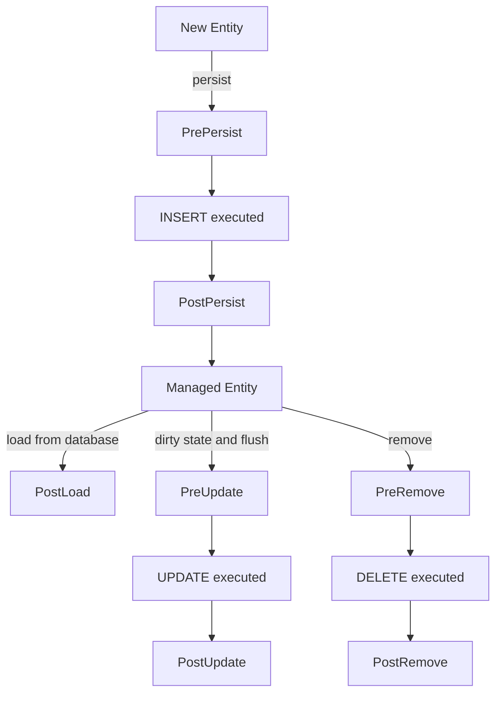
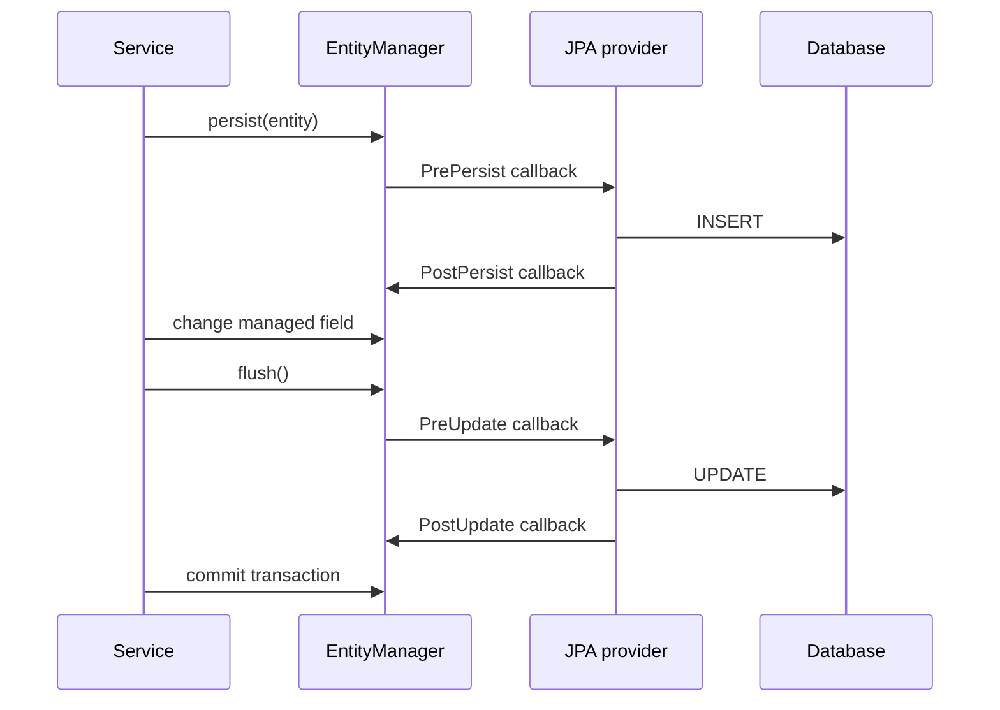

# Entity callback với @PrePersist, @PreUpdate, @PostLoad và các mốc liên quan

## 1. Mục tiêu

JPA cung cấp lifecycle callback để chạy một phương thức tại những mốc nhất định trong vòng đời Entity. Các callback này hữu ích khi cần tự động thiết lập timestamp, chuẩn hóa dữ liệu cục bộ, tính toán thuộc tính tạm thời sau khi tải hoặc ghi nhận một hành động trước/sau khi Entity được lưu hay xóa.

Bài học bao gồm sáu mốc callback chính:
- `@PrePersist` và `@PostPersist` khi tạo Entity.
- `@PreUpdate` và `@PostUpdate` khi cập nhật Entity.
- `@PostLoad` khi Entity được tải vào persistence context.
- `@PreRemove` và `@PostRemove` khi xóa Entity.

Sau bài học, bạn có thể hiểu callback được gọi lúc nào, đặt callback trong Entity hoặc entity listener, dùng callback trong Spring Data JPA, kiểm thử chúng bằng H2 và nhận biết những thao tác dữ liệu bỏ qua callback.

## 2. Vòng đời Entity và vị trí callback

JPA quản lý Entity qua các trạng thái chính:

| Trạng thái | Ý nghĩa |
| --- | --- |
| New / transient | Đối tượng Java mới, chưa được persistence context quản lý. |
| Managed | Được EntityManager quản lý; thay đổi trạng thái có thể được ghi xuống database khi flush. |
| Detached | Từng được quản lý nhưng hiện không còn thuộc persistence context. |
| Removed | Được đánh dấu xóa; lệnh DELETE được thực thi khi đồng bộ phù hợp. |

Callback được gắn với các thao tác chuyển trạng thái hoặc tải dữ liệu. Không nên hiểu rằng mỗi lần gọi một phương thức Java như `save()` đều tạo ra đúng một callback tương ứng. Spring Data JPA ủy quyền cho JPA provider; callback chạy theo các sự kiện persistence thực tế.



Sơ đồ mô tả các mốc khái niệm. Thời điểm SQL thực tế phụ thuộc chiến lược sinh ID, flush mode, JPA provider và transaction.

## 3. Các callback chính

| Callback | Thời điểm | Công dụng thường gặp |
| --- | --- | --- |
| `@PrePersist` | Trước khi thao tác INSERT được thực hiện cho Entity mới. | Thiết lập `createdAt`, giá trị mặc định, chuẩn hóa field. |
| `@PostPersist` | Sau khi INSERT được thực hiện. | Xử lý cục bộ cần ID đã được sinh, cập nhật trạng thái tạm thời. |
| `@PreUpdate` | Trước khi thao tác UPDATE được thực hiện. | Cập nhật `updatedAt`, kiểm tra trạng thái cục bộ. |
| `@PostUpdate` | Sau khi UPDATE được thực hiện. | Ghi nhận kết quả cục bộ sau khi cập nhật. |
| `@PostLoad` | Sau khi Entity được tải vào persistence context hoặc sau refresh. | Tính toán thuộc tính `@Transient` từ dữ liệu vừa tải. |
| `@PreRemove` | Trước khi thao tác DELETE được thực hiện. | Kiểm tra hoặc chuẩn bị trạng thái trước khi xóa. |
| `@PostRemove` | Sau khi DELETE được thực hiện. | Cập nhật trạng thái tạm thời của đối tượng đã xóa. |

### 3.1. @PrePersist

`@PrePersist` được gọi khi JPA chuẩn bị persist một Entity mới. Đây là vị trí phù hợp để:
- Gán `createdAt` và `updatedAt` ban đầu.
- Chuẩn hóa chuỗi thuộc tính của chính Entity.
- Gán một giá trị mặc định không phụ thuộc truy vấn database.

Không nên dùng callback này để truy vấn Entity khác hoặc điều phối một quy trình nghiệp vụ nhiều bước. Việc đó thuộc về Service.

Với khóa được sinh bởi database, không nên dựa vào việc ID đã có trong `@PrePersist`. Thời điểm có ID phụ thuộc chiến lược sinh khóa và provider; nếu cần ID đã được insert, `@PostPersist` là mốc phù hợp hơn.

### 3.2. @PostPersist

`@PostPersist` được gọi sau khi thao tác INSERT được thực hiện. Với khóa sinh tự động, ID thường đã có ở thời điểm này. Tuy vậy, callback này vẫn xảy ra trong quá trình transaction; nó không có nghĩa transaction đã commit thành công.

Không dùng `@PostPersist` như một cơ chế gửi email hoặc gọi dịch vụ bên ngoài mà cần bảo đảm chỉ chạy sau commit. Nếu transaction sau đó rollback, side effect bên ngoài có thể đã xảy ra dù dữ liệu không được commit. Hãy dùng transaction event phù hợp, transactional outbox hoặc xử lý sau commit cho những tác vụ đó.

### 3.3. @PreUpdate và @PostUpdate

`@PreUpdate` và `@PostUpdate` gắn với thao tác UPDATE do JPA provider thực hiện. Thông thường, thay đổi thuộc tính của Entity managed được phát hiện bằng dirty checking khi flush.

Điều này dẫn đến các điểm quan trọng:
- `@PreUpdate` thường được gọi trong lúc flush khi provider chuẩn bị phát lệnh UPDATE.
- `@PostUpdate` được gọi sau thao tác UPDATE.
- Chỉ gọi `repository.save()` không có nghĩa chắc chắn callback update sẽ chạy; kết quả phụ thuộc Entity mới hay đã tồn tại, trạng thái managed/detached và có UPDATE thực tế hay không.
- Nếu không có thay đổi persistent state nên không có UPDATE, không nên kỳ vọng `@PreUpdate` sẽ chạy.

Vì vậy, `@PreUpdate` thường dùng để cập nhật `updatedAt`. Không dùng nó để thay thế logic nghiệp vụ như tính giá đơn hàng hoặc kiểm tra quyền.

### 3.4. @PostLoad

`@PostLoad` được gọi sau khi JPA tải trạng thái Entity từ database vào persistence context. Callback cũng có thể được gọi sau thao tác refresh.

Công dụng phù hợp:
- Tạo nhãn hiển thị tạm thời từ các field persistent.
- Khởi tạo cache cục bộ không được lưu trong database.
- Chuẩn bị một giá trị dẫn xuất để sử dụng trong vòng đời hiện tại của đối tượng.

`@PostLoad` không chạy lại mỗi khi gọi `findById()`. Nếu Entity đã managed trong persistence context, JPA có thể trả lại cùng instance mà không tải lại dữ liệu. Sau `EntityManager.clear()`, một lần tải mới sẽ tạo cơ hội cho callback chạy lại.

Không dùng `@PostLoad` để sửa dữ liệu persistent theo cách âm thầm. Nếu cần thay đổi dữ liệu và lưu lại, hãy dùng phương thức nghiệp vụ trong transaction.

### 3.5. @PreRemove và @PostRemove

`@PreRemove` được gọi trước thao tác xóa; `@PostRemove` được gọi sau khi thao tác DELETE được thực hiện. Chúng có thể hữu ích cho kiểm tra cục bộ hoặc cập nhật trạng thái transient của instance.

Không nên gọi dịch vụ bên ngoài trực tiếp trong callback xóa nếu side effect đó cần đồng bộ với kết quả commit. Dùng event sau commit hoặc outbox để xử lý an toàn hơn.

## 4. Đặt callback trong Entity

Callback có thể được khai báo ngay trong lớp Entity hoặc trong một mapped superclass. Một callback method trong Entity có dạng phương thức không tham số, trả về `void`.

Ví dụ sau dùng một mapped superclass để quản lý timestamp và một Entity `Product` để minh họa các callback còn lại.

### 4.1. Mapped superclass cho audit timestamp

`src/main/java/com/example/catalog/product/AuditedEntity.java`:

```java
package com.example.catalog.product;

import jakarta.persistence.Column;
import jakarta.persistence.MappedSuperclass;
import jakarta.persistence.PrePersist;
import jakarta.persistence.PreUpdate;
import java.time.Instant;

@MappedSuperclass
public abstract class AuditedEntity {
    @Column(name = "created_at", nullable = false, updatable = false)
    private Instant createdAt;

    @Column(name = "updated_at", nullable = false)
    private Instant updatedAt;

    @PrePersist
    protected void beforeInsert() {
        Instant now = Instant.now();
        if (createdAt == null) {
            createdAt = now;
        }
        updatedAt = now;
    }

    @PreUpdate
    protected void beforeUpdate() {
        updatedAt = Instant.now();
    }

    public Instant getCreatedAt() {
        return createdAt;
    }

    public Instant getUpdatedAt() {
        return updatedAt;
    }
}
```

`@MappedSuperclass` không tạo bảng riêng. Các mapping của lớp này được kế thừa vào bảng của Entity con. Callback `@PrePersist` và `@PreUpdate` cũng được áp dụng cho các Entity kế thừa mapping đó.

`createdAt` có `updatable = false` để JPA không đưa cột này vào câu lệnh UPDATE thông thường. Callback `beforeUpdate()` chỉ thay đổi `updatedAt`.

### 4.2. Entity Product với các mốc callback

`src/main/java/com/example/catalog/product/Product.java`:

```java
package com.example.catalog.product;

import jakarta.persistence.Column;
import jakarta.persistence.Entity;
import jakarta.persistence.GeneratedValue;
import jakarta.persistence.GenerationType;
import jakarta.persistence.Id;
import jakarta.persistence.PostLoad;
import jakarta.persistence.PostPersist;
import jakarta.persistence.PostRemove;
import jakarta.persistence.PostUpdate;
import jakarta.persistence.PreRemove;
import jakarta.persistence.Table;
import jakarta.persistence.Transient;

@Entity
@Table(name = "products")
public class Product extends AuditedEntity {
    @Id
    @GeneratedValue(strategy = GenerationType.IDENTITY)
    private Long id;

    @Column(nullable = false, unique = true, length = 40)
    private String sku;

    @Column(nullable = false, length = 160)
    private String name;

    @Transient
    private String displayLabel;

    @Transient
    private Long idObservedAfterPersist;

    @Transient
    private boolean updateCallbackInvoked;

    @Transient
    private boolean preRemoveInvoked;

    @Transient
    private boolean postRemoveInvoked;

    protected Product() {
        // JPA cần constructor không tham số.
    }

    public Product(String sku, String name) {
        if (sku == null || sku.isBlank() || sku.length() > 40) {
            throw new IllegalArgumentException("SKU is required");
        }
        if (name == null || name.isBlank() || name.length() > 160) {
            throw new IllegalArgumentException("Product name is required");
        }
        this.sku = sku.trim();
        this.name = name.trim();
    }

    public void rename(String newName) {
        if (newName == null || newName.isBlank() || newName.length() > 160) {
            throw new IllegalArgumentException("Product name is required");
        }
        this.name = newName.trim();
    }

    @PostLoad
    protected void afterLoad() {
        displayLabel = sku + " - " + name;
    }

    @PostPersist
    protected void afterInsert() {
        idObservedAfterPersist = id;
    }

    @PostUpdate
    protected void afterUpdate() {
        updateCallbackInvoked = true;
    }

    @PreRemove
    protected void beforeDelete() {
        preRemoveInvoked = true;
    }

    @PostRemove
    protected void afterDelete() {
        postRemoveInvoked = true;
    }

    public Long getId() {
        return id;
    }

    public String getSku() {
        return sku;
    }

    public String getName() {
        return name;
    }

    public String getDisplayLabel() {
        return displayLabel;
    }

    public Long getIdObservedAfterPersist() {
        return idObservedAfterPersist;
    }

    public boolean isUpdateCallbackInvoked() {
        return updateCallbackInvoked;
    }

    public boolean isPreRemoveInvoked() {
        return preRemoveInvoked;
    }

    public boolean isPostRemoveInvoked() {
        return postRemoveInvoked;
    }
}
```

Trong ví dụ:
- `@PrePersist` và `@PreUpdate` được kế thừa từ `AuditedEntity` để quản lý timestamp.
- `@PostPersist` lưu ID đã được sinh vào field transient để minh họa rằng callback xảy ra sau INSERT.
- `@PostLoad` tạo `displayLabel` từ `sku` và `name`; field này không được lưu vào database.
- `@PostUpdate`, `@PreRemove` và `@PostRemove` đánh dấu các mốc đã chạy để kiểm thử.

Field có `@Transient` không được JPA ánh xạ thành cột. Các field đánh dấu trạng thái callback chỉ phục vụ minh họa và kiểm thử; không nên dùng chúng làm trạng thái nghiệp vụ lâu dài.

## 5. Dùng entity listener với @EntityListeners

Khi logic callback cần tái sử dụng cho nhiều Entity, có thể tách nó thành một listener class và gắn bằng `@EntityListeners`.

Ví dụ listener chuẩn hóa một mã SKU trước khi persist hoặc update:

```java
package com.example.catalog.product;

import jakarta.persistence.PrePersist;
import jakarta.persistence.PreUpdate;

public class ProductCodeListener {
    @PrePersist
    @PreUpdate
    public void normalizeSku(Product product) {
        product.normalizeSku();
    }
}
```

Trong Entity:

```java
@Entity
@EntityListeners(ProductCodeListener.class)
public class Product {
    // Mapping và thuộc tính khác.
}
```

Ví dụ listener trên giả định Entity có phương thức `normalizeSku()` với quyền truy cập phù hợp. Trong một lớp listener, callback method nhận đúng một tham số là Entity được xử lý; callback method đặt trực tiếp trong Entity thì không có tham số.

Không cần tạo listener riêng nếu logic chỉ áp dụng cho một Entity. Dùng listener cho logic dùng chung hoặc tách biệt rõ ràng.

JPA hỗ trợ default entity listeners, listener khai báo trên Entity hoặc mapped superclass và callback method trong Entity. Thứ tự listener chịu ảnh hưởng bởi cấu hình mặc định và thứ tự khai báo/inheritance; tránh thiết kế nhiều callback phụ thuộc lẫn nhau theo thứ tự ngầm. Có thể loại trừ default hoặc superclass listeners bằng `@ExcludeDefaultListeners` và `@ExcludeSuperclassListeners` khi cần.

## 6. Quy tắc và giới hạn của callback

Callback method cần tuân thủ các quy tắc cơ bản:

- Phải trả về `void`.
- Callback trong Entity hoặc mapped superclass không có tham số.
- Callback trong entity listener nhận một tham số là Entity tương ứng.
- Không khai báo callback là `static` hoặc `final`.
- Mỗi lifecycle event nên có một callback rõ ràng cho mỗi lớp; tránh nhiều phương thức cùng lớp cùng xử lý một event vì thứ tự có thể không xác định theo cách bạn mong đợi.

Callback là hook cấp persistence, không phải nơi thay thế Service. Theo hướng dẫn portability của JPA, callback không nên gọi thao tác `EntityManager` hoặc `Query`, truy cập các Entity khác, hay thay đổi quan hệ giữa các Entity trong persistence context. Hãy giới hạn callback vào trạng thái không phải quan hệ của chính Entity.

Ví dụ phù hợp:
- Chuẩn hóa một chuỗi trên chính Entity.
- Gán timestamp.
- Tính một field transient từ dữ liệu đã tải.

Ví dụ nên đặt ở Service hoặc event handler:
- Tạo thêm nhiều Entity liên quan.
- Gọi repository khác để truy vấn dữ liệu.
- Gửi email, gọi HTTP API hoặc phát message ra hệ thống ngoài.
- Thực hiện quy trình nghiệp vụ cần phối hợp nhiều aggregate.

Nếu callback ném runtime exception, thao tác persistence có thể thất bại và transaction có thể bị đánh dấu rollback theo quy tắc transaction hiện hành. Không dùng callback để nuốt exception hoặc che giấu lỗi dữ liệu.

## 7. Callback và thời điểm flush/commit

JPA dùng persistence context để theo dõi Entity managed. Khi thuộc tính persistent thay đổi, provider có thể chưa gửi SQL ngay. SQL thường được đồng bộ khi flush, ví dụ trước một số truy vấn hoặc khi transaction commit.



Điểm cần nhớ:
- `persist()` không nhất thiết đồng nghĩa SQL INSERT đã được gửi ngay trong mọi chiến lược sinh khóa. Với `GenerationType.IDENTITY`, provider thường cần INSERT sớm để nhận ID.
- `@PreUpdate` và `@PostUpdate` gắn với UPDATE thực tế. Nếu không có thay đổi persistent state, provider có thể không phát UPDATE và callback update không chạy.
- `flush()` đồng bộ SQL nhưng không commit transaction. Sau flush, transaction vẫn có thể rollback.
- `@PostPersist`, `@PostUpdate` và `@PostRemove` không phải tín hiệu rằng transaction đã commit.

Vì vậy, callback không phù hợp để gửi thông báo không thể thu hồi. Nếu cần chỉ gửi email hoặc message sau khi dữ liệu commit, hãy dùng transaction synchronization sau commit, transactional event listener hoặc transactional outbox.

## 8. Callback có chạy với mọi kiểu cập nhật dữ liệu không?

Không. Lifecycle callback chỉ áp dụng cho thao tác Entity thông qua JPA persistence lifecycle.

Các thao tác sau có thể bỏ qua callback của từng Entity:
- JPQL bulk update hoặc bulk delete qua `@Modifying`.
- Native SQL update/delete.
- JDBC trực tiếp hoặc thao tác từ một ứng dụng khác.
- Thay đổi database do trigger hoặc job bên ngoài thực hiện.

Ví dụ bulk update:

```java
@Modifying
@Query("update Product p set p.name = :name where p.id = :id")
int renameDirectly(@Param("id") Long id, @Param("name") String name);
```

Truy vấn bulk này cập nhật trực tiếp dữ liệu theo câu lệnh JPQL. Nó không tải từng Product, nên `@PreUpdate` và `@PostUpdate` của từng Entity không được gọi. Persistence context có thể còn giữ trạng thái cũ; sau bulk operation, cân nhắc clear hoặc refresh các Entity đang managed theo đúng transaction và use case.

Nếu hệ thống bắt buộc cập nhật `updatedAt` cho cả bulk query, hãy đưa việc cập nhật timestamp vào chính câu lệnh bulk hoặc dùng cơ chế database phù hợp. Không giả định callback sẽ tự chạy.

## 9. Spring Data JPA Auditing

Với các trường audit phổ biến như người tạo, thời điểm tạo, người sửa và thời điểm sửa, Spring Data JPA cung cấp auditing. Cơ chế này dựa trên entity listener và thường gọn hơn việc tự viết callback cho từng Entity.

### 9.1. Bật auditing

`src/main/java/com/example/catalog/config/JpaAuditingConfig.java`:

```java
package com.example.catalog.config;

import org.springframework.context.annotation.Configuration;
import org.springframework.data.jpa.repository.config.EnableJpaAuditing;

@Configuration
@EnableJpaAuditing
public class JpaAuditingConfig {
}
```

### 9.2. Tạo mapped superclass audit

```java
package com.example.catalog.common;

import jakarta.persistence.Column;
import jakarta.persistence.EntityListeners;
import jakarta.persistence.MappedSuperclass;
import java.time.Instant;
import org.springframework.data.annotation.CreatedDate;
import org.springframework.data.annotation.LastModifiedDate;
import org.springframework.data.jpa.domain.support.AuditingEntityListener;

@MappedSuperclass
@EntityListeners(AuditingEntityListener.class)
public abstract class Auditable {
    @CreatedDate
    @Column(name = "created_at", nullable = false, updatable = false)
    private Instant createdAt;

    @LastModifiedDate
    @Column(name = "updated_at", nullable = false)
    private Instant updatedAt;

    public Instant getCreatedAt() {
        return createdAt;
    }

    public Instant getUpdatedAt() {
        return updatedAt;
    }
}
```

Để theo dõi người tạo và người cập nhật, thêm `@CreatedBy` và `@LastModifiedBy`, đồng thời cung cấp bean `AuditorAware<T>` để Spring Data biết người dùng hiện tại. Kiểu `T` cần phù hợp với kiểu thuộc tính lưu actor, ví dụ `String` hoặc `Long`.

Không nên để callback thủ công và Spring Data auditing cùng ghi hai giá trị khác nhau vào cùng một trường timestamp. Chọn một cơ chế chịu trách nhiệm cho từng trường audit.

## 10. Kiểm thử lifecycle callback

Ví dụ dưới đây dùng Spring Boot 3.5.0, Java 17+, `spring-boot-starter-data-jpa`, H2 và `spring-boot-starter-test`. `@DataJpaTest` tạo test slice cho Entity và Repository.

`src/main/resources/application.properties`:

```properties
spring.datasource.url=jdbc:h2:mem:callbackdb;DB_CLOSE_DELAY=-1
spring.datasource.driver-class-name=org.h2.Driver
spring.datasource.username=sa
spring.datasource.password=
spring.jpa.hibernate.ddl-auto=create-drop
spring.jpa.open-in-view=false
spring.jpa.show-sql=true
```

`src/main/java/com/example/catalog/product/ProductRepository.java`:

```java
package com.example.catalog.product;

import org.springframework.data.jpa.repository.JpaRepository;

public interface ProductRepository extends JpaRepository<Product, Long> {
}
```

`src/test/java/com/example/catalog/product/ProductLifecycleTest.java`:

```java
package com.example.catalog.product;

import static org.assertj.core.api.Assertions.assertThat;

import org.junit.jupiter.api.Test;
import org.springframework.beans.factory.annotation.Autowired;
import org.springframework.boot.test.autoconfigure.orm.jpa.DataJpaTest;
import org.springframework.boot.test.autoconfigure.orm.jpa.TestEntityManager;

@DataJpaTest
class ProductLifecycleTest {
    @Autowired
    private ProductRepository productRepository;

    @Autowired
    private TestEntityManager entityManager;

    @Test
    void invokesCallbacksAtPersistLoadUpdateAndRemove() {
        Product product = new Product("SKU-1", "Mechanical Keyboard");
        productRepository.save(product);
        entityManager.flush();

        Long id = product.getId();
        assertThat(id).isNotNull();
        assertThat(product.getIdObservedAfterPersist()).isEqualTo(id);
        assertThat(product.getCreatedAt()).isNotNull();
        assertThat(product.getUpdatedAt()).isNotNull();

        entityManager.clear();

        Product loaded = productRepository.findById(id).orElseThrow();
        assertThat(loaded.getDisplayLabel()).isEqualTo("SKU-1 - Mechanical Keyboard");

        loaded.rename("Mechanical Keyboard Pro");
        entityManager.flush();

        assertThat(loaded.isUpdateCallbackInvoked()).isTrue();
        assertThat(loaded.getUpdatedAt()).isNotNull();

        entityManager.remove(loaded);
        entityManager.flush();

        assertThat(loaded.isPreRemoveInvoked()).isTrue();
        assertThat(loaded.isPostRemoveInvoked()).isTrue();
    }
}
```

Chạy test:

```bash
mvn test
```

Kết quả mong đợi là `BUILD SUCCESS`. Test xác nhận timestamp được gán trước INSERT/UPDATE, ID được quan sát sau persist, `@PostLoad` tạo nhãn sau khi tải lại Entity, và callback trước/sau xóa được gọi. Đây là kết quả kỳ vọng khi chạy dự án với cấu hình đã nêu; nội dung bài học chưa chạy Maven trong môi trường thực tế.

## 11. Những lỗi thường gặp

| Hiện tượng | Nguyên nhân | Cách xử lý |
| --- | --- | --- |
| `@PreUpdate` không chạy | Không có UPDATE thực tế hoặc thay đổi chỉ nằm ở field `@Transient`. | Thay đổi persistent state của Entity managed và flush. |
| Callback chạy muộn hơn dự kiến | SQL được trì hoãn tới flush. | Hiểu flush mode và transaction boundary; không dựa vào callback như sự kiện commit. |
| `@PostLoad` không chạy khi gọi `findById` | Entity đã có sẵn trong persistence context. | Clear context hoặc dùng EntityManager mới để kiểm tra lần load mới. |
| Timestamp bị ghi đè | Nhiều callback hoặc auditing cùng quản lý một trường. | Chỉ định một cơ chế chịu trách nhiệm cho từng field. |
| Callback gửi email nhưng transaction rollback | Side effect chạy trước commit. | Dùng event sau commit hoặc transactional outbox. |
| Bulk update không cập nhật audit field | Bulk DML bỏ qua callback Entity. | Cập nhật field trong câu lệnh bulk hoặc dùng cơ chế database. |
| Entity listener không được gọi | Chưa gắn `@EntityListeners`, listener không có callback hợp lệ hoặc entity không đi qua JPA. | Kiểm tra annotation, method signature và đường đi persistence. |
| Test không quan sát được `@PostLoad` | Entity vẫn nằm trong persistence context. | Gọi `clear()` trước khi tải lại. |

## 12. Nguyên tắc thiết kế

1. Dùng callback cho thao tác cục bộ, lặp lại và gắn trực tiếp với vòng đời persistence của Entity.
2. Dùng Service cho quy tắc nghiệp vụ, truy vấn repository khác và điều phối nhiều Entity.
3. Dùng event sau commit hoặc outbox cho side effect bên ngoài cần gắn với transaction đã commit.
4. Hiểu rằng `@PreUpdate` và `@PostUpdate` gắn với UPDATE thực tế khi flush, không gắn với mỗi lần gọi `save()`.
5. Không dùng callback để xử lý bulk JPQL, native SQL hoặc JDBC; các thao tác đó bỏ qua lifecycle của từng Entity.
6. Đặt callback dùng chung trong mapped superclass hoặc entity listener khi phù hợp, nhưng giữ thứ tự phụ thuộc ở mức tối thiểu.
7. Ưu tiên Spring Data auditing cho các trường created/modified phổ biến và cấu hình `AuditorAware` khi cần actor.
8. Kiểm thử callback bằng cách flush và clear persistence context để quan sát đúng thời điểm.

## 13. Checklist hoàn thành

- [ ] Phân biệt được `@PrePersist` và `@PostPersist`.
- [ ] Giải thích được khi nào `@PreUpdate` và `@PostUpdate` chạy.
- [ ] Biết `@PostLoad` không chạy lại nếu Entity đã managed.
- [ ] Phân biệt `@PreRemove` và `@PostRemove`.
- [ ] Đặt được callback trong Entity, mapped superclass hoặc entity listener.
- [ ] Nêu được giới hạn khi truy vấn hoặc thay đổi quan hệ bên trong callback.
- [ ] Nhận diện bulk update/delete bỏ qua callback Entity.
- [ ] Biết khi nào dùng Spring Data JPA Auditing.
- [ ] Kiểm thử được các mốc callback bằng `@DataJpaTest`.

Khi hoàn thành, bạn có thể đặt logic đúng vào từng mốc vòng đời Entity, tận dụng callback cho audit và chuẩn hóa dữ liệu, đồng thời tránh phụ thuộc sai vào thời điểm flush hoặc commit.