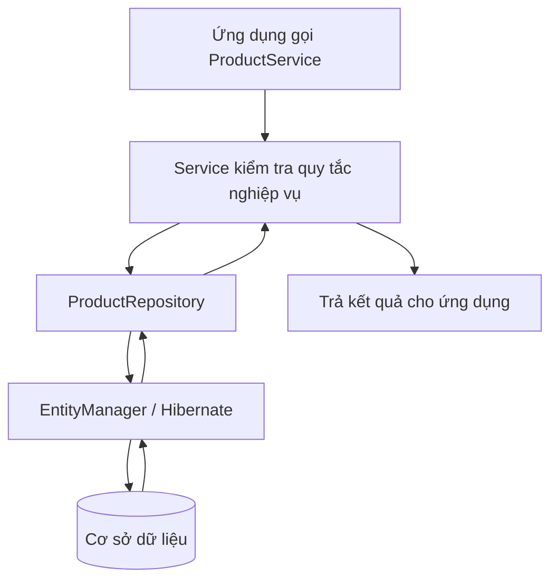

# Khởi tạo Entity, JpaRepository và dịch vụ nghiệp vụ đầu tiên

## 1. Mục tiêu

Trong bước này, ta tạo một lát cắt nghiệp vụ nhỏ bằng Spring Data JPA: một Entity đại diện cho dữ liệu sản phẩm, một JpaRepository để truy cập cơ sở dữ liệu và một Service chứa quy tắc nghiệp vụ. Ví dụ dùng miền `Product` với giá, tồn kho và thao tác giữ hàng.

Sau khi hoàn thành, bạn có thể:
- Ánh xạ một lớp Java thành bảng cơ sở dữ liệu bằng Jakarta Persistence.
- Dùng `JpaRepository` để thực hiện các thao tác CRUD và truy vấn theo tên phương thức.
- Đặt logic nghiệp vụ trong Service và quản lý ranh giới transaction.
- Hiểu vì sao một Entity đang được quản lý có thể tự được cập nhật khi transaction kết thúc.
- Kiểm tra luồng tạo sản phẩm và giữ hàng bằng kiểm thử tích hợp.

## 2. Cấu trúc hoạt động

Luồng cơ bản của một yêu cầu nghiệp vụ:



- **Entity** mô tả dữ liệu và ánh xạ giữa thuộc tính Java với cột trong bảng.
- **Repository** cung cấp API truy cập dữ liệu. Spring Data JPA tạo phần triển khai lúc ứng dụng khởi động.
- **Service** điều phối các thao tác và thực thi quy tắc nghiệp vụ trong transaction.
- **Database** lưu dữ liệu lâu dài. Hibernate là một implementation phổ biến của JPA, chịu trách nhiệm chuyển thao tác trên Entity thành SQL.

Không đặt quy tắc như kiểm tra tồn kho trong Repository. Repository tập trung vào truy cập dữ liệu; Service quyết định thao tác nào hợp lệ trong nghiệp vụ.

## 3. Chuẩn bị dự án

Ví dụ dưới đây dùng Java 17+, Maven và Spring Boot 3.5.0. Spring Boot 3 sử dụng namespace `jakarta.persistence` và `jakarta.validation`; không dùng các import `javax.persistence` của những dự án Spring Boot cũ.

Nếu dự án đã được tạo bằng Spring Initializr, hãy giữ phiên bản Spring Boot hiện có và bổ sung các dependency cần thiết. Với một dự án Maven tối thiểu, `pom.xml` có thể như sau:

```xml
<?xml version="1.0" encoding="UTF-8"?>
<project xmlns="http://maven.apache.org/POM/4.0.0"
         xmlns:xsi="http://www.w3.org/2001/XMLSchema-instance"
         xsi:schemaLocation="http://maven.apache.org/POM/4.0.0 https://maven.apache.org/xsd/maven-4.0.0.xsd">
    <modelVersion>4.0.0</modelVersion>

    <parent>
        <groupId>org.springframework.boot</groupId>
        <artifactId>spring-boot-starter-parent</artifactId>
        <version>3.5.0</version>
        <relativePath/>
    </parent>

    <groupId>com.example</groupId>
    <artifactId>store-jpa</artifactId>
    <version>0.0.1-SNAPSHOT</version>
    <name>store-jpa</name>

    <properties>
        <java.version>17</java.version>
    </properties>

    <dependencies>
        <dependency>
            <groupId>org.springframework.boot</groupId>
            <artifactId>spring-boot-starter-data-jpa</artifactId>
        </dependency>
        <dependency>
            <groupId>org.springframework.boot</groupId>
            <artifactId>spring-boot-starter-validation</artifactId>
        </dependency>
        <dependency>
            <groupId>com.h2database</groupId>
            <artifactId>h2</artifactId>
            <scope>runtime</scope>
        </dependency>
        <dependency>
            <groupId>org.springframework.boot</groupId>
            <artifactId>spring-boot-starter-test</artifactId>
            <scope>test</scope>
        </dependency>
    </dependencies>

    <build>
        <plugins>
            <plugin>
                <groupId>org.springframework.boot</groupId>
                <artifactId>spring-boot-maven-plugin</artifactId>
            </plugin>
        </plugins>
    </build>
</project>
```

Các dependency có vai trò:
- `spring-boot-starter-data-jpa`: Spring Data JPA, JPA API và Hibernate.
- `spring-boot-starter-validation`: Bean Validation để kiểm tra dữ liệu theo annotation.
- `h2`: cơ sở dữ liệu nhẹ dùng trong ví dụ và kiểm thử.
- `spring-boot-starter-test`: JUnit, Spring Test và AssertJ.

## 4. Tạo cấu trúc package

Đặt lớp ứng dụng ở package gốc để Spring Boot có thể tự dò các Entity, Repository và Service nằm trong những package con.

```text
src/
  main/
    java/com/example/store/
      StoreApplication.java
      product/
        Product.java
        ProductRepository.java
        ProductService.java
        ProductNotFoundException.java
    resources/
      application.properties
  test/
    java/com/example/store/product/
      ProductServiceIntegrationTest.java
```

### Lớp khởi động

`src/main/java/com/example/store/StoreApplication.java`:

```java
package com.example.store;

import org.springframework.boot.SpringApplication;
import org.springframework.boot.autoconfigure.SpringBootApplication;

@SpringBootApplication
public class StoreApplication {
    public static void main(String[] args) {
        SpringApplication.run(StoreApplication.class, args);
    }
}
```

`@SpringBootApplication` bật cấu hình tự động và component scanning từ package `com.example.store` trở xuống. Vì vậy, các lớp trong `com.example.store.product` được phát hiện mà không cần khai báo thủ công.

## 5. Tạo Entity Product

Entity là lớp Java được JPA quản lý và ánh xạ với một bảng. Một Entity cơ bản cần có `@Entity`, khóa chính được đánh dấu bằng `@Id` và constructor không tham số. Với Hibernate, constructor không tham số có thể là `protected`.

`src/main/java/com/example/store/product/Product.java`:

```java
package com.example.store.product;

import jakarta.persistence.Column;
import jakarta.persistence.Entity;
import jakarta.persistence.GeneratedValue;
import jakarta.persistence.GenerationType;
import jakarta.persistence.Id;
import jakarta.persistence.Table;
import jakarta.validation.constraints.DecimalMin;
import jakarta.validation.constraints.Digits;
import jakarta.validation.constraints.Min;
import jakarta.validation.constraints.NotBlank;
import jakarta.validation.constraints.NotNull;
import jakarta.validation.constraints.Size;
import java.math.BigDecimal;

@Entity
@Table(name = "products")
public class Product {
    @Id
    @GeneratedValue(strategy = GenerationType.IDENTITY)
    private Long id;

    @NotBlank
    @Size(max = 120)
    @Column(nullable = false, length = 120)
    private String name;

    @NotNull
    @DecimalMin("0.01")
    @Digits(integer = 10, fraction = 2)
    @Column(nullable = false, precision = 12, scale = 2)
    private BigDecimal price;

    @Min(0)
    @Column(nullable = false)
    private int stock;

    protected Product() {
        // JPA cần constructor không tham số để khởi tạo Entity.
    }

    public Product(String name, BigDecimal price, int stock) {
        if (name == null || name.isBlank()) {
            throw new IllegalArgumentException("Product name is required");
        }
        if (price == null || price.signum() <= 0) {
            throw new IllegalArgumentException("Price must be greater than zero");
        }
        if (stock < 0) {
            throw new IllegalArgumentException("Stock cannot be negative");
        }

        String normalizedName = name.trim();
        if (normalizedName.length() > 120) {
            throw new IllegalArgumentException("Product name is too long");
        }

        this.name = normalizedName;
        this.price = price;
        this.stock = stock;
    }

    public void reserveStock(int quantity) {
        if (quantity <= 0) {
            throw new IllegalArgumentException("Quantity must be positive");
        }
        if (quantity > stock) {
            throw new IllegalStateException("Insufficient stock");
        }
        stock -= quantity;
    }

    public Long getId() {
        return id;
    }

    public String getName() {
        return name;
    }

    public BigDecimal getPrice() {
        return price;
    }

    public int getStock() {
        return stock;
    }
}
```

Giải thích các annotation và lựa chọn thiết kế:
- `@Entity` đánh dấu lớp được JPA quản lý. `@Table(name = "products")` chỉ định tên bảng.
- `@Id` đánh dấu khóa chính. `@GeneratedValue(strategy = GenerationType.IDENTITY)` giao việc sinh ID cho cơ chế identity của cơ sở dữ liệu.
- `@Column` mô tả tên cột và các ràng buộc ánh xạ như `nullable`, `length`, `precision` và `scale`.
- `BigDecimal` phù hợp với dữ liệu tiền tệ hơn `double`, vì phép biểu diễn thập phân của `double` có thể gây sai số làm tròn.
- `@NotBlank`, `@NotNull`, `@DecimalMin`, `@Digits`, `@Min` và `@Size` là ràng buộc Bean Validation. Chúng kiểm tra dữ liệu khi validation được kích hoạt; các kiểm tra trong constructor và phương thức nghiệp vụ vẫn giúp bảo vệ các quy tắc cốt lõi ngay khi đối tượng được tạo hoặc thay đổi.
- Constructor `protected` cho phép JPA khởi tạo đối tượng. Constructor công khai còn lại dùng khi tạo sản phẩm từ nghiệp vụ.
- Không cung cấp setter công khai cho mọi thuộc tính. Thay đổi tồn kho đi qua `reserveStock`, nơi quy tắc số lượng dương và tồn kho đủ được kiểm tra.

Không nên dùng `@Data` một cách máy móc cho Entity. `equals`, `hashCode` và `toString` được sinh tự động có thể gây vấn đề khi Entity có ID được sinh sau khi lưu hoặc có quan hệ lazy. Hãy thiết kế các phương thức này theo quy tắc định danh của miền nghiệp vụ.

## 6. Tạo JpaRepository

`JpaRepository<T, ID>` cung cấp các thao tác thường dùng mà không cần viết lớp triển khai. `T` là kiểu Entity và `ID` là kiểu khóa chính.

`src/main/java/com/example/store/product/ProductRepository.java`:

```java
package com.example.store.product;

import java.util.List;
import java.util.Optional;
import org.springframework.data.jpa.repository.JpaRepository;

public interface ProductRepository extends JpaRepository<Product, Long> {
    Optional<Product> findByNameIgnoreCase(String name);

    List<Product> findByStockLessThan(int stock);
}
```

Các phương thức có sẵn thường dùng:

| Phương thức | Công dụng |
| --- | --- |
| `save(entity)` | Lưu Entity mới hoặc cập nhật Entity theo cơ chế của Spring Data JPA. |
| `findById(id)` | Tìm theo khóa chính, trả về `Optional<T>`. |
| `findAll()` | Lấy tất cả bản ghi. |
| `existsById(id)` | Kiểm tra khóa chính có tồn tại. |
| `delete(entity)` | Xóa Entity. |
| `count()` | Đếm số bản ghi. |

Spring Data JPA còn tạo truy vấn từ tên phương thức:
- `findByNameIgnoreCase` tìm theo tên, không phân biệt chữ hoa và chữ thường.
- `findByStockLessThan` tìm các sản phẩm có tồn kho nhỏ hơn giá trị truyền vào.
- `Optional<Product>` thể hiện kết quả có thể không tồn tại, giúp bên gọi xử lý trường hợp không tìm thấy một cách rõ ràng.

Tên thuộc tính trong phương thức truy vấn phải khớp với thuộc tính Java của Entity. Ví dụ `findByStockLessThan` dùng `stock`, không dùng tên cột SQL nếu tên cột khác tên thuộc tính.

Khi cần truy vấn phức tạp, có thể dùng `@Query` với JPQL hoặc native SQL. Hãy bắt đầu bằng derived query khi biểu thức đơn giản, dễ đọc.

## 7. Tạo Service và quy tắc nghiệp vụ đầu tiên

Service là nơi điều phối Repository và áp dụng quy tắc nghiệp vụ. Ví dụ này cung cấp ba thao tác: tạo sản phẩm, xem danh sách hoặc chi tiết sản phẩm, và giữ một số lượng hàng trong kho.

### Ngoại lệ khi không tìm thấy sản phẩm

`src/main/java/com/example/store/product/ProductNotFoundException.java`:

```java
package com.example.store.product;

public class ProductNotFoundException extends RuntimeException {
    public ProductNotFoundException(Long id) {
        super("Product with id " + id + " was not found");
    }
}
```

### ProductService

`src/main/java/com/example/store/product/ProductService.java`:

```java
package com.example.store.product;

import java.math.BigDecimal;
import java.util.List;
import org.springframework.data.domain.Sort;
import org.springframework.stereotype.Service;
import org.springframework.transaction.annotation.Transactional;

@Service
@Transactional(readOnly = true)
public class ProductService {
    private final ProductRepository productRepository;

    public ProductService(ProductRepository productRepository) {
        this.productRepository = productRepository;
    }

    public Product getProduct(Long id) {
        return productRepository.findById(id)
                .orElseThrow(() -> new ProductNotFoundException(id));
    }

    public List<Product> getProducts() {
        return productRepository.findAll(Sort.by(Sort.Direction.ASC, "name"));
    }

    @Transactional
    public Product createProduct(String name, BigDecimal price, int initialStock) {
        Product product = new Product(name, price, initialStock);
        return productRepository.save(product);
    }

    @Transactional
    public Product reserveStock(Long productId, int quantity) {
        Product product = getProduct(productId);
        product.reserveStock(quantity);
        return product;
    }
}
```

Điểm cần hiểu:
- `@Service` đăng ký lớp thành Spring bean. Constructor injection giúp dependency rõ ràng và dễ kiểm thử.
- `@Transactional(readOnly = true)` ở cấp lớp đặt mặc định cho các thao tác đọc.
- `@Transactional` trên `createProduct` và `reserveStock` mở transaction ghi. Annotation ở phương thức ghi đè cấu hình `readOnly` của lớp.
- `createProduct` tạo Entity rồi gọi `save` để đưa Entity mới vào persistence context và lưu theo transaction.
- `reserveStock` tải Entity trong transaction rồi gọi phương thức nghiệp vụ trên Entity. Entity đang được quản lý nên Hibernate theo dõi thay đổi. Khi transaction commit, dirty checking phát hiện `stock` đã đổi và phát sinh câu lệnh UPDATE. Không cần gọi `save` lần nữa trong trường hợp này.
- Nếu không tìm thấy ID, Service ném `ProductNotFoundException`. Nếu số lượng không hợp lệ hoặc tồn kho không đủ, phương thức nghiệp vụ ném ngoại lệ trước khi giảm tồn kho.

Với mặc định của Spring, transaction thường rollback khi có unchecked exception (`RuntimeException` hoặc `Error`). Các ngoại lệ checked không tự động rollback theo mặc định; nếu nghiệp vụ cần rollback với checked exception, cấu hình `rollbackFor` phù hợp.

`@Transactional` thường được áp dụng thông qua Spring proxy. Vì vậy, hãy gọi phương thức transactional từ bean Spring khác hoặc qua proxy. Một lời gọi nội bộ giữa các phương thức cùng một đối tượng không đi qua proxy để kích hoạt thêm transaction riêng. Trong ví dụ, `reserveStock` đã mở transaction nên lời gọi nội bộ `getProduct` vẫn chạy trong transaction đó.

## 8. Cấu hình cơ sở dữ liệu H2

`src/main/resources/application.properties`:

```properties
spring.datasource.url=jdbc:h2:mem:storedb;DB_CLOSE_DELAY=-1
spring.datasource.driver-class-name=org.h2.Driver
spring.datasource.username=sa
spring.datasource.password=

spring.jpa.hibernate.ddl-auto=create-drop
spring.jpa.open-in-view=false
spring.jpa.show-sql=true
```

Ứng dụng dùng H2 trong bộ nhớ để có thể chạy ví dụ mà không cần cài một máy chủ cơ sở dữ liệu riêng. Hibernate tạo schema khi ứng dụng khởi động và xóa schema khi ứng dụng kết thúc.

`ddl-auto=create-drop` phù hợp cho ví dụ hoặc kiểm thử. Không dùng cấu hình này tùy tiện trong môi trường production vì schema có thể bị tạo lại và dữ liệu bị mất. Với hệ thống thật, nên quản lý thay đổi schema bằng Flyway hoặc Liquibase, sau đó đặt `ddl-auto=validate` hoặc một chế độ phù hợp với quy trình triển khai.

`spring.jpa.open-in-view=false` tránh giữ persistence context mở xuyên suốt tầng web. Khi ứng dụng có quan hệ lazy, hãy tải dữ liệu cần thiết trong transaction của Service hoặc dùng projection/DTO phù hợp.

## 9. Kiểm thử luồng nghiệp vụ

Kiểm thử tích hợp dưới đây khởi tạo Spring context, dùng H2 và gọi Service thật. Nó xác nhận sản phẩm được tạo, tồn kho giảm khi giữ hàng và quy tắc không cho phép giữ quá số lượng hiện có.

`src/test/java/com/example/store/product/ProductServiceIntegrationTest.java`:

```java
package com.example.store.product;

import static org.assertj.core.api.Assertions.assertThat;
import static org.assertj.core.api.Assertions.assertThatThrownBy;

import java.math.BigDecimal;
import org.junit.jupiter.api.BeforeEach;
import org.junit.jupiter.api.Test;
import org.springframework.beans.factory.annotation.Autowired;
import org.springframework.boot.test.context.SpringBootTest;
import org.springframework.transaction.annotation.Transactional;

@SpringBootTest
@Transactional
class ProductServiceIntegrationTest {
    @Autowired
    private ProductService productService;

    @Autowired
    private ProductRepository productRepository;

    @BeforeEach
    void clearProducts() {
        productRepository.deleteAll();
    }

    @Test
    void createsProductAndReservesStock() {
        Product created = productService.createProduct(
                "Keyboard", new BigDecimal("79.90"), 10);

        Product updated = productService.reserveStock(created.getId(), 3);

        assertThat(updated.getStock()).isEqualTo(7);
        Product saved = productRepository.findById(created.getId()).orElseThrow();
        assertThat(saved.getStock()).isEqualTo(7);
    }

    @Test
    void rejectsReservationWhenStockIsInsufficient() {
        Product created = productService.createProduct(
                "Mouse", new BigDecimal("25.00"), 2);

        assertThatThrownBy(() -> productService.reserveStock(created.getId(), 3))
                .isInstanceOf(IllegalStateException.class)
                .hasMessage("Insufficient stock");

        Product unchanged = productRepository.findById(created.getId()).orElseThrow();
        assertThat(unchanged.getStock()).isEqualTo(2);
    }
}
```

Chạy kiểm thử tại thư mục chứa `pom.xml`:

```bash
mvn test
```

Kết quả mong đợi là Maven kết thúc với `BUILD SUCCESS`; cả hai test đều thành công. Test thứ nhất xác nhận luồng ghi và đọc dữ liệu. Test thứ hai xác nhận quy tắc tồn kho được thực thi và số lượng không bị giảm khi yêu cầu không hợp lệ.

Có thể khởi động ứng dụng bằng:

```bash
mvn spring-boot:run
```

Ví dụ hiện tập trung vào Entity, Repository và Service nên chưa tạo REST Controller. Khi thêm API, Controller nên nhận request, gọi Service và chuyển kết quả sang DTO; không nên đưa quy tắc giữ hàng vào Controller.

## 10. Những lỗi thường gặp

| Hiện tượng | Nguyên nhân thường gặp | Cách xử lý |
| --- | --- | --- |
| Không tìm thấy annotation `Entity` hoặc `Id` | Dùng sai namespace hoặc thiếu dependency JPA. | Với Spring Boot 3, dùng `jakarta.persistence.*` và thêm `spring-boot-starter-data-jpa`. |
| Spring không tạo Repository bean | Repository nằm ngoài phạm vi component scan hoặc package cấu hình chưa đúng. | Đặt Repository dưới package gốc của lớp `@SpringBootApplication`; nếu cần, cấu hình `@EnableJpaRepositories`. |
| Entity không được phát hiện | Entity nằm ngoài vùng quét mặc định. | Đặt Entity trong package con hoặc cấu hình `@EntityScan`. |
| Lỗi khi Hibernate khởi tạo Entity | Thiếu constructor không tham số hoặc lớp/thuộc tính được khai báo không phù hợp với JPA. | Giữ Entity không final và cung cấp constructor không tham số có quyền truy cập `protected` hoặc `public`. |
| Không kết nối được database | Thiếu driver, URL sai hoặc thông tin kết nối không khớp. | Kiểm tra dependency driver và các thuộc tính `spring.datasource.*`. |
| `findById` không có dữ liệu | ID không tồn tại. | Xử lý `Optional` bằng `orElseThrow` hoặc trả kết quả phù hợp với nghiệp vụ. |
| Thay đổi Entity không được lưu | Entity đã detached hoặc thay đổi diễn ra ngoài transaction phù hợp. | Tải Entity và thực hiện thay đổi trong phương thức Service có `@Transactional`. |
| Không thể lưu dữ liệu do ràng buộc | Dữ liệu vi phạm validation hoặc constraint của database. | Kiểm tra đầu vào, Bean Validation và cấu hình cột. |

## 11. Các nguyên tắc cần ghi nhớ

1. Một Entity mô tả trạng thái và các hành vi gắn với chính đối tượng. Không biến Entity thành nơi chứa truy vấn cơ sở dữ liệu.
2. Repository là cổng truy cập dữ liệu. Ưu tiên `JpaRepository` và derived query cho các truy vấn đơn giản.
3. Service là ranh giới của một ca sử dụng nghiệp vụ. Đặt transaction ở Service để các thao tác liên quan được commit hoặc rollback cùng nhau.
4. Kiểm tra quy tắc ở nơi phù hợp. Bean Validation hữu ích cho ràng buộc dữ liệu; phương thức Entity bảo vệ bất biến; Service điều phối quy trình.
5. Dùng `BigDecimal` cho tiền tệ và xác định rõ precision/scale của cột.
6. Chỉ gọi `save` khi cần lưu một Entity mới hoặc khi thao tác cần thiết theo trạng thái persistence. Với Entity đang managed trong transaction, JPA dirty checking tự ghi nhận thay đổi.
7. Dùng cấu hình tạo schema tự động cho môi trường phát triển hoặc kiểm thử. Production cần quy trình migration và sao lưu dữ liệu.

## 12. Checklist hoàn thành

- [ ] Ứng dụng Spring Boot khởi động được.
- [ ] `Product` được đánh dấu `@Entity`, có khóa chính và constructor không tham số.
- [ ] `ProductRepository` kế thừa `JpaRepository<Product, Long>`.
- [ ] `ProductService` dùng constructor injection và có transaction cho thao tác ghi.
- [ ] `reserveStock` từ chối số lượng không hợp lệ hoặc vượt tồn kho.
- [ ] Kiểm thử tích hợp xác nhận dữ liệu được lưu và quy tắc nghiệp vụ hoạt động.

Khi các mục trên đều đạt, bạn đã có nền tảng cho một luồng Spring Data JPA hoàn chỉnh: Entity mô tả dữ liệu, Repository truy cập dữ liệu và Service thực hiện ca sử dụng nghiệp vụ đầu tiên.