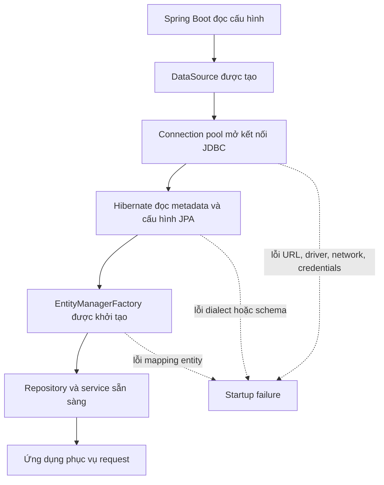

# Kiểm tra kết nối, tạo schema thử nghiệm và lỗi khởi động thường gặp

## 1. Mục tiêu của bước khởi tạo

Một ứng dụng Spring Data JPA chỉ có thể làm việc với dữ liệu khi nhiều thành phần được cấu hình đúng cùng lúc: cấu hình DataSource, JDBC driver, database đang chạy và cho phép kết nối, tài khoản có quyền phù hợp, JPA provider khởi tạo được EntityManagerFactory, và schema trong database tương thích với entity.

Khi ứng dụng khởi động thất bại, lỗi hiển thị ở cuối stack trace thường chỉ là lớp bọc. Nguyên nhân có thể nằm ở URL kết nối, driver, network, thông tin đăng nhập, quyền database, schema, migration hoặc mapping entity. Vì vậy cần kiểm tra theo từng lớp thay vì thay đổi ngẫu nhiên nhiều thuộc tính.

Trong bài này, ta thực hiện ba việc:

1. Xác nhận ứng dụng kết nối được tới database bằng JDBC.
2. Tạo một schema dùng riêng cho kiểm thử và chọn chiến lược quản lý schema phù hợp.
3. Đọc log để nhận diện những lỗi thường gặp khi Spring Boot và Hibernate khởi tạo.

Các ví dụ dùng Spring Boot 3.x, Spring Data JPA, Hibernate 6 và Java 17 trở lên. Cú pháp Gradle và cấu hình áp dụng được cho ứng dụng Spring Boot 3.3.

## 2. Các thành phần phải hoạt động cùng nhau

Luồng khởi tạo cơ bản:



- **JDBC driver** chuyển lời gọi JDBC thành giao thức mà database hiểu. Ví dụ PostgreSQL cần PostgreSQL JDBC Driver; MySQL cần MySQL Connector/J.
- **DataSource** cung cấp kết nối cho ứng dụng. Spring Boot thường tự cấu hình DataSource từ các thuộc tính `spring.datasource.*`.
- **HikariCP** là connection pool mặc định phổ biến trong Spring Boot. Pool tái sử dụng các kết nối thay vì mở một kết nối mới cho mỗi thao tác.
- **JPA provider** như Hibernate tạo EntityManagerFactory, đọc metadata database, quản lý persistence context và chuyển thao tác entity thành SQL.
- **Schema** là cấu trúc database mà câu SQL và entity cùng sử dụng: bảng, cột, khóa, index, sequence và constraint.

Một cấu hình DataSource đúng chưa đảm bảo mapping JPA đúng. Ngược lại, entity được viết đúng cũng không thể hoạt động nếu database không truy cập được hoặc schema thiếu bảng.

## 3. Khai báo dependency và JDBC driver

Với Gradle và Spring Boot dependency management, dependency cơ bản có thể viết như sau:

```groovy
dependencies {
    implementation 'org.springframework.boot:spring-boot-starter-data-jpa'

    runtimeOnly 'org.postgresql:postgresql'

    testImplementation 'org.springframework.boot:spring-boot-starter-test'
    testRuntimeOnly 'com.h2database:h2'
}
```

Spring Boot quản lý phiên bản tương thích cho các dependency trong hệ sinh thái của nó. Không nên tự thêm một phiên bản Hibernate khác với phiên bản do Spring Boot quản lý nếu chưa có lý do rõ ràng.

Driver phải có mặt trên runtime classpath. Nếu dùng PostgreSQL thì khai báo PostgreSQL driver; nếu dùng MySQL thì thay bằng MySQL Connector/J:

```groovy
runtimeOnly 'com.mysql:mysql-connector-j'
```

Không cần khai báo cả hai driver nếu ứng dụng chỉ kết nối một loại database. Cũng không cần đặt `spring.datasource.driver-class-name` trong đa số trường hợp: Spring Boot có thể suy ra driver từ JDBC URL và driver có trên classpath. Chỉ khai báo thủ công khi có lý do cụ thể.

## 4. Cấu hình và kiểm tra kết nối database

### 4.1. Cấu hình DataSource

Ví dụ `application-local.yml` cho PostgreSQL:

```yaml
spring:
  datasource:
    url: jdbc:postgresql://localhost:5432/jpa_demo
    username: ${DB_USERNAME}
    password: ${DB_PASSWORD}
    hikari:
      pool-name: JpaDemoPool
      maximum-pool-size: 10
      minimum-idle: 2
      connection-timeout: 30000

  jpa:
    open-in-view: false
    hibernate:
      ddl-auto: validate
```

Ý nghĩa các thuộc tính chính:

- `spring.datasource.url`: JDBC URL gồm loại driver, host, port và database name.
- `username`, `password`: tài khoản database. Trong ứng dụng thật, lấy thông tin nhạy cảm từ environment variable hoặc secret manager; không commit mật khẩu vào Git.
- `maximum-pool-size`: số kết nối tối đa trong HikariCP. Giá trị phải được cân nhắc theo tải ứng dụng và giới hạn kết nối của database.
- `minimum-idle`: số kết nối nhàn rỗi tối thiểu mà pool duy trì.
- `connection-timeout`: thời gian tối đa chờ lấy kết nối từ pool, tính bằng mili giây.
- `ddl-auto: validate`: yêu cầu Hibernate kiểm tra schema hiện có có tương thích với mapping entity hay không; Hibernate không tự tạo hoặc cập nhật schema theo lựa chọn này.
- `open-in-view: false`: đóng persistence context theo ranh giới transaction thay vì giữ nó mở tới khi render response. Đây là lựa chọn rõ ràng cho nhiều ứng dụng API, giúp tránh truy vấn lazy ngoài service transaction.

JDBC URL có cú pháp phụ thuộc database:

| Database | Ví dụ URL |
|---|---|
| PostgreSQL | `jdbc:postgresql://localhost:5432/jpa_demo` |
| MySQL | `jdbc:mysql://localhost:3306/jpa_demo` |
| MariaDB | `jdbc:mariadb://localhost:3306/jpa_demo` |
| H2 in-memory | `jdbc:h2:mem:jpa_demo;DB_CLOSE_DELAY=-1` |

Tên database, port và tham số URL phải khớp với môi trường đang chạy. Khi ứng dụng chạy trong container cùng network với database, host thường là tên service, chẳng hạn `db`, thay vì `localhost`. Bên trong container, `localhost` trỏ về chính container ứng dụng.

### 4.2. Dùng profile để tách cấu hình

Không nên dùng chung một URL cho local, test và production. Có thể tách thành:

- `application.yml`: cấu hình chung, không chứa thông tin bí mật.
- `application-local.yml`: database local.
- `application-test.yml`: database thử nghiệm.
- `application-prod.yml`: cấu hình production lấy từ môi trường triển khai.

Kích hoạt profile local:

```bash
./gradlew bootRun --args='--spring.profiles.active=local'
```

Hoặc đặt environment variable `SPRING_PROFILES_ACTIVE=local`. Khi kiểm tra log, hãy xác nhận profile đang active; một cấu hình đúng trong `application-local.yml` sẽ không có tác dụng nếu ứng dụng chạy với profile khác.

### 4.3. Kiểm tra database bên ngoài ứng dụng

Trước khi điều tra JPA, xác nhận database đang chạy và có thể truy cập từ đúng môi trường của ứng dụng.

Với PostgreSQL, có thể dùng công cụ `psql`:

```bash
psql "host=localhost port=5432 dbname=jpa_demo user=app"
```

Sau khi kết nối, kiểm tra database hiện tại và quyền của tài khoản. Nếu ứng dụng chạy trong Docker, kiểm tra từ network/container tương ứng; kết nối thành công từ máy phát triển không chứng minh rằng container ứng dụng cũng truy cập được.

Những điểm cần xác nhận:

1. Database process hoặc container đã sẵn sàng nhận kết nối.
2. Host và port có thể truy cập từ nơi chạy ứng dụng.
3. Database name đã tồn tại.
4. Username và password đúng.
5. Tài khoản có quyền CONNECT vào database và quyền cần thiết trên schema/table.
6. Firewall, network policy hoặc Docker network không chặn kết nối.

### 4.4. Kiểm tra qua Spring Boot Actuator

Nếu ứng dụng có Actuator, health endpoint có thể cho biết DataSource có truy cập được hay không. Thêm dependency:

```groovy
implementation 'org.springframework.boot:spring-boot-starter-actuator'
```

Cấu hình expose health endpoint qua HTTP:

```yaml
management:
  endpoints:
    web:
      exposure:
        include: health
  endpoint:
    health:
      show-details: when_authorized
```

Gọi:

```http
GET /actuator/health
```

Khi JDBC và health indicator được cấu hình, Spring Boot có thể đưa trạng thái database vào health result. Không nên expose chi tiết health cho mọi người dùng trên production; cấu hình quyền truy cập và mức hiển thị phù hợp với môi trường.

Health check là bằng chứng hữu ích về kết nối tại thời điểm kiểm tra. Nó không thay thế integration test cho truy vấn nghiệp vụ, quyền truy cập bảng hoặc tính đúng đắn của schema.

### 4.5. Kiểm tra bằng integration test

Một test nhỏ có thể thực thi câu SQL đơn giản để chứng minh DataSource lấy được connection và database thực thi được câu lệnh:

```java
@SpringBootTest
class DatabaseConnectionTest {

    @Autowired
    private JdbcTemplate jdbcTemplate;

    @Test
    void canExecuteSimpleQuery() {
        Integer result = jdbcTemplate.queryForObject(
            "select 1",
            Integer.class
        );

        assertThat(result).isEqualTo(1);
    }
}
```

Test này kiểm tra đường đi qua Spring DataSource/JDBC. Nó chưa kiểm tra entity mapping, repository query hay schema nghiệp vụ; các phần đó cần test riêng.

## 5. Tạo schema thử nghiệm

Schema thử nghiệm nên độc lập với dữ liệu thật và có thể tạo lại một cách lặp lại. Có ba hướng thường dùng: database in-memory, database thật chạy trong container, hoặc schema riêng trên một database dùng chung cho test.

### 5.1. Dùng H2 in-memory cho test nhanh

H2 là relational database chạy trong JVM, có thể tạo database trong bộ nhớ. Với dependency:

```groovy
testRuntimeOnly 'com.h2database:h2'
```

Tạo `src/test/resources/application-test.yml`:

```yaml
spring:
  datasource:
    url: jdbc:h2:mem:jpa_demo_test;DB_CLOSE_DELAY=-1
    driver-class-name: org.h2.Driver
    username: sa
    password:

  jpa:
    hibernate:
      ddl-auto: create-drop
    show-sql: false
```

`DB_CLOSE_DELAY=-1` giữ database in-memory tồn tại trong suốt vòng đời JVM ngay cả khi không còn connection mở. Database vẫn bị mất khi JVM kết thúc.

Trong test, kích hoạt profile:

```java
@DataJpaTest
@ActiveProfiles("test")
class CustomerRepositoryTest {

    @Autowired
    private CustomerRepository customerRepository;

    @Test
    void savesAndFindsCustomer() {
        Customer customer = new Customer();
        customer.setName("Lan");

        Customer saved = customerRepository.save(customer);

        assertThat(customerRepository.findById(saved.getId()))
            .isPresent()
            .get()
            .extracting(Customer::getName)
            .isEqualTo("Lan");
    }
}
```

`@DataJpaTest` tạo test slice tập trung vào JPA: entity và repository được cấu hình để kiểm thử; test thường chạy trong transaction và rollback sau mỗi phương thức. Khi có embedded database trên classpath, Spring Boot Test có thể thay DataSource bằng database embedded cho test.

H2 phù hợp cho test nhanh và logic repository cơ bản. Tuy nhiên, H2 không hoàn toàn giống PostgreSQL, MySQL hay Oracle. Khác biệt về kiểu dữ liệu, sequence, JSON, collation, function, SQL dialect, constraint và locking có thể khiến test qua H2 nhưng lỗi trên database production.

### 5.2. Dùng Testcontainers để kiểm thử trên database cùng loại production

Khi cần kiểm chứng hành vi đặc thù của database, dùng Testcontainers để khởi động database thật trong container trong thời gian test. Ví dụ PostgreSQL:

Thêm dependency:

```groovy
dependencies {
    testImplementation 'org.springframework.boot:spring-boot-starter-test'
    testImplementation 'org.testcontainers:junit-jupiter'
    testImplementation 'org.testcontainers:postgresql'
}
```

Test mẫu:

```java
@Testcontainers
@DataJpaTest
@AutoConfigureTestDatabase(
    replace = AutoConfigureTestDatabase.Replace.NONE
)
class CustomerRepositoryPostgresTest {

    @Container
    static final PostgreSQLContainer<?> postgres =
        new PostgreSQLContainer<>("postgres:16-alpine")
            .withDatabaseName("jpa_test")
            .withUsername("test")
            .withPassword("test");

    @DynamicPropertySource
    static void configureDatasource(DynamicPropertyRegistry registry) {
        registry.add("spring.datasource.url", postgres::getJdbcUrl);
        registry.add("spring.datasource.username", postgres::getUsername);
        registry.add("spring.datasource.password", postgres::getPassword);
    }

    @Autowired
    private CustomerRepository customerRepository;

    @Test
    void persistsCustomerInPostgres() {
        Customer customer = new Customer();
        customer.setName("Lan");

        Customer saved = customerRepository.save(customer);

        assertThat(customerRepository.findById(saved.getId()))
            .isPresent();
    }
}
```

Các điểm quan trọng:

- `@Testcontainers` tích hợp vòng đời container với JUnit Jupiter.
- `@Container` khai báo container được quản lý trong test.
- `@DynamicPropertySource` đưa URL và thông tin kết nối do container cấp vào Spring Environment.
- `replace = NONE` yêu cầu Spring không thay DataSource được cấu hình bằng một embedded database khác.
- Docker phải đang chạy và máy test phải có thể tải image nếu image chưa có sẵn.

Testcontainers chậm hơn H2 nhưng tăng độ tin cậy khi ứng dụng phụ thuộc vào hành vi riêng của PostgreSQL hoặc database production. Có thể chạy một nhóm test nhanh với H2 và một nhóm integration test có chọn lọc với Testcontainers.

### 5.3. Tạo schema riêng thay vì dùng chung schema thật

Nếu test cần database server dùng chung, hãy tạo database hoặc schema riêng cho test, ví dụ `jpa_demo_test`. Tài khoản test chỉ nên có quyền trên vùng dữ liệu thử nghiệm. Không trỏ test tự động vào database production.

Đặt tên database, schema và profile rõ ràng để tránh nhầm lẫn. Trước khi chạy test phá hủy dữ liệu, xác nhận URL đang trỏ tới môi trường test. Không dùng `create`, `create-drop` hoặc script xóa bảng trên database có dữ liệu cần giữ.

## 6. Chọn cách tạo và quản lý schema

Hibernate có thể tạo hoặc kiểm tra schema dựa trên entity, nhưng ứng dụng cũng có thể quản lý schema bằng SQL script hoặc công cụ migration. Hãy chọn một nguồn quản lý cấu trúc rõ ràng.

### 6.1. Các giá trị của `spring.jpa.hibernate.ddl-auto`

| Giá trị | Hành vi | Nơi thường dùng |
|---|---|---|
| `none` | Không tự tạo, cập nhật hoặc kiểm tra schema | Khi schema do công cụ khác quản lý |
| `validate` | Kiểm tra mapping entity có tương thích với schema hiện tại | Local tích hợp migration và production |
| `update` | Cố gắng cập nhật schema theo mapping | Thử nghiệm hoặc phát triển cục bộ có kiểm soát |
| `create` | Tạo schema khi khởi tạo; có thể xóa cấu trúc cũ trước khi tạo lại | Database dùng riêng, dữ liệu có thể bỏ |
| `create-drop` | Tạo schema khi khởi tạo và xóa schema khi EntityManagerFactory đóng | Test với database dùng riêng |

Không dùng `create` hoặc `create-drop` trên database có dữ liệu cần giữ. `update` cũng không phải cơ chế migration đáng tin cậy cho production: nó không thay thế lịch sử thay đổi schema được review, không mô tả đầy đủ cách chuyển đổi dữ liệu và không cung cấp quy trình rollback rõ ràng.

Nếu không khai báo `ddl-auto`, giá trị mặc định của Spring Boot phụ thuộc loại database và cách khởi tạo schema. Hãy đặt rõ cấu hình theo môi trường thay vì dựa vào mặc định ngầm.

### 6.2. Dùng schema.sql và data.sql

Spring Boot hỗ trợ chạy SQL script khi khởi tạo. Ví dụ:

```text
src/main/resources/
  schema.sql
  data.sql
```

Cấu hình:

```yaml
spring:
  sql:
    init:
      mode: always
      schema-locations: classpath:schema.sql
      data-locations: classpath:data.sql
```

- `schema.sql` chứa lệnh tạo cấu trúc bảng, sequence hoặc constraint.
- `data.sql` chứa dữ liệu khởi tạo cần thiết.

Mặc định việc chạy script có khác biệt giữa embedded database và database thông thường; `spring.sql.init.mode=always` yêu cầu chạy script cho mọi loại database. Chỉ bật khi đó là chủ đích.

Nếu Hibernate tạo bảng trước và `data.sql` cần insert vào những bảng đó, có thể dùng:

```yaml
spring:
  jpa:
    defer-datasource-initialization: true
```

Thuộc tính này trì hoãn SQL script initialization để chạy sau khi JPA đã khởi tạo schema. Nếu script được dùng để tạo schema trước Hibernate validation, không bật tùy chọn trì hoãn một cách máy móc. Thứ tự phải phù hợp với nguồn sở hữu schema.

Không nên đồng thời để Hibernate `create`, SQL script và Flyway/Liquibase cùng quản lý một bảng mà không có quy ước. Nhiều cơ chế cùng thay đổi schema dễ gây xung đột, dữ liệu khởi tạo trùng lặp và lỗi phụ thuộc thứ tự.

### 6.3. Dùng Flyway hoặc Liquibase cho schema có lịch sử

Với ứng dụng cần giữ dữ liệu qua nhiều phiên bản, migration là cách quản lý schema có thể review và lặp lại.

Flyway dùng các file migration có phiên bản, ví dụ:

```text
src/main/resources/db/migration/
  V1__create_customer.sql
  V2__add_customer_status.sql
```

Ví dụ nội dung `V1__create_customer.sql`:

```sql
create table customer (
    id bigint generated by default as identity primary key,
    name varchar(150) not null
);
```

Flyway lưu lịch sử migration đã chạy trong bảng metadata của nó. Mỗi migration có thứ tự và được áp dụng theo quy tắc của Flyway. Liquibase cũng giải quyết bài toán migration nhưng sử dụng changelog và changeset.

Khi migration là nguồn sở hữu schema, thường cấu hình Hibernate ở chế độ kiểm tra:

```yaml
spring:
  jpa:
    hibernate:
      ddl-auto: validate
```

Điều này giúp phát hiện entity mapping không khớp schema sau migration. Với môi trường không cần kiểm tra mapping lúc khởi động, có thể chọn `none`, nhưng phải có kiểm thử schema phù hợp.

Không chỉnh sửa migration đã được áp dụng trên môi trường chia sẻ hoặc production. Hãy tạo migration mới để thay đổi schema. Trước khi phát hành, kiểm tra cả việc chuyển đổi dữ liệu, index, constraint và khả năng triển khai theo thứ tự tương thích với phiên bản ứng dụng.

## 7. Quy trình kiểm tra khởi tạo theo thứ tự

Khi thiết lập một module mới, có thể đi theo trình tự sau:

1. **Kiểm tra dependency:** starter JPA và JDBC driver đúng loại database có trên runtime classpath.
2. **Kiểm tra profile:** xác nhận profile đang active và đúng file cấu hình được nạp.
3. **Kiểm tra URL:** xác nhận JDBC URL, host, port và database name.
4. **Kiểm tra database độc lập:** database đang chạy, có thể kết nối từ môi trường chạy ứng dụng và tài khoản có quyền.
5. **Kiểm tra DataSource:** khởi động ứng dụng hoặc chạy test JDBC đơn giản.
6. **Kiểm tra schema:** xác nhận migration/script đã chạy hoặc cấu hình tạo schema phù hợp với môi trường.
7. **Kiểm tra mapping:** để Hibernate validate schema hoặc chạy test repository.
8. **Kiểm tra health:** nếu dùng Actuator, xác nhận health indicator của database.
9. **Kiểm tra log:** đọc nguyên nhân đầu tiên có ý nghĩa trong chuỗi lỗi, không chỉ dòng `APPLICATION FAILED TO START` cuối cùng.

Thực hiện theo thứ tự giúp khoanh vùng lỗi. Nếu test JDBC `select 1` thất bại thì chưa cần điều tra annotation của entity. Nếu JDBC thành công nhưng Hibernate báo thiếu bảng, hãy tập trung vào schema và migration.

## 8. Những lỗi khởi động thường gặp và cách xử lý

| Dấu hiệu trong log | Nguyên nhân thường gặp | Cách kiểm tra |
|---|---|---|
| `Failed to configure a DataSource` hoặc không có URL | Thiếu `spring.datasource.url`, không có embedded database, profile sai | Kiểm tra profile active, cấu hình và dependency database |
| `Cannot load driver class` hoặc không tìm thấy driver | Thiếu JDBC driver hoặc khai báo sai driver class | Kiểm tra runtime classpath và dependency đúng database |
| `Connection refused` | Database chưa chạy, sai port hoặc network không truy cập được | Kiểm tra process/container, port mapping và host |
| `UnknownHostException` | Host trong URL không phân giải được | Kiểm tra DNS, Docker service name và network |
| `password authentication failed` hoặc `Access denied` | Username/password sai hoặc tài khoản bị khóa | Kiểm tra secret và quyền tài khoản |
| `Unknown database` hoặc database không tồn tại | URL trỏ tới database chưa được tạo | Tạo database hoặc sửa database name |
| `permission denied for schema` / `permission denied for table` | Tài khoản kết nối thiếu quyền | Cấp quyền CONNECT, USAGE, CREATE hoặc quyền bảng cần thiết theo database |
| `Schema-validation: missing table` | Migration chưa chạy, sai schema hoặc sai tên bảng | Kiểm tra migration history, schema mặc định và mapping |
| `Schema-validation: wrong column type` | Kiểu cột database khác kiểu mapping mong đợi | Kiểm tra DDL, Java type, converter và dialect |
| `relation does not exist` | Bảng chưa được tạo hoặc truy vấn dùng sai schema | Kiểm tra schema search path, migration và tên bảng |
| `Not a managed type` | Entity không được scan hoặc class thiếu `@Entity` | Kiểm tra package scan, annotation và cấu hình persistence unit |
| `Not a single result` / query validation error | JPQL hoặc repository method không hợp lệ, kết quả không như mong đợi | Kiểm tra tên property, kiểu tham số, JPQL và cardinality |
| `Unable to determine Dialect` | Hibernate không lấy được metadata JDBC hoặc dialect không thể xác định | Kiểm tra kết nối trước; chỉ cấu hình dialect tường minh khi cần |
| `BeanCreationException` khi tạo repository | Query method, entity mapping hoặc dependency khởi tạo bị lỗi | Tìm nguyên nhân sâu nhất trong nested cause |

### 8.1. Lỗi không có DataSource

Thông báo dạng:

```text
Failed to configure a DataSource:
'url' attribute is not specified and no embedded datasource could be configured.
```

Thường do thiếu URL và cũng không có embedded database trên classpath. Kiểm tra:

- Có khai báo `spring.datasource.url` trong profile đang chạy không?
- Environment variable có được truyền vào process không?
- Tên file có đúng `application-{profile}.yml` không?
- Profile có được kích hoạt không?
- Dependency driver hoặc H2 có nằm trên classpath phù hợp không?

Không nên thêm H2 vào runtime chỉ để làm biến mất lỗi nếu ứng dụng cần kết nối PostgreSQL thật.

### 8.2. Lỗi không kết nối được database

Ví dụ `Connection refused` thường cho biết không có dịch vụ lắng nghe tại host/port đó hoặc network không cho phép truy cập. Kiểm tra database process, container health, port mapping và URL.

Nếu dùng Docker Compose, cần phân biệt hai trường hợp:

- Ứng dụng chạy trực tiếp trên máy phát triển: thường kết nối qua `localhost` và port được publish.
- Ứng dụng chạy trong container cùng Compose network: dùng tên service của database và port nội bộ, ví dụ `db:5432`.

Chỉ dùng `depends_on` chưa chắc đảm bảo database đã sẵn sàng nhận kết nối. Có thể cần healthcheck và điều kiện chờ service healthy hoặc cơ chế retry phù hợp.

### 8.3. Lỗi xác thực hoặc quyền

Nếu log cho biết authentication failed, xác nhận username/password mà process thực sự nhận được. Không đưa mật khẩu vào log hoặc commit file cấu hình. Nếu đăng nhập thành công nhưng báo permission denied, kiểm tra quyền ở cấp database, schema, sequence và table. Một ứng dụng có thể kết nối được nhưng vẫn không tạo được bảng vì tài khoản chỉ có quyền đọc.

### 8.4. Lỗi schema validation

Khi Hibernate báo thiếu bảng, cột hoặc kiểu dữ liệu sai, kiểm tra theo thứ tự:

1. Ứng dụng đang kết nối đúng database và schema chưa?
2. Migration có chạy thành công không?
3. Migration history có ghi nhận phiên bản cần thiết không?
4. Tên bảng/cột và schema trong mapping có khớp DDL không?
5. Java type, converter, enum mapping và kiểu cột có tương thích không?

Không chữa lỗi validation bằng cách đổi sang `ddl-auto=update` ngay lập tức. Trước tiên cần xác định nguồn quản lý schema. Nếu migration là nguồn chuẩn, sửa migration hoặc mapping bằng thay đổi có kiểm soát.

### 8.5. Lỗi entity không được quản lý

`Not a managed type` thường xuất hiện khi repository tham chiếu một class không được JPA nhận diện là entity. Kiểm tra class có `@Entity`, có nằm trong package được component/entity scan hay không, và repository có dùng đúng entity type không. Nếu entity nằm ngoài package của class `@SpringBootApplication`, có thể cần cấu hình `@EntityScan` tường minh.

### 8.6. Lỗi query trong repository

Spring Data JPA có thể kiểm tra và khởi tạo query khi tạo repository bean. Một JPQL query tham chiếu sai tên property, sai kiểu tham số hoặc sai entity name có thể làm ứng dụng thất bại ngay khi khởi động.

JPQL dùng tên entity và thuộc tính Java, không dùng trực tiếp tên bảng/cột SQL trừ khi viết native query. Ví dụ:

```java
@Query("select c from Customer c where c.name = :name")
List<Customer> findByName(@Param("name") String name);
```

Ở đây `Customer` là entity name và `name` là thuộc tính Java. Nếu dùng `nativeQuery = true`, câu truy vấn phải theo cú pháp và tên bảng/cột của database.

## 9. Đọc log hiệu quả

Khi ứng dụng không khởi động, hãy tìm **root cause** trong chuỗi `Caused by`. Một `BeanCreationException` có thể chỉ bọc lỗi Hibernate, và lỗi Hibernate có thể bọc lỗi JDBC. Đọc từ thông báo đầu tiên có ý nghĩa về kết nối hoặc schema.

Trong môi trường local, có thể bật log SQL:

```yaml
logging:
  level:
    org.hibernate.SQL: DEBUG
    org.hibernate.orm.jdbc.bind: TRACE
```

`org.hibernate.SQL` hiển thị SQL Hibernate phát ra; `org.hibernate.orm.jdbc.bind` hiển thị giá trị bind parameter trong Hibernate 6. Bind logging có thể làm lộ dữ liệu nhạy cảm, vì vậy chỉ bật có kiểm soát trong môi trường phát triển và tắt ở production.

Các thuộc tính hữu ích khác khi chẩn đoán:

- `spring.jpa.show-sql=true`: cách nhanh để xem SQL trên console trong local; log category thường linh hoạt hơn.
- `logging.level.com.zaxxer.hikari=DEBUG`: có thể giúp hiểu pool đang khởi tạo hoặc gặp lỗi gì; chỉ bật tạm thời khi cần.
- `logging.level.org.springframework.jdbc=DEBUG`: cung cấp thêm thông tin về hoạt động JDBC của Spring.

Không nên bật tất cả log ở mức TRACE liên tục. Log quá nhiều có thể làm nhiễu nguyên nhân chính và tăng rủi ro lộ dữ liệu.

## 10. Một cấu hình mẫu cho từng môi trường

### Local development

Local có thể dùng database chạy trong Docker hoặc cài trực tiếp. Nếu database có dữ liệu cần giữ, dùng migration và `validate`. Nếu schema hoàn toàn tạm thời, có thể dùng `create-drop` với database riêng.

Ví dụ profile local dùng PostgreSQL:

```yaml
spring:
  datasource:
    url: jdbc:postgresql://localhost:5432/jpa_demo
    username: ${DB_USERNAME}
    password: ${DB_PASSWORD}
  jpa:
    hibernate:
      ddl-auto: validate
    open-in-view: false
```

### Automated test

Test nhanh có thể dùng H2 in-memory và `create-drop`; integration test quan trọng nên dùng Testcontainers cùng loại database production. Mỗi test phải biết rõ database mà nó đang dùng.

### Production

Production nên có migration được quản lý và review, tài khoản database có quyền tối thiểu cần thiết, secret được cấp từ môi trường triển khai, connection pool được cấu hình theo tải và giới hạn database. Hibernate thường đặt `ddl-auto=validate` hoặc `none`; không tự động tạo/xóa schema khi ứng dụng khởi động.

Không nên dùng một file cấu hình duy nhất chứa URL, username, password và chiến lược DDL cho mọi môi trường.

## 11. Checklist trước khi kết luận ứng dụng đã khởi tạo thành công

- [ ] JDBC driver đúng loại database có trên runtime classpath.
- [ ] Profile và file cấu hình đang dùng đã được xác nhận.
- [ ] JDBC URL trỏ đúng host, port và database.
- [ ] Database sẵn sàng và truy cập được từ môi trường chạy ứng dụng.
- [ ] Tài khoản đăng nhập thành công và có quyền phù hợp.
- [ ] DataSource/connection pool được khởi tạo.
- [ ] Schema đã được tạo bằng đúng cơ chế đã chọn.
- [ ] Hibernate mapping tương thích với schema.
- [ ] Repository query khởi tạo thành công.
- [ ] Integration test thực thi được truy vấn trên database phù hợp.
- [ ] Health endpoint hoạt động nếu ứng dụng cung cấp Actuator.
- [ ] Log không còn lỗi khởi tạo chưa được xử lý.

## 12. Kết luận

Để khởi tạo Spring Data JPA ổn định, hãy kiểm tra lần lượt dependency, profile, JDBC URL, database/network, thông tin đăng nhập, DataSource, schema và entity mapping. Dùng H2 cho test nhanh, Testcontainers để kiểm thử sát database production, và migration như Flyway hoặc Liquibase để quản lý schema có lịch sử.

Chọn `create-drop` cho database thử nghiệm dùng riêng, `validate` khi muốn Hibernate xác nhận schema do migration quản lý, và `none` khi không cần Hibernate can thiệp schema. Khi gặp lỗi khởi động, tìm root cause trong nested exception rồi kiểm tra đúng lớp gây lỗi. Cách làm có thứ tự giúp phân biệt lỗi kết nối, lỗi quyền, lỗi schema và lỗi mapping mà không phải thay đổi cấu hình một cách mò mẫm.
