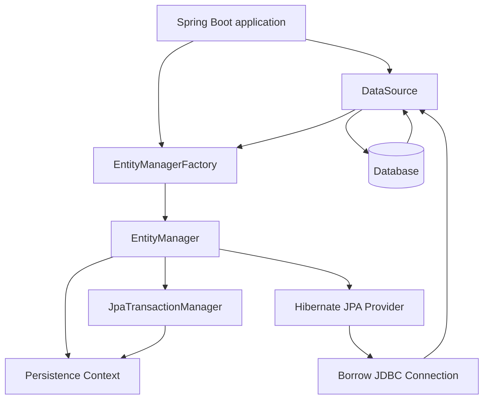

# Vai trò của DataSource, EntityManagerFactory và EntityManager

## Mục tiêu

Trong một ứng dụng Spring Data JPA, ba thành phần `DataSource`, `EntityManagerFactory` và `EntityManager` phối hợp để kết nối database, tạo môi trường làm việc với JPA và quản lý các entity trong một đơn vị công việc. Chúng nằm ở ba lớp trách nhiệm khác nhau:

- `DataSource` cung cấp các kết nối JDBC tới database, thường thông qua connection pool.
- `EntityManagerFactory` khởi tạo và quản lý cấu hình JPA, metadata mapping và tạo `EntityManager`.
- `EntityManager` thực hiện thao tác trên entity và quản lý persistence context trong phạm vi làm việc hiện tại.

Hiểu đúng ranh giới này giúp cấu hình Spring Boot, quản lý transaction, xử lý lỗi kết nối và tránh chia sẻ nhầm đối tượng không an toàn giữa các thread.

## Bức tranh tổng thể



Đây là sơ đồ khái niệm. Hibernate là JPA provider phổ biến trong Spring Boot, nhưng ứng dụng có thể dùng provider khác. `DataSource` là abstraction JDBC; nó không phải một `EntityManager` và cũng không tự hiểu entity.

## 1. DataSource: nơi cung cấp kết nối JDBC

`javax.sql.DataSource` là interface chuẩn của Java để lấy kết nối JDBC. Với ứng dụng JPA, Hibernate sử dụng DataSource để lấy một `java.sql.Connection` khi cần gửi SQL tới database.

DataSource thường được cấu hình bằng URL, username, password và driver JDBC. Trong Spring Boot, nếu có `spring-boot-starter-data-jpa` hoặc JDBC starter, HikariCP thường là connection pool mặc định khi thư viện có mặt.

### Connection pool hoạt động thế nào?

Việc mở một kết nối vật lý tới database có chi phí: thiết lập TCP, xác thực, thương lượng cấu hình và cấp tài nguyên ở cả hai phía. Connection pool giữ một số kết nối đã mở để tái sử dụng.

1. Hibernate yêu cầu connection từ DataSource.
2. Pool cấp một connection đang rảnh; nếu cần và còn trong giới hạn, pool có thể tạo kết nối vật lý mới.
3. JDBC dùng connection đó để tạo statement, bind tham số và gửi SQL.
4. Khi Hibernate hoặc transaction manager trả connection, pool thường reset trạng thái cần thiết rồi đưa connection trở lại danh sách rảnh.

Ứng dụng nên để pool quản lý vòng đời kết nối. Không lưu một `Connection` dùng chung trong field của singleton Service và không tự đóng DataSource do Spring quản lý.

### Cấu hình DataSource trong Spring Boot

Ví dụ `application.properties` cho H2 trong bộ nhớ:

```properties
spring.datasource.url=jdbc:h2:mem:jpa-infra;DB_CLOSE_DELAY=-1
spring.datasource.username=sa
spring.datasource.password=
spring.datasource.driver-class-name=org.h2.Driver

spring.datasource.hikari.maximum-pool-size=10
spring.datasource.hikari.minimum-idle=2
spring.datasource.hikari.connection-timeout=30000
```

Spring Boot đọc các thuộc tính `spring.datasource.*`, tạo DataSource và cấu hình pool. Với HikariCP, các thuộc tính riêng nằm dưới `spring.datasource.hikari.*`. Driver class thường được suy ra từ JDBC URL nên có thể bỏ `driver-class-name` nếu driver được nhận diện.

Trong production, đặt thông tin xác thực qua biến môi trường hoặc secret manager. Kích thước pool cần được chọn theo giới hạn connection của database, số instance ứng dụng và mức tải; tăng pool vô hạn không làm database xử lý nhanh hơn.

## 2. EntityManagerFactory: nhà máy tạo EntityManager

`jakarta.persistence.EntityManagerFactory` là đối tượng tạo ra `EntityManager`. Factory được cấu hình cho một persistence unit và nắm giữ metadata mà JPA provider cần để làm việc với entity.

Khi khởi tạo, factory/provider chuẩn bị các thông tin như:

- Các lớp được đánh dấu `@Entity` và quan hệ giữa chúng.
- Mapping giữa Java property với table, column, khóa chính và khóa ngoại.
- Cấu hình JPA provider, dialect, naming strategy và các thuộc tính Hibernate.
- Metamodel dùng để mô tả entity và thuộc tính ở mức JPA.

Trong Spring Boot, auto-configuration thường xây dựng `EntityManagerFactory` thông qua `LocalContainerEntityManagerFactoryBean`. Bean này tích hợp factory với container Spring. Ứng dụng thông thường chỉ cần khai báo dependency và cấu hình properties; không nên tự tạo thêm factory nếu không có yêu cầu nhiều persistence unit hoặc cấu hình đặc biệt.

### Vòng đời và tính an toàn

`EntityManagerFactory` là đối tượng nặng, được thiết kế để tồn tại lâu và được nhiều thread sử dụng đồng thời. Thông thường một ứng dụng có một factory cho mỗi persistence unit. Spring quản lý việc khởi tạo và đóng factory khi application context dừng.

Không tạo một factory mới cho mỗi request hoặc mỗi lần gọi Repository. Cách đó làm lặp chi phí khởi tạo metadata và tài nguyên provider.

### Khi nào cần truy cập factory trực tiếp?

Phần lớn code nghiệp vụ chỉ cần Repository hoặc `EntityManager`. Có thể inject factory khi cần kiểm tra metamodel hoặc khi chủ động quản lý một `EntityManager` ở ngoài mô hình transaction-scoped của Spring:

```java
import jakarta.persistence.EntityManager;
import jakarta.persistence.EntityManagerFactory;
import org.springframework.stereotype.Component;

@Component
public class EntityManagerFactoryInspector {
    private final EntityManagerFactory entityManagerFactory;

    public EntityManagerFactoryInspector(EntityManagerFactory entityManagerFactory) {
        this.entityManagerFactory = entityManagerFactory;
    }

    public int mappedEntityCount() {
        return entityManagerFactory.getMetamodel().getEntities().size();
    }

    public void runStandaloneWork() {
        EntityManager entityManager = entityManagerFactory.createEntityManager();
        try {
            // Thực hiện công việc JPA có quản lý transaction phù hợp.
        } finally {
            entityManager.close();
        }
    }
}
```

Đoạn `runStandaloneWork()` chỉ minh họa vòng đời đóng EntityManager. Khi tự gọi `createEntityManager()`, code phải tự quản lý transaction và luôn đóng EntityManager trong `finally` hoặc `try-with-resources` nếu API/phiên bản hỗ trợ. Không dùng cách này thay cho EntityManager do Spring quản lý trong Service thông thường.

## 3. EntityManager: giao diện làm việc với entity

`jakarta.persistence.EntityManager` là API chính để ứng dụng tương tác với persistence context và thực hiện các thao tác JPA.

Các thao tác thường dùng:

| API | Vai trò |
| --- | --- |
| `persist(entity)` | Đưa entity mới vào trạng thái managed. |
| `find(Type.class, id)` | Tìm entity theo khóa chính. |
| `getReference(Type.class, id)` | Lấy tham chiếu có thể tải trễ tới entity. |
| `merge(entity)` | Sao chép trạng thái từ entity đầu vào vào một instance managed và trả về instance managed đó. |
| `remove(entity)` | Đánh dấu entity managed để xóa khi đồng bộ. |
| `createQuery(...)` | Tạo và thực thi JPQL hoặc Criteria query. |
| `flush()` | Đồng bộ thay đổi đang chờ trong persistence context xuống database. |
| `clear()` | Detach toàn bộ entity đang được quản lý trong persistence context. |

EntityManager không phải connection JDBC. EntityManager làm việc ở tầng object và JPA; provider quyết định khi nào lấy connection từ DataSource để chạy SQL. Một EntityManager có thể thực hiện nhiều thao tác trong cùng transaction và dùng cùng persistence context.

### Persistence context

Mỗi EntityManager gắn với một persistence context. Đây là vùng theo dõi các entity đang được quản lý.

- **Identity map:** trong một persistence context, một entity type và primary key thường chỉ có một managed instance. Hai lần `find(Customer.class, 1L)` trong cùng context thường trả cùng object.
- **First-level cache:** nếu entity đã được quản lý, `find` có thể trả object từ persistence context mà không đọc database lần nữa.
- **Dirty checking:** provider theo dõi thay đổi của managed entity. Khi flush, Hibernate có thể phát sinh `UPDATE` mà không cần gọi phương thức update riêng.
- **Entity lifecycle:** entity có thể ở trạng thái transient, managed, detached hoặc removed. Trạng thái quyết định cách `persist`, `merge` và `remove` hoạt động.

Ví dụ, sau `entityManager.find(Customer.class, id)`, entity được quản lý. Nếu code đổi `customer.setName("Mai")` trong transaction, Hibernate có thể phát hiện thay đổi và phát sinh `UPDATE` khi flush. Nếu entity đã detached, thay đổi trên object đó không tự động được ghi xuống database.

### EntityManager có thread-safe không?

Không. Một EntityManager không được thiết kế để nhiều thread sử dụng đồng thời. Không tạo singleton chứa một EntityManager thật rồi chia sẻ cho các request.

Trong ứng dụng Spring, cách thông dụng là inject EntityManager qua `@PersistenceContext`. Spring cung cấp một shared proxy; proxy này chuyển lời gọi tới EntityManager phù hợp với transaction hiện tại. Đối tượng proxy có thể được inject vào bean singleton vì nó không đồng nghĩa với việc một EntityManager thật được dùng chung giữa mọi thread.

```java
@PersistenceContext
private EntityManager entityManager;
```

Không tự gọi `close()` trên EntityManager được inject theo cách này. Spring và transaction manager quản lý EntityManager thực tế. Nếu tự tạo bằng `EntityManagerFactory.createEntityManager()`, chính code tạo ra phải đóng nó.

## 4. Ba thành phần phối hợp trong Spring transaction

Trong Spring Boot, `JpaTransactionManager` thường quản lý transaction cho một EntityManagerFactory. Khi một phương thức `@Transactional` được gọi qua Spring proxy, luồng khái quát là:

1. Transaction manager bắt đầu transaction hoặc tham gia transaction đang có.
2. Spring lấy hoặc tạo EntityManager gắn với persistence context của transaction và bind nó vào ngữ cảnh đồng bộ của thread.
3. Service gọi Repository hoặc EntityManager. Các thao tác trong cùng transaction thường dùng chung EntityManager/persistence context.
4. Khi cần SQL, Hibernate lấy JDBC connection từ DataSource và thực hiện statement.
5. Khi transaction commit, provider flush các thay đổi cần thiết rồi transaction manager commit transaction.
6. EntityManager được giải phóng khỏi transaction; connection được trả về pool theo cơ chế quản lý của provider và transaction manager.

Luồng thực tế có thể lấy connection trễ, chỉ khi có SQL đầu tiên. Chi tiết thời điểm lấy/trả connection phụ thuộc transaction, Hibernate và cấu hình connection handling.

### Đặt transaction ở tầng Service

Ví dụ Service sử dụng EntityManager:

```java
import jakarta.persistence.EntityManager;
import jakarta.persistence.PersistenceContext;
import java.util.Optional;
import org.springframework.stereotype.Service;
import org.springframework.transaction.annotation.Transactional;

@Service
public class CustomerService {
    @PersistenceContext
    private EntityManager entityManager;

    @Transactional
    public Customer create(String name, String email) {
        Customer customer = new Customer(name, email);
        entityManager.persist(customer);
        return customer;
    }

    @Transactional(readOnly = true)
    public Optional<Customer> findById(Long id) {
        return Optional.ofNullable(entityManager.find(Customer.class, id));
    }
}
```

Đặt transaction ở Service giúp một nghiệp vụ gồm nhiều thao tác Repository/EntityManager có thể thành một đơn vị nguyên tử. Nếu thao tác sau thất bại và exception làm transaction rollback, các thay đổi trong cùng transaction được rollback cùng nhau.

`@Transactional` thường hoạt động qua proxy. Vì vậy, gọi một phương thức transactional khác bằng `this.someMethod()` trong cùng object có thể bỏ qua proxy và không tạo transaction như mong đợi. Hãy đặt ranh giới transaction ở public service method được gọi từ bean khác, hoặc dùng cấu trúc phù hợp với cơ chế proxy đang cấu hình.

`readOnly = true` là gợi ý cho Spring và JPA provider để tối ưu thao tác đọc. Không nên coi nó là cơ chế phân quyền hoặc cam kết rằng mọi lệnh ghi đều bị database từ chối.

## 5. Spring Boot tự cấu hình các bean như thế nào?

Với `spring-boot-starter-data-jpa`, Spring Boot thường tự cấu hình các thành phần chính:

| Thành phần | Nhiệm vụ trong ứng dụng |
| --- | --- |
| `DataSource` | Cung cấp JDBC connection và quản lý pool. |
| JPA provider (thường Hibernate) | Thực thi JPA, mapping entity và sinh SQL. |
| `EntityManagerFactory` | Đại diện persistence unit và tạo EntityManager. |
| `JpaTransactionManager` | Quản lý transaction gắn với EntityManagerFactory. |
| Spring Data repositories | Tạo proxy cho các interface Repository được quét. |

Auto-configuration dựa trên classpath, properties và các bean ứng dụng đã tự khai báo. Nếu đã có DataSource hoặc EntityManagerFactory do ứng dụng cung cấp, một số cấu hình mặc định có thể lùi lại.

Entity thường được quét từ package của lớp `@SpringBootApplication` trở xuống. Đặt lớp main ở package gốc của ứng dụng giúp component scan và entity scan hoạt động dễ dự đoán. Nếu entity nằm ngoài vùng quét mặc định, có thể cấu hình `@EntityScan`; nếu Repository nằm ngoài vùng quét, có thể dùng `@EnableJpaRepositories`.

Với nhiều database hoặc nhiều persistence unit, mỗi nhóm entity/Repository cần được gắn đúng DataSource, EntityManagerFactory và transaction manager. Khi đó phải cấu hình rõ bean, `@Primary`, `entityManagerFactoryRef` và `transactionManagerRef` thay vì dựa hoàn toàn vào auto-configuration mặc định.

## 6. Ví dụ chạy được với Java 17+, Spring Boot và H2

Ví dụ dưới đây dùng DataSource do Spring Boot tạo, inject EntityManagerFactory để đọc metamodel và dùng EntityManager trong Service để ghi rồi đọc một khách hàng.

### Cấu trúc thư mục

```text
jpa-infrastructure/
├── pom.xml
└── src/
    └── main/
        ├── java/com/example/jpainfrastructure/
        │   ├── JpaInfrastructureApplication.java
        │   ├── Customer.java
        │   └── CustomerService.java
        └── resources/
            └── application.properties
```

### `pom.xml`

```xml
<?xml version="1.0" encoding="UTF-8"?>
<project xmlns="http://maven.apache.org/POM/4.0.0"
         xmlns:xsi="http://www.w3.org/2001/XMLSchema-instance"
         xsi:schemaLocation="http://maven.apache.org/POM/4.0.0 https://maven.apache.org/xsd/maven-4.0.0.xsd">
    <modelVersion>4.0.0</modelVersion>
    <parent>
        <groupId>org.springframework.boot</groupId>
        <artifactId>spring-boot-starter-parent</artifactId>
        <version>3.4.5</version>
        <relativePath/>
    </parent>
    <groupId>com.example</groupId>
    <artifactId>jpa-infrastructure</artifactId>
    <version>0.0.1-SNAPSHOT</version>
    <properties>
        <java.version>17</java.version>
    </properties>
    <dependencies>
        <dependency>
            <groupId>org.springframework.boot</groupId>
            <artifactId>spring-boot-starter-data-jpa</artifactId>
        </dependency>
        <dependency>
            <groupId>com.h2database</groupId>
            <artifactId>h2</artifactId>
            <scope>runtime</scope>
        </dependency>
    </dependencies>
    <build>
        <plugins>
            <plugin>
                <groupId>org.springframework.boot</groupId>
                <artifactId>spring-boot-maven-plugin</artifactId>
            </plugin>
        </plugins>
    </build>
</project>
```

### `src/main/resources/application.properties`

```properties
spring.datasource.url=jdbc:h2:mem:jpa-infra;DB_CLOSE_DELAY=-1
spring.datasource.username=sa
spring.datasource.password=
spring.jpa.hibernate.ddl-auto=create-drop
spring.jpa.open-in-view=false
logging.level.org.hibernate.SQL=DEBUG
```

`create-drop` phù hợp cho ví dụ database tạm trong bộ nhớ. Với production, dùng migration tool như Flyway hoặc Liquibase để quản lý schema và chọn chiến lược `ddl-auto` phù hợp; không tùy tiện để Hibernate tự xóa/tạo schema dữ liệu thật.

### `Customer.java`

```java
package com.example.jpainfrastructure;

import jakarta.persistence.Column;
import jakarta.persistence.Entity;
import jakarta.persistence.GeneratedValue;
import jakarta.persistence.GenerationType;
import jakarta.persistence.Id;
import jakarta.persistence.Table;

@Entity
@Table(name = "customers")
public class Customer {
    @Id
    @GeneratedValue(strategy = GenerationType.IDENTITY)
    private Long id;

    @Column(nullable = false, length = 120)
    private String name;

    @Column(nullable = false, unique = true, length = 180)
    private String email;

    protected Customer() {
    }

    public Customer(String name, String email) {
        this.name = name;
        this.email = email;
    }

    public Long getId() {
        return id;
    }

    public String getName() {
        return name;
    }

    public String getEmail() {
        return email;
    }

    @Override
    public String toString() {
        return "Customer{id=" + id + ", name=" + name + ", email=" + email + "}";
    }
}
```

### `CustomerService.java`

```java
package com.example.jpainfrastructure;

import jakarta.persistence.EntityManager;
import jakarta.persistence.PersistenceContext;
import java.util.Optional;
import org.springframework.stereotype.Service;
import org.springframework.transaction.annotation.Transactional;

@Service
public class CustomerService {
    @PersistenceContext
    private EntityManager entityManager;

    @Transactional
    public Customer create(String name, String email) {
        Customer customer = new Customer(name, email);
        entityManager.persist(customer);
        return customer;
    }

    @Transactional(readOnly = true)
    public Optional<Customer> findById(Long id) {
        return Optional.ofNullable(entityManager.find(Customer.class, id));
    }
}
```

### `JpaInfrastructureApplication.java`

```java
package com.example.jpainfrastructure;

import javax.sql.DataSource;
import jakarta.persistence.EntityManagerFactory;
import org.springframework.boot.CommandLineRunner;
import org.springframework.boot.SpringApplication;
import org.springframework.boot.autoconfigure.SpringBootApplication;
import org.springframework.context.annotation.Bean;

@SpringBootApplication
public class JpaInfrastructureApplication {
    public static void main(String[] args) {
        SpringApplication.run(JpaInfrastructureApplication.class, args);
    }

    @Bean
    CommandLineRunner demonstrate(
            DataSource dataSource,
            EntityManagerFactory entityManagerFactory,
            CustomerService customerService) {
        return args -> {
            System.out.println("DataSource: " + dataSource.getClass().getSimpleName());
            System.out.println("Mapped entity count: "
                    + entityManagerFactory.getMetamodel().getEntities().size());

            Customer saved = customerService.create("An", "an@example.com");
            System.out.println("Created customer id: " + saved.getId());

            Customer found = customerService.findById(saved.getId()).orElseThrow();
            System.out.println("Found: " + found);
        };
    }
}
```

### Chạy chương trình

```bash
mvn spring-boot:run
```

Với H2 database mới và ví dụ trên, phần output do ứng dụng in ra có dạng:

```text
DataSource: HikariDataSource
Mapped entity count: 1
Created customer id: 1
Found: Customer{id=1, name=An, email=an@example.com}
```

Tên lớp DataSource có thể khác nếu ứng dụng dùng pool hoặc implementation khác. ID bắt đầu từ 1 trong database H2 mới của ví dụ.

### Điều gì xảy ra khi chạy?

1. Spring Boot đọc `application.properties`, tìm H2 driver và tạo DataSource với HikariCP.
2. Hibernate đọc entity `Customer`, tạo metadata mapping và Spring xây dựng EntityManagerFactory.
3. Spring cấu hình `JpaTransactionManager` và tạo bean `CustomerService`.
4. Khi `customerService.create(...)` được gọi qua proxy, transaction bắt đầu. EntityManager proxy trỏ tới EntityManager gắn với transaction.
5. `persist()` đưa `Customer` vào persistence context. Với `IDENTITY`, provider thường cần thực hiện INSERT sớm để nhận ID database sinh.
6. Khi phương thức kết thúc, transaction manager hoàn tất commit; EntityManager được giải phóng khỏi transaction và connection được trả về pool.
7. Lời gọi `findById()` mở transaction đọc mới. EntityManager tìm entity theo ID, Hibernate gửi SELECT qua JDBC nếu entity chưa có trong persistence context hiện tại.
8. Hibernate ánh xạ row thành `Customer`, rồi Service trả kết quả cho `CommandLineRunner`.

## 7. Phân biệt vòng đời và trách nhiệm

| Đặc điểm | DataSource | EntityManagerFactory | EntityManager |
| --- | --- | --- | --- |
| Lớp trách nhiệm | JDBC connectivity | JPA bootstrap và factory | Entity operations và persistence context |
| Đối tượng tạo/quản lý | Connection | EntityManager | Managed entities, query và thay đổi |
| Vòng đời thường gặp | Một bean/pool lâu dài | Một bean lâu dài cho mỗi persistence unit | Theo transaction hoặc đơn vị công việc |
| Thread-safe | Implementation/pool hỗ trợ dùng đồng thời | Có | Không |
| Được Spring quản lý | Có trong cấu hình Boot thông thường | Có | Có qua proxy và transaction integration |
| Tự tạo trong code nghiệp vụ? | Thường không | Hiếm khi | Không tạo thủ công trong Service thông thường |

Không nên nhầm `EntityManagerFactory` với `EntityManager`: factory là đối tượng dùng chung lâu dài, còn EntityManager là đơn vị làm việc có persistence context riêng. Tương tự, không nhầm DataSource với connection: DataSource cấp connection; mỗi connection được mượn và trả theo vòng đời thao tác/transaction.

## 8. Lỗi thường gặp và cách xử lý

1. **Không có JDBC driver hoặc sai URL:** kiểm tra dependency driver, `spring.datasource.url`, username và quyền kết nối database.
2. **Connection pool cạn:** kiểm tra connection có bị giữ quá lâu, transaction có kéo dài, code có tự mở connection mà không đóng, và pool size có phù hợp giới hạn database.
3. **Tạo EntityManagerFactory quá nhiều lần:** để Spring Boot quản lý một factory cho mỗi persistence unit thay vì tạo trong mỗi request.
4. **Dùng một EntityManager thật ở nhiều thread:** dùng `@PersistenceContext` hoặc cơ chế transaction-scoped của Spring; không lưu EntityManager tự tạo trong singleton.
5. **Đóng EntityManager do Spring inject:** không gọi `close()` trên shared proxy; chỉ đóng EntityManager mà code tự tạo bằng factory.
6. **`No EntityManager with actual transaction available` hoặc thao tác cần transaction bị lỗi:** kiểm tra `@Transactional`, transaction manager và việc lời gọi có đi qua Spring proxy hay không.
7. **Entity không được mapping:** kiểm tra package scan, `@Entity`, dependency JPA và `@EntityScan` nếu entity nằm ngoài package mặc định.
8. **LazyInitializationException:** dữ liệu lazy bị truy cập sau khi persistence context đóng. Tải dữ liệu trong transaction, dùng fetch join, `@EntityGraph` hoặc projection phù hợp.
9. **Schema không khớp entity:** kiểm tra migration, tên table/column, kiểu dữ liệu và chiến lược `ddl-auto`; tránh dùng `create` hoặc `create-drop` trên dữ liệu production.

## 9. Nguyên tắc sử dụng trong dự án

- Để Spring Boot tạo và quản lý DataSource, EntityManagerFactory và transaction manager nếu không có yêu cầu cấu hình đặc biệt.
- Dùng Repository cho các thao tác dữ liệu thông dụng; dùng `@PersistenceContext` khi cần API JPA trực tiếp.
- Đặt transaction ở ranh giới nghiệp vụ tại Service để nhiều thao tác dữ liệu có cùng đơn vị commit/rollback.
- Giữ EntityManager ngắn hạn theo transaction và không chia sẻ EntityManager thật giữa các thread.
- Cấu hình pool theo tải và giới hạn database; theo dõi connection active, idle, timeout và thời gian transaction.
- Tắt Open Session in View khi muốn kiểm soát rõ việc tải dữ liệu trong tầng service; chuẩn bị DTO/projection hoặc fetch plan trước khi trả dữ liệu ra ngoài.
- Dùng migration để quản lý schema production và giữ thông tin xác thực trong secret/configuration an toàn.

Chuỗi vai trò cần nhớ: **DataSource cấp JDBC connection → EntityManagerFactory tạo EntityManager → EntityManager quản lý persistence context và thao tác entity → Hibernate dùng connection để thực thi SQL → transaction manager hoàn tất commit hoặc rollback.**