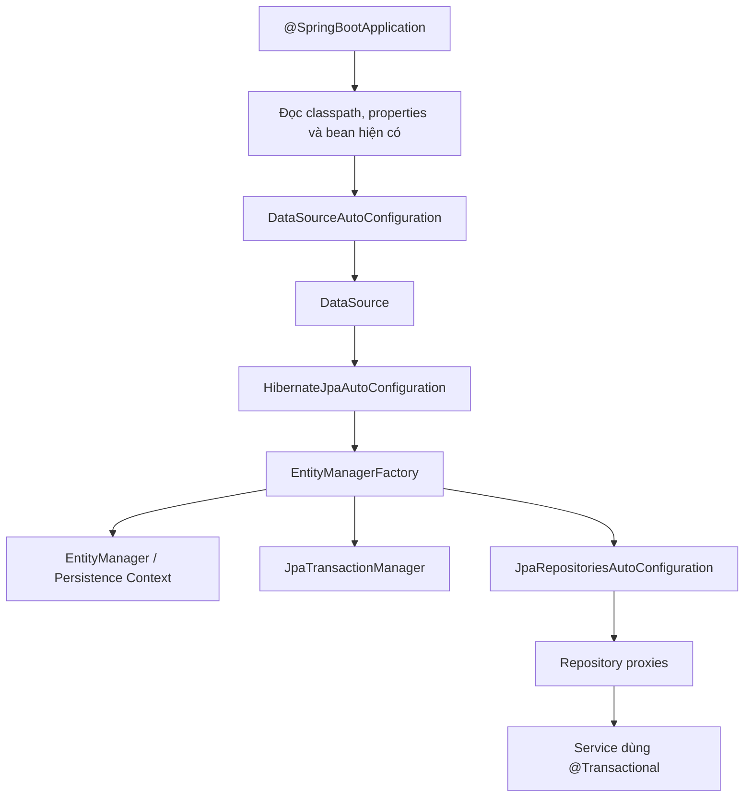

# Cơ chế tự cấu hình JPA của Spring Boot

## Mục tiêu

Sau bài này, bạn có thể giải thích Spring Boot tự thiết lập Spring Data JPA như thế nào; nhận diện các bean chính được tạo trong quá trình khởi động; hiểu vai trò của dependency, package scan và cấu hình `application.yml`; biết khi nào auto-configuration được áp dụng hoặc nhường chỗ cho cấu hình tùy chỉnh; đồng thời chẩn đoán các lỗi thường gặp.

## 1. Auto-configuration là gì?

Spring Boot auto-configuration là cơ chế tự cấu hình ứng dụng dựa trên những gì đang có trong classpath, các property và những bean đã được khai báo. Mục tiêu là cung cấp một cấu hình mặc định hợp lý để ứng dụng có thể chạy với ít cấu hình thủ công.

`@SpringBootApplication` là annotation tổng hợp, bao gồm ba phần quan trọng:

- `@SpringBootConfiguration`: đánh dấu lớp cấu hình chính của ứng dụng.
- `@EnableAutoConfiguration`: bật cơ chế nạp các lớp auto-configuration phù hợp.
- `@ComponentScan`: quét các component Spring trong package của lớp ứng dụng và các package con.

Auto-configuration không phải một bộ cấu hình cố định luôn được bật. Mỗi cấu hình thường có điều kiện như: thư viện cần thiết có mặt trong classpath, một bean loại nào đó đã tồn tại, property được bật hoặc chưa có bean tùy chỉnh thay thế. Spring Boot đánh giá các điều kiện đó khi tạo `ApplicationContext`.

Ví dụ, nếu ứng dụng có `spring-boot-starter-data-jpa`, Spring Data JPA, Hibernate và các lớp JPA cần thiết sẽ có mặt trên classpath. Nếu đồng thời có một `DataSource` phù hợp, Spring Boot có thể cấu hình `EntityManagerFactory`, transaction manager và các repository JPA.

## 2. Dependency kích hoạt hạ tầng JPA

Trong Maven, dependency thường dùng là `spring-boot-starter-data-jpa`. Starter này đưa vào Spring Data JPA, Spring ORM/JDBC, Hibernate ORM và các thành phần hỗ trợ cần thiết. Spring Boot quản lý phiên bản tương thích thông qua dependency management của phiên bản Boot mà dự án sử dụng.

Ví dụ phần dependency trong `pom.xml`:

```xml
<dependencies>
    <dependency>
        <groupId>org.springframework.boot</groupId>
        <artifactId>spring-boot-starter-data-jpa</artifactId>
    </dependency>

    <dependency>
        <groupId>org.postgresql</groupId>
        <artifactId>postgresql</artifactId>
        <scope>runtime</scope>
    </dependency>
</dependencies>
```

Starter JPA cung cấp ORM và repository; driver PostgreSQL cung cấp khả năng giao tiếp với PostgreSQL. Nếu dùng MySQL, H2 hoặc một hệ quản trị khác, hãy thêm driver tương ứng. Có dependency JPA không có nghĩa ứng dụng tự biết phải kết nối tới database nào: ứng dụng vẫn cần một `DataSource`, thường được cấu hình bằng URL và thông tin đăng nhập.

Trong môi trường kiểm thử hoặc học tập, có thể dùng H2 thay cho PostgreSQL:

```xml
<dependency>
    <groupId>com.h2database</groupId>
    <artifactId>h2</artifactId>
    <scope>runtime</scope>
</dependency>
```

Không nên khai báo phiên bản riêng cho Hibernate hoặc Spring Data JPA khi đang dùng dependency management của Spring Boot, trừ khi có lý do tương thích cụ thể. Tự nâng riêng một thành phần có thể tạo ra tổ hợp thư viện không tương thích.

## 3. Chuỗi auto-configuration khi ứng dụng khởi động

Với một ứng dụng Spring Boot đơn giản chỉ có một database, luồng chính có thể hình dung như sau:



Sơ đồ là cách tóm tắt các thành phần thường gặp. Spring Boot thực tế nạp nhiều auto-configuration có điều kiện và một số cấu hình có thể được áp dụng theo thứ tự phụ thuộc. Nếu dự án có nhiều database hoặc bean tùy chỉnh, chuỗi này sẽ phức tạp hơn.

### 3.1. DataSourceAutoConfiguration tạo kết nối database

`DataSource` là abstraction JDBC đại diện cho nguồn cấp kết nối. Hibernate dùng `DataSource` để lấy JDBC connection khi cần đọc hoặc ghi dữ liệu.

`DataSourceAutoConfiguration` có thể tạo một `DataSource` nếu các điều kiện phù hợp được đáp ứng và ứng dụng chưa khai báo một bean `DataSource` của riêng mình. Spring Boot thường chọn HikariCP làm connection pool khi thư viện này có mặt, như trong cấu hình starter thông thường.

Spring Boot có thể nhận cấu hình từ các property như:

- `spring.datasource.url`: JDBC URL của database.
- `spring.datasource.username`: tài khoản kết nối.
- `spring.datasource.password`: mật khẩu.
- `spring.datasource.driver-class-name`: tên lớp JDBC driver; thường có thể suy ra từ URL.
- `spring.datasource.hikari.*`: các tùy chọn riêng của HikariCP như pool size và timeout.

Nếu classpath có database nhúng như H2 và không khai báo URL, Boot có thể tự cấu hình database nhúng. Nếu không có database nhúng và cũng không có URL hợp lệ, ứng dụng thường dừng với lỗi không xác định được driver hoặc không cấu hình được datasource.

### 3.2. HibernateJpaAutoConfiguration tạo EntityManagerFactory

Khi các lớp JPA và Hibernate có mặt, một `DataSource` phù hợp đã được tạo và chưa có `EntityManagerFactory` tùy chỉnh, Hibernate JPA auto-configuration có thể thiết lập hạ tầng JPA.

Bean trung tâm là `EntityManagerFactory`. Trong cấu hình Hibernate tiêu chuẩn, Spring dùng `LocalContainerEntityManagerFactoryBean` để xây dựng factory. Factory này được cấu hình với `DataSource`, provider Hibernate, metadata entity, các property JPA/Hibernate và những tùy chỉnh liên quan.

`EntityManagerFactory` tạo ra `EntityManager`. `EntityManager` là API chính của JPA để persist, find, merge, remove và tạo query. EntityManager làm việc với persistence context để quản lý trạng thái entity trong phạm vi persistence context.

Hibernate là provider triển khai các API JPA. Nó đọc mapping annotation, theo dõi thay đổi entity, tạo SQL và dùng JDBC thông qua `DataSource` để gửi câu lệnh tới database.

### 3.3. Entity scanning tìm các lớp @Entity

Spring Boot cần biết package nào chứa entity. Theo mặc định, Boot dùng package của lớp có `@SpringBootApplication` làm package gốc cho việc dò tìm entity. Vì vậy, cách tổ chức đơn giản thường đặt lớp ứng dụng ở package cha của entity:

```text
com.example.learning
├── LearningApplication.java
├── customer
│   ├── Customer.java
│   ├── CustomerRepository.java
│   └── CustomerService.java
└── order
    ├── PurchaseOrder.java
    └── OrderRepository.java
```

Entity scan và component scan có liên quan nhưng không phải cùng một việc. `@ComponentScan` tìm component Spring như `@Service`, `@Repository`, `@Controller`; entity scan tìm các lớp persistence được đánh dấu `@Entity` để đưa vào metadata JPA.

Nếu entity nằm ngoài package gốc, có thể chỉ định rõ:

```java
package com.example.learning;

import org.springframework.boot.autoconfigure.SpringBootApplication;
import org.springframework.boot.autoconfigure.domain.EntityScan;

@SpringBootApplication
@EntityScan(basePackages = {
    "com.example.learning.customer",
    "com.example.shared.persistence"
})
public class LearningApplication {
    public static void main(String[] args) {
        org.springframework.boot.SpringApplication.run(
            LearningApplication.class, args
        );
    }
}
```

Chỉ thêm `@EntityScan` khi cấu trúc package thực sự cần. Nếu khai báo sai hoặc quá hẹp, entity có thể không được quản lý và repository sẽ báo lỗi như `Not a managed type`.

### 3.4. JpaRepositoriesAutoConfiguration tạo repository proxy

Spring Data JPA cung cấp cơ chế tạo implementation cho repository interface. Ví dụ:

```java
package com.example.learning.customer;

import org.springframework.data.jpa.repository.JpaRepository;

public interface CustomerRepository
        extends JpaRepository<Customer, Long> {
}
```

Bạn chỉ khai báo interface. Spring Data JPA tạo proxy bean để thực hiện các thao tác như `save`, `findById`, `findAll`, `deleteById`, phân trang và các query method.

Boot thường dò repository từ package gốc của ứng dụng. Nếu repository ở package khác, có thể cấu hình:

```java
import org.springframework.boot.autoconfigure.SpringBootApplication;
import org.springframework.data.jpa.repository.config.EnableJpaRepositories;

@SpringBootApplication
@EnableJpaRepositories(basePackages = "com.example.data.repositories")
public class LearningApplication {
    // main method
}
```

Trong ứng dụng đơn giản, không cần thêm `@EnableJpaRepositories` vì auto-configuration đã làm việc này. Khi tự khai báo annotation, hãy bảo đảm package được chỉ định đúng và tránh tạo hai cấu hình scan chồng lấn.

### 3.5. Transaction manager hỗ trợ @Transactional

Trong cấu hình JPA tiêu chuẩn với một `EntityManagerFactory`, Spring Boot có thể tạo `JpaTransactionManager` làm implementation của `PlatformTransactionManager`.

Service có thể khai báo transaction như sau:

```java
package com.example.learning.customer;

import org.springframework.stereotype.Service;
import org.springframework.transaction.annotation.Transactional;

@Service
public class CustomerService {
    private final CustomerRepository customers;

    public CustomerService(CustomerRepository customers) {
        this.customers = customers;
    }

    @Transactional
    public Long register(String name) {
        Customer customer = new Customer(name);
        return customers.save(customer).getId();
    }
}
```

`@Transactional` được xử lý qua cơ chế proxy của Spring. Khi phương thức được gọi qua Spring proxy, transaction manager bắt đầu hoặc tham gia transaction hiện tại. Khi phương thức hoàn tất bình thường, transaction được commit; khi có exception thuộc quy tắc rollback, transaction được rollback.

Với Spring Boot, transaction management thường được cấu hình tự động. Ứng dụng thông thường không cần tự thêm `@EnableTransactionManagement`. Cần nhớ rằng gọi một phương thức transactional khác trong cùng object bằng `this.method()` không đi qua proxy mặc định, nên có thể không kích hoạt transaction như mong đợi.

## 4. Cấu hình tối thiểu bằng application.yml

Ví dụ cấu hình PostgreSQL:

```yaml
spring:
  datasource:
    url: jdbc:postgresql://localhost:5432/learning
    username: ${DB_USERNAME}
    password: ${DB_PASSWORD}
  jpa:
    hibernate:
      ddl-auto: validate
    open-in-view: false
    show-sql: false
    properties:
      hibernate:
        format_sql: true
```

Giải thích:

- `spring.datasource.*` cấu hình kết nối JDBC.
- `spring.jpa.hibernate.ddl-auto` điều khiển cách Hibernate xử lý schema trong lúc khởi động.
- `validate` yêu cầu Hibernate kiểm tra mapping với schema hiện có; nó không tạo bảng.
- `spring.jpa.open-in-view=false` tắt việc giữ persistence context mở tới cuối vòng đời web request; điều này giúp ranh giới truy cập dữ liệu rõ hơn, nhưng service cần tải dữ liệu cần thiết trước khi trả response.
- `spring.jpa.properties.hibernate.*` chuyển property cụ thể xuống Hibernate.

Thông tin đăng nhập nên lấy từ biến môi trường hoặc secret manager. Không commit mật khẩu thật vào repository. Tên property có dấu gạch ngang là dạng canonical của Spring Boot; relaxed binding cũng hỗ trợ các cách viết tương đương trong một số nguồn cấu hình.

### 4.1. Một số property thường gặp

| Property | Ý nghĩa |
| --- | --- |
| `spring.datasource.url` | JDBC URL kết nối database |
| `spring.datasource.username` / `password` | Thông tin đăng nhập |
| `spring.datasource.hikari.maximum-pool-size` | Số kết nối tối đa trong Hikari pool |
| `spring.jpa.hibernate.ddl-auto` | Chiến lược tạo, cập nhật hoặc kiểm tra schema của Hibernate |
| `spring.jpa.show-sql` | In SQL ra log console theo cấu hình JPA |
| `spring.jpa.open-in-view` | Bật/tắt Open EntityManager in View trong ứng dụng web |
| `spring.jpa.database-platform` | Chỉ định Hibernate dialect khi cần; nhiều trường hợp provider có thể tự nhận diện |
| `spring.jpa.properties.hibernate.format_sql` | Định dạng SQL do Hibernate sinh |
| `spring.data.jpa.repositories.enabled` | Bật/tắt auto-configuration repository JPA |

Không phải property nào cũng thuộc cùng một lớp. `spring.datasource.*` điều khiển kết nối; `spring.jpa.*` là cấu hình JPA do Boot cung cấp; `spring.jpa.properties.hibernate.*` là property chuyển tiếp cho provider; `spring.data.jpa.*` điều khiển hành vi Spring Data JPA.

## 5. Ví dụ các thành phần được auto-configure

Giả sử dự án có entity:

```java
package com.example.learning.customer;

import jakarta.persistence.Entity;
import jakarta.persistence.GeneratedValue;
import jakarta.persistence.GenerationType;
import jakarta.persistence.Id;
import jakarta.persistence.Table;

@Entity
@Table(name = "customers")
public class Customer {
    @Id
    @GeneratedValue(strategy = GenerationType.IDENTITY)
    private Long id;

    private String name;

    protected Customer() {
    }

    public Customer(String name) {
        this.name = name;
    }

    public Long getId() {
        return id;
    }

    public String getName() {
        return name;
    }
}
```

Repository:

```java
package com.example.learning.customer;

import java.util.List;
import org.springframework.data.jpa.repository.JpaRepository;

public interface CustomerRepository
        extends JpaRepository<Customer, Long> {
    List<Customer> findByNameContainingIgnoreCase(String keyword);
}
```

Application class:

```java
package com.example.learning;

import org.springframework.boot.SpringApplication;
import org.springframework.boot.autoconfigure.SpringBootApplication;

@SpringBootApplication
public class LearningApplication {
    public static void main(String[] args) {
        SpringApplication.run(LearningApplication.class, args);
    }
}
```

Với dependency và datasource hợp lệ, Boot tự cấu hình entity manager factory, transaction manager và repository proxy. Bạn không cần tự viết implementation cho `CustomerRepository` hoặc tự khởi tạo `EntityManagerFactory` trong ứng dụng cơ bản.

Để hiểu các bean đang tồn tại, có thể inject hoặc kiểm tra context trong một test:

```java
package com.example.learning;

import jakarta.persistence.EntityManagerFactory;
import javax.sql.DataSource;
import org.junit.jupiter.api.Test;
import org.springframework.beans.factory.annotation.Autowired;
import org.springframework.boot.test.context.SpringBootTest;
import org.springframework.transaction.PlatformTransactionManager;

import static org.assertj.core.api.Assertions.assertThat;

@SpringBootTest
class JpaAutoConfigurationTest {
    @Autowired DataSource dataSource;
    @Autowired EntityManagerFactory entityManagerFactory;
    @Autowired PlatformTransactionManager transactionManager;
    @Autowired CustomerRepository customerRepository;

    @Test
    void jpaInfrastructureIsAvailable() {
        assertThat(dataSource).isNotNull();
        assertThat(entityManagerFactory).isNotNull();
        assertThat(transactionManager).isNotNull();
        assertThat(customerRepository).isNotNull();
    }
}
```

Đây là ví dụ kiểm tra trong ứng dụng Spring Boot có test dependencies và cấu hình database cho test. `PlatformTransactionManager` là abstraction; trong cấu hình JPA một database, bean thường là `JpaTransactionManager`.

## 6. Auto-configuration có điều kiện và cơ chế back-off

Nguyên tắc quan trọng của Spring Boot là cung cấp default khi phù hợp, đồng thời cho phép ứng dụng thay thế bằng bean do mình định nghĩa. Cơ chế này thường được gọi là back-off.

| Thành phần | Hành vi mặc định thường gặp | Khi ứng dụng tự cấu hình |
| --- | --- | --- |
| `DataSource` | Boot tạo datasource từ property hoặc database nhúng | Bean `DataSource` tùy chỉnh thường khiến datasource auto-configuration nhường chỗ |
| `EntityManagerFactory` | Hibernate JPA auto-configuration tạo factory | Bean `EntityManagerFactory` hoặc factory tùy chỉnh có thể khiến cấu hình Hibernate mặc định nhường chỗ |
| Transaction manager | Boot tạo manager phù hợp với JPA | Bean `PlatformTransactionManager` tùy chỉnh có thể thay thế manager mặc định |
| JPA repositories | Boot tự scan repository theo package mặc định | `@EnableJpaRepositories` cho phép chỉ định package và factory/transaction manager tương ứng; cấu hình repository tùy chỉnh có thể khiến auto-configuration mặc định nhường chỗ |

Back-off không có nghĩa là mọi bean JPA đều bị tắt chỉ vì bạn thêm một bean bất kỳ. Điều kiện phụ thuộc vào từng auto-configuration cụ thể và loại bean được kiểm tra. Khi tùy chỉnh, cần kiểm tra bean nào được tạo, bean nào bị điều kiện loại bỏ và các dependency của chúng.

### 6.1. Ví dụ tùy chỉnh DataSource

Trong ứng dụng cơ bản, property thường đủ. Nếu cần cấu hình pool hoặc datasource đặc biệt, có thể tự khai báo bean:

```java
@Configuration
public class DatabaseConfiguration {
    @Bean
    @ConfigurationProperties("app.datasource")
    public DataSource dataSource() {
        return DataSourceBuilder.create().build();
    }
}
```

Ví dụ trên cần các import Spring Boot phù hợp và property `app.datasource.*` có đủ thông tin cho implementation datasource được chọn. Khi tự tạo nhiều datasource hoặc dùng HikariCP trực tiếp, thường nên khai báo rõ loại datasource và cách bind property cho pool thay vì dựa vào một cấu hình chung không phù hợp.

Khi tự tạo `DataSource`, bạn chịu trách nhiệm cấu hình URL, credentials, pool, driver và lifecycle. Boot có thể không còn tạo datasource mặc định. Hạ tầng JPA phía sau vẫn có thể được auto-configure nếu nó nhìn thấy một datasource phù hợp và các điều kiện khác vẫn đúng.

### 6.2. Khi cần cấu hình repository tường minh

Ứng dụng nhiều module hoặc nhiều persistence unit có thể cần chỉ định rõ:

```java
@Configuration
@EnableJpaRepositories(
    basePackages = "com.example.learning.customer.repository",
    entityManagerFactoryRef = "customerEntityManagerFactory",
    transactionManagerRef = "customerTransactionManager"
)
public class CustomerJpaConfiguration {
    // Define the matching EntityManagerFactory and transaction manager beans.
}
```

Đây chỉ là khung cấu hình thể hiện các liên kết tên bean. Với nhiều database, phải định nghĩa đầy đủ từng `DataSource`, `EntityManagerFactory`, transaction manager và package entity/repository tương ứng. Không thể chỉ thêm `@EnableJpaRepositories` mà không cung cấp các bean được tham chiếu.

## 7. Auto-configuration và package scan: các ranh giới cần phân biệt

Ba cơ chế scan thường bị nhầm lẫn:

1. **Component scan** tìm các bean Spring như `@Component`, `@Service`, `@Repository`, `@Controller`.
2. **Entity scan** tìm các lớp `@Entity` để Hibernate/JPA đưa vào persistence metadata.
3. **Repository scan** tìm interface Spring Data như `JpaRepository` và tạo proxy.

Đặt lớp `@SpringBootApplication` ở package gốc giúp các package con được tìm thấy theo mặc định. Nếu lớp ứng dụng nằm quá sâu, các package ngang hàng có thể bị bỏ qua. Khi đó, hãy chuyển lớp ứng dụng lên package gốc hoặc chỉ định scan rõ ràng bằng `scanBasePackages`, `@EntityScan` và `@EnableJpaRepositories` theo đúng trách nhiệm.

`scanBasePackages` của `@SpringBootApplication` điều khiển component scan; không nên giả định nó tự thay đổi tất cả cấu hình entity và repository trong mọi trường hợp. Hãy dùng annotation đúng cho loại scan cần điều chỉnh.

## 8. Schema initialization và migration

Auto-configuration JPA còn liên quan đến thời điểm kiểm tra hoặc tạo schema. Property `spring.jpa.hibernate.ddl-auto` có các giá trị thường dùng:

| Giá trị | Hành vi |
| --- | --- |
| `none` | Không yêu cầu Hibernate quản lý DDL |
| `validate` | Kiểm tra schema hiện có có phù hợp mapping hay không |
| `update` | Cố gắng điều chỉnh schema để khớp mapping |
| `create` | Tạo lại schema khi khởi động theo cấu hình provider |
| `create-drop` | Tạo schema khi khởi động và xóa khi EntityManagerFactory đóng |

Giá trị mặc định do Boot suy ra từ loại database và việc có công cụ khởi tạo schema như Flyway/Liquibase hay không. Database nhúng có thể nhận mặc định khác database bên ngoài; vì vậy không nên dựa vào mặc định này cho môi trường production.

Trong môi trường thật, nên quản lý thay đổi schema bằng migration có version, ví dụ Flyway hoặc Liquibase. Khi dùng migration, cấu hình Hibernate ở chế độ `validate` hoặc `none` tùy chính sách của dự án để tránh hai cơ chế cùng thay đổi schema.

Nếu dùng `schema.sql` hoặc `data.sql` cùng JPA, hãy chú ý thứ tự khởi tạo. Khi muốn Hibernate tạo schema trước rồi script nạp dữ liệu chạy sau, có thể cần `spring.jpa.defer-datasource-initialization=true`. Với database không nhúng, việc chạy script SQL có thể cần `spring.sql.init.mode=always`. Trước khi bật, hãy xác định rõ môi trường và nguồn sở hữu schema để tránh tạo dữ liệu hoặc thay đổi cấu trúc ngoài ý muốn.

## 9. Nhiều DataSource và nhiều EntityManagerFactory

Auto-configuration mặc định hướng tới trường hợp phổ biến: một datasource và một persistence unit. Khi ứng dụng có nhiều database, nhiều `DataSource` cùng loại có thể khiến Boot không xác định được bean phù hợp. Khi đó, cần xác định datasource chính bằng `@Primary` nếu có một datasource mặc định, hoặc cấu hình rõ từng persistence unit.

Một cấu hình đa database thường phải chỉ định:

- Bean `DataSource` cho từng database.
- Bean `LocalContainerEntityManagerFactoryBean` hoặc `EntityManagerFactory` cho từng persistence unit.
- Package entity tương ứng với từng factory.
- `@EnableJpaRepositories` cho từng nhóm repository, với `entityManagerFactoryRef` và `transactionManagerRef` chính xác.
- Transaction manager phù hợp với database mà nghiệp vụ đang thao tác.

Không nên cho một repository vô tình dùng nhầm `EntityManagerFactory` hoặc transaction manager. Việc đó có thể khiến query chạy vào sai database hoặc transaction không bao trùm toàn bộ thao tác mong muốn.

## 10. Cách kiểm tra Spring Boot đã auto-configure gì

### 10.1. Bật condition evaluation report

Chạy ứng dụng với tham số `--debug` để Spring Boot in báo cáo điều kiện auto-configuration:

```bash
./mvnw spring-boot:run -Dspring-boot.run.arguments=--debug
```

Trên Windows PowerShell có thể dùng `./mvnw.cmd spring-boot:run -Dspring-boot.run.arguments=--debug` nếu dự án có Maven Wrapper. Với Gradle Wrapper, dùng `./gradlew bootRun --args='--debug'` hoặc `./gradlew.bat bootRun --args='--debug'` trên Windows.

Trong Condition Evaluation Report, chú ý các nhóm positive matches và negative matches. Positive match cho biết điều kiện được thỏa mãn; negative match cho biết auto-configuration bị bỏ qua và thường kèm lý do như thiếu class, thiếu bean hoặc property không phù hợp.

### 10.2. Kiểm tra bean trong ApplicationContext

Trong test hoặc khi debug, có thể kiểm tra bean bằng `ApplicationContext` hoặc inject trực tiếp các kiểu cần xác minh:

- `DataSource` để xác nhận datasource được tạo.
- `EntityManagerFactory` để xác nhận JPA provider đã khởi tạo.
- `PlatformTransactionManager` để xác nhận transaction manager có mặt.
- Repository interface cụ thể để xác nhận repository scan đã hoạt động.

Actuator có endpoint `conditions` để quan sát điều kiện auto-configuration khi đã thêm Spring Boot Actuator và cấu hình expose endpoint phù hợp. Endpoint này có thể tiết lộ thông tin cấu hình nội bộ; chỉ expose theo chính sách bảo mật của ứng dụng, đặc biệt ở production.

### 10.3. Bật log có mục tiêu

Để kiểm tra SQL và tham số khi phát triển, có thể cấu hình:

```yaml
logging:
  level:
    org.hibernate.SQL: DEBUG
    org.hibernate.orm.jdbc.bind: TRACE
```

Logger `org.hibernate.SQL` hiển thị câu SQL; logger bind của Hibernate 6 có thể hiển thị giá trị tham số. Log bind có thể chứa dữ liệu cá nhân hoặc bí mật, vì vậy chỉ bật tạm thời trong môi trường phát triển và không để lộ ra log production.

## 11. Lỗi thường gặp và cách xử lý

| Triệu chứng | Nguyên nhân thường gặp | Hướng kiểm tra |
| --- | --- | --- |
| `Failed to determine a suitable driver class` | Thiếu JDBC driver hoặc URL chưa hợp lệ | Kiểm tra dependency driver, `spring.datasource.url` và runtime classpath |
| `Failed to configure a DataSource` | Không có URL và không có database nhúng phù hợp | Thêm driver và cấu hình datasource hoặc dependency H2 cho môi trường test |
| Không tìm thấy repository bean | Repository nằm ngoài package scan hoặc repository auto-config bị tắt | Kiểm tra package gốc, `@EnableJpaRepositories` và `spring.data.jpa.repositories.enabled` |
| `Not a managed type` | Entity chưa được entity scan hoặc thiếu `@Entity` | Kiểm tra annotation và `@EntityScan` |
| `No qualifying bean of type EntityManagerFactory` | Hibernate JPA auto-config không chạy hoặc bị back-off | Xem condition report, dependency, datasource và bean tùy chỉnh |
| `NoUniqueBeanDefinitionException` cho DataSource hoặc transaction manager | Có nhiều bean cùng loại mà không có lựa chọn rõ ràng | Dùng `@Primary` khi phù hợp hoặc tham chiếu bean theo tên |
| Schema validation thất bại | Schema thật không khớp mapping entity | Kiểm tra migration, tên bảng/cột, kiểu dữ liệu và constraint |
| Ứng dụng khởi động nhưng query lỗi | SQL, mapping, quyền database hoặc schema chưa đúng | Kiểm tra SQL/log, quyền tài khoản và schema hiện tại |

Không nên xử lý các lỗi trên bằng cách thêm annotation hoặc dependency một cách ngẫu nhiên. Hãy xác định auto-configuration nào không match, bean nào đang thiếu hoặc bean nào khiến cấu hình mặc định back-off.

## 12. Các nhầm lẫn phổ biến

- **“Chỉ cần `@Entity` là JPA tự hoạt động.”** Không đúng. Ứng dụng cần JPA provider, `DataSource` hợp lệ, entity manager factory và các dependency tương ứng.
- **“Starter JPA tự tạo database server.”** Không đúng. Starter cung cấp thư viện tích hợp; database server phải tồn tại hoặc ứng dụng phải dùng database nhúng như H2.
- **“`@SpringBootApplication` quét mọi package trong project.”** Mặc định nó quét package của lớp ứng dụng và các package con. Package nằm ngoài cây đó cần cấu hình scan rõ ràng.
- **“Component scan tự động thay thế entity scan.”** Hai cơ chế phục vụ mục đích khác nhau. Entity phải được đưa vào metadata JPA.
- **“Luôn phải khai báo `@EnableJpaRepositories`.”** Không cần trong ứng dụng đơn giản dùng auto-configuration mặc định.
- **“Tự khai báo một bean bất kỳ sẽ tắt toàn bộ JPA auto-configuration.”** Back-off phụ thuộc vào điều kiện của từng cấu hình và từng loại bean.
- **“`ddl-auto=update` là lựa chọn an toàn cho production.”** Không nên xem đây là cơ chế migration có kiểm soát. Hãy quản lý schema bằng migration.
- **“Bật log SQL và bind parameter ở mọi môi trường.”** Bind parameter có thể làm lộ dữ liệu nhạy cảm; cần giới hạn theo môi trường.
- **“Có nhiều database chỉ cần thêm nhiều URL.”** Ứng dụng đa database cần cấu hình datasource, persistence unit, repository và transaction manager tương ứng.

## 13. Checklist khi tạo ứng dụng Spring Data JPA

- [ ] Đã thêm `spring-boot-starter-data-jpa`.
- [ ] Đã thêm JDBC driver đúng với hệ quản trị database.
- [ ] Đã cấu hình URL, username và password qua property an toàn.
- [ ] Lớp `@SpringBootApplication` nằm ở package gốc hợp lý.
- [ ] Entity có `@Entity` và nằm trong phạm vi entity scan.
- [ ] Repository kế thừa `JpaRepository` và nằm trong phạm vi repository scan.
- [ ] `EntityManagerFactory` và transaction manager được tạo đúng.
- [ ] Cấu hình schema phù hợp môi trường; production dùng migration có kiểm soát.
- [ ] Đã kiểm tra condition report khi auto-configuration không hoạt động như mong đợi.
- [ ] Không để lộ credentials hoặc bind parameter nhạy cảm trong log.

## Kết luận

Spring Boot JPA auto-configuration kết nối nhiều thành phần thành một hạ tầng persistence hoàn chỉnh: dependency đưa các thư viện vào classpath; datasource auto-configuration cung cấp kết nối JDBC; Hibernate JPA auto-configuration tạo `EntityManagerFactory`; entity scan đưa entity vào metadata; Spring Data JPA tạo repository proxy; transaction manager hỗ trợ `@Transactional`. Hiểu điều kiện kích hoạt, package scan và back-off giúp bạn tận dụng cấu hình mặc định, tùy chỉnh đúng chỗ và tìm nguyên nhân khi ứng dụng không khởi động hoặc repository không hoạt động.