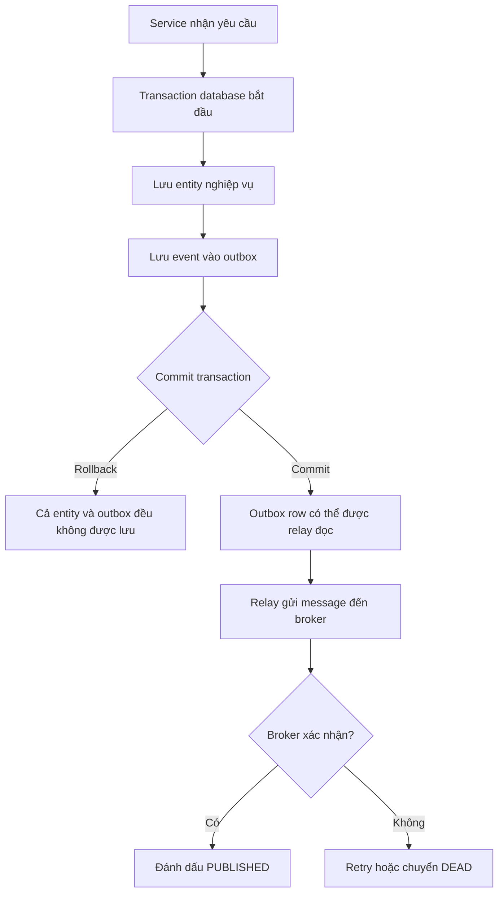

# Mẫu transactional outbox cho thay đổi dữ liệu và công bố thông điệp

Một nghiệp vụ thường cần vừa cập nhật cơ sở dữ liệu vừa gửi thông điệp đến hệ thống khác. Ví dụ: tạo đơn hàng trong Spring Data JPA rồi phát sự kiện `OrderPlaced` để dịch vụ kho, thanh toán hoặc thông báo xử lý tiếp.

Nếu ứng dụng ghi database và gửi message broker bằng hai thao tác độc lập, hai hệ thống có thể rơi vào trạng thái không nhất quán. Transactional outbox giải quyết vấn đề này bằng cách ghi thay đổi nghiệp vụ và một bản ghi sự kiện vào cùng một giao dịch database. Một tiến trình relay đọc outbox đã commit rồi gửi thông điệp ra broker.

## 1. Vấn đề dual write

Giả sử một service thực hiện:

```java
@Transactional
public void placeOrder(CreateOrder command) {
    PurchaseOrder order = orders.save(PurchaseOrder.from(command));
    messageBroker.publish(new OrderPlaced(order.getId()));
}
```

Đoạn mã trên có hai thao tác cần thành công cùng nhau:

1. Lưu đơn hàng trong database.
2. Gửi sự kiện đến message broker.

Transaction của JPA chỉ điều khiển tài nguyên database thuộc transaction manager. Nó không tự động làm cho lời gọi đến Kafka, RabbitMQ hoặc một HTTP service trở thành một phần của cùng transaction.

Có hai tình huống lỗi điển hình:

- **Database commit nhưng publish thất bại:** đơn hàng tồn tại nhưng hệ thống khác không nhận được sự kiện. Ví dụ kho không biết cần chuẩn bị hàng.
- **Publish thành công nhưng database rollback:** hệ thống khác đã xử lý một đơn hàng mà database không lưu thành công.

Đây là bài toán dual write: một nghiệp vụ cần ghi vào hai hệ thống độc lập nhưng không có cơ chế nguyên tử chung. Gửi message trước hay sau khi commit đều không loại bỏ được mọi cửa sổ lỗi.

## 2. Transactional outbox hoạt động như thế nào?

Thay vì gửi message ngay trong transaction nghiệp vụ, ứng dụng lưu một bản ghi outbox cùng với dữ liệu nghiệp vụ:

1. Service cập nhật entity nghiệp vụ.
2. Service tạo event DTO mô tả sự kiện vừa xảy ra.
3. Service lưu event vào bảng `outbox_event`.
4. Cả entity nghiệp vụ và outbox row được commit trong cùng một database transaction.
5. Một relay riêng đọc các outbox row đã commit và gửi message đến broker.
6. Sau khi broker xác nhận nhận message, relay đánh dấu outbox row đã publish.

Nếu transaction rollback, cả thay đổi nghiệp vụ và outbox row đều rollback. Nếu transaction commit, cả hai đều tồn tại để relay có thể xử lý.



Outbox là nguồn dữ liệu bền vững để phát lại sự kiện. Relay có thể tạm dừng hoặc ứng dụng có thể khởi động lại mà không làm mất các sự kiện đã được ghi vào database.

## 3. Thiết kế bảng outbox

Một bảng outbox thường lưu thông tin định danh sự kiện, aggregate phát sinh sự kiện, loại event, payload và trạng thái gửi.

| Cột | Ý nghĩa |
|---|---|
| `id` | ID duy nhất của event; dùng làm event ID và khóa idempotency. |
| `aggregate_type` | Loại aggregate, ví dụ `PurchaseOrder`. |
| `aggregate_id` | ID của aggregate phát sinh sự kiện. |
| `event_type` | Tên sự kiện, ví dụ `OrderPlaced`. |
| `schema_version` | Phiên bản cấu trúc payload. |
| `payload` | Nội dung event đã serialize, thường là JSON. |
| `occurred_at` | Thời điểm nghiệp vụ phát sinh sự kiện. |
| `status` | Trạng thái gửi: `PENDING`, `IN_PROGRESS`, `PUBLISHED` hoặc `DEAD`. |
| `attempts` | Số lần gửi thất bại hoặc thử lại. |
| `next_attempt_at` | Thời điểm sớm nhất được phép thử lại. |
| `claimed_until` | Hạn giữ quyền xử lý của worker đang claim event. |
| `claim_token` | Token nhận diện lượt claim, tránh worker cũ cập nhật kết quả của lượt claim mới. |
| `published_at` | Thời điểm broker xác nhận message. |
| `last_error` | Lỗi gần nhất để điều tra và vận hành. |

Có thể dùng UUID cho event ID để tạo định danh ngay trong ứng dụng. Payload nên là một event DTO bất biến, không serialize trực tiếp entity JPA vì entity có thể chứa lazy proxy, quan hệ vòng hoặc dữ liệu không nên công bố ra ngoài.

Ví dụ entity outbox rút gọn:

```java
import jakarta.persistence.*;
import java.time.Instant;
import java.util.UUID;

@Entity
@Table(name = "outbox_event")
public class OutboxEvent {

    @Id
    private UUID id;

    @Column(name = "aggregate_type", nullable = false, length = 100)
    private String aggregateType;

    @Column(name = "aggregate_id", nullable = false, length = 100)
    private String aggregateId;

    @Column(name = "event_type", nullable = false, length = 160)
    private String eventType;

    @Column(name = "schema_version", nullable = false)
    private int schemaVersion;

    @Lob
    @Column(nullable = false)
    private String payload;

    @Column(name = "occurred_at", nullable = false)
    private Instant occurredAt;

    @Enumerated(EnumType.STRING)
    @Column(nullable = false, length = 20)
    private OutboxStatus status;

    @Column(nullable = false)
    private int attempts;

    @Column(name = "next_attempt_at", nullable = false)
    private Instant nextAttemptAt;

    @Column(name = "claimed_until")
    private Instant claimedUntil;

    @Column(name = "claim_token")
    private UUID claimToken;

    @Column(name = "published_at")
    private Instant publishedAt;

    @Lob
    @Column(name = "last_error")
    private String lastError;

    protected OutboxEvent() {
    }

    public static OutboxEvent pending(
            String aggregateType,
            String aggregateId,
            String eventType,
            int schemaVersion,
            String payload,
            Instant occurredAt) {

        OutboxEvent event = new OutboxEvent();
        event.id = UUID.randomUUID();
        event.aggregateType = aggregateType;
        event.aggregateId = aggregateId;
        event.eventType = eventType;
        event.schemaVersion = schemaVersion;
        event.payload = payload;
        event.occurredAt = occurredAt;
        event.status = OutboxStatus.PENDING;
        event.attempts = 0;
        event.nextAttemptAt = occurredAt;
        return event;
    }

    // Các getter và phương thức chuyển trạng thái được lược bớt.
}
```

Enum trạng thái:

```java
public enum OutboxStatus {
    PENDING,
    IN_PROGRESS,
    PUBLISHED,
    DEAD
}
```

Đây là cấu trúc minh họa; schema migration thực tế cần chọn kiểu cột phù hợp với database, độ dài payload, index và chính sách lưu trữ. Một index thường hữu ích cho việc tìm event đến hạn, chẳng hạn trên `status`, `next_attempt_at` và `occurred_at`. Có thể thêm index trên `aggregate_type`, `aggregate_id` để truy vết lịch sử của một aggregate.

## 4. Ghi thay đổi nghiệp vụ và outbox trong cùng transaction

Đây là phần quan trọng nhất của mẫu outbox. Hai repository phải tham gia cùng một transaction manager và cùng transaction database.

Ví dụ event DTO:

```java
import java.math.BigDecimal;
import java.time.Instant;
import java.util.UUID;

public record OrderPlaced(
        UUID orderId,
        BigDecimal total,
        Instant occurredAt) {
}
```

Service lưu đơn hàng và event:

```java
import com.fasterxml.jackson.core.JsonProcessingException;
import com.fasterxml.jackson.databind.ObjectMapper;
import java.time.Clock;
import java.time.Instant;
import java.util.UUID;
import org.springframework.stereotype.Service;
import org.springframework.transaction.annotation.Transactional;

@Service
public class OrderService {

    private final PurchaseOrderRepository orders;
    private final OutboxEventRepository outbox;
    private final ObjectMapper objectMapper;
    private final Clock clock;

    public OrderService(
            PurchaseOrderRepository orders,
            OutboxEventRepository outbox,
            ObjectMapper objectMapper,
            Clock clock) {
        this.orders = orders;
        this.outbox = outbox;
        this.objectMapper = objectMapper;
        this.clock = clock;
    }

    @Transactional
    public UUID placeOrder(CreateOrder command) {
        PurchaseOrder order = PurchaseOrder.from(command);
        PurchaseOrder saved = orders.save(order);

        Instant now = clock.instant();
        OrderPlaced event = new OrderPlaced(
                saved.getId(), saved.getTotal(), now);

        String payload;
        try {
            payload = objectMapper.writeValueAsString(event);
        } catch (JsonProcessingException ex) {
            throw new IllegalStateException(
                    "Không thể serialize OrderPlaced", ex);
        }

        outbox.save(OutboxEvent.pending(
                "PurchaseOrder",
                saved.getId().toString(),
                "OrderPlaced",
                1,
                payload,
                now));

        return saved.getId();
    }
}
```

Trong ví dụ, `PurchaseOrderRepository` và `OutboxEventRepository` đều là Spring Data JPA repository sử dụng cùng database và transaction manager. Khi phương thức `placeOrder()` commit, cả đơn hàng và outbox row cùng được commit.

Nếu serialize payload thất bại, `IllegalStateException` là unchecked exception nên transaction mặc định rollback. Đơn hàng đã được lưu trong transaction cũng không được commit riêng lẻ.

Nếu entity dùng ID do database sinh, giá trị ID thường có sau khi gọi `save()` và persist theo chiến lược ID đã cấu hình. Hãy bảo đảm ID aggregate đã sẵn sàng trước khi tạo payload và outbox row. Có thể dùng UUID do ứng dụng cấp nếu muốn tạo định danh trước khi persist.

Không nên đặt việc gửi broker bên trong `placeOrder()`. Nếu broker chậm hoặc lỗi, transaction database sẽ bị kéo dài mà vẫn không tạo được tính nguyên tử giữa hai hệ thống.

**Không tách outbox insert sang một transaction độc lập.** Nếu dùng `REQUIRES_NEW` cho việc lưu outbox, outbox row có thể commit trong khi transaction nghiệp vụ rollback, làm relay phát một event cho thay đổi chưa từng được lưu.

## 5. Repository cho outbox và ranh giới transaction

Repository có thể là một interface JPA thông thường:

```java
import java.util.UUID;
import org.springframework.data.jpa.repository.JpaRepository;

public interface OutboxEventRepository
        extends JpaRepository<OutboxEvent, UUID> {
}
```

Transaction cần bảo đảm các điều kiện:

- Service có `@Transactional` hoặc một ranh giới giao dịch tương đương.
- Repository nghiệp vụ và repository outbox tham gia cùng transaction manager.
- Hai bảng nằm trong cùng database transaction.
- Không có thao tác commit độc lập giữa lúc lưu entity nghiệp vụ và outbox row.
- Chỉ relay đọc các event đã commit để công bố ra ngoài.

Nếu ứng dụng có nhiều datasource hoặc nhiều `PlatformTransactionManager`, cần chỉ rõ manager phù hợp và xác nhận cả hai repository thực sự tham gia cùng transaction. Chỉ đặt hai lệnh `save()` trong cùng một phương thức Java không tự bảo đảm chúng thuộc cùng transaction.

## 6. Relay đọc outbox và gửi message

Relay là tiến trình riêng chịu trách nhiệm chuyển outbox row thành message broker message. Có thể triển khai bằng scheduled worker trong ứng dụng hoặc một service độc lập.

Luồng cơ bản:

1. Tìm các event `PENDING` đã đến hạn.
2. Claim một batch để chỉ một worker xử lý mỗi event tại một thời điểm.
3. Commit trạng thái claim và lấy dữ liệu event thành DTO.
4. Gửi payload đến broker, chờ xác nhận theo cơ chế của broker.
5. Nếu broker xác nhận, cập nhật trạng thái `PUBLISHED`.
6. Nếu gửi thất bại hoặc timeout, lên lịch retry hoặc chuyển event sang `DEAD` sau số lần thử tối đa.

Một abstraction cho broker có thể biểu diễn việc gửi và chờ xác nhận:

```java
import java.util.UUID;

public interface MessageBroker {

    // Chỉ hoàn tất bình thường khi broker đã xác nhận message.
    void publishAndAwaitAck(
            String topic,
            String key,
            UUID eventId,
            String eventType,
            int schemaVersion,
            String payload);
}
```

Khi gửi, nên đưa event ID vào header hoặc envelope để consumer có thể nhận diện message trùng. Có thể dùng `aggregateId` làm message key để các event cùng aggregate được đưa về cùng partition nếu broker hỗ trợ partition theo key.

### Vì sao cần claim event?

Nếu nhiều worker cùng đọc các hàng `PENDING`, hai worker có thể cùng gửi một event. Một cách phổ biến là chuyển trạng thái sang `IN_PROGRESS` trong một transaction ngắn, kèm token và lease:

- `claim_token`: UUID nhận diện lượt claim.
- `claimed_until`: thời điểm hết hạn claim.
- Worker chỉ cập nhật kết quả nếu token vẫn khớp.
- Nếu worker chết, claim hết hạn và event có thể được worker khác lấy lại.

Với PostgreSQL, có thể dùng câu lệnh native query dạng sau để claim đồng thời nhiều hàng mà tránh chờ các hàng đã bị worker khác khóa:

```sql
WITH candidates AS (
    SELECT id
    FROM outbox_event
    WHERE (status = 'PENDING' AND next_attempt_at <= :now)
       OR (status = 'IN_PROGRESS' AND claimed_until < :now)
    ORDER BY occurred_at, id
    LIMIT :batch_size
    FOR UPDATE SKIP LOCKED
)
UPDATE outbox_event e
SET status = 'IN_PROGRESS',
    claim_token = :claim_token,
    claimed_until = :lease_until
FROM candidates c
WHERE e.id = c.id
RETURNING e.id, e.aggregate_id, e.event_type,
          e.schema_version, e.payload;
```

Đây là ví dụ riêng cho PostgreSQL, không phải JPQL portable. Với database khác, cần dùng cơ chế khóa hoặc cập nhật claim nguyên tử tương đương. Claim transaction nên kết thúc trước khi gọi broker để không giữ row lock trong lúc chờ mạng.

Lease phải dài hơn thời gian gửi dự kiến hoặc được gia hạn khi cần. Nếu lease hết hạn trong khi worker cũ vẫn đang gửi, worker khác có thể claim lại và tạo bản gửi trùng. Token giúp worker cũ không ghi đè trạng thái của lượt claim mới, nhưng không thể thu hồi một message đã gửi ra broker.

## 7. Đánh dấu đã gửi và xử lý lỗi

Sau khi broker xác nhận, relay đánh dấu event đã publish trong transaction database:

```java
@Transactional
public void markPublished(
        UUID eventId, UUID claimToken, Instant publishedAt) {
    // Chỉ cập nhật nếu event vẫn IN_PROGRESS
    // và claim_token trùng với lượt xử lý hiện tại.
}
```

Điều kiện theo claim token ngăn một worker cũ cập nhật trạng thái sau khi event đã được worker khác claim lại.

Nếu broker gửi lỗi, relay ghi nhận số lần thử, lỗi gần nhất và thời điểm retry:

```java
@Transactional
public void scheduleRetry(
        UUID eventId,
        UUID claimToken,
        String error,
        Instant nextAttemptAt,
        int maxAttempts) {
    // Tăng attempts, lưu last_error và next_attempt_at.
    // Nếu đạt maxAttempts, chuyển trạng thái sang DEAD.
}
```

Có thể dùng exponential backoff:

```text
delay = min(maxDelay, baseDelay * 2^attempts)
```

Nên thêm jitter ngẫu nhiên để nhiều event lỗi cùng lúc không đồng loạt retry vào một thời điểm. Lỗi cấu hình hoặc payload không hợp lệ có thể cần chuyển thẳng sang trạng thái `DEAD` để điều tra, thay vì retry vô hạn.

Một relay đơn giản có thể được tổ chức như sau:

```java
@Component
public class OutboxRelay {

    private final OutboxClaimService claims;
    private final MessageBroker broker;
    private final OutboxStateService states;
    private final Clock clock;

    public OutboxRelay(
            OutboxClaimService claims,
            MessageBroker broker,
            OutboxStateService states,
            Clock clock) {
        this.claims = claims;
        this.broker = broker;
        this.states = states;
        this.clock = clock;
    }

    @Scheduled(fixedDelayString = "${outbox.poll-delay:1000}")
    public void publishPending() {
        var batch = claims.claimBatch(100, clock.instant());

        for (var event : batch) {
            try {
                broker.publishAndAwaitAck(
                        "orders",
                        event.aggregateId(),
                        event.id(),
                        event.eventType(),
                        event.schemaVersion(),
                        event.payload());

                states.markPublished(
                        event.id(), event.claimToken(), clock.instant());
            } catch (Exception ex) {
                states.scheduleRetry(
                        event.id(),
                        event.claimToken(),
                        ex.getMessage(),
                        clock.instant(),
                        10);
            }
        }
    }
}
```

`OutboxClaimService` và `OutboxStateService` nên là các Spring bean riêng có transaction boundary phù hợp. `claimBatch()` cần thực hiện claim nguyên tử như mô tả ở trên; `markPublished()` và `scheduleRetry()` cập nhật trạng thái bằng transaction riêng. Ví dụ relay chỉ minh họa cách kết nối các thành phần; phần query claim, tính backoff, giới hạn độ dài lỗi và cấu hình broker cần được triển khai theo database và broker thực tế.

## 8. Vì sao transactional outbox thường bảo đảm at-least-once?

Outbox bảo đảm event không bị mất giữa thay đổi database và việc tạo yêu cầu gửi: nếu nghiệp vụ commit, outbox row cũng commit. Tuy nhiên, việc gửi broker và đánh dấu `PUBLISHED` vẫn là hai thao tác riêng.

Một tình huống quan trọng:

1. Relay gửi message.
2. Broker đã nhận và xác nhận.
3. Relay chết trước khi cập nhật outbox row thành `PUBLISHED`.
4. Lease hết hạn, worker khác claim lại event.
5. Message được gửi lần nữa.

Vì vậy, relay có thể gửi trùng. Đây là đặc tính at-least-once: event sẽ được thử gửi cho đến khi thành công hoặc đạt chính sách dừng, nhưng consumer có thể nhận cùng event nhiều lần.

Không nên tuyên bố outbox tạo ra exactly-once delivery xuyên suốt database và broker. Hãy thiết kế consumer idempotent để xử lý message lặp an toàn.

## 9. Consumer idempotent và inbox pattern

Consumer có thể lưu event ID đã xử lý vào một bảng inbox hoặc processed-message. Bảng này cần unique constraint trên event ID.

Quy trình xử lý:

1. Nhận message cùng event ID.
2. Trong transaction của consumer, ghi nhận event ID chưa xử lý bằng thao tác insert có tính nguyên tử.
3. Nếu event ID đã tồn tại, bỏ qua message trùng.
4. Nếu insert thành công, thực hiện thay đổi nghiệp vụ của consumer.
5. Commit thay đổi nghiệp vụ và bản ghi inbox trong cùng transaction.

Ví dụ về cấu trúc:

```java
@Entity
@Table(name = "processed_message")
public class ProcessedMessage {

    @Id
    private UUID eventId;

    private Instant processedAt;

    protected ProcessedMessage() {
    }

    public ProcessedMessage(UUID eventId, Instant processedAt) {
        this.eventId = eventId;
        this.processedAt = processedAt;
    }
}
```

Ở mức database, nên dùng insert có unique constraint để giải quyết tranh chấp khi hai consumer worker cùng nhận một event. Với PostgreSQL, có thể dùng `INSERT ... ON CONFLICT DO NOTHING` và kiểm tra số hàng được insert. Không chỉ dùng `existsById()` rồi `save()` như một bảo đảm concurrency: hai transaction có thể cùng kiểm tra chưa tồn tại trước khi một transaction ghi.

Bản ghi inbox và thay đổi nghiệp vụ consumer phải commit cùng nhau. Nếu xử lý nghiệp vụ lỗi và transaction rollback, bản ghi inbox cũng rollback, cho phép broker giao lại message. Nếu commit thành công, lần giao trùng tiếp theo nhận ra event ID và không xử lý lại.

Nếu consumer gọi thêm một hệ thống bên ngoài, thao tác đó lại tạo bài toán dual write mới. Consumer có thể cần outbox riêng, hoặc một cơ chế idempotency mà hệ thống đích hỗ trợ.

## 10. Thứ tự sự kiện theo aggregate

Nhiều nghiệp vụ cần giữ thứ tự event của cùng một aggregate, ví dụ:

1. `OrderPlaced`
2. `OrderPaid`
3. `OrderShipped`

Sắp xếp outbox theo `occurred_at` không tự bảo đảm thứ tự khi có nhiều worker. Một event cũ có thể đang retry trong khi event mới đã được gửi.

Nếu cần thứ tự theo aggregate:

- Ghi một sequence hoặc aggregate version vào mỗi event.
- Dùng `aggregate_id` làm message key để broker định tuyến các event cùng aggregate đến cùng partition.
- Chỉ cho phép relay xử lý tuần tự các event của cùng aggregate, hoặc không claim event tiếp theo khi event trước chưa hoàn tất.
- Consumer kiểm tra sequence để phát hiện event đến sai thứ tự hoặc bị thiếu.

Không nên giả định có thứ tự toàn cục giữa mọi aggregate. Thông thường chỉ cần thứ tự trong phạm vi một aggregate; thứ tự toàn cục sẽ làm giảm khả năng xử lý song song.

## 11. Dùng CDC thay cho polling relay

Ngoài relay polling, có thể dùng Change Data Capture (CDC) để đọc transaction log của database. Ví dụ, Debezium có thể đọc write-ahead log hoặc binlog và chuyển các thay đổi trong bảng outbox thành message broker message.

So sánh:

| Tiêu chí | Polling relay | CDC |
|---|---|---|
| Cách đọc event | Truy vấn bảng outbox theo trạng thái | Đọc transaction log của database |
| Hạ tầng | Có thể chạy trong ứng dụng Spring | Cần connector CDC và hạ tầng liên quan |
| Claim/retry | Ứng dụng tự quản lý trạng thái, lease và retry | Connector quản lý offset; cần vận hành và giám sát connector |
| Độ trễ | Phụ thuộc chu kỳ polling và batch | Thường gần thời gian thực |
| Dọn dữ liệu | Có thể xóa hoặc lưu trữ row đã publish theo chính sách | Cần retention phù hợp với connector và log |
| Vận hành | Đơn giản hơn khi quy mô nhỏ | Phù hợp hệ thống có hạ tầng CDC và lưu lượng lớn |

Với CDC, event vẫn phải được ghi cùng transaction với dữ liệu nghiệp vụ. CDC chỉ thay thế cách đọc và phát hiện outbox row; nó không làm mất yêu cầu consumer idempotent hoặc xử lý schema evolution.

## 12. Vì sao @TransactionalEventListener(AFTER_COMMIT) chưa đủ?

Spring có `@TransactionalEventListener(phase = AFTER_COMMIT)` để gọi listener sau khi transaction commit:

```java
@TransactionalEventListener(phase = TransactionPhase.AFTER_COMMIT)
public void onOrderPlaced(OrderPlaced event) {
    messageBroker.publishAndAwaitAck(
            "orders",
            event.orderId().toString(),
            /* eventId */ null,
            "OrderPlaced",
            1,
            serialize(event));
}
```

Cách này bảo đảm listener chỉ chạy sau commit trong điều kiện listener được đăng ký và transaction hoàn tất bình thường. Tuy nhiên, nó không tạo một bản ghi bền vững để phát lại nếu process chết sau commit nhưng trước khi listener gửi message.

Có thể dùng application event hoặc `@TransactionalEventListener` để đánh thức relay sớm sau commit, nhưng outbox row vẫn phải là nguồn dữ liệu bền vững. Nếu listener không chạy, scheduled relay hoặc CDC vẫn có thể phát hiện event đã commit.

## 13. Quản lý payload và vòng đời outbox

Outbox là dữ liệu vận hành lâu dài nên cần chính sách rõ ràng:

- **Schema version:** lưu phiên bản event để consumer biết cách diễn giải payload cũ.
- **Event DTO:** dùng kiểu dữ liệu rõ ràng, ổn định; tránh serialize entity JPA và lazy relation.
- **Thông tin nhạy cảm:** chỉ đưa dữ liệu cần thiết vào payload, áp dụng phân quyền truy cập và chính sách retention.
- **Correlation ID:** thêm request ID hoặc trace ID để liên kết log của producer, relay và consumer.
- **Giám sát:** theo dõi số event `PENDING`, tuổi event cũ nhất, số lần retry, số event `DEAD`, thời gian publish và tỷ lệ lỗi broker.
- **Dọn dữ liệu:** lưu trữ hoặc xóa event `PUBLISHED` theo chính sách audit/retention; không xóa event đang pending hoặc đang được claim.
- **Replay:** cần quy trình kiểm soát để phát lại event `DEAD`, đồng thời giữ nguyên event ID nếu muốn consumer nhận diện đó là cùng một sự kiện.

Khi thay đổi cấu trúc event, nên thêm trường theo cách tương thích ngược hoặc tăng `schema_version`. Consumer cần xử lý được các phiên bản còn nằm trong thời gian retention, hoặc có bước chuyển đổi payload.

## 14. Kiểm thử transactional outbox

Kiểm thử cần xác nhận cả tính nguyên tử trong database và hành vi relay.

| Kịch bản | Điều cần xác nhận |
|---|---|
| Tạo đơn hàng thành công | Có một đơn hàng và một outbox row tương ứng sau commit. |
| Lỗi trước khi commit | Cả đơn hàng và outbox row đều không tồn tại. |
| Serialize event thất bại | Transaction rollback, không lưu một nửa nghiệp vụ. |
| Broker gửi thành công | Relay đánh dấu event `PUBLISHED` sau khi nhận xác nhận. |
| Broker lỗi tạm thời | Event được lên lịch retry và giữ lại payload. |
| Worker chết sau khi broker nhận message | Event có thể gửi trùng; consumer chỉ áp dụng nghiệp vụ một lần nhờ idempotency. |
| Hai worker claim đồng thời | Một event không bị hai worker cùng sở hữu một claim hợp lệ. |
| Event hết số lần retry | Chuyển `DEAD`, có lỗi để điều tra và quy trình replay. |
| Event cùng aggregate | Thứ tự được giữ nếu nghiệp vụ yêu cầu và relay/broker được cấu hình tương ứng. |

Nên dùng integration test với database thật hoặc Testcontainers để xác minh transaction, locking và native query claim. Mock repository không thể chứng minh rằng hai bảng thực sự rollback cùng nhau hoặc câu lệnh khóa hoạt động đúng trên database mục tiêu.

Đối với kiểm thử rollback, cần để exception thoát khỏi transaction hoặc chủ động đánh dấu rollback-only rồi xác minh cả hai bảng sau khi transaction kết thúc. Đối với relay, có thể mock broker để mô phỏng lỗi, xác nhận retry và trường hợp broker đã nhận nhưng relay chưa kịp cập nhật trạng thái.

## 15. Checklist triển khai

- Ghi entity nghiệp vụ và outbox row trong cùng một database transaction.
- Dùng cùng transaction manager cho hai repository.
- Serialize event DTO bất biến, có event ID, event type và schema version.
- Không gửi message trực tiếp trong transaction nghiệp vụ.
- Claim event nguyên tử trước khi publish nếu có nhiều worker.
- Chỉ đánh dấu `PUBLISHED` sau khi broker xác nhận.
- Dùng lease, retry có backoff và trạng thái `DEAD`.
- Thiết kế consumer idempotent bằng event ID và unique constraint.
- Xác định yêu cầu thứ tự theo aggregate.
- Giám sát backlog, event cũ, lỗi gửi và chính sách lưu trữ.
- Kiểm thử rollback, retry, gửi trùng, claim đồng thời và replay.

Transactional outbox biến việc công bố thông điệp thành một quy trình bền vững: database transaction ghi cả thay đổi nghiệp vụ và ý định phát event; relay chịu trách nhiệm gửi event sau commit. Mẫu này loại bỏ cửa sổ mất event giữa hai lần ghi độc lập, đồng thời yêu cầu hệ thống chấp nhận gửi ít nhất một lần và thiết kế consumer idempotent để xử lý message trùng an toàn.