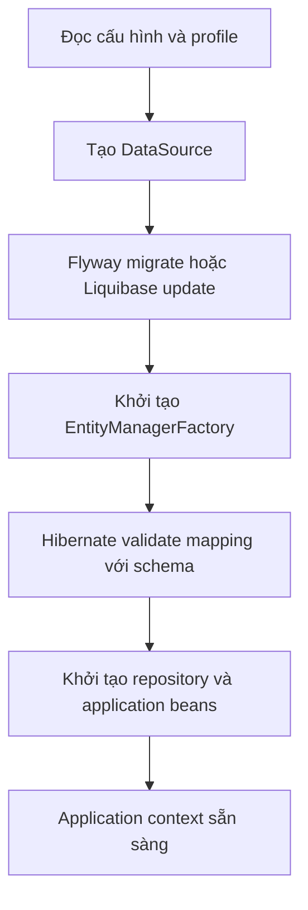

# Phối hợp migration, kiểm tra mapping và khởi động ứng dụng

## Mục tiêu

Trong ứng dụng Spring Data JPA, entity mapping mô tả cách Java object tương ứng với bảng và cột; migration quản lý cấu trúc database thực tế; Spring Boot điều phối kết nối database, chạy migration, khởi tạo JPA và tạo repository bean.

Ba phần này phải thống nhất. Nếu Hibernate khởi tạo `EntityManagerFactory` trước khi migration tạo bảng, ứng dụng có thể lỗi ngay khi startup. Nếu migration tạo cột khác tên hoặc kiểu so với entity, Hibernate có thể báo schema validation failure. Nếu Hibernate tự thay đổi schema trong khi Flyway hoặc Liquibase cũng quản lý DDL, database có thể trôi khỏi lịch sử migration đã được kiểm soát.

Bài này hướng dẫn cách phối hợp migration, mapping và startup theo một trình tự có thể lặp lại giữa máy phát triển, CI, staging và production.

Sau bài này, bạn có thể:

- Phân biệt trách nhiệm của migration tool, Hibernate và Spring Data JPA.
- Chọn một cơ chế duy nhất để quản lý schema.
- Cấu hình Flyway hoặc Liquibase chạy trước JPA.
- Dùng `spring.jpa.hibernate.ddl-auto=validate` để phát hiện sai lệch mapping.
- Đối chiếu entity, table, column, type, constraint và association.
- Hiểu thứ tự khởi động DataSource, migration, EntityManagerFactory và repository.
- Kiểm thử migration từ database rỗng và database phiên bản cũ.
- Chẩn đoán lỗi migration, schema validation và application context startup.
- Triển khai migration an toàn khi nhiều phiên bản ứng dụng cùng hoạt động.

Ví dụ tập trung vào Spring Boot 3.5, Spring Data JPA 3.x, Hibernate 6 và PostgreSQL. DDL, kiểu dữ liệu và transaction behavior cần được điều chỉnh theo DBMS thực tế.

## 1. Ba trách nhiệm phải phối hợp

### 1.1. Migration tool quản lý schema thật

Flyway hoặc Liquibase chịu trách nhiệm thay đổi cấu trúc database:

- Tạo và sửa bảng, cột, sequence, index, foreign key và constraint.
- Chuyển đổi hoặc backfill dữ liệu khi schema thay đổi.
- Ghi nhận migration nào đã chạy ở database.
- Phát hiện migration bị sửa hoặc lịch sử không khớp.
- Cung cấp thứ tự thay đổi có thể review và triển khai lại.

Migration là lịch sử thay đổi schema có version. Khi một migration đã chạy ở môi trường dùng chung, hãy tạo migration mới cho thay đổi tiếp theo; không sửa nội dung migration cũ đã được áp dụng.

### 1.2. Entity mapping mô tả cách JPA sử dụng schema

Entity và mapping annotations mô tả cách Hibernate đọc/ghi dữ liệu:

- `@Entity`, `@Table`: entity và bảng.
- `@Column`: tên cột, length, precision, scale và thuộc tính mapping.
- `@Id`, `@GeneratedValue`: primary key và chiến lược sinh ID.
- `@ManyToOne`, `@OneToMany`, `@JoinColumn`: quan hệ và foreign key mapping.
- `@Enumerated`, `@Convert`: cách chuyển kiểu Java sang database.
- `@Version`: optimistic locking column.

Entity không tự chứng minh database đã có bảng hoặc cột tương ứng. Annotation mô tả mapping; migration mới tạo hoặc thay đổi schema trong database.

### 1.3. Spring Boot điều phối startup

Spring Boot cấu hình DataSource, phát hiện migration tool, chạy migration và khởi tạo JPA. Khi Flyway hoặc Liquibase được auto-configure, Spring Boot thiết lập dependency để Hibernate chờ database initialization hoàn tất trước khi tạo EntityManagerFactory.

Repository của Spring Data JPA được tạo trong application context dựa trên entity mapping và JPA infrastructure đã khởi tạo.

## 2. Chọn một cơ chế quản lý schema

| Cơ chế | Vai trò | Khi phù hợp |
|---|---|---|
| Flyway | Migration có version bằng SQL hoặc Java | Muốn lịch sử migration tuyến tính, rõ thứ tự |
| Liquibase | Changelog và changeset bằng XML, YAML, JSON hoặc SQL | Cần changeset, context, label và rollback metadata |
| Hibernate DDL | Tạo, cập nhật hoặc validate schema từ mapping | Prototype, demo hoặc test được kiểm soát |
| schema.sql/data.sql | Script khởi tạo cơ bản của Spring Boot | Database nhỏ hoặc test đơn giản |

Với ứng dụng có database được triển khai lâu dài, hãy chọn Flyway hoặc Liquibase làm chủ sở hữu DDL. Hibernate nên dùng để kiểm tra mapping bằng `validate`; không để Hibernate tự cập nhật schema trong khi migration tool cũng đang quản lý schema.

### 2.1. Các giá trị ddl-auto

`spring.jpa.hibernate.ddl-auto` điều khiển schema tooling của Hibernate:

| Giá trị | Hành vi | Cách dùng |
|---|---|---|
| `none` | Không tạo, sửa hoặc validate schema | Khi pipeline chịu trách nhiệm kiểm tra riêng |
| `validate` | So sánh một phần schema với mapping, không thay đổi schema | Phù hợp khi Flyway/Liquibase quản lý DDL |
| `update` | Hibernate cố gắng thay đổi schema theo mapping | Chỉ cân nhắc cho môi trường phát triển được kiểm soát |
| `create` | Tạo lại schema từ mapping, có thể phá hủy schema cũ | Demo hoặc database test có thể xóa |
| `create-drop` | Tạo schema khi khởi tạo và drop khi SessionFactory đóng | Test/demo với database tạm |

`validate` không phải migration tool và cũng không phải bộ so sánh schema đầy đủ. Nó giúp phát hiện nhiều sai lệch table/column/type mà Hibernate kiểm tra được, nhưng không thay thế việc kiểm tra index, trigger, view, stored procedure, default expression, quyền và mọi constraint riêng của database.

`update` không tạo lịch sử migration có thể review và không bảo đảm mọi thay đổi mapping đều được chuyển thành DDL an toàn. Không dùng nó làm cơ chế triển khai schema production.

Spring Boot có default khác nhau theo môi trường: embedded database có thể mặc định `create-drop` nếu không phát hiện schema manager; database khác thường mặc định `none`. Hãy đặt giá trị rõ ràng thay vì phụ thuộc default. Tham khảo <https://docs.spring.io/spring-boot/3.5/how-to/data-initialization.html>.

## 3. Cấu hình Flyway trong Spring Boot

### 3.1. Dependency Maven

Ví dụ cho Spring Boot 3.5 và PostgreSQL:

```xml
<dependencies>
    <dependency>
        <groupId>org.springframework.boot</groupId>
        <artifactId>spring-boot-starter-data-jpa</artifactId>
    </dependency>

    <dependency>
        <groupId>org.flywaydb</groupId>
        <artifactId>flyway-core</artifactId>
    </dependency>

    <dependency>
        <groupId>org.flywaydb</groupId>
        <artifactId>flyway-database-postgresql</artifactId>
        <scope>runtime</scope>
    </dependency>

    <dependency>
        <groupId>org.postgresql</groupId>
        <artifactId>postgresql</artifactId>
        <scope>runtime</scope>
    </dependency>
</dependencies>
```

Để Spring Boot dependency management quản lý version nếu có thể. Không tự pin version Hibernate, Spring Data JPA hoặc Flyway không tương thích với Spring Boot BOM.

Với Flyway hiện đại, một số database cần module riêng như `flyway-database-postgresql` hoặc `flyway-mysql`. Hãy thêm module khớp DBMS và Flyway version của dự án. Tham khảo <https://docs.spring.io/spring-boot/3.5/how-to/data-initialization.html>.

### 3.2. Thư mục và tên migration

Flyway mặc định tìm versioned migration trong:

```text
src/
  main/
    resources/
      db/
        migration/
          V1__create_customer_schema.sql
          V2__add_customer_status.sql
          V3__create_customer_email_index.sql
```

Quy tắc tên phổ biến:

```text
V<VERSION>__<DESCRIPTION>.sql
```

Version phải duy nhất và được áp dụng theo thứ tự. Flyway lưu lịch sử và checksum trong bảng `flyway_schema_history`. Migration versioned đã áp dụng ở môi trường lâu dài nên được giữ nguyên; nếu cần sửa schema, tạo version mới. Tham khảo <https://documentation.red-gate.com/fd/versioned-migrations-273973333.html>.

### 3.3. Cấu hình application.yml

```yaml
spring:
  datasource:
    url: ${DB_URL}
    username: ${DB_APP_USER}
    password: ${DB_APP_PASSWORD}

  flyway:
    enabled: true
    locations: classpath:db/migration
    validate-on-migrate: true
    default-schema: app
    schemas: app
    user: ${DB_MIGRATION_USER}
    password: ${DB_MIGRATION_PASSWORD}

  jpa:
    hibernate:
      ddl-auto: validate
    properties:
      hibernate:
        default_schema: app
    open-in-view: false
```

Trong cấu hình này:

- `spring.datasource.*` là kết nối mà ứng dụng dùng khi truy cập database.
- `spring.flyway.*` cấu hình nơi migration và thông tin kết nối migration.
- `spring.jpa.hibernate.ddl-auto=validate` yêu cầu Hibernate kiểm tra mapping khi tạo JPA infrastructure.
- `hibernate.default_schema` xác định schema mặc định Hibernate dùng khi mapping không chỉ rõ schema.
- `spring.flyway.default-schema` và `spring.flyway.schemas` điều khiển schema Flyway quản lý.

Nếu dùng cùng database user cho Flyway và ứng dụng, có thể bỏ `spring.flyway.user/password`; Flyway sẽ dùng DataSource chính. Trong production, nên cân nhắc user migration có quyền DDL và user runtime chỉ có quyền cần thiết cho thao tác ứng dụng.

Không commit mật khẩu thật vào repository. Cấp URL, username và password qua environment variables, secret manager hoặc cấu hình triển khai.

### 3.4. Migration SQL ví dụ

File `V1__create_customer_schema.sql` dưới đây dùng PostgreSQL:

```sql
CREATE SCHEMA IF NOT EXISTS app;

CREATE TABLE app.department (
    id BIGINT GENERATED BY DEFAULT AS IDENTITY PRIMARY KEY,
    name VARCHAR(120) NOT NULL
);

CREATE TABLE app.customer (
    id BIGINT GENERATED BY DEFAULT AS IDENTITY PRIMARY KEY,
    name VARCHAR(160) NOT NULL,
    email VARCHAR(320) NOT NULL,
    status VARCHAR(20) NOT NULL,
    created_at TIMESTAMP WITH TIME ZONE NOT NULL,
    department_id BIGINT,
    CONSTRAINT uk_customer_email UNIQUE (email),
    CONSTRAINT fk_customer_department
        FOREIGN KEY (department_id)
        REFERENCES app.department(id)
);

CREATE INDEX idx_customer_status_created_at
    ON app.customer(status, created_at);
```

DDL này tạo schema, bảng, khóa chính, unique constraint, foreign key và index. Cú pháp identity và timestamp ở đây là PostgreSQL; với MySQL, SQL Server hoặc Oracle, hãy dùng kiểu và DDL phù hợp.

### 3.5. Validate lịch sử migration

Flyway lưu checksum khi áp dụng versioned migration. Lệnh validate so sánh migration hiện có với lịch sử đã lưu và phát hiện migration bị đổi nội dung, đổi tên hoặc mất khỏi bộ migration đang triển khai.

Nếu đã cài Flyway CLI:

```bash
flyway info
flyway validate
```

Có thể chạy validate qua Maven/Gradle nếu dự án đã cấu hình plugin tương ứng. Không sửa trực tiếp bảng `flyway_schema_history` để bỏ qua lỗi checksum. Khi migration đã áp dụng bị chỉnh sửa, hãy xác định môi trường nào đã chạy nó và tạo migration mới để sửa trạng thái database. Tham khảo <https://documentation.red-gate.com/flyway/reference/commands/validate>.

## 4. Nếu dùng Liquibase

Liquibase là lựa chọn thay thế Flyway. Không chạy cả hai tool để cùng quản lý một schema nếu không có kiến trúc và quy trình phân chia ownership rõ ràng.

### 4.1. Dependency và cấu hình

```xml
<dependency>
    <groupId>org.liquibase</groupId>
    <artifactId>liquibase-core</artifactId>
</dependency>
```

```yaml
spring:
  liquibase:
    enabled: true
    change-log: classpath:/db/changelog/db.changelog-master.yaml

  jpa:
    hibernate:
      ddl-auto: validate
```

Spring Boot mặc định tìm master changelog ở `db/changelog/db.changelog-master.yaml`; có thể thay bằng `spring.liquibase.change-log`. Khi Liquibase được auto-configure, migration chạy trong startup trước JPA initialization theo dependency ordering của Spring Boot. Tham khảo <https://docs.spring.io/spring-boot/3.5/how-to/data-initialization.html>.

### 4.2. Changeset YAML

```yaml
databaseChangeLog:
  - changeSet:
      id: 001-create-department
      author: team
      changes:
        - createTable:
            tableName: department
            columns:
              - column:
                  name: id
                  type: BIGINT
                  autoIncrement: true
                  constraints:
                    primaryKey: true
                    nullable: false
              - column:
                  name: name
                  type: VARCHAR(120)
                  constraints:
                    nullable: false
```

Mỗi changeset có định danh từ `id`, `author` và path changelog. Liquibase ghi nhận changeset đã chạy trong `DATABASECHANGELOG` và dùng checksum để phát hiện nội dung thay đổi ngoài dự kiến.

Tạo changeset mới cho thay đổi tiếp theo. Với DDL cần rollback, định nghĩa rollback phù hợp hoặc chuẩn bị migration forward-fix. Rollback không phải lúc nào cũng an toàn khi migration đã chuyển đổi hoặc xóa dữ liệu. Tham khảo <https://docs.liquibase.com/community/user-guide-5-0/what-is-a-changeset>.

## 5. Thứ tự khởi động đúng

Với Flyway hoặc Liquibase được Spring Boot auto-configure, luồng khởi động thường là:



Spring Boot phát hiện các bean khởi tạo database như Flyway, FlywayMigrationInitializer và SpringLiquibase. EntityManagerFactory được cấu hình phụ thuộc vào bước database initialization để Hibernate không chạy trước migration. Tham khảo <https://docs.spring.io/spring-boot/3.5/how-to/data-initialization.html>.

### 5.1. Vì sao migration phải chạy trước Hibernate?

Giả sử migration V2 thêm cột `status` vào bảng customer. Entity mới cũng có field `status`.

Nếu Hibernate validate schema trước V2, nó có thể báo thiếu cột. Nếu Hibernate tự update schema để thêm cột trước V2, migration V2 có thể gặp schema không như dự kiến.

Khi migration chạy trước:

1. Database được đưa lên version schema mới nhất.
2. Hibernate đọc metadata và kiểm tra mapping với schema đã cập nhật.
3. Repository được khởi tạo dựa trên EntityManagerFactory hợp lệ.
4. Application context hoàn tất startup.

Nếu migration hoặc schema validation thất bại, ứng dụng nên fail startup để lỗi được phát hiện trong deployment thay vì tiếp tục chạy với schema không tương thích.

### 5.2. Không chạy migration thủ công trong CommandLineRunner

Không đặt migration trong `CommandLineRunner` hoặc `ApplicationRunner` rồi mong nó chạy trước Hibernate:

```java
@Bean
CommandLineRunner migrateDatabase(Flyway flyway) {
    return args -> flyway.migrate();
}
```

Các runner được gọi sau khi application context đã khởi tạo các bean cần thiết. EntityManagerFactory có thể đã được tạo và schema validation đã chạy. Dùng auto-configuration hoặc initializer được tích hợp đúng với Spring Boot dependency ordering.

Nếu tự viết database initializer hoặc DataSource riêng, phải khai báo dependency để các bean cần schema chờ initializer hoàn tất. Spring Boot có cơ chế `@DependsOnDatabaseInitialization` và detector cho bean custom khi cần; chỉ dùng khi auto-detection không đủ. Tham khảo tài liệu Spring Boot database initialization ở trên.

## 6. Kiểm tra entity mapping khớp migration

Hibernate `validate` kiểm tra một phần tương thích giữa mapping và schema. Ngoài validation tự động, cần review các điểm sau.

### 6.1. Entity, table và schema name

```java
@Entity
@Table(name = "customer", schema = "app")
public class Customer {
    // ...
}
```

Đối chiếu:

- Entity class có được scan không?
- `@Table` có đúng table và schema không?
- Database dùng chữ hoa/thường hoặc quoted identifier như thế nào?
- Hibernate default schema và Flyway default schema có trỏ cùng nơi không?
- Search path của database connection có thể khiến query truy cập nhầm schema không?

Nếu entity nằm ngoài package của class `@SpringBootApplication`, có thể cần `@EntityScan`. Nếu repository nằm ngoài package mặc định, có thể cần `@EnableJpaRepositories`. Đặt application class ở package gốc thường giúp component, entity và repository scanning đơn giản hơn.

### 6.2. Column name, length và nullability

```java
@Column(name = "name", nullable = false, length = 160)
private String name;

@Column(name = "email", nullable = false, length = 320)
private String email;
```

Migration phải tạo cột tương ứng với tên và kiểu database phù hợp. Kiểm tra:

- Tên cột chính xác, bao gồm naming strategy.
- Kiểu SQL và kiểu Java có tương thích.
- Length/precision/scale có đáp ứng dữ liệu thực tế.
- NOT NULL, unique và check constraint có được tạo trong migration.
- Default value trong database có phù hợp với cách ứng dụng INSERT không.

`nullable = false` mô tả mapping và có thể ảnh hưởng DDL được sinh; nó không tự thay thế migration tạo constraint NOT NULL trong schema đã tồn tại.

### 6.3. ID và chiến lược sinh khóa

```java
@Id
@GeneratedValue(strategy = GenerationType.IDENTITY)
private Long id;
```

Nếu dùng IDENTITY, migration phải tạo cột tương ứng với identity/auto-increment theo DBMS.

Nếu dùng SEQUENCE, cần đối chiếu:

- Sequence có tồn tại không?
- Schema và tên sequence có đúng không?
- Allocation size giữa Hibernate và sequence có tương thích không?
- Quyền sử dụng sequence đã được cấp cho user runtime chưa?

Không thay đổi `GenerationType` chỉ ở entity mà quên migration. ID generation mismatch có thể chỉ lộ ra khi INSERT đầu tiên chạy.

### 6.4. Enum và converter

```java
@Enumerated(EnumType.STRING)
@Column(name = "status", nullable = false, length = 20)
private CustomerStatus status;
```

Với `EnumType.STRING`, database lưu tên enum như `ACTIVE` hoặc `SUSPENDED`. DDL nên dùng kiểu chuỗi đủ độ dài và constraint phù hợp nếu cần giới hạn giá trị.

Tránh dùng `EnumType.ORDINAL` nếu giá trị enum có thể được sắp xếp lại; ordinal lưu số vị trí và có thể làm dữ liệu cũ mang nghĩa khác khi thứ tự enum thay đổi.

Với `AttributeConverter`, kiểm tra kiểu database mà converter thực sự ghi/đọc. Nếu converter lưu UUID, JSON hoặc mã trạng thái tùy biến, migration phải dùng kiểu SQL tương ứng và test round-trip.

### 6.5. Precision, scale và thời gian

```java
@Column(name = "amount", precision = 19, scale = 2, nullable = false)
private BigDecimal amount;
```

Migration nên khai báo DECIMAL/NUMERIC với precision và scale phù hợp. Tránh dùng floating-point cho số tiền cần chính xác thập phân.

Với thời gian, xác định rõ ý nghĩa:

- `LocalDate`: ngày không có thời điểm/timezone.
- `LocalDateTime`: ngày giờ không gắn timezone.
- `Instant`: một thời điểm trên timeline UTC.
- `OffsetDateTime`: ngày giờ có offset.

Database có thể lưu timestamp có hoặc không có timezone tùy DBMS. Kiểm tra JDBC driver, Hibernate dialect và cách ứng dụng chuẩn hóa timezone; không chỉ nhìn tên Java type.

### 6.6. Association và foreign key

```java
@ManyToOne(fetch = FetchType.LAZY)
@JoinColumn(name = "department_id")
private Department department;
```

Migration cần có cột `department_id` và foreign key tham chiếu đúng primary key của department.

Với quan hệ hai chiều, `mappedBy` nằm ở inverse side; cột foreign key thường thuộc owning side. Tên join column và nullability phải khớp với migration.

Đừng cho rằng khai báo `@ManyToOne` tự tạo foreign key trong database production. Migration phải tạo constraint thực tế.

### 6.7. Index và constraint

Entity mapping có thể chứa `@Index` hoặc `unique = true`, nhưng khi migration tool quản lý DDL, hãy review migration để bảo đảm index và constraint đã được tạo đúng.

Kiểm tra:

- Unique constraint có tên và phạm vi đúng không?
- Foreign key có ON DELETE/ON UPDATE behavior đúng không?
- Index có thứ tự cột phù hợp query không?
- Check constraint có phản ánh invariant nghiệp vụ không?
- Có cần partial/functional index đặc thù database không?

Hibernate `validate` không thay thế việc kiểm tra đầy đủ index, trigger và mọi database object.

## 7. Ví dụ mapping khớp với migration

Enum:

```java
public enum CustomerStatus {
    ACTIVE,
    SUSPENDED
}
```

Department entity:

```java
@Entity
@Table(name = "department", schema = "app")
public class Department {

    @Id
    @GeneratedValue(strategy = GenerationType.IDENTITY)
    private Long id;

    @Column(name = "name", nullable = false, length = 120)
    private String name;

    protected Department() {
    }

    public Department(String name) {
        this.name = name;
    }

    public Long getId() {
        return id;
    }

    public String getName() {
        return name;
    }
}
```

Customer entity:

```java
@Entity
@Table(name = "customer", schema = "app")
public class Customer {

    @Id
    @GeneratedValue(strategy = GenerationType.IDENTITY)
    private Long id;

    @Column(name = "name", nullable = false, length = 160)
    private String name;

    @Column(name = "email", nullable = false, length = 320)
    private String email;

    @Enumerated(EnumType.STRING)
    @Column(name = "status", nullable = false, length = 20)
    private CustomerStatus status;

    @Column(name = "created_at", nullable = false)
    private Instant createdAt;

    @ManyToOne(fetch = FetchType.LAZY)
    @JoinColumn(name = "department_id")
    private Department department;

    protected Customer() {
    }

    public Customer(
            String name,
            String email,
            CustomerStatus status,
            Instant createdAt,
            Department department
    ) {
        this.name = name;
        this.email = email;
        this.status = status;
        this.createdAt = createdAt;
        this.department = department;
    }

    public Long getId() {
        return id;
    }

    public String getName() {
        return name;
    }

    public String getEmail() {
        return email;
    }

    public CustomerStatus getStatus() {
        return status;
    }

    public Instant getCreatedAt() {
        return createdAt;
    }

    public Department getDepartment() {
        return department;
    }
}
```

Repository:

```java
public interface CustomerRepository
        extends JpaRepository<Customer, Long> {
}
```

Migration V1 đã tạo schema `app`, bảng `department` và `customer`, IDENTITY primary key, các cột name/email/status/created_at/department_id, unique constraint trên email, foreign key và index trên status/created_at.

Entity và migration cần khớp tên, schema, kiểu dữ liệu và quan hệ. Nếu thay đổi mapping sau này, tạo migration mới và kiểm tra lại với `ddl-auto=validate`.

## 8. Repository scanning và application configuration

Spring Boot mặc định scan package từ package chứa class `@SpringBootApplication` và các package con. Cấu trúc phổ biến:

```text
com.example.app
  Application.java
  customer
    Customer.java
    CustomerRepository.java
  department
    Department.java
```

```java
package com.example.app;

@SpringBootApplication
public class Application {

    public static void main(String[] args) {
        SpringApplication.run(Application.class, args);
    }
}
```

Nếu entity hoặc repository nằm ngoài vùng scan mặc định, có thể khai báo rõ:

```java
@SpringBootApplication
@EntityScan(basePackageClasses = Customer.class)
@EnableJpaRepositories(basePackageClasses = CustomerRepository.class)
public class Application {
    // ...
}
```

Không thêm các annotation này nếu package layout đã được scan đúng. Khi repository không được tạo hoặc entity không được nhận diện, kiểm tra package boundary trước khi thay đổi cấu hình database.

## 9. Không trộn migration với schema.sql và Hibernate update

Một cấu hình dễ gây lỗi là cùng lúc:

- Flyway tạo bảng.
- Hibernate `ddl-auto=update` tự thêm cột.
- `schema.sql` cũng tạo hoặc sửa bảng.
- `data.sql` chèn dữ liệu phụ thuộc thứ tự khởi tạo.

Các initializer có thể chạy ở thứ tự khác nhau và tạo schema khác nhau giữa test và production.

Khi Flyway hoặc Liquibase là schema owner:

```yaml
spring:
  flyway:
    enabled: true

  sql:
    init:
      mode: never

  jpa:
    hibernate:
      ddl-auto: validate
```

Không bắt buộc khai báo `spring.sql.init.mode=never` nếu dự án không có script initializer; cấu hình này hữu ích khi muốn thể hiện rõ rằng schema.sql/data.sql không được sử dụng.

Nếu dùng script SQL cơ bản thay migration tool, hãy thiết kế thứ tự rõ ràng. Spring Boot có thuộc tính `spring.jpa.defer-datasource-initialization` để thay đổi thứ tự khi thật sự cần. Tuy nhiên, tài liệu Spring Boot khuyến nghị dùng một cơ chế schema initialization duy nhất. Tham khảo <https://docs.spring.io/spring-boot/3.5/how-to/data-initialization.html>.

## 10. Migration cho database đã tồn tại

Không phải database nào cũng bắt đầu từ schema rỗng. Khi đưa Flyway hoặc Liquibase vào hệ thống cũ, cần xác định database hiện có đang ở trạng thái nào.

Quy trình tổng quát:

1. Backup và kiểm tra schema hiện tại.
2. So sánh bảng/cột/constraint/index thực tế với mapping và DDL dự kiến.
3. Xác định migration version tương ứng với schema đã tồn tại.
4. Dùng baseline hoặc changelog sync theo quy trình có kiểm soát nếu tool hỗ trợ và database đã được review.
5. Chạy migration tiếp theo trên bản sao database.
6. Bật Hibernate validate và chạy integration test.
7. Chỉ triển khai khi lịch sử migration khớp với schema thật.

Với Flyway, `baseline-on-migrate` có thể đánh dấu schema hiện có ở một version baseline. Không bật nó tùy tiện trên mọi môi trường: nếu baseline sai version, Flyway có thể bỏ qua migration cần thiết và lịch sử không phản ánh schema thật.

Với Liquibase, `changelog-sync` có thể ghi nhận changeset đã được áp dụng mà không thực thi chúng. Chỉ dùng khi đã đối chiếu schema và changelog với database thực tế.

Không xóa bảng lịch sử migration hoặc chỉnh checksum để làm startup qua lỗi. Trước tiên xác định schema thật, migration nào đã chạy và môi trường nào đang có trạng thái khác biệt.

## 11. Thay đổi schema an toàn khi ứng dụng đang chạy

Trong hệ thống có nhiều instance hoặc rolling deployment, có thể có hai phiên bản ứng dụng cùng chạy trong lúc migration được áp dụng. Migration cần tương thích trong giai đoạn chuyển tiếp.

Mẫu expand-and-contract:

### Giai đoạn 1: Expand

Thêm cột mới theo cách tương thích ngược:

```sql
ALTER TABLE app.customer
    ADD COLUMN display_name VARCHAR(180);
```

Cột mới cho phép null để phiên bản ứng dụng cũ vẫn INSERT được.

### Giai đoạn 2: Deploy ứng dụng tương thích cả hai dạng

Phiên bản ứng dụng mới có thể đọc display_name nếu có, hoặc fallback từ name. Trong giai đoạn này, nếu cần, ứng dụng có thể ghi đồng thời vào cột cũ và cột mới.

### Giai đoạn 3: Backfill

Chuyển dữ liệu cũ sang cột mới bằng migration hoặc batch job có kiểm soát:

```sql
UPDATE app.customer
SET display_name = name
WHERE display_name IS NULL;
```

Với bảng lớn, backfill có thể cần chạy theo batch để giảm lock, transaction dài và tải database. Không giả định một UPDATE toàn bảng luôn an toàn.

### Giai đoạn 4: Enforce constraint

Sau khi xác nhận dữ liệu đã đầy đủ:

```sql
ALTER TABLE app.customer
    ALTER COLUMN display_name SET NOT NULL;
```

### Giai đoạn 5: Contract

Chỉ xóa cột cũ sau khi mọi instance và consumer đã ngừng sử dụng nó, và phiên bản ứng dụng mới không còn phụ thuộc vào cột đó.

Không triển khai migration drop/rename ngay trước khi phiên bản cũ ngừng chạy nếu hai phiên bản có thể cùng truy cập database. Lập kế hoạch tương thích schema theo toàn bộ vòng đời rollout, không chỉ theo thứ tự một lần startup.

## 12. Kiểm thử migration và mapping

Một bộ kiểm thử tốt phải kiểm tra cả migration lẫn JPA mapping. Chỉ kiểm tra repository query trên H2 có thể bỏ sót lỗi dialect hoặc DDL production.

### 12.1. Chạy migration từ database rỗng

CI nên tạo database mới, chạy toàn bộ migration từ version đầu tiên và khởi tạo application context với `spring.jpa.hibernate.ddl-auto=validate`.

Nếu migration thiếu bảng/cột hoặc mapping không khớp, application context sẽ không khởi động.

### 12.2. Kiểm thử bằng Testcontainers

Ví dụ integration test PostgreSQL:

```java
@Testcontainers
@SpringBootTest
class DatabaseStartupIntegrationTest {

    @Container
    static final PostgreSQLContainer<?> postgres =
            new PostgreSQLContainer<>("postgres:16-alpine");

    @DynamicPropertySource
    static void configureDatabase(DynamicPropertyRegistry registry) {
        registry.add("spring.datasource.url", postgres::getJdbcUrl);
        registry.add("spring.datasource.username", postgres::getUsername);
        registry.add("spring.datasource.password", postgres::getPassword);
    }

    @Autowired
    private CustomerRepository customerRepository;

    @Test
    void migrationsAndJpaMappingAllowRepositoryAccess() {
        assertThat(customerRepository.count()).isZero();
    }
}
```

Ví dụ cần dependency Testcontainers PostgreSQL, JUnit integration và Spring Boot test support. Trong test profile, nếu Flyway không khai báo user/password riêng, nó dùng DataSource do dynamic properties cung cấp.

Khi Spring tạo application context, Flyway chạy migration trên PostgreSQL container và Hibernate validate mapping. Test chỉ chạy đến method khi context đã khởi tạo thành công; lời gọi repository xác nhận database access hoạt động.

### 12.3. Kiểm thử upgrade từ version cũ

Migration từ database rỗng chỉ kiểm tra đường đi mới. Cần thêm upgrade test:

1. Tạo database ở schema version N.
2. Chèn dữ liệu đại diện cho version N.
3. Chạy migration N+1 đến version mới nhất.
4. Kiểm tra dữ liệu cũ được giữ hoặc chuyển đổi đúng.
5. Khởi tạo ứng dụng với Hibernate validate.
6. Kiểm tra repository đọc và ghi theo mapping mới.

Điều này phát hiện lỗi backfill, đổi kiểu, mất dữ liệu, constraint mới không tương thích và migration chỉ chạy đúng trên database rỗng.

### 12.4. Kiểm thử mapping và repository

Ngoài context startup, nên có test cho:

- INSERT entity mới và generated ID.
- UPDATE và đọc lại sau flush/clear.
- Unique, foreign key, NOT NULL và check constraint.
- Enum, converter, UUID và date/time.
- Association owning side và join column.
- Query method, Specification và pagination.
- Transaction rollback khi vi phạm constraint.
- Native query hoặc database function nếu ứng dụng sử dụng.

### 12.5. Test-only migration và test data

Flyway hỗ trợ migration chỉ dành cho test trong `src/test/resources/db/migration`. Các file test-only có thể chạy sau production migrations khi test application khởi động.

Liquibase có thể dùng contexts để áp dụng changeset test data chỉ trong test profile. Không đưa dữ liệu test hoặc tài khoản mẫu vào migration production nếu chúng không thuộc dữ liệu nghiệp vụ thực tế. Tham khảo <https://docs.spring.io/spring-boot/3.5/how-to/data-initialization.html>.

## 13. Chẩn đoán lỗi startup

Khi application không khởi động, exception ngoài cùng thường chỉ là wrapper. Hãy đọc log đến nguyên nhân sâu nhất, thường bắt đầu bằng `Caused by`.

| Triệu chứng | Nguyên nhân thường gặp | Cách kiểm tra |
|---|---|---|
| Connection refused/timeout | Database chưa chạy, URL/port sai, network hoặc firewall | Kiểm tra JDBC URL, DNS, port và trạng thái DB |
| Authentication failed | Sai credential hoặc secret chưa được inject | Kiểm tra environment/profile và user database |
| Flyway không nhận database | Thiếu database-specific Flyway module hoặc driver | Kiểm tra dependency và DBMS version |
| No migrations found | Sai locations, file name hoặc resource path | Kiểm tra classpath:db/migration và tên file |
| Validate checksum failed | Migration đã áp dụng bị sửa hoặc lịch sử khác | So sánh checksum, file và schema history |
| Migration failed | DDL sai dialect, quyền thiếu, object đã tồn tại hoặc lock | Xem SQL statement đầu tiên gây lỗi và DB error code |
| Missing table | Migration chưa tạo bảng hoặc sai schema | Kiểm tra Flyway history, default schema và @Table |
| Missing column | Entity field chưa có migration hoặc tên column sai | Đối chiếu @Column với DDL |
| Wrong column type | SQL type không tương thích mapping/dialect | Kiểm tra JDBC metadata, precision, scale và converter |
| Duplicate key khi migrate | Dữ liệu cũ xung đột unique constraint mới | Kiểm tra dữ liệu trước khi tạo constraint |
| Repository bean không được tạo | Repository ngoài scan hoặc query method không hợp lệ | Kiểm tra package, method signature và startup cause |
| Entity không được nhận diện | Entity ngoài vùng scan | Kiểm tra package hoặc @EntityScan |
| Local chạy, production fail | Khác database, schema, collation, permission hoặc profile | Chạy migration và validate trên DBMS tương ứng |

### 13.1. Trình tự điều tra

Khi startup fail, kiểm tra theo thứ tự:

1. Database có thể kết nối bằng đúng URL/user của ứng dụng không?
2. Migration tool có được load và nhận đúng DBMS không?
3. Migration location có chứa file versioned cần thiết không?
4. Migration history cho biết version nào đã áp dụng?
5. Migration lỗi ở statement nào và database trả vendor code gì?
6. Schema thực tế có table, column, sequence và constraint cần thiết không?
7. Hibernate validate báo property nào không khớp?
8. Entity/repository có nằm trong package scan không?
9. Repository query hoặc bean startup nào gây lỗi tiếp theo?

Sửa nguyên nhân gốc rồi chạy lại từ trạng thái database có thể tái tạo. Không chỉ tăng timeout hoặc tắt validate để che lỗi schema.

## 14. Logging và kiểm tra trạng thái

Trong môi trường phát triển/test, có thể bật log migration và SQL:

```yaml
logging:
  level:
    org.flywaydb: INFO
    org.hibernate.SQL: DEBUG
    org.hibernate.orm.jdbc.bind: TRACE
```

Log bind parameter có thể chứa email, token, dữ liệu cá nhân hoặc thông tin nhạy cảm. Không bật TRACE rộng rãi trong production nếu chưa có masking và kiểm soát quyền truy cập log.

Các điểm nên quan sát:

- Database URL/DBMS version, nhưng không log password.
- Migration version hiện tại và migration pending.
- Thời gian chạy từng migration.
- Số migration thành công/thất bại.
- Schema validation result.
- Thời gian tạo EntityManagerFactory.
- Lỗi connection pool và database permission.
- Startup readiness của application instance.

Nếu có health indicator cho database và migration tool, phân biệt trạng thái database connection với trạng thái migration. Kết nối được database không có nghĩa schema đã ở đúng version.

## 15. Production, nhiều DataSource và quyền database

### 15.1. Tách quyền migration và runtime

Một thiết kế phổ biến:

- Migration user: được CREATE/ALTER/DROP theo schema và migration cần thiết.
- Application user: chỉ có SELECT/INSERT/UPDATE/DELETE và quyền sequence/function cần thiết.
- Read-only user: chỉ có quyền đọc nếu hệ thống có datasource đọc riêng.

Flyway mặc định dùng primary DataSource; có thể cấu hình user/password riêng hoặc DataSource riêng qua `@FlywayDataSource`. Liquibase có cơ chế tương ứng qua `@LiquibaseDataSource`. Với nhiều DataSource (multiple DataSource), phải xác định rõ migration nào áp dụng cho database/schema nào. Tham khảo <https://docs.spring.io/spring-boot/3.5/how-to/data-initialization.html>.

### 15.2. Nhiều instance khởi động cùng lúc

Nếu mọi replica đều chạy migration khi startup, migration tool cần phối hợp để tránh hai instance cùng thực thi một migration. Flyway và Liquibase có cơ chế quản lý lịch sử/lock riêng, nhưng vẫn cần kiểm thử trên database và cách triển khai thật.

Với hệ thống có nhiều replica hoặc migration dài, có thể chạy migration như một bước riêng trong deployment pipeline/job, sau đó mới rollout application instances. Pipeline phải xác nhận migration thành công trước khi cho phiên bản ứng dụng mới nhận traffic.

### 15.3. Database DDL không phải lúc nào cũng rollback giống nhau

Khả năng transaction của DDL khác nhau theo DBMS và statement. Có database hỗ trợ transactional DDL cho nhiều thao tác; có thao tác tự commit hoặc không thể rollback theo cách mong đợi.

Đối với migration có nhiều statement:

- Kiểm tra transaction behavior của DBMS.
- Chia migration theo đơn vị thay đổi dễ kiểm soát.
- Chuẩn bị cách khôi phục nếu migration dừng giữa chừng.
- Backup dữ liệu quan trọng trước thay đổi phá hủy.
- Kiểm thử migration lỗi giữa chừng trên bản sao database.
- Không cho rằng rollback script luôn có thể phục hồi dữ liệu đã xóa.

### 15.4. Nhiều DataSource cần migration riêng

Nếu ứng dụng kết nối nhiều database, không giả định một Flyway bean mặc định sẽ quản lý tất cả. Xác định DataSource nào là primary, migration tool nào gắn với từng DataSource và schema nào được quản lý.

Với mỗi database:

1. Tạo migration bean gắn đúng DataSource.
2. Chỉ định đúng location/schema và credential.
3. Đảm bảo EntityManagerFactory tương ứng phụ thuộc vào initializer đó.
4. Không để migration của database A chạy nhầm trên database B.
5. Kiểm thử startup khi một database không khả dụng và xác định ứng dụng có được phép phục vụ một phần hay phải fail toàn bộ.

## 15.5. Điều phối startup và quan sát vận hành

Việc migration chạy trước EntityManagerFactory phải được quan sát và điều phối rõ trong môi trường triển khai. Không chỉ kiểm tra rằng ứng dụng đã mở cổng HTTP; cần xác nhận database đã kết nối, migration hoàn tất, schema validation thành công và application context đã sẵn sàng nhận traffic.

**Theo dõi migration history và lock.** Với Flyway, kiểm tra bảng `flyway_schema_history`, version hiện tại, trạng thái success, checksum và migration pending. Với Liquibase, kiểm tra `DATABASECHANGELOG` để biết changeset nào đã chạy và `DATABASECHANGELOGLOCK` để biết có tiến trình đang giữ lock. Log nên ghi tên migration/changeset, thời gian bắt đầu-kết thúc và lỗi đầu tiên. Nếu migration đang chờ lock, xác định instance/job đang thực thi và thời gian giữ lock; không tự xóa lock row hoặc sửa history table để ép startup tiếp tục.

**Quan sát các pha startup.** Theo dõi lần lượt DataSource connection, migration initializer, EntityManagerFactory creation, Hibernate schema validation, repository/application bean initialization và trạng thái readiness. Nếu migration thất bại, EntityManagerFactory không nên được coi là sẵn sàng. Với nhiều DataSource (multiple DataSource), log và health indicator phải chỉ rõ database/schema nào đang được khởi tạo để tránh nhầm lẫn giữa các nguồn dữ liệu.

**Chẩn đoán theo nguyên nhân cụ thể.** Khi thiếu table hoặc column, đối chiếu entity mapping với schema và migration version đã áp dụng. Khi thiếu constraint hoặc index, kiểm tra DDL của migration và metadata database; Hibernate validate không kiểm tra đầy đủ mọi database object. Khi checksum drift, so sánh file migration với history của đúng môi trường và tạo migration sửa tiếp theo nếu migration cũ đã được áp dụng. Ghi lại SQLState/vendor code, tên migration và statement thất bại; không chỉ lưu exception wrapper ngoài cùng.

**Readiness và health checks.** Readiness chỉ nên thành công sau khi database dependency, migration và JPA initialization cần thiết đã hoàn tất. Liveness nên phản ánh tiến trình có còn hoạt động hay không; tránh làm liveness phụ thuộc trực tiếp vào database để một database outage không tạo vòng lặp restart liên tục. Theo dõi riêng database health, migration state và application readiness. Không gửi traffic tới instance chưa ready.

**Restart và retry an toàn.** Nếu startup thất bại, trước tiên sửa nguyên nhân gốc như credential, quyền DDL, migration lỗi, checksum drift hoặc schema mismatch. Sau đó kiểm tra history và trạng thái schema trước khi restart. Chỉ retry lỗi tạm thời đã xác định; không retry mù lỗi cú pháp, thiếu quyền hoặc migration không tương thích. Nếu tiến trình dừng giữa migration, kiểm tra transaction behavior của DBMS và các statement đã thực thi trước khi chạy lại. Migration phải có tính lặp lại/khả năng phục hồi phù hợp; không tự xóa history hay lock để bỏ qua trạng thái chưa rõ. Với triển khai nhiều replica, ưu tiên một migration job có kết quả rõ ràng rồi mới rollout ứng dụng, hoặc xác nhận cơ chế locking của tool hoạt động đúng trên DBMS mục tiêu.

## 16. Checklist trước khi khởi động và triển khai

**Dependency và configuration**

- [ ] Spring Boot BOM quản lý version Spring Data JPA, Hibernate và migration tool.
- [ ] JDBC driver và module Flyway phù hợp DBMS.
- [ ] DataSource URL, credential và profile đúng.
- [ ] Migration location/changelog path đúng.
- [ ] Chỉ một công cụ quản lý schema.
- [ ] Hibernate dùng `validate` hoặc `none` theo chiến lược đã chọn.

**Migration**

- [ ] Migration có version/changeset ID duy nhất.
- [ ] Migration đã áp dụng không bị sửa tùy tiện.
- [ ] Schema history khớp với schema thực tế.
- [ ] DDL và data backfill đã được review.
- [ ] Index, foreign key, unique và check constraint được tạo.
- [ ] Quyền migration và runtime được tách hợp lý.
- [ ] Có kế hoạch backup/forward-fix cho thay đổi phá hủy.

**Mapping**

- [ ] Entity được scan.
- [ ] Repository được scan.
- [ ] Table/schema/column name khớp DDL.
- [ ] ID strategy khớp identity/sequence.
- [ ] Enum và converter dùng đúng kiểu SQL.
- [ ] Precision, scale, length và timezone đã kiểm tra.
- [ ] Join column và foreign key khớp owning side.
- [ ] Naming strategy nhất quán giữa mapping và migration.

**Startup và test**

- [ ] Migration chạy trước EntityManagerFactory.
- [ ] Hibernate validate thành công.
- [ ] Application context khởi tạo thành công.
- [ ] Repository smoke test chạy được.
- [ ] CI chạy migration từ database rỗng.
- [ ] Có upgrade test từ schema version trước.
- [ ] Testcontainers dùng DBMS tương ứng production khi cần.
- [ ] Log không lộ secret hoặc bind parameter nhạy cảm.

**Deployment**

- [ ] Migration tương thích với các phiên bản ứng dụng đang chạy.
- [ ] Rolling deployment dùng expand-and-contract khi cần.
- [ ] Migration job hoàn tất trước khi rollout phiên bản phụ thuộc schema mới.
- [ ] Có giám sát migration duration, startup failure và schema version.

## 17. Tài liệu tham khảo

- [Spring Boot 3.5 — Database Initialization](https://docs.spring.io/spring-boot/3.5/how-to/data-initialization.html)
- [Spring Boot 3.5 — SQL Databases và JPA](https://docs.spring.io/spring-boot/3.5/reference/data/sql.html)
- [Flyway — Versioned Migrations](https://documentation.red-gate.com/fd/versioned-migrations-273973333.html)
- [Flyway — Validate](https://documentation.red-gate.com/flyway/reference/commands/validate)
- [Liquibase — Changesets](https://docs.liquibase.com/community/user-guide-5-0/what-is-a-changeset)
- [Hibernate ORM — Schema Validation](https://docs.hibernate.org/stable/orm/javadocs/org/hibernate/tool/schema/spi/SchemaValidator.html)

## Kết luận

Migration tool quản lý lịch sử thay đổi schema; entity mapping mô tả cách JPA sử dụng schema; Spring Boot điều phối để database được cập nhật trước khi Hibernate và repository khởi tạo. Với Flyway hoặc Liquibase, hãy để migration là chủ sở hữu DDL và đặt `spring.jpa.hibernate.ddl-auto=validate` để phát hiện sai lệch mapping trong startup.

Kiểm tra table/schema/column, ID generation, enum, kiểu dữ liệu, association, index và constraint. Test migration từ database rỗng lẫn database version cũ bằng đúng DBMS khi có hành vi phụ thuộc dialect. Với production rollout, dùng migration tương thích ngược, tách quyền DDL khỏi runtime và chỉ đưa application instance vào phục vụ khi migration cùng schema validation đã thành công.
