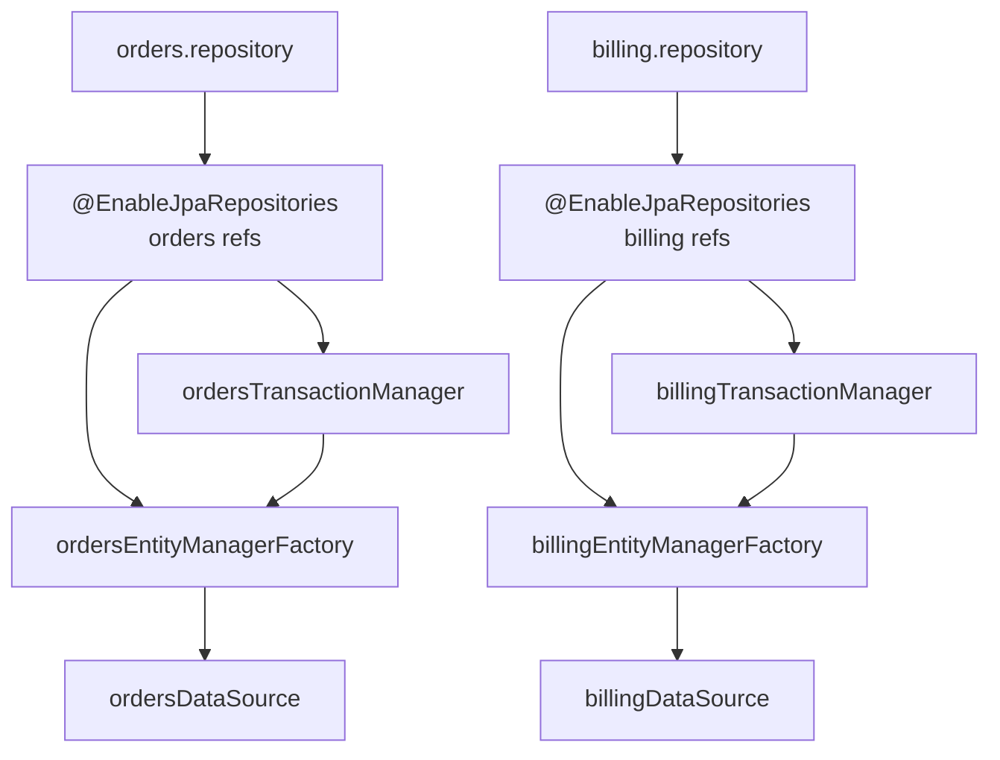

# Phân vùng gói Repository bằng entityManagerFactoryRef và transactionManagerRef

Khi một ứng dụng Spring Data JPA kết nối tới nhiều cơ sở dữ liệu, mỗi nhóm repository cần biết chính xác DataSource, EntityManagerFactory và transaction manager mà nhóm đó sử dụng. Nếu để Spring Data tự chọn theo tên mặc định, các repository có thể cùng trỏ về một persistence unit hoặc Spring không xác định được bean phù hợp khi có nhiều ứng viên.

@EnableJpaRepositories cung cấp hai thuộc tính quan trọng để phân vùng repository:

- entityManagerFactoryRef chỉ định bean EntityManagerFactory dùng để tạo repository proxy cho package được quét.
- transactionManagerRef chỉ định bean PlatformTransactionManager dùng cho các transaction mặc định của repository trong package đó.

Bài này xây dựng ví dụ có hai database orders và billing, mỗi database có package entity, repository, EntityManagerFactory và JpaTransactionManager riêng.

> Các đoạn Java dưới đây là snippet cho dự án Java 17+ dùng Spring Boot 3+ và spring-boot-starter-data-jpa. Chúng minh họa cấu hình cần tích hợp vào ứng dụng, không phải chương trình độc lập có thể chạy trực tiếp bằng javac/java.

## 1. Hiểu đúng ba thành phần cho mỗi database

Với mỗi database dùng JPA, thường cần cấu hình ba thành phần có quan hệ với nhau:

| Thành phần | Nhiệm vụ |
|---|---|
| DataSource | Cung cấp JDBC connection tới database tương ứng. |
| EntityManagerFactory | Tạo EntityManager và quản lý metadata, mapping entity thuộc persistence unit đó. |
| PlatformTransactionManager | Quản lý transaction cho persistence unit. Với JPA cục bộ, thường dùng JpaTransactionManager. |

Mỗi EntityManagerFactory cần gắn với đúng DataSource và đúng package entity. Mỗi nhóm repository cần được gắn với EntityManagerFactory cùng transaction manager tương ứng.

Sơ đồ quan hệ:



Không nên dùng chung một package repository cho hai cấu hình vì cùng một interface có thể bị quét bởi cả hai cấu hình.

## 2. Thiết kế package tách biệt

Một cấu trúc package dễ quản lý:

```text
com.example
├── orders
│   ├── domain
│   │   └── PurchaseOrder.java
│   └── repository
│       └── PurchaseOrderRepository.java
├── billing
│   ├── domain
│   │   └── Invoice.java
│   └── repository
│       └── InvoiceRepository.java
├── config
│   ├── OrdersJpaConfiguration.java
│   └── BillingJpaConfiguration.java
└── service
    └── OrderService.java
```

- com.example.orders.domain chứa entity được quản lý bởi orders persistence unit.
- com.example.orders.repository chứa repository dùng orders database.
- com.example.billing.domain chứa entity được quản lý bởi billing persistence unit.
- com.example.billing.repository chứa repository dùng billing database.

Một entity JPA chỉ nên thuộc một EntityManagerFactory trong thiết kế này. Quan hệ JPA như @ManyToOne hoặc @OneToMany không thể nối trực tiếp entity được quản lý bởi hai persistence unit độc lập. Nếu invoice tham chiếu order ở database khác, lưu orderId như một giá trị và tra cứu qua service hoặc API phù hợp.

## 3. Khai báo DataSource và EntityManagerFactory cho database orders

Ví dụ sử dụng DataSourceProperties để Spring Boot xử lý thuộc tính url và chuyển thành jdbcUrl phù hợp với HikariCP. Pool-specific settings được bind ở prefix riêng.

**OrdersJpaConfiguration.java:**

```java
import javax.sql.DataSource;

import com.zaxxer.hikari.HikariDataSource;

import jakarta.persistence.EntityManagerFactory;

import org.springframework.beans.factory.annotation.Qualifier;
import org.springframework.boot.autoconfigure.jdbc.DataSourceProperties;
import org.springframework.boot.context.properties.ConfigurationProperties;
import org.springframework.boot.orm.jpa.EntityManagerFactoryBuilder;
import org.springframework.context.annotation.Bean;
import org.springframework.context.annotation.Configuration;
import org.springframework.context.annotation.Primary;
import org.springframework.data.jpa.repository.config.EnableJpaRepositories;
import org.springframework.orm.jpa.JpaTransactionManager;
import org.springframework.orm.jpa.LocalContainerEntityManagerFactoryBean;
import org.springframework.transaction.PlatformTransactionManager;

@Configuration(proxyBeanMethods = false)
@EnableJpaRepositories(
    basePackages = "com.example.orders.repository",
    entityManagerFactoryRef = "ordersEntityManagerFactory",
    transactionManagerRef = "ordersTransactionManager"
)
public class OrdersJpaConfiguration {

    @Bean
    @Primary
    @ConfigurationProperties("app.datasource.orders")
    DataSourceProperties ordersDataSourceProperties() {
        return new DataSourceProperties();
    }

    @Bean
    @Primary
    @ConfigurationProperties("app.datasource.orders.hikari")
    HikariDataSource ordersDataSource(
            @Qualifier("ordersDataSourceProperties")
            DataSourceProperties properties) {
        return properties.initializeDataSourceBuilder()
                .type(HikariDataSource.class)
                .build();
    }

    @Bean
    @Primary
    LocalContainerEntityManagerFactoryBean ordersEntityManagerFactory(
            EntityManagerFactoryBuilder builder,
            @Qualifier("ordersDataSource") DataSource dataSource) {
        return builder
                .dataSource(dataSource)
                .packages("com.example.orders.domain")
                .persistenceUnit("orders")
                .build();
    }

    @Bean
    @Primary
    PlatformTransactionManager ordersTransactionManager(
            @Qualifier("ordersEntityManagerFactory")
            EntityManagerFactory entityManagerFactory) {
        return new JpaTransactionManager(entityManagerFactory);
    }
}
```

Các điểm cần chú ý:

1. basePackages giới hạn việc quét repository vào package orders.
2. entityManagerFactoryRef trỏ tới bean tên ordersEntityManagerFactory.
3. transactionManagerRef trỏ tới bean tên ordersTransactionManager.
4. packages("com.example.orders.domain") giới hạn entity được đăng ký trong persistence unit orders.
5. persistenceUnit("orders") đặt tên persistence unit; tên này cũng có thể dùng khi inject EntityManager bằng @PersistenceContext(unitName = "orders").
6. @Primary giúp Spring Boot và các điểm injection không có qualifier chọn một nhóm bean mặc định. Nó không thay thế các tham chiếu tường minh trong @EnableJpaRepositories.

Spring Boot cung cấp EntityManagerFactoryBuilder trong cấu hình JPA auto-configuration. Với cách tự khai báo nhiều DataSource, đánh dấu một DataSource là @Primary để các cấu hình auto-configuration cần một ứng viên duy nhất có thể chọn được bean mặc định. Nếu đã tắt hoặc thay thế JPA auto-configuration, cần tự cung cấp builder hoặc tự cấu hình LocalContainerEntityManagerFactoryBean.

## 4. Khai báo cấu hình cho database billing

Database thứ hai dùng cấu hình tương tự nhưng có bean name, package entity, package repository và persistence unit riêng. Không đánh dấu các bean này là @Primary:

**BillingJpaConfiguration.java:**

```java
import javax.sql.DataSource;

import com.zaxxer.hikari.HikariDataSource;

import jakarta.persistence.EntityManagerFactory;

import org.springframework.beans.factory.annotation.Qualifier;
import org.springframework.boot.autoconfigure.jdbc.DataSourceProperties;
import org.springframework.boot.context.properties.ConfigurationProperties;
import org.springframework.boot.orm.jpa.EntityManagerFactoryBuilder;
import org.springframework.context.annotation.Bean;
import org.springframework.context.annotation.Configuration;
import org.springframework.data.jpa.repository.config.EnableJpaRepositories;
import org.springframework.orm.jpa.JpaTransactionManager;
import org.springframework.orm.jpa.LocalContainerEntityManagerFactoryBean;
import org.springframework.transaction.PlatformTransactionManager;

@Configuration(proxyBeanMethods = false)
@EnableJpaRepositories(
    basePackages = "com.example.billing.repository",
    entityManagerFactoryRef = "billingEntityManagerFactory",
    transactionManagerRef = "billingTransactionManager"
)
public class BillingJpaConfiguration {

    @Bean
    @ConfigurationProperties("app.datasource.billing")
    DataSourceProperties billingDataSourceProperties() {
        return new DataSourceProperties();
    }

    @Bean
    @ConfigurationProperties("app.datasource.billing.hikari")
    HikariDataSource billingDataSource(
            @Qualifier("billingDataSourceProperties")
            DataSourceProperties properties) {
        return properties.initializeDataSourceBuilder()
                .type(HikariDataSource.class)
                .build();
    }

    @Bean
    LocalContainerEntityManagerFactoryBean billingEntityManagerFactory(
            EntityManagerFactoryBuilder builder,
            @Qualifier("billingDataSource") DataSource dataSource) {
        return builder
                .dataSource(dataSource)
                .packages("com.example.billing.domain")
                .persistenceUnit("billing")
                .build();
    }

    @Bean
    PlatformTransactionManager billingTransactionManager(
            @Qualifier("billingEntityManagerFactory")
            EntityManagerFactory entityManagerFactory) {
        return new JpaTransactionManager(entityManagerFactory);
    }
}
```

Hai cấu hình cùng dùng EntityManagerFactoryBuilder nhưng truyền vào DataSource khác nhau. Builder tạo hai LocalContainerEntityManagerFactoryBean độc lập, mỗi bean quản lý package entity của riêng mình. Hai JpaTransactionManager cũng gắn với đúng EntityManagerFactory tương ứng.

Không dùng cùng tên bean cho hai database. Các qualifier trong tham số phương thức cấu hình phải khớp chính xác với tên bean đã khai báo.

## 5. Cấu hình connection trong application.yml

Ví dụ hai database PostgreSQL:

```yaml
app:
  datasource:
    orders:
      url: jdbc:postgresql://localhost:5432/orders_db
      username: app_user
      password: YOUR_ORDERS_DB_PASSWORD
      driver-class-name: org.postgresql.Driver
      hikari:
        pool-name: orders-pool
        maximum-pool-size: 12
        minimum-idle: 2

    billing:
      url: jdbc:postgresql://localhost:5432/billing_db
      username: billing_user
      password: YOUR_BILLING_DB_PASSWORD
      driver-class-name: org.postgresql.Driver
      hikari:
        pool-name: billing-pool
        maximum-pool-size: 8
        minimum-idle: 1
```

DataSourceProperties nhận url, username, password và driver. Các thuộc tính bên dưới hikari được bind vào HikariDataSource. Không đặt URL trực tiếp vào prefix Hikari nếu đang bind trực tiếp HikariDataSource, vì Hikari dùng jdbcUrl; DataSourceProperties.initializeDataSourceBuilder() xử lý việc chuyển đổi này.

Các giá trị password trong ví dụ chỉ để minh họa cấu trúc cấu hình. Không commit mật khẩu thật vào repository. Dùng environment variable, secret manager hoặc cấu hình bảo mật phù hợp cho từng môi trường.

Nếu hai database cần Hibernate property khác nhau như dialect, schema, naming strategy hoặc batch size, cấu hình JPA property riêng cho từng EntityManagerFactory thay vì giả định mọi spring.jpa.* đều phù hợp cho cả hai. Cấu hình trong ví dụ dùng cùng provider và cùng nhóm thiết lập JPA cơ bản.

## 6. Repository được phân vùng như thế nào?

Ví dụ repository cho orders:

```java
package com.example.orders.repository;

import org.springframework.data.jpa.repository.JpaRepository;

import com.example.orders.domain.PurchaseOrder;

public interface PurchaseOrderRepository
        extends JpaRepository<PurchaseOrder, Long> {
}
```

Repository cho billing:

```java
package com.example.billing.repository;

import org.springframework.data.jpa.repository.JpaRepository;

import com.example.billing.domain.Invoice;

public interface InvoiceRepository
        extends JpaRepository<Invoice, Long> {
}
```

Khi ứng dụng khởi động:

- Spring quét com.example.orders.repository và tạo PurchaseOrderRepository với ordersEntityManagerFactory và ordersTransactionManager.
- Spring quét com.example.billing.repository và tạo InvoiceRepository với billingEntityManagerFactory và billingTransactionManager.

Các thuộc tính entityManagerFactoryRef và transactionManagerRef nhận tên bean, không phải tên class Java hoặc tên persistence unit. Chúng mặc định lần lượt là entityManagerFactory và transactionManager nếu không được cấu hình. Trong ứng dụng có nhiều persistence unit, hãy khai báo tường minh để tránh repository trỏ nhầm.

## 7. Chọn transaction manager tại tầng service

transactionManagerRef xác định transaction manager dùng cho repository được cấu hình. Khi service cần mở transaction bao quanh use case, cũng phải chọn đúng transaction manager:

```java
import org.springframework.stereotype.Service;
import org.springframework.transaction.annotation.Transactional;

@Service
public class OrderService {

    private final PurchaseOrderRepository orders;

    public OrderService(PurchaseOrderRepository orders) {
        this.orders = orders;
    }

    @Transactional(transactionManager = "ordersTransactionManager")
    public void confirmOrder(Long orderId) {
        PurchaseOrder order = orders.findById(orderId)
                .orElseThrow();
        order.confirm();
    }
}
```

Service thao tác với billing database chọn manager khác:

```java
import org.springframework.stereotype.Service;
import org.springframework.transaction.annotation.Transactional;

@Service
public class InvoiceService {

    private final InvoiceRepository invoices;

    public InvoiceService(InvoiceRepository invoices) {
        this.invoices = invoices;
    }

    @Transactional(transactionManager = "billingTransactionManager")
    public void markInvoicePaid(Long invoiceId) {
        Invoice invoice = invoices.findById(invoiceId)
                .orElseThrow();
        invoice.markPaid();
    }
}
```

Nếu bỏ thuộc tính transactionManager trên @Transactional ở service, Spring chọn transaction manager mặc định hoặc bean @Primary. Nếu service thao tác với billing repository nhưng transaction bên ngoài lại dùng orders manager, hai manager có thể mở hai transaction cục bộ độc lập. Không nên dựa vào việc repository tự chọn manager để suy ra transaction ngoài đã dùng đúng database.

Có thể inject EntityManager riêng theo persistence unit khi cần truy vấn tùy biến:

```java
import jakarta.persistence.EntityManager;
import jakarta.persistence.PersistenceContext;

public class BillingCustomDao {

    @PersistenceContext(unitName = "billing")
    private EntityManager entityManager;

    // Các thao tác tùy biến dùng billing persistence unit.
}
```

Giá trị unitName phải khớp với tên được khai báo qua .persistenceUnit("billing"). Không inject một EntityManager không định danh trong ứng dụng có nhiều persistence unit nếu không có cấu hình mặc định rõ ràng.

## 8. Transaction giữa hai database có nguyên tử không?

Hai bean JpaTransactionManager trong ví dụ là hai local transaction manager. Mỗi manager điều khiển transaction của persistence unit tương ứng. Việc dùng hai repository trong cùng một phương thức Java không tự tạo ra một transaction nguyên tử bao phủ cả hai database.

Ví dụ không bảo đảm atomicity toàn cục:

```java
@Transactional(transactionManager = "ordersTransactionManager")
public void createOrderAndInvoice(PurchaseOrder order, Invoice invoice) {
    orders.save(order);
    invoices.save(invoice);
}
```

Transaction của orders được mở bởi ordersTransactionManager. Khi invoices.save() chạy, repository billing dùng billingTransactionManager riêng. Hai transaction có thể commit hoặc rollback độc lập. Nếu billing commit nhưng orders rollback, dữ liệu giữa hai database có thể không đồng nhất.

Nếu yêu cầu commit/rollback nguyên tử trên nhiều database, cần giải pháp transaction phân tán như JTA/XA với datasource và driver hỗ trợ XA, transaction coordinator phù hợp và cấu hình vận hành tương ứng. Giải pháp này phức tạp hơn về cấu hình, độ trễ và xử lý sự cố.

Với nhiều hệ thống nghiệp vụ, có thể thiết kế Saga hoặc Transactional Outbox cùng cơ chế retry/idempotency và bù trừ nghiệp vụ. Hãy chọn theo yêu cầu nhất quán và khả năng phục hồi, không giả định @Transactional thông thường tự bao trùm mọi database.

## 9. Migration và schema cho từng database

Mỗi datasource cần schema và migration tương ứng. Nếu dùng Flyway hoặc Liquibase, cần cấu hình để migration chạy trên đúng datasource. Cấu hình auto-configuration mặc định thường tập trung vào datasource chính; khi có nhiều database, hãy xác định rõ migration nào chạy cho orders và migration nào chạy cho billing.

Không để Hibernate tự tạo schema cho một persistence unit rồi giả định database còn lại cũng đã được cập nhật. Trong môi trường triển khai, migration version của mỗi database cần được theo dõi riêng và phải tương thích với entity package được gắn vào EntityManagerFactory đó.

## 10. Kiểm thử wiring và các lỗi thường gặp

Một integration test nên xác nhận repository ghi đúng database và transaction manager đúng persistence unit:

1. Khởi động hai database kiểm thử độc lập, chẳng hạn hai PostgreSQL Testcontainers.
2. Nạp schema/migration riêng cho từng database.
3. Lưu một entity qua orders repository và xác nhận nó tồn tại trong orders database.
4. Lưu một entity qua billing repository và xác nhận nó tồn tại trong billing database.
5. Kiểm thử rollback cho từng service với đúng transactionManager.
6. Kiểm tra repository package không bị quét trùng bởi hai @EnableJpaRepositories.

| Hiện tượng | Nguyên nhân thường gặp | Cách kiểm tra hoặc xử lý |
|---|---|---|
| Not a managed type | Entity không nằm trong package được EMF quét | Kiểm tra .packages(...) của đúng EMF |
| Repository kết nối nhầm database | entityManagerFactoryRef trỏ nhầm hoặc package bị quét trùng | Kiểm tra basePackages và tên bean được tham chiếu |
| Không tìm thấy transaction manager | Sai tên transactionManagerRef hoặc bean chưa được khai báo | Đối chiếu tên bean và qualifier |
| Lỗi nhiều bean cùng kiểu | Có nhiều datasource/EMF/transaction manager mà injection không có qualifier hoặc primary | Đặt @Qualifier tại điểm inject và chọn @Primary có chủ đích |
| @Transactional rollback nhầm database | Service dùng transaction manager mặc định không khớp repository | Khai báo @Transactional(transactionManager = "...") |
| Không kết nối được Hikari | Bind url trực tiếp vào Hikari thay vì jdbcUrl | Dùng DataSourceProperties.initializeDataSourceBuilder() |
| Entity relationship lỗi giữa hai database | Hai entity thuộc hai persistence unit độc lập | Dùng ID tham chiếu và phối hợp qua service/API |
| Dữ liệu hai database lệch nhau sau lỗi | Hai local transaction không commit nguyên tử cùng nhau | Dùng JTA/XA hoặc thiết kế Saga/Outbox phù hợp |

## 11. Checklist triển khai

- Mỗi database có DataSource và pool connection riêng.
- Mỗi EntityManagerFactory dùng đúng datasource và chỉ quét package entity của mình.
- Mỗi repository package chỉ được một cấu hình @EnableJpaRepositories quản lý.
- entityManagerFactoryRef trỏ đúng bean EMF.
- transactionManagerRef trỏ đúng bean transaction manager.
- Bean name, qualifier và persistence unit name được đặt nhất quán.
- Một nhóm bean được chọn @Primary khi cần ứng viên mặc định; các điểm inject còn lại dùng qualifier.
- Service chọn đúng transaction manager bằng @Transactional(transactionManager = "...").
- Không giả định hai local transaction manager tạo transaction nguyên tử xuyên database.
- Migration và kiểm thử được cấu hình riêng cho từng database.

entityManagerFactoryRef và transactionManagerRef là hai điểm nối quyết định repository package sẽ dùng persistence unit và transaction nào. Khi tách package repository, package entity và bean name nhất quán, ứng dụng có thể quản lý nhiều database rõ ràng, kiểm thử được và tránh các lỗi chọn nhầm datasource hoặc transaction manager.

## Tài liệu tham khảo

- [Spring Data JPA — EnableJpaRepositories API](https://docs.spring.io/spring-data/jpa/reference/api/java/org/springframework/data/jpa/repository/config/EnableJpaRepositories.html)
- [Spring Data JPA — Repository Configuration](https://docs.spring.io/spring-data/jpa/reference/repositories/create-instances.html)
- [Spring Boot 3.4 — Configure Two DataSources and Multiple EntityManagerFactories](https://docs.spring.io/spring-boot/3.4/how-to/data-access.html)
- [Spring Framework — Transaction Management](https://docs.spring.io/spring-framework/reference/data-access/transaction.html)