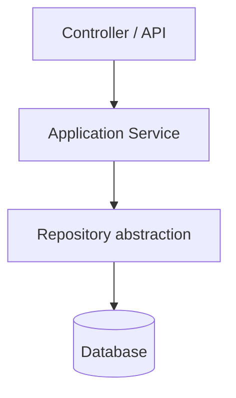
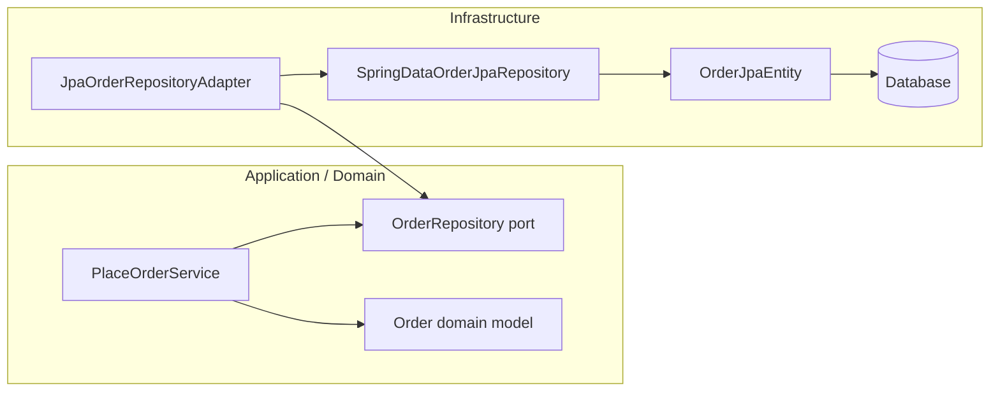

# Đặt Repository ở đâu trong kiến trúc phân lớp của ứng dụng Spring Data JPA?

Repository thuộc ranh giới truy cập dữ liệu: nó cung cấp các thao tác lưu, tìm, cập nhật và xóa dữ liệu cho phần nghiệp vụ. Vị trí cụ thể của interface Repository phụ thuộc kiến trúc mà ứng dụng chọn.

Trong kiến trúc phân lớp truyền thống, Repository thường nằm ở lớp persistence/data access và Service phụ thuộc vào nó. Trong Clean Architecture hoặc Hexagonal Architecture, interface repository thường là một port thuộc phía trong (application hoặc domain), còn phần triển khai dùng Spring Data JPA nằm ở infrastructure. Hai cách đều có thể đúng; điều quan trọng là dependency đi theo một hướng rõ ràng và mỗi lớp giữ đúng trách nhiệm.

## 1. Repository đứng ở đâu trong luồng xử lý?

Một luồng phổ biến:



- **Controller** nhận HTTP request, kiểm tra dữ liệu đầu vào ở mức API, gọi use case và chuyển kết quả thành response.
- **Service / Use case** điều phối nghiệp vụ, áp dụng quy tắc, quản lý ranh giới transaction và gọi các abstraction cần thiết.
- **Repository** cung cấp cách truy cập dữ liệu theo khái niệm nghiệp vụ hoặc aggregate; nó không điều phối toàn bộ use case.
- **Infrastructure / persistence adapter** thực hiện truy cập database bằng Spring Data JPA, Hibernate, JDBC hoặc công nghệ khác.

Repository là một abstraction, không đồng nghĩa với database table hay entity. Spring Data JPA có thể tạo implementation proxy từ một interface kế thừa `JpaRepository`; ta không phải tự viết class CRUD cho interface đó.

Ví dụ:

```java
public interface OrderRepository
        extends JpaRepository<OrderEntity, Long> {
}
```

Spring Data phát hiện interface trong phạm vi repository scan, tạo proxy và cung cấp các thao tác CRUD. Service gọi interface qua dependency injection; service không cần biết câu SQL hay cách Hibernate tạo câu lệnh.

## 2. Cách tổ chức trong kiến trúc phân lớp truyền thống

Với ứng dụng CRUD hoặc hệ thống có độ phức tạp vừa phải, cấu trúc theo feature kết hợp các lớp là lựa chọn dễ hiểu:

```text
com.example.shop
└── order
    ├── controller
    │   └── OrderController.java
    ├── service
    │   └── OrderService.java
    ├── repository
    │   └── OrderRepository.java
    ├── entity
    │   └── OrderEntity.java
    └── dto
        ├── CreateOrderRequest.java
        └── OrderResponse.java
```

Trong cách này, Spring Data repository interface thường đặt ở package `repository` hoặc `persistence`. Service phụ thuộc vào interface đó; Controller chỉ phụ thuộc vào Service.

Entity JPA:

**OrderEntity.java**

```java
package com.example.shop.order.entity;

import jakarta.persistence.Column;
import jakarta.persistence.Entity;
import jakarta.persistence.GeneratedValue;
import jakarta.persistence.GenerationType;
import jakarta.persistence.Id;
import jakarta.persistence.Table;
import java.math.BigDecimal;

@Entity
@Table(name = "orders")
public class OrderEntity {

    @Id
    @GeneratedValue(strategy = GenerationType.IDENTITY)
    private Long id;

    @Column(nullable = false, unique = true)
    private String orderNumber;

    @Column(nullable = false, precision = 12, scale = 2)
    private BigDecimal total;

    @Column(nullable = false)
    private String status;

    protected OrderEntity() {
    }

    public OrderEntity(String orderNumber, BigDecimal total) {
        this.orderNumber = orderNumber;
        this.total = total;
        this.status = "NEW";
    }

    public Long getId() {
        return id;
    }

    public String getOrderNumber() {
        return orderNumber;
    }

    public BigDecimal getTotal() {
        return total;
    }

    public String getStatus() {
        return status;
    }

    public void confirm() {
        if (!"NEW".equals(status)) {
            throw new IllegalStateException("Only new orders can be confirmed");
        }
        status = "CONFIRMED";
    }
}
```

Repository:

**OrderRepository.java**

```java
package com.example.shop.order.repository;

import com.example.shop.order.entity.OrderEntity;
import java.util.Optional;
import org.springframework.data.jpa.repository.JpaRepository;

public interface OrderRepository
        extends JpaRepository<OrderEntity, Long> {

    Optional<OrderEntity> findByOrderNumber(String orderNumber);
}
```

Service:

**OrderService.java**

```java
package com.example.shop.order.service;

import com.example.shop.order.entity.OrderEntity;
import com.example.shop.order.repository.OrderRepository;
import java.math.BigDecimal;
import org.springframework.stereotype.Service;
import org.springframework.transaction.annotation.Transactional;

@Service
public class OrderService {

    private final OrderRepository orderRepository;

    public OrderService(OrderRepository orderRepository) {
        this.orderRepository = orderRepository;
    }

    @Transactional
    public OrderEntity create(String orderNumber, BigDecimal total) {
        if (orderNumber == null || orderNumber.isBlank()) {
            throw new IllegalArgumentException("orderNumber is required");
        }
        if (total == null || total.signum() < 0) {
            throw new IllegalArgumentException("total must be non-negative");
        }

        if (orderRepository.findByOrderNumber(orderNumber).isPresent()) {
            throw new IllegalArgumentException("orderNumber already exists");
        }

        return orderRepository.save(new OrderEntity(orderNumber, total));
    }

    @Transactional
    public void confirm(Long orderId) {
        OrderEntity order = orderRepository.findById(orderId)
            .orElseThrow(() -> new IllegalArgumentException("Order not found"));
        order.confirm();
        // Entity đang managed; dirty checking ghi status khi transaction flush.
    }
}
```

Controller không gọi repository trực tiếp. Khai báo request và response DTO:

**CreateOrderRequest.java**

```java
package com.example.shop.order.dto;

import jakarta.validation.constraints.DecimalMin;
import jakarta.validation.constraints.NotBlank;
import jakarta.validation.constraints.NotNull;
import java.math.BigDecimal;

public record CreateOrderRequest(
    @NotBlank String orderNumber,
    @NotNull @DecimalMin("0.00") BigDecimal total
) {
}
```

**OrderResponse.java**

```java
package com.example.shop.order.dto;

import java.math.BigDecimal;

public record OrderResponse(
    Long id,
    String orderNumber,
    BigDecimal total
) {
}
```

Controller:

```java
package com.example.shop.order.controller;

import com.example.shop.order.dto.CreateOrderRequest;
import com.example.shop.order.dto.OrderResponse;
import com.example.shop.order.entity.OrderEntity;
import com.example.shop.order.service.OrderService;
import jakarta.validation.Valid;
import org.springframework.http.HttpStatus;
import org.springframework.web.bind.annotation.PostMapping;
import org.springframework.web.bind.annotation.RequestBody;
import org.springframework.web.bind.annotation.RequestMapping;
import org.springframework.web.bind.annotation.ResponseStatus;
import org.springframework.web.bind.annotation.RestController;

@RestController
@RequestMapping("/orders")
public class OrderController {

    private final OrderService orderService;

    public OrderController(OrderService orderService) {
        this.orderService = orderService;
    }

    @PostMapping
    @ResponseStatus(HttpStatus.CREATED)
    public OrderResponse create(@Valid @RequestBody CreateOrderRequest request) {
        OrderEntity order =
            orderService.create(request.orderNumber(), request.total());

        return new OrderResponse(
            order.getId(),
            order.getOrderNumber(),
            order.getTotal()
        );
    }
}
```

Để request validation hoạt động, ứng dụng cần dependency Bean Validation phù hợp, chẳng hạn `spring-boot-starter-validation`. Dù request đã được validate, service/domain vẫn cần bảo vệ invariant vì use case có thể được gọi từ batch, message consumer hoặc test mà không đi qua HTTP controller.

Luồng dependency của cách tổ chức này là:

```text
Controller -> Service -> Spring Data Repository -> EntityManager/Database
```

Cách này thực dụng, dễ triển khai và phù hợp khi dự án chấp nhận service phụ thuộc trực tiếp vào Spring Data JPA. Đổi lại, service có thể bị gắn với các kiểu framework như `Pageable`, `Page`, `JpaSpecificationExecutor` hoặc entity JPA.

## 3. Tổ chức theo feature hay theo layer?

Hai kiểu package thường gặp:

**Layer-first:**

```text
controller/
service/
repository/
entity/
dto/
```

**Feature-first:**

```text
order/
  controller/
  service/
  repository/
  entity/
  dto/
customer/
  controller/
  service/
  repository/
  entity/
  dto/
```

Layer-first dễ nhìn khi ứng dụng nhỏ và số feature ít. Khi dự án lớn lên, một package `service` hoặc `repository` có thể chứa hàng chục class thuộc các nghiệp vụ không liên quan. Feature-first gom các thành phần cùng một nghiệp vụ lại gần nhau, giảm việc phải đi qua nhiều package cấp cao.

Không có yêu cầu Spring Data JPA bắt buộc một kiểu package duy nhất. Hãy ưu tiên cấu trúc giúp người đọc tìm được code của một feature và xác định được ranh giới giữa nghiệp vụ với persistence.

## 4. Repository trong Clean Architecture hoặc Hexagonal Architecture

Khi cần domain/application không phụ thuộc Spring Data JPA, đặt interface repository ở phía trong dưới dạng **port**. Infrastructure cung cấp adapter hiện thực port bằng Spring Data JPA.

Cấu trúc ví dụ:

```text
com.example.shop.order
├── domain
│   └── Order.java
├── application
│   ├── port
│   │   └── out
│   │       └── OrderRepository.java
│   └── usecase
│       └── PlaceOrderService.java
└── infrastructure
    └── persistence
        └── jpa
            ├── OrderJpaEntity.java
            ├── SpringDataOrderJpaRepository.java
            └── JpaOrderRepositoryAdapter.java
```

Interface ở application port:

**OrderRepository.java**

```java
package com.example.shop.order.application.port.out;

import com.example.shop.order.domain.Order;
import java.util.Optional;

public interface OrderRepository {

    Optional<Order> findById(Long id);

    Order save(Order order);
}
```

Đây là abstraction của ứng dụng, không kế thừa `JpaRepository` và không import annotation Spring. Nó thể hiện những thao tác mà use case cần, không phơi bày chi tiết database.

Domain model:

**Order.java**

```java
package com.example.shop.order.domain;

import java.math.BigDecimal;

public record Order(
    Long id,
    String orderNumber,
    BigDecimal total
) {
    public static Order newOrder(String orderNumber, BigDecimal total) {
        return new Order(null, orderNumber, total);
    }
}
```

Use case phụ thuộc port:

**PlaceOrderService.java**

```java
package com.example.shop.order.application.usecase;

import com.example.shop.order.application.port.out.OrderRepository;
import com.example.shop.order.domain.Order;
import java.math.BigDecimal;

public class PlaceOrderService {

    private final OrderRepository orderRepository;

    public PlaceOrderService(OrderRepository orderRepository) {
        this.orderRepository = orderRepository;
    }

    public Order place(String orderNumber, BigDecimal total) {
        if (orderNumber == null || orderNumber.isBlank()) {
            throw new IllegalArgumentException("orderNumber is required");
        }
        if (total == null || total.signum() < 0) {
            throw new IllegalArgumentException("total must be non-negative");
        }

        return orderRepository.save(Order.newOrder(orderNumber, total));
    }
}
```

Đăng ký use case thuần Java thành Spring bean bằng cấu hình ở vòng ngoài:

**OrderUseCaseConfig.java**

```java
package com.example.shop.order.infrastructure.config;

import com.example.shop.order.application.port.out.OrderRepository;
import com.example.shop.order.application.usecase.PlaceOrderService;
import org.springframework.context.annotation.Bean;
import org.springframework.context.annotation.Configuration;

@Configuration(proxyBeanMethods = false)
public class OrderUseCaseConfig {

    @Bean
    PlaceOrderService placeOrderService(OrderRepository orderRepository) {
        return new PlaceOrderService(orderRepository);
    }
}
```

Phần infrastructure dùng một JPA entity riêng:

**OrderJpaEntity.java**

```java
package com.example.shop.order.infrastructure.persistence.jpa;

import jakarta.persistence.Column;
import jakarta.persistence.Entity;
import jakarta.persistence.GeneratedValue;
import jakarta.persistence.GenerationType;
import jakarta.persistence.Id;
import jakarta.persistence.Table;
import java.math.BigDecimal;

@Entity
@Table(name = "orders")
public class OrderJpaEntity {

    @Id
    @GeneratedValue(strategy = GenerationType.IDENTITY)
    private Long id;

    @Column(nullable = false, unique = true)
    private String orderNumber;

    @Column(nullable = false, precision = 12, scale = 2)
    private BigDecimal total;

    protected OrderJpaEntity() {
    }

    public OrderJpaEntity(Long id, String orderNumber, BigDecimal total) {
        this.id = id;
        this.orderNumber = orderNumber;
        this.total = total;
    }

    public Long getId() {
        return id;
    }

    public String getOrderNumber() {
        return orderNumber;
    }

    public BigDecimal getTotal() {
        return total;
    }
}
```

Spring Data repository chỉ biết persistence entity:

**SpringDataOrderJpaRepository.java**

```java
package com.example.shop.order.infrastructure.persistence.jpa;

import java.util.Optional;
import org.springframework.data.jpa.repository.JpaRepository;

public interface SpringDataOrderJpaRepository
        extends JpaRepository<OrderJpaEntity, Long> {

    Optional<OrderJpaEntity> findByOrderNumber(String orderNumber);
}
```

Adapter chuyển đổi giữa domain model và JPA entity:

**JpaOrderRepositoryAdapter.java**

```java
package com.example.shop.order.infrastructure.persistence.jpa;

import com.example.shop.order.application.port.out.OrderRepository;
import com.example.shop.order.domain.Order;
import java.util.Optional;
import org.springframework.stereotype.Repository;

@Repository
public class JpaOrderRepositoryAdapter implements OrderRepository {

    private final SpringDataOrderJpaRepository jpaRepository;

    public JpaOrderRepositoryAdapter(
            SpringDataOrderJpaRepository jpaRepository) {
        this.jpaRepository = jpaRepository;
    }

    @Override
    public Optional<Order> findById(Long id) {
        return jpaRepository.findById(id).map(this::toDomain);
    }

    @Override
    public Order save(Order order) {
        OrderJpaEntity entity = new OrderJpaEntity(
            order.id(),
            order.orderNumber(),
            order.total()
        );

        return toDomain(jpaRepository.save(entity));
    }

    private Order toDomain(OrderJpaEntity entity) {
        return new Order(
            entity.getId(),
            entity.getOrderNumber(),
            entity.getTotal()
        );
    }
}
```

Trong mô hình này, use case chỉ biết `OrderRepository` port. Nó không biết `JpaRepository`, `EntityManager`, Hibernate hay tên bảng. Adapter là nơi biết cách lưu `OrderJpaEntity` và chuyển dữ liệu thành domain model.

Sơ đồ dependency:



Mũi tên phụ thuộc mã nguồn hướng vào phía trong: adapter triển khai port. Application không import infrastructure. Khi thay Hibernate bằng JDBC hoặc một remote API, use case vẫn dùng cùng port nếu hợp đồng nghiệp vụ không đổi.

## 5. Nên đặt interface ở application hay domain?

Không có một quy tắc duy nhất cho mọi dự án:

- **Application port:** phù hợp khi repository phục vụ một use case hoặc một luồng ứng dụng cụ thể. Interface thể hiện đúng nhu cầu mà application cần.
- **Domain repository:** phù hợp khi repository là một abstraction tự nhiên của aggregate trong domain-driven design, ví dụ `OrderRepository` làm việc với aggregate `Order`.
- **Infrastructure:** đặt Spring Data interface và adapter cụ thể ở đây vì chúng phụ thuộc framework, ORM và schema database.

Nếu interface chỉ là một tập CRUD tổng quát mà domain không thực sự cần, không nhất thiết phải tạo một abstraction domain chỉ để sao chép mọi phương thức của `JpaRepository`. Tạo port khi nó bảo vệ một ranh giới có ý nghĩa hoặc giúp application không phụ thuộc công nghệ lưu trữ.

## 6. Transaction nên đặt ở đâu?

Transaction thường bao phủ một use case, có thể gọi nhiều repository và thực hiện nhiều thay đổi phải nhất quán với nhau. Vì vậy, ranh giới transaction thường được xác định ở application service/use case, không nên chỉ gắn rời rạc vào từng câu lệnh repository.

Trong ứng dụng Spring phân lớp truyền thống, transaction thường bao trọn use case. Với `OrderEntity` đã khai báo phương thức `confirm()` ở phần trước:

```java
package com.example.shop.order.service;

import com.example.shop.order.entity.OrderEntity;
import com.example.shop.order.repository.OrderRepository;
import org.springframework.stereotype.Service;
import org.springframework.transaction.annotation.Transactional;

@Service
public class OrderConfirmationService {

    private final OrderRepository orderRepository;

    public OrderConfirmationService(OrderRepository orderRepository) {
        this.orderRepository = orderRepository;
    }

    @Transactional
    public void confirm(Long orderId) {
        OrderEntity order = orderRepository.findById(orderId)
            .orElseThrow(() -> new IllegalArgumentException("Order not found"));
        order.confirm();
    }
}
```

Entity được tải trong transaction là managed; dirty checking sẽ ghi thay đổi trạng thái khi flush. Nếu use case cập nhật nhiều repository, đặt transaction ở phương thức service bao quanh toàn bộ thao tác để các thay đổi tham gia cùng transaction manager.

Trong Clean Architecture, có thể đặt `@Transactional` trực tiếp trên application service như một lựa chọn thực dụng, chấp nhận application layer phụ thuộc Spring transaction. Nếu cần application thuần framework, có thể đặt transaction orchestration ở một decorator/proxy bên ngoài use case hoặc dùng cấu hình adapter phù hợp. Dù chọn cách nào, transaction phải bao trọn nghiệp vụ cần tính nguyên tử.

Các repository method kế thừa từ Spring Data có transaction behavior mặc định theo loại phương thức, nhưng điều đó không thay thế việc xác định transaction boundary của use case. Khi nhiều repository cùng tham gia một nghiệp vụ, transaction ở service giúp thể hiện rõ phạm vi công việc.

## 7. Custom query và business logic thuộc lớp nào?

Repository phù hợp với truy vấn dữ liệu và thao tác persistence:

- Tìm aggregate theo ID hoặc business key.
- Tìm theo điều kiện, phân trang, sắp xếp.
- Lưu aggregate và thực hiện các truy vấn cần thiết cho use case.
- Dùng custom repository fragment khi truy vấn cần logic persistence phức tạp.

Business logic thuộc domain hoặc application:

- Kiểm tra một đơn hàng có được chuyển từ trạng thái này sang trạng thái khác hay không.
- Tính phí, áp dụng chính sách giảm giá hoặc giới hạn tín dụng.
- Điều phối việc tạo đơn hàng, giữ tồn kho và phát hành thanh toán.
- Quyết định khi nào phát event hoặc gọi một port bên ngoài.

Không đặt toàn bộ quy trình `createOrder -> reserveStock -> chargePayment -> sendEmail` trong một repository. Repository không phải workflow engine hoặc service layer.

Nếu query phức tạp cần custom implementation, có thể dùng fragment:

```java
public interface OrderSearch {
    List<OrderEntity> findOrdersReadyForDispatch();
}

public interface OrderRepository
        extends JpaRepository<OrderEntity, Long>, OrderSearch {
}
```

Implementation fragment dùng `EntityManager`, Criteria API hoặc query phù hợp và nằm trong infrastructure/persistence. Nó vẫn tập trung vào truy vấn, không điều phối toàn bộ nghiệp vụ.

## 8. Kiểm thử theo đúng ranh giới

Tổ chức repository đúng cũng giúp xác định test nào cần viết:

| Lớp | Mục tiêu kiểm thử | Cách kiểm thử phù hợp |
|---|---|---|
| Controller | HTTP status, request validation, response mapping | `@WebMvcTest` hoặc MockMvc |
| Application service/use case | Quy tắc nghiệp vụ và điều phối | Unit test với fake/mock repository port |
| Spring Data repository/adapter | JPQL, mapping, constraint, transaction persistence | `@DataJpaTest`, Testcontainers khi cần database production |
| End-to-end | Wiring và luồng từ API tới database | `@SpringBootTest` hoặc test tích hợp có phạm vi phù hợp |

Unit test cho use case Clean Architecture có thể dùng fake repository:

```java
import com.example.shop.order.application.port.out.OrderRepository;
import com.example.shop.order.domain.Order;
import java.util.HashMap;
import java.util.Map;
import java.util.Optional;

class InMemoryOrderRepository
        implements OrderRepository {

    private final Map<Long, Order> orders = new HashMap<>();
    private long nextId = 1;

    @Override
    public Optional<Order> findById(Long id) {
        return Optional.ofNullable(orders.get(id));
    }

    @Override
    public Order save(Order order) {
        Order saved = new Order(
            order.id() == null ? nextId++ : order.id(),
            order.orderNumber(),
            order.total()
        );
        orders.put(saved.id(), saved);
        return saved;
    }
}
```

Fake này phục vụ unit test, không thay thế integration test với JPA. Integration test cần xác minh adapter, mapping và database behavior thực tế. Nếu production dùng PostgreSQL, Testcontainers PostgreSQL thường cung cấp bằng chứng phù hợp hơn H2 cho các khác biệt về dialect, constraint, sequence và locking.

## 9. Spring Boot repository scanning

Spring Boot thường quét component, entity và repository từ package chứa class `@SpringBootApplication` trở xuống. Đặt class main ở package gốc chung giúp các package con được phát hiện:

```text
com.example.shop
├── ShopApplication.java
├── order
│   ├── service
│   ├── repository
│   └── entity
└── customer
    ├── service
    ├── repository
    └── entity
```

Nếu repository nằm ngoài phạm vi mặc định, có thể cấu hình `@EnableJpaRepositories(basePackages = "...")`. Với nhiều persistence unit, cần cấu hình `entityManagerFactoryRef` và `transactionManagerRef` phù hợp cho từng package repository.

Spring Data repository interface thường không cần tự gắn `@Repository` để được phát hiện khi nằm trong phạm vi repository scan. `@Repository` thường hữu ích cho class DAO/adapter tự viết, đồng thời tham gia cơ chế exception translation của Spring khi được quản lý như bean.

## 10. Lỗi thiết kế thường gặp

| Lỗi | Hệ quả | Hướng điều chỉnh |
|---|---|---|
| Controller inject trực tiếp JpaRepository | HTTP layer phụ thuộc persistence và dễ chứa nghiệp vụ | Controller gọi application service |
| Đặt mọi repository trong một package toàn cục khi dự án lớn | Khó tìm code theo feature và dễ tạo phụ thuộc chéo | Gom package theo feature/module |
| Đưa tính phí hoặc chuyển trạng thái vào repository | Persistence layer chứa business rule, khó test và tái sử dụng | Đưa rule vào domain/application |
| Application port extends JpaRepository | Application phụ thuộc Spring Data và JPA | Tạo port nhỏ theo nhu cầu; để infrastructure kế thừa JpaRepository |
| Đưa JPA entity ra API response | Schema persistence rò rỉ ra contract HTTP, dễ lazy-loading/serialization lỗi | Dùng request/response DTO và mapper |
| Dùng một generic BaseRepository cho mọi entity quá sớm | Abstraction khó hiểu và mang theo API không cần thiết | Bắt đầu với repository cụ thể, trừu tượng hóa khi có nhu cầu thực |
| Đặt transaction trên từng method repository mà không xác định use case | Nhiều thao tác có thể không nằm trong cùng transaction | Đặt transaction boundary ở service/use case |
| Dùng repository để gọi service khác hoặc gửi email | Tạo vòng phụ thuộc và trộn workflow với persistence | Dùng application service và outbound port |

## 11. Chọn cách tổ chức phù hợp

| Bối cảnh | Cách đặt Repository |
|---|---|
| Ứng dụng CRUD đơn giản, một database | Spring Data interface trong package `repository`; service gọi trực tiếp |
| Ứng dụng lớn theo feature | Repository trong module/feature tương ứng, cạnh service và entity |
| Clean Architecture/Hexagonal | Port ở application/domain; Spring Data interface và adapter ở infrastructure |
| Domain-driven design với aggregate | Repository abstraction tập trung vào vòng đời aggregate; implementation ở infrastructure |
| Có nhiều persistence technology | Application phụ thuộc port; mỗi công nghệ cung cấp adapter riêng |

Không có giá trị khi thêm nhiều tầng chỉ để tạo thêm interface giống hệt nhau. Hãy dùng cấu trúc truyền thống khi sự đơn giản quan trọng và ranh giới phụ thuộc framework được chấp nhận. Dùng port/adapter khi cần bảo vệ application/domain khỏi Spring Data JPA, hỗ trợ nhiều adapter hoặc kiểm thử use case độc lập với database.

Quy tắc cốt lõi là Controller xử lý giao tiếp, Service/use case điều phối nghiệp vụ, Repository cung cấp abstraction truy cập dữ liệu, và infrastructure chịu trách nhiệm hiện thực bằng Spring Data JPA. Đặt các thành phần ở đúng module và giữ dependency đi theo hướng đã chọn sẽ giúp ứng dụng dễ đọc, dễ kiểm thử và dễ thay đổi.