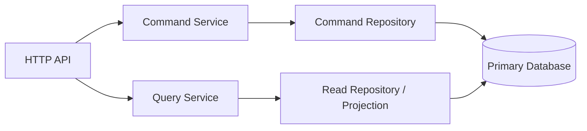
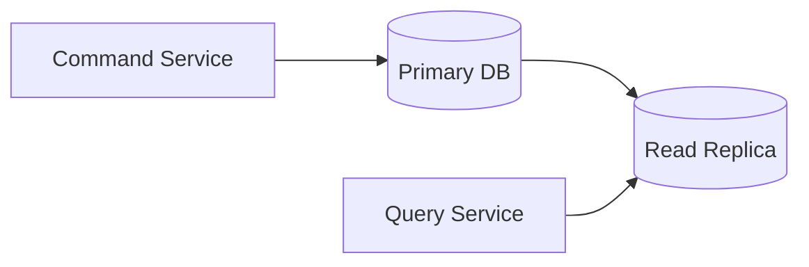

# Tách luồng đọc và ghi khi yêu cầu truy vấn khác biệt

## 1. Mục tiêu

Khi ứng dụng lớn dần, cách đọc dữ liệu thường có yêu cầu khác với cách ghi. Luồng ghi cần bảo vệ quy tắc nghiệp vụ, cập nhật Entity và quản lý transaction. Luồng đọc thường cần trả dữ liệu nhanh cho màn hình hoặc API, có thể cần projection, tổng hợp, lọc và phân trang theo hình dạng riêng.

Tách luồng đọc và ghi (read/write separation) giúp mỗi bên có cấu trúc phù hợp với nhiệm vụ của nó. Đây là ý tưởng cốt lõi của CQRS (Command Query Responsibility Segregation): command thay đổi trạng thái, query chỉ đọc dữ liệu.

Sau bài học, bạn có thể:
- Phân biệt command và query theo tác động lên trạng thái.
- Tách Repository và Service cho luồng ghi và luồng đọc trong Spring Data JPA.
- Dùng Entity managed cho nghiệp vụ ghi và DTO projection cho truy vấn đọc.
- Đặt transaction boundary phù hợp, gồm `@Transactional(readOnly = true)` cho query.
- Giữ tính nhất quán khi hai luồng cùng dùng một database.
- Hiểu độ trễ replication khi query qua read replica.
- Thiết kế read model riêng và transactional outbox khi cần cập nhật bất đồng bộ.
- Kiểm thử read-after-write, transaction và projection.

## 2. Command và Query khác nhau thế nào?

Command yêu cầu hệ thống thay đổi trạng thái. Ví dụ:

- Tạo sản phẩm.
- Đổi giá sản phẩm.
- Ngừng kinh doanh một sản phẩm.
- Xác nhận đơn hàng.

Query chỉ yêu cầu đọc dữ liệu và không thay đổi trạng thái nghiệp vụ. Ví dụ:

- Lấy danh sách sản phẩm đang bán.
- Tìm chi tiết sản phẩm theo SKU.
- Lấy số lượng đơn theo trạng thái.
- Tìm các sản phẩm có giá trong một khoảng.

Quy ước thực tế:

| Luồng | Trách nhiệm | Kết quả thường trả về |
| --- | --- | --- |
| Command | Kiểm tra quy tắc nghiệp vụ và thay đổi trạng thái. | ID, trạng thái xử lý, kết quả command hoặc domain event. |
| Query | Lọc, sắp xếp, phân trang và định dạng dữ liệu đọc. | DTO, projection, Page, Slice hoặc scalar. |

Command và Query có thể cùng nằm trong một ứng dụng Spring Boot và dùng chung một database. Tách trách nhiệm không bắt buộc phải dùng microservices hoặc hai database riêng.

## 3. Khi nào nên tách read/write?

Tách luồng hữu ích khi:

- Màn hình đọc cần nhiều join, tổng hợp hoặc projection khác với mô hình Entity ghi.
- API đọc cần trả DTO gọn, trong khi command cần Entity đầy đủ và domain method.
- Có nhiều loại màn hình đọc với hình dạng dữ liệu khác nhau.
- Query cần tối ưu riêng về index, pagination hoặc cache.
- Hệ thống có lượng đọc lớn và muốn bổ sung read replica.
- Nhóm phát triển cần ranh giới rõ giữa logic thay đổi trạng thái và logic trình bày dữ liệu.

Không cần áp dụng CQRS phức tạp cho mọi CRUD đơn giản. Nếu một Entity chỉ có vài query nhỏ và ít thay đổi, một Repository cùng Service có thể đủ rõ ràng. Tách khi lợi ích về hiệu năng, mô hình hoặc bảo trì lớn hơn chi phí vận hành.

## 4. Mô hình kiến trúc

Với cùng một database, có thể tách thành hai đường đi:



Command Repository tải Entity để áp dụng nghiệp vụ và ghi trong transaction. Read Repository trả projection hoặc DTO, chỉ lấy những cột mà màn hình cần.

Ở giai đoạn đầu, hai Repository có thể truy cập cùng schema và cùng primary database. Về sau, nếu workload yêu cầu, query có thể đọc từ replica hoặc read store riêng. Khi đó cần thiết kế thêm consistency và đồng bộ dữ liệu.

## 5. Ví dụ domain Product

Ví dụ dùng Java 17+, Spring Boot 3.x, Spring Data JPA và Hibernate do Spring Boot quản lý phiên bản. Một Product có SKU, tên, giá, trạng thái hoạt động và version.

`src/main/java/com/example/catalog/Product.java`:

```java
package com.example.catalog;

import jakarta.persistence.Column;
import jakarta.persistence.Entity;
import jakarta.persistence.GeneratedValue;
import jakarta.persistence.GenerationType;
import jakarta.persistence.Id;
import jakarta.persistence.Table;
import jakarta.persistence.Version;
import java.math.BigDecimal;

@Entity
@Table(name = "products")
public class Product {
    @Id
    @GeneratedValue(strategy = GenerationType.IDENTITY)
    private Long id;

    @Column(nullable = false, unique = true, length = 40)
    private String sku;

    @Column(nullable = false, length = 160)
    private String name;

    @Column(nullable = false, precision = 12, scale = 2)
    private BigDecimal price;

    @Column(nullable = false)
    private boolean active;

    @Version
    @Column(nullable = false)
    private long version;

    protected Product() {
        // JPA cần constructor không tham số.
    }

    public Product(String sku, String name, BigDecimal price) {
        if (sku == null || sku.isBlank() || sku.length() > 40) {
            throw new IllegalArgumentException("SKU is required");
        }
        if (name == null || name.isBlank() || name.length() > 160) {
            throw new IllegalArgumentException("Name is required");
        }
        validatePrice(price);
        this.sku = sku.trim();
        this.name = name.trim();
        this.price = price;
        this.active = true;
    }

    public void changePrice(BigDecimal newPrice) {
        validatePrice(newPrice);
        this.price = newPrice;
    }

    public void deactivate() {
        this.active = false;
    }

    private static void validatePrice(BigDecimal price) {
        if (price == null || price.signum() < 0) {
            throw new IllegalArgumentException("Price must be zero or greater");
        }
    }

    public Long getId() { return id; }
    public String getSku() { return sku; }
    public String getName() { return name; }
    public BigDecimal getPrice() { return price; }
    public boolean isActive() { return active; }
    public long getVersion() { return version; }
}
```

`@Version` hỗ trợ optimistic locking cho cập nhật Entity thông thường. Domain method `changePrice()` giữ quy tắc giá tại Entity; command service không cần tự sửa field private.

## 6. Tách Repository cho command và query

Command Repository kế thừa `JpaRepository` để tải và lưu Entity:

`src/main/java/com/example/catalog/ProductCommandRepository.java`:

```java
package com.example.catalog;

import java.util.Optional;
import org.springframework.data.jpa.repository.JpaRepository;

public interface ProductCommandRepository extends JpaRepository<Product, Long> {
    Optional<Product> findBySku(String sku);
}
```

Read Repository chỉ công bố các truy vấn cần cho màn hình. Ví dụ dùng DTO record để lấy đúng bốn thuộc tính:

`src/main/java/com/example/catalog/ProductListItem.java`:

```java
package com.example.catalog;

import java.math.BigDecimal;

public record ProductListItem(
        Long id,
        String sku,
        String name,
        BigDecimal price) {
}
```

`src/main/java/com/example/catalog/ProductReadRepository.java`:

```java
package com.example.catalog;

import java.util.Optional;
import org.springframework.data.domain.Pageable;
import org.springframework.data.domain.Slice;
import org.springframework.data.jpa.repository.Query;
import org.springframework.data.repository.Repository;
import org.springframework.data.repository.query.Param;

public interface ProductReadRepository extends Repository<Product, Long> {
    @Query("""
           select new com.example.catalog.ProductListItem(
               p.id, p.sku, p.name, p.price)
           from Product p
           where p.active = true
           """)
    Slice<ProductListItem> findActive(Pageable pageable);

    @Query("""
           select new com.example.catalog.ProductListItem(
               p.id, p.sku, p.name, p.price)
           from Product p
           where p.sku = :sku
           """)
    Optional<ProductListItem> findItemBySku(@Param("sku") String sku);
}
```

`ProductReadRepository` extends the minimal Spring Data `Repository` marker instead of `JpaRepository`, because the read path does not need `save`, `delete` or Entity mutation methods. The JPQL constructor expression returns `ProductListItem`; the query does not need to hydrate a full managed Product for this list use case.

Spring Data can append the Sort from `Pageable` to the JPQL query. The service below adds `name` and `id` ordering so pagination remains deterministic when names repeat.

## 7. Command Service: tải Entity và thay đổi trạng thái

Command Service đặt transaction boundary cho nghiệp vụ ghi:

`src/main/java/com/example/catalog/ProductCommandService.java`:

```java
package com.example.catalog;

import java.math.BigDecimal;
import java.util.Objects;
import org.springframework.stereotype.Service;
import org.springframework.transaction.annotation.Transactional;

@Service
public class ProductCommandService {
    private final ProductCommandRepository repository;

    public ProductCommandService(ProductCommandRepository repository) {
        this.repository = repository;
    }

    @Transactional
    public void changePrice(String sku, BigDecimal newPrice) {
        Objects.requireNonNull(sku, "sku is required");
        Product product = repository.findBySku(sku)
                .orElseThrow(() -> new IllegalArgumentException("Product not found"));
        product.changePrice(newPrice);
    }

    @Transactional
    public void deactivate(String sku) {
        Product product = repository.findBySku(sku)
                .orElseThrow(() -> new IllegalArgumentException("Product not found"));
        product.deactivate();
    }
}
```

Entity được load trong transaction nên trở thành managed. Khi method kết thúc và transaction flush/commit, Hibernate phát sinh UPDATE cho các thay đổi. Không cần gọi `save()` lại cho Entity managed; có thể gọi `save()` theo convention của dự án, nhưng dirty checking đã theo dõi thay đổi.

Command Service là nơi kiểm tra quyền, trạng thái hợp lệ và các quy tắc nghiệp vụ liên quan. Nếu một thao tác cần cập nhật nhiều Entity, chúng nên nằm trong cùng transaction khi nghiệp vụ yêu cầu atomicity.

## 8. Query Service: projection và read-only transaction

Query Service chỉ điều phối truy vấn và trả DTO/projection:

`src/main/java/com/example/catalog/ProductQueryService.java`:

```java
package com.example.catalog;

import java.util.Objects;
import org.springframework.data.domain.PageRequest;
import org.springframework.data.domain.Pageable;
import org.springframework.data.domain.Slice;
import org.springframework.data.domain.Sort;
import org.springframework.stereotype.Service;
import org.springframework.transaction.annotation.Transactional;

@Service
@Transactional(readOnly = true)
public class ProductQueryService {
    private static final int MAX_PAGE_SIZE = 100;

    private final ProductReadRepository repository;

    public ProductQueryService(ProductReadRepository repository) {
        this.repository = repository;
    }

    public Slice<ProductListItem> findActive(int page, int size) {
        Pageable pageable = validatedPageable(page, size);
        return repository.findActive(pageable);
    }

    public ProductListItem findBySku(String sku) {
        Objects.requireNonNull(sku, "sku is required");
        return repository.findItemBySku(sku)
                .orElseThrow(() -> new IllegalArgumentException("Product not found"));
    }

    private Pageable validatedPageable(int page, int size) {
        if (page < 0) {
            throw new IllegalArgumentException("Page index must be zero or greater");
        }
        if (size < 1 || size > MAX_PAGE_SIZE) {
            throw new IllegalArgumentException("Page size must be between 1 and 100");
        }
        return PageRequest.of(page, size,
                Sort.by(Sort.Order.asc("name"), Sort.Order.asc("id")));
    }
}
```

`@Transactional(readOnly = true)` thể hiện đây là transaction phục vụ đọc. Với Hibernate, Spring có thể áp dụng các tối ưu như thay đổi flush mode để giảm dirty checking. Đây là hint cho transaction manager/provider; không phải cơ chế bảo mật bảo đảm mọi database đều từ chối ghi. Không thực hiện command trong Query Service.

Phân trang dùng `Slice` vì ví dụ chỉ cần biết còn trang tiếp theo, không cần tổng số sản phẩm. Nếu UI cần `totalElements` và `totalPages`, đổi sang `Page` và chấp nhận count query khi cần.

## 9. API phân tách GET và command

Ví dụ Controller định tuyến GET sang Query Service và PATCH sang Command Service:

`src/main/java/com/example/catalog/ProductController.java`:

```java
package com.example.catalog;

import java.math.BigDecimal;
import org.springframework.data.domain.Slice;
import org.springframework.http.ResponseEntity;
import org.springframework.web.bind.annotation.GetMapping;
import org.springframework.web.bind.annotation.PatchMapping;
import org.springframework.web.bind.annotation.PathVariable;
import org.springframework.web.bind.annotation.RequestBody;
import org.springframework.web.bind.annotation.RequestMapping;
import org.springframework.web.bind.annotation.RequestParam;
import org.springframework.web.bind.annotation.RestController;

@RestController
@RequestMapping("/api/products")
public class ProductController {
    private final ProductCommandService commands;
    private final ProductQueryService queries;

    public ProductController(ProductCommandService commands, ProductQueryService queries) {
        this.commands = commands;
        this.queries = queries;
    }

    public record ChangePriceRequest(BigDecimal price) {
    }

    @GetMapping
    public Slice<ProductListItem> listActive(
            @RequestParam(defaultValue = "0") int page,
            @RequestParam(defaultValue = "20") int size) {
        return queries.findActive(page, size);
    }

    @GetMapping("/{sku}")
    public ProductListItem getBySku(@PathVariable String sku) {
        return queries.findBySku(sku);
    }

    @PatchMapping("/{sku}/price")
    public ResponseEntity<Void> changePrice(
            @PathVariable String sku,
            @RequestBody ChangePriceRequest request) {
        commands.changePrice(sku, request.price());
        return ResponseEntity.noContent().build();
    }
}
```

Trong ứng dụng thực tế, thêm Bean Validation cho request DTO và exception handler để ánh xạ lỗi nghiệp vụ thành HTTP status thích hợp. Controller không nên tự chứa query SQL hoặc quy tắc domain.

## 10. Nhất quán khi cùng dùng một database

Khi command và query cùng truy cập primary database, transaction commit của command là ranh giới quan trọng. Một query chạy sau khi command đã commit, trong transaction mới với isolation thông thường như READ COMMITTED, sẽ nhìn thấy dữ liệu đã commit.

Ví dụ luồng:

1. Client gọi PATCH đổi giá sản phẩm.
2. `ProductCommandService` tải Entity và đổi giá trong transaction.
3. Spring commit transaction.
4. Client gọi GET sau đó.
5. `ProductQueryService` chạy projection query trên cùng primary database và đọc giá mới.

Không đọc lại trong cùng persistence context từ một Entity đã cache nếu query cần phản ánh dữ liệu vừa thay đổi qua bulk SQL hoặc procedure. Khi bulk DML/procedure cập nhật bảng ngoài dirty checking, cần clear/refresh persistence context phù hợp.

Đối với thao tác command rồi query ngay trong cùng request, có thể trả về kết quả command hoặc đọc projection sau khi commit. Không nên gọi một query độc lập rồi kỳ vọng nó thấy thay đổi chưa commit từ transaction khác.

## 11. Khi query đọc từ read replica

Khi lượng đọc lớn, có thể cấu hình database replica để giảm tải primary. Lúc này command ghi primary, query có thể đọc replica.



Replication thường bất đồng bộ. Vì vậy có thể xảy ra:

- Command đã commit trên primary.
- Replica chưa nhận hoặc chưa áp dụng transaction đó.
- GET ngay sau command trả dữ liệu cũ hoặc chưa tìm thấy bản ghi.

Đây là replication lag và dẫn tới eventual consistency. Nếu nghiệp vụ cần read-your-writes, có thể:

- Đọc từ primary trong một khoảng thời gian sau command.
- Trả dữ liệu cần thiết trực tiếp từ kết quả command.
- Gắn phiên bản/sequence để chỉ đọc replica khi đã bắt kịp.
- Thiết kế UI chấp nhận trạng thái đang đồng bộ nếu phù hợp.

Không giả định `@Transactional(readOnly = true)` tự động chuyển truy vấn sang replica. Việc route sang replica cần cấu hình DataSource/transaction routing riêng, chẳng hạn custom `AbstractRoutingDataSource`, connection proxy và quy tắc chọn nguồn. Chỉ đánh dấu transaction read-only không tự tạo read replica hoặc tự bảo đảm route.

### 11.1. Read-only routing cần đúng thời điểm

Nếu custom routing datasource dựa trên `TransactionSynchronizationManager.isCurrentTransactionReadOnly()`, cần bảo đảm quyết định route được thực hiện khi transaction context đã có sẵn. Với một số cấu hình transaction manager, connection có thể được lấy trước khi transaction synchronization được công bố; `LazyConnectionDataSourceProxy` thường được dùng để trì hoãn lấy physical connection đến lúc thực sự cần.

Đây là chi tiết cấu hình hạ tầng, không phải thứ cần thêm vào mọi ứng dụng. Phải integration test rằng query đi replica và command đi primary, đặc biệt kiểm tra trường hợp gọi query sau command trong cùng request.

## 12. Read model riêng và CQRS nâng cao

Khi projection từ cùng schema không còn đủ, có thể tạo read model riêng được tối ưu cho màn hình hoặc báo cáo:

- Bảng tổng hợp doanh thu theo ngày.
- Bảng tìm kiếm sản phẩm đã denormalize.
- Document trong search engine.
- Materialized view hoặc bảng dashboard.

Command vẫn cập nhật write model là nguồn dữ liệu chuẩn. Một tiến trình khác cập nhật read model theo event hoặc message. Khi đó read model có thể chậm hơn write model một khoảng thời gian.

Không để hai database ghi độc lập trong cùng một business operation mà không có cơ chế đảm bảo. Nếu transaction cập nhật primary thành công nhưng gửi message thất bại, read model sẽ không bao giờ được cập nhật. Nếu gửi message trước rồi transaction database rollback, consumer có thể đọc một event không có dữ liệu tương ứng.

### 12.1. Transactional outbox

Transactional outbox giải quyết vấn đề dual write bằng cách ghi thay đổi domain và một bản ghi outbox trong cùng transaction database:

1. Command cập nhật Product.
2. Cùng transaction đó, ghi event `ProductPriceChanged` vào bảng outbox.
3. Commit một lần cho cả Product và outbox row.
4. Publisher đọc outbox và gửi message tới broker.
5. Consumer cập nhật read model; xử lý message theo cách idempotent.

Ví dụ cấu trúc bảng:

```sql
create table outbox_event (
    id varchar(36) primary key,
    aggregate_type varchar(100) not null,
    aggregate_id varchar(100) not null,
    event_type varchar(150) not null,
    payload clob not null,
    occurred_at timestamp not null,
    published_at timestamp null
);
```

Publisher có thể gửi lại một event nếu bị lỗi sau khi publish nhưng trước khi đánh dấu `published_at`. Vì vậy consumer cần chống xử lý trùng bằng event ID hoặc version. Không xóa event ngay sau khi gửi nếu chưa có chính sách retry, retention và quan sát lỗi.

Outbox phù hợp khi read model bất đồng bộ hoặc có message broker. Với ứng dụng CRUD nhỏ dùng cùng database, thêm outbox có thể tạo độ phức tạp không cần thiết.

## 13. Kiểm thử read/write separation

Cần kiểm thử cả query projection lẫn transaction ghi. Một test Repository đơn giản có thể xác nhận DTO projection chỉ trả đúng giá trị; test service có thể xác nhận command commit được query path đọc thấy.

Ví dụ dùng `spring-boot-starter-data-jpa`, H2 và `spring-boot-starter-test`. `@DataJpaTest` cấu hình test slice. Tắt transaction bao ngoài để các transaction của Service thực sự commit:

`src/test/java/com/example/catalog/ProductReadWriteSeparationTest.java`:

```java
package com.example.catalog;

import static org.assertj.core.api.Assertions.assertThat;

import java.math.BigDecimal;
import java.util.List;
import org.junit.jupiter.api.BeforeEach;
import org.junit.jupiter.api.Test;
import org.springframework.beans.factory.annotation.Autowired;
import org.springframework.boot.test.autoconfigure.orm.jpa.DataJpaTest;
import org.springframework.context.annotation.Import;
import org.springframework.data.domain.Slice;
import org.springframework.data.domain.Sort;
import org.springframework.data.domain.PageRequest;
import org.springframework.transaction.PlatformTransactionManager;
import org.springframework.transaction.TransactionDefinition;
import org.springframework.transaction.annotation.Propagation;
import org.springframework.transaction.annotation.Transactional;
import org.springframework.transaction.support.TransactionTemplate;

@DataJpaTest
@Import({ProductCommandService.class, ProductQueryService.class})
@Transactional(propagation = Propagation.NOT_SUPPORTED)
class ProductReadWriteSeparationTest {
    @Autowired
    private ProductCommandRepository commandRepository;

    @Autowired
    private ProductCommandService commands;

    @Autowired
    private ProductQueryService queries;

    @Autowired
    private PlatformTransactionManager transactionManager;

    private TransactionTemplate transactions;

    @BeforeEach
    void cleanDatabase() {
        transactions = new TransactionTemplate(transactionManager);
        transactions.executeWithoutResult(status -> commandRepository.deleteAllInBatch());
    }

    private void insertProducts() {
        transactions.executeWithoutResult(status -> commandRepository.saveAll(List.of(
                new Product("KB-100", "Keyboard", new BigDecimal("120.00")),
                new Product("MS-200", "Mouse", new BigDecimal("35.00")),
                new Product("MN-300", "Monitor", new BigDecimal("250.00")))));
    }

    @Test
    void queryPathReturnsOnlyTheReadModelAfterCommandCommits() {
        insertProducts();

        commands.changePrice("KB-100", new BigDecimal("135.00"));

        ProductListItem result = queries.findBySku("KB-100");

        assertThat(result.name()).isEqualTo("Keyboard");
        assertThat(result.price()).isEqualByComparingTo("135.00");
    }

    @Test
    void queryPathUsesSliceAndStableOrdering() {
        insertProducts();

        Slice<ProductListItem> first = queries.findActive(0, 2);

        assertThat(first.getContent()).hasSize(2);
        assertThat(first.getContent()).extracting(ProductListItem::name)
                .containsExactly("Keyboard", "Monitor");
        assertThat(first.hasNext()).isTrue();
    }

    @Test
    void commandPathDoesNotReturnInactiveProductsFromReadModel() {
        insertProducts();

        commands.deactivate("MS-200");

        Slice<ProductListItem> result = queries.findActive(0, 10);

        assertThat(result.getContent()).extracting(ProductListItem::sku)
                .containsExactly("KB-100", "MN-300");
    }
}
```

Test đầu ghi giá bằng command service, transaction commit, sau đó query service đọc giá mới qua DTO projection. Test thứ hai kiểm tra Slice và thứ tự ổn định. Test thứ ba kiểm tra thay đổi trạng thái qua command làm sản phẩm biến mất khỏi read query.

Chạy kiểm thử từ thư mục chứa `pom.xml`:

```bash
mvn test
```

Kết quả mong đợi là Maven kết thúc với `BUILD SUCCESS` và cả ba test đều thành công. Đây là kết quả kỳ vọng của ví dụ, chưa phải log build đã chạy trong môi trường thực tế.

Đối với ứng dụng dùng read replica hoặc read model bất đồng bộ, bổ sung test replication lag, retry/outbox và read-your-writes. H2 không mô phỏng replication hoặc transaction behavior của database production.

## 14. Lỗi thường gặp

| Hiện tượng | Nguyên nhân | Cách xử lý |
| --- | --- | --- |
| Query Service vô tình thay đổi Entity | Dùng chung Entity managed và gọi domain method trong luồng đọc. | Trả DTO/projection, giữ query service read-only và không gọi command từ query path. |
| Read query tải quá nhiều cột | Repository trả Entity đầy đủ dù màn hình chỉ cần vài field. | Dùng closed interface projection hoặc DTO constructor projection. |
| Ghi thành công nhưng GET trả dữ liệu cũ | GET đọc replica đang lag hoặc query cache/persistence context cũ. | Đọc primary cho read-your-writes, trả kết quả command hoặc thiết kế consistency rõ ràng. |
| `readOnly = true` không chặn được UPDATE | Read-only chủ yếu là transaction hint/provider optimization. | Không dùng query service để ghi; nếu cần enforcement, cấu hình quyền database riêng. |
| Nghĩ readOnly tự route sang replica | Chưa cấu hình routing datasource hoặc connection được lấy sai thời điểm. | Cấu hình routing riêng và kiểm thử primary/replica bằng integration test. |
| Hai luồng dùng chung Repository quá rộng | Query path có thể gọi save/delete ngoài ý muốn và khó review. | Tách interface command và read, hoặc giới hạn API Repository theo trách nhiệm. |
| DTO query không khớp constructor | Thứ tự/kiểu tham số JPQL constructor expression sai. | Đối chiếu record canonical constructor với thứ tự field trong `select new`. |
| Page query tạo count query đắt | UI không cần tổng số nhưng method trả `Page`. | Dùng `Slice` hoặc `List` với Pageable. |
| Event đã gửi nhưng transaction ghi rollback | Publish message và ghi database là hai thao tác độc lập. | Dùng transactional outbox khi cần đồng bộ bất đồng bộ đáng tin cậy. |
| Consumer cập nhật read model trùng event | Publisher có thể retry sau khi không nhận được xác nhận. | Xử lý idempotent bằng event ID/version và lưu trạng thái xử lý. |
| Read model không theo kịp write model | Consumer chậm, message lỗi hoặc projection bị lệch. | Theo dõi lag, retry, dead-letter queue và quy trình rebuild projection. |
| Query replica không có dữ liệu mới | Replication bất đồng bộ. | Đặt chính sách read-after-write và route primary khi cần. |

## 15. Nguyên tắc thiết kế

1. Xác định command bằng tác động lên trạng thái; query chỉ đọc và trả dữ liệu.
2. Tách Service theo trách nhiệm: command giữ quy tắc domain/transaction, query tối ưu hình dạng dữ liệu đọc.
3. Dùng Entity managed cho thao tác ghi; ưu tiên DTO/projection cho danh sách và màn hình đọc.
4. Tách Repository interface nếu điều đó giúp giới hạn API và quyền trách nhiệm; không bắt buộc tạo hai database ngay từ đầu.
5. Dùng `@Transactional` cho command và `@Transactional(readOnly = true)` cho query; hiểu readOnly là hint, không phải enforcement phổ quát.
6. Dùng `Slice` nếu không cần tổng số, `Page` khi cần metadata tổng và projection khi không cần Entity đầy đủ.
7. Cùng primary database giúp read-after-write đơn giản hơn; vẫn phải tôn trọng transaction commit và persistence context.
8. Nếu dùng replica, xác định replication lag và cách xử lý read-your-writes.
9. Nếu read model cập nhật bất đồng bộ, dùng outbox khi cần bảo đảm atomicity giữa domain commit và việc phát event.
10. Thiết kế consumer idempotent, có retry, quan sát lag và khả năng rebuild read model.
11. Áp dụng filter tenant/quyền truy cập ở cả query path; tách luồng không được bỏ qua authorization.
12. Chỉ triển khai CQRS nâng cao khi độ phức tạp truy vấn hoặc tải hệ thống tạo ra lợi ích rõ ràng.

## 16. Checklist hoàn thành

- [ ] Phân biệt command và query.
- [ ] Giải thích được CQRS không bắt buộc phải có hai database.
- [ ] Tạo Command Repository và Query Repository với API phù hợp.
- [ ] Dùng Entity và domain method cho luồng ghi.
- [ ] Dùng DTO projection cho luồng đọc.
- [ ] Tạo Command Service với `@Transactional`.
- [ ] Tạo Query Service với `@Transactional(readOnly = true)`.
- [ ] Chọn Page/Slice/List theo metadata cần thiết.
- [ ] Kiểm tra read-after-write khi hai luồng cùng dùng primary database.
- [ ] Giải thích replication lag và eventual consistency khi đọc replica.
- [ ] Hiểu routing datasource cần cấu hình riêng; readOnly không tự route.
- [ ] Mô tả transactional outbox khi read model được cập nhật bất đồng bộ.
- [ ] Kiểm thử command commit và query projection bằng integration test.
- [ ] Áp dụng authorization/filter tenant cho cả hai luồng.

Khi hoàn thành, bạn có thể tách đường ghi và đường đọc trong Spring Data JPA theo nhu cầu thực tế, giữ nghiệp vụ ghi an toàn và tối ưu truy vấn đọc mà vẫn hiểu rõ các giới hạn nhất quán dữ liệu.