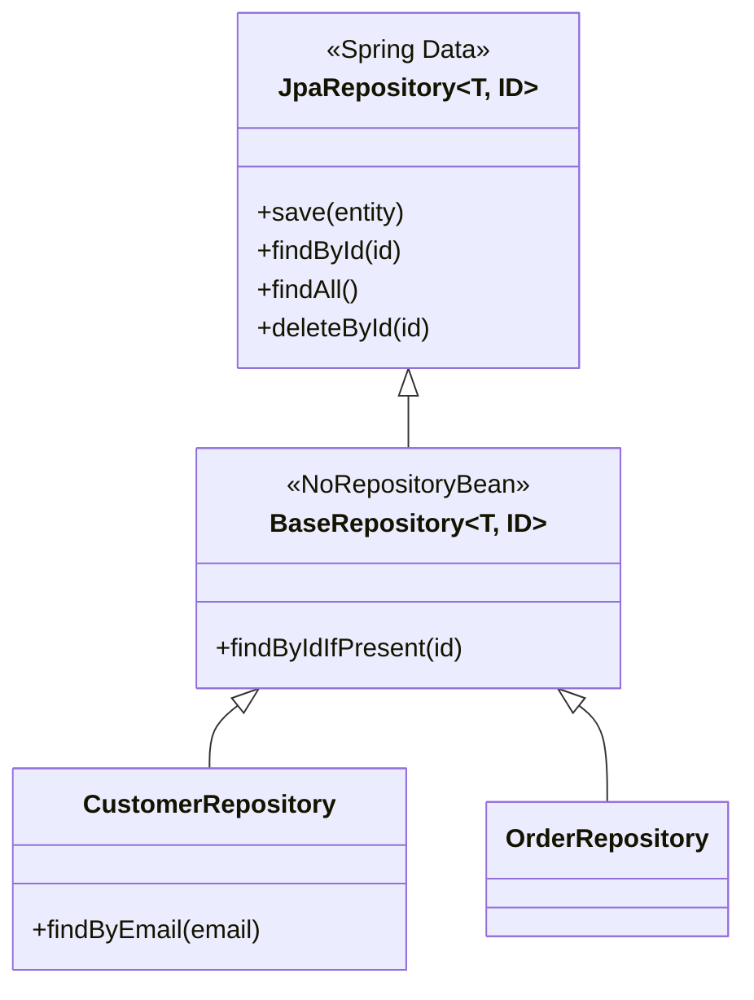

# Ngăn tạo Repository trung gian bằng @NoRepositoryBean

## 1. Vì sao cần Repository trung gian?

Spring Data JPA cho phép tạo repository interface để truy cập dữ liệu của một entity. Thông thường, mỗi interface cụ thể được Spring Data phát hiện sẽ được tạo một proxy bean để ứng dụng inject và sử dụng.

Khi nhiều entity cần chung một nhóm thao tác hoặc quy ước, ta có thể tạo một interface cơ sở generic, ví dụ `BaseRepository<T, ID>`, rồi cho các repository cụ thể kế thừa nó. Cách này giúp tập trung các phương thức dùng chung và tránh lặp lại khai báo.

Tuy nhiên, interface trung gian vẫn là một repository interface trong phạm vi quét của Spring Data. Nó chứa type variable như `T` và `ID`, chưa chỉ ra entity cụ thể. Spring Data không nên tạo một repository proxy độc lập cho interface generic đó vì không thể xác định chính xác domain type mà repository sẽ quản lý.

Annotation `@NoRepositoryBean` giải quyết đúng vấn đề này: nó đánh dấu interface trung gian là một repository contract để các interface khác kế thừa, nhưng yêu cầu Spring Data không tạo bean repository trực tiếp từ chính interface đó.

Mục tiêu là:

- `BaseRepository<T, ID>`: interface dùng chung, không được tạo repository bean riêng.
- `CustomerRepository extends BaseRepository<Customer, Long>`: repository cụ thể, được Spring Data tạo proxy bình thường.
- `OrderRepository extends BaseRepository<Order, UUID>`: repository cụ thể khác, cũng được tạo proxy với kiểu entity và ID tương ứng.

## 2. @NoRepositoryBean là gì?

`@NoRepositoryBean` là annotation của Spring Data, nằm trong package:

```java
import org.springframework.data.repository.NoRepositoryBean;
```

Nó được đặt trên interface repository trung gian để Spring Data bỏ qua việc tạo repository instance cho interface đó trong quá trình repository scanning.

Ví dụ tối thiểu:

```java
@NoRepositoryBean
public interface BaseRepository<T, ID>
        extends JpaRepository<T, ID> {
}
```

Ở đây:

- `T` là kiểu entity mà repository cụ thể sẽ quản lý.
- `ID` là kiểu của thuộc tính định danh entity.
- `JpaRepository<T, ID>` cung cấp các thao tác CRUD, phân trang, sắp xếp và một số thao tác JPA phổ biến.
- `@NoRepositoryBean` nói với Spring Data rằng không tạo proxy cho `BaseRepository` khi chỉ thấy interface generic này.

Annotation không tạo bean, không thay thế `JpaRepository`, không thay thế `@Entity`, và cũng không tự động thêm logic truy cập dữ liệu. Nó chỉ điều khiển việc Spring Data có tạo repository proxy trực tiếp cho interface được đánh dấu hay không.

## 3. Cách xây dựng BaseRepository và repository cụ thể

### 3.1. Tạo interface generic dùng chung

Ví dụ, ứng dụng muốn tất cả repository có thêm một tiện ích tìm theo ID nhưng xử lý an toàn khi ID là null:

```java
import java.util.Optional;

import org.springframework.data.jpa.repository.JpaRepository;
import org.springframework.data.repository.NoRepositoryBean;

@NoRepositoryBean
public interface BaseRepository<T, ID>
        extends JpaRepository<T, ID> {

    default Optional<T> findByIdIfPresent(ID id) {
        if (id == null) {
            return Optional.empty();
        }
        return findById(id);
    }
}
```

Phương thức `findByIdIfPresent` là default method của Java interface. Nó tái sử dụng `findById` được kế thừa từ `JpaRepository`. Mọi repository cụ thể kế thừa `BaseRepository` đều có thể gọi phương thức này.

Không nên đưa vào interface generic một derived query phụ thuộc vào thuộc tính chỉ tồn tại ở một số entity. Ví dụ, nếu khai báo `findAllByCreatedAtAfter(...)`, mọi entity dùng repository đó đều phải có thuộc tính tương ứng theo quy tắc đặt tên của Spring Data. Chỉ đưa phương thức như vậy vào base interface khi đó thực sự là quy ước chung của toàn bộ domain type kế thừa.

### 3.2. Tạo repository cụ thể

Giả sử ứng dụng có entity `Customer` với khóa chính kiểu `Long`:

```java
import java.util.Optional;

import org.springframework.data.jpa.repository.EntityGraph;

public interface CustomerRepository
        extends BaseRepository<Customer, Long> {

    Optional<Customer> findByEmail(String email);
}
```

Spring Data nhìn thấy kiểu generic đã được xác định:

- `T = Customer`
- `ID = Long`

Do đó, nó có thể tạo repository proxy cho `CustomerRepository`, ánh xạ các thao tác kế thừa từ `JpaRepository` vào entity `Customer`, đồng thời triển khai query method `findByEmail` theo tên thuộc tính.

Một repository khác có thể dùng entity và ID khác:

```java
public interface OrderRepository
        extends BaseRepository<Order, UUID> {
}
```

Hai repository cùng dùng logic chung nhưng vẫn có domain type và kiểu định danh riêng.

### 3.3. Sơ đồ quan hệ interface



Sơ đồ biểu diễn quan hệ kế thừa. `BaseRepository` là hợp đồng generic ở giữa; hai interface lá là repository cụ thể được Spring Data tạo proxy.

## 4. Spring Data xử lý @NoRepositoryBean như thế nào?

Khi ứng dụng khởi động, Spring Data thực hiện repository scanning trong các package được cấu hình. Nó tìm những interface đáp ứng điều kiện repository và tạo bean proxy cho các repository hợp lệ.

Nếu một interface trung gian generic không được đánh dấu `@NoRepositoryBean`, Spring Data có thể xem nó như một repository candidate cần khởi tạo. Nhưng interface đó chưa xác định entity cụ thể. Type variable `T` chưa thể đại diện cho một entity đã được JPA quản lý và `ID` cũng chưa xác định kiểu khóa chính.

Khi đánh dấu `@NoRepositoryBean`, Spring Data bỏ qua việc tạo repository proxy cho interface trung gian. Các interface con cụ thể vẫn được scan và tạo bean nếu chúng đáp ứng các điều kiện repository thông thường.

Điều quan trọng là annotation này không làm các phương thức của base interface biến mất. Các phương thức vẫn được kế thừa vào repository con. Chỉ có bean cho chính interface generic bị loại khỏi quá trình tạo repository.

Luồng khái quát:

1. Spring Data tìm thấy `BaseRepository<T, ID>`.
2. Annotation `@NoRepositoryBean` cho biết không tạo proxy trực tiếp cho interface này.
3. Spring Data tìm thấy `CustomerRepository extends BaseRepository<Customer, Long>`.
4. Generic type đã được cụ thể hóa thành `Customer` và `Long`.
5. Spring Data tạo proxy cho `CustomerRepository`.
6. Ứng dụng inject và gọi `CustomerRepository` như một Spring bean bình thường.

## 5. Điều gì xảy ra nếu thiếu @NoRepositoryBean?

Giả sử ta khai báo:

```java
public interface BaseRepository<T, ID>
        extends JpaRepository<T, ID> {
}
```

và interface này nằm trong package mà Spring Data đang scan. Spring Data có thể cố tạo repository cho interface generic đó. Vì không có entity cụ thể, quá trình xác định domain type hoặc khởi tạo repository có thể thất bại.

Thông báo chính xác phụ thuộc vào cấu trúc interface, query method, phiên bản Spring Data và thời điểm lỗi được phát hiện. Các triệu chứng có thể liên quan đến:

- Không xác định được domain type cho repository generic.
- Không thể tạo query vì kiểu entity hoặc thuộc tính chưa được xác định.
- Lỗi kiểu `Not a managed type` khi một kiểu chưa phải entity được dùng làm domain type.
- Lỗi tạo bean repository trong quá trình khởi động application context.

Không nên dựa vào một thông báo lỗi cố định để chẩn đoán mọi trường hợp. Hãy tìm repository interface được nêu trong nested cause và kiểm tra xem đó có phải interface generic trung gian cần `@NoRepositoryBean` hay không.

Cách sửa thông thường là:

```java
@NoRepositoryBean
public interface BaseRepository<T, ID>
        extends JpaRepository<T, ID> {
}
```

Sau đó giữ annotation ở interface trung gian, còn repository cụ thể vẫn không có annotation này.

## 6. Đặt annotation đúng vị trí

### 6.1. Đúng: đánh dấu interface trung gian generic

```java
@NoRepositoryBean
public interface BaseRepository<T, ID>
        extends JpaRepository<T, ID> {
}
```

Đây là trường hợp sử dụng phổ biến nhất. Interface chưa đại diện cho một entity cụ thể nên không cần bean proxy riêng.

### 6.2. Đúng: nhiều tầng interface trung gian

Một dự án có thể xây dựng nhiều tầng hợp đồng:

```java
@NoRepositoryBean
public interface ReadRepository<T, ID>
        extends Repository<T, ID> {

    Optional<T> findById(ID id);

    List<T> findAll();
}
```

```java
@NoRepositoryBean
public interface WriteRepository<T, ID>
        extends ReadRepository<T, ID> {

    <S extends T> S save(S entity);

    void deleteById(ID id);
}
```

Repository cụ thể:

```java
public interface CustomerRepository
        extends WriteRepository<Customer, Long> {
}
```

Mỗi interface trung gian generic mà Spring Data không nên khởi tạo trực tiếp cần được đánh dấu `@NoRepositoryBean`. Interface lá đã xác định đầy đủ entity và ID nên được Spring Data tạo proxy.

### 6.3. Sai: đánh dấu repository cụ thể

```java
@NoRepositoryBean
public interface CustomerRepository
        extends JpaRepository<Customer, Long> {
}
```

Trong trường hợp này, `CustomerRepository` là repository cụ thể mà ứng dụng cần inject. Đánh dấu nó bằng `@NoRepositoryBean` sẽ khiến Spring Data bỏ qua việc tạo bean repository cho interface đó. Khi service inject `CustomerRepository`, ứng dụng có thể gặp lỗi không tìm thấy bean phù hợp.

Hãy bỏ annotation khỏi repository cụ thể:

```java
public interface CustomerRepository
        extends JpaRepository<Customer, Long> {
}
```

### 6.4. Sai: dùng annotation thay cho @Entity

`@NoRepositoryBean` không biến một class thành entity và cũng không giúp Hibernate nhận diện entity. Entity vẫn cần được đánh dấu `@Entity` và nằm trong vùng quét JPA hoặc được khai báo qua cấu hình phù hợp.

Nếu lỗi là `Not a managed type: Customer`, hãy kiểm tra entity annotation và entity scanning. Chỉ thêm `@NoRepositoryBean` khi lỗi thực sự xuất phát từ interface repository trung gian generic bị Spring Data cố khởi tạo.

## 7. Generic type phải được khai báo đầy đủ

Khi repository cụ thể kế thừa base interface, hãy truyền chính xác entity type và ID type:

```java
public interface CustomerRepository
        extends BaseRepository<Customer, Long> {
}
```

Không dùng raw type:

```java
// Không nên
public interface CustomerRepository
        extends BaseRepository {
}
```

Raw type làm mất thông tin generic và có thể dẫn đến cảnh báo biên dịch, khó xác định domain type hoặc lỗi ở thời điểm runtime.

Kiểu ID phải khớp với thuộc tính `@Id` của entity:

```java
@Entity
public class Customer {

    @Id
    @GeneratedValue(strategy = GenerationType.IDENTITY)
    private Long id;

    private String email;

    // constructors, getters and setters
}
```

Với entity trên, repository nên dùng `Customer, Long`. Nếu entity sử dụng `UUID`, `String` hoặc một kiểu khóa khác, generic ID phải phản ánh đúng kiểu đó.

Không nên dùng `Object` làm kiểu ID chỉ để làm interface tổng quát hơn. Generic type có mục đích giữ thông tin kiểu chính xác cho từng repository.

## 8. Phương thức dùng chung trong base interface

### 8.1. Dùng lại phương thức từ JpaRepository

Nếu chỉ cần CRUD chuẩn, không cần khai báo lại các phương thức đã có trong `JpaRepository`. Repository cụ thể tự kế thừa chúng thông qua base interface.

### 8.2. Thêm default method không phụ thuộc vào thuộc tính riêng của entity

Ví dụ:

```java
@NoRepositoryBean
public interface BaseRepository<T, ID>
        extends JpaRepository<T, ID> {

    default Optional<T> findByIdIfPresent(ID id) {
        return id == null ? Optional.empty() : findById(id);
    }
}
```

Default method phù hợp với logic nhỏ có thể dùng chung cho mọi domain type. Spring Data repository proxy hỗ trợ default method trong interface repository.

### 8.3. Cẩn thận với derived query method

Spring Data tạo query từ tên phương thức dựa trên thuộc tính của domain class. Vì vậy một phương thức như:

```java
List<T> findByStatus(String status);
```

chỉ phù hợp nếu mọi entity kế thừa base interface đều có thuộc tính `status` mà Spring Data có thể phân giải. Nếu không, repository của entity không có thuộc tính đó có thể thất bại khi khởi tạo.

Nếu các entity có cấu trúc khác nhau, hãy đặt derived query trong repository cụ thể tương ứng:

```java
public interface CustomerRepository
        extends BaseRepository<Customer, Long> {

    List<Customer> findByStatus(CustomerStatus status);
}
```

Không đưa query method của một entity riêng vào base interface chỉ để giảm số dòng khai báo.

### 8.4. Khi logic dùng chung trở nên phức tạp

Nếu cần triển khai logic tùy chỉnh lớn, có thể dùng repository fragment hoặc custom repository base class. `@NoRepositoryBean` chỉ giải quyết việc không tạo proxy cho interface trung gian; nó không tự động cung cấp implementation cho những phương thức trừu tượng tùy chỉnh.

Với repository fragment, định nghĩa một interface chức năng và implementation tương ứng, rồi ghép fragment vào repository cần dùng. Với custom base class, cấu hình `repositoryBaseClass` trong `@EnableJpaRepositories` để Spring Data sử dụng implementation nền phù hợp.

Không nên biến `BaseRepository` thành nơi chứa mọi nghiệp vụ của tất cả entity. Chỉ giữ những hành vi thực sự phổ biến và có cùng ngữ nghĩa.

## 9. Phạm vi repository scanning

Spring Boot thường tìm repository trong package của class `@SpringBootApplication` và các package con. Nếu repository nằm ngoài phạm vi mặc định, có thể cấu hình rõ bằng `@EnableJpaRepositories`:

```java
@Configuration
@EnableJpaRepositories(
    basePackages = "com.example.app.repository"
)
public class JpaRepositoryConfig {
}
```

Nếu `BaseRepository` và repository cụ thể nằm trong package được scan, Spring Data sẽ áp dụng `@NoRepositoryBean` khi phân loại repository candidate.

Khi gặp lỗi không tìm thấy repository bean, hãy kiểm tra:

- Interface cụ thể có nằm trong package được scan không?
- Có cấu hình `@EnableJpaRepositories` giới hạn package không?
- Repository cụ thể có bị đánh dấu nhầm `@NoRepositoryBean` không?
- Repository có kế thừa một base interface với generic type đã cụ thể hóa không?
- Profile hoặc điều kiện cấu hình có vô hiệu hóa cấu hình JPA không?

Không cần đặt `@Repository` lên mọi Spring Data repository interface thông thường. Spring Data tự đăng ký proxy repository bean khi scan thành công.

## 10. Kiểm tra repository được tạo đúng

Có thể dùng một JPA slice test để xác nhận repository cụ thể được Spring tạo bean:

```java
@DataJpaTest
class CustomerRepositoryTest {

    @Autowired
    private CustomerRepository customerRepository;

    @Test
    void createsConcreteRepositoryBean() {
        assertThat(customerRepository).isNotNull();
    }
}
```

Test này xác nhận application context của JPA test slice có thể tạo và inject `CustomerRepository`. Nó không yêu cầu có bean riêng cho `BaseRepository`.

Có thể kiểm tra thêm hành vi kế thừa:

```java
@Test
void inheritedMethodCanBeUsed() {
    Customer customer = new Customer();
    customer.setEmail("lan@example.com");

    Customer saved = customerRepository.save(customer);

    assertThat(customerRepository.findByIdIfPresent(saved.getId()))
        .isPresent();
}
```

Test này giả định entity `Customer` có setter `setEmail`, khóa chính được sinh khi lưu và test database đã được cấu hình. Nó chứng minh repository cụ thể dùng được phương thức từ `JpaRepository` và default method từ `BaseRepository`.

Nếu muốn kiểm tra rằng không có bean được tạo cho interface trung gian, có thể truy vấn ApplicationContext theo kiểu generic đã được resolve hoặc kiểm tra repository bean definitions. Tuy nhiên, với thiết kế thông thường, việc inject và sử dụng repository cụ thể là kiểm tra quan trọng nhất. Không nên viết test phụ thuộc vào tên bean nội bộ do Spring Data sinh ra nếu không có nhu cầu cụ thể.

## 11. Chẩn đoán các lỗi thường gặp

| Triệu chứng | Nguyên nhân có thể | Hướng xử lý |
|---|---|---|
| Spring cố tạo bean cho base repository generic | Thiếu `@NoRepositoryBean` trên interface trung gian | Thêm annotation vào base interface cần bỏ qua |
| Không tìm thấy bean `CustomerRepository` | Đánh dấu nhầm repository cụ thể bằng `@NoRepositoryBean`, hoặc package không được scan | Bỏ annotation ở interface lá và kiểm tra repository scanning |
| `Not a managed type` | Entity chưa được JPA quản lý, hoặc base repository bị khởi tạo với domain type không hợp lệ | Kiểm tra `@Entity`, entity scan và generic type |
| Không thể xác định domain type | Repository kế thừa raw type hoặc generic chưa được cụ thể hóa | Dùng `BaseRepository<Customer, Long>` |
| Query creation exception khi khởi động | Derived query trong base interface tham chiếu property không có ở entity con | Chuyển query về repository cụ thể hoặc bảo đảm property tồn tại ở mọi entity |
| Lỗi kiểu ID | Generic ID không khớp với kiểu `@Id` | Khai báo đúng `Long`, `UUID`, `String` hoặc kiểu thực tế |
| Repository không được phát hiện | Package nằm ngoài vùng scan hoặc cấu hình `@EnableJpaRepositories` sai | Điều chỉnh base package và cấu hình JPA |
| Service báo không có bean khi inject | Interface cần inject bị loại khỏi repository scanning hoặc cấu hình context không tạo repository | Xác định interface cụ thể và kiểm tra annotation/package/profile |

Một nguyên tắc chẩn đoán hữu ích: nếu lỗi nhắc tới base interface generic, kiểm tra `@NoRepositoryBean`; nếu lỗi nhắc tới entity cụ thể, kiểm tra mapping và entity scanning; nếu lỗi nhắc tới query method, kiểm tra tên property và kiểu tham số.

## 12. Những điều @NoRepositoryBean không làm

Để tránh dùng sai, cần phân biệt rõ phạm vi của annotation:

- Không tạo repository bean. Nó ngăn tạo bean trực tiếp cho interface được đánh dấu.
- Không ngăn các repository con kế thừa phương thức từ base interface.
- Không thay thế `@Entity`, `@Id`, `@EnableJpaRepositories` hoặc cấu hình DataSource.
- Không sửa lỗi kết nối database, lỗi schema hoặc lỗi transaction.
- Không tự triển khai phương thức tùy chỉnh trừ khi phương thức là default method hoặc có implementation fragment/base class tương ứng.
- Không phải annotation để đánh dấu service, component hoặc class entity.
- Không nên đặt trên repository cụ thể mà ứng dụng cần inject.

Hiểu đúng phạm vi giúp khoanh vùng lỗi và tránh thêm annotation vào sai tầng.

## 13. Checklist khi xây dựng repository generic

- [ ] Base interface thực sự dùng chung cho nhiều entity.
- [ ] Base interface khai báo generic type `T` và `ID` phù hợp.
- [ ] Base interface được đánh dấu `@NoRepositoryBean`.
- [ ] Repository cụ thể kế thừa base interface với entity và ID đầy đủ.
- [ ] Repository cụ thể không bị đánh dấu `@NoRepositoryBean`.
- [ ] Entity có `@Entity` và thuộc tính `@Id` đúng kiểu.
- [ ] Derived query trong base interface chỉ dùng property có trên mọi entity kế thừa.
- [ ] Repository scanning bao phủ package của repository cụ thể.
- [ ] Custom method có implementation phù hợp: default method, fragment hoặc base class.
- [ ] JPA slice test khởi tạo và inject được repository cụ thể.
- [ ] Test xác nhận các phương thức kế thừa hoạt động đúng.

## 14. Kết luận

`@NoRepositoryBean` là annotation cần thiết khi xây dựng repository interface trung gian generic cho Spring Data JPA. Nó ngăn Spring Data tạo proxy cho interface chưa xác định entity và ID cụ thể, trong khi vẫn cho phép repository con kế thừa các phương thức dùng chung.

Hãy đặt annotation trên từng interface trung gian cần bỏ qua, cụ thể hóa đầy đủ generic type ở repository lá, và giữ repository cụ thể không có `@NoRepositoryBean`. Khi có lỗi khởi động, phân biệt lỗi tạo proxy generic, lỗi entity mapping, lỗi query method và lỗi repository scanning để xử lý đúng nguyên nhân.
