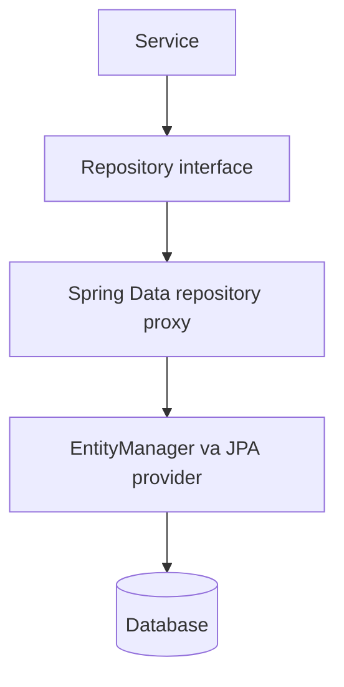
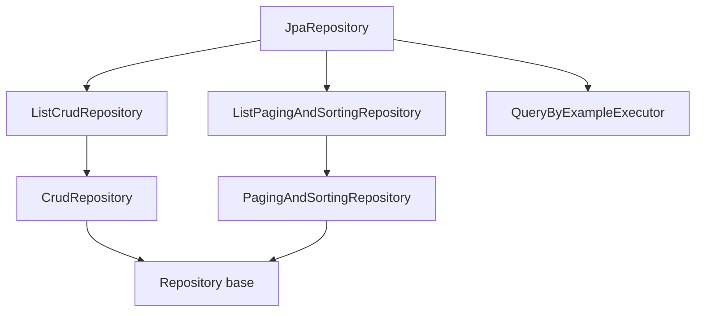

# ListCrudRepository, PagingAndSortingRepository và JpaRepository

## 1. Mục tiêu

Spring Data cung cấp các interface Repository để ứng dụng truy cập dữ liệu mà không phải tự viết lớp triển khai cho những thao tác phổ biến. Bài học này tập trung vào `ListCrudRepository`, `PagingAndSortingRepository` và `JpaRepository`, đồng thời đặt chúng trong mối quan hệ với `CrudRepository` và `ListPagingAndSortingRepository`.

Sau bài học, bạn có thể:
- Phân biệt trách nhiệm của các interface CRUD, List CRUD, paging và sorting.
- Giải thích thay đổi quan trọng trong quan hệ kế thừa từ Spring Data 3.0.
- Chọn interface phù hợp theo loại persistence store và API mà Service cần.
- Viết repository có derived query, sắp xếp và phân trang.
- Phân biệt `Page`, `Slice`, `flush`, `commit` và các thao tác JPA theo lô.

## 2. Repository trong Spring Data hoạt động như thế nào?

`Repository<T, ID>` là interface đánh dấu trung tâm của Spring Data. Khi ứng dụng khởi động, Spring Data phát hiện các interface repository trong phạm vi quét, tạo proxy thực thi thao tác dữ liệu và đăng ký proxy đó thành Spring bean để Service có thể inject.

Bạn chỉ cần khai báo interface và các phương thức cần dùng. Spring Data cung cấp phần triển khai cho các phương thức kế thừa; với derived query, framework phân tích tên phương thức để tạo truy vấn. Với truy vấn phức tạp, có thể dùng `@Query` hoặc cơ chế mở rộng phù hợp.



`T` là kiểu Entity hoặc domain type; `ID` là kiểu khóa chính. Ví dụ `JpaRepository<Book, Long>` quản lý Entity `Book` có khóa chính kiểu `Long`.

## 3. Cây kế thừa và thay đổi từ Spring Data 3.0

Trong Spring Data 3.x, các interface được tách thành nhánh CRUD và nhánh paging/sorting. `JpaRepository` kết hợp các interface cần thiết cho ứng dụng dùng JPA.



**Điểm cần nhớ từ Spring Data 3.0:** `PagingAndSortingRepository` không còn kế thừa `CrudRepository`. Vì vậy, chỉ kế thừa `PagingAndSortingRepository` sẽ không tự có `save`, `findById` hoặc `delete`.

Trong các phiên bản Spring Data 2.x trước đây, `PagingAndSortingRepository` từng kế thừa `CrudRepository`. Khi nâng cấp lên Spring Data 3.x, mã nguồn dựa vào quan hệ kế thừa cũ có thể không biên dịch. Nếu cần cả CRUD và paging/sorting, hãy kết hợp các interface tương ứng hoặc dùng `JpaRepository` trong ứng dụng JPA.

`ListCrudRepository` và `ListPagingAndSortingRepository` cũng được bổ sung trong Spring Data 3.0. Nếu dự án đang dùng Spring Data 2.x, các interface List này chưa có; hãy kiểm tra phiên bản Spring Data thực tế trước khi áp dụng ví dụ.

## 4. Phân biệt các interface

### `CrudRepository<T, ID>`

Đây là lựa chọn cơ bản cho các thao tác tạo, đọc, cập nhật và xóa. Các phương thức thường dùng gồm:

| Phương thức | Ý nghĩa |
| --- | --- |
| `save(entity)` | Lưu một Entity và trả về instance được lưu. |
| `saveAll(entities)` | Lưu nhiều Entity. |
| `findById(id)` | Tìm theo khóa chính, trả về `Optional<T>`. |
| `existsById(id)` | Kiểm tra khóa chính có tồn tại. |
| `findAll()` | Lấy tất cả Entity, trả về `Iterable<T>`. |
| `findAllById(ids)` | Lấy Entity theo danh sách ID, trả về `Iterable<T>`. |
| `count()` | Đếm số Entity. |
| `deleteById(id)`, `delete(entity)`, `deleteAll()` | Xóa theo ID, theo Entity hoặc xóa toàn bộ. |

`CrudRepository` không cung cấp trực tiếp API `findAll(Pageable)` hoặc `findAll(Sort)`. Khi chỉ cần CRUD tổng quát và chấp nhận kiểu trả về `Iterable`, interface này là đủ.

### `ListCrudRepository<T, ID>`

`ListCrudRepository` kế thừa `CrudRepository` và ghi đè các phương thức trả về tập hợp để dùng `List` thay cho `Iterable`. Những phương thức tiêu biểu:

- `<S extends T> List<S> saveAll(Iterable<S> entities)`.
- `List<T> findAll()`.
- `List<T> findAllById(Iterable<ID> ids)`.

Các thao tác CRUD còn lại vẫn được kế thừa. Interface này phù hợp khi Service thường xuyên cần duyệt, sắp xếp hoặc xử lý kết quả dưới dạng `List`.

### `PagingAndSortingRepository<T, ID>`

Interface này bổ sung thao tác lấy dữ liệu có sắp xếp hoặc phân trang:

- `Iterable<T> findAll(Sort sort)` lấy các bản ghi theo thứ tự yêu cầu.
- `Page<T> findAll(Pageable pageable)` lấy một trang dữ liệu cùng thông tin phân trang.

Trong Spring Data 3.x, interface này chỉ tập trung vào paging và sorting. Muốn có CRUD, cần kết hợp thêm `CrudRepository` hoặc `ListCrudRepository`.

### `ListPagingAndSortingRepository<T, ID>`

Đây là biến thể của `PagingAndSortingRepository`, ghi đè phương thức `findAll(Sort sort)` để trả về `List<T>` thay vì `Iterable<T>`. Phương thức phân trang vẫn trả về `Page<T>` vì kết quả cần chứa cả nội dung trang và metadata.

Khi cần CRUD với kiểu List cùng paging/sorting mà không cần API riêng của JPA, có thể kết hợp `ListCrudRepository` và `ListPagingAndSortingRepository`.

### `JpaRepository<T, ID>`

`JpaRepository` là lựa chọn phổ biến cho ứng dụng dùng Jakarta Persistence (JPA). Trong Spring Data JPA 3.x, interface này kết hợp `ListCrudRepository`, `ListPagingAndSortingRepository` và `QueryByExampleExecutor`.

Do đó, nó cung cấp:
- Các thao tác CRUD với kiểu trả về List ở những phương thức tập hợp tương ứng.
- Sắp xếp và phân trang.
- Các API JPA như `flush`, `saveAndFlush`, `saveAllAndFlush`, `getReferenceById` và các thao tác xóa theo lô.
- Các phương thức Query by Example được kế thừa từ `QueryByExampleExecutor`.

Chọn `JpaRepository` khi persistence layer dùng JPA/Hibernate và bạn cần những khả năng này. Với MongoDB, Redis hoặc một persistence store khác, hãy dùng interface phù hợp của module tương ứng thay vì phụ thuộc `JpaRepository`.

## 5. Chọn interface nào?

| Nhu cầu | Lựa chọn phù hợp |
| --- | --- |
| CRUD tổng quát, kết quả tập hợp dạng `Iterable` | `CrudRepository` |
| CRUD tổng quát, muốn `List` | `ListCrudRepository` |
| Chỉ cần sắp xếp và phân trang | `PagingAndSortingRepository` |
| Sắp xếp/phân trang và muốn kết quả sắp xếp dạng `List` | `ListPagingAndSortingRepository` |
| Dùng JPA và cần CRUD, List, paging, sorting cùng API JPA | `JpaRepository` |
| Cần CRUD cùng paging/sorting trên Spring Data 3.x nhưng không cần JPA API | Kết hợp `CrudRepository` với `PagingAndSortingRepository`, hoặc `ListCrudRepository` với `ListPagingAndSortingRepository` |

Không cần kế thừa mọi interface để có thật nhiều phương thức. Chọn mức API phù hợp với persistence technology và cách Service sử dụng kết quả.

## 6. Ví dụ dự án Spring Data JPA

Ví dụ dùng Java 17+, Maven, Spring Boot 3.5.0, Spring Data JPA và H2. Miền dữ liệu là `Book`, với tên sách, tác giả và trạng thái còn được phép mượn.

### Cấu trúc thư mục

```text
src/
  main/
    java/com/example/library/
      LibraryApplication.java
      book/
        Book.java
        BookRepository.java
    resources/
      application.properties
  test/
    java/com/example/library/book/
      BookRepositoryTest.java
pom.xml
```

### `pom.xml`

```xml
<?xml version="1.0" encoding="UTF-8"?>
<project xmlns="http://maven.apache.org/POM/4.0.0"
         xmlns:xsi="http://www.w3.org/2001/XMLSchema-instance"
         xsi:schemaLocation="http://maven.apache.org/POM/4.0.0 https://maven.apache.org/xsd/maven-4.0.0.xsd">
    <modelVersion>4.0.0</modelVersion>

    <parent>
        <groupId>org.springframework.boot</groupId>
        <artifactId>spring-boot-starter-parent</artifactId>
        <version>3.5.0</version>
        <relativePath/>
    </parent>

    <groupId>com.example</groupId>
    <artifactId>library-repository</artifactId>
    <version>0.0.1-SNAPSHOT</version>

    <properties>
        <java.version>17</java.version>
    </properties>

    <dependencies>
        <dependency>
            <groupId>org.springframework.boot</groupId>
            <artifactId>spring-boot-starter-data-jpa</artifactId>
        </dependency>
        <dependency>
            <groupId>com.h2database</groupId>
            <artifactId>h2</artifactId>
            <scope>runtime</scope>
        </dependency>
        <dependency>
            <groupId>org.springframework.boot</groupId>
            <artifactId>spring-boot-starter-test</artifactId>
            <scope>test</scope>
        </dependency>
    </dependencies>

    <build>
        <plugins>
            <plugin>
                <groupId>org.springframework.boot</groupId>
                <artifactId>spring-boot-maven-plugin</artifactId>
            </plugin>
        </plugins>
    </build>
</project>
```

### Lớp khởi động

`src/main/java/com/example/library/LibraryApplication.java`:

```java
package com.example.library;

import org.springframework.boot.SpringApplication;
import org.springframework.boot.autoconfigure.SpringBootApplication;

@SpringBootApplication
public class LibraryApplication {
    public static void main(String[] args) {
        SpringApplication.run(LibraryApplication.class, args);
    }
}
```

`@SpringBootApplication` đặt component scan ở package `com.example.library`, do đó Entity và Repository trong package con `book` được phát hiện tự động.

### Entity `Book`

`src/main/java/com/example/library/book/Book.java`:

```java
package com.example.library.book;

import jakarta.persistence.Column;
import jakarta.persistence.Entity;
import jakarta.persistence.GeneratedValue;
import jakarta.persistence.GenerationType;
import jakarta.persistence.Id;
import jakarta.persistence.Table;

@Entity
@Table(name = "books")
public class Book {
    @Id
    @GeneratedValue(strategy = GenerationType.IDENTITY)
    private Long id;

    @Column(nullable = false, length = 160)
    private String title;

    @Column(nullable = false, length = 120)
    private String author;

    @Column(nullable = false)
    private boolean available;

    protected Book() {
        // JPA cần constructor không tham số.
    }

    public Book(String title, String author, boolean available) {
        String normalizedTitle = title == null ? "" : title.trim();
        String normalizedAuthor = author == null ? "" : author.trim();

        if (normalizedTitle.isEmpty() || normalizedTitle.length() > 160) {
            throw new IllegalArgumentException("Title must contain 1 to 160 characters");
        }
        if (normalizedAuthor.isEmpty() || normalizedAuthor.length() > 120) {
            throw new IllegalArgumentException("Author must contain 1 to 120 characters");
        }

        this.title = normalizedTitle;
        this.author = normalizedAuthor;
        this.available = available;
    }

    public Long getId() {
        return id;
    }

    public String getTitle() {
        return title;
    }

    public String getAuthor() {
        return author;
    }

    public boolean isAvailable() {
        return available;
    }
}
```

Các điểm chính:
- `@Entity` đăng ký lớp với JPA; `@Table` chỉ định bảng `books`.
- `@Id` và `@GeneratedValue` khai báo khóa chính tự sinh.
- JPA cần constructor không tham số; constructor `protected` là lựa chọn phù hợp.
- Các trường được ánh xạ theo field access vì `@Id` đặt trên field.
- Constructor công khai kiểm tra dữ liệu cơ bản để tránh tạo đối tượng có tên sách hoặc tác giả rỗng.

### Repository dùng `JpaRepository`

`src/main/java/com/example/library/book/BookRepository.java`:

```java
package com.example.library.book;

import java.util.List;
import org.springframework.data.domain.Page;
import org.springframework.data.domain.Pageable;
import org.springframework.data.domain.Slice;
import org.springframework.data.domain.Sort;
import org.springframework.data.jpa.repository.JpaRepository;

public interface BookRepository extends JpaRepository<Book, Long> {
    List<Book> findByAuthorIgnoreCase(String author);

    List<Book> findByAuthorIgnoreCase(String author, Sort sort);

    Page<Book> findByAvailableTrue(Pageable pageable);

    Slice<Book> findByTitleContainingIgnoreCase(String keyword, Pageable pageable);
}
```

Không cần viết class `BookRepositoryImpl` cho các phương thức trên. Spring Data tạo implementation cho các thao tác kế thừa và phân tích tên phương thức để tạo truy vấn cho các derived query.

Ý nghĩa các phương thức tự khai báo:
- `findByAuthorIgnoreCase` tìm sách theo tác giả, không phân biệt chữ hoa/chữ thường.
- Phiên bản có tham số `Sort` cho phép bên gọi chọn thứ tự kết quả.
- `findByAvailableTrue` chỉ lấy sách có `available = true` và chia kết quả thành trang.
- `findByTitleContainingIgnoreCase` tìm tiêu đề có chứa từ khóa, không phân biệt chữ hoa/chữ thường; `Slice` phù hợp khi chỉ cần biết còn trang tiếp theo hay không.

## 7. Kết hợp CRUD với paging/sorting trong Spring Data 3.x

Nếu không dùng JPA nhưng cần cả CRUD và paging/sorting, bạn có thể kết hợp các interface một cách tường minh.

Ví dụ muốn dùng kiểu `Iterable` cho CRUD:

```java
import org.springframework.data.repository.CrudRepository;
import org.springframework.data.repository.PagingAndSortingRepository;

public interface BookCrudPagingRepository
        extends CrudRepository<Book, Long>,
                PagingAndSortingRepository<Book, Long> {
}
```

Ví dụ muốn dùng `List` cho các kết quả tập hợp:

```java
import org.springframework.data.repository.ListCrudRepository;
import org.springframework.data.repository.ListPagingAndSortingRepository;

public interface BookListCrudPagingRepository
        extends ListCrudRepository<Book, Long>,
                ListPagingAndSortingRepository<Book, Long> {
}
```

Hai đoạn trên là hai cách khai báo thay thế nhau để minh họa quan hệ interface. Trong một ứng dụng, hãy chọn interface repository thực sự cần dùng cho từng domain type và tránh tạo các repository trùng chức năng chỉ để gom nhiều API vào cùng một chỗ.

## 8. Sắp xếp với `Sort`

`Sort` mô tả thứ tự của kết quả dựa trên tên thuộc tính của Entity. Có thể sắp xếp tăng dần, giảm dần hoặc ghép nhiều điều kiện.

```java
import org.springframework.data.domain.Sort;

Sort sortByAuthorThenTitle = Sort.by(
        Sort.Order.asc("author"),
        Sort.Order.asc("title"));

List<Book> books = bookRepository.findByAuthorIgnoreCase("Nguyen Van A", sortByAuthorThenTitle);
```

Ví dụ trên yêu cầu kết quả được sắp xếp theo `author`, sau đó theo `title`. Tên dùng trong `Sort` là tên thuộc tính Java của Entity, không nhất thiết là tên cột trong database.

Có thể tạo thứ tự bằng cách ghép các Sort:

```java
Sort sort = Sort.by("title").ascending()
        .and(Sort.by("id").ascending());
```

Khi phân trang, nên có thứ tự ổn định. Nếu nhiều bản ghi có cùng `title`, thêm một thuộc tính duy nhất như `id` làm tiêu chí phụ giúp các trang ít bị trùng hoặc bỏ sót bản ghi khi dữ liệu không đổi.

Nếu nhận tên cột sắp xếp từ request bên ngoài, hãy giới hạn bằng danh sách thuộc tính được cho phép. Không chuyển trực tiếp mọi chuỗi do client gửi vào `Sort` vì thuộc tính không tồn tại có thể làm truy vấn lỗi và API sẽ khó kiểm soát.

## 9. Phân trang với `Pageable`, `Page` và `Slice`

`Pageable` mô tả số trang, kích thước trang và thứ tự sắp xếp. `PageRequest` là một cách phổ biến để tạo `Pageable`.

```java
import org.springframework.data.domain.Page;
import org.springframework.data.domain.PageRequest;
import org.springframework.data.domain.Pageable;
import org.springframework.data.domain.Sort;

Pageable pageable = PageRequest.of(
        0,
        20,
        Sort.by("title").ascending().and(Sort.by("id").ascending()));

Page<Book> page = bookRepository.findByAvailableTrue(pageable);

System.out.println("Số bản ghi trong trang: " + page.getNumberOfElements());
System.out.println("Tổng số bản ghi: " + page.getTotalElements());
System.out.println("Tổng số trang: " + page.getTotalPages());
System.out.println("Còn trang tiếp theo: " + page.hasNext());
```

`PageRequest.of(0, 20, ...)` yêu cầu trang đầu tiên với tối đa 20 bản ghi. Chỉ số trang bắt đầu từ 0, không phải 1.

`Page<T>` chứa nội dung trang và metadata như:
- `getContent()`: danh sách Entity của trang hiện tại.
- `getNumber()`: chỉ số trang hiện tại, bắt đầu từ 0.
- `getSize()`: kích thước trang được yêu cầu.
- `getNumberOfElements()`: số phần tử thực tế trong trang hiện tại.
- `getTotalElements()`: tổng số bản ghi thỏa điều kiện.
- `getTotalPages()`: tổng số trang.
- `hasNext()` và `hasPrevious()`: kiểm tra trang kế tiếp hoặc trang trước.

Để tính tổng số bản ghi và số trang, truy vấn kiểu `Page` thường cần count query bổ sung. Spring Data có thể tối ưu việc đếm trong một số trường hợp, nhưng count query vẫn có thể là chi phí đáng kể với bảng lớn hoặc điều kiện lọc phức tạp.

### Khi nào dùng `Slice<T>`?

`Slice<T>` chứa nội dung trang và thông tin có trang tiếp theo hay không, nhưng không cung cấp tổng số bản ghi hoặc tổng số trang. Nếu giao diện chỉ cần nút Tiếp theo và không cần hiển thị tổng số trang, `Slice` thường phù hợp hơn. Provider thường lấy thêm một bản ghi để xác định còn trang kế tiếp.

```java
Slice<Book> slice = bookRepository.findByTitleContainingIgnoreCase(
        "spring",
        PageRequest.of(0, 20, Sort.by("title").ascending()));

List<Book> currentBooks = slice.getContent();
boolean hasMore = slice.hasNext();
```

`Page` phù hợp khi cần tổng số kết quả; `Slice` phù hợp khi chỉ cần biết còn dữ liệu để tải tiếp. Cả hai đều có thể được dùng với `Pageable` trong derived query.

## 10. Các API riêng của `JpaRepository`

Ngoài CRUD, paging và sorting, `JpaRepository` cung cấp một số thao tác gắn với JPA.

| API | Công dụng | Lưu ý |
| --- | --- | --- |
| `flush()` | Đồng bộ các thay đổi đang chờ trong persistence context xuống database. | Không đồng nghĩa transaction đã commit. |
| `saveAndFlush(entity)` | Lưu Entity rồi flush ngay. | Transaction vẫn có thể rollback sau đó. |
| `saveAllAndFlush(entities)` | Lưu một nhóm Entity rồi flush. | Flush không thay thế chiến lược batch JDBC. |
| `getReferenceById(id)` | Lấy một reference cho Entity theo ID. | Không nhất thiết truy vấn database ngay; có thể phát sinh `EntityNotFoundException` khi reference được truy cập nếu bản ghi không tồn tại. |
| `deleteAllInBatch()` | Xóa tất cả Entity bằng thao tác bulk. | Bỏ qua vòng đời từng Entity và có thể làm persistence context đang mở không đồng bộ với database. |
| `deleteAllByIdInBatch(ids)` | Xóa theo một nhóm ID bằng bulk operation. | Cần hiểu tác động lên cache và quan hệ Entity. |

### `flush()` khác `commit()`

JPA có persistence context để theo dõi Entity đang được quản lý. Khi thuộc tính thay đổi, provider có thể trì hoãn SQL cho tới thời điểm flush. `flush()` yêu cầu provider đồng bộ các thay đổi đang chờ với database.

Commit là bước hoàn tất transaction. Flush có thể xảy ra trước commit, và transaction vẫn có thể rollback sau một lần flush. Dùng `saveAndFlush` khi cần buộc đồng bộ sớm, chẳng hạn muốn phát hiện lỗi constraint trước khi tiếp tục một phần logic khác trong cùng transaction; không gọi nó theo thói quen sau mọi `save`.

### `findById()` khác `getReferenceById()`

- `findById(id)` trả về `Optional<T>` và phù hợp khi cần biết chắc bản ghi có tồn tại hay không.
- `getReferenceById(id)` trả về reference do JPA provider quản lý. Reference có thể là proxy chưa tải dữ liệu; lỗi không tìm thấy có thể chỉ xuất hiện khi truy cập thuộc tính của nó.

Khi cần trả lỗi nghiệp vụ rõ ràng cho ID không tồn tại, `findById(...).orElseThrow(...)` thường dễ hiểu hơn.

### Cẩn thận với thao tác xóa theo lô

Các phương thức như `deleteAllInBatch` dùng bulk query thay vì gọi thao tác xóa trên từng Entity. Vì vậy, callback vòng đời như `@PreRemove` không chạy cho từng đối tượng và quy tắc cascade remove của thao tác xóa Entity thông thường không được áp dụng như cách xóa từng Entity. Persistence context đang mở cũng có thể giữ trạng thái cũ sau bulk query.

Chỉ dùng batch delete khi hiểu rõ các tác động này. Nếu cần callback, cascade hoặc xử lý nghiệp vụ cho từng bản ghi, hãy tải Entity và xóa theo cách thông thường trong transaction phù hợp.

## 11. Kiểm thử repository

`@DataJpaTest` tạo test slice cho JPA: cấu hình EntityManager, repository và database nhúng nếu có trên classpath. H2 trong ví dụ được dùng làm database kiểm thử.

`src/main/resources/application.properties`:

```properties
spring.datasource.url=jdbc:h2:mem:librarydb;DB_CLOSE_DELAY=-1
spring.datasource.driver-class-name=org.h2.Driver
spring.datasource.username=sa
spring.datasource.password=
spring.jpa.hibernate.ddl-auto=create-drop
spring.jpa.open-in-view=false
spring.jpa.show-sql=true
```

`src/test/java/com/example/library/book/BookRepositoryTest.java`:

```java
package com.example.library.book;

import static org.assertj.core.api.Assertions.assertThat;

import java.util.List;
import org.junit.jupiter.api.Test;
import org.springframework.beans.factory.annotation.Autowired;
import org.springframework.boot.test.autoconfigure.orm.jpa.DataJpaTest;
import org.springframework.data.domain.Page;
import org.springframework.data.domain.PageRequest;
import org.springframework.data.domain.Sort;

@DataJpaTest
class BookRepositoryTest {
    @Autowired
    private BookRepository bookRepository;

    @Test
    void findsAuthorBooksAsSortedList() {
        bookRepository.saveAll(List.of(
                new Book("Zulu", "A. Writer", true),
                new Book("Alpha", "a. writer", true),
                new Book("Other", "B. Writer", true)));
        bookRepository.flush();

        List<Book> books = bookRepository.findByAuthorIgnoreCase(
                "A. WRITER", Sort.by("title").ascending());

        assertThat(books)
                .extracting(Book::getTitle)
                .containsExactly("Alpha", "Zulu");
    }

    @Test
    void returnsPageContentAndTotalCount() {
        bookRepository.saveAll(List.of(
                new Book("Alpha", "Writer A", true),
                new Book("Beta", "Writer B", true),
                new Book("Gamma", "Writer C", true),
                new Book("Hidden", "Writer D", false)));
        bookRepository.flush();

        Page<Book> page = bookRepository.findByAvailableTrue(
                PageRequest.of(0, 2, Sort.by("title").ascending().and(Sort.by("id").ascending())));

        assertThat(page.getContent())
                .extracting(Book::getTitle)
                .containsExactly("Alpha", "Beta");
        assertThat(page.getTotalElements()).isEqualTo(3);
        assertThat(page.getTotalPages()).isEqualTo(2);
        assertThat(page.hasNext()).isTrue();
    }
}
```

Chạy kiểm thử từ thư mục chứa `pom.xml`:

```bash
mvn test
```

Kết quả mong đợi là Maven kết thúc với `BUILD SUCCESS` và cả hai test đều thành công. Test đầu kiểm tra derived query cùng sắp xếp. Test thứ hai kiểm tra nội dung trang, tổng số bản ghi và số trang. Đây là kết quả kỳ vọng khi chạy ví dụ với các dependency và cấu hình đã nêu; chưa có lệnh build nào được chạy trong môi trường của bài học.

## 12. Lỗi thường gặp và cách xử lý

| Hiện tượng | Nguyên nhân | Cách xử lý |
| --- | --- | --- |
| `PagingAndSortingRepository` không có `save` hoặc `findById` | Dự án dùng Spring Data 3.x, nơi interface này không còn kế thừa `CrudRepository`. | Kế thừa thêm `CrudRepository`/`ListCrudRepository`, hoặc dùng `JpaRepository` nếu dùng JPA. |
| Không tìm thấy `ListCrudRepository` | Phiên bản Spring Data quá cũ. | Dùng phiên bản Spring Data 3.0 trở lên hoặc giữ interface phù hợp với phiên bản đang dùng. |
| Repository không được tạo thành bean | Interface nằm ngoài package scan hoặc cấu hình repository chưa đúng. | Đặt repository dưới package của lớp `@SpringBootApplication` hoặc cấu hình `@EnableJpaRepositories`. |
| Derived query không chạy | Tên thuộc tính trong phương thức không khớp Entity hoặc từ khóa đặt sai. | Kiểm tra chính tả tên thuộc tính và cú pháp query derivation. |
| `Sort` báo không có thuộc tính | Dùng tên cột database thay cho thuộc tính Java hoặc gửi một field không hợp lệ. | Dùng đúng thuộc tính Entity và giới hạn sort field đầu vào. |
| Trang dữ liệu bị trùng hoặc thiếu khi dữ liệu thay đổi | Thứ tự phân trang không ổn định hoặc nhiều bản ghi có cùng giá trị sắp xếp. | Thêm tiêu chí phụ duy nhất như `id`; cân nhắc kiểu scrolling phù hợp khi dữ liệu lớn và thay đổi liên tục. |
| Truy vấn `Page` chậm | Count query để tính tổng kết quả tốn kém. | Dùng `Slice` nếu chỉ cần biết còn trang tiếp theo, hoặc tối ưu count query. |
| `getReferenceById` phát sinh lỗi khi đọc thuộc tính | ID không tồn tại và proxy được khởi tạo muộn. | Dùng `findById` nếu cần kiểm tra tồn tại trước. |
| Bulk delete để lại trạng thái Entity cũ trong persistence context | Bulk query không đồng bộ từng Entity đang được quản lý. | Dùng trong transaction có kiểm soát; cân nhắc flush/clear và tránh tiếp tục dùng Entity cũ sau bulk operation. |

## 13. Nguyên tắc sử dụng trong dự án

1. Chọn interface theo nhu cầu thực tế. `JpaRepository` thường phù hợp với ứng dụng JPA; các interface nhỏ hơn giúp giới hạn API mà tầng repository công bố.
2. Luôn kiểm tra phiên bản Spring Data trước khi dựa vào quan hệ kế thừa. Đặc biệt, nhớ thay đổi của `PagingAndSortingRepository` từ phiên bản 3.0.
3. Dùng `ListCrudRepository` khi các phương thức CRUD trả về `List` làm mã Service đơn giản hơn.
4. Dùng `Page` khi cần tổng số kết quả; dùng `Slice` khi chỉ cần kiểm tra có dữ liệu tiếp theo.
5. Sắp xếp ổn định khi phân trang và giới hạn các thuộc tính mà client được phép chọn để sort.
6. Chỉ gọi `flush` hoặc `saveAndFlush` khi có lý do về thời điểm đồng bộ SQL; flush không commit transaction.
7. Chỉ dùng batch delete khi chấp nhận hành vi bulk và tác động tới lifecycle, cascade cùng persistence context.
8. Với truy vấn động dựa trên Specification, hãy kết hợp thêm `JpaSpecificationExecutor<Book>` vào repository. `JpaRepository` không tự kế thừa interface này.

## 14. Checklist hoàn thành

- [ ] Phân biệt được CRUD, List CRUD, paging/sorting và các API riêng của JPA.
- [ ] Giải thích được vì sao `PagingAndSortingRepository` trong Spring Data 3.x không có sẵn các phương thức CRUD.
- [ ] Chọn được giữa `CrudRepository`, `ListCrudRepository` và `JpaRepository` theo yêu cầu.
- [ ] Viết được derived query nhận `Sort` hoặc `Pageable`.
- [ ] Phân biệt được `Page` và `Slice` cũng như chi phí count query.
- [ ] Hiểu `flush` khác commit và biết rủi ro của bulk delete.
- [ ] Chạy thành công kiểm thử repository bằng `mvn test`.

Khi hoàn thành, bạn có thể chọn đúng Repository interface cho từng nhu cầu và tránh lỗi nâng cấp thường gặp khi chuyển từ Spring Data 2.x lên 3.x.