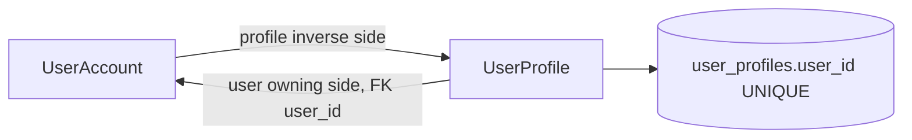

# Ánh xạ một-một bằng @OneToOne

## 1. Mục tiêu

Trong JPA, quan hệ một-một (one-to-one) biểu diễn mối liên hệ trong đó một bản ghi ở bảng này liên kết với tối đa một bản ghi ở bảng kia, và ngược lại. Ví dụ: một tài khoản có tối đa một hồ sơ cá nhân; một hồ sơ thuộc về một tài khoản.

Sau bài học, bạn có thể:
- Hiểu quan hệ một-một ở mức mô hình đối tượng và cơ sở dữ liệu.
- Phân biệt owning side và inverse side của quan hệ hai chiều.
- Ánh xạ quan hệ một-một một chiều và hai chiều bằng `@OneToOne`.
- Dùng `@JoinColumn`, `mappedBy`, `cascade` và `orphanRemoval` đúng mục đích.
- Hiểu lựa chọn `fetch`, `optional` và cách kiểm tra tính duy nhất ở database.
- Kiểm thử việc lưu, tải và xóa đối tượng liên quan trong Spring Data JPA.

## 2. Quan hệ một-một trong cơ sở dữ liệu

Ví dụ một hệ thống có bảng `user_accounts` và `user_profiles`. Mỗi hồ sơ thuộc về một tài khoản; một tài khoản có thể có hoặc chưa có hồ sơ.

Một cách triển khai quan hệ này là đặt khóa ngoại ở bảng `user_profiles`:

```sql
CREATE TABLE user_accounts (
    id BIGINT GENERATED BY DEFAULT AS IDENTITY PRIMARY KEY,
    email VARCHAR(180) NOT NULL UNIQUE
);

CREATE TABLE user_profiles (
    id BIGINT GENERATED BY DEFAULT AS IDENTITY PRIMARY KEY,
    user_id BIGINT NOT NULL UNIQUE,
    display_name VARCHAR(120) NOT NULL,
    CONSTRAINT fk_user_profiles_user
        FOREIGN KEY (user_id) REFERENCES user_accounts(id)
);
```

Ba ràng buộc quan trọng:
- `FOREIGN KEY (user_id)` bảo đảm hồ sơ tham chiếu tới một tài khoản có thật.
- `UNIQUE (user_id)` bảo đảm một tài khoản không bị tham chiếu bởi nhiều hồ sơ.
- `NOT NULL` bảo đảm mỗi hồ sơ phải có một tài khoản.

Thiết kế này cho phép một tài khoản có 0 hoặc 1 hồ sơ, còn mỗi hồ sơ bắt buộc thuộc về đúng 1 tài khoản. Ràng buộc khóa ngoại và unique không tự buộc mọi tài khoản phải có hồ sơ; nếu nghiệp vụ yêu cầu mọi tài khoản đều phải có hồ sơ, cần bảo đảm quy tắc đó ở quy trình tạo dữ liệu và cân nhắc thiết kế database phù hợp.

Quan hệ một-một có thể đặt khóa ngoại ở một trong hai bảng. Bảng chứa khóa ngoại là phía sở hữu quan hệ trong JPA. Vị trí khóa ngoại quyết định owning side, không phải tên lớp hay phía được xem là cha trong nghiệp vụ.

## 3. Owning side và inverse side

Trong quan hệ hai chiều, JPA phân biệt hai phía:

- **Owning side:** phía ánh xạ cột khóa ngoại bằng `@JoinColumn`. Đây là phía quyết định thay đổi liên kết được ghi xuống database.
- **Inverse side:** phía tham chiếu ngược, khai báo `mappedBy` trỏ tới tên thuộc tính quan hệ ở owning side. Phía này không tạo thêm cột khóa ngoại.

Với ví dụ tài khoản và hồ sơ:
- `UserProfile.user` là owning side vì nó có `@JoinColumn(name = "user_id")`.
- `UserAccount.profile` là inverse side vì nó dùng `mappedBy = "user"`.

`mappedBy = "user"` trỏ tới tên thuộc tính Java `user` trong lớp `UserProfile`, không phải tên cột SQL `user_id`.



Khi quan hệ hai chiều, cần đồng bộ cả hai phía trong bộ nhớ. Nếu chỉ gán `userAccount.profile = profile` mà không gán `profile.user = userAccount`, owning side vẫn chưa được cập nhật; database có thể không lưu liên kết như mong muốn.

## 4. Ánh xạ một-một một chiều

Quan hệ một chiều có nghĩa là ứng dụng chỉ điều hướng từ một Entity sang Entity còn lại. Ví dụ, từ tài khoản có thể lấy hồ sơ, nhưng từ hồ sơ không cần tham chiếu ngược tới tài khoản.

```java
@Entity
@Table(name = "user_accounts")
public class UserAccount {
    @Id
    @GeneratedValue(strategy = GenerationType.IDENTITY)
    private Long id;

    @OneToOne(fetch = FetchType.LAZY, cascade = CascadeType.ALL, orphanRemoval = true)
    @JoinColumn(name = "profile_id", unique = true)
    private UserProfile profile;
}
```

Trong ví dụ một chiều, bảng `user_accounts` chứa cột `profile_id` tham chiếu tới `user_profiles.id`. `unique = true` bảo đảm một hồ sơ không bị nhiều tài khoản cùng tham chiếu.

Không khai báo `mappedBy` khi đây là quan hệ một chiều. Phía có `@JoinColumn` sở hữu liên kết. Nếu chỉ cần đi từ tài khoản tới hồ sơ, đây là mô hình đơn giản và tránh duy trì quan hệ ngược không cần thiết.

Phần còn lại của bài học dùng mô hình hai chiều với khóa ngoại `user_profiles.user_id`, vì nó minh họa đầy đủ cả owning side lẫn inverse side.

## 5. Ví dụ hai chiều hoàn chỉnh

Ví dụ dùng Java 17+, Maven, Spring Boot 3.5.0, Spring Data JPA và H2. `UserAccount` có tối đa một `UserProfile`; hồ sơ là đối tượng phụ thuộc vòng đời vào tài khoản.

### 5.1. Cấu trúc thư mục

```text
src/
  main/
    java/com/example/library/
      LibraryApplication.java
      user/
        UserAccount.java
        UserProfile.java
        UserAccountRepository.java
        UserProfileRepository.java
    resources/
      application.properties
  test/
    java/com/example/library/user/
      UserOneToOneRepositoryTest.java
pom.xml
```

### 5.2. Dependency Maven

Ví dụ `pom.xml` tối thiểu:

```xml
<?xml version="1.0" encoding="UTF-8"?>
<project xmlns="http://maven.apache.org/POM/4.0.0"
         xmlns:xsi="http://www.w3.org/2001/XMLSchema-instance"
         xsi:schemaLocation="http://maven.apache.org/POM/4.0.0 https://maven.apache.org/xsd/maven-4.0.0.xsd">
    <modelVersion>4.0.0</modelVersion>

    <parent>
        <groupId>org.springframework.boot</groupId>
        <artifactId>spring-boot-starter-parent</artifactId>
        <version>3.5.0</version>
        <relativePath/>
    </parent>

    <groupId>com.example</groupId>
    <artifactId>one-to-one-jpa</artifactId>
    <version>0.0.1-SNAPSHOT</version>

    <properties>
        <java.version>17</java.version>
    </properties>

    <dependencies>
        <dependency>
            <groupId>org.springframework.boot</groupId>
            <artifactId>spring-boot-starter-data-jpa</artifactId>
        </dependency>
        <dependency>
            <groupId>com.h2database</groupId>
            <artifactId>h2</artifactId>
            <scope>runtime</scope>
        </dependency>
        <dependency>
            <groupId>org.springframework.boot</groupId>
            <artifactId>spring-boot-starter-test</artifactId>
            <scope>test</scope>
        </dependency>
    </dependencies>

    <build>
        <plugins>
            <plugin>
                <groupId>org.springframework.boot</groupId>
                <artifactId>spring-boot-maven-plugin</artifactId>
            </plugin>
        </plugins>
    </build>
</project>
```

### 5.3. Lớp khởi động

`src/main/java/com/example/library/LibraryApplication.java`:

```java
package com.example.library;

import org.springframework.boot.SpringApplication;
import org.springframework.boot.autoconfigure.SpringBootApplication;

@SpringBootApplication
public class LibraryApplication {
    public static void main(String[] args) {
        SpringApplication.run(LibraryApplication.class, args);
    }
}
```

Đặt lớp khởi động ở package gốc để Spring Boot tự quét các Entity và Repository trong package con.

### 5.4. Entity UserAccount — inverse side

`src/main/java/com/example/library/user/UserAccount.java`:

```java
package com.example.library.user;

import jakarta.persistence.CascadeType;
import jakarta.persistence.Column;
import jakarta.persistence.Entity;
import jakarta.persistence.FetchType;
import jakarta.persistence.GeneratedValue;
import jakarta.persistence.GenerationType;
import jakarta.persistence.Id;
import jakarta.persistence.OneToOne;
import jakarta.persistence.Table;
import java.util.Objects;

@Entity
@Table(name = "user_accounts")
public class UserAccount {
    @Id
    @GeneratedValue(strategy = GenerationType.IDENTITY)
    private Long id;

    @Column(nullable = false, unique = true, length = 180)
    private String email;

    @OneToOne(
            mappedBy = "user",
            cascade = CascadeType.ALL,
            orphanRemoval = true,
            fetch = FetchType.LAZY)
    private UserProfile profile;

    protected UserAccount() {
        // JPA cần constructor không tham số.
    }

    public UserAccount(String email) {
        if (email == null || email.isBlank() || email.length() > 180) {
            throw new IllegalArgumentException("Email must contain 1 to 180 characters");
        }
        this.email = email.trim();
    }

    public void addProfile(UserProfile newProfile) {
        Objects.requireNonNull(newProfile, "profile is required");
        if (newProfile.getUser() != null && newProfile.getUser() != this) {
            throw new IllegalStateException("Profile already belongs to another account");
        }
        if (this.profile != null && this.profile != newProfile) {
            this.profile.setUser(null);
        }
        this.profile = newProfile;
        newProfile.setUser(this);
    }

    public void removeProfile() {
        if (this.profile != null) {
            UserProfile oldProfile = this.profile;
            this.profile = null;
            oldProfile.setUser(null);
        }
    }

    public Long getId() {
        return id;
    }

    public String getEmail() {
        return email;
    }

    public UserProfile getProfile() {
        return profile;
    }
}
```

`mappedBy = "user"` cho JPA biết `UserProfile.user` là thuộc tính sở hữu liên kết. `UserAccount` không tạo cột `profile_id` trong thiết kế hai chiều này.

`addProfile()` cập nhật cả `this.profile` và `newProfile.user`. `removeProfile()` xóa liên kết ở cả hai phía. Khi thay hồ sơ cũ bằng hồ sơ mới, hồ sơ cũ bị tách khỏi tài khoản và `orphanRemoval` sẽ yêu cầu JPA xóa đối tượng mồ côi khi flush.

Phương thức trên giả định hồ sơ mới chưa thuộc về tài khoản khác. Nếu nghiệp vụ cho phép chuyển hồ sơ giữa các tài khoản, cần có một thao tác chuyển quyền sở hữu riêng để cập nhật cả hai tài khoản trong cùng transaction.

### 5.5. Entity UserProfile — owning side

`src/main/java/com/example/library/user/UserProfile.java`:

```java
package com.example.library.user;

import jakarta.persistence.Column;
import jakarta.persistence.Entity;
import jakarta.persistence.FetchType;
import jakarta.persistence.GeneratedValue;
import jakarta.persistence.GenerationType;
import jakarta.persistence.Id;
import jakarta.persistence.JoinColumn;
import jakarta.persistence.OneToOne;
import jakarta.persistence.Table;

@Entity
@Table(name = "user_profiles")
public class UserProfile {
    @Id
    @GeneratedValue(strategy = GenerationType.IDENTITY)
    private Long id;

    @Column(name = "display_name", nullable = false, length = 120)
    private String displayName;

    @OneToOne(fetch = FetchType.LAZY, optional = false)
    @JoinColumn(name = "user_id", nullable = false, unique = true)
    private UserAccount user;

    protected UserProfile() {
        // JPA cần constructor không tham số.
    }

    public UserProfile(String displayName) {
        if (displayName == null || displayName.isBlank() || displayName.length() > 120) {
            throw new IllegalArgumentException("Display name must contain 1 to 120 characters");
        }
        this.displayName = displayName.trim();
    }

    void setUser(UserAccount user) {
        this.user = user;
    }

    public Long getId() {
        return id;
    }

    public String getDisplayName() {
        return displayName;
    }

    public UserAccount getUser() {
        return user;
    }
}
```

`@JoinColumn` đánh dấu owning side và chỉ định cột khóa ngoại `user_id`. `nullable = false` yêu cầu mỗi hồ sơ phải tham chiếu tới một tài khoản. `unique = true` bảo đảm một tài khoản không có nhiều hồ sơ.

`optional = false` mô tả rằng quan hệ từ `UserProfile` tới `UserAccount` là bắt buộc. `nullable = false` mô tả ràng buộc cột khi schema được tạo. Trong production, nên khai báo rõ khóa ngoại và unique constraint trong migration bằng Flyway hoặc Liquibase thay vì chỉ dựa vào tự sinh schema.

### 5.6. Repository

`src/main/java/com/example/library/user/UserAccountRepository.java`:

```java
package com.example.library.user;

import java.util.Optional;
import org.springframework.data.jpa.repository.JpaRepository;

public interface UserAccountRepository extends JpaRepository<UserAccount, Long> {
    Optional<UserAccount> findByEmailIgnoreCase(String email);
}
```

`src/main/java/com/example/library/user/UserProfileRepository.java`:

```java
package com.example.library.user;

import java.util.Optional;
import org.springframework.data.jpa.repository.JpaRepository;

public interface UserProfileRepository extends JpaRepository<UserProfile, Long> {
    Optional<UserProfile> findByUser_Id(Long userId);
}
```

`findByUser_Id` truy vấn theo thuộc tính `id` của quan hệ `user`. Dấu gạch dưới làm rõ đường dẫn `user.id`, tránh nhầm lẫn khi Spring Data phân tích tên thuộc tính.

## 6. Lưu dữ liệu và cascade

Với mapping trên, `UserAccount` là phía inverse nhưng được cấu hình `cascade = CascadeType.ALL`. Vì vậy, lưu tài khoản có thể cascade thao tác persist/merge tới hồ sơ. Tuy nhiên, owning side vẫn phải được thiết lập để cột `user_id` có giá trị.

```java
UserAccount account = new UserAccount("reader@example.com");
UserProfile profile = new UserProfile("Reader One");
account.addProfile(profile);

UserAccount saved = userAccountRepository.save(account);
```

Phương thức `addProfile()` đồng bộ cả hai phía. Nếu bỏ qua `profile.setUser(account)`, owning side sẽ không biết hồ sơ thuộc về tài khoản nào và thao tác ghi có thể thất bại do `user_id` là NOT NULL hoặc không tạo được liên kết mong muốn.

`CascadeType.ALL` bao gồm persist, merge, remove, refresh và detach. Chỉ dùng nó khi hồ sơ thực sự thuộc vòng đời của tài khoản. Nếu hai đối tượng có vòng đời độc lập hoặc hồ sơ được chia sẻ, không nên cascade xóa một cách tùy tiện.

`orphanRemoval = true` phù hợp khi hồ sơ là đối tượng con riêng của tài khoản: khi gỡ hồ sơ khỏi quan hệ, JPA sẽ xóa bản ghi hồ sơ khi đồng bộ persistence context. Nó không có nghĩa là mọi lần đặt một thuộc tính thành null đều an toàn trong mọi thiết kế; cần cập nhật hai phía đúng cách và thực hiện trong transaction.

## 7. Fetch strategy và hiệu năng

JPA quy định `@OneToOne` mặc định là `FetchType.EAGER`, tức quan hệ được yêu cầu tải sớm. Với dữ liệu lớn hoặc nhiều quan hệ, điều này có thể khiến một truy vấn tải thêm dữ liệu không cần thiết.

Bạn có thể khai báo `fetch = FetchType.LAZY` để yêu cầu tải trễ:

```java
@OneToOne(fetch = FetchType.LAZY)
@JoinColumn(name = "profile_id", unique = true)
private UserProfile profile;
```

Nhưng cần hiểu các giới hạn:
- `LAZY` trên quan hệ to-one là một hint trong JPA; provider có thể không thực hiện được trong mọi trường hợp.
- Ở inverse side của `@OneToOne` hai chiều, provider cần biết quan hệ có tồn tại hay không. Một số trường hợp Hibernate cần bytecode enhancement để tải trễ hiệu quả; nếu không, có thể truy vấn thêm hoặc tải sớm.
- Truy cập proxy ngoài transaction có thể gây `LazyInitializationException` nếu dữ liệu chưa được tải.

Hãy kiểm soát dữ liệu trả về từ tầng Service bằng DTO, projection hoặc fetch query phù hợp. Không nên bật EAGER cho mọi quan hệ chỉ để tránh lỗi lazy; điều đó có thể làm tăng số truy vấn và lượng dữ liệu không cần thiết.

## 8. @MapsId: dùng chung khóa chính

Nếu hồ sơ có cùng ID với tài khoản, có thể dùng shared primary key. Khi đó, bảng `user_profiles` dùng chính `user_id` vừa làm khóa chính vừa làm khóa ngoại tới `user_accounts.id`.

`@MapsId` ánh xạ khóa chính của Entity phụ thuộc từ khóa chính của Entity được tham chiếu:

```java
@Entity
@Table(name = "user_profiles")
public class UserProfile {
    @Id
    private Long id;

    @OneToOne(fetch = FetchType.LAZY, optional = false)
    @MapsId
    @JoinColumn(name = "user_id")
    private UserAccount user;

    // Constructor và các thuộc tính khác.
}
```

Trong ví dụ này, ID của `UserProfile` được lấy từ ID của `UserAccount`; không cần `@GeneratedValue` riêng cho profile. `@MapsId` không phải một kiểu quan hệ mới, mà là cách ánh xạ khóa dùng chung cho quan hệ một-một hoặc nhiều-một phù hợp.

Shared primary key phù hợp khi đối tượng phụ thuộc không thể tồn tại độc lập và có cùng định danh với đối tượng chính. Cần thiết kế cascade và cách tạo hai đối tượng sao cho Entity cha được persist và ID của nó được gán trước khi khóa phụ thuộc được đồng bộ.

## 9. Kiểm thử tích hợp với H2

Ví dụ test dùng Spring Boot 3.5.0, `spring-boot-starter-data-jpa`, H2 và `spring-boot-starter-test`. `@DataJpaTest` cấu hình test slice cho Entity và Repository.

`src/main/resources/application.properties`:

```properties
spring.datasource.url=jdbc:h2:mem:onetoonedb;DB_CLOSE_DELAY=-1
spring.datasource.driver-class-name=org.h2.Driver
spring.datasource.username=sa
spring.datasource.password=
spring.jpa.hibernate.ddl-auto=create-drop
spring.jpa.open-in-view=false
spring.jpa.show-sql=true
```

`src/test/java/com/example/library/user/UserOneToOneRepositoryTest.java`:

```java
package com.example.library.user;

import static org.assertj.core.api.Assertions.assertThat;

import org.junit.jupiter.api.Test;
import org.springframework.beans.factory.annotation.Autowired;
import org.springframework.boot.test.autoconfigure.orm.jpa.DataJpaTest;
import org.springframework.boot.test.autoconfigure.orm.jpa.TestEntityManager;

@DataJpaTest
class UserOneToOneRepositoryTest {
    @Autowired
    private UserAccountRepository userAccountRepository;

    @Autowired
    private UserProfileRepository userProfileRepository;

    @Autowired
    private TestEntityManager entityManager;

    @Test
    void cascadesProfileAndRemovesOrphan() {
        UserAccount account = new UserAccount("reader@example.com");
        account.addProfile(new UserProfile("Reader One"));

        UserAccount saved = userAccountRepository.saveAndFlush(account);
        Long accountId = saved.getId();

        entityManager.clear();

        UserAccount loaded = userAccountRepository.findById(accountId).orElseThrow();
        assertThat(loaded.getProfile().getDisplayName()).isEqualTo("Reader One");
        assertThat(userProfileRepository.findByUser_Id(accountId)).isPresent();

        loaded.removeProfile();
        userAccountRepository.flush();

        assertThat(userProfileRepository.findByUser_Id(accountId)).isEmpty();
    }
}
```

Chạy kiểm thử từ thư mục chứa `pom.xml`:

```bash
mvn test
```

Kết quả mong đợi là Maven kết thúc với `BUILD SUCCESS`. Test tạo tài khoản và hồ sơ trong cùng graph đối tượng, lưu tài khoản để kiểm tra cascade, xóa persistence context rồi tải lại để kiểm tra quan hệ hai chiều. Cuối cùng, test gỡ hồ sơ và xác nhận `orphanRemoval` xóa bản ghi phụ thuộc. Đây là kết quả kỳ vọng khi chạy với cấu hình đã nêu; lệnh build chưa được chạy trong nội dung bài học.

## 10. Lỗi thường gặp

| Hiện tượng | Nguyên nhân | Cách xử lý |
| --- | --- | --- |
| Hibernate báo lỗi lớp khóa không hợp lệ | Lớp `@Embeddable` hoặc `@IdClass` thiếu constructor không tham số hay không triển khai `Serializable`. | Kiểm tra yêu cầu của JPA và khai báo constructor phù hợp. |
| Entity được lưu nhưng khóa ngoại không có giá trị | Chỉ cập nhật inverse side, không cập nhật owning side. | Đồng bộ cả hai phía bằng phương thức trợ giúp trong Entity. |
| Nhiều hồ sơ cùng trỏ tới một tài khoản | Cột khóa ngoại không có unique constraint. | Dùng `unique = true` và tạo unique constraint thực tế trong migration. |
| `mappedBy` không được nhận diện | Giá trị `mappedBy` dùng tên cột thay vì tên thuộc tính Java ở owning side. | Dùng đúng tên thuộc tính, ví dụ `mappedBy = "user"`. |
| Derived query không tìm thấy thuộc tính | Đường dẫn tới quan hệ viết sai hoặc thiếu ranh giới giữa các thuộc tính. | Với `Profile.user.id`, dùng `findByUser_Id`. |
| `findById` không trả về kết quả | Một thành phần khóa ngoại hoặc ID bị thiếu/sai. | Kiểm tra đầy đủ khóa chính và giá trị truyền vào. |
| Gặp lỗi lazy khi serialize response | Entity có quan hệ lazy được truy cập sau khi transaction đóng hoặc tạo vòng lặp JSON hai chiều. | Chuyển sang DTO/projection trong transaction; tránh trả trực tiếp graph Entity. |
| Xóa tài khoản không xóa hồ sơ như mong muốn | Thiếu cascade remove hoặc orphan removal, hay không cập nhật cả hai phía. | Xác định vòng đời sở hữu và cấu hình cascade/orphanRemoval có chủ đích. |

## 11. Nguyên tắc thiết kế

1. Chỉ ánh xạ `@OneToOne` khi database thật sự bảo đảm tính duy nhất của quan hệ bằng unique constraint trên khóa ngoại.
2. Owning side là phía có `@JoinColumn`; `mappedBy` chỉ rõ thuộc tính owning side trên Entity còn lại.
3. Với quan hệ hai chiều, cung cấp phương thức thêm/gỡ quan hệ để đồng bộ cả hai phía.
4. Dùng cascade khi một đối tượng thực sự quản lý vòng đời đối tượng kia. Chỉ bật `orphanRemoval` khi đối tượng phụ thuộc không được tồn tại độc lập.
5. Hiểu mặc định EAGER của `@OneToOne` và cân nhắc LAZY, DTO hoặc projection để kiểm soát tải dữ liệu.
6. Không dùng `CascadeType.REMOVE` với một đối tượng được chia sẻ hoặc có vòng đời độc lập.
7. Khai báo khóa ngoại và unique constraint trong migration production; annotation không thay thế việc kiểm soát schema đã triển khai.
8. Dùng phương thức nghiệp vụ để duy trì tính nhất quán của hai phía thay vì để mọi nơi gọi setter tùy ý.

## 12. Checklist hoàn thành

- [ ] Giải thích được vì sao `@OneToOne` cần unique constraint trên khóa ngoại.
- [ ] Phân biệt owning side và inverse side.
- [ ] Viết được quan hệ một chiều bằng `@OneToOne` và `@JoinColumn`.
- [ ] Viết được quan hệ hai chiều với `mappedBy` và đồng bộ cả hai phía.
- [ ] Hiểu ý nghĩa của `optional`, `nullable`, `cascade` và `orphanRemoval`.
- [ ] Biết giới hạn của `FetchType.LAZY` với quan hệ một-một.
- [ ] Kiểm thử được cascade persist và orphan removal bằng `@DataJpaTest`.
- [ ] Trả dữ liệu quan hệ qua DTO/projection khi cần tránh lazy loading hoặc vòng lặp JSON.

Khi hoàn thành, bạn có thể ánh xạ quan hệ một-một theo đúng vị trí khóa ngoại, bảo đảm tính duy nhất ở database và quản lý vòng đời Entity liên quan một cách nhất quán.