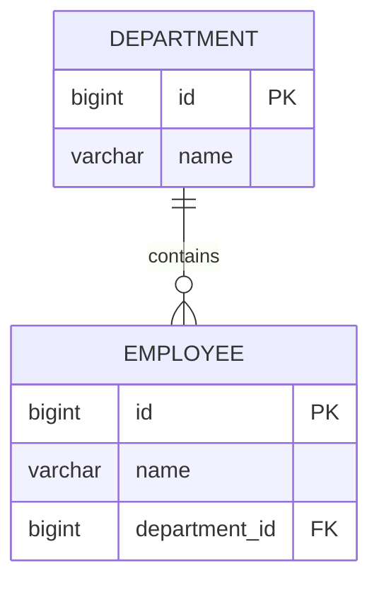

# Vai trò của mappedBy và vị trí lưu khóa ngoại

## Mục tiêu

Trong quan hệ entity của JPA, hai phía Java có thể cùng tham chiếu lẫn nhau, nhưng database cần một cấu trúc cụ thể để biểu diễn quan hệ: một khóa ngoại trong bảng hoặc một bảng nối. JPA dùng khái niệm **owning side** (phía sở hữu) và **inverse side** (phía nghịch đảo) để xác định phía nào điều khiển mapping quan hệ.

`mappedBy` được khai báo ở inverse side và trỏ tới tên thuộc tính quan hệ ở owning side. Nó cho JPA biết quan hệ đã được ánh xạ ở đâu, nhờ đó JPA không tạo một mapping ghi độc lập ở phía còn lại.

Điều cần nhớ: vị trí của collection trong Java không quyết định nơi lưu khóa ngoại. Với quan hệ hai chiều `@OneToMany`/`@ManyToOne`, khóa ngoại thường nằm ở bảng phía nhiều và thuộc tính `@ManyToOne` là owning side.

## 1. Owning side và inverse side là gì?

Trong mô hình quan hệ database, khóa ngoại nằm ở một bảng cụ thể. JPA cần biết thuộc tính nào chịu trách nhiệm cập nhật cột khóa ngoại hoặc bảng nối đó. Thuộc tính ấy nằm ở owning side.

- **Owning side:** phía khai báo mapping vật lý của quan hệ, thường là nơi đặt `@JoinColumn` hoặc `@JoinTable`. Thay đổi phía này được JPA dùng để đồng bộ quan hệ xuống database.
- **Inverse side:** phía tham chiếu mapping đã được định nghĩa ở nơi khác. Nó khai báo `mappedBy` để chỉ tên thuộc tính quan hệ ở owning side.

Owning side là khái niệm của ORM mapping, không có nghĩa object ở phía đó là chủ sở hữu nghiệp vụ, chủ sở hữu dữ liệu theo domain, hoặc có quyền xóa object phía kia.

## 2. mappedBy trỏ tới đâu?

`mappedBy` nhận **tên thuộc tính Java** ở entity phía owning side. Giá trị này không phải tên bảng, tên cột khóa ngoại, tên class hoặc tên property ở inverse side.

```java
@Entity
public class Department {
    @OneToMany(mappedBy = "department")
    private List<Employee> employees = new ArrayList<>();
}

@Entity
public class Employee {
    @ManyToOne
    @JoinColumn(name = "department_id")
    private Department department;
}
```

`mappedBy = "department"` trỏ tới field `Employee.department`. JPA nhìn vào mapping của thuộc tính đó để biết quan hệ đã được định nghĩa ở phía `Employee`.

Nếu đổi tên field Java từ `department` thành `team`, cần cập nhật `mappedBy = "team"`. Tên cột database vẫn có thể là `department_id`; hai tên này thuộc hai lớp khác nhau.

## 3. Quan hệ hai chiều OneToMany / ManyToOne

Đây là mẫu phổ biến nhất: một phòng ban có nhiều nhân viên, mỗi nhân viên thuộc một phòng ban.



Khóa ngoại `employee.department_id` nằm ở bảng `employee`, vì mỗi hàng nhân viên lưu mã phòng ban mà nó tham chiếu.

Mapping tương ứng:

```java
@Entity
public class Department {
    @Id
    @GeneratedValue(strategy = GenerationType.IDENTITY)
    private Long id;

    private String name;

    @OneToMany(mappedBy = "department")
    private List<Employee> employees = new ArrayList<>();
}

@Entity
public class Employee {
    @Id
    @GeneratedValue(strategy = GenerationType.IDENTITY)
    private Long id;

    private String name;

    @ManyToOne(fetch = FetchType.LAZY)
    @JoinColumn(name = "department_id")
    private Department department;
}
```

`Employee.department` là owning side vì nó khai báo `@JoinColumn`. `Department.employees` là inverse side vì nó khai báo `mappedBy`. JPA cập nhật cột `department_id` dựa trên giá trị `Employee.department`.

### Vì sao ManyToOne thường là owning side?

Với quan hệ nhiều nhân viên thuộc một phòng ban, mỗi hàng `employee` có thể lưu trực tiếp một `department_id`. Một khóa ngoại duy nhất trong bảng phía nhiều biểu diễn được quan hệ. Nếu chỉ nhìn từ bảng `department`, một phòng ban có thể có nhiều nhân viên nên không thể đặt một cột `employee_id` đơn giản trong mỗi hàng phòng ban để biểu diễn toàn bộ tập con.

Do đó, mô hình tự nhiên là foreign key nằm ở bảng phía nhiều. Trong mapping hai chiều chuẩn, thuộc tính `@ManyToOne` điều khiển foreign key và `@OneToMany(mappedBy=...)` chỉ là góc nhìn ngược lại.

## 4. Cập nhật cả hai phía trong Java

Vì database chỉ đồng bộ theo owning side, code cần cập nhật thuộc tính `Employee.department`. Tuy nhiên, để object graph trong bộ nhớ nhất quán, cũng nên cập nhật collection `Department.employees`.

Thêm helper methods:

```java
public void addEmployee(Employee employee) {
    employees.add(employee);
    employee.setDepartment(this);
}

public void removeEmployee(Employee employee) {
    employees.remove(employee);
    employee.setDepartment(null);
}
```

Và trong `Employee`:

```java
public void setDepartment(Department department) {
    this.department = department;
}
```

Trong dự án thật, helper có thể kiểm tra null, tránh thêm trùng, xử lý employee đang thuộc department khác và áp dụng quy tắc domain tương ứng.

### Chỉ cập nhật inverse side sẽ ra sao?

Giả sử code chỉ gọi:

```java
department.getEmployees().add(employee);
```

nhưng không gọi `employee.setDepartment(department)`. Collection trong bộ nhớ có thể hiển thị nhân viên trong phòng ban, nhưng owning side vẫn là `null`. Khi flush, Hibernate không có giá trị owning side để ghi `department_id`; kết quả database có thể không như mong muốn hoặc vi phạm `NOT NULL` constraint.

Ngược lại, nếu chỉ set `employee.department`, foreign key có thể được ghi đúng nhưng collection `department.employees` trong bộ nhớ có thể chưa phản ánh thay đổi. Vì vậy nên đồng bộ cả hai phía bằng helper methods.

## 5. @JoinColumn xác định cột khóa ngoại

`@JoinColumn` mô tả cột dùng để nối tới bảng đích. Trong ví dụ `Employee.department`, khai báo:

```java
@ManyToOne(fetch = FetchType.LAZY)
@JoinColumn(name = "department_id", nullable = false)
private Department department;
```

có nghĩa bảng `employee` chứa cột `department_id` tham chiếu tới khóa chính của `department`. `name` là tên cột ở bảng hiện tại; `referencedColumnName` có thể dùng khi cần tham chiếu một cột khác khóa chính theo mapping hợp lệ.

Nếu bỏ `@JoinColumn`, provider sẽ áp dụng tên mặc định theo quy tắc mapping. Khai báo tường minh thường giúp schema dễ đọc và migration rõ ràng.

Ví dụ DDL khái niệm:

```sql
create table department (
    id bigint generated by default as identity primary key,
    name varchar(255)
);

create table employee (
    id bigint generated by default as identity primary key,
    name varchar(255),
    department_id bigint not null,
    constraint fk_employee_department
        foreign key (department_id) references department(id)
);
```

DDL thực tế phụ thuộc database dialect, kiểu ID và cấu hình Hibernate. `@JoinColumn` mô tả mapping; migration tool nên quản lý schema production.

## 6. Các kiểu quan hệ khác và vị trí lưu khóa ngoại

### OneToOne

Với quan hệ một-một, owning side là phía xác định foreign key. Ví dụ `User` có một `Profile`, và bảng `user_profile` chứa `user_id`:

```java
@Entity
public class User {
    @OneToOne(mappedBy = "user", fetch = FetchType.LAZY)
    private UserProfile profile;
}

@Entity
public class UserProfile {
    @OneToOne
    @JoinColumn(name = "user_id", unique = true)
    private User user;
}
```

`UserProfile.user` là owning side; `User.profile` là inverse side. Cột `user_profile.user_id` nằm trong bảng `user_profile`. Unique constraint giúp database bảo đảm một user không bị gắn với nhiều profile.

Nếu muốn khóa ngoại nằm ở bảng `user`, hãy đặt owning side và `@JoinColumn` ở `User`, rồi để `UserProfile` tham chiếu bằng `mappedBy`.

### ManyToMany

Quan hệ nhiều-nhiều thường dùng một join table chứa hai khóa ngoại. Một phía là owning side và khai báo `@JoinTable`; phía còn lại khai báo `mappedBy`.

```java
@Entity
public class Student {
    @ManyToMany
    @JoinTable(
        name = "student_course",
        joinColumns = @JoinColumn(name = "student_id"),
        inverseJoinColumns = @JoinColumn(name = "course_id")
    )
    private Set<Course> courses = new HashSet<>();
}

@Entity
public class Course {
    @ManyToMany(mappedBy = "courses")
    private Set<Student> students = new HashSet<>();
}
```

`Student.courses` là owning side. Bảng `student_course` chứa `student_id` và `course_id`. `Course.students` chỉ là inverse side. Nếu cần thêm thuộc tính cho quan hệ như ngày đăng ký, điểm hoặc trạng thái, thường nên mô hình hóa join table thành một entity riêng thay vì tiếp tục dùng `@ManyToMany` thuần.

### OneToMany một chiều

Không phải mọi `@OneToMany` đều phải có `mappedBy`. Với quan hệ một chiều, collection có thể là owning side và JPA thường dùng join table theo mapping mặc định. Nếu muốn đặt foreign key ở bảng phía nhiều, có thể khai báo `@JoinColumn` trên collection:

```java
@Entity
public class Department {
    @OneToMany
    @JoinColumn(name = "department_id")
    private List<Employee> employees = new ArrayList<>();
}
```

Ở mapping này, `Department.employees` điều khiển association và cột `department_id` nằm trong bảng `employee`. Không có field `Employee.department` nên cũng không có `mappedBy`. Việc chọn một chiều hay hai chiều nên dựa trên cách domain cần điều hướng quan hệ, không chỉ dựa vào vị trí collection.

## 7. Khi nào cần mappedBy?

Dùng `mappedBy` khi muốn mô tả quan hệ hai chiều và phía hiện tại là inverse side. Một số mẫu thường gặp:

| Quan hệ | Owning side | Inverse side | Vị trí lưu quan hệ |
| --- | --- | --- | --- |
| Bidirectional OneToMany / ManyToOne | `@ManyToOne` | `@OneToMany(mappedBy = ...)` | FK trong bảng phía nhiều |
| Bidirectional OneToOne | Phía có `@JoinColumn` hoặc `@JoinTable` | Phía có `mappedBy` | FK hoặc join table theo owning mapping |
| Bidirectional ManyToMany | Phía khai báo `@JoinTable` | Phía có `mappedBy` | Join table |
| Unidirectional OneToMany | Collection phía OneToMany | Không có inverse field | Thường join table; có thể cấu hình FK bằng `@JoinColumn` |

`mappedBy` không phải annotation bắt buộc cho mọi quan hệ hai chiều nếu mapping được thiết kế theo hướng khác, nhưng trong mapping chuẩn chỉ một phía điều khiển cấu trúc liên kết. Hai phía không nên cùng khai báo join column độc lập cho cùng một association.

## 8. Cascade và orphanRemoval không quyết định owning side

`cascade` xác định thao tác nào được lan truyền từ entity này sang entity liên quan, ví dụ `PERSIST`, `MERGE`, `REMOVE` hoặc `ALL`. `orphanRemoval = true` cho phép xóa entity con khi nó bị loại khỏi quan hệ theo điều kiện của mapping.

Những thuộc tính này không thay đổi phía sở hữu quan hệ. Ví dụ `Department.employees` có `cascade = CascadeType.ALL` và `mappedBy = "department"` thì `Employee.department` vẫn là owning side. Khi thêm nhân viên, code vẫn phải set owning side.

Ví dụ helper method:

```java
public void addEmployee(Employee employee) {
    employees.add(employee);
    employee.setDepartment(this);
}
```

Nếu dùng `orphanRemoval = true`, chỉ bật khi entity con thực sự thuộc vòng đời của entity cha và việc bỏ khỏi collection có nghĩa là xóa con. Không dùng nó chỉ để đồng bộ collection.

## 9. Ví dụ chạy được với Java 17+, Spring Boot và H2

Ví dụ dưới đây tạo phòng ban và hai nhân viên. `Employee.department` là owning side, còn `Department.employees` dùng `mappedBy`. Helper method cập nhật cả hai phía; service flush và clear persistence context trước khi đọc lại để kiểm tra dữ liệu được hydrate từ database.

### Cấu trúc dự án

```text
mapped-by-demo/
├── pom.xml
└── src/
    └── main/
        ├── java/com/example/mappedby/
        │   ├── MappedByApplication.java
        │   ├── Department.java
        │   ├── Employee.java
        │   ├── DepartmentRepository.java
        │   └── DepartmentService.java
        └── resources/
            └── application.properties
```

### `pom.xml`

```xml
<?xml version="1.0" encoding="UTF-8"?>
<project xmlns="http://maven.apache.org/POM/4.0.0"
         xmlns:xsi="http://www.w3.org/2001/XMLSchema-instance"
         xsi:schemaLocation="http://maven.apache.org/POM/4.0.0 https://maven.apache.org/xsd/maven-4.0.0.xsd">
    <modelVersion>4.0.0</modelVersion>
    <parent>
        <groupId>org.springframework.boot</groupId>
        <artifactId>spring-boot-starter-parent</artifactId>
        <version>3.4.5</version>
        <relativePath/>
    </parent>
    <groupId>com.example</groupId>
    <artifactId>mapped-by-demo</artifactId>
    <version>0.0.1-SNAPSHOT</version>
    <properties>
        <java.version>17</java.version>
    </properties>
    <dependencies>
        <dependency>
            <groupId>org.springframework.boot</groupId>
            <artifactId>spring-boot-starter-data-jpa</artifactId>
        </dependency>
        <dependency>
            <groupId>com.h2database</groupId>
            <artifactId>h2</artifactId>
            <scope>runtime</scope>
        </dependency>
    </dependencies>
    <build>
        <plugins>
            <plugin>
                <groupId>org.springframework.boot</groupId>
                <artifactId>spring-boot-maven-plugin</artifactId>
            </plugin>
        </plugins>
    </build>
</project>
```

### `src/main/resources/application.properties`

```properties
spring.datasource.url=jdbc:h2:mem:mappedby;DB_CLOSE_DELAY=-1
spring.datasource.username=sa
spring.datasource.password=
spring.jpa.hibernate.ddl-auto=create-drop
spring.jpa.open-in-view=false
logging.level.org.hibernate.SQL=DEBUG
```

### `Department.java`

```java
package com.example.mappedby;

import jakarta.persistence.CascadeType;
import jakarta.persistence.Entity;
import jakarta.persistence.GeneratedValue;
import jakarta.persistence.GenerationType;
import jakarta.persistence.Id;
import jakarta.persistence.OneToMany;
import jakarta.persistence.Table;
import java.util.ArrayList;
import java.util.List;

@Entity
@Table(name = "departments")
public class Department {
    @Id
    @GeneratedValue(strategy = GenerationType.IDENTITY)
    private Long id;

    private String name;

    @OneToMany(mappedBy = "department", cascade = CascadeType.ALL)
    private List<Employee> employees = new ArrayList<>();

    protected Department() {
    }

    public Department(String name) {
        this.name = name;
    }

    public void addEmployee(Employee employee) {
        employees.add(employee);
        employee.setDepartment(this);
    }

    public Long getId() {
        return id;
    }

    public String getName() {
        return name;
    }

    public List<Employee> getEmployees() {
        return employees;
    }
}
```

### `Employee.java`

```java
package com.example.mappedby;

import jakarta.persistence.Entity;
import jakarta.persistence.FetchType;
import jakarta.persistence.GeneratedValue;
import jakarta.persistence.GenerationType;
import jakarta.persistence.Id;
import jakarta.persistence.JoinColumn;
import jakarta.persistence.ManyToOne;
import jakarta.persistence.Table;

@Entity
@Table(name = "employees")
public class Employee {
    @Id
    @GeneratedValue(strategy = GenerationType.IDENTITY)
    private Long id;

    private String name;

    @ManyToOne(fetch = FetchType.LAZY)
    @JoinColumn(name = "department_id", nullable = false)
    private Department department;

    protected Employee() {
    }

    public Employee(String name) {
        this.name = name;
    }

    void setDepartment(Department department) {
        this.department = department;
    }

    public String getName() {
        return name;
    }
}
```

### `DepartmentRepository.java`

```java
package com.example.mappedby;

import org.springframework.data.jpa.repository.JpaRepository;

public interface DepartmentRepository extends JpaRepository<Department, Long> {
}
```

### `DepartmentService.java`

```java
package com.example.mappedby;

import jakarta.persistence.EntityManager;
import jakarta.persistence.PersistenceContext;
import org.springframework.stereotype.Service;
import org.springframework.transaction.annotation.Transactional;

@Service
public class DepartmentService {
    private final DepartmentRepository repository;

    @PersistenceContext
    private EntityManager entityManager;

    public DepartmentService(DepartmentRepository repository) {
        this.repository = repository;
    }

    @Transactional
    public String createAndRead() {
        Department department = new Department("Engineering");
        department.addEmployee(new Employee("An"));
        department.addEmployee(new Employee("Binh"));

        Department saved = repository.save(department);
        entityManager.flush();
        Long id = saved.getId();
        entityManager.clear();

        Department loaded = repository.findById(id).orElseThrow();
        String names = loaded.getEmployees().stream()
                .map(Employee::getName)
                .sorted()
                .reduce((left, right) -> left + ", " + right)
                .orElse("");

        return loaded.getName() + ": " + names;
    }
}
```

`entityManager.clear()` detach các entity trong persistence context hiện tại. Lần `findById()` tiếp theo phải hydrate lại entity; khi truy cập collection lazy trong cùng transaction, Hibernate tải các nhân viên liên quan.

### `MappedByApplication.java`

```java
package com.example.mappedby;

import org.springframework.boot.CommandLineRunner;
import org.springframework.boot.SpringApplication;
import org.springframework.boot.autoconfigure.SpringBootApplication;
import org.springframework.context.annotation.Bean;

@SpringBootApplication
public class MappedByApplication {
    public static void main(String[] args) {
        SpringApplication.run(MappedByApplication.class, args);
    }

    @Bean
    CommandLineRunner demo(DepartmentService service) {
        return args -> System.out.println(service.createAndRead());
    }
}
```

### Chạy chương trình

```bash
mvn spring-boot:run
```

Phần output do ứng dụng in ra:

```text
Engineering: An, Binh
```

SQL tiêu biểu Hibernate thực hiện có dạng:

```sql
insert into departments (name, id) values (?, default)
insert into employees (department_id, name, id) values (?, ?, default)
insert into employees (department_id, name, id) values (?, ?, default)
select d1_0.id, d1_0.name from departments d1_0 where d1_0.id = ?
select e1_0.department_id, e1_0.id, e1_0.name
from employees e1_0 where e1_0.department_id = ?
```

Alias và thứ tự cột có thể khác theo phiên bản Hibernate và dialect. Điều quan trọng là `department_id` xuất hiện trong INSERT của bảng `employees`, vì `Employee.department` là owning side.

## 10. Kiểm tra vị trí khóa ngoại bằng schema

Khi cần xác nhận FK thực sự nằm ở đâu, hãy kiểm tra DDL hoặc metadata database:

```sql
select table_name, column_name
from information_schema.columns
where column_name like '%department%';
```

Cú pháp metadata có thể khác theo hệ quản trị database. Có thể kiểm tra thêm foreign-key constraints qua `information_schema` hoặc công cụ quản trị schema.

Không suy luận vị trí FK chỉ từ tên collection Java. Hãy tìm `@JoinColumn`, `@JoinTable`, `mappedBy` và xác nhận DDL thực tế.

## 11. Lỗi thường gặp

1. **Nhầm `mappedBy` là tên cột:** `mappedBy` nhận tên thuộc tính Java ở owning side, ví dụ `department`, không phải `department_id`.
2. **Chỉ thêm vào collection inverse side:** collection có thể thay đổi trong bộ nhớ nhưng FK không được cập nhật. Hãy set owning-side reference.
3. **Đặt `@JoinColumn` ở cả hai phía:** có thể tạo hai mapping vật lý hoặc lỗi mapping. Chỉ một phía sở hữu association hai chiều.
4. **Đặt FK ở sai bảng:** với bidirectional `OneToMany/ManyToOne`, FK thường nằm trong bảng phía nhiều, do `ManyToOne` sở hữu.
5. **Dùng `mappedBy` trong quan hệ một chiều:** không có thuộc tính phía đối diện để tham chiếu; bỏ `mappedBy` và cấu hình association một chiều phù hợp.
6. **Quên đồng bộ object graph:** chỉ set owning side có thể ghi database đúng nhưng collection inverse side trong bộ nhớ vẫn cũ. Dùng helper method cập nhật cả hai.
7. **Nhầm cascade với ownership:** cascade lan truyền thao tác persist/merge/remove; nó không quyết định cột FK được cập nhật từ phía nào.
8. **Truy cập collection lazy sau transaction:** tải dữ liệu trong transaction hoặc dùng fetch join, `@EntityGraph` hay DTO projection phù hợp.
9. **Cho rằng `mappedBy` tạo FK:** `mappedBy` mô tả inverse side. FK hoặc join table được khai báo ở owning side.

## 12. Nguyên tắc thiết kế

- Với bidirectional `OneToMany/ManyToOne`, thường đặt `@JoinColumn` ở `ManyToOne` và `mappedBy` ở `OneToMany`.
- Tạo helper methods trên aggregate để đồng bộ cả hai phía trong bộ nhớ.
- Chỉ bật cascade và orphan removal theo vòng đời nghiệp vụ; không dùng chúng để sửa ownership.
- Dùng `LAZY` cho quan hệ to-one khi phù hợp với workload và chủ động tải dữ liệu cần thiết trong transaction.
- Xác nhận schema bằng migration hoặc DDL, đặc biệt khi đổi owning side hay đổi join column.
- Kiểm thử cả chiều ghi và chiều đọc trong persistence context mới để phát hiện lỗi chỉ cập nhật inverse side.

Điểm cốt lõi: **mappedBy xác định phía inverse và trỏ tới thuộc tính association ở owning side. Với OneToMany/ManyToOne hai chiều, khóa ngoại thường nằm trong bảng phía ManyToOne; chỉ cập nhật owning side mới quyết định giá trị FK được ghi xuống database.**