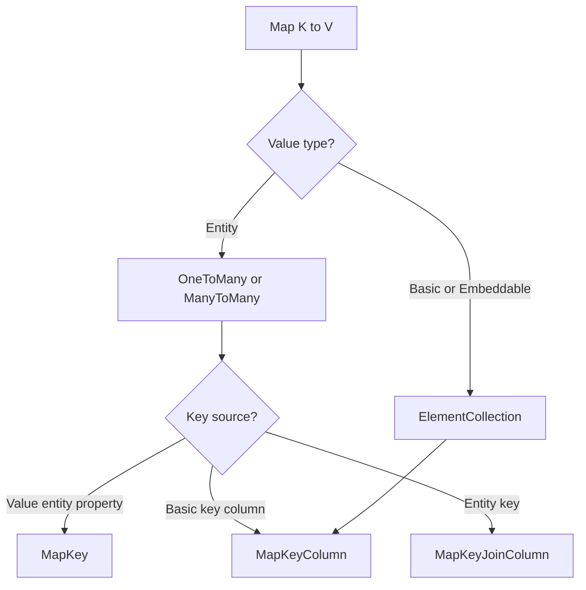

# Ánh xạ khóa Map bằng @MapKey và các biến thể phù hợp

## 1. Mục tiêu

Java `Map<K, V>` lưu dữ liệu theo cặp khóa và giá trị. Trong JPA, Map có thể biểu diễn nhiều kiểu dữ liệu: Map của Entity, Map của giá trị cơ bản, Map có khóa enum hoặc Map có khóa là một Entity khác. Annotation dùng để ánh xạ khóa phụ thuộc vào kiểu của khóa và giá trị.

Bài học tập trung vào `@MapKey` và các biến thể liên quan:
- `@MapKey`: lấy khóa Map từ một thuộc tính của Entity giá trị, hoặc từ khóa chính của Entity giá trị nếu không chỉ định tên thuộc tính.
- `@MapKeyColumn`: lưu khóa cơ bản trong một cột riêng của bảng liên kết hoặc collection table.
- `@MapKeyEnumerated` và `@MapKeyTemporal`: chỉ định cách lưu khóa enum hoặc kiểu ngày giờ legacy.
- `@MapKeyJoinColumn` và `@MapKeyJoinColumns`: ánh xạ khóa Map là một Entity.
- `@MapKeyClass`: khai báo kiểu khóa khi dùng Map raw type và kiểu không thể được suy ra từ generic.

Sau bài học, bạn có thể chọn annotation phù hợp, đọc đúng quan hệ giữa Map key và Map value, thiết kế ràng buộc database để tránh trùng khóa, và viết repository/test cho Map-valued association.

## 2. Map trong JPA gồm những gì?

Một thuộc tính Map có hai phần:

- **Map key (`K`)**: dùng để tìm một giá trị trong Map.
- **Map value (`V`)**: đối tượng hoặc giá trị được lưu tương ứng với key.

Ví dụ `Map<String, Course>` có thể dùng mã môn học làm key và Entity `Course` làm value. `Map<String, String>` có thể dùng tên cấu hình làm key và nội dung cấu hình làm value.

JPA ánh xạ Map khác nhau tùy loại value:

| Kiểu value | Mapping thường dùng |
| --- | --- |
| Entity | `@OneToMany` hoặc `@ManyToMany` |
| Basic type như `String`, `Integer`, `BigDecimal` | `@ElementCollection` |
| Embeddable | `@ElementCollection` |

Với Map có value là Entity, key có thể lấy từ thuộc tính của Entity value, lưu riêng trong cột, hoặc là một Entity khác. Với Map có value là basic/embeddable, các cặp key-value thường được lưu trong collection table.



## 3. @MapKey: lấy key từ Entity value

`@MapKey` dùng khi Map value là một Entity và key được lấy từ một thuộc tính persistent của Entity đó. Không có một cột map-key riêng được tạo chỉ để lưu key: JPA sử dụng giá trị của thuộc tính đã có trong bảng Entity value.

Có hai cách dùng:

1. `@MapKey(name = "code")`: key lấy từ thuộc tính `code` của Entity value.
2. `@MapKey` không có `name`: key lấy từ khóa chính của Entity value.

Ví dụ một phòng ban quản lý nhiều khóa học. Trong mỗi phòng ban, mã khóa học là duy nhất. Map dùng mã khóa học làm key và Entity `Course` làm value.

### 3.1. Entity Department

`src/main/java/com/example/catalog/department/Department.java`:

```java
package com.example.catalog.department;

import jakarta.persistence.CascadeType;
import jakarta.persistence.Column;
import jakarta.persistence.Entity;
import jakarta.persistence.GeneratedValue;
import jakarta.persistence.GenerationType;
import jakarta.persistence.Id;
import jakarta.persistence.MapKey;
import jakarta.persistence.OneToMany;
import jakarta.persistence.Table;
import jakarta.persistence.UniqueConstraint;
import java.util.HashMap;
import java.util.Map;
import java.util.Objects;

@Entity
@Table(name = "departments")
public class Department {
    @Id
    @GeneratedValue(strategy = GenerationType.IDENTITY)
    private Long id;

    @Column(nullable = false, unique = true, length = 100)
    private String name;

    @OneToMany(
            mappedBy = "department",
            cascade = CascadeType.ALL,
            orphanRemoval = true)
    @MapKey(name = "code")
    private Map<String, Course> courses = new HashMap<>();

    protected Department() {
        // JPA cần constructor không tham số.
    }

    public Department(String name) {
        if (name == null || name.isBlank() || name.length() > 100) {
            throw new IllegalArgumentException("Department name is required");
        }
        this.name = name.trim();
    }

    public void addCourse(Course course) {
        Objects.requireNonNull(course, "course is required");
        Course current = courses.get(course.getCode());
        if (current != null && current != course) {
            throw new IllegalArgumentException("Course code already exists in this department");
        }
        if (course.getDepartment() != null && course.getDepartment() != this) {
            throw new IllegalStateException("Course already belongs to another department");
        }
        courses.put(course.getCode(), course);
        course.setDepartment(this);
    }

    public void removeCourse(String code) {
        Course removed = courses.remove(code);
        if (removed != null) {
            removed.setDepartment(null);
        }
    }

    public Long getId() {
        return id;
    }

    public String getName() {
        return name;
    }

    public Map<String, Course> getCourses() {
        return courses;
    }
}
```

`@MapKey(name = "code")` yêu cầu JPA lấy key từ thuộc tính `code` của mỗi `Course`. Map có kiểu `Map<String, Course>` vì `Course.code` là String.

`mappedBy = "department"` cho biết `Course.department` là owning side của quan hệ OneToMany. Khóa Map và owning side là hai vấn đề riêng: `@MapKey` quyết định key của Map, còn `mappedBy` xác định Entity nào ghi khóa ngoại.

### 3.2. Entity Course

`src/main/java/com/example/catalog/department/Course.java`:

```java
package com.example.catalog.department;

import jakarta.persistence.Column;
import jakarta.persistence.Entity;
import jakarta.persistence.FetchType;
import jakarta.persistence.GeneratedValue;
import jakarta.persistence.GenerationType;
import jakarta.persistence.Id;
import jakarta.persistence.JoinColumn;
import jakarta.persistence.ManyToOne;
import jakarta.persistence.Table;
import jakarta.persistence.UniqueConstraint;

@Entity
@Table(
        name = "courses",
        uniqueConstraints = @UniqueConstraint(
                name = "uk_course_department_code",
                columnNames = {"department_id", "course_code"}))
public class Course {
    @Id
    @GeneratedValue(strategy = GenerationType.IDENTITY)
    private Long id;

    @Column(name = "course_code", nullable = false, length = 30)
    private String code;

    @Column(nullable = false, length = 160)
    private String title;

    @ManyToOne(fetch = FetchType.LAZY, optional = false)
    @JoinColumn(name = "department_id", nullable = false)
    private Department department;

    protected Course() {
        // JPA cần constructor không tham số.
    }

    public Course(String code, String title) {
        if (code == null || code.isBlank() || code.length() > 30) {
            throw new IllegalArgumentException("Course code is required");
        }
        if (title == null || title.isBlank() || title.length() > 160) {
            throw new IllegalArgumentException("Course title is required");
        }
        this.code = code.trim();
        this.title = title.trim();
    }

    void setDepartment(Department department) {
        this.department = department;
    }

    public Long getId() {
        return id;
    }

    public String getCode() {
        return code;
    }

    public String getTitle() {
        return title;
    }

    public Department getDepartment() {
        return department;
    }
}
```

Unique constraint `(department_id, course_code)` bảo đảm một mã môn học không bị lặp trong cùng một phòng ban. Đây là ràng buộc quan trọng vì Map không thể giữ hai value khác nhau với cùng một key trong cùng một Map.

Không nhất thiết `course_code` phải duy nhất trên toàn bộ bảng. Nếu mã chỉ có ý nghĩa trong phạm vi phòng ban, unique constraint cần bao gồm cả `department_id`.

### 3.3. Repository

`src/main/java/com/example/catalog/department/DepartmentRepository.java`:

```java
package com.example.catalog.department;

import org.springframework.data.jpa.repository.JpaRepository;

public interface DepartmentRepository extends JpaRepository<Department, Long> {
}
```

`src/main/java/com/example/catalog/department/CourseRepository.java`:

```java
package com.example.catalog.department;

import org.springframework.data.jpa.repository.JpaRepository;

public interface CourseRepository extends JpaRepository<Course, Long> {
}
```

Generic ID của `DepartmentRepository` và `CourseRepository` là `Long`, vì mỗi Entity có khóa chính đơn. Map key của `Department.courses` là `String`, nhưng điều đó không làm thay đổi kiểu ID của repository.

### 3.4. Lưu và tải Map

```java
Department department = new Department("Computer Science");
department.addCourse(new Course("JAVA-101", "Java Fundamentals"));
department.addCourse(new Course("DB-201", "Database Systems"));

Department saved = departmentRepository.save(department);
```

Vì `Department.courses` có `cascade = CascadeType.ALL`, việc persist Department sẽ cascade tới các Course trong Map. Phương thức `addCourse` đồng thời đặt `Course.department`, tức cập nhật owning side.

Đọc lại:

```java
Department loaded = departmentRepository.findById(saved.getId())
        .orElseThrow();

Course javaCourse = loaded.getCourses().get("JAVA-101");
System.out.println(javaCourse.getTitle());
```

Trong một transaction đang mở, `loaded.getCourses()` trả về Map được JPA quản lý. Vì `@MapKey` dùng thuộc tính `Course.code`, key của entry tương ứng với mã môn học.

## 4. @MapKey không có name

Nếu không truyền `name`, `@MapKey` sử dụng khóa chính của Entity value làm Map key.

Ví dụ:

```java
@OneToMany(mappedBy = "department")
@MapKey
private Map<Long, Course> coursesById = new HashMap<>();
```

Ở đây key là ID của `Course`, nên kiểu Map là `Map<Long, Course>`. Cách này hữu ích khi muốn truy cập các Entity con trực tiếp bằng khóa chính của chúng.

Phân biệt:

| Khai báo | Nguồn Map key | Kiểu key ví dụ |
| --- | --- | --- |
| `@MapKey(name = "code")` | Thuộc tính `code` của Entity value | `String` |
| `@MapKey` | Khóa chính của Entity value | `Long` |

`@MapKey` không tạo một cột khóa riêng. Key là giá trị của thuộc tính đã tồn tại trên Entity value.

## 5. @MapKeyColumn: lưu key cơ bản ở cột riêng

Dùng `@MapKeyColumn` khi key là một kiểu cơ bản và key được lưu riêng, không lấy từ một thuộc tính đã có của Entity value.

Ví dụ một phòng ban muốn đặt bí danh cho các khóa học. Value vẫn là Entity `Course`, nhưng key như `core-java` hoặc `sql-intro` độc lập với `Course.code`.

```java
@OneToMany(cascade = CascadeType.ALL, orphanRemoval = true)
@JoinTable(
        name = "department_course_aliases",
        joinColumns = @JoinColumn(name = "department_id"),
        inverseJoinColumns = @JoinColumn(name = "course_id"))
@MapKeyColumn(name = "course_alias", nullable = false, length = 40)
private Map<String, Course> coursesByAlias = new HashMap<>();
```

Với mapping một chiều dùng `@JoinTable`, bảng liên kết chứa khóa ngoại tới Department, khóa ngoại tới Course và cột `course_alias` lưu Map key. Đây là key độc lập với thuộc tính của Course.

Không dùng `@MapKey(name = "code")` trong cùng mapping này vì hai annotation thể hiện hai chiến lược khác nhau: lấy key từ thuộc tính Entity value hoặc lưu key riêng trong cột.

### 5.1. Map trong @ElementCollection

`@MapKeyColumn` cũng thường dùng với Map có value là basic type hoặc embeddable. Khi đó, `@ElementCollection` lưu các cặp key-value trong collection table.

```java
@ElementCollection
@CollectionTable(
        name = "department_settings",
        joinColumns = @JoinColumn(name = "department_id"))
@MapKeyColumn(name = "setting_key", nullable = false, length = 60)
@Column(name = "setting_value", nullable = false, length = 500)
private Map<String, String> settings = new HashMap<>();
```

Ví dụ này tạo collection table có khóa ngoại `department_id`, cột key `setting_key` và cột value `setting_value`. Các phần tử Map không phải Entity riêng và không có repository độc lập.

## 6. @MapKeyEnumerated: Map có key là enum

Nếu key là enum, dùng `@MapKeyEnumerated` để chỉ định cách lưu giá trị enum. Nếu không chỉ định, JPA mặc định dùng ordinal (vị trí số). Với dữ liệu lâu dài, `EnumType.STRING` thường an toàn hơn vì thêm hoặc sắp xếp lại hằng enum không làm thay đổi ý nghĩa của các số đã lưu.

```java
public enum PermissionType {
    READ,
    WRITE,
    ADMIN
}
```

```java
@ElementCollection
@CollectionTable(
        name = "role_permissions",
        joinColumns = @JoinColumn(name = "role_id"))
@MapKeyColumn(name = "permission_code", nullable = false, length = 20)
@MapKeyEnumerated(EnumType.STRING)
@Column(name = "description", nullable = false, length = 200)
private Map<PermissionType, String> permissions = new HashMap<>();
```

`@MapKeyEnumerated(EnumType.STRING)` áp dụng cho key enum. `@MapKeyColumn` đặt tên cột chứa key; `@Column` đặt tên cột chứa value. Hai cột này có vai trò khác nhau.

## 7. @MapKeyTemporal: Map có key ngày giờ kiểu legacy

Với Map key dùng `java.util.Date` hoặc `Calendar`, `@MapKeyTemporal` chỉ định độ chính xác thời gian được lưu, tương tự cách `@Temporal` áp dụng cho thuộc tính Entity.

```java
@ElementCollection
@CollectionTable(
        name = "daily_metrics",
        joinColumns = @JoinColumn(name = "account_id"))
@MapKeyColumn(name = "metric_date")
@MapKeyTemporal(TemporalType.DATE)
@Column(name = "metric_value")
private Map<Date, BigDecimal> metricsByDate = new HashMap<>();
```

Đây là ví dụ dùng kiểu ngày giờ legacy. Với mô hình mới, nên cân nhắc các kiểu `java.time` như `LocalDate`, `LocalDateTime` hoặc `Instant` được JPA hỗ trợ trực tiếp, rồi chọn mapping phù hợp mà không cần `@MapKeyTemporal`.

## 8. @MapKeyJoinColumn: Map có key là Entity

Nếu key của Map là một Entity khác, dùng `@MapKeyJoinColumn` để ánh xạ khóa ngoại của Entity key. Ví dụ một nhân viên có các dự án, trong đó Map được tra cứu theo phòng ban phụ trách dự án.

```java
@ManyToMany
@JoinTable(
        name = "employee_projects",
        joinColumns = @JoinColumn(name = "employee_id"),
        inverseJoinColumns = @JoinColumn(name = "project_id"))
@MapKeyJoinColumn(name = "department_id")
private Map<Department, Project> projectsByDepartment = new HashMap<>();
```

Trong mapping này:
- Key của Map là Entity `Department`.
- Value của Map là Entity `Project`.
- `employee_id` xác định nhân viên sở hữu quan hệ.
- `project_id` xác định dự án value.
- `department_id` là khóa ngoại dùng để tạo Map key.

Bảng liên kết cần ràng buộc duy nhất phù hợp với mô hình, ví dụ `(employee_id, department_id)` nếu một nhân viên chỉ có một dự án cho mỗi phòng ban.

Nếu Entity dùng làm Map key có khóa chính ghép, dùng `@MapKeyJoinColumns` để ánh xạ nhiều cột khóa ngoại tương ứng. Mỗi `@MapKeyJoinColumn` chỉ rõ một thành phần khóa của Entity key.

## 9. @MapKeyClass: khai báo kiểu key cho Map raw type

Trong mã Java hiện đại, nên khai báo generic đầy đủ, ví dụ `Map<String, Course>`. Khi kiểu key không thể suy ra vì một Map raw type trong mã legacy, `@MapKeyClass` có thể chỉ định kiểu key cho JPA.

```java
@ElementCollection
@CollectionTable(
        name = "legacy_settings",
        joinColumns = @JoinColumn(name = "owner_id"))
@MapKeyClass(String.class)
@MapKeyColumn(name = "setting_key")
@Column(name = "setting_value")
private Map settings;
```

Ví dụ này chỉ để nhận diện annotation. Không nên viết raw `Map` trong code mới vì mất kiểm tra kiểu ở compile time và phải ép kiểu khi đọc dữ liệu. Hãy ưu tiên `Map<String, String>` và để Java compiler kiểm tra key/value.

## 10. So sánh các annotation Map key

| Annotation | Khi nào dùng | Map key được lưu/biểu diễn như thế nào? |
| --- | --- | --- |
| `@MapKey(name = "property")` | Value là Entity; key lấy từ một thuộc tính của Entity đó. | Dùng thuộc tính đã có, không thêm cột key riêng. |
| `@MapKey` | Value là Entity; key lấy từ khóa chính của Entity value. | Dùng primary key của value. |
| `@MapKeyColumn` | Key là basic type như String hoặc Integer. | Lưu key trong cột riêng ở bảng liên kết/collection table tương ứng. |
| `@MapKeyEnumerated` | Key là enum. | Chọn lưu ordinal hoặc tên enum; nên cân nhắc STRING. |
| `@MapKeyTemporal` | Key là Date/Calendar kiểu legacy. | Chọn DATE, TIME hoặc TIMESTAMP. |
| `@MapKeyJoinColumn` | Key là Entity. | Lưu khóa ngoại của Entity key trong bảng liên kết phù hợp. |
| `@MapKeyJoinColumns` | Key là Entity có khóa ghép. | Lưu nhiều cột khóa ngoại cho các thành phần khóa. |
| `@MapKeyClass` | Map raw type không thể suy ra kiểu key. | Khai báo kiểu key rõ ràng cho JPA; tránh dùng trong code mới. |

Không cần gắn tất cả annotation này lên một thuộc tính. Chọn một chiến lược phù hợp với kiểu key và kiểu value. Một số annotation bổ sung như `@MapKeyEnumerated` hoặc `@MapKeyTemporal` mô tả cách chuyển đổi kiểu key, thường kết hợp với cột lưu key.

## 11. Quy tắc truy vấn và tính duy nhất

Với `@MapKey(name = "code")`, key Map lấy từ thuộc tính `code` của Entity value. Vì vậy, trong phạm vi một Department, `code` phải duy nhất. Nếu hai Course trong cùng Department có cùng code, Map không thể biểu diễn cả hai value dưới hai entry riêng biệt; dữ liệu database cũng cần chặn trường hợp này.

Để bảo vệ tính duy nhất, có thể dùng unique constraint trên `(department_id, course_code)` như ví dụ Entity Course. Cần tạo constraint thực tế bằng migration trong production.

Khi thuộc tính dùng làm Map key bị thay đổi, key trong Map đang nằm trong bộ nhớ có thể không còn tương ứng với giá trị mới. Vì vậy, nên xem thuộc tính dùng làm key là bất biến sau khi gắn Entity vào Map. Nếu nghiệp vụ cần đổi mã, hãy gỡ Entity khỏi Map theo key cũ, cập nhật trong transaction và thêm lại theo key mới, đồng thời bảo đảm database constraint.

Với `@MapKeyColumn`, uniqueness của key cũng cần được bảo đảm theo phạm vi owner. Ví dụ trong bảng collection hoặc join table, ràng buộc phù hợp thường gồm khóa ngoại owner và cột map key.

Derived query phụ thuộc đường dẫn thuộc tính Entity, không phải key Java của Map theo cách tự động chung cho mọi truy vấn. Với `@MapKey(name = "code")`, truy vấn theo `Course.code` có thể khai báo trực tiếp trong `CourseRepository`; truy vấn theo Department có thể dùng đường dẫn quan hệ tương ứng.

## 12. Fetching, cascade và vòng đời

Map-valued association của `@OneToMany` mặc định là LAZY. Khi truy cập Map, provider có thể phát sinh truy vấn bổ sung. Nếu tải danh sách nhiều Department rồi duyệt Map của từng Department, ứng dụng có thể gặp N+1 query.

Các cách xử lý:
- Tải dữ liệu cần thiết trong transaction của Service.
- Dùng `join fetch` hoặc `@EntityGraph` cho use case cụ thể.
- Trả DTO/projection thay vì trả trực tiếp graph Entity ra tầng web.
- Phân trang ở truy vấn owner một cách cẩn thận; fetch collection cùng pagination có thể gây truy vấn kém hiệu quả hoặc kết quả không như mong đợi tùy provider.

`cascade` quyết định thao tác nào được truyền từ owner tới các value Entity. `orphanRemoval = true` xóa value Entity khi nó bị gỡ khỏi collection association. Chỉ dùng chúng khi value thực sự phụ thuộc vòng đời vào owner.

Với `@ElementCollection`, các value không phải Entity riêng; chúng được lưu và xóa theo collection table của owner. Không có cascade Entity lifecycle theo cách của `@OneToMany`.

Map Java như `HashMap` không đảm bảo thứ tự duyệt. Nếu nghiệp vụ cần thứ tự, hãy khai báo chiến lược sắp xếp rõ ràng bằng `@OrderBy` phù hợp với thuộc tính value hoặc dùng cấu trúc được provider hỗ trợ; đừng giả định thứ tự database luôn ổn định.

## 13. Kiểm thử với H2

Ví dụ dùng Spring Boot 3.5.0, Java 17+, Spring Data JPA, H2 và Spring Boot Test.

`src/main/resources/application.properties`:

```properties
spring.datasource.url=jdbc:h2:mem:mapdb;DB_CLOSE_DELAY=-1
spring.datasource.driver-class-name=org.h2.Driver
spring.datasource.username=sa
spring.datasource.password=
spring.jpa.hibernate.ddl-auto=create-drop
spring.jpa.open-in-view=false
spring.jpa.show-sql=true
```

`src/test/java/com/example/catalog/department/DepartmentMapKeyTest.java`:

```java
package com.example.catalog.department;

import static org.assertj.core.api.Assertions.assertThat;

import org.junit.jupiter.api.Test;
import org.springframework.beans.factory.annotation.Autowired;
import org.springframework.boot.test.autoconfigure.orm.jpa.DataJpaTest;
import org.springframework.boot.test.autoconfigure.orm.jpa.TestEntityManager;

@DataJpaTest
class DepartmentMapKeyTest {
    @Autowired
    private DepartmentRepository departmentRepository;

    @Autowired
    private CourseRepository courseRepository;

    @Autowired
    private TestEntityManager entityManager;

    @Test
    void loadsCoursesUsingTheirCodeAsMapKey() {
        Department department = new Department("Computer Science");
        department.addCourse(new Course("JAVA-101", "Java Fundamentals"));
        department.addCourse(new Course("DB-201", "Database Systems"));

        Department saved = departmentRepository.saveAndFlush(department);
        Long departmentId = saved.getId();
        entityManager.clear();

        Department loaded = departmentRepository.findById(departmentId).orElseThrow();

        assertThat(loaded.getCourses()).containsKeys("JAVA-101", "DB-201");
        assertThat(loaded.getCourses().get("JAVA-101").getTitle())
                .isEqualTo("Java Fundamentals");
    }

    @Test
    void removesCourseWhenItIsRemovedFromTheMap() {
        Department department = new Department("Computer Science");
        department.addCourse(new Course("JAVA-101", "Java Fundamentals"));
        Department saved = departmentRepository.saveAndFlush(department);
        Long departmentId = saved.getId();
        Long courseId = saved.getCourses().get("JAVA-101").getId();
        entityManager.clear();

        Department loaded = departmentRepository.findById(departmentId).orElseThrow();
        loaded.removeCourse("JAVA-101");
        entityManager.flush();
        entityManager.clear();

        assertThat(courseRepository.findById(courseId)).isEmpty();
    }
}
```

Chạy kiểm thử từ thư mục chứa `pom.xml`:

```bash
mvn test
```

Kết quả mong đợi là Maven kết thúc với `BUILD SUCCESS`. Test đầu kiểm tra `@MapKey(name = "code")` khôi phục Map bằng đúng mã khóa học sau khi persistence context được xóa. Test thứ hai kiểm tra `orphanRemoval` xóa Course sau khi gỡ khỏi Map và đồng bộ transaction. Đây là kết quả kỳ vọng khi chạy ví dụ với cấu hình đã nêu; lệnh build chưa được chạy trong nội dung bài học.

## 14. Lỗi thường gặp

| Hiện tượng | Nguyên nhân | Cách xử lý |
| --- | --- | --- |
| Map chỉ giữ một value dù database có nhiều dòng | Nhiều Entity value có cùng giá trị thuộc tính dùng làm `@MapKey`. | Bảo đảm key duy nhất trong phạm vi owner bằng unique constraint. |
| Map key không cập nhật sau khi đổi thuộc tính | Thuộc tính dùng làm key bị thay đổi trong khi Map đã được nạp. | Giữ key bất biến hoặc gỡ và thêm lại entry trong transaction. |
| Thay đổi collection không ghi được FK | Chỉ cập nhật inverse side hoặc `mappedBy` trỏ sai tên thuộc tính. | Cập nhật owning side và dùng đúng tên thuộc tính Java. |
| Hibernate tạo cột key không như dự kiến | Nhầm `@MapKey` với `@MapKeyColumn`. | Dùng `@MapKey` cho thuộc tính của Entity value; dùng `@MapKeyColumn` cho key cơ bản lưu riêng. |
| Enum key đổi ý nghĩa sau khi thêm enum | Lưu enum theo ordinal. | Dùng `@MapKeyEnumerated(EnumType.STRING)` khi phù hợp. |
| Map raw gây mất type safety | Không khai báo generic và phải dùng `@MapKeyClass` hoặc ép kiểu. | Dùng `Map<K, V>` có generic đầy đủ trong code mới. |
| Truy vấn tải quá nhiều dữ liệu | Map LAZY bị truy cập lặp lại gây N+1 hoặc fetch plan không phù hợp. | Dùng DTO, projection, `@EntityGraph` hoặc fetch join cho use case cụ thể. |
| Lỗi constraint khi thêm entry | Key bị trùng hoặc owner chưa được liên kết đúng. | Kiểm tra Map key, owning side và unique constraint trước khi persist. |

## 15. Nguyên tắc thiết kế

1. Xác định rõ kiểu key và value trước khi chọn annotation.
2. Dùng `@MapKey(name = "...")` khi key chính là thuộc tính đã có của Entity value.
3. Dùng `@MapKey` không có tên khi muốn key là primary key của Entity value.
4. Dùng `@MapKeyColumn` khi key cơ bản cần được lưu ở cột riêng.
5. Dùng `@MapKeyEnumerated`, `@MapKeyTemporal` hoặc `@MapKeyJoinColumn(s)` khi kiểu key yêu cầu cách ánh xạ chuyên biệt.
6. Với Map key lấy từ thuộc tính Entity, bảo đảm thuộc tính đó duy nhất trong phạm vi owner và không thay đổi tùy tiện.
7. Bảo vệ tính duy nhất bằng constraint ở database, không chỉ dựa vào `Map.put()` trong Java.
8. Chỉ dùng cascade và orphan removal khi value Entity có vòng đời phụ thuộc owner.
9. Kiểm soát fetch plan và không trả trực tiếp Map Entity ra API nếu dễ phát sinh lazy loading hoặc vòng lặp JSON.

## 16. Checklist hoàn thành

- [ ] Phân biệt Map key và Map value trong JPA.
- [ ] Giải thích được `@MapKey` lấy key từ thuộc tính Entity value.
- [ ] Phân biệt `@MapKey` với `@MapKeyColumn`.
- [ ] Biết dùng `@MapKeyEnumerated` cho enum key.
- [ ] Nhận diện trường hợp dùng `@MapKeyTemporal` và `@MapKeyJoinColumn(s)`.
- [ ] Hiểu vai trò của `@MapKeyClass` và lý do nên tránh raw Map.
- [ ] Thiết kế unique constraint cho key trong phạm vi owner.
- [ ] Kiểm thử Map-valued association sau khi flush và clear persistence context.

Khi hoàn thành, bạn có thể ánh xạ Map trong JPA theo đúng nguồn của khóa, chọn annotation phù hợp với kiểu dữ liệu và bảo đảm dữ liệu trong Map nhất quán với các ràng buộc của database.