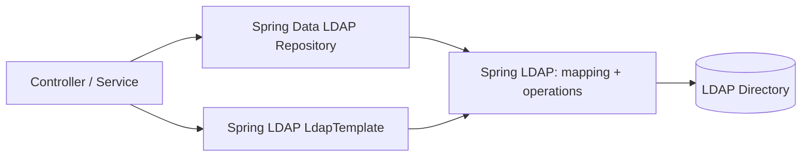

# Spring Data LDAP là gì và giải quyết bài toán nào?

Trong nhiều hệ thống doanh nghiệp, thông tin nhân viên, tài khoản, nhóm và cơ cấu tổ chức không nằm trong cơ sở dữ liệu quan hệ của từng ứng dụng mà được quản lý tập trung trong một **dịch vụ thư mục LDAP**. Ứng dụng Java cần tìm người dùng theo mã nhân viên, đọc thông tin liên hệ, đối chiếu nhóm hoặc cập nhật một số thuộc tính được cho phép. Spring Data LDAP giúp triển khai lớp truy cập dữ liệu này bằng các repository và đối tượng Java, đồng thời cho phép dùng công cụ truy vấn của Spring LDAP khi cần linh hoạt hơn.

Bài học thuộc chương **Tổng quan**, tập trung vào câu hỏi: **Spring Data LDAP là gì, tại sao cần nó và nên dùng trong tình huống nào?** Các ví dụ giới thiệu DN, `objectClass`, schema, ánh xạ entry, repository, `LdapTemplate`, CRUD, truy vấn an toàn và các lưu ý về kết nối, quyền truy cập, kiểm thử.

## 1. Sau bài học, bạn có thể làm gì?

- Giải thích được LDAP lưu dữ liệu dưới dạng cây entry và phân biệt nó với cơ sở dữ liệu quan hệ.
- Đọc một DN, nhận biết các thuộc tính LDAP và vai trò của `objectClass` trong schema.
- Chỉ ra vai trò khác nhau của Spring Data LDAP, Spring LDAP và Spring Security LDAP.
- Ánh xạ một entry thành đối tượng Java, viết repository truy vấn và thực hiện CRUD cơ bản.
- Chọn `LdapRepository` hoặc `LdapTemplate` theo nhu cầu; nhận biết các rủi ro về LDAP injection, kết nối và phân quyền.

## 2. Bài toán trước khi có Spring Data LDAP

Giả sử một công ty có nhiều ứng dụng nội bộ: cổng nhân sự, hệ thống quản lý thiết bị, công cụ tra cứu danh bạ và ứng dụng phê duyệt. Tất cả đều cần thông tin về nhân viên. Nếu mỗi ứng dụng lưu một bản sao riêng, dữ liệu dễ bị lệch khi nhân viên đổi phòng ban, email hoặc rời công ty.

Một directory server (ví dụ OpenLDAP hoặc Microsoft Active Directory) có thể đóng vai trò **nguồn danh bạ dùng chung**. Ứng dụng truy vấn directory để:

1. Tìm nhân viên theo `uid`, email hoặc thuộc tính được tổ chức quy định.
2. Lấy tên hiển thị, phòng ban, đơn vị và các nhóm liên quan.
3. Tạo hoặc cập nhật entry nếu ứng dụng được cấp quyền ghi.
4. Đồng bộ thông tin cần thiết sang các hệ thống khác.

Làm trực tiếp với LDAP thường đòi hỏi xử lý DN, bộ lọc truy vấn, kết nối, `Attributes`, chuyển kiểu dữ liệu và lỗi từ directory. Khi có nhiều truy vấn và mô hình dữ liệu, mã xử lý hạ tầng dễ lặp lại và lấn át nghiệp vụ. **Spring Data LDAP cung cấp mô hình repository và ánh xạ đối tượng để giảm phần mã lặp đó.**

> **Giới hạn quan trọng:** LDAP không tự động thay thế database nghiệp vụ. Directory thường phù hợp với dữ liệu danh bạ, tài khoản, nhóm và cấu trúc tổ chức; giao dịch nhiều bảng, phân tích dữ liệu hoặc quan hệ phức tạp thường phù hợp hơn với hệ quản trị dữ liệu chuyên dụng.

## 3. Nền tảng LDAP cần hiểu trước

### 3.1. Directory là một cây entry

LDAP (Lightweight Directory Access Protocol) là giao thức truy cập dịch vụ thư mục. Một directory tổ chức dữ liệu thành các **entry có quan hệ cha–con**. Mỗi entry có một **Distinguished Name (DN)** để định danh vị trí của nó trong cây.

Ví dụ, xét cây thư mục của miền `example.org`:

```text
dc=example,dc=org
├── ou=people
│   ├── uid=lan
│   └── uid=minh
└── ou=groups
    └── cn=developers
```

Entry của nhân viên Lan có thể mang DN:

```text
uid=lan,ou=people,dc=example,dc=org
```

Các thành phần có ý nghĩa:

| Thuật ngữ | Ví dụ | Ý nghĩa |
|---|---|---|
| DN | `uid=lan,ou=people,dc=example,dc=org` | Đường định danh entry trong cây LDAP. |
| RDN | `uid=lan` | Thành phần định danh entry so với entry cha. |
| `ou` | `ou=people` | Đơn vị tổ chức (organizational unit), thường dùng làm nhánh chứa entry. |
| `dc` | `dc=example,dc=org` | Thành phần miền (domain component). |
| Thuộc tính | `cn`, `sn`, `mail` | Dữ liệu của entry; một thuộc tính có thể có nhiều giá trị. |
| `objectClass` | `inetOrgPerson` | Lớp schema xác định loại entry, thuộc tính bắt buộc và được phép. |

DN là định danh theo cấu trúc cây, không phải địa chỉ email hay khóa tự tăng. Di chuyển entry sang nhánh khác hoặc đổi RDN có thể làm DN thay đổi, ảnh hưởng các tham chiếu và quyền truy cập.

### 3.2. Một entry có thể trông như thế nào?

Định dạng LDIF sau minh họa dữ liệu của một người dùng:

```ldif
dn: uid=lan,ou=people,dc=example,dc=org
objectClass: top
objectClass: person
objectClass: organizationalPerson
objectClass: inetOrgPerson
uid: lan
cn: Lan Nguyen
sn: Nguyen
mail: lan@example.org
```

`dn` xác định vị trí entry. `objectClass` chỉ ra các quy tắc schema; ví dụ `person` thường yêu cầu `cn` và `sn`. Thuộc tính có thể đơn trị hoặc đa trị tùy schema. Không phải mọi directory đều dùng cùng object class và thuộc tính: **Microsoft Active Directory có các schema và quy ước riêng**, do đó mapping phải bám dữ liệu thực tế.

### 3.3. Search base, scope và filter

Một phép tìm kiếm LDAP thường có ba thành phần:

- **Base DN:** điểm bắt đầu tìm, ví dụ `ou=people,dc=example,dc=org`.
- **Scope:** chỉ entry tại base, con trực tiếp hay toàn bộ cây con.
- **Filter:** điều kiện, ví dụ `(uid=lan)` hoặc `(&(objectClass=inetOrgPerson)(sn=Nguyen))`.

Chọn base và filter đúng giúp trả kết quả chính xác, tránh quét các nhánh không cần thiết và tôn trọng giới hạn truy vấn của server.

## 4. Spring Data LDAP là gì?

**Spring Data LDAP** là một mô-đun trong hệ sinh thái Spring Data giúp làm việc với LDAP theo cách quen thuộc của Spring: định nghĩa đối tượng ánh xạ entry, khai báo interface repository và để framework triển khai các thao tác truy cập dữ liệu phổ biến. Nó vận hành trên nền **Spring LDAP**, vốn cung cấp `LdapTemplate`, quản lý kết nối và các API tìm kiếm, cập nhật entry.



| Thành phần | Đóng vai trò gì? | Dùng khi nào? |
|---|---|---|
| **Spring Data LDAP** | Repository, ánh xạ entry sang Java, phương thức truy vấn dẫn xuất từ tên method. | Phần lớn truy vấn và CRUD thông thường trên các entry đã có mô hình rõ ràng. |
| **Spring LDAP** | API mức thấp hơn, `LdapTemplate`, truy vấn linh hoạt, thao tác LDAP và mapping. | Filter phức tạp, thao tác đặc thù directory hoặc kết quả không cần ánh xạ đầy đủ. |
| **Spring Security LDAP** | Tích hợp LDAP vào luồng xác thực và tra cứu thông tin phục vụ bảo mật. | Đăng nhập, xác thực danh tính và một số kịch bản phân quyền. |
| **Spring Data JPA** | Repository trên dữ liệu quan hệ qua JPA. | Bảng, quan hệ, khóa ngoại, transaction và truy vấn dữ liệu quan hệ. |

**Spring Data LDAP không tự dựng LDAP server, không tự tạo schema và không biến LDAP thành cơ sở dữ liệu quan hệ.** Ứng dụng phải kết nối tới một directory có cấu hình, schema và quyền phù hợp.

## 5. Từ LDAP entry đến Java repository

Ví dụ dưới đây minh họa Spring Boot kết nối một directory thử nghiệm chứa nhánh `ou=people,dc=example,dc=org`.

### 5.1. Khai báo dependency và cấu hình

Trong dự án Spring Boot dùng Maven:

```xml
<dependency>
    <groupId>org.springframework.boot</groupId>
    <artifactId>spring-boot-starter-data-ldap</artifactId>
</dependency>
```

Cấu hình minh họa trong `application.yml`:

```yaml
spring:
  ldap:
    urls: ldap://localhost:1389
    base: dc=example,dc=org
    username: cn=admin,dc=example,dc=org
    password: ${LDAP_BIND_PASSWORD}
```

Trong ví dụ này, `spring.ldap.base` là base chung của kết nối; nhánh `ou=people` được dùng tiếp khi tìm entry. `ldap://localhost:1389` chỉ phù hợp với môi trường thử nghiệm cục bộ. Môi trường thực tế cần cấu hình TLS (`ldaps://` hoặc StartTLS tùy server và thư viện), kiểm tra chứng chỉ hợp lệ, quản lý bí mật an toàn và dùng tài khoản bind với quyền tối thiểu.

### 5.2. Ánh xạ entry

```java
import javax.naming.Name;
import org.springframework.ldap.odm.annotations.Attribute;
import org.springframework.ldap.odm.annotations.Entry;
import org.springframework.ldap.odm.annotations.Id;

@Entry(
    base = "ou=people",
    objectClasses = {
        "top", "person", "organizationalPerson", "inetOrgPerson"
    }
)
public class PersonEntry {

    @Id
    private Name dn;

    @Attribute(name = "uid")
    private String uid;

    @Attribute(name = "cn")
    private String fullName;

    @Attribute(name = "sn")
    private String surname;

    @Attribute(name = "mail")
    private String email;

    // Constructor không tham số, getter và setter được lược bớt.
}
```

`@Entry` chỉ ra nhánh tìm kiếm và lớp schema của entry. `@Id` ánh xạ DN (kiểu `javax.naming.Name`) để repository định danh đối tượng. `@Attribute` gắn field Java với tên thuộc tính LDAP. Nếu tên thuộc tính trong server khác ví dụ, hãy thay mapping theo schema thật. Với dữ liệu nhiều giá trị, cần chọn kiểu ánh xạ thích hợp thay vì mặc định mọi thuộc tính đều là `String`.

### 5.3. Định nghĩa repository

```java
import java.util.List;
import java.util.Optional;
import org.springframework.data.ldap.repository.LdapRepository;

public interface PersonRepository
        extends LdapRepository<PersonEntry> {

    Optional<PersonEntry> findByUid(String uid);

    List<PersonEntry> findBySurname(String surname);
}
```

Các phương thức `findByUid` và `findBySurname` dựa trên **tên thuộc tính Java** được mapping (lần lượt là `uid` và `surname`), sau đó Spring Data LDAP chuyển thành truy vấn tương ứng. Các thao tác chung như `findById`, `save`, `findAll` và `deleteById` được kế thừa từ repository.

### 5.4. CRUD cơ bản qua repository

Đoạn mã dưới đây minh họa luồng thao tác. Giả sử `PersonEntry` đã có getter/setter và directory cho phép ứng dụng tạo, sửa, xóa dưới nhánh `ou=people`.

```java
import javax.naming.Name;
import org.springframework.ldap.support.LdapNameBuilder;

// CREATE: DN tương đối với spring.ldap.base
Name dn = LdapNameBuilder.newInstance("ou=people")
        .add("uid", "lan")
        .build();

PersonEntry lan = new PersonEntry();
lan.setDn(dn);
lan.setUid("lan");
lan.setFullName("Lan Nguyen");
lan.setSurname("Nguyen");
lan.setEmail("lan@example.org");
personRepository.save(lan);

// READ: tìm theo một thuộc tính được ánh xạ
PersonEntry existing = personRepository.findByUid("lan")
        .orElseThrow();

// UPDATE: sửa thuộc tính hợp lệ rồi lưu lại
existing.setEmail("lan.nguyen@example.org");
personRepository.save(existing);

// DELETE: xóa theo DN đã xác định
personRepository.deleteById(existing.getDn());
```

Ở đây, `uid=lan,ou=people` là DN tương đối với base `dc=example,dc=org` của cấu hình; DN đầy đủ trên server là `uid=lan,ou=people,dc=example,dc=org`. Cách chuẩn hóa DN phụ thuộc `ContextSource`/base đang dùng, vì vậy cần xác nhận bằng bài kiểm thử tích hợp trước khi ghi dữ liệu thật. Việc tạo entry chỉ thành công nếu nhánh cha tồn tại, các thuộc tính bắt buộc của schema đầy đủ, DN không trùng và tài khoản bind có quyền.

`save` không bảo đảm các đặc tính transaction của JPA. Nếu yêu cầu đổi RDN/di chuyển entry, đổi nhóm, hoặc cập nhật thuộc tính đặc biệt như mật khẩu, cần kiểm tra chính sách và API LDAP phù hợp thay vì giả định rằng sửa mọi field rồi `save` đều đủ.

## 6. Khi nào nên dùng LdapTemplate?

Repository hiệu quả khi truy vấn xoay quanh một loại entry có mapping ổn định. Nhưng đôi lúc ứng dụng chỉ cần một thuộc tính, phải áp dụng filter động hoặc muốn kiểm soát scope tìm kiếm. Khi đó `LdapTemplate` và `LdapQueryBuilder` của Spring LDAP có thể rõ ràng hơn.

Ví dụ, tra tên hiển thị theo `uid`:

```java
import java.util.List;
import org.springframework.ldap.core.AttributesMapper;
import org.springframework.ldap.core.LdapTemplate;
import static org.springframework.ldap.query.LdapQueryBuilder.query;

public class DirectoryLookup {
    private final LdapTemplate ldapTemplate;

    public DirectoryLookup(LdapTemplate ldapTemplate) {
        this.ldapTemplate = ldapTemplate;
    }

    public List<String> findDisplayNames(String inputUid) {
        return ldapTemplate.search(
            query().base("ou=people")
                   .where("uid").is(inputUid),
            (AttributesMapper<String>) attributes ->
                attributes.get("cn").get().toString()
        );
    }
}
```

Builder tạo filter từ thành phần có cấu trúc, xử lý việc escape giá trị truy vấn thay vì ghép giá trị người dùng vào chuỗi LDAP filter bằng tay. Không nên viết `"(uid=" + inputUid + ")"` với dữ liệu chưa tin cậy: các ký tự đặc biệt có thể làm thay đổi ý nghĩa filter và gây **LDAP injection**. Cũng cần xây DN bằng `LdapNameBuilder` hoặc API xử lý DN, không nối trực tiếp chuỗi từ input.

Ví dụ này giả định mọi entry khớp filter đều có `cn`; với directory không đồng nhất, hãy xử lý thuộc tính thiếu và các trường hợp trả về nhiều kết quả.

## 7. Những bài toán Spring Data LDAP giải quyết tốt

| Nhu cầu thực tế | Cách Spring Data LDAP hỗ trợ | Lưu ý |
|---|---|---|
| Tra danh bạ nhân viên | Repository truy vấn theo `uid`, tên hoặc email. | Xác định thuộc tính thực tế có được đánh chỉ mục hay không. |
| Hiển thị hồ sơ người dùng | Mapping entry thành Java object để dùng trong service. | Không phơi bày thông tin nhạy cảm ngoài nhu cầu nghiệp vụ. |
| Quản lý entry được ủy quyền | Các thao tác tạo, đọc, cập nhật, xóa qua repository. | Tuân thủ schema, ACL và lifecycle của directory. |
| Truy vấn theo tiêu chí linh hoạt | Kết hợp `LdapTemplate`, query builder, scope/base phù hợp. | Escape filter, giới hạn kích thước kết quả và phân trang khi cần. |
| Tích hợp danh bạ vào ứng dụng Spring | Quản lý kết nối và các bean Spring quen thuộc. | Kiểm thử với server tương thích schema thực tế. |

Một ví dụ điển hình là **cổng tra cứu nhân viên**. Khi người dùng nhập mã nhân viên, API gọi service, service dùng repository tìm entry và trả về tên, email, đơn vị được phép công bố. Danh bạ vẫn được quản lý tập trung trong LDAP; ứng dụng không phải sao chép và duy trì toàn bộ hồ sơ nhân sự ở mỗi nơi.

Tuy nhiên, một hệ thống **đăng nhập bằng LDAP** cần phân biệt rõ hai yêu cầu: tìm/đọc entry người dùng là bài toán truy cập dữ liệu; xác thực mật khẩu, xây dựng phiên và phân quyền truy cập thuộc phạm vi của Spring Security và chính sách bảo mật. Việc đọc thấy entry **không đồng nghĩa** đã xác thực được người dùng.

## 8. Những giới hạn và sai lầm thường gặp

**Nhầm DN với một thuộc tính bình thường.** `uid` có thể xuất hiện trong DN nhưng DN là đường định danh entry, còn `uid` là thuộc tính. Đổi `uid` trong đối tượng Java không mặc nhiên đổi DN; rename/move cần được xử lý đúng.

**Bỏ qua schema và objectClass.** Có thể một entry thiếu `sn`, dùng `user` thay cho `inetOrgPerson`, hoặc từ chối ghi `mail` do ACL. Lỗi lúc ghi không nhất thiết do repository mà có thể xuất phát từ ràng buộc directory.

**Dùng LDAP như hệ quản trị dữ liệu giao dịch.** LDAP có mô hình cây, các thao tác và giới hạn riêng. Không nên mặc định có JOIN, khóa ngoại và transaction nhiều thao tác như trong database quan hệ.

**Lấy không giới hạn toàn bộ directory.** `findAll` hoặc tìm kiếm subtree quá rộng có thể chậm, bị server giới hạn số entry hoặc ảnh hưởng hệ thống dùng chung. Thu hẹp base, thêm điều kiện và dùng paging khi danh sách lớn.

**Ghi thông tin xác thực vào mã nguồn.** Secret cần lấy từ môi trường hoặc bộ quản lý bí mật; kết nối từ xa phải được bảo vệ bằng TLS, xác minh chứng chỉ và tài khoản bind chỉ có quyền cần thiết.

**Không tính đến tính chất dữ liệu đa trị.** Thuộc tính như thành viên nhóm có thể chứa nhiều giá trị; mapping sang một `String` có nguy cơ làm mất thông tin hoặc không đúng mong đợi.

## 9. Kiểm thử tích hợp với directory

Vì hành vi phụ thuộc schema và cấu hình server, kiểm thử thao tác LDAP nên có **một directory phục vụ test** (server nhúng hoặc container, tùy môi trường dự án) và bộ fixture tách biệt với dữ liệu production.

Một luồng kiểm thử hữu ích:

1. Khởi tạo cây `dc=example,dc=org`, `ou=people` và dữ liệu entry mẫu theo schema mà code sử dụng.
2. Cấu hình `ContextSource`/base và tài khoản thử nghiệm; xác nhận repository tìm được `uid=lan` với đúng DN và thuộc tính.
3. Tạo entry mới, đọc lại, sửa `mail`, xác minh giá trị được cập nhật, xóa entry và kiểm tra không còn tìm thấy.
4. Thử trường hợp DN trùng, thiếu thuộc tính bắt buộc, tài khoản không có quyền và filter nhận ký tự đặc biệt.
5. Bảo đảm dữ liệu kiểm thử được dọn dẹp và không thao tác trên directory thật.

Các bài test chỉ chạy với mock repository giúp kiểm tra service nhưng **không chứng minh** DN, schema, escaping, quyền và thao tác `save` sẽ hoạt động đúng trên LDAP server. Với module LDAP, kiểm thử tích hợp là một phần quan trọng của việc xác nhận tính đúng đắn.

## 10. Tổng kết và tự kiểm tra

Spring Data LDAP phù hợp khi ứng dụng Spring cần đọc hoặc quản lý **entry của một directory LDAP** theo mô hình Java/repository. Nó giúp giảm mã xử lý hạ tầng cho các thao tác phổ biến, trong khi Spring LDAP cung cấp `LdapTemplate` khi truy vấn hoặc thao tác đặc thù hơn. Hiểu DN, `objectClass`, schema, search base, filter và quyền truy cập là điều kiện để dùng thư viện đúng cách.

Hãy tự trả lời:

1. Trong DN `uid=lan,ou=people,dc=example,dc=org`, đâu là RDN và đâu là nhánh chứa entry?
2. Vì sao `@Id` ánh xạ DN, còn `@Attribute(name = "uid")` ánh xạ thuộc tính?
3. Khi nào bạn chọn repository, khi nào cần `LdapTemplate`?
4. Vì sao nên dùng query builder thay vì ghép filter từ chuỗi nhập của người dùng?
5. Truy cập được hồ sơ LDAP có đồng nghĩa với việc người dùng đã đăng nhập thành công không?

Nếu trả lời được các câu hỏi này, bạn đã có nền tảng để học sâu hơn về mapping, truy vấn repository, CRUD, xử lý filter an toàn, bảo mật kết nối và kiểm thử với directory.
