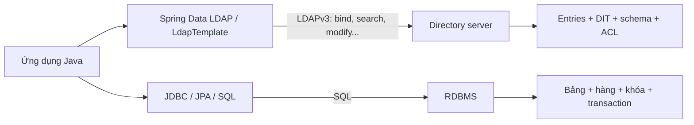
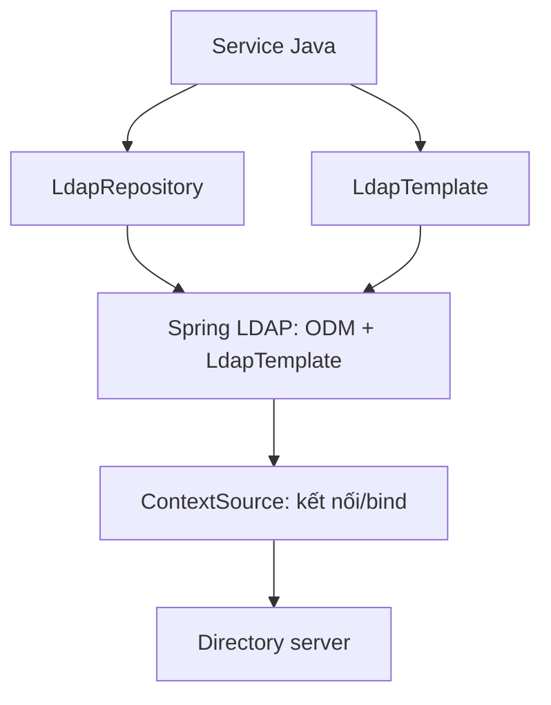
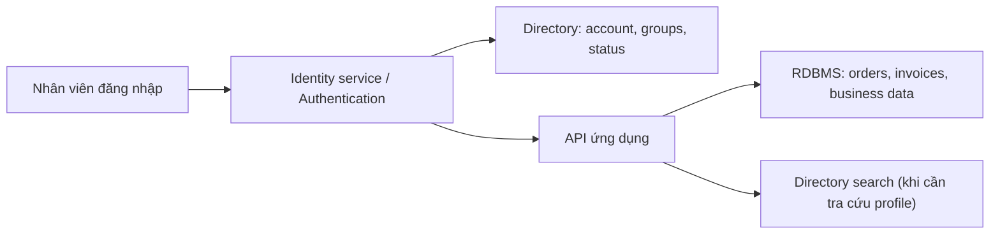

# Phân biệt giao thức LDAP, máy chủ thư mục và cơ sở dữ liệu quan hệ

> **Chương:** Tổng quan  
> **Module:** SPRING_DATA_LDAP — sử dụng Spring Data LDAP repository và Spring LDAP để truy cập directory, ánh xạ entry phân cấp thành đối tượng Java, tìm kiếm, CRUD và kiểm thử an toàn.

## Mục tiêu học tập

Kết thúc bài này, bạn có thể:

1. Giải thích vì sao **LDAP là một giao thức**, còn **directory server là hệ thống triển khai dịch vụ thư mục**; không nhầm cả hai với cơ sở dữ liệu quan hệ (RDBMS).
2. Đọc một cây LDAP gồm **DN, RDN, entry, attribute, objectClass** và mô tả điểm khác biệt với bảng, hàng, cột, khóa của SQL.
3. So sánh các thao tác **bind, search, add, modify, delete, ModifyDN** của LDAP với xác thực và các thao tác SQL.
4. Hiểu Spring Data LDAP repository và Spring LDAP `LdapTemplate` sử dụng LDAP như thế nào, gồm giới hạn truy vấn, phân trang, bộ lọc và giao dịch.
5. Chọn directory hay RDBMS dựa trên bài toán danh tính, phân quyền, tra cứu tổ chức, giao dịch nghiệp vụ và yêu cầu bảo mật.

## 1. Ba khái niệm khác nhau

Một ứng dụng muốn tìm nhân viên có `uid=linh` có thể gửi truy vấn LDAP tới một máy chủ thư mục. Máy chủ thực thi truy vấn đó trên dữ liệu entry mà nó quản lý, sau đó trả kết quả. Cũng là dữ liệu người dùng, nhưng nếu ứng dụng dùng bảng `users` của PostgreSQL thì nó thực thi SQL trên RDBMS.

| Khái niệm | Bản chất | Vai trò | Ví dụ |
| --- | --- | --- | --- |
| **LDAP (Lightweight Directory Access Protocol)** | **Giao thức** truy cập và thao tác dịch vụ thư mục | Xác định thông điệp và cách client yêu cầu bind, search, add, modify, delete… | LDAPv3 (RFC 4511), LDAP search filter (RFC 4515) |
| **Directory server / dịch vụ thư mục** | **Phần mềm và dịch vụ** quản lý entry, cây tên, schema và quyền | Nhận yêu cầu LDAP, kiểm tra quyền/schema, tìm kiếm và lưu dữ liệu | OpenLDAP, 389 Directory Server, Microsoft Active Directory Domain Services |
| **RDBMS (Relational Database Management System)** | **Hệ quản trị dữ liệu quan hệ** | Quản lý bảng, khóa, truy vấn SQL và giao dịch | PostgreSQL, MySQL, Oracle Database, Microsoft SQL Server |

**LDAP không phải là tên một hệ quản trị cơ sở dữ liệu.** Máy chủ LDAP có thể lưu dữ liệu trên backend riêng và có bộ chỉ mục; từ “directory” cũng là một dạng cơ sở dữ liệu theo nghĩa rộng. Điểm phân biệt ở đây là **giao thức LDAP và mô hình entry phân cấp** so với **mô hình quan hệ và SQL**. RFC LDAP không bắt buộc một sản phẩm phải dùng một công nghệ lưu trữ vật lý cụ thể.

Một máy chủ thư mục có thể hỗ trợ nhiều giao thức: ví dụ **Active Directory Domain Services (AD DS)** phục vụ truy vấn danh bạ qua LDAP và hỗ trợ Kerberos cùng các thành phần khác cho xác thực Windows. **Active Directory không đồng nghĩa với LDAP**; LDAP chỉ là một trong các giao thức mà dịch vụ đó sử dụng.



Cùng một ứng dụng **có thể dùng cả hai hệ thống**: directory phục vụ tài khoản, nhóm và cấu trúc tổ chức; RDBMS phục vụ đơn hàng, thanh toán và dữ liệu nghiệp vụ.

## 2. LDAP tổ chức dữ liệu ra sao?

Đơn vị dữ liệu cơ bản của directory là **entry**, gồm một **Distinguished Name (DN)** và tập các thuộc tính (*attributes*) với một hoặc nhiều giá trị.

Ví dụ trong một directory thử nghiệm:

```ldif
dn: uid=linh,ou=people,dc=example,dc=org
objectClass: top
objectClass: person
objectClass: organizationalPerson
objectClass: inetOrgPerson
uid: linh
cn: Linh Nguyen
sn: Nguyen
mail: linh@example.org
telephoneNumber: +84 28 0000 0001
```

Các khái niệm quan trọng:

- **DN**: `uid=linh,ou=people,dc=example,dc=org` định danh entry trong cây, bằng cách ghép các **RDN** theo đường từ entry lên gốc.
- **RDN (Relative Distinguished Name)**: `uid=linh` là tên của entry so với entry cha. DN xác định vị trí của entry trong directory; nếu chuyển hoặc đổi tên entry, DN có thể thay đổi.
- **DIT (Directory Information Tree)**: cấu trúc cây được tạo từ các DN cha/con; khác với các bảng quan hệ được nối bằng khóa.
- **Attribute**: `cn`, `sn`, `uid`, `mail`, `telephoneNumber`. Một thuộc tính có thể đa trị nếu schema cho phép (ví dụ nhiều `telephoneNumber`).
- **`objectClass` và schema**: quy định entry thuộc loại nào, thuộc tính nào bắt buộc (`MUST`), thuộc tính nào được phép (`MAY`), kiểu giá trị và quy tắc so khớp. Với chuỗi `inetOrgPerson` chuẩn, `cn` và `sn` là bắt buộc vì kế thừa từ `person`.
- **ACL (Access Control List)/policy**: server xác định danh tính bind nào được xem, sửa hoặc xóa entry/attribute. Có schema hợp lệ chưa chắc đã có quyền ghi.

Cây LDAP minh họa:

```text
dc=example,dc=org
├── ou=people
│   ├── uid=linh
│   └── uid=mai
└── ou=groups
    └── cn=developers
```

DN của `uid=linh` đọc từ lá lên gốc là `uid=linh,ou=people,dc=example,dc=org`. Một entry nhóm có thể dùng thuộc tính `member` chứa DN của thành viên; đó là **tham chiếu bằng giá trị DN**, không phải một foreign key được RDBMS thực thi với toàn bộ semantics của quan hệ SQL.

### DN có phải primary key không?

DN có tác dụng **định danh duy nhất trong phạm vi cây/tên của directory**, nên có phần giống primary key. Tuy nhiên, DN chứa thông tin vị trí và **có thể đổi khi rename/move** qua `ModifyDN`. Nếu hệ thống khác cần khóa lâu dài để liên kết người dùng, ưu tiên một định danh ổn định đã được directory của bạn hỗ trợ (ví dụ một thuộc tính mã nhân viên bất biến theo quy định hoặc identifier chuyên dụng), và đừng giả định `uid` hay `mail` tự nhiên luôn bất biến, duy nhất trên mọi directory.

Tài liệu nền tảng: [RFC 4512 — LDAP Directory Information Models](https://www.rfc-editor.org/rfc/rfc4512.html).

## 3. RDBMS mô hình hóa cùng dữ liệu như thế nào?

Cùng dữ liệu nhân viên có thể nằm ở bảng `employees`:

```sql
CREATE TABLE employees (
    id          BIGINT PRIMARY KEY,
    username    VARCHAR(100) UNIQUE NOT NULL,
    full_name   VARCHAR(200) NOT NULL,
    surname     VARCHAR(100) NOT NULL,
    email       VARCHAR(255)
);

INSERT INTO employees (id, username, full_name, surname, email)
VALUES (101, 'linh', 'Linh Nguyen', 'Nguyen', 'linh@example.org');

SELECT id, username, full_name, email
FROM employees
WHERE username = 'linh';
```

Mô hình này có **bảng, hàng, cột, primary key, unique constraint, foreign key**, truy vấn `JOIN` và transaction. Nếu nhân viên thuộc nhiều phòng ban, có thể tạo bảng `departments` và bảng quan hệ để liên kết. RDBMS xử lý dữ liệu theo khóa và ràng buộc do schema quan hệ khai báo, không bắt buộc tổ chức mọi đối tượng trong cây DN.

### Bảng đối chiếu LDAP và SQL

| Câu hỏi | LDAP directory | RDBMS |
| --- | --- | --- |
| Một đối tượng dữ liệu được biểu diễn bằng gì? | **Entry** có DN và các attribute | **Row** trong table |
| Nhận diện đối tượng như thế nào? | **DN** và các thuộc tính định danh | Primary key / unique key |
| Quan hệ phân cấp? | **DIT** với DN cha/con | Foreign key, self-reference, bảng cây, recursive query |
| Schema kiểm tra gì? | `objectClass`, `MUST`/`MAY`, attribute syntax, naming constraints | Kiểu cột, `NOT NULL`, `CHECK`, unique, foreign key |
| Truy vấn bằng gì? | LDAP **search base + scope + filter** | SQL `SELECT`, `WHERE`, `JOIN`, `GROUP BY` |
| Nhiều giá trị trong một thuộc tính? | Một attribute có thể **đa trị** | Thường chuẩn hóa bằng bảng liên kết hoặc loại dữ liệu riêng |
| Tìm nhiều cấp của cây? | `SUBTREE` scope | Recursive SQL / tree schema / joins |
| Transaction đa đối tượng? | LDAP chuẩn **không bảo đảm ACID xuyên nhiều entry** | RDBMS thường hỗ trợ transaction ACID giữa nhiều row/table |
| Mạnh ở bài toán nào? | Tra cứu tài khoản, nhóm, tổ chức, nhận dạng entry | Giao dịch nghiệp vụ, quan hệ phức tạp, báo cáo/aggregation |

Các so sánh phản ánh **khả năng được giao thức và mô hình cung cấp**, không khẳng định mọi directory luôn nhanh hơn mọi RDBMS cho mọi phép đọc. Hiệu năng thực tế phụ thuộc chỉ mục, filter, kích thước directory, mạng, cấu hình server và ứng dụng.

## 4. Truy vấn LDAP: base DN, scope và filter thay cho SQL

Với SQL, ta thường viết:

```sql
SELECT *
FROM employees
WHERE username = 'linh';
```

Với LDAP, truy vấn có ít nhất ba thành phần:

1. **Base DN**: vị trí bắt đầu tìm, ví dụ `ou=people,dc=example,dc=org`.
2. **Search scope**: phạm vi duyệt trong cây, gồm `BASE` (chỉ entry base), `ONELEVEL` (các entry con trực tiếp) và `SUBTREE` (base cùng toàn bộ hậu duệ).
3. **Filter**: điều kiện so khớp, ví dụ `(&(objectClass=inetOrgPerson)(uid=linh))`.

Ví dụ filter LDAP:

| Mục đích | Filter |
| --- | --- |
| Tài khoản có `uid=linh` | `(uid=linh)` |
| Người dùng thuộc lớp `inetOrgPerson` và có `uid=linh` | `(&(objectClass=inetOrgPerson)(uid=linh))` |
| Entry có thuộc tính `mail` | `(mail=*)` |
| `sn=Nguyen` hoặc `sn=Tran` | `(\|(sn=Nguyen)(sn=Tran))` |
| Không phải nhóm `groupOfNames` | `(!(objectClass=groupOfNames))` |

Ở LDAP filter, `&` là **AND**, `|` là **OR**, `!` là **NOT**. Bộ so khớp không đơn giản là dấu `=` của SQL: schema định nghĩa các **matching rules**, nên việc phân biệt chữ hoa/thường, chuẩn hóa Unicode hay so sánh giá trị tùy loại thuộc tính. LDAP filter không có cú pháp `JOIN` để trả kết quả kết hợp từ nhiều tập entity như SQL.

Ví dụ câu lệnh dùng `ldapsearch` cho OpenLDAP client (môi trường thử nghiệm):

```bash
ldapsearch -x \
  -H ldap://localhost:389 \
  -b "ou=people,dc=example,dc=org" \
  -s sub \
  "(&(objectClass=inetOrgPerson)(uid=linh))" \
  dn uid cn sn mail
```

Nếu server yêu cầu bind, thêm tùy chọn danh tính và nhập mật khẩu an toàn như `-D ... -W`; trên production dùng LDAPS/StartTLS và xác thực chứng chỉ. **Bí mật bind không nằm trong filter** và không được hardcode vào lệnh/script được chia sẻ.

### Tìm kiếm theo scope khác giới hạn kết quả

- `SUBTREE` mở rộng **độ sâu** tìm kiếm; nó không đồng nghĩa trả tất cả entry không giới hạn.
- `countLimit` giới hạn **số kết quả** một search trả về, nhưng không cung cấp vị trí “trang tiếp”.
- Phân trang LDAP theo **RFC 2696 Simple Paged Results Control** dùng cookie do server cấp để tiếp tục theo từng đợt. Không thể tự suy cookie thành offset SQL.
- Tính năng paging/sorting **không được Spring Data LDAP `LdapRepository` hỗ trợ như `Pageable` của JPA**; khi cần kiểm soát paging của LDAP server, dùng `LdapTemplate` cùng control tương ứng nếu server hỗ trợ.

## 5. LDAP có thể ghi dữ liệu, nhưng cơ chế khác SQL

LDAPv3 định nghĩa nhiều loại request, không chỉ tìm kiếm:

| LDAP operation | Ý nghĩa | Phép SQL có mục đích gần giống |
| --- | --- | --- |
| `Bind` | Thiết lập danh tính xác thực cho LDAP connection | Gần với xác thực kết nối DB, **không phải SQL DML** |
| `Search` | Tìm entry bằng base DN, scope, filter và attributes | `SELECT ... WHERE ...` |
| `Compare` | Yêu cầu server kiểm tra entry có giá trị attribute cho trước không | Phép kiểm tra điều kiện trên row |
| `Add` | Tạo một entry mới tại DN, phải thỏa schema | `INSERT` |
| `Modify` | Thêm/xóa/thay giá trị attribute của một entry | `UPDATE` |
| `Delete` | Xóa entry tại DN (bị giới hạn bởi quan hệ cha/con và quyền) | `DELETE` |
| `ModifyDN` | Đổi RDN hoặc chuyển entry trong DIT | Đổi định danh hoặc chuyển node cây, không tương đương một câu SQL đơn lẻ |
| `Unbind` | Kết thúc phiên giao thức | Đóng kết nối ở mức client |

**Bind không đồng nghĩa đọc/ghi tài khoản.** Một client có thể bind thành công nhưng không có quyền đọc thuộc tính như `mail` hoặc ghi `member`; authorization được áp dụng riêng. `Bind` còn có nhiều phương thức (ví dụ simple bind và SASL) tùy server/client.

### LDAP có transaction không?

LDAP `Modify` áp dụng các thay đổi trong **một request trên một entry** theo yêu cầu nguyên tử của giao thức: nếu một phần sửa đổi không hợp lệ, server không thực hiện dở dang các thay đổi đó. Nhưng LDAP chuẩn **không cung cấp giao dịch ACID đa entry tương đương** `BEGIN; UPDATE...; UPDATE...; COMMIT;` của RDBMS.

Một số directory có cơ chế transaction hoặc thay đổi hàng loạt riêng của sản phẩm, nhưng không được coi là tính năng phổ quát của LDAP. Vì vậy, nếu cần tạo đồng thời tài khoản, đơn hàng, hóa đơn và bảo đảm **tất cả thành công hoặc tất cả rollback**, RDBMS thường là nơi phù hợp hơn cho dữ liệu nghiệp vụ đó.

**Ví dụ:** khi nhân viên đổi phòng ban, thao tác đổi group membership và cập nhật hồ sơ ở các entry LDAP khác nhau có thể thành công từng phần nếu một bước gặp lỗi. Ứng dụng cần kiểm tra kết quả, thiết kế retry/idempotency hoặc cơ chế phối hợp phù hợp; đừng giả định một `@Transactional` JPA sẽ tự quản lý mọi thay đổi LDAP.

Nguồn: [RFC 4511 — LDAP Protocol](https://www.rfc-editor.org/rfc/rfc4511.html).

## 6. Spring Data LDAP nằm ở đâu?

Trong ứng dụng Spring, nên phân biệt rõ ba lớp:

- **Spring Boot**: quản lý dependency, cấu hình bean và môi trường runtime, có thể tạo `ContextSource`/`LdapTemplate` khi classpath và cấu hình phù hợp.
- **Spring LDAP**: cung cấp `LdapTemplate`, `ContextSource`, query builder, xử lý DN và LDAP controls.
- **Spring Data LDAP**: kết hợp **Object-Directory Mapping (ODM)** với mô hình **repository** để thao tác entry dưới dạng đối tượng Java.



Một dependency Maven thông dụng trong dự án Spring Boot dùng parent/BOM:

```xml
<dependency>
    <groupId>org.springframework.boot</groupId>
    <artifactId>spring-boot-starter-data-ldap</artifactId>
</dependency>
```

Không tự ghép version Spring Boot/Spring Data LDAP/Spring LDAP khác major version khi Boot đã quản lý dependency. Lấy phiên bản thực tế từ BOM và dependency tree của dự án.

Ví dụ `application.yml` cho directory test:

```yaml
spring:
  ldap:
    urls: "ldap://localhost:389"
    base: "dc=example,dc=org"
    username: "${LDAP_BIND_DN}"
    password: "${LDAP_BIND_PASSWORD}"
```

Mật khẩu được lấy từ biến môi trường, không commit trong mã nguồn. `localhost` chỉ dùng cho môi trường có directory test cục bộ; khi kết nối từ container, hostname cần phù hợp mạng giữa container/app và LDAP server.

### ODM entity ánh xạ entry LDAP

Với DN `uid=linh,ou=people,dc=example,dc=org` và base cấu hình `dc=example,dc=org`:

```java
import javax.naming.Name;

import org.springframework.ldap.odm.annotations.Attribute;
import org.springframework.ldap.odm.annotations.Entry;
import org.springframework.ldap.odm.annotations.Id;

@Entry(
    base = "ou=people",
    objectClasses = {"top", "person", "organizationalPerson", "inetOrgPerson"}
)
public class DirectoryPerson {

    @Id
    private Name dn;  // DN của entry

    @Attribute(name = "uid")
    private String uid;

    @Attribute(name = "cn")
    private String fullName;

    @Attribute(name = "sn")
    private String surname;

    @Attribute(name = "mail")
    private String email;

    public DirectoryPerson() { }

    public Name getDn() { return dn; }
    public void setDn(Name dn) { this.dn = dn; }
    public String getUid() { return uid; }
    public void setUid(String uid) { this.uid = uid; }
    public String getFullName() { return fullName; }
    public void setFullName(String fullName) { this.fullName = fullName; }
    public String getSurname() { return surname; }
    public void setSurname(String surname) { this.surname = surname; }
    public String getEmail() { return email; }
    public void setEmail(String email) { this.email = email; }
}
```

Ở đây:

- `@Entry` xác định các lớp của entry và base DN tương đối. Với schema `inetOrgPerson`, `cn` và `sn` bắt buộc theo lớp `person` kế thừa.
- `@Id` là annotation **Spring LDAP ODM** và có kiểu `javax.naming.Name`. Không nhầm với `jakarta.persistence.Id` hoặc `org.springframework.data.annotation.Id`.
- `@Attribute(name="cn")` ánh xạ field Java `fullName` sang thuộc tính LDAP `cn`.
- Có thể dùng `@Transient` với field chỉ để hiển thị UI, tránh ghi một tên thuộc tính không được schema cho phép.

### Repository truy vấn như một interface Java

```java
import org.springframework.data.ldap.repository.LdapRepository;

public interface DirectoryPersonRepository
        extends LdapRepository<DirectoryPerson> {

    DirectoryPerson findByUid(String uid);
}
```

Dùng trong service:

```java
DirectoryPerson person = personRepository.findByUid("linh");
if (person != null) {
    System.out.println(person.getFullName());
}
```

`LdapRepository<T>` có **một** type parameter entity vì ID LDAP có kiểu `Name`. Spring Data LDAP hỗ trợ CRUD và các query method được module hỗ trợ; nó **không trở thành JPA** chỉ vì cùng mô hình repository. Ví dụ `Page<T> findBy...(Pageable pageable)` theo Spring Data JPA không mặc nhiên có ý nghĩa với LDAP repository.

Để tạo mới bằng repository cần thiết kế trạng thái **new/existing** và DN chính xác; nếu ứng dụng cần quy định tường minh việc tạo entry, Spring LDAP `LdapTemplate.bind(...)` là API thích hợp. Với LDAP, server kiểm tra cả DN tồn tại, schema `objectClass` và quyền ghi.

## 7. Lúc nào dùng `LdapTemplate` thay vì repository?

`LdapTemplate` thích hợp khi cần một truy vấn đặc thù mà method repository khó thể hiện: base/scope khác nhau, attributes trả về chọn lọc, filter phức tạp hoặc LDAP controls.

Ví dụ lấy tên người dùng theo `uid` với filter được xây an toàn:

```java
import static org.springframework.ldap.query.LdapQueryBuilder.query;

import java.util.List;
import org.springframework.ldap.core.AttributesMapper;
import org.springframework.ldap.core.LdapTemplate;

public final class PersonLookup {

    private final LdapTemplate ldapTemplate;

    public PersonLookup(LdapTemplate ldapTemplate) {
        this.ldapTemplate = ldapTemplate;
    }

    public List<String> findNamesByUid(String uid) {
        return ldapTemplate.search(
            query()
                .base("ou=people")
                .where("objectClass").is("inetOrgPerson")
                .and("uid").is(uid),
            (AttributesMapper<String>) attributes ->
                (String) attributes.get("cn").get()
        );
    }
}
```

`base("ou=people")` là DN tương đối với `spring.ldap.base=dc=example,dc=org` trong ví dụ. `where(...).is(uid)` xây filter với giá trị đã được escape; không nối trực tiếp chuỗi `"(uid=" + uid + ")"` với dữ liệu người dùng vì có nguy cơ **LDAP filter injection**. Với tên attribute lấy từ input, chỉ cho phép danh sách thuộc tính được định nghĩa trước; đừng xem escape giá trị là đủ nếu cả tên thuộc tính cũng không đáng tin cậy.

Chú ý rằng `LdapTemplate.search(...)` trong ví dụ chỉ trả danh sách tên. Muốn đọc DN và nhiều thuộc tính, dùng mapper/ODM phù hợp.

## 8. Khi nào directory phù hợp, khi nào RDBMS phù hợp?

| Bài toán | Hướng chọn thường phù hợp | Lý do |
| --- | --- | --- |
| Tra cứu tài khoản nhân viên, email, tên hiển thị, nhóm | **Directory/LDAP** | Entry, nhóm và cơ chế truy cập directory đã được nhiều hệ thống nhận diện sử dụng |
| Xác thực doanh nghiệp tập trung | **Identity provider/directory phù hợp** | Tài khoản, chính sách và phương thức xác thực được quản lý tập trung; LDAP bind chỉ là một khả năng |
| Lưu đơn hàng và chi tiết đơn hàng | **RDBMS** | Quan hệ và transaction bảo đảm nhất quán nghiệp vụ |
| Ghi giao dịch thanh toán/hóa đơn | **RDBMS** | Cần ràng buộc dữ liệu và ACID qua nhiều bảng |
| Danh bạ đọc nhiều, ít sửa, có phân cấp tổ chức | **Directory có thể phù hợp** | Truy vấn theo base, scope, attribute và index |
| Phân tích báo cáo lớn, joins và aggregations | **RDBMS/warehouse** | SQL, `JOIN`, `GROUP BY` và công cụ phân tích |
| Ứng dụng cần vừa tài khoản nội bộ vừa dữ liệu nghiệp vụ | **Kết hợp cả hai** | LDAP là nguồn danh tính; RDBMS chứa dữ liệu nghiệp vụ gắn với định danh ổn định |

Không chọn LDAP chỉ vì “cần lưu user”; một ứng dụng độc lập ít người dùng có thể đủ với RDBMS và giải pháp xác thực phù hợp. Ngược lại, trong tổ chức đã có directory/identity platform, việc tự sao chép toàn bộ mật khẩu và nhóm vào bảng SQL tạo rủi ro bảo mật/vận hành. **Quyết định nên dựa trên yêu cầu tích hợp, chính sách danh tính, quyền truy cập, volume, tính nhất quán và cách vận hành**.

### Kiến trúc kết hợp thường gặp



Trong RDBMS, lưu **mã định danh ổn định** để tham chiếu tài khoản, chứ không tự mặc định DN là ID vĩnh viễn. Nếu sao chép profile từ directory sang RDBMS cho mục đích hiển thị, phải có quy tắc đồng bộ, xử lý cập nhật/đổi tên/xóa tài khoản và quyền riêng tư. Một lệnh đồng bộ hai hệ không mặc nhiên thuộc chung transaction.

## 9. LDAP và RDBMS khác nhau về bảo mật như thế nào?

LDAP không tự đồng nghĩa với “xác thực bảo mật”. Dùng LDAP để tìm người dùng và dùng LDAP để kiểm tra thông tin xác thực là **hai nhiệm vụ khác nhau**.

- **Kết nối:** với LDAP không mã hóa (`ldap://`), tránh gửi simple bind password trên mạng không tin cậy. Khi cần bảo mật, dùng **LDAPS (`ldaps://`)** hoặc **StartTLS** trên LDAP theo khả năng directory; kiểm tra chứng chỉ máy chủ và trust chain.
- **Tài khoản bind:** dùng quyền tối thiểu cho chức năng cần thiết. API chỉ tìm danh bạ thường không cần quyền sửa người dùng hoặc nhóm.
- **Mật khẩu:** không đọc `userPassword` rồi so sánh plaintext tại ứng dụng. Khi xác thực, dùng kiến trúc identity provider/Spring Security LDAP và phương thức bind phù hợp.
- **Filter và DN:** escape giá trị filter bằng `LdapQueryBuilder` và tạo DN bằng `LdapNameBuilder` khi nhận input. DN escaping và LDAP filter escaping là **hai quy tắc khác nhau**.
- **Phân quyền:** schema quyết định cấu trúc dữ liệu; ACL/policy quyết định **ai được đọc/ghi**. Một entry đúng `objectClass` vẫn có thể trả lỗi thiếu quyền.
- **Dữ liệu nhạy cảm:** directory có thể chứa email, số điện thoại, nhóm quyền và thông tin tổ chức; cần giới hạn attributes tìm kiếm, log và thời gian lưu dữ liệu.

RDBMS cũng cần TLS, secret management, phân quyền theo vai trò và parameterized SQL; việc chống SQL injection không đồng nghĩa chống LDAP filter injection. Mỗi API có cách parameterize/escape tương ứng.

## 10. Những hiểu nhầm thường gặp

**“LDAP là một database giống MySQL?”**  
LDAP là giao thức thao tác directory. Máy chủ directory lưu dữ liệu và phục vụ tìm kiếm, nhưng mô hình entry/DN/schema cùng truy vấn LDAP khác bảng quan hệ/SQL.

**“LDAP chỉ đọc, không ghi được?”**  
Không đúng. LDAPv3 có Add, Modify, Delete, ModifyDN. Quyền ghi phụ thuộc ACL và chính sách của directory.

**“Có dùng LDAP tức là phải dùng Active Directory?”**  
Không. AD DS là một triển khai dịch vụ thư mục hỗ trợ LDAP. OpenLDAP và nhiều directory server khác cũng có thể phục vụ LDAP.

**“DN giống primary key nên không bao giờ thay đổi?”**  
DN là tên phân biệt trong cây và có thể thay đổi khi đổi RDN hoặc chuyển vị trí. Định danh tham chiếu bền vững cần được thiết kế riêng theo thuộc tính/server.

**“Cứ dùng `LdapRepository` là có đầy đủ SQL pagination, JOIN, transaction?”**  
Không. Spring Data LDAP chỉ cung cấp những tính năng tương thích với mô hình LDAP. Truy vấn theo cây/filter và các controls khác với JOIN/OFFSET/transaction của RDBMS; tài liệu repository nêu rõ không hỗ trợ paging/sorting bằng repository.

**“Bind thành công nghĩa là tôi có quyền sửa bất cứ entry nào?”**  
Không. Bind xác lập danh tính; ACL của directory kiểm soát từng phạm vi và thao tác.

## 11. Bài tập thực hành và tự kiểm tra

### Bài tập 1 — Nhận diện các thành phần

Cho hệ thống gồm ứng dụng Java Spring Boot, một OpenLDAP server và một PostgreSQL database. Hãy xác định đâu là **giao thức**, đâu là **dịch vụ thư mục**, và đâu là **RDBMS**.

**Gợi ý:** LDAP là giao thức ứng dụng dùng để trao đổi với OpenLDAP; OpenLDAP là directory server; PostgreSQL là RDBMS. Spring Data LDAP là thư viện Java cung cấp repository và ODM, không phải server LDAP.

### Bài tập 2 — Đọc DN và truy vấn

Cho DN `uid=mai,ou=people,dc=example,dc=org` và base `dc=example,dc=org`.

1. RDN của người dùng là gì? Entry cha trực tiếp là gì?
2. Nếu dùng scope `ONELEVEL` với base `dc=example,dc=org`, truy vấn có thấy `uid=mai` không? Vì sao?
3. Viết filter tìm `uid=mai` và `objectClass=inetOrgPerson`.

**Gợi ý:** RDN là `uid=mai`; cha là `ou=people,dc=example,dc=org`. `ONELEVEL` tại root chỉ thấy con trực tiếp như `ou=people`, chưa đến `uid=mai`; dùng `SUBTREE` hoặc base `ou=people,...`. Filter là `(&(objectClass=inetOrgPerson)(uid=mai))`.

### Bài tập 3 — Chọn nơi lưu dữ liệu

Hệ thống bán hàng có 5.000 nhân viên, nhóm quyền thuộc tổ chức và hàng triệu đơn hàng. Bạn lưu những dữ liệu nào trong directory và những dữ liệu nào trong RDBMS? Khi nhân viên đổi phòng ban, bạn nối dữ liệu giữa hai nguồn thế nào?

**Gợi ý:** Directory phù hợp quản lý thông tin tài khoản/nhóm nếu tổ chức đã dùng; RDBMS phù hợp đơn hàng, hóa đơn và transaction. Dùng mã định danh người dùng ổn định, thiết kế đồng bộ thông tin thay đổi và tránh dùng DN như khóa bất biến.

### Bài tập 4 — So sánh CRUD

Giả sử cần cập nhật `mail` của một người dùng và thêm người đó vào nhóm `developers`. Có thể coi hai thao tác trên hai entry LDAP là một giao dịch đa entry bảo đảm rollback theo chuẩn LDAPv3 không?

**Gợi ý:** Không. Mỗi request LDAP có kết quả riêng; cần xử lý lỗi từng bước, retry hoặc cơ chế directory/ứng dụng bổ sung.

## 12. Checklist trước khi bắt đầu Spring Data LDAP

- [ ] Tôi phân biệt được **LDAP (protocol)**, **directory server (service)** và **RDBMS (quan hệ/SQL)**.
- [ ] Tôi hiểu cấu trúc entry, DN/RDN, DIT, `objectClass`, `MUST`/`MAY` và schema.
- [ ] Tôi biết thành phần của LDAP search: **base DN, scope, filter, attributes**.
- [ ] Tôi biết LDAP có Add/Modify/Delete/ModifyDN và giới hạn giao dịch đa entry.
- [ ] Tôi biết `LdapRepository` ánh xạ entry ODM, còn `LdapTemplate` cung cấp API tìm kiếm/ghi chi tiết.
- [ ] Tôi không áp đặt giả định `JOIN`, `Pageable` và transaction JPA lên LDAP repository.
- [ ] Tôi dùng filter/DN escaping, LDAPS/StartTLS và tài khoản bind có quyền tối thiểu.
- [ ] Tôi đã chọn directory/RDBMS theo nghiệp vụ và thiết kế định danh ổn định khi cần tích hợp cả hai.
- [ ] Tôi có directory test (embedded LDAP hoặc server thử nghiệm) để kiểm chứng DN, schema, kết nối và quyền.

## Tài liệu chuẩn và tài liệu Spring

- [RFC 4511 — Lightweight Directory Access Protocol (LDAP): The Protocol](https://www.rfc-editor.org/rfc/rfc4511.html)
- [RFC 4512 — LDAP: Directory Information Models (DN, RDN, DIT, schema)](https://www.rfc-editor.org/rfc/rfc4512.html)
- [RFC 4513 — LDAP Authentication Methods and Security Mechanisms](https://www.rfc-editor.org/rfc/rfc4513.html)
- [RFC 4515 — LDAP Search Filters](https://www.rfc-editor.org/rfc/rfc4515.html)
- [RFC 2696 — LDAP Simple Paged Results Control](https://www.rfc-editor.org/rfc/rfc2696.html)
- [Spring Boot — LDAP Auto-configuration](https://docs.spring.io/spring-boot/reference/data/nosql.html#data.nosql.ldap)
- [Spring LDAP — Repository (ODM, ID type, paging/sorting)](https://docs.spring.io/spring-ldap/reference/repositories.html)
- [Spring Data LDAP — Configuration](https://docs.spring.io/spring-data/ldap/reference/ldap/configuration.html)
- [Spring LDAP — Object-Directory Mapping](https://docs.spring.io/spring-ldap/reference/odm.html)
- [Spring LDAP — LdapQueryBuilder và search](https://docs.spring.io/spring-ldap/reference/query-builder-advanced.html)

