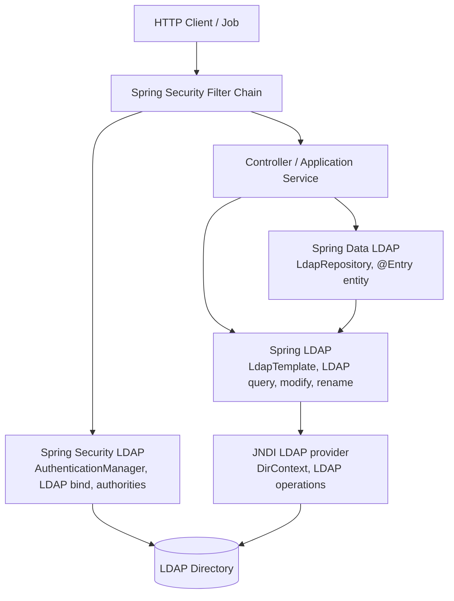
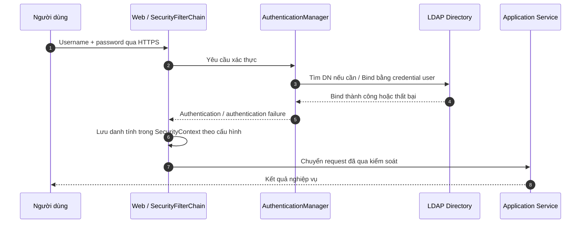
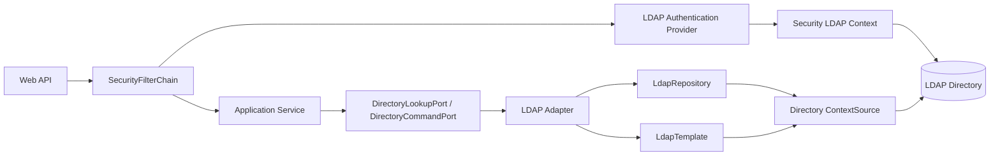

# Phân biệt JNDI, Spring LDAP, Spring Data LDAP và Spring Security LDAP

Trong chương **Tổng quan** của **SPRING_DATA_LDAP**, bốn cái tên **JNDI**, **Spring LDAP**, **Spring Data LDAP** và **Spring Security LDAP** thường xuất hiện cùng lúc khi xây dựng ứng dụng Java tích hợp dịch vụ thư mục. Chúng cùng làm việc với LDAP nhưng **giải quyết những bài toán khác nhau**: giao tiếp với directory, giảm mã thao tác LDAP, truy cập entry bằng repository và xác thực người dùng.

Ví dụ một cổng nhân sự có hai yêu cầu: nhân viên đăng nhập bằng tài khoản công ty, còn phòng nhân sự tìm tên/email từ danh bạ LDAP. Đăng nhập thuộc ranh giới **Spring Security LDAP**; truy vấn hồ sơ có thể dùng **Spring Data LDAP repository** hoặc **Spring LDAP `LdapTemplate`**. Các thao tác này cuối cùng đều phải gửi thông điệp LDAP qua một LDAP client/provider, thường dựa trên **JNDI** trong hệ sinh thái Java/Spring LDAP.

Bài học giúp chọn đúng API cho từng yêu cầu, hiểu cách các tầng phối hợp, tránh nhầm LDAP Bind với việc tìm entry, và xây dựng ứng dụng an toàn trước các vấn đề DN, `objectClass`, schema, filter, CRUD, TLS và kiểm thử.

## 1. Bảng phân biệt nhanh

| Công nghệ | Vai trò chính | API/khái niệm tiêu biểu | Khi nên dùng |
| --- | --- | --- | --- |
| **JNDI** (*Java Naming and Directory Interface*) | API Java tiêu chuẩn để truy cập hệ thống tên/directory; với LDAP dùng LDAP provider của JNDI | `DirContext`, `InitialDirContext`, `SearchControls`, `NamingEnumeration`, `ModificationItem` | Cần thao tác JNDI trực tiếp, tích hợp cấp thấp hoặc hiểu điều gì xảy ra bên dưới Spring |
| **Spring LDAP** | Trừu tượng hóa và đơn giản hóa thao tác LDAP/JNDI | `ContextSource`, `LdapContextSource`, `LdapTemplate`, `LdapQueryBuilder`, `AttributesMapper`, `LdapNameBuilder` | Cần Search có filter/scope linh hoạt, Modify thuộc tính, Bind/Add/Delete, rename/move entry |
| **Spring Data LDAP** | Mô hình **repository** và ánh xạ LDAP entry ↔ Java object trên nền Spring LDAP | `@Entry`, `@Id`, `@Attribute`, `LdapRepository<T>`, derived queries | Muốn làm việc với entry đã mô hình hóa bằng Java và các thao tác CRUD/truy vấn repository |
| **Spring Security LDAP** | Tích hợp xác thực LDAP với Spring Security và chuyển quyền LDAP thành quyền ứng dụng khi cấu hình | `AuthenticationManager`, bind authentication, user search, group/authority mapping, `SecurityFilterChain` | Đăng nhập bằng tài khoản directory, kiểm tra mật khẩu và cấp `GrantedAuthority` cho phiên xác thực |

**Điểm cần nhớ:** Spring Data LDAP **không thay thế** Spring Security LDAP để xác thực người dùng; Spring Security LDAP **không thay thế** repository để quản lý dữ liệu directory. Spring LDAP và Spring Data LDAP có thể cùng tồn tại trong một adapter. JNDI cung cấp API nền tảng mà các lớp hỗ trợ Spring LDAP dựa vào.

### 1.1. Một sơ đồ tổng thể



Sơ đồ mô tả **hai luồng logic**. Luồng tra cứu hồ sơ đi từ service đến repository/`LdapTemplate` rồi JNDI/provider và LDAP server. Luồng xác thực đi qua Spring Security LDAP; thư viện này có thể dùng Spring LDAP/LDAP context ở bên dưới, nhưng ứng dụng không nên giả định nó sử dụng đúng **cùng account Bind hoặc cùng bean ContextSource** với repository.

## 2. Khái niệm LDAP chung mà cả bốn lớp cùng gặp

LDAP (*Lightweight Directory Access Protocol*) thao tác trên **entry** trong cây thư mục. Mỗi entry có một **Distinguished Name (DN)** và các **attribute** tuân theo **schema**; `objectClass` quyết định nhóm thuộc tính bắt buộc/tùy chọn và các quy tắc đối tượng.

Ví dụ một entry:

```ldif
dn: uid=lan,ou=people,dc=example,dc=org
objectClass: top
objectClass: person
objectClass: organizationalPerson
objectClass: inetOrgPerson
uid: lan
cn: Lan Nguyen
sn: Nguyen
mail: lan@example.org
```

Những thành phần cần phân biệt:

- **LDAP URL/endpoint:** `ldaps://directory.example.org:636` cho biết nơi thiết lập kết nối, không tự xác định người dùng nằm ở OU nào.
- **Base DN:** `dc=example,dc=org` là nhánh gốc của ví dụ; `ou=people,dc=example,dc=org` là nhánh tìm nhân viên.
- **DN entry:** `uid=lan,ou=people,dc=example,dc=org` là tên đầy đủ của entry Lan; `uid=lan` là một **RDN**.
- **Filter:** `(&(objectClass=inetOrgPerson)(uid=lan))` chọn entry có thuộc tính phù hợp bên trong base và search scope.
- **Bind:** thao tác LDAP xác thực một danh tính với directory. Khi ứng dụng dùng simple Bind với mật khẩu, cần bảo vệ kết nối bằng TLS trước khi gửi thông tin xác thực.
- **ACL:** quy định tài khoản Bind được phép tìm, xem thuộc tính, tạo, sửa, đổi tên hay xóa entry nào. TLS mã hóa đường truyền nhưng không thay thế quyền truy cập.

Một filter đúng không bảo đảm có kết quả: base/scope có thể sai, DN entry nằm ở OU khác, tài khoản Bind thiếu quyền hoặc `objectClass` không như giả định. Những điểm này xuất hiện ở cả JNDI, Spring LDAP và Spring Data LDAP; Spring Security LDAP cũng phải quan tâm DN và quyền tìm kiếm khi xác thực.

## 3. JNDI: API nền tảng để nói chuyện với LDAP

**JNDI** là API trong Java cho hoạt động *naming/directory*. Khi chọn LDAP provider, các thao tác JNDI được chuyển thành hoạt động LDAP trên mạng. JNDI **không phải một LDAP server** và cũng không phải hệ thống lưu danh bạ riêng.

Các package và interface thường gặp:

| JNDI | Công dụng |
| --- | --- |
| `javax.naming.Context` | Mô hình context tên, thuộc tính môi trường xác thực/kết nối |
| `javax.naming.directory.DirContext` | Search, lấy thuộc tính, bind/rebind, modify attributes |
| `javax.naming.directory.SearchControls` | Search scope, số kết quả, thời gian, attributes cần trả |
| `javax.naming.NamingEnumeration` | Duyệt kết quả Search; phải đóng để giải phóng tài nguyên |
| `javax.naming.directory.ModificationItem` | Mô tả thêm, thay hoặc xóa giá trị thuộc tính |
| `javax.naming.ldap.LdapName`, `Rdn` | Phân tích/xây DN an toàn, hiểu RDN đặc biệt |
| `javax.naming.ldap.LdapContext` | Những khả năng LDAP mở rộng và controls |

### 3.1. Ví dụ JNDI tìm người dùng

Ví dụ Java tối giản sau giả định server đã cấu hình TLS và tài khoản dịch vụ có quyền đọc:

```java
import java.util.Hashtable;
import javax.naming.Context;
import javax.naming.NamingEnumeration;
import javax.naming.directory.DirContext;
import javax.naming.directory.InitialDirContext;
import javax.naming.directory.SearchControls;
import javax.naming.directory.SearchResult;

public class RawJndiLookup {
    public void findByUid(String uid, String bindPassword)
            throws Exception {
        Hashtable<String, Object> env = new Hashtable<>();
        env.put(Context.INITIAL_CONTEXT_FACTORY,
                "com.sun.jndi.ldap.LdapCtxFactory");
        env.put(Context.PROVIDER_URL,
                "ldaps://directory.example.org:636");
        env.put(Context.SECURITY_AUTHENTICATION, "simple");
        env.put(Context.SECURITY_PRINCIPAL,
                "uid=app-reader,ou=services,dc=example,dc=org");
        env.put(Context.SECURITY_CREDENTIALS, bindPassword);

        DirContext ctx = new InitialDirContext(env);
        try {
            SearchControls controls = new SearchControls();
            controls.setSearchScope(SearchControls.SUBTREE_SCOPE);
            controls.setReturningAttributes(
                    new String[]{"uid", "cn", "mail"});
            controls.setCountLimit(100);

            NamingEnumeration<SearchResult> results = ctx.search(
                    "ou=people,dc=example,dc=org",
                    "(&(objectClass=inetOrgPerson)(uid={0}))",
                    new Object[]{uid},
                    controls);
            try {
                while (results.hasMore()) {
                    SearchResult entry = results.next();
                    // Xử lý entry.getAttributes() theo yêu cầu.
                }
            } finally {
                results.close();
            }
        } finally {
            ctx.close();
        }
    }
}
```

Overload `DirContext.search(..., Object[] filterArgs, ...)` thay giá trị tham số trong filter theo cơ chế escape của JNDI provider, an toàn hơn ghép `uid` vào filter bằng chuỗi thô. Ví dụ chỉ ra rằng caller phải tự quản lý `DirContext`, `NamingEnumeration`, mapping thuộc tính và đường đi lỗi. Chi tiết provider (`com.sun.jndi.ldap.LdapCtxFactory`) thuộc môi trường JNDI thông dụng của JDK; khả năng/cấu hình có thể khác nếu dùng provider khác.

**Điều JNDI không tự giải quyết:** DI của Spring, chuyển `Attributes` thành entity ứng dụng, repository derived query, bảo vệ HTTP endpoint, tạo phiên đăng nhập hay ánh xạ nhóm LDAP thành authority.

### 3.2. Khi nào vẫn dùng JNDI trực tiếp?

JNDI hữu ích khi cần thao tác mà abstraction sẵn có không cung cấp, tích hợp thư viện Java cũ, cấu hình LDAP controls rất cụ thể hoặc chẩn đoán lỗi ở tầng giao thức. Trong ứng dụng Spring thông thường, nên ưu tiên Spring LDAP để giảm mã mở/đóng context, chuyển ngoại lệ và xử lý DN/filter. Nếu phải dùng JNDI trực tiếp, cần đặc biệt chú ý timeout, referral, TLS, nguồn mật khẩu và vòng đời tài nguyên.

## 4. Spring LDAP: tầng hỗ trợ thao tác LDAP

**Spring LDAP** xây trên các cơ chế LDAP/JNDI để cung cấp API thuận tiện, nhất quán hơn. Hai thành phần cốt lõi là:

- **`ContextSource` / `LdapContextSource`:** cung cấp context kết nối tới endpoint LDAP, thông tin Bind, base DN, cấu hình liên quan kết nối và xác thực.
- **`LdapTemplate`:** thực hiện Search, Lookup, Bind/Add, Unbind/Delete, Modify, Rename; quản lý context và chuyển ngoại lệ JNDI sang hệ thống ngoại lệ của Spring LDAP.

Các hỗ trợ thường dùng khác là `LdapQueryBuilder` để xây filter/query, `AttributesMapper` hoặc `ContextMapper` để ánh xạ dữ liệu, `LdapNameBuilder` để xây DN và cơ chế ODM `@Entry` khi ánh xạ LDAP entry thành Java object.

### 4.1. Cấu hình ContextSource qua Spring Boot

```yaml
spring:
  ldap:
    urls: ldaps://directory.example.org:636
    base: dc=example,dc=org
    username: uid=app-reader,ou=services,dc=example,dc=org
    password: ${LDAP_BIND_PASSWORD}
```

Trong một ứng dụng Spring Boot có các dependency LDAP thích hợp, thuộc tính `spring.ldap.urls` chọn endpoint, `spring.ldap.base` chọn **DN gốc chung**, còn `username/password` xác định **tài khoản dịch vụ để Bind**. Base tìm kiếm riêng như `ou=people` thường được hiểu là DN **tương đối** với `ContextSource.base`, tạo thành `ou=people,dc=example,dc=org`. Đừng lặp phần suffix nếu API đã thêm base.

LDAPS cần truststore/CA và kiểm tra hostname hợp lệ. Nếu chọn `ldap://` cùng StartTLS, phải cấu hình chiến lược StartTLS bắt buộc trước khi gửi Bind; **đổi sang URL `ldap://` không tự bật TLS**.

### 4.2. Dùng LdapTemplate với bộ lọc an toàn

```java
import java.util.List;
import org.springframework.ldap.core.AttributesMapper;
import org.springframework.ldap.core.LdapTemplate;
import org.springframework.ldap.query.LdapQuery;
import org.springframework.ldap.query.LdapQueryBuilder;
import org.springframework.ldap.query.SearchScope;

record PersonSummary(String uid, String name, String email) {}

public class DirectorySearchService {
    private final LdapTemplate ldapTemplate;

    public DirectorySearchService(LdapTemplate ldapTemplate) {
        this.ldapTemplate = ldapTemplate;
    }

    public List<PersonSummary> findPeople(String uid) {
        LdapQuery query = LdapQueryBuilder.query()
                .base("ou=people")
                .searchScope(SearchScope.SUBTREE)
                .countLimit(100)
                .attributes("uid", "cn", "mail")
                .where("objectClass").is("inetOrgPerson")
                .and("uid").is(uid);

        return ldapTemplate.search(query,
                (AttributesMapper<PersonSummary>) attrs ->
                    new PersonSummary(
                        value(attrs, "uid"),
                        value(attrs, "cn"),
                        value(attrs, "mail")));
    }

    private static String value(
            javax.naming.directory.Attributes attrs, String key)
            throws javax.naming.NamingException {
        var attribute = attrs.get(key);
        return attribute == null || attribute.size() == 0
                ? null : String.valueOf(attribute.get());
    }
}
```

`LdapQueryBuilder` kiểm soát điều kiện và escape **giá trị** đưa vào filter; tránh viết `"(uid=" + uid + ")"` vì có thể dẫn tới LDAP filter injection. Ví dụ đơn giản hóa việc ánh xạ: thuộc tính LDAP có thể thiếu hoặc đa trị, nên ứng dụng thật cần mô hình hóa rõ các trường bắt buộc/tùy chọn. `countLimit` cũng không có nghĩa đã phân trang hay lấy đủ mọi entry trong directory.

**Khi nào chọn `LdapTemplate` thay vì repository?** Khi cần filter động, phạm vi search đặc biệt, giới hạn/projection, sửa một thuộc tính cụ thể, đổi DN/RDN hoặc thao tác với directory không phù hợp mô hình một entity repository.

### 4.3. Spring LDAP vẫn xử lý dữ liệu LDAP theo schema

Spring LDAP giúp tạo request và ánh xạ kết quả, nhưng server mới quyết định DN có tồn tại, `objectClass`/thuộc tính có hợp lệ, tài khoản Bind có đủ ACL hay không. Không có API nào của Spring LDAP tự cho phép ghi một entry sai schema; tương tự, việc dùng `LdapTemplate.rename` không đảm bảo các tham chiếu nhóm hoặc hệ thống bên ngoài tự đổi DN theo.

## 5. Spring Data LDAP: thao tác entry theo mô hình repository

**Spring Data LDAP** bổ sung cách làm việc quen thuộc của họ Spring Data: định nghĩa entity, đánh dấu DN/thuộc tính và tạo repository để thực hiện truy vấn, đọc, lưu hoặc xóa entry. Các thành phần này **không tạo ra LDAP database mới** và không biến LDAP thành hệ thống quan hệ có join/transaction như JPA.

Ví dụ entity có DN và các thuộc tính thông dụng:

```java
import javax.naming.Name;
import org.springframework.ldap.odm.annotations.Attribute;
import org.springframework.ldap.odm.annotations.Entry;
import org.springframework.ldap.odm.annotations.Id;

@Entry(
    base = "ou=people",
    objectClasses = {"top", "person", "organizationalPerson", "inetOrgPerson"}
)
public class PersonEntry {
    @Id
    private Name dn;

    @Attribute(name = "uid")
    private String uid;

    @Attribute(name = "cn")
    private String commonName;

    @Attribute(name = "mail")
    private String email;

    public PersonEntry() {}
    public Name getDn() { return dn; }
    public String getUid() { return uid; }
    public String getCommonName() { return commonName; }
    public String getEmail() { return email; }
}
```

Repository:

```java
import java.util.List;
import org.springframework.data.ldap.repository.LdapRepository;

public interface PersonRepository extends LdapRepository<PersonEntry> {
    List<PersonEntry> findByUid(String uid);
}
```

Điểm cần hiểu:

- `@Entry` là ánh xạ **loại entry và base tương đối**. Nó không đăng ký endpoint mới hay tạo `ou=people` trên server.
- `@Id Name dn` biểu diễn DN của entry, **không** phải khóa chính dạng số hoặc UUID mặc định như thường thấy trong database SQL. DN có thể thay đổi sau rename/move.
- `@Attribute` ánh xạ thuộc tính LDAP. `uid`, `cn`, `sn`, `mail` phải phù hợp với schema và `objectClass` trên directory.
- `findByUid` là **derived query** dùng thuộc tính `uid`; tên method không đồng nghĩa LDAP sẽ tự đảm bảo UID duy nhất xuyên mọi OU/naming context.
- Các API repository thường xử lý các thao tác entity thuận tiện, nhưng thao tác Modify DN, cập nhật chọn lọc thuộc tính hay search với controls phức tạp có thể cần một **custom repository implementation hoặc `LdapTemplate`**.

Nếu project dùng Spring Boot, starter dành cho Spring Data LDAP cung cấp tích hợp thích hợp; tùy cơ chế auto-configuration/scanning của dự án, có thể cần `@EnableLdapRepositories` và kiểm tra bean `ContextSource` được repo sử dụng. Không mặc định bean repository và bean xác thực Spring Security LDAP được khởi tạo từ cùng một cấu hình.

### 5.1. Service nghiệp vụ không nhất thiết biết DN

Một cách tổ chức hợp lý:

```text
EmployeeController
    |
    v
EmployeeDirectoryService  -->  DirectoryLookupPort (interface)
                                      |
                                      v
                         SpringDataLdapDirectoryAdapter
                                      |
                              PersonRepository
                                      |
                               LDAP Directory
```

Service có thể yêu cầu “tìm hồ sơ theo UID” và nhận DTO gồm `uid`/tên/email. Adapter chịu trách nhiệm đọc `PersonEntry`, kiểm tra 0/1/nhiều kết quả, ánh xạ entry thành DTO và xử lý lỗi từ directory. Không nên để controller trả thẳng entity chứa DN/thuộc tính chưa được phê duyệt.

### 5.2. Repository không phải tầng xác thực

Phương thức `findByUid("lan")` chỉ **tìm entry**. Nó không chứng minh người vừa đăng nhập là Lan, không xác minh mật khẩu người đó và không tự tạo `Authentication` hay `SecurityContext` cho HTTP request. Kể cả khi repository tìm thấy `userPassword` (nếu ACL cho phép), **không nên đọc mật khẩu rồi tự so sánh** để xây xác thực: cách lưu, hash, policy Bind, cơ chế lockout và quyền của directory có thể phức tạp hơn. Việc đăng nhập thuộc Spring Security LDAP hoặc một cơ chế xác thực được tổ chức phê duyệt.

## 6. Spring Security LDAP: xác thực và tạo danh tính bảo mật cho ứng dụng

**Spring Security LDAP** tích hợp LDAP vào hệ thống xác thực Spring Security. Nó trả lời những câu hỏi mà repository thông thường không giải quyết:

1. Người dùng có cung cấp thông tin xác thực hợp lệ hay không?
2. Tìm DN hoặc user entry cần xác thực ở đâu?
3. Cần thực hiện **Bind authentication** hay phương thức xác thực LDAP khác được hỗ trợ?
4. Sau khi xác thực, người dùng có những **authorities** nào cho ứng dụng?
5. Request HTTP nào được phép vào controller và chạy use case?

Luồng cơ bản với **bind authentication**:



**Bind authentication khác đọc user entry:** LDAP server xác minh thông tin xác thực bằng thao tác Bind. Ứng dụng không cần và thường không được đọc mật khẩu từ directory. Việc Spring Security xác thực thành công cũng **không tự cấp quyền sửa mọi entry LDAP**: quyền thao tác dữ liệu của application service vẫn do authorization và LDAP ACL quyết định.

### 6.1. Ví dụ cấu hình xác thực Bind

Với một phiên bản Spring Security cung cấp `LdapBindAuthenticationManagerFactory`, có thể cấu hình ý tưởng sau:

```java
import org.springframework.context.annotation.Bean;
import org.springframework.context.annotation.Configuration;
import org.springframework.ldap.core.support.BaseLdapPathContextSource;
import org.springframework.security.authentication.AuthenticationManager;
import org.springframework.security.config.ldap.LdapBindAuthenticationManagerFactory;
import org.springframework.security.ldap.DefaultSpringSecurityContextSource;

@Configuration
public class LdapAuthenticationConfig {

    @Bean
    BaseLdapPathContextSource securityLdapContextSource() {
        return new DefaultSpringSecurityContextSource(
                "ldaps://directory.example.org:636/dc=example,dc=org");
    }

    @Bean
    AuthenticationManager ldapAuthenticationManager(
            BaseLdapPathContextSource securityLdapContextSource) {
        LdapBindAuthenticationManagerFactory factory =
                new LdapBindAuthenticationManagerFactory(
                        securityLdapContextSource);

        factory.setUserDnPatterns("uid={0},ou=people");
        return factory.createAuthenticationManager();
    }
}
```

Đây là ví dụ **tập trung vào thành phần LDAP authentication**, chưa phải ứng dụng web hoàn chỉnh: phải cấu hình `SecurityFilterChain`, phương thức đăng nhập và cách sử dụng `AuthenticationManager` trong phiên bản Spring Security của dự án. Ngoài module `spring-security-ldap`, một số API cấu hình thuộc `spring-security-config`. API/kiểu cấu hình có thể thay đổi giữa các dòng phiên bản; cần đối chiếu phiên bản dependency thực tế.

`setUserDnPatterns("uid={0},ou=people")` chỉ phù hợp nếu các entry người dùng **thực sự có DN theo mẫu đó**. Nếu user nằm ở nhiều OU hoặc RDN là `cn`, phải dùng cơ chế **user search** với base/filter được cấu hình an toàn thay vì đoán DN từ username. Constructor `DefaultSpringSecurityContextSource` trong ví dụ dùng LDAP URL có kèm **base DN ở phần path**; điều này khác cách Spring Boot thường tách `spring.ldap.urls` và `spring.ldap.base` cho repository.

**Không nên mở Bind simple trên kết nối không mã hóa.** Với LDAPS phải xác minh chứng chỉ server; với StartTLS phải buộc nâng cấp TLS trước Bind. Spring Security xử lý xác thực ứng dụng, còn việc TLS thực sự thành công là điều kiện hạ tầng phải kiểm tra.

### 6.2. Group và quyền truy cập trong ứng dụng

Spring Security LDAP có thể đọc nhóm LDAP hoặc thông tin authority thông qua cơ chế group search/authorities populator theo cấu hình. Sau đó ứng dụng dùng `GrantedAuthority` và quy tắc authorization, ví dụ “chỉ nhân viên HR được xem toàn bộ hồ sơ”.

Nhưng các schema group không giống nhau:

| Mô hình LDAP | Thuộc tính ví dụ | Điều cần kiểm tra |
| --- | --- | --- |
| `groupOfNames` | `member` chứa DN thành viên | Nhóm và DN thành viên có tồn tại, tham chiếu có được cập nhật sau rename không? |
| `groupOfUniqueNames` | `uniqueMember` | Cú pháp/định danh thành viên theo schema |
| `posixGroup` | `memberUid` | Thành viên thường dựa trên UID, khác cách lưu DN |
| Một số directory có liên kết ngược | `memberOf` | Có phải operational/computed attribute không, có hỗ trợ nested groups không? |

**Không được giả định** mọi LDAP server đều có `memberOf` hoặc mọi nhóm đều map trực tiếp thành một role ứng dụng. Cần định nghĩa mapping từ nhóm directory sang authority, xử lý nhóm lồng nhau theo chính sách và kiểm thử với schema thật. User được xác thực không có nghĩa tự động có mọi quyền nghiệp vụ.

### 6.3. Tài khoản dịch vụ và tài khoản người dùng

| Danh tính | Dùng ở đâu? | Quyền nên có |
| --- | --- | --- |
| **Service Bind DN** của Spring LDAP/Data LDAP | Repository và `LdapTemplate` đọc/ghi dữ liệu theo nhiệm vụ | Quyền nhỏ nhất trong đúng OU/thuộc tính cần thiết |
| **User credential** khi xác thực LDAP | Spring Security LDAP thực hiện Bind theo chính sách | Quyền của người dùng; không biến thành account quản trị directory |
| **Search Bind DN** của thành phần xác thực (nếu cần) | Tìm DN trước khi Bind user | Đủ quyền tra cứu user, không cần quyền provisioning |

Không mặc định dùng một tài khoản duy nhất cho mọi loại Bind. Một ứng dụng có thể dùng **hai `ContextSource` khác nhau**: một cho đọc danh bạ, một cho tìm người dùng và xác thực. Cần bảo đảm bean được inject đúng và mọi endpoint đều được bảo vệ TLS.

## 7. Cùng một yêu cầu nghiệp vụ được xử lý ở bốn tầng ra sao?

Giả sử ứng dụng có API `GET /api/directory/users/lan` và màn hình đăng nhập.

### 7.1. Xem hồ sơ của Lan

1. **Spring Security** kiểm tra caller đã xác thực và có quyền xem hồ sơ hay chưa; nếu dùng LDAP auth, thành phần liên quan là **Spring Security LDAP**.
2. **Application service** yêu cầu tìm hồ sơ `uid=lan`, chọn thuộc tính nghiệp vụ được phép công bố.
3. **Spring Data LDAP repository** có thể dùng `findByUid("lan")`; với query đặc biệt, adapter dùng **Spring LDAP `LdapTemplate`**.
4. **JNDI/provider** thực hiện thao tác LDAP thực tế qua endpoint với Bind account của ứng dụng.
5. **LDAP server** kiểm tra base/scope/filter, schema và ACL, rồi trả entry; adapter ánh xạ thành DTO để trả API.

### 7.2. Đăng nhập bằng tài khoản Lan

1. Request đăng nhập đến **SecurityFilterChain** qua HTTPS.
2. **Spring Security LDAP** tìm DN của Lan (nếu dùng user search) rồi xác thực thông qua Bind theo cấu hình.
3. Thành công tạo **Authentication** với danh tính và quyền ứng dụng thích hợp; thất bại trả authentication failure.
4. Việc xác thực không cần gọi `PersonRepository.findByUid` để tự đọc `userPassword`.

### 7.3. Đổi email hay chuyển OU

Nếu ứng dụng được cho phép sửa thuộc tính, service xác minh quyền rồi gọi adapter LDAP: dùng repository cho thao tác entity phù hợp, hoặc **`LdapTemplate.modifyAttributes`** để sửa email có kiểm soát. Chuyển OU/đổi RDN dùng thao tác **Modify DN** (ví dụ `LdapTemplate.rename`), vì chỉnh chuỗi `@Id` trên object Java không tự đồng nghĩa đổi tên entry. Spring Security LDAP không phải API chung để CRUD account.

## 8. Chọn API nào cho từng bài toán?

| Yêu cầu cụ thể | Công cụ chính | Lý do |
| --- | --- | --- |
| Tìm entry theo `uid`/`mail` với model rõ ràng | **Spring Data LDAP** | Entity và repository giúp code gọn, dễ định nghĩa hợp đồng |
| Search theo base/scope/filter động hoặc giới hạn thuộc tính | **Spring LDAP `LdapTemplate`** | Điều khiển chi tiết truy vấn và mapping |
| Đọc/ghi một số thuộc tính, rename/move DN | **Spring LDAP `LdapTemplate`** | Hỗ trợ Modify/Modify DN rõ ràng, tránh ghi lại toàn entity không cần thiết |
| Thao tác LDAP/JNDI đặc thù mà Spring chưa bọc | **JNDI** | Kiểm soát API/controls tầng thấp; tự gánh quản lý context và lỗi |
| Xác minh mật khẩu đăng nhập người dùng | **Spring Security LDAP** | Bind authentication và tích hợp `AuthenticationManager` |
| Gán quyền web từ nhóm LDAP | **Spring Security LDAP + authorization của ứng dụng** | Ánh xạ groups thành authorities, kiểm tra policy |
| Đối chiếu hồ sơ LDAP với HR database | **Application service + Spring Data LDAP/Spring LDAP** | Quy định nguồn dữ liệu gốc và xử lý nhất quán |
| Bảo vệ endpoint theo vai trò, user đã đăng nhập | **Spring Security** (LDAP là một nguồn xác thực) | SecurityFilterChain/authorization hoạt động ở tầng ứng dụng |

**Không cần chọn duy nhất một công nghệ cho toàn bộ hệ thống.** Một ứng dụng thường sử dụng cả Spring Security LDAP cho login và Spring Data LDAP/`LdapTemplate` cho directory operations. Cần tách ranh giới để dễ kiểm thử và tránh một module tự vượt quyền của module khác.

## 9. Những hiểu lầm phổ biến

### 9.1. “Spring Data LDAP là ORM như JPA nên có transaction SQL”

LDAP là directory phân cấp theo DN và schema, không phải relational database. `@Entry` và `LdapRepository` làm việc với entry, nhưng không tạo entity graph/join hoặc transaction phân tán giữa LDAP và database. Nếu luồng nghiệp vụ cập nhật cả HR database và LDAP, cần thiết kế điều phối, idempotency, đối soát và cách xử lý khi một phía lỗi.

### 9.2. “Tìm được entry là xác thực thành công”

`findByUid("lan")` thành công chỉ chứng minh có entry phù hợp trong phạm vi query và dưới ACL của Bind account. Nó không chứng minh caller biết mật khẩu Lan. Xác thực phải dùng cơ chế phù hợp của Spring Security LDAP hoặc nhà cung cấp danh tính đã được lựa chọn.

### 9.3. “Spring Security LDAP tự tạo repository để quản lý mọi entry”

Spring Security LDAP tập trung vào authentication và authorities. Không phải thư viện CRUD/provisioning account tổng quát. Tạo/xóa/sửa entry cần quy trình IAM được phê duyệt và các thao tác LDAP phù hợp, với service account được cấp quyền cần thiết.

### 9.4. “Dùng LdapTemplate thì luôn an toàn trước LDAP injection”

Không nếu tự nối chuỗi filter hoặc DN từ input. Dùng `LdapQueryBuilder`/filter builder hay derived query để escape giá trị filter, `LdapNameBuilder` để tạo DN, và kiểm tra quyền/base/scope rõ ràng. **LDAP filter escaping khác DN escaping**; validation không thay thế cơ chế escape.

### 9.5. “Thêm `ldaps://` là hoàn tất bảo mật”

LDAPS bảo vệ kênh khi TLS handshake và **xác minh chứng chỉ/hostname** đúng cách. Ứng dụng vẫn cần ACL, quyền tối thiểu, quản lý mật khẩu, timeout và xử lý lỗi. Không tắt kiểm tra chứng chỉ để vượt lỗi PKIX hay tự động fallback sang simple Bind không mã hóa.

### 9.6. “Một endpoint có nghĩa toàn bộ directory”

Một LDAP server có thể chỉ phục vụ một naming context. Search có thể gặp referral, giới hạn server hoặc kết quả một phần. Khi dùng Spring LDAP và repository, cần hiểu base/scope và kiểm tra `PartialResultException` thay vì lặng lẽ bỏ qua khi dữ liệu phải đầy đủ.

### 9.7. “Spring Data LDAP và Spring Security LDAP bắt buộc dùng chung ContextSource”

Không. Chúng có thể chia sẻ thông tin endpoint hoặc một số cấu hình, nhưng mục đích và quyền Bind khác nhau. Với Spring Boot tự cấu hình và bean thủ công, hãy xác định **bean nào được dùng cho repository và bean nào cho authentication**, tránh xung đột hoặc vô tình gửi user password qua kết nối không được bảo vệ.

## 10. Kiến trúc khuyến nghị cho ứng dụng có cả login và danh bạ

Một thiết kế rõ trách nhiệm gồm:



Tách **authentication** khỏi **directory data access** mang lại các lợi ích:

- Không để controller tự tạo JNDI context hoặc tự kiểm tra mật khẩu LDAP.
- Có thể thay đổi derived query thành `LdapTemplate` mà không làm thay đổi hợp đồng service.
- Dễ cấp hai account Bind khác quyền, quản lý secret riêng và đánh giá ACL.
- Test được quy tắc nghiệp vụ bằng fake port mà không cần LDAP, đồng thời integration test riêng phần kết nối, ánh xạ entry và Bind.
- Đổi schema/OU/định danh ở adapter thay vì lan ra HTTP API.

Nếu ứng dụng chỉ tra cứu danh bạ và đã xác thực bằng OAuth2/OIDC ở nơi khác, **không bắt buộc** dùng Spring Security LDAP. Nếu chỉ xác thực login qua LDAP và không cần repository CRUD, cũng **không bắt buộc** khai báo Spring Data LDAP repository. Chọn đúng module theo trách nhiệm.

## 11. Bảo mật và vận hành ở từng tầng

| Tầng | Rủi ro cần kiểm soát | Biện pháp chính |
| --- | --- | --- |
| JNDI/provider | Leak connection, referral sang host khác, timeout, TLS không xác minh | Đóng context/enumeration, giới hạn timeout/referral, TLS và CA/hostname |
| Spring LDAP | Filter/DN injection, sai base/scope, xử lý partial result | Builder an toàn, DN tương đối đúng, giới hạn search, không nuốt lỗi thiếu dữ liệu |
| Spring Data LDAP | Trả raw entity, cập nhật sai DN, vi phạm schema/ACL | DTO/port, xác minh `@Entry` và `@Id`, kiểm thử CRUD/schema |
| Spring Security LDAP | Credential sai, Bind không mã hóa, map group sai, quyền quá rộng | Bind qua TLS, xác thực thất bại rõ ràng, mapping group có kiểm soát |
| Ứng dụng | Lộ dữ liệu nhân viên, dùng sai nguồn dữ liệu, đồng bộ xóa nhầm | Authorization, quyền tối thiểu, audit, hợp đồng về độ đầy đủ và đối soát |

Nên có metrics/log cho các thao tác như `bind`, `search`, `modify`, `modify_dn`, `delete` và phân biệt lỗi thực sự nhận LDAP result code với lỗi mạng/TLS. Ví dụ `49 invalidCredentials` ở Bind khác `50 insufficientAccessRights` khi Modify; Search trả 0 entry với result code `0 success` khác `32 noSuchObject` khi base DN không hợp lệ. Không ghi mật khẩu, full filter hoặc entry nhạy cảm trong log.

## 12. Kiểm thử theo ranh giới công nghệ

| Kiểu test | Mục tiêu | Ví dụ |
| --- | --- | --- |
| **Unit test service** | Quy tắc nghiệp vụ, mapping DTO và phân quyền độc lập LDAP | Fake `DirectoryLookupPort` trả hồ sơ, rỗng hoặc lỗi |
| **Integration test JNDI/Spring LDAP** | Endpoint, Bind service account, base/scope/filter, SearchControls, Modify DN | Seed LDAP test directory, tìm entry ở OU con và sửa một thuộc tính |
| **Integration test Spring Data LDAP** | `@Entry`, `@Id`, `@Attribute`, derived query, CRUD/schema | Tạo/tìm/sửa/xóa entry thử nghiệm với DN hợp lệ |
| **Integration test Spring Security LDAP** | Bind user, sai mật khẩu, group authority, account bị khóa, TLS | Gửi yêu cầu xác thực tới test directory có user và group |
| **API/end-to-end test** | Login + quyền truy cập + tìm hồ sơ qua service | User HR xem được hồ sơ theo policy; user khác bị từ chối |

Nên đưa vào bộ kiểm thử các trường hợp:

1. **Một UID hợp lệ:** repository trả đúng entry; login bằng password đúng tạo `Authentication` thành công khi được cấu hình.
2. **UID không tồn tại:** query có thể trả rỗng; authentication phải thất bại, không tạo phiên.
3. **Password sai:** Bind không thành công, không được xem như lỗi “không tìm thấy” của repository.
4. **Search với filter chứa ký tự đặc biệt:** giá trị được escape, không mở rộng truy vấn hoặc thay đổi cây DN.
5. **Entry thiếu thuộc tính tùy chọn:** adapter xử lý `mail` rỗng đúng hợp đồng; schema bắt buộc được server kiểm tra.
6. **Account Bind read-only:** đọc được entry cần thiết nhưng không được Modify/Delete; Security LDAP user không bị dùng nhầm làm service admin.
7. **Lỗi TLS/CA:** từ chối kết nối và không fallback sang LDAP không mã hóa.
8. **Nhiều OU, referral/partial result:** không tuyên bố dữ liệu đầy đủ nếu một phần directory chưa được truy vấn.
9. **Rename/move entry:** DN của entity và phạm vi repository được cập nhật/đối soát sau thao tác.
10. **LDAP không khả dụng:** service trả lỗi dependency phù hợp, không biến tất cả lỗi thành danh sách rỗng hay mặc định đăng nhập thành công.

Mock `PersonRepository` có thể kiểm thử logic service nhưng **không chứng minh** filter, DN, TLS, schema và ACL thực sự hoạt động. Muốn xác nhận cơ chế LDAP và Spring Security LDAP, cần một directory thử nghiệm có dữ liệu và cấu hình gần với môi trường đích.

## 13. Ba tình huống chọn công nghệ

### Tình huống A: API tra cứu thông tin nhân viên

Ứng dụng đã xác thực bằng một hệ thống khác, chỉ cần lấy `uid`, `cn`, `mail` từ LDAP. Dùng **Spring Data LDAP `LdapRepository`** để đọc entry; khi cần search có nhiều điều kiện hay projection giới hạn, dùng **Spring LDAP `LdapTemplate`**. Không cần đưa Spring Security LDAP vào chỉ vì dữ liệu nằm trong LDAP.

### Tình huống B: Cổng nội bộ đăng nhập bằng tài khoản directory

Ứng dụng cần xác thực username/password, rồi dùng role từ LDAP group để kiểm tra quyền truy cập. Dùng **Spring Security LDAP**, cấu hình Bind và group/authority mapping phù hợp. Nếu cổng còn cần hiển thị danh bạ, tích hợp thêm repository hoặc `LdapTemplate` riêng cho dữ liệu, tránh dùng chính logic login để trả dữ liệu tùy ý.

### Tình huống C: Dịch vụ quản trị tài khoản nội bộ

Ứng dụng cần tạo entry với `objectClass` hợp lệ, sửa thuộc tính, chuyển OU và đối soát nhóm. Dùng **Spring LDAP `LdapTemplate`** và repository khi thích hợp. Thao tác ghi phải đi qua service có authorization, ACL và audit. **Spring Security LDAP** chỉ giải quyết danh tính người gọi và quyền ứng dụng; nó không tự cung cấp quy trình provisioning hoàn chỉnh.

## 14. Câu hỏi tự kiểm tra

1. **JNDI có phải LDAP server không?** Không. Nó là API Java; LDAP provider của JNDI thực hiện request tới server.
2. **`LdapTemplate` thuộc thành phần nào?** Spring LDAP. Nó giúp Search/Modify/Rename và quản lý context.
3. **`LdapRepository<PersonEntry>` giải quyết gì?** Truy cập entry theo entity Java và các thao tác repository của Spring Data LDAP.
4. **`findByUid("lan")` có xác minh mật khẩu Lan không?** Không. Nó là truy vấn directory, không phải authentication.
5. **Muốn đăng nhập bằng LDAP nên dùng gì?** Spring Security LDAP với phương thức Bind/user lookup và chính sách bảo mật thích hợp.
6. **`@Id Name dn` có giống khóa chính SQL vĩnh viễn không?** Không. DN có thể đổi khi rename/move entry; cần quản lý định danh ổn định riêng khi nghiệp vụ yêu cầu.
7. **Khi nào `LdapTemplate` thuận tiện hơn repository?** Khi cần LDAP filter/scope đặc biệt, projection, Modify chọn lọc, rename/move hoặc controls không biểu đạt gọn bằng derived method.
8. **Spring Security LDAP có tự cấp quyền CRUD cho user đăng nhập không?** Không. Cần authorization của ứng dụng và LDAP ACL; tài khoản service có quyền riêng.
9. **Có thể dùng chung một LDAP server cho login và tra cứu không?** Có, nhưng cần thiết kế đúng ContextSource, Bind identity, TLS và quyền.
10. **Vì sao test bằng mock repository chưa đủ?** Vì mock không kiểm tra LDAP server thực, DN, `objectClass`, schema, Bind, TLS, ACL hoặc referral.

**Ghi nhớ:** **JNDI** là API truy cập directory ở mức Java; **Spring LDAP** cung cấp công cụ thao tác LDAP thuận tiện; **Spring Data LDAP** bổ sung ánh xạ entry và mô hình repository; **Spring Security LDAP** tích hợp **xác thực và quyền** vào Spring Security. Khi xây dựng hệ thống SPRING_DATA_LDAP, hãy tách luồng authentication khỏi luồng đọc/ghi directory, dùng DN/filter an toàn, tôn trọng schema/`objectClass` và ACL, bảo vệ kết nối bằng TLS và kiểm thử ở đúng ranh giới của mỗi thành phần.
