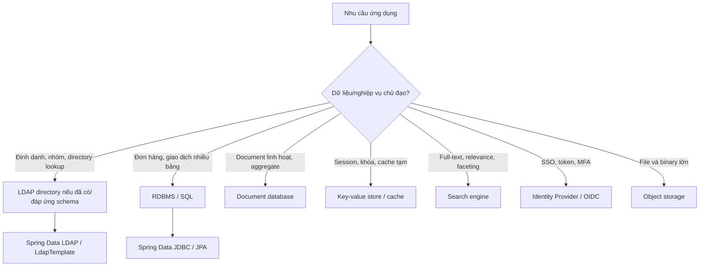
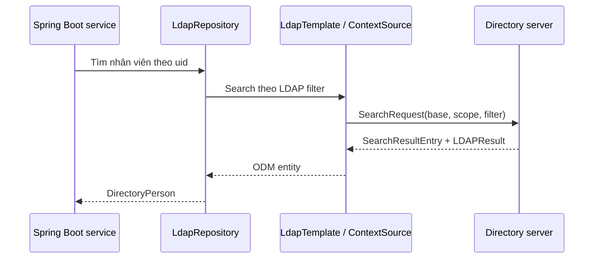
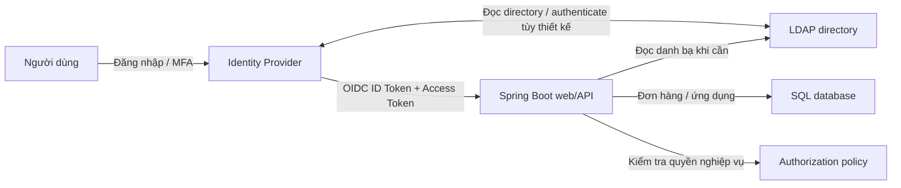
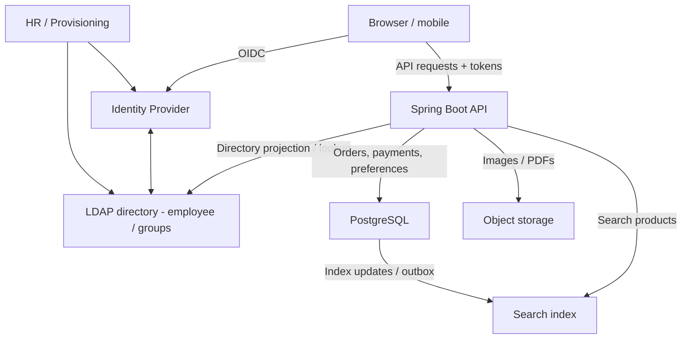

# Khi nào nên dùng LDAP và khi nào nên chọn hệ lưu trữ khác

> **Chương:** Tổng quan  
> **Module:** SPRING_DATA_LDAP — truy cập dịch vụ thư mục LDAP qua Spring Data LDAP repository và `LdapTemplate`, ánh xạ entry phân cấp sang Java; hiểu DN, `objectClass`, schema, filter an toàn, CRUD, bảo mật kết nối và kiểm thử với directory.

## Mục tiêu học tập

Sau bài này, bạn có thể:

1. Phân biệt **LDAP là giao thức truy cập directory** với **máy chủ thư mục** lưu trữ entry và với những hệ lưu trữ như RDBMS, document database hay search engine.
2. Nhận ra những đặc tính khiến LDAP phù hợp với **dữ liệu định danh, tài khoản, nhóm, thiết bị và cấu hình thư mục** được nhiều hệ thống cần đọc.
3. Nhận ra khi nào **SQL**, **document database**, **key-value store/cache**, **search engine**, **object storage** hoặc **graph database** giải quyết bài toán tốt hơn.
4. Phân biệt nhu cầu **lưu thông tin định danh** với **đăng nhập SSO qua OpenID Connect** và **provisioning tài khoản qua SCIM**; tránh coi các giao thức này là cùng một loại kho dữ liệu.
5. Đánh giá ứng dụng theo dạng truy vấn, schema, tần suất cập nhật, transaction, consistency, latency, mô hình phân quyền, replication, khả năng vận hành và chi phí tích hợp.
6. Thiết kế một ứng dụng Spring Boot sử dụng **Spring Data LDAP cho directory** và **RDBMS cho dữ liệu nghiệp vụ**, xác định nguồn dữ liệu có thẩm quyền và xử lý các cập nhật liên hệ giữa hai hệ thống.
7. Xây dựng bộ tiêu chí và kiểm thử thực tế trước khi quyết định dùng LDAP làm hệ thống chính.

## 1. Câu hỏi đúng không phải là “LDAP hay SQL tốt hơn?”

Một công ty có thể cần đồng thời:

- Tra cứu nhân viên theo `uid`, `mail`, họ tên và đơn vị.
- Đăng nhập một lần cho nhiều ứng dụng, có MFA.
- Kiểm tra nhân viên thuộc những nhóm nào.
- Lưu đơn hàng, hóa đơn và lịch sử thanh toán.
- Tìm nội dung sản phẩm theo từ khóa có xếp hạng.
- Lưu ảnh đại diện, file hợp đồng và các tệp lớn.
- Thống kê doanh thu từng tháng và theo từng cửa hàng.

Không có lý do tốt để ép **tất cả** nhu cầu này vào một kiểu lưu trữ duy nhất. Hệ thống directory có điểm mạnh riêng; cơ sở dữ liệu quan hệ, dịch vụ danh tính và công cụ tìm kiếm cũng vậy.

**Nguyên tắc kiến trúc:** chọn hệ lưu trữ dựa trên **ngữ nghĩa dữ liệu và thao tác quan trọng nhất**, không chỉ vì một thư viện Java có sẵn. Spring Data LDAP giúp Java thao tác với LDAP thuận tiện, **không biến LDAP thành một database quan hệ đa năng**.



Sơ đồ trên là **định hướng ban đầu**, không phải quy tắc loại trừ tuyệt đối. Một hệ directory có thể hỗ trợ nhiều loại dữ liệu và một database quan hệ cũng có thể lưu tài khoản. Câu hỏi cần trả lời là **hệ nào được phép sở hữu dữ liệu**, ai cập nhật, người dùng truy vấn ra sao và những bảo đảm nào bắt buộc.

## 2. LDAP là giao thức; directory server mới là hệ thống lưu trữ

**LDAP (Lightweight Directory Access Protocol)** là giao thức để client truy cập dịch vụ thư mục. Giao thức định nghĩa các operation như `Bind`, `Search`, `Compare`, `Add`, `Modify`, `Delete` và `ModifyDN`. LDAP **không** quy định mọi server phải dùng cùng một cơ sở dữ liệu nội bộ, công cụ replication hay chính sách quản trị.

**Directory server** như OpenLDAP, 389 Directory Server hoặc Active Directory Domain Services triển khai dịch vụ lưu trữ/tra cứu entries và thường bổ sung schema, ACL, replication, monitoring cùng tính năng đặc thù sản phẩm.

Trong Spring:

- `LdapContextSource` tạo context kết nối và bind đến directory.
- `LdapTemplate` thực hiện các LDAP operations qua JNDI, quản lý context và mapper.
- Spring Data LDAP `LdapRepository<T>` giúp thao tác CRUD/truy vấn theo entity được ánh xạ bởi Spring LDAP ODM.
- **Directory server** mới quyết định entry nào tồn tại, attribute nào hợp lệ, quyền đọc/ghi và cách lưu/replicate dữ liệu.

Ví dụ luồng:



Có hai cấp độ cần phân biệt khi đánh giá giải pháp:

1. **Có phù hợp dùng mô hình directory/LDAP không?** Đây là quyết định về dữ liệu và nghiệp vụ.
2. **Nếu có, chọn server, topology và thư viện client nào?** Đây là quyết định triển khai: LDAP endpoint, TLS, schema, replication, Java library, tests.

Đừng chọn LDAP chỉ vì một LDAP connector có sẵn; cũng đừng loại LDAP khi tổ chức đang có directory được quản trị tập trung và nhiều hệ thống khác đã phụ thuộc vào nó.

Nguồn: [RFC 4511 — LDAP Protocol](https://www.rfc-editor.org/rfc/rfc4511.html), [RFC 4512 — LDAP Directory Information Models](https://www.rfc-editor.org/rfc/rfc4512.html).

## 3. Mô hình dữ liệu directory: entry, DN, attributes và schema

Directory lưu một **Directory Information Tree (DIT)**, trong đó mỗi entry có **Distinguished Name (DN)** và tập thuộc tính.

```text
dc=example,dc=org
├── ou=people
│   ├── uid=linh
│   ├── uid=mai
│   └── uid=nam
├── ou=groups
│   ├── cn=developers
│   └── cn=operators
└── ou=devices
    └── cn=printer-01
```

Một entry nhân viên thử nghiệm:

```ldif
dn: uid=linh,ou=people,dc=example,dc=org
objectClass: top
objectClass: person
objectClass: organizationalPerson
objectClass: inetOrgPerson
uid: linh
cn: Linh Nguyen
sn: Nguyen
givenName: Linh
mail: linh@example.org
telephoneNumber: +84 28 5555 0101
```

Trong dữ liệu này:

- **DN** `uid=linh,ou=people,dc=example,dc=org` đặt tên entry. Nó gồm **RDN** `uid=linh` và các thành phần cha.
- **Attributes** như `uid`, `cn`, `sn`, `mail` có thể có kiểu, cú pháp, matching rules và số lượng giá trị khác nhau.
- **`objectClass`** chỉ loại entry và liên quan đến schema. `inetOrgPerson` kế thừa `person`, trong đó `cn` và `sn` là thuộc tính bắt buộc.
- **Schema** kiểm tra `MUST`/`MAY`, cú pháp attribute, cấu trúc entry và những hạn chế khác.
- **Group entry** có thể chứa nhiều giá trị `member` là DN của người dùng, chẳng hạn `groupOfNames`; đây không phải bảng quan hệ có foreign key tự động kiểu SQL.

Mô hình này rất hợp lý khi câu hỏi chính là:

- “Tài khoản có DN này không?”
- “Những nhân viên dưới `ou=people` có `mail` thuộc domain công ty?”
- “Những `member` nào thuộc nhóm `cn=developers`?”
- “Tìm thiết bị hoặc một đối tượng thư mục theo thuộc tính đã được index?”

### DN không phải khóa nghiệp vụ bất biến

Nếu một entry được **đổi RDN** hoặc chuyển sang OU khác bằng `ModifyDN`, DN có thể đổi. Bởi vậy:

- Đừng dùng DN như khóa ngoại vĩnh viễn trong bảng đơn hàng.
- Email cũng thường **không ổn định** vì có thể đổi theo tên hoặc domain.
- `uid` có thể ổn định theo chính sách doanh nghiệp nhưng không có bảo đảm giao thức rằng mọi tổ chức đều giữ nó bất biến.
- Nếu cần liên kết dài hạn, dùng một **stable identifier** có chính sách quản trị rõ: mã nội bộ không tái sử dụng, ID do Identity Provider cấp hoặc identifier dành riêng của directory (tùy sản phẩm).

Đây là một khác biệt lớn giữa **directory entry location** và **identity của chủ thể trong nghiệp vụ**.

Nguồn: [RFC 4512](https://www.rfc-editor.org/rfc/rfc4512.html), [RFC 4519 — Schema](https://www.rfc-editor.org/rfc/rfc4519.html), [RFC 2798 — inetOrgPerson](https://www.rfc-editor.org/rfc/rfc2798.html).

## 4. Những trường hợp LDAP thường là lựa chọn hợp lý

### 4.1. Danh bạ nhân viên, tổ chức, thiết bị

Ứng dụng cần truy vấn hồ sơ được quản trị tập trung theo thuộc tính:

- `uid`/ID nhân viên;
- Tên, email, bộ phận, vị trí;
- OU hoặc nhánh tổ chức;
- Thiết bị, dịch vụ nội bộ hoặc đối tượng cấu hình theo schema riêng.

Directory đã được vận hành trong tổ chức và có ACL phân vùng là một nguồn dữ liệu hợp lý. Spring LDAP có thể search theo base DN và filter, trả về một DTO gọn hoặc ODM entity.

**Điều kiện:** dữ liệu này cần có **nguồn cập nhật có thẩm quyền**. Nếu HR system mới là nguồn chính, LDAP có thể là **bản sao phục vụ tích hợp**, không nên để nhiều ứng dụng tự sửa `sn`, `mail`, manager hay nhóm theo những quy tắc xung đột nhau.

### 4.2. Tích hợp với hệ sinh thái đã dùng LDAP

Các sản phẩm quản lý máy trạm, ứng dụng cũ, dịch vụ nội bộ, directory enterprise và một số giải pháp quản trị truy cập đã biết LDAP. Khi tổ chức đã có schema, vận hành, backup, compliance và governance rõ, việc ứng dụng Java đọc directory sẽ giảm chi phí đồng bộ bảng nhân viên riêng.

**Đúng:** service Spring Data LDAP đọc thông tin nhân viên từ directory hiện có.  
**Cần cân nhắc:** tự xây một LDAP server mới chỉ để lưu preferences cho một ứng dụng web nhỏ.

### 4.3. Tài khoản, nhóm và thông tin phục vụ kiểm soát truy cập

Directory phù hợp để biểu diễn account và group membership dùng chung. Ví dụ:

```ldif
dn: cn=developers,ou=groups,dc=example,dc=org
objectClass: top
objectClass: groupOfNames
cn: developers
member: uid=linh,ou=people,dc=example,dc=org
member: uid=mai,ou=people,dc=example,dc=org
```

Nhưng **group membership không tự biến thành authorization đúng cho ứng dụng**:

- LDAP group thể hiện quan hệ thư mục; quyền “được hoàn tiền”, “xem hóa đơn của khách A” còn phụ thuộc **quy tắc nghiệp vụ**.
- Nhóm lồng nhau, các attribute nhóm/role và ACL có thể khác giữa OpenLDAP và Active Directory.
- Nếu app đọc một replica/cached membership, việc **thu hồi quyền** có thể bị chậm do replication lag/cache.
- Một ứng dụng quản lý identity phải tách **ai là người dùng**, **người dùng được xác thực thế nào**, **được phép làm gì** và **quyền đó có hiệu lực từ lúc nào**.

### 4.4. Đọc nhiều hơn ghi và dữ liệu ít biến động về cấu trúc

Một workload có tỷ lệ đọc cao, các thuộc tính đã định nghĩa, truy vấn lọc có thể index và người dùng cần tra cứu nhanh thường phù hợp với directory. Đây là **mẫu sử dụng thường gặp**, không phải khẳng định “LDAP không viết được” hay mọi server LDAP luôn nhanh hơn SQL.

Nên đánh giá thực tế: tần suất `Search`/`Modify`, số entry, indexing, ACL, network, số request đồng thời, caching và replica. Một truy vấn LDAP thiếu index với base rộng có thể chậm hơn một truy vấn SQL được thiết kế tốt.

## 5. Trường hợp thường nên chọn loại lưu trữ khác

| Loại nhu cầu | Lựa chọn thường phù hợp | Vì sao LDAP ít phù hợp làm kho chính |
| --- | --- | --- |
| **Đơn hàng, hóa đơn, thanh toán, tồn kho** | **RDBMS** như PostgreSQL/MySQL | Quan hệ nhiều bảng, khóa ngoại, unique constraints, transaction nhất quán trên nhiều bản ghi |
| **Workflow có nhiều bước ghi liên quan** | RDBMS + workflow/outbox tùy hệ thống | LDAP cơ bản không có transaction đa entry phổ quát |
| **Hồ sơ nghiệp vụ linh hoạt theo từng loại** | Document database hoặc RDBMS JSON | Mô hình tài liệu/aggregate thay đổi thường xuyên, ít phù hợp schema directory cố định |
| **Session ngắn hạn, rate limit, cache** | Redis hoặc key-value store | TTL/eviction, các thao tác atomic phù hợp cache/session, không nên nhồi vào LDAP |
| **Full-text search, xếp hạng relevance, autocomplete phức tạp** | Search engine | LDAP filter không thay thế ranking, analyzer, language tokenization và facets của search engine |
| **Ảnh, video, PDF, file lớn** | Object storage | Entry attributes không phải giải pháp tối ưu cho binary lớn và phân phối file |
| **Báo cáo phân tích, tổng hợp sự kiện quy mô lớn** | Data warehouse/OLAP | LDAP không nhằm JOIN/aggregation đa chiều kiểu SQL/OLAP |
| **Quan hệ nhiều tầng phức tạp, path analysis** | Graph database hoặc RDBMS phù hợp | LDAP DIT là cây tên; group membership không phải graph query engine tổng quát |
| **Đăng nhập web/mobile SSO, MFA, token** | Identity Provider hỗ trợ **OpenID Connect** | LDAP Bind không thay thế OIDC, session federation hay token cho ứng dụng hiện đại |
| **Provisioning users/groups giữa các SaaS** | **SCIM** hoặc API provisioning được hỗ trợ | LDAP là một mô hình giao thức directory; không phải API provisioning cross-domain mặc định |

**Lưu ý về loại giải pháp:** OIDC và SCIM **không phải database** trực tiếp cạnh tranh với LDAP. OIDC là giao thức xác thực/federation, SCIM là giao thức quản lý vòng đời identity theo HTTP. Một Identity Provider có thể **đọc LDAP ở phía sau** và cung cấp OIDC hoặc SCIM ra phía trước.

Một dịch vụ search có thể **index từ LDAP** mà không thay LDAP làm nguồn dữ liệu chính; một cache có thể **giảm tải LDAP** nhưng không thay chính sách cập nhật authoritative.

Nguồn: [OpenID Connect Core 1.0](https://openid.net/specs/openid-connect-core-1_0.html), [RFC 7644 — SCIM Protocol](https://www.rfc-editor.org/rfc/rfc7644.html).

## 6. So sánh LDAP, SQL và document database theo tiêu chí

| Tiêu chí | LDAP directory | RDBMS | Document database |
| --- | --- | --- | --- |
| Đơn vị dữ liệu | Entry có DN, attributes, `objectClass` | Hàng/bảng với schema/constraints | Document/aggregate, thường JSON/BSON |
| Tổ chức dữ liệu | Cây DIT theo naming context | Quan hệ bảng, khóa, chỉ mục | Collections và documents |
| Truy vấn mạnh | Base DN, scope, attribute filters, search/lookup | JOIN, GROUP BY, nhiều kiểu điều kiện/tổng hợp | Truy vấn document và fields, pipeline tùy sản phẩm |
| Thay đổi schema | Theo directory schema/`MUST/MAY` | Migrations/constraints có kiểm soát | Thường linh hoạt hơn; vẫn cần validation/quy ước |
| ID | DN theo vị trí, có thể đổi khi rename/move | Primary key theo thiết kế | Document ID theo thiết kế |
| Transaction | Một LDAP ModifyRequest nguyên tử trên một entry; extension tùy server | Transaction đa bản ghi/bảng phổ biến | Transaction và atomicity phụ thuộc sản phẩm/phạm vi |
| Kết nối/SDK | LDAPv3, JNDI, Spring LDAP | JDBC/JPA, Spring Data JDBC/JPA | SDK/driver của document store |
| Bảo mật | Bind, ACL entry/attribute, LDAPS/StartTLS, directory policy | RBAC, row/column policies tùy DB | Vai trò/policy tùy sản phẩm |
| Trường hợp nổi bật | Identity directory, groups, thiết bị, tích hợp LDAP | Hệ thống giao dịch/nghiệp vụ | Aggregate linh hoạt, tài liệu ứng dụng |

**Không có bảng so sánh nào bảo đảm hiệu năng.** Một PostgreSQL được index tốt có thể xử lý tra cứu nhân viên hiệu quả; một LDAP server chuyên dụng có thể cung cấp directory search phù hợp và governance tập trung. Benchmark phải phản ánh **khối lượng, dữ liệu, network và tính đúng đắn thực tế**.

### Atomicity không có nghĩa transaction đa entry

Theo RFC 4511, nếu một `ModifyRequest` có hai thay đổi đối với **cùng một entry**, toàn bộ danh sách được áp dụng nguyên tử:

```text
Modify uid=linh,ou=people,...
  REPLACE telephoneNumber = "+84 28 5555 0101"
  REPLACE description     = "Engineering"
```

Nhưng nếu tiếp tục:

```text
Modify uid=linh,...
Modify cn=developers,ou=groups,...
INSERT INTO app_audit(...)
```

thì đây là **nhiều operation trên nhiều nguồn dữ liệu**. Không có cam kết rollback chung chỉ vì chúng nằm trong một Java method hoặc mang `@Transactional` của JDBC/JPA.

[RFC 5805](https://www.rfc-editor.org/rfc/rfc5805.html) định nghĩa LDAP Transactions **Experimental** khi server/client hỗ trợ; Spring LDAP cũng có thể dùng compensating transactions phía client theo cấu hình. Không nên giả định cả hai là cơ chế sẵn có trên mọi directory hoặc tương đương giao dịch ACID xuyên LDAP và RDBMS.

## 7. Bộ câu hỏi chọn hệ lưu trữ trước khi bắt đầu dự án

Dùng những câu hỏi sau để phân tích bài toán thay vì quyết định chỉ từ tên sản phẩm:

| Câu hỏi | Khi nào nghiêng về LDAP? | Khi nào nghiêng về hệ khác? |
| --- | --- | --- |
| **Dữ liệu đại diện cho gì?** | Người dùng, nhóm, thiết bị, đối tượng directory có naming rule | Đơn hàng, giỏ hàng, giao dịch, tài liệu, sự kiện |
| **Ai là source of truth?** | Directory/identity platform đã là nguồn authoritative hoặc bản sao chuẩn hóa | Ứng dụng nghiệp vụ là nơi định nghĩa và sở hữu dữ liệu |
| **Truy vấn phổ biến?** | Lookup DN; filter theo `uid`/`mail`/group trong một subtree | JOIN, ranking, aggregation, time-series, graph path |
| **Cập nhật có liên quan nhiều bản ghi?** | Chủ yếu thao tác độc lập trên entry | Cần transaction nhiều entity/bảng với ràng buộc mạnh |
| **Schema thay đổi thường xuyên?** | Schema được quản trị và chuẩn hóa giữa hệ thống | Mỗi feature thường thêm kiểu document/field mới |
| **Yêu cầu read-after-write?** | Có thiết kế replica/authoritative reads phù hợp | Cần consistency/transaction theo workflow cụ thể |
| **Cần SSO/MFA?** | LDAP là backing directory cho IdP | Ứng dụng nên dùng OIDC/SAML qua IdP thay vì tự Bind |
| **Có cần tìm kiếm nội dung?** | Exact/presence/substring attribute filters đủ | Relevance, typo tolerance, phân tích ngôn ngữ |
| **Tính sẵn sàng?** | Directory đã có HA, replication, ACL và runbook | Dựng LDAP mới làm tăng vận hành không cần thiết |
| **Bảo vệ dữ liệu?** | Đã có ACL/retention/audit đúng chính sách | Muốn tách PII, dữ liệu giao dịch, quyền đọc theo tenant |
| **Tổng chi phí vòng đời?** | Tái sử dụng hạ tầng identity hiện có | Schema LDAP/provisioning mới gây phụ thuộc khó tháo |

### Chỉ số cần làm rõ trong yêu cầu phi chức năng

Không dừng ở câu “phải nhanh”. Hãy ghi:

- Số lượng entries và tốc độ tăng trưởng theo năm.
- Số request `Search`/`Bind`/`Modify` mỗi giây, số luồng đồng thời.
- P95/P99 latency mục tiêu trên mạng ứng dụng thực tế.
- Tần suất update, nhu cầu đọc tức thì sau update.
- Mức RPO/RTO, giới hạn replication lag, cách xử lý node mất kết nối.
- Thời gian phục vụ authentication/authorization khi directory chậm.
- Hạn mức connection, pool, size/time limits và nhu cầu LDAP pagination.
- Yêu cầu phân quyền đọc từng attribute, xóa dữ liệu, retention, audit.
- Quy tắc định danh và xử lý rename/move/hợp nhất tài khoản.

Đây là các điều kiện để thực hiện thử nghiệm, không phải những thuộc tính có giá trị tối ưu cố định cho mọi hệ thống.

## 8. Phân biệt lưu identity với xác thực và cấp quyền

Câu “chúng tôi cần hệ thống quản lý người dùng” thường chứa ít nhất ba nhu cầu khác nhau:

1. **Identity data:** ai là nhân viên, account DN, `uid`, `mail`, thuộc nhóm nào; có thể nằm trong LDAP.
2. **Authentication:** người dùng chứng minh danh tính bằng mật khẩu, passkey, MFA hoặc SSO. Ứng dụng web/mobile hiện đại thường dùng **Identity Provider (IdP)** với OpenID Connect.
3. **Authorization:** người dùng sau khi đăng nhập được xem/cập nhật tài nguyên nào. Đây là **chính sách nghiệp vụ**, có thể tham khảo LDAP groups nhưng không nhất thiết đồng nhất với chúng.



**Quan trọng:** dùng LDAP làm kho identity **không có nghĩa** ứng dụng phải tự làm form đăng nhập rồi gọi `Bind` với password của từng người. Khi có IdP/OIDC, ứng dụng nên dùng luồng xác thực chuẩn để nhận và kiểm tra tokens theo protocol, đồng thời áp dụng authorization riêng.

**SCIM** phục vụ công việc khác: tạo, cập nhật và vô hiệu hóa user/group giữa các hệ thống qua HTTP. Một tổ chức có thể dùng HR → SCIM provisioning → IdP/directory → OIDC login cho ứng dụng. LDAP và SCIM có thể cùng tồn tại; không phải thay thế hoàn toàn.

**Không lưu password người dùng trong SQL/LDAP tùy tiện** hoặc đọc `userPassword` về ứng dụng để tự so sánh. Xác thực phải theo chính sách bảo mật của directory/IdP; secret của service account phải được giữ riêng.

### Ví dụ quyết định

- **Ứng dụng nội bộ cần SSO có MFA:** tích hợp Spring Security OAuth2/OIDC với IdP. Chỉ đọc LDAP trực tiếp khi cần những attributes mà API được ủy quyền không cung cấp.
- **Ứng dụng legacy cần đọc nhóm LDAP:** dùng Spring LDAP với service account quyền tối thiểu; bảo đảm quy tắc map LDAP group → application role đã được xác nhận.
- **Dịch vụ provisioning nhân viên:** cập nhật từ nguồn authoritative theo API/directory được chính sách cho phép; không để mọi microservice cùng tự tạo và sửa user entry.

Nguồn: [OpenID Connect Core](https://openid.net/specs/openid-connect-core-1_0.html), [RFC 7644 — SCIM](https://www.rfc-editor.org/rfc/rfc7644.html).

## 9. Kiến trúc ví dụ: directory cho nhân viên, SQL cho đơn hàng

Giả sử một doanh nghiệp xây hệ thống đặt hàng nội bộ:

- Nhân viên và nhóm phòng ban đã được quản lý tập trung bằng LDAP.
- Đơn hàng, sản phẩm, giỏ hàng, hóa đơn và trạng thái thanh toán do ứng dụng sở hữu.
- Người dùng đăng nhập qua IdP hiện có.
- Tìm kiếm sản phẩm cần full-text và ranking.
- Dữ liệu đơn hàng cần transaction trên nhiều bảng.

Kiến trúc thích hợp có thể là:



Ở đây **mỗi nguồn có một trách nhiệm**:

| Dữ liệu | Nguồn có thẩm quyền đề xuất | Ghi chú |
| --- | --- | --- |
| Hồ sơ nhân viên, DN, nhóm enterprise | HR/directory/IdP tùy tổ chức | Phải có quy tắc cập nhật và đồng bộ rõ |
| Claim đăng nhập, phiên, MFA | IdP | Không dùng DN như session token |
| Đơn hàng, dòng hàng, thanh toán | RDBMS nghiệp vụ | Transaction/constraints theo domain |
| Giao diện tùy chọn của người dùng | DB ứng dụng | Không cần thêm LDAP attributes chỉ để lưu theme |
| Tìm kiếm tài liệu/sản phẩm | Search index | Bản sao để truy vấn, không phải source of truth |
| File hợp đồng, ảnh | Object storage | DB lưu metadata/quyền/đường dẫn tham chiếu |

**Không copy cả LDAP entry vào bảng SQL rồi để hai phía sửa cùng một field mà không có quy tắc ownership.** Nếu cần cache dữ liệu nhân viên trong DB ứng dụng, hãy chỉ lưu projection tối thiểu, đánh dấu thời điểm đồng bộ và xác định chính sách refresh, conflict, deletion.

### Liên kết dữ liệu qua định danh ổn định

Một bảng SQL không nên dùng email hoặc DN làm identity lâu dài nếu chúng có thể đổi:

```sql
CREATE TABLE app_user_preferences (
    subject_key VARCHAR(200) PRIMARY KEY,
    theme VARCHAR(20) NOT NULL DEFAULT 'system',
    language_tag VARCHAR(20) NOT NULL DEFAULT 'vi'
);

CREATE TABLE app_orders (
    order_id BIGINT GENERATED ALWAYS AS IDENTITY PRIMARY KEY,
    subject_key VARCHAR(200) NOT NULL,
    total_amount DECIMAL(14, 2) NOT NULL,
    status VARCHAR(30) NOT NULL,
    created_at TIMESTAMP NOT NULL DEFAULT CURRENT_TIMESTAMP
);
```

`subject_key` cần một **giá trị stable** theo cơ chế identity của hệ thống, chẳng hạn ánh xạ từ cặp **OIDC `issuer + subject`** hoặc một mã người dùng nội bộ không tái sử dụng. Đừng suy mọi IdP có chung `sub` giữa các issuers hoặc rằng `sub` luôn bằng LDAP `uid`.

Đây chỉ là schema minh họa. Production cần thêm constraints, foreign keys tới bảng user nội bộ nếu có, indices, state transitions, currency handling, timezone/audit và transaction đúng nghiệp vụ.

## 10. Spring Data LDAP: truy vấn directory không trộn vào domain SQL

Khi ứng dụng đã có LDAP server và cần tra cứu, thêm dependency trong Spring Boot:

```xml
<dependency>
    <groupId>org.springframework.boot</groupId>
    <artifactId>spring-boot-starter-data-ldap</artifactId>
</dependency>
```

Cấu hình môi trường thử nghiệm:

```yaml
spring:
  ldap:
    urls: "ldaps://ldap.example.org:636"
    base: "dc=example,dc=org"
    username: "${LDAP_READ_BIND_DN}"
    password: "${LDAP_READ_BIND_PASSWORD}"
```

Ở production, kiểm tra chứng chỉ TLS/hostname/CA, quản lý mật khẩu bằng secret manager, có timeout và giới hạn connection phù hợp; tên miền ở đây chỉ là ví dụ. Tài khoản bind đọc danh bạ không nên có quyền thay password hoặc sửa nhóm nếu service chỉ tra cứu.

### 10.1. Ánh xạ entry bằng ODM

```java
package com.example.directory.ldap;

import javax.naming.Name;

import org.springframework.ldap.odm.annotations.Attribute;
import org.springframework.ldap.odm.annotations.Entry;
import org.springframework.ldap.odm.annotations.Id;

@Entry(
    base = "ou=people",
    objectClasses = {
        "top", "person", "organizationalPerson", "inetOrgPerson"
    }
)
public class DirectoryPerson {

    @Id
    private Name dn;

    @Attribute(name = "uid")
    private String uid;

    @Attribute(name = "cn")
    private String commonName;

    @Attribute(name = "sn")
    private String surname;

    @Attribute(name = "mail")
    private String email;

    public DirectoryPerson() {}

    public Name getDn() { return dn; }
    public void setDn(Name dn) { this.dn = dn; }

    public String getUid() { return uid; }
    public void setUid(String uid) { this.uid = uid; }

    public String getCommonName() { return commonName; }
    public void setCommonName(String commonName) {
        this.commonName = commonName;
    }

    public String getSurname() { return surname; }
    public void setSurname(String surname) {
        this.surname = surname;
    }

    public String getEmail() { return email; }
    public void setEmail(String email) { this.email = email; }
}
```

Các annotation `@Entry`, `@Id`, `@Attribute` thuộc **Spring LDAP ODM**, không phải JPA. `@Id` dùng `javax.naming.Name` — **DN của entry**, khác kiểu khóa `Long`/`UUID` thường dùng trong RDBMS.

Một repository:

```java
package com.example.directory.ldap;

import java.util.List;
import org.springframework.data.ldap.repository.LdapRepository;

public interface DirectoryPersonRepository
        extends LdapRepository<DirectoryPerson> {

    List<DirectoryPerson> findByUid(String uid);
}
```

Dùng `List` trong ví dụ để không giả định `uid` là unique trên **toàn bộ search scope**. Nếu hệ thống bảo đảm duy nhất, API nghiệp vụ có thể yêu cầu đúng một kết quả và báo xung đột nếu có nhiều match.

### 10.2. Dùng `LdapTemplate` khi chỉ cần vài attribute

Không phải mọi màn hình đều cần tải entity đầy đủ. Với danh bạ autocomplete, chỉ cần `uid`, `cn`, `mail`:

```java
package com.example.directory.service;

import static org.springframework.ldap.query.LdapQueryBuilder.query;

import java.util.List;
import javax.naming.directory.Attribute;
import javax.naming.directory.Attributes;

import org.springframework.ldap.core.AttributesMapper;
import org.springframework.ldap.core.LdapOperations;
import org.springframework.stereotype.Service;

@Service
public class PeopleDirectoryReader {

    public record PersonCard(
        String uid, String commonName, String email
    ) {}

    private final LdapOperations ldap;

    public PeopleDirectoryReader(LdapOperations ldap) {
        this.ldap = ldap;
    }

    public List<PersonCard> findByUid(String uid) {
        if (uid == null || !uid.matches("[A-Za-z0-9._-]{1,64}")) {
            throw new IllegalArgumentException("UID không hợp lệ");
        }

        return ldap.search(
            query()
                .base("ou=people")
                .attributes("uid", "cn", "mail")
                .countLimit(10)
                .where("objectClass").is("inetOrgPerson")
                .and("uid").is(uid),
            (AttributesMapper<PersonCard>) attrs ->
                new PersonCard(
                    (String) attrs.get("uid").get(),
                    (String) attrs.get("cn").get(),
                    readOptional(attrs, "mail")
                )
        );
    }

    private static String readOptional(
            Attributes attrs, String name)
            throws javax.naming.NamingException {
        Attribute attribute = attrs.get(name);
        return attribute == null ? null : (String) attribute.get();
    }
}
```

**Vì sao cách này phù hợp?**

- `LdapOperations` là interface, `LdapTemplate` thường là implementation được Spring Boot cung cấp.
- `query().base("ou=people")` giới hạn vùng tìm; các DN của Spring LDAP có thể được hiểu tương đối với `spring.ldap.base=dc=example,dc=org`.
- `where("uid").is(uid)` xây filter từ giá trị, tránh tự ghép `"(uid=" + uid + ")"` có nguy cơ **LDAP filter injection**.
- `attributes(...)` chỉ yêu cầu những trường cần thiết, giảm lượng PII được tải.
- `countLimit(10)` chỉ là giới hạn kết quả **một search**, không phải LDAP pagination.
- `mail` là thuộc tính tùy chọn; mapper kiểm tra null.
- Nếu LDAP ACL không cho đọc một attribute bắt buộc để map, logic cần xử lý theo policy thay vì giả định nó luôn có.

Để đọc nhiều trang, sử dụng **LDAP Simple Paged Results Control** (RFC 2696) khi server hỗ trợ; không suy rằng Spring Data LDAP repository có `Pageable`/`Sort` như JPA. Theo tài liệu Spring Data LDAP, paging và sorting **không được hỗ trợ trực tiếp trên LDAP repositories**.

Với input DN, dùng `LdapNameBuilder` thay vì nối chuỗi DN; escaping DN theo RFC 4514 **khác** escaping LDAP filter theo RFC 4515.

Nguồn: [Spring LDAP ODM](https://docs.spring.io/spring-ldap/reference/odm.html), [Spring Data LDAP — Repositories](https://docs.spring.io/spring-data/ldap/reference/ldap/configuration.html), [Spring LDAP — Advanced Queries](https://docs.spring.io/spring-ldap/reference/query-builder-advanced.html).

## 11. Vì sao không dùng LDAP cho transaction đơn hàng?

Một nghiệp vụ mua hàng giả định cần:

1. Tạo `Order`;
2. Tạo `OrderLine`;
3. Giảm tồn kho;
4. Ghi một bút toán hoặc trạng thái thanh toán;
5. Đảm bảo nếu bước bắt buộc thất bại, dữ liệu nghiệp vụ không ở trạng thái dở dang.

SQL database được thiết kế để dùng transaction và constraints cho kiểu thao tác này. Đoạn SQL mô phỏng:

```sql
BEGIN;

INSERT INTO app_orders (subject_key, total_amount, status)
VALUES ('identity-provider|subject-42', 250000, 'PENDING');

-- Trên schema thật còn có order_lines, inventory,
-- constraints, khóa/chính sách concurrency và audit.
-- Giảm tồn kho phải kiểm tra số lượng còn lại.

COMMIT;
```

Đoạn trên **không phải quy trình thanh toán hoàn chỉnh**, chỉ minh họa transaction boundary của RDBMS. Trong một hệ thực, xử lý payment gateway còn yêu cầu idempotency, outbox/saga hoặc workflow khác vì giao dịch ngân hàng bên ngoài cũng không nằm trong local DB transaction.

Nếu cố đưa đơn hàng vào LDAP:

- Cần thiết kế `objectClass`/schema tùy biến, naming/DIT và mapping không có nhiều lợi ích cho dữ liệu đơn hàng.
- Thiếu JOIN/constraints và transaction đa entry chuẩn theo nhu cầu.
- Truy vấn báo cáo hàng tháng, tổng tiền theo khách, phân tích sản phẩm khó phù hợp với LDAP filter.
- Lượng cập nhật và audit có thể tạo tải không đúng thiết kế directory.

**Nguyên tắc:** không đặt domain giao dịch cốt lõi vào LDAP chỉ vì LDAP có `Add`/`Modify`. Có khả năng ghi một entry không đồng nghĩa nó là giải pháp đúng cho toàn bộ nghiệp vụ.

## 12. Chỉ dùng LDAP khi tổ chức đã có directory: nên hay không?

**Không nhất thiết.** Cần đánh giá điều kiện cụ thể:

### Nên tích hợp directory hiện có khi

- Các identity, group, OU đã được quản trị bởi đội danh tính/IT.
- Có API LDAP và quyền truy cập hợp lệ, dữ liệu cần thiết được phép đọc.
- Schema đã ổn định và có kế hoạch mở rộng chính thức.
- Hệ thống khác cần nhất quán về danh bạ; tránh tạo bản sao có quyền sửa độc lập.
- Độ trễ replication và mức sẵn sàng thỏa yêu cầu.
- Có đội vận hành TLS, backup, schema, ACL, incident, capacity.

### Cần cân nhắc thay thế khi

- Chỉ một ứng dụng nhỏ cần email và tùy chọn giao diện; tạo LDAP server riêng làm tăng chi phí vận hành.
- Mỗi tuần có field nghiệp vụ mới, dữ liệu có cấu trúc document linh hoạt.
- Nghiệp vụ cần JOIN/transaction đa bảng hoặc phân tích lớn.
- Tất cả user login đã qua IdP OIDC và app không cần thuộc tính directory trực tiếp.
- Directory là hệ legacy không có kế hoạch nâng cấp, thiếu TLS/ACL/quan sát và tạo phụ thuộc rủi ro.
- Dữ liệu cần ở nhiều vùng hoặc tenant có mô hình permission mà directory hiện tại không đáp ứng.

**Có thể chọn kết hợp:** dùng LDAP làm **nguồn tra cứu identity**, IdP làm **nguồn xác thực**, SQL làm **nguồn dữ liệu ứng dụng**. Sự đơn giản nằm ở ownership rõ, không nhất thiết ở “chỉ có một cơ sở dữ liệu”.

## 13. Hiệu năng và tìm kiếm: LDAP filter không phải mọi loại search

LDAP hỗ trợ một số điều kiện tìm kiếm mạnh theo giao thức:

```ldap
(&(objectClass=inetOrgPerson)(sn=Nguyen)(mail=*))
```

Ý nghĩa:

- `&`: các điều kiện cùng đúng;
- `objectClass=inetOrgPerson`: entry theo class người dùng;
- `sn=Nguyen`: so khớp theo matching rule của attribute;
- `mail=*`: có giá trị `mail`;
- Base DN và scope quyết định **nhánh cây** được tìm.

Khi dùng Spring LDAP:

```java
var search = query()
    .base("ou=people")
    .where("objectClass").is("inetOrgPerson")
    .and("sn").is("Nguyen");
```

Với tra cứu chính xác hoặc theo tiền tố/substring đã index phù hợp, directory có thể đáp ứng tốt.

Nhưng khi yêu cầu:

- Xếp hạng theo mức liên quan (relevance scoring);
- Tự sửa lỗi gõ/typo tolerance;
- Tách từ cho văn bản tiếng Việt/đa ngôn ngữ;
- Tìm nhiều trường kèm boost/weights/facets;
- Tính thống kê trên hàng triệu log và dữ liệu thời gian;

nên cân nhắc **search engine/OLAP** được xây cho những nhiệm vụ đó. Có thể định kỳ hoặc theo sự kiện index các trường được phép từ LDAP sang search engine, nhưng:

- Không sao chép password, secret hoặc thuộc tính nhạy cảm vào index.
- Search index là dữ liệu phái sinh, có thể stale; phải có chính sách đồng bộ/xóa.
- Quyền xem từng người dùng vẫn phải được kiểm tra khi trả kết quả, không chỉ dựa vào index.
- Phải xử lý entry rename/move, duplicate và deletion, không chỉ “INSERT mãi”.

### LDAP pagination không phải SQL offset pagination

`countLimit(100)` giới hạn kết quả nhưng không có ý nghĩa `OFFSET 100`. Nếu directory hỗ trợ **RFC 2696**, client có thể dùng Paged Results Control và cookie. Cookie là opaque, có thể phụ thuộc trạng thái server/kết nối; cần giữ context thích hợp qua chuỗi. Không dựa vào repository `PageRequest` như khi dùng JPA.

Và phân trang LDAP không bảo đảm snapshot bất biến khi entry được thêm/xóa giữa các lượt tìm kiếm. Nếu cần snapshot báo cáo có tính nhất quán mạnh, kho phân tích hoặc RDBMS với cơ chế transaction/snapshot phù hợp thường dễ đáp ứng hơn.

## 14. Bảo mật: chọn đúng nguồn chưa đủ

LDAP chứa **dữ liệu định danh** và có thể là hạ tầng bảo mật quan trọng của tổ chức. Kiến trúc dùng LDAP cần giải quyết ít nhất:

| Rủi ro | Kiểm soát cần có |
| --- | --- |
| Bind password gửi qua kênh không bảo vệ | **LDAPS/StartTLS**, kiểm tra certificate CA và hostname |
| Một service account có quyền quá rộng | Quyền tối thiểu, tách read/write, ACL theo subtree/attributes |
| LDAP filter injection | `LdapQueryBuilder` và escape giá trị theo RFC 4515; không nối raw filter |
| DN injection / truy cập ngoài OU | `LdapNameBuilder`, allowlist OU, xác minh tenant và caller |
| User enumeration | Authorization trước lookup, rate limit, response không lộ tồn tại tài khoản ngoài quyền |
| Thu hồi quyền chậm | Kiểm soát replication lag/cache, đường đọc authoritative khi nhạy cảm |
| Credential/logging leak | Không log password, raw tokens, PII/attributes nhạy cảm; dùng correlation ID |
| Cạn pool/DoS | Max connections, timeouts, search limits, filter base/index |
| Schema/custom attribute sai | Quản trị thay đổi schema, migration/test và phân quyền cập nhật |

**Sự tồn tại của LDAP group không thay thế authorization của ứng dụng.** Ví dụ người dùng thuộc `cn=finance` vẫn không nhất thiết được phép xem hóa đơn của mọi công ty con. Điều kiện “cùng tenant”, “được giao nhiệm vụ”, “quyền theo đối tượng” có thể cần kiểm tra trong app policy hoặc database nghiệp vụ.

### Không chia sẻ trực tiếp credentials của user giữa các stores

Nếu đăng nhập qua IdP, ứng dụng không cần thu thập LDAP password. Nếu một hệ legacy xác thực bằng LDAP Bind, dùng cơ chế Spring Security LDAP và bảo vệ TLS/credentials, không lưu password trong DB ứng dụng hoặc so sánh `userPassword` tự chế.

Một service chỉ cần đọc thông tin nhân viên nên dùng **read-only service account**. Không bật pooling tùy tiện cho connection xác thực per-user bằng các credentials thay đổi; cần hiểu security context của pooled connection.

## 15. Availability, replication và consistency cần được tính trong quyết định

Nhiều directory dùng replication để có nhiều node phục vụ search. Nhưng:

- **Replication không đồng nghĩa dữ liệu trên mọi replica có hiệu lực ngay lập tức.**
- Danh sách `spring.ldap.urls` có thể cho phép Java JNDI thử URL khác **khi tạo context**; không tự replay an toàn operation đang thực hiện.
- Khi một `Add`/`Modify` mất response, server có thể đã ghi. Outcome phải được coi là **chưa rõ** cho đến khi đối soát.
- Read-after-write trên replica chậm có thể trả dữ liệu cũ.
- Một read-only replica không tự trở thành writer khi leader mất.
- Pool có thể chứa connection stale; cần validation, timeout và hạn mức.

Ví dụ: ứng dụng khóa tài khoản trên writer A, sau đó đọc replica B còn lag và thấy account vẫn active. Nếu logic authorization dựa vào B, quyền đã thu hồi có thể chưa có hiệu lực. Đây là câu hỏi **security + consistency**, không chỉ là cấu hình `LdapTemplate`.

Nếu doanh nghiệp cần thay đổi quyền có hiệu lực trong giới hạn chặt, phải khảo sát **topology directory, cơ chế cache của IdP/app và đường kiểm tra quyền**, không mặc định mọi LDAP read có cùng độ mới.

## 16. Tránh “hai nguồn sự thật” trong hệ thống hỗn hợp

Một ứng dụng kết hợp LDAP với SQL cần **một hợp đồng ownership** cho mỗi loại dữ liệu.

Ví dụ:

| Field hoặc hành vi | Owner | Bản sao được dùng ở đâu? |
| --- | --- | --- |
| Họ tên nhân viên | HR/directory theo chính sách tổ chức | Card hiển thị trong app, cache có TTL |
| Tài khoản bị khóa/nhóm enterprise | Directory/IdP theo chính sách | Authorization view có expiry và invalidation |
| Ngôn ngữ, theme của app | SQL ứng dụng | Không cần ghi vào LDAP |
| Đơn hàng, trạng thái thanh toán | SQL/order service | Search index/reporting read model |
| Search keywords cho hồ sơ | Search index đã kiểm soát PII | Có version/refresh/delete policy |

**Cần tránh:**

```text
App A cập nhật mail trong LDAP.
App B cập nhật mail trong SQL.
Job đồng bộ hai chiều chạy mỗi giờ.
Không hệ nào được công nhận là chủ dữ liệu.
→ Xung đột, ghi đè giá trị mới và lỗi khó truy vết.
```

Thay bằng:

1. Quy định **source of truth** cho từng field.
2. Chọn **một chiều đồng bộ chủ đạo**; nếu cần hai chiều phải có quy tắc conflict/version rõ.
3. Dùng ID ổn định và mapping giữa `issuer + sub`/enterprise person ID/LDAP DN với khả năng DN đổi.
4. Thiết lập idempotency và checkpoint cho provisioning.
5. Nếu dùng event/outbox từ SQL sang LDAP, chấp nhận **eventual consistency** và xử lý retry/bù trừ.
6. Cập nhật/xóa bản sao PII theo chính sách bảo mật/retention; không để index/cache giữ dữ liệu đã bị thu hồi quá hạn.
7. Monitor độ lệch dữ liệu và có quy trình reconciliation.

Đừng giả định một annotation `@Transactional` trên Spring service sẽ rollback đồng thời JDBC và mọi LDAP operations. Đó là hai resource khác nhau; thiết kế cần **transaction boundary riêng** và điều phối có trạng thái nếu cần.

## 17. Các tình huống quyết định kiến trúc

### Tình huống A — Danh bạ nội bộ đã có Active Directory

**Yêu cầu:** tra cứu nhân viên, email, OU và nhóm để hiển thị trong một ứng dụng Java.

**Gợi ý:** dùng LDAP/Directory API được tổ chức cho phép để **đọc** thông tin; có thể dùng Spring Data LDAP repository hoặc `LdapTemplate`. Xác minh schema/LDAP group semantics và quyền đọc phù hợp. Đăng nhập vẫn nên theo IdP/SSO của tổ chức nếu đã có.

**Không nên:** xây một bảng user SQL có quyền ghi song song vào tên và nhóm rồi tự đồng bộ hai chiều tùy tiện.

### Tình huống B — Website thương mại với giỏ hàng và thanh toán

**Yêu cầu:** khách mua hàng, đổi số lượng tồn kho, tạo hóa đơn, hoàn tiền và audit.

**Gợi ý:** RDBMS là kho nghiệp vụ chính; có thể dùng IdP cho login. LDAP không có lợi thế đặc trưng ở core transaction, đặc biệt nếu tổ chức chưa có directory.

**Không nên:** tự xây LDAP directory để mô hình hóa `Order`/`OrderLine`.

### Tình huống C — Ứng dụng SaaS cần SSO, MFA và đăng nhập social

**Yêu cầu:** người dùng đăng nhập bằng doanh nghiệp hoặc social identity, có token cho API.

**Gợi ý:** chọn IdP hỗ trợ OIDC và cấu hình Spring Security; nếu doanh nghiệp có LDAP nội bộ, IdP có thể kết nối LDAP như một nguồn identity. Không yêu cầu mỗi microservice tự LDAP Bind.

### Tình huống D — Hồ sơ tùy biến theo loại đối tượng

**Yêu cầu:** mỗi khách hàng có bộ trường tùy chỉnh khác nhau, schema có thể thay đổi theo tính năng.

**Gợi ý:** document database hoặc RDBMS với JSON/validation tùy độ mạnh của quan hệ và transaction. Chỉ dùng LDAP nếu các đối tượng thực sự là directory entries, schema được quản trị và có nhu cầu interoperability LDAP.

### Tình huống E — Tìm sản phẩm hoặc nhân viên theo từ khóa gần đúng

**Yêu cầu:** autocomplete nhiều ngôn ngữ, chịu lỗi chính tả, xếp hạng mức liên quan.

**Gợi ý:** search engine cho search experience; index từ các nguồn authoritative. Nếu danh bạ LDAP là nguồn nhân viên, chỉ trích những attributes có quyền xử lý.

### Tình huống F — Provision nhân viên vào nhiều hệ thống

**Yêu cầu:** khi HR thêm nhân viên, các hệ thống SaaS cần tạo account/thu hồi quyền đúng trạng thái.

**Gợi ý:** kiến trúc identity provisioning dùng HR/IdP, SCIM hoặc connector được hỗ trợ; LDAP có thể là một destination/source trong quy trình. Cần stable identity, idempotency, conflict policy, rollback bù trừ và audit. Không coi LDAP Add thành công là toàn bộ workflow đã hoàn tất.

### Tình huống G — Quyền truy cập tài liệu tài chính

**Yêu cầu:** nhân viên trong `cn=finance` có thể xem báo cáo **chỉ của pháp nhân được phân quyền**.

**Gợi ý:** LDAP group có thể cung cấp một **tín hiệu đầu vào**, nhưng policy theo từng tài liệu/pháp nhân cần authorization ở ứng dụng và dữ liệu nghiệp vụ. Nhóm bị thu hồi phải xét đến cache/replication delay.

### Tình huống H — Cache các truy vấn directory phổ biến

**Yêu cầu:** mỗi request API đọc `uid`/`mail` và directory đang có tải cao.

**Gợi ý:** trước khi thêm cache, kiểm tra indexing, base/scope, connection pool và số truy vấn. Nếu cần cache, đặt TTL/invalidation, che PII, đánh giá ảnh hưởng khi quyền/identity thay đổi. Không xem cache là source of truth và không để dữ liệu bị khóa tiếp tục được tin cậy vô hạn.

## 18. Kiểm chứng quyết định bằng một proof of concept

Để tránh quyết định hoàn toàn dựa trên tài liệu marketing, hãy xây một **PoC nhỏ** với dữ liệu, query và đường kết nối giống production dự kiến.

### Mô hình test

- Một LDAP server test có schema, OU, users/groups tương ứng; không dùng dữ liệu nhân viên thật.
- Một RDBMS test cho dữ liệu đơn hàng và preferences, cùng ứng dụng Spring Boot.
- Nhiều loại request: lookup đúng DN, search theo `uid`/`mail`, tìm group, sửa một attribute, ghi transaction nhiều bản ghi SQL.
- Kịch bản mất LDAP connection, replica lag, dữ liệu bị rename/move, response lỗi schema, referral nếu topology có.
- Đo p50/p95/p99, throughput, số kết nối, CPU, memory và số result codes; **không suy** từ một lần chạy.

### Ma trận test gợi ý

| Test | Điều cần xác minh |
| --- | --- |
| **P1 — Exact lookup** | Đọc entry DN xác định đúng `cn`/`sn`/`mail` và ACL |
| **P2 — Indexed search** | Truy vấn `uid`/`mail` trong một OU hẹp, đo latency |
| **P3 — Broad search** | Có size/time limit, tránh scan toàn directory không cần |
| **P4 — Mapping** | `@Entry`, `@Id Name`, `@Attribute` đúng schema |
| **P5 — Create invalid** | Thiếu `sn` bị từ chối; không làm rác directory |
| **P6 — Atomic Modify** | Nhiều attribute của một entry thay đổi nguyên tử |
| **P7 — Multi-step workflow** | LDAP + SQL không tự rollback chung; có trạng thái recovery |
| **P8 — Network** | Timeout/mất response phân loại đúng; không retry write mù |
| **P9 — Replica** | Khi read-after-write, kết quả replica có thể stale |
| **P10 — Security** | Bind credentials qua TLS, ACL, filter injection, PII exposure |
| **P11 — Entity rename** | DN đổi nhưng stable business identity vẫn liên kết đúng |
| **P12 — SSO/Provisioning** | Đường OIDC/SCIM vận hành đúng contract, không nhầm với LDAP Bind |
| **P13 — Search experience** | Nếu cần ranking/typos, công cụ search chuyên dụng đáp ứng |
| **P14 — Operational cost** | Khả năng backup, HA, monitoring, schema migrations và đội sở hữu |

Một unit test với mock repository không thể chứng minh LDAP schema, ACL, TLS, query index hoặc replication hoạt động. Cần integration test với directory test, server-specific configurations và kiểm tra tính đúng đắn của trạng thái cuối.

### Kiểm tra LDAP query bằng công cụ dòng lệnh

```bash
ldapsearch -x \
  -H ldaps://ldap.example.org:636 \
  -D "cn=test-reader,ou=services,dc=example,dc=org" \
  -W \
  -b "ou=people,dc=example,dc=org" \
  -s sub \
  "(&(objectClass=inetOrgPerson)(uid=linh))" \
  dn uid cn sn mail
```

Dùng `-W` để nhập mật khẩu tương tác, không gắn secret vào command line. Cấu hình trust chain/hostname trước khi truy cập LDAPS. Với một số server, search filter đúng nhưng thiếu index hoặc quyền đọc vẫn có thể trả kết quả chậm/rỗng.

## 19. Những hiểu nhầm cần loại bỏ

| Hiểu nhầm | Điều đúng |
| --- | --- |
| “LDAP là SQL nhưng dữ liệu có dạng cây.” | LDAP là giao thức directory với DN, schema và filter riêng; không có JOIN/transaction SQL như một RDBMS |
| “LDAP nhanh hơn SQL cho mọi truy vấn tìm người.” | Phụ thuộc index, schema, network, base/scope, tải và cách vận hành |
| “Dùng LDAP thì không cần Identity Provider.” | IdP/OIDC giải quyết login federation, MFA, tokens; LDAP có thể chỉ là nguồn identity |
| “Có OIDC rồi thì mọi trường hợp không cần LDAP.” | Ứng dụng đôi khi vẫn cần đọc attributes/groups ngoài token hoặc tích hợp legacy directory |
| “SCIM là database thay LDAP.” | SCIM là giao thức provisioning qua HTTP, có thể dùng với một directory phía sau |
| “DN là khóa bất biến vĩnh viễn.” | Rename/move có thể làm DN đổi |
| “LDAP không hỗ trợ ghi.” | LDAP có Add/Modify/Delete/ModifyDN; câu hỏi là workload và consistency phù hợp |
| “Mọi LDAP write đều có transaction xuyên nhiều entry.” | `ModifyRequest` nguyên tử cho một entry; transaction đa entry là extension/phương án đặc thù |
| “Spring Data LDAP repository có phân trang như JPA.” | LDAP repositories không hỗ trợ trực tiếp paging/sorting theo tài liệu Spring; có RFC 2696 controls riêng |
| “Nhóm LDAP là toàn bộ quyền nghiệp vụ.” | App cần policy/tenant/object-level authorization, bảo đảm freshness của group data |
| “Đưa tất cả user data vào SQL cache sẽ đơn giản hơn.” | Nếu SQL và LDAP đều có quyền cập nhật cùng field sẽ gây xung đột source of truth |
| “`@Transactional` JDBC rollback cả LDAP.” | JDBC transaction không tự bao phủ LDAP hoặc IdP/SCIM |
| “Email là stable user ID.” | Email có thể thay đổi, bị tái sử dụng hoặc không unique trên phạm vi ứng dụng |
| “Bật LDAP pooling là giải quyết mọi vấn đề tải.” | Cần thiết kế truy vấn/index, connection quotas, timeout và giới hạn concurrency |

## 20. Bài tập tự đánh giá

**Câu 1.** Công ty đã có LDAP directory chuẩn, cần một ứng dụng Java tra cứu nhân viên bằng `uid` và `mail`. Bạn chọn cách nào?

**Gợi ý đáp án:** Dùng Spring Data LDAP repository hoặc `LdapTemplate` đọc directory dưới OU phù hợp; chọn attributes tối thiểu, service-account quyền đọc, LDAPS/StartTLS và filter an toàn. Không tạo database identity song song có quyền ghi riêng nếu không cần.

**Câu 2.** Một ứng dụng cần cập nhật đơn hàng và tồn kho trong cùng giao dịch. Vì sao LDAP không nên là lựa chọn mặc định?

**Gợi ý đáp án:** Cần transaction/constraints đa bản ghi và các quan hệ/báo cáo của domain giao dịch. RDBMS phù hợp hơn; LDAPv3 nền tảng không có transaction đa entry phổ quát.

**Câu 3.** Ứng dụng yêu cầu login SSO với MFA. Có thể cho tất cả microservices gọi LDAP Bind trực tiếp không?

**Gợi ý đáp án:** Không nên mặc định. Nên tích hợp IdP/OIDC, dùng token và authorization đúng chuẩn; IdP có thể dùng LDAP ở phía sau.

**Câu 4.** Nếu nhân viên đổi OU từ `ou=sales` sang `ou=engineering`, bạn có nên sửa hàng nghìn đơn hàng vì chúng dùng full DN làm khóa tham chiếu?

**Gợi ý đáp án:** Thiết kế đó có vấn đề. Dùng stable business ID/identity provider subject mapping để liên kết; DN chỉ là tên vị trí directory hiện tại.

**Câu 5.** Một màn hình tìm hồ sơ cần typo tolerance và relevance ranking tiếng Việt. LDAP filter đã đủ chưa?

**Gợi ý đáp án:** Không phải công cụ phù hợp cho ranking/analyzer phức tạp. Có thể dùng search engine với index phái sinh từ LDAP, vẫn áp dụng ACL và cơ chế đồng bộ/xóa dữ liệu.

**Câu 6.** Sau khi thêm nhân viên trên writer LDAP, app đọc replica và nhận `existsById=false`. Có thể coi Add chưa xảy ra không?

**Gợi ý đáp án:** Không. Replica có thể chưa đồng bộ. Cần đọc trên nguồn authoritative/kiểm tra replication và đối soát theo identity, đặc biệt nếu client từng mất response.

**Câu 7.** Tùy chọn giao diện `darkMode` hoặc `languagePreference` chỉ phục vụ một web app nên lưu trong LDAP hay SQL?

**Gợi ý đáp án:** Thường lưu trong kho dữ liệu ứng dụng, ví dụ SQL; không mở rộng schema identity chỉ để đáp ứng tính năng riêng nếu không có nhu cầu chia sẻ/định nghĩa tập trung.

**Câu 8.** SCIM và LDAP có thể cùng có mặt trong một quy trình tạo nhân viên không?

**Gợi ý đáp án:** Có. SCIM là giao thức provisioning, LDAP có thể là nguồn/destination directory; cần quản lý stable ID, chính sách owner, cập nhật/xóa và bảo mật.

## 21. Checklist lựa chọn cuối cùng

- [ ] Đã phân biệt **LDAP protocol**, directory server, IdP/OIDC, SCIM và các loại database.
- [ ] Đã xác định dữ liệu nào thực sự là **directory data**: người dùng, nhóm, thiết bị, dịch vụ.
- [ ] Biết **source of truth** của từng field và bên nào được quyền cập nhật.
- [ ] Đã đánh giá DN/RDN, OU, schema `objectClass`, `MUST/MAY` và nhu cầu stable ID.
- [ ] Truy vấn chủ đạo có phù hợp LDAP base/scope/filter hay cần JOIN/analytics/full-text ranking?
- [ ] Đã xác định ranh giới atomicity một `ModifyRequest` và nhu cầu transaction đa bản ghi.
- [ ] Với ứng dụng login hiện đại, đã cân nhắc IdP/OIDC thay vì tự tổ chức LDAP Bind.
- [ ] Với provisioning, đã xem SCIM/connector thích hợp và cơ chế idempotency.
- [ ] Cấu hình Spring LDAP/repository có base DN, mapping và filter escaping đúng.
- [ ] Không để SQL, cache, search index và LDAP cùng là writer cho một field thiếu conflict policy.
- [ ] Có chính sách PII, ACL, TLS, secret management, chống enumeration và rate limiting.
- [ ] Có kế hoạch replication/read-after-write, failover, timeout, pool và dữ liệu stale.
- [ ] Có quy trình rename/move/delete, identifier mapping và xóa bản sao dữ liệu phái sinh.
- [ ] Đã benchmark theo workload/SLI thực tế và chạy integration tests trên directory test.
- [ ] Đã tính chi phí vận hành dài hạn, ownership, monitoring, backup và khả năng di trú.

## Tài liệu chính thức để học tiếp

- [RFC 4511 — Lightweight Directory Access Protocol: The Protocol](https://www.rfc-editor.org/rfc/rfc4511.html)
- [RFC 4512 — LDAP Directory Information Models](https://www.rfc-editor.org/rfc/rfc4512.html)
- [RFC 4513 — LDAP Authentication Methods and Security Mechanisms](https://www.rfc-editor.org/rfc/rfc4513.html)
- [RFC 4514 — Distinguished Names](https://www.rfc-editor.org/rfc/rfc4514.html)
- [RFC 4515 — LDAP Search Filters](https://www.rfc-editor.org/rfc/rfc4515.html)
- [RFC 4519 — LDAP Schema for User Applications](https://www.rfc-editor.org/rfc/rfc4519.html)
- [RFC 2798 — inetOrgPerson Object Class](https://www.rfc-editor.org/rfc/rfc2798.html)
- [RFC 2696 — LDAP Simple Paged Results Control](https://www.rfc-editor.org/rfc/rfc2696.html)
- [RFC 5805 — LDAP Transactions (Experimental)](https://www.rfc-editor.org/rfc/rfc5805.html)
- [Spring LDAP — Object-Directory Mapping](https://docs.spring.io/spring-ldap/reference/odm.html)
- [Spring LDAP — Query Builder](https://docs.spring.io/spring-ldap/reference/query-builder-advanced.html)
- [Spring Data LDAP — Repository Configuration](https://docs.spring.io/spring-data/ldap/reference/ldap/configuration.html)
- [Spring Boot — LDAP Auto-configuration](https://docs.spring.io/spring-boot/reference/data/nosql.html#data.nosql.ldap)
- [OpenID Connect Core 1.0 — Authentication layer](https://openid.net/specs/openid-connect-core-1_0.html)
- [RFC 7644 — SCIM Protocol](https://www.rfc-editor.org/rfc/rfc7644.html)

