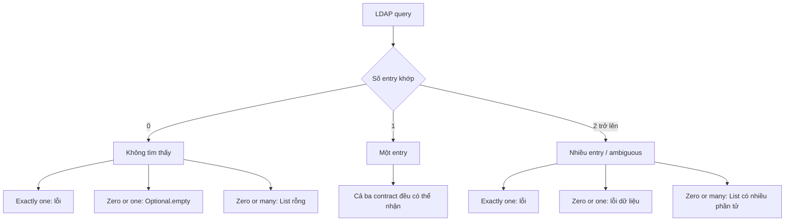
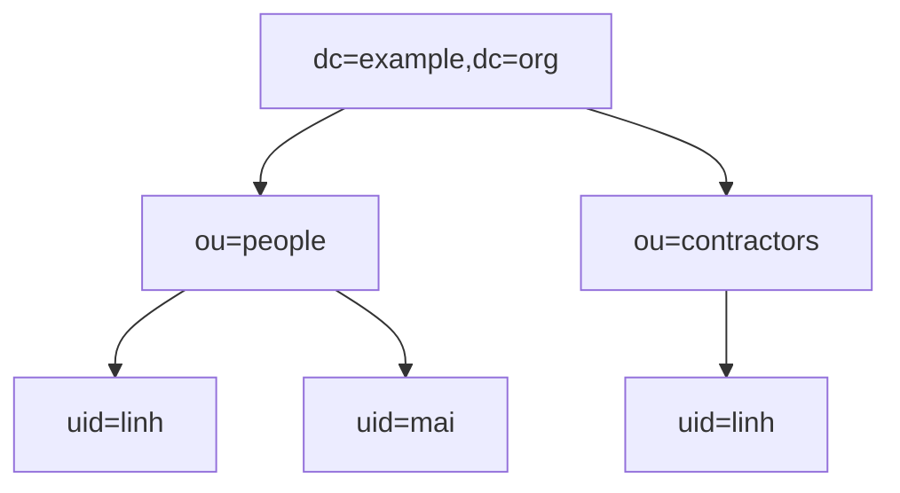

# Đối chiếu phương thức trả một kết quả với phương thức trả nhiều kết quả

> **Chương:** LdapTemplate  
> **Module:** SPRING_DATA_LDAP — truy cập dịch vụ thư mục LDAP qua Spring Data LDAP repository và Spring LDAP `LdapTemplate`, ánh xạ entry phân cấp sang Java; hiểu DN, `objectClass`, schema, truy vấn repository/LdapTemplate, CRUD, filter an toàn, bảo mật kết nối và kiểm thử với directory.

## Mục tiêu học tập

Sau bài này, bạn có thể:

1. Phân biệt **`lookup` theo DN**, **`searchForObject`** và **`search`** theo LDAP filter.
2. Chọn đúng phương thức khi nghiệp vụ mong đợi **đúng một entry**, **không quá một entry** hoặc **nhiều entry**.
3. Hiểu contract cardinality của `searchForObject(LdapQuery, ContextMapper)`: yêu cầu đúng một kết quả và báo lỗi nếu không có hoặc có nhiều hơn một.
4. Hiểu `search(LdapQuery, mapper)` trả `List<T>`, kể cả khi danh sách rỗng; không tự chọn phần tử đầu để che dữ liệu trùng.
5. Dùng `LdapQueryBuilder` để xây base, scope, filter và danh sách attribute; tránh LDAP filter injection.
6. Phân biệt lỗi “không tìm thấy” với lỗi ACL, timeout, referral, size limit và lỗi mapping.
7. Thiết kế truy vấn có cardinality rõ ràng, kiểm tra uniqueness và tránh race condition khi dùng kết quả đọc để quyết định ghi.
8. Viết integration test cho trường hợp 0, 1 và nhiều kết quả trên directory test.

## 1. Vì sao phải phân biệt truy vấn một kết quả và nhiều kết quả?

Giả sử một ứng dụng quản lý nhân viên cần tìm người có `uid=linh` trong nhánh `ou=people`. Có ba tình huống:

- Không có entry nào khớp: UID chưa tồn tại trong phạm vi tìm.
- Có đúng một entry: có thể trả về một hồ sơ.
- Có từ hai entry trở lên: dữ liệu hoặc phạm vi truy vấn không đáp ứng giả định “một UID chỉ có một người”.

Một phương thức trả về một object không tự động có nghĩa “lấy tùy ý một kết quả”. Cần xác định contract:

- **Exactly one:** bắt buộc đúng một entry; 0 hoặc nhiều hơn 1 đều là lỗi.
- **Zero or one:** 0 là trạng thái hợp lệ; 1 là kết quả; nhiều hơn 1 là dữ liệu mơ hồ.
- **Zero or many:** 0 trả danh sách rỗng; 1 hoặc nhiều trả danh sách.



Spring LDAP cung cấp nhiều API vì các nghiệp vụ có cardinality khác nhau. Chọn đúng API giúp phát hiện dữ liệu trùng thay vì vô tình che giấu lỗi.

## 2. Ba thao tác dễ bị nhầm

### 2.1. `lookup(Name dn, mapper)` — đọc một entry theo DN đã biết

Nếu đã có Distinguished Name (DN) chính xác, `lookup` thực hiện đọc entry theo tên:

```java
Name dn = LdapNameBuilder.newInstance("ou=people")
        .add("uid", "linh")
        .build();

PersonSummary person = ldapTemplate.lookup(
    dn,
    (AttributesMapper<PersonSummary>) attrs ->
        new PersonSummary(
            (String) attrs.get("uid").get(),
            (String) attrs.get("cn").get()
        )
);
```

Đây là thao tác **đọc một entry tại một DN cụ thể**, không phải search theo filter trên một subtree.

- DN tương đối phải phù hợp với `ContextSource.base`.
- Nếu DN không tồn tại, JNDI/Spring LDAP thường báo `NameNotFoundException`; đây không phải contract `Optional.empty()`.
- Nếu ACL không cho đọc, lỗi quyền có thể xuất hiện thay vì kết quả rỗng.
- Nếu chỉ biết `uid` mà không biết OU/RDN đầy đủ, `lookup` chưa đủ thông tin để xác định DN.

Ví dụ với `spring.ldap.base=dc=example,dc=org`, DN đầy đủ trong directory là `uid=linh,ou=people,dc=example,dc=org`, còn DN tương đối truyền cho template thường là `uid=linh,ou=people`.

### 2.2. `searchForObject(LdapQuery, ContextMapper<T>)` — yêu cầu đúng một kết quả

Dùng khi truy vấn là search theo base/filter nhưng nghiệp vụ khẳng định phải có **đúng một entry**:

```java
PersonSummary person = ldapTemplate.searchForObject(
    query()
        .base("ou=people")
        .where("objectClass").is("inetOrgPerson")
        .and("uid").is("linh"),
    personContextMapper
);
```

Contract của Spring LDAP hiện hành:

- Có đúng một entry: trả object do mapper tạo.
- Không có entry: ném `IncorrectResultSizeDataAccessException`.
- Có nhiều hơn một entry: cũng ném `IncorrectResultSizeDataAccessException`.

Vì vậy `searchForObject` **không trả null khi không tìm thấy** theo contract hiện hành được tài liệu hóa. Hãy xử lý exception theo đúng hợp đồng API và version mà dự án sử dụng.

### 2.3. `search(LdapQuery, mapper)` — trả tất cả kết quả

Dùng khi nghiệp vụ chấp nhận 0, 1 hoặc nhiều entry:

```java
List<PersonSummary> people = ldapTemplate.search(
    query()
        .base("ou=people")
        .where("objectClass").is("inetOrgPerson")
        .and("sn").is("Nguyen"),
    personAttributesMapper
);
```

Kết quả là `List<PersonSummary>`:

- Không có entry: danh sách rỗng.
- Có một entry: danh sách có một phần tử.
- Có nhiều entry: danh sách có tất cả các kết quả được server trả về trong giới hạn truy vấn.

`search` là lựa chọn tự nhiên cho danh bạ, danh sách nhân viên theo phòng ban, thành viên nhóm hoặc một bộ lọc có thể khớp nhiều người.

### So sánh nhanh

| API | Đầu vào | Cardinality | Khi không có kết quả | Khi có nhiều kết quả |
| --- | --- | --- | --- | --- |
| `lookup(Name, mapper)` | DN cụ thể | Một entry theo DN | Thường là `NameNotFoundException` | Không áp dụng cho một DN |
| `searchForObject(LdapQuery, ContextMapper)` | Base + scope + filter | **Exactly one** | `IncorrectResultSizeDataAccessException` | `IncorrectResultSizeDataAccessException` |
| `search(LdapQuery, ContextMapper)` | Base + scope + filter | Zero or many | `List` rỗng | `List` có nhiều phần tử |
| `search(LdapQuery, AttributesMapper)` | Base + scope + filter | Zero or many | `List` rỗng | `List` có nhiều phần tử |
| `findOne(LdapQuery, Class)` ODM | Query + entity class | **Exactly one** | `EmptyResultDataAccessException` | `IncorrectResultSizeDataAccessException` |
| `find(LdapQuery, Class)` ODM | Query + entity class | Zero or many | `List` rỗng | `List` có nhiều entity |

`lookup` và `searchForObject` đều trả một object, nhưng **không cùng ý nghĩa**: một bên đọc theo DN đã biết, bên kia chạy search và yêu cầu search có đúng một match.

Nguồn API: [Spring LDAP — LdapOperations](https://docs.spring.io/spring-ldap/reference/api/java/org/springframework/ldap/core/LdapOperations.html), [Spring LDAP — LdapTemplate](https://docs.spring.io/spring-ldap/reference/api/java/org/springframework/ldap/core/LdapTemplate.html).

## 3. Xây một entity và mapper dùng trong ví dụ

Ví dụ directory test có base `dc=example,dc=org` và entry:

```ldif
dn: uid=linh,ou=people,dc=example,dc=org
objectClass: top
objectClass: person
objectClass: organizationalPerson
objectClass: inetOrgPerson
uid: linh
cn: Linh Nguyen
sn: Nguyen
mail: linh@example.org

dn: uid=mai,ou=people,dc=example,dc=org
objectClass: top
objectClass: person
objectClass: organizationalPerson
objectClass: inetOrgPerson
uid: mai
cn: Mai Tran
sn: Tran
mail: mai@example.org

dn: uid=nam,ou=people,dc=example,dc=org
objectClass: top
objectClass: person
objectClass: organizationalPerson
objectClass: inetOrgPerson
uid: nam
cn: Nam Nguyen
sn: Nguyen
mail: nam@example.org
```

`inetOrgPerson` kế thừa `person` và `organizationalPerson`. Theo schema chuẩn, `cn` và `sn` là thuộc tính bắt buộc của `person`. Các entry ở trên có UID riêng trong nhánh minh họa.

DTO của ứng dụng:

```java
package com.example.directory.api;

public record PersonSummary(
    String uid,
    String commonName,
    String surname,
    String email
) {}
```

### Mapper dùng `AttributesMapper`

`AttributesMapper` nhận tập `Attributes` của một entry:

```java
import javax.naming.NamingException;
import javax.naming.directory.Attributes;

import org.springframework.ldap.core.AttributesMapper;

public final class PersonAttributesMapper
        implements AttributesMapper<PersonSummary> {

    @Override
    public PersonSummary mapFromAttributes(Attributes attrs)
            throws NamingException {

        return new PersonSummary(
            value(attrs, "uid"),
            value(attrs, "cn"),
            value(attrs, "sn"),
            value(attrs, "mail")
        );
    }

    private static String value(Attributes attrs, String id)
            throws NamingException {
        var attribute = attrs.get(id);
        return attribute == null ? null : (String) attribute.get();
    }
}
```

Mapper xử lý `mail` như attribute tùy chọn. Không giả định mọi attribute đều hiện diện: ACL có thể giới hạn dữ liệu được trả, schema có thể cho phép attribute tùy chọn, hoặc dữ liệu cũ chưa hoàn chỉnh.

### Mapper dùng `ContextMapper`

`searchForObject` yêu cầu `ContextMapper`. Mapper này nhận object context của entry:

```java
import org.springframework.ldap.core.ContextMapper;
import org.springframework.ldap.core.DirContextOperations;

public final class PersonContextMapper
        implements ContextMapper<PersonSummary> {

    @Override
    public PersonSummary mapFromContext(Object context) {
        DirContextOperations entry = (DirContextOperations) context;

        return new PersonSummary(
            entry.getStringAttribute("uid"),
            entry.getStringAttribute("cn"),
            entry.getStringAttribute("sn"),
            entry.getStringAttribute("mail")
        );
    }
}
```

Chọn mapper theo dữ liệu cần dùng:

- `AttributesMapper` phù hợp khi chỉ cần các LDAP attributes.
- `ContextMapper` có thể truy cập context operations, DN và dữ liệu entry theo abstraction Spring LDAP.
- ODM mapper/repository phù hợp khi ứng dụng đã có entity `@Entry`.

Không viết mapper giả định attribute luôn tồn tại nếu schema không bắt buộc hoặc ACL có thể ẩn attribute.

## 4. Dùng `searchForObject` khi nghiệp vụ cần đúng một entry

Ví dụ một endpoint tra cứu hồ sơ theo UID **trong OU nhân viên**. Quy tắc nghiệp vụ nói UID phải duy nhất trong nhánh này:

```java
import static org.springframework.ldap.query.LdapQueryBuilder.query;

import org.springframework.ldap.core.LdapOperations;
import org.springframework.stereotype.Service;

@Service
public class UniquePersonLookup {

    private final LdapOperations ldap;
    private final PersonContextMapper mapper = new PersonContextMapper();

    public UniquePersonLookup(LdapOperations ldap) {
        this.ldap = ldap;
    }

    public PersonSummary requireOneByUid(String uid) {
        if (uid == null || !uid.matches("[A-Za-z0-9._-]{1,64}")) {
            throw new IllegalArgumentException("UID không hợp lệ");
        }

        return ldap.searchForObject(
            query()
                .base("ou=people")
                .where("objectClass").is("inetOrgPerson")
                .and("uid").is(uid),
            mapper
        );
    }
}
```

Ở đây:

- `base("ou=people")` giới hạn nhánh directory được tìm.
- `objectClass` giới hạn kiểu entry.
- `uid` là attribute dùng để tìm.
- `searchForObject` xác nhận có đúng một kết quả.

**Không bắt `IncorrectResultSizeDataAccessException` rồi lấy phần tử đầu tiên.** Nếu có hai nhân viên cùng UID trong scope, đó là tình huống dữ liệu cần điều tra, không phải một lựa chọn ngẫu nhiên.

### Phân biệt “không có” và “trùng”

`IncorrectResultSizeDataAccessException` là lỗi cardinality. Có thể kiểm tra số lượng thực tế khi exception cung cấp:

```java
import org.springframework.dao.IncorrectResultSizeDataAccessException;

try {
    return uniquePersonLookup.requireOneByUid(uid);
} catch (IncorrectResultSizeDataAccessException ex) {
    int actual = ex.getActualSize();

    if (actual == 0) {
        throw new PersonNotFoundException(uid);
    }
    if (actual > 1) {
        throw new AmbiguousPersonException(uid, actual);
    }
    throw ex;
}
```

Ví dụ trên minh họa cách phân loại khi implementation cung cấp actual size. Không nên dựa vào việc mọi lỗi LDAP đều là exception cardinality: lỗi mạng, ACL, referral, timeout và mapping có các exception riêng.

Nếu hệ thống không cần phân biệt chi tiết giữa 0 và nhiều ở tầng API, có thể để exception được xử lý ở một exception handler trung tâm. Nhưng **đừng biến cả hai thành “không tìm thấy”** nếu duplicate là một lỗi dữ liệu cần cảnh báo.

## 5. Dùng `search` khi 0 hoặc nhiều kết quả đều hợp lệ

Ví dụ tìm tất cả nhân viên có họ `Nguyen`:

```java
import static org.springframework.ldap.query.LdapQueryBuilder.query;

import java.util.List;
import org.springframework.ldap.core.LdapOperations;

public class PeopleSearchService {

    private final LdapOperations ldap;
    private final PersonAttributesMapper mapper =
            new PersonAttributesMapper();

    public PeopleSearchService(LdapOperations ldap) {
        this.ldap = ldap;
    }

    public List<PersonSummary> findBySurname(String surname) {
        if (surname == null || surname.isBlank()) {
            throw new IllegalArgumentException("Surname không được rỗng");
        }

        return ldap.search(
            query()
                .base("ou=people")
                .where("objectClass").is("inetOrgPerson")
                .and("sn").is(surname)
                .attributes("uid", "cn", "sn", "mail"),
            mapper
        );
    }
}
```

Kết quả:

```text
findBySurname("Nguyen")
→ [
    PersonSummary("linh", "Linh Nguyen", "Nguyen", "linh@example.org"),
    PersonSummary("nam", "Nam Nguyen", "Nguyen", "nam@example.org")
  ]
```

Nếu không có ai mang họ cần tìm, method trả `List.of()`/danh sách rỗng theo kết quả search, không phải exception “phải có đúng một người”.

**Không dùng `searchForObject` cho một truy vấn họ tên có thể khớp nhiều nhân viên.** Nếu giao diện cần danh sách, hãy dùng API list. Nếu nghiệp vụ chỉ cho phép một người, cần một định danh/điều kiện duy nhất hơn.

## 6. Dùng `searchForObject` không có nghĩa là “lấy một kết quả đầu tiên”

Một nhầm lẫn thường gặp là hiểu “ForObject” thành “tôi chỉ cần object đầu tiên”. Contract của Spring LDAP hiện hành yêu cầu **unique entry**:

```text
0 match  → IncorrectResultSizeDataAccessException
1 match  → trả object
2+ match → IncorrectResultSizeDataAccessException
```

Đây là lựa chọn phù hợp cho nghiệp vụ “một tài khoản duy nhất”, nhưng không phù hợp cho “tìm một nhân viên bất kỳ trong phòng ban”.

Nếu bạn thật sự cần một entry theo tiêu chí ưu tiên (ví dụ nhân viên mới nhất), phải thiết kế tiêu chí sắp xếp và selection rõ ràng. LDAP search thông thường **không bảo đảm thứ tự kết quả**; không dựa vào phần tử đầu tiên của `List` để suy ra “mới nhất”, “đầu tiên” hay “tốt nhất”.

RFC 4511 quy định SearchResultEntry được trả về theo quá trình xử lý của server, nhưng không tạo một thứ tự nghiệp vụ mặc định cho client. Server-specific sort control có thể tồn tại, song cần kiểm tra hỗ trợ, quyền và semantics trên directory thực tế.

## 7. `findOne` ODM và `find` ODM khác gì?

Nếu đã khai báo entity Spring LDAP ODM, có thể dùng API map thẳng vào class:

```java
import javax.naming.Name;

import org.springframework.ldap.odm.annotations.Entry;
import org.springframework.ldap.odm.annotations.Id;
import org.springframework.ldap.odm.annotations.Attribute;

@Entry(
    base = "ou=people",
    objectClasses = {
        "top", "person", "organizationalPerson", "inetOrgPerson"
    }
)
public class DirectoryPerson {

    @Id
    private Name dn;

    @Attribute(name = "uid")
    private String uid;

    @Attribute(name = "cn")
    private String commonName;

    @Attribute(name = "sn")
    private String surname;

    public DirectoryPerson() {}

    public Name getDn() { return dn; }
    public String getUid() { return uid; }
    public String getCommonName() { return commonName; }
    public String getSurname() { return surname; }
}
```

### Đúng một entity: `findOne`

```java
DirectoryPerson person = ldapTemplate.findOne(
    query()
        .base("ou=people")
        .where("objectClass").is("inetOrgPerson")
        .and("uid").is("linh"),
    DirectoryPerson.class
);
```

Contract ODM được tài liệu hóa:

- Không có kết quả: `EmptyResultDataAccessException`.
- Có đúng một: trả `DirectoryPerson`.
- Có nhiều hơn một: `IncorrectResultSizeDataAccessException`.

### Nhiều entity: `find`

```java
List<DirectoryPerson> people = ldapTemplate.find(
    query()
        .base("ou=people")
        .where("objectClass").is("inetOrgPerson")
        .and("sn").is("Nguyen"),
    DirectoryPerson.class
);
```

`find` trả danh sách các entry khớp query và class mapping. Khi không có entry, danh sách rỗng.

Đây là cách so sánh trực tiếp ở mức ODM:

| ODM method | Kiểu trả về | 0 match | Nhiều match |
| --- | --- | --- | --- |
| `findOne(query, DirectoryPerson.class)` | `DirectoryPerson` | `EmptyResultDataAccessException` | `IncorrectResultSizeDataAccessException` |
| `find(query, DirectoryPerson.class)` | `List<DirectoryPerson>` | List rỗng | List có nhiều entity |

**Đừng nhầm `findOne` của `LdapTemplate` với `Optional<T>` của Spring Data repository.** Repository `findById(Name)` thường trả `Optional<T>` vì DN là ID; API ODM `findOne` yêu cầu đúng một search match.

## 8. Khi cần “không hoặc một”: tự biểu diễn contract Optional

Có nghiệp vụ cần ba kết quả rõ:

- Không tìm thấy → `Optional.empty()`.
- Tìm thấy một → `Optional.of(person)`.
- Nhiều hơn một → lỗi dữ liệu.

Có thể dùng `search` rồi kiểm tra số phần tử:

```java
import java.util.List;
import java.util.Optional;

public Optional<PersonSummary> findOptionalUniqueByUid(String uid) {
    List<PersonSummary> matches = ldap.search(
        query()
            .base("ou=people")
            .where("objectClass").is("inetOrgPerson")
            .and("uid").is(uid),
        personAttributesMapper
    );

    if (matches.isEmpty()) {
        return Optional.empty();
    }

    if (matches.size() > 1) {
        throw new AmbiguousPersonException(uid, matches.size());
    }

    return Optional.of(matches.get(0));
}
```

Cách này dễ đọc và cho contract rõ. Tuy nhiên, nó thu thập kết quả thành List; nếu base/filter có thể trả rất nhiều entry, không nên tải toàn bộ chỉ để kiểm tra có nhiều hơn một.

Nếu chỉ cần phân biệt 0, 1, nhiều, có thể cấu hình giới hạn tìm kiếm hợp lý và **xử lý size limit/partial result đúng cách**. Đừng đặt count limit bằng 1 rồi tuyên bố đã chứng minh tính duy nhất: giới hạn đó có thể che giấu các entry trùng. Một chiến lược giới hạn ở 2 có thể giúp phát hiện ít nhất hai kết quả, nhưng phải kiểm tra cách server/provider biểu diễn size-limit response và không coi một tập kết quả bị cắt là đầy đủ.

Với dữ liệu lớn, `searchForObject` được thiết kế cho unique lookup và có thể là lựa chọn rõ hơn khi hợp đồng là **exactly one**.

## 9. Cardinality phụ thuộc base, scope và filter

Cùng một filter có thể trả số lượng khác nhau nếu base DN hoặc search scope thay đổi.



Giả sử `uid=linh` xuất hiện ở cả `ou=people` và `ou=contractors`:

| Base DN | Scope | Filter | Số kết quả ví dụ |
| --- | --- | --- | ---: |
| `ou=people` | Subtree | `(uid=linh)` | 1 |
| `ou=contractors` | Subtree | `(uid=linh)` | 1 |
| `dc=example,dc=org` | Subtree | `(uid=linh)` | 2 |
| `uid=linh,ou=people` | Object | `(objectClass=*)` | 1 |

Nếu nghiệp vụ nói “UID duy nhất trong nhân viên”, base `ou=people` phải nằm trong query. Nếu chỉ lọc `uid` trên toàn naming context, có thể vô tình tìm được nhiều đối tượng.

Các scope LDAP phổ biến:

- **OBJECT_SCOPE:** chỉ entry ở đúng base DN.
- **ONELEVEL_SCOPE:** các entry con trực tiếp.
- **SUBTREE_SCOPE:** base và toàn bộ descendants.

Search scope mặc định của builder/version cần được hiểu rõ; hãy đặt base/scope tường minh trong truy vấn quan trọng.

## 10. Filter an toàn và attributes tối thiểu

Không ghép input vào raw LDAP filter:

```java
// Không làm như vậy với input từ HTTP:
String filter = "(uid=" + uid + ")";
```

Nếu UID có ký tự đặc biệt như `*`, `(`, `)` hoặc `\`, chuỗi filter có thể thay đổi ý nghĩa. Dùng `LdapQueryBuilder`:

```java
LdapQuery query = query()
    .base("ou=people")
    .where("objectClass").is("inetOrgPerson")
    .and("uid").is(uid)
    .attributes("uid", "cn", "mail");
```

Builder giúp escape **giá trị filter** theo quy tắc LDAP. Nhưng vẫn cần:

- Allowlist attribute names và search base; không cho client tùy chọn attribute/filter syntax tùy ý.
- Kiểm tra quyền của caller và tenant/OU trước khi query.
- Giới hạn size/time của search khi input có thể tạo workload lớn.
- Không trả attribute nhạy cảm chỉ vì mapper có thể đọc được.
- Phân biệt escaping filter (RFC 4515) với escaping DN (RFC 4514).

`attributes("uid", "cn", "mail")` giảm dữ liệu tải về và PII không cần thiết. Nếu mapper cần `sn`, hãy yêu cầu nó; nếu `mail` tùy chọn, xử lý null.

## 11. Đảm bảo uniqueness: phương thức một kết quả không thay thế ràng buộc dữ liệu

`searchForObject` chỉ kiểm tra số kết quả của **truy vấn tại thời điểm chạy**. Nó không tạo unique index, không khóa directory và không bảo đảm một client khác không tạo entry trùng sau đó.

Các câu hỏi cần làm rõ:

1. `uid` có duy nhất trong toàn directory hay chỉ trong một OU?
2. Có nhiều naming contexts/replicas không?
3. Server có overlay/constraint/policy kiểm tra uniqueness cho attribute không?
4. Có luồng provisioning nào tạo account đồng thời không?
5. DN có thể thay đổi do rename/move không?
6. Quy tắc matching của attribute có phân biệt hoa thường không?

**LDAP schema không tự bảo đảm mọi attribute thông thường đều unique.** Việc dùng `uid` làm unique identifier có thể đến từ naming convention, directory server configuration, overlay hoặc quy trình provisioning. Phải xác minh trong hệ thống thực tế.

### Không dùng “search đúng một” như khóa cho thao tác ghi

Ví dụ:

```java
PersonSummary person = ldap.searchForObject(query, mapper);
// Sau đó thay group membership hoặc cập nhật entry.
```

Giữa search và Modify có thể có client khác rename, delete, sửa hoặc thay thế entry. Kết quả đúng một ở thời điểm T1 **không phải lock** bảo đảm đúng trạng thái ở T2.

Nếu update cần điều kiện “chỉ thay đổi khi attribute còn đúng giá trị cũ”, xem xét **LDAP Assertion Control RFC 4528** nếu server/client hỗ trợ, hoặc cơ chế coordination riêng. Không giả định `@Transactional` của JPA khóa hoặc rollback một LDAP operation.

## 12. Xử lý kết quả và exception đúng cách

### Bảng phân loại

| Tình huống | API list | API exactly one | Cách hiểu |
| --- | --- | --- | --- |
| Không match | List rỗng | Exception cardinality | Không có entry trong kết quả hiện tại |
| Một match | List có 1 | Trả object | Cardinality đạt |
| Nhiều match | List có nhiều | Exception cardinality | Điều kiện không đủ unique hoặc data duplicate |
| Sai bind credentials | Exception | Exception | Không phải “không tìm thấy” |
| ACL không đủ | Có thể exception hoặc kết quả bị giới hạn theo policy | Exception hoặc kết quả theo policy | Không suy ra global absence |
| Server timeout/unavailable | Exception | Exception | Không đổi thành empty/null |
| Search size/time limit | Exception/partial behavior tùy provider | Exception/partial behavior tùy provider | Kết quả có thể chưa đầy đủ |
| Referral/partial result | Exception hoặc partial result theo cấu hình | Không thể coi là unique nếu chưa đủ phạm vi | Xem topology/referral policy |
| Mapping lỗi | Exception | Exception | Dữ liệu hoặc mapper không tương thích |

Các exception Spring LDAP thường gặp có thể bao gồm:

- `IncorrectResultSizeDataAccessException`: cardinality không đúng một.
- `EmptyResultDataAccessException`: API ODM `findOne` không tìm thấy.
- `NameNotFoundException`: DN không tồn tại trong thao tác lookup tương ứng.
- `AuthenticationException`: bind credentials không hợp lệ.
- `NoPermissionException`: thiếu quyền.
- `CommunicationException`/`ServiceUnavailableException`: lỗi kết nối/dịch vụ.
- `SizeLimitExceededException`/`TimeLimitExceededException` hoặc lỗi được dịch tương ứng: giới hạn search.
- `PartialResultException`/`ReferralException`: referral/partial result theo provider và cấu hình.
- `DataRetrievalFailureException` hoặc lỗi mapping: mapper không thể đọc/convert dữ liệu.

Tên và cách dịch exception phụ thuộc method, Spring LDAP version và JNDI provider. Khi chẩn đoán, xem root cause và LDAP result code; không bắt toàn bộ `RuntimeException` rồi trả `Optional.empty()`.

### Ví dụ xử lý API exactly one

```java
public PersonSummary getRequiredPerson(String uid) {
    try {
        return ldap.searchForObject(
            query()
                .base("ou=people")
                .where("objectClass").is("inetOrgPerson")
                .and("uid").is(uid),
            personContextMapper
        );
    } catch (IncorrectResultSizeDataAccessException ex) {
        if (ex.getActualSize() == 0) {
            throw new PersonNotFoundException(uid);
        }
        if (ex.getActualSize() > 1) {
            throw new AmbiguousPersonException(uid, ex.getActualSize());
        }
        throw ex;
    }
}
```

Code trên chỉ chuyển **lỗi cardinality** thành lỗi nghiệp vụ. Nó không bắt lỗi ACL/network/TLS và không biến chúng thành “không có người”.

## 13. Hiệu năng: một kết quả không có nghĩa server chỉ xử lý một entry

Một truy vấn có thể chỉ trả về một object nhưng vẫn phải duyệt nhiều entries để tìm nó, tùy:

- Base DN và scope;
- Attribute filter có index hay không;
- Matching rule của attribute;
- Kích thước subtree;
- ACL và các attributes được yêu cầu;
- Server load, replication và network latency.

Ví dụ, `searchForObject` với base root và filter `(mail=*example.org)` có thể rất tốn tài nguyên nếu server không có index phù hợp. Trong khi `lookup` theo DN chính xác thường nhắm thẳng một entry. Tuy nhiên không nên đưa ra cam kết hiệu năng tuyệt đối nếu chưa đo server thật.

### Checklist tối ưu

1. Base DN hẹp nhất đáp ứng nghiệp vụ.
2. Scope phù hợp: object/one-level/subtree.
3. Filter trên attributes có index phù hợp.
4. Yêu cầu đúng các attributes mapper cần.
5. Dùng size/time limits hợp lý, không biến một query mơ hồ thành query vô hạn.
6. Đo P50/P95/P99 và server-side search metrics.
7. Tránh chạy `existsById` rồi `findById` nếu cuối cùng vẫn cần entity.
8. Với danh sách lớn, cân nhắc paging RFC 2696 thay vì nạp toàn bộ List vào heap.

### `searchForStream` khi kết quả lớn

Spring LDAP có API `searchForStream(LdapQuery, mapper)` ở các version hỗ trợ, trả về `Stream<T>` thay vì thu thập toàn bộ kết quả thành List ngay trong API.

Ví dụ:

```java
try (var stream = ldapTemplate.searchForStream(
        query()
            .base("ou=people")
            .where("objectClass").is("inetOrgPerson"),
        personAttributesMapper)) {

    stream.forEach(this::processPerson);
}
```

Đóng stream sau khi xử lý để giải phóng tài nguyên search/context. Kiểm tra version Spring LDAP đang dùng (API này được thêm từ nhánh 3.0). Stream không thay thế mọi yêu cầu paging/connection affinity; nếu server cần RFC 2696 controls hoặc workload cần checkpoint, thiết kế paging rõ ràng.

## 14. Ánh xạ sang HTTP/API mà không làm lộ directory

Một endpoint có thể có contract:

```text
GET /api/people/{uid}
→ yêu cầu đúng một người trong OU nhân viên
GET /api/people?sn=Nguyen
→ trả danh sách người phù hợp
```

Các phản hồi thường cân nhắc:

| Kết quả nội bộ | API có thể trả | Ghi chú |
| --- | --- | --- |
| Một người và caller được phép đọc | `200 OK` + DTO | Chỉ trả attributes được phép |
| Không tìm thấy trong phạm vi được phép | `404 Not Found` | Tùy policy chống enumeration |
| Nhiều kết quả trong API yêu cầu unique | `409 Conflict` hoặc lỗi dữ liệu nội bộ | Cần cảnh báo/điều tra duplicate |
| Caller không có quyền | `403 Forbidden` hoặc `404` có chủ ý | Không tiết lộ entry ngoài phạm vi |
| LDAP không sẵn sàng | `503 Service Unavailable` | Không chuyển thành 404 |
| Search bị giới hạn/không đầy đủ | `503`/`422` hoặc lỗi phù hợp contract | Không trả danh sách thiếu như đầy đủ |

Không expose full DN, base DN nội bộ, filter raw, bind DN, password hoặc stack trace. Quyền đọc của service account không đồng nghĩa mọi HTTP caller được đọc mọi entry; authorization phải được thực hiện ở application layer.

## 15. Integration test cho 0, 1 và nhiều kết quả

Một mock có thể kiểm tra service chọn đúng method, nhưng không xác minh search filter, base, scope, schema, ACL và exception behavior của directory. Cần integration test trên LDAP test server hoặc embedded LDAP phù hợp.

Giả định fixture có:

- `uid=linh` dưới `ou=people`;
- `uid=mai` dưới `ou=people`;
- `uid=linh` dưới `ou=contractors` để tạo tình huống trùng khi mở rộng base.

### Test tìm một kết quả

```java
@Test
void searchForObjectReturnsOneUniqueEntry() {
    PersonSummary result = ldapTemplate.searchForObject(
        query()
            .base("ou=people")
            .where("objectClass").is("inetOrgPerson")
            .and("uid").is("linh"),
        personContextMapper
    );

    assertEquals("linh", result.uid());
    assertEquals("Linh Nguyen", result.commonName());
}
```

### Test không có kết quả

```java
@Test
void searchForObjectFailsWhenNoEntryMatches() {
    assertThrows(
        IncorrectResultSizeDataAccessException.class,
        () -> ldapTemplate.searchForObject(
            query()
                .base("ou=people")
                .where("objectClass").is("inetOrgPerson")
                .and("uid").is("missing-user"),
            personContextMapper
        )
    );
}
```

### Test có nhiều kết quả

Trong test directory riêng, tạo hai entries cùng `uid` dưới phạm vi base rộng (hoặc fixture khác đáp ứng schema):

```java
@Test
void searchForObjectFailsWhenMoreThanOneEntryMatches() {
    assertThrows(
        IncorrectResultSizeDataAccessException.class,
        () -> ldapTemplate.searchForObject(
            query()
                .base("dc=example,dc=org")
                .where("objectClass").is("inetOrgPerson")
                .and("uid").is("linh"),
            personContextMapper
        )
    );
}
```

### Test list trả nhiều kết quả

```java
@Test
void searchReturnsAllMatchingPeople() {
    List<PersonSummary> results = ldapTemplate.search(
        query()
            .base("ou=people")
            .where("objectClass").is("inetOrgPerson")
            .and("sn").is("Nguyen"),
        personAttributesMapper
    );

    assertTrue(results.size() >= 1);
    assertTrue(results.stream()
        .allMatch(person -> "Nguyen".equals(person.surname())));
}
```

Các test này giả định test profile đã khởi tạo base/OU, import LDIF, cấu hình bean `LdapTemplate` và bind account có quyền đọc. Không chạy các ca tạo duplicate trên directory production.

### Ma trận kiểm thử cần có

| Ca | Dữ liệu/kịch bản | Kỳ vọng |
| --- | --- | --- |
| **T1** | Filter khớp 0 entry với `search` | List rỗng |
| **T2** | Filter khớp đúng 1 với `search` | List có một phần tử |
| **T3** | Filter khớp nhiều với `search` | List có đủ các kết quả trong giới hạn |
| **T4** | `searchForObject` khớp 0 | `IncorrectResultSizeDataAccessException` |
| **T5** | `searchForObject` khớp 1 | Trả một object |
| **T6** | `searchForObject` khớp nhiều | `IncorrectResultSizeDataAccessException` |
| **T7** | `findOne(query, Class)` khớp 0 | `EmptyResultDataAccessException` |
| **T8** | `findOne(query, Class)` khớp nhiều | `IncorrectResultSizeDataAccessException` |
| **T9** | `lookup` DN tồn tại/không tồn tại | Object hoặc NameNotFoundException |
| **T10** | UID giống nhau ở hai OU | Base/scope quyết định cardinality |
| **T11** | Attribute tùy chọn thiếu | Mapper không ném NPE |
| **T12** | Bind account thiếu ACL | Không biến lỗi quyền thành empty list |
| **T13** | Server timeout/size limit/referral | Lỗi được phân loại; không coi partial result là đầy đủ |
| **T14** | Input chứa ký tự filter đặc biệt | Builder escape; không mở rộng filter ngoài ý muốn |
| **T15** | Hai client tạo/sửa đồng thời | Search exactly one không bị coi là lock/unique constraint |

## 16. Các lỗi thường gặp

| Triệu chứng | Nguyên nhân | Cách xử lý |
| --- | --- | --- |
| `searchForObject` ném IncorrectResultSize khi không tìm thấy | API yêu cầu đúng một, 0 cũng là cardinality sai | Dùng `search` hoặc xử lý exception theo contract |
| `searchForObject` ném IncorrectResultSize dù filter tưởng unique | Có duplicate hoặc base/scope rộng | Thu hẹp base/scope; kiểm tra dữ liệu và uniqueness policy |
| `search` trả List rỗng | Không có match trong view/quyền hiện tại | Kiểm tra base/filter/ACL/replica |
| `lookup` ném NameNotFoundException | DN sai hoặc entry không có ở endpoint hiện tại | Kiểm tra DN tương đối và `ContextSource.base` |
| `searchForObject` trả một người “không đúng” | Filter/base không mô tả đủ identity; code chọn first ở nơi khác | Xác định đúng DN/unique identifier, không dùng kết quả đầu tùy tiện |
| API list thiếu kết quả | Size/time limit, referral hoặc partial result | Kiểm tra LDAPResult/exception và policy |
| Mapper ném NullPointerException | Attribute tùy chọn bị thiếu hoặc ACL ẩn | Kiểm tra null và schema |
| Query trả duplicate khác nhau giữa node | Replication lag hoặc dữ liệu khác nhau | Xác định authoritative endpoint và kiểm tra replica |
| Search chậm dù chỉ có một kết quả | Base rộng, attribute chưa index, server tải cao | Thu hẹp base/scope, index và benchmark |
| Exception bị biến thành 404 | Catch RuntimeException quá rộng | Chỉ map cardinality/not-found theo contract; lỗi availability trả lỗi hệ thống |

## 17. Câu hỏi tự đánh giá

**Câu 1.** `searchForObject(query, mapper)` có trả `null` khi không có entry không?  
**Đáp án:** Không theo contract hiện hành; nó ném `IncorrectResultSizeDataAccessException` khi kết quả không đúng một entry, bao gồm 0 và nhiều hơn 1.

**Câu 2.** `search(query, mapper)` trả gì khi không có entry?  
**Đáp án:** Một `List` rỗng.

**Câu 3.** Khi đã biết DN chính xác của entry, dùng `lookup` hay search filter?  
**Đáp án:** `lookup(Name, mapper)` là lựa chọn trực tiếp để đọc entry theo DN. Search filter phù hợp khi cần tìm theo thuộc tính trong một base/scope.

**Câu 4.** Vì sao không lấy `results.get(0)` khi query có nhiều kết quả?  
**Đáp án:** LDAP search không bảo đảm thứ tự nghiệp vụ. Chọn phần tử đầu có thể che duplicate và trả người không xác định.

**Câu 5.** `searchForObject` chứng minh `uid` có unique constraint trong directory không?  
**Đáp án:** Không. Nó chỉ kiểm tra cardinality của search tại thời điểm đó. Unique policy phải được bảo đảm riêng ở server/provisioning.

**Câu 6.** `findOne(query, DirectoryPerson.class)` khác `searchForObject(query, mapper)` thế nào khi không có kết quả?  
**Đáp án:** ODM `findOne` ném `EmptyResultDataAccessException`; `searchForObject` theo contract hiện hành ném `IncorrectResultSizeDataAccessException` khi không đúng một kết quả.

**Câu 7.** Nếu service account không có quyền đọc, có thể coi list rỗng là bằng chứng người dùng không tồn tại không?  
**Đáp án:** Không. Phải phân biệt ACL/authentication/partial result với kết quả không match.

**Câu 8.** Có thể dùng kết quả exactly-one để đảm bảo entry không đổi trước khi Modify không?  
**Đáp án:** Không. Search không khóa entry; cần assertion/coordination phù hợp nếu update phụ thuộc trạng thái hiện tại.

## 18. Checklist chọn API

- [ ] Đã xác định nghiệp vụ cần **đúng một**, **không hoặc một**, hay **không hoặc nhiều** entry.
- [ ] Biết DN chính xác thì ưu tiên `lookup(Name, mapper)`; không nhầm với filter search.
- [ ] Dùng `searchForObject(LdapQuery, ContextMapper)` khi yêu cầu đúng một match và chấp nhận exception nếu 0/nhiều.
- [ ] Dùng `search(LdapQuery, mapper)` khi danh sách rỗng hoặc nhiều phần tử đều hợp lệ.
- [ ] Dùng `findOne`/`find` ODM khi cần map trực tiếp entity `@Entry`; hiểu exception semantics riêng.
- [ ] Base DN và scope được đặt tường minh; UID unique ở phạm vi nào đã được xác định.
- [ ] Filter được xây bằng `LdapQueryBuilder`; không nối raw input vào filter.
- [ ] Chỉ trả attributes cần thiết; mapper xử lý attribute tùy chọn và ACL.
- [ ] Không lấy phần tử đầu để che nhiều kết quả; không đặt count limit 1 để giả định unique.
- [ ] Phân biệt cardinality exception với authentication, ACL, referral, timeout, size limit và mapping errors.
- [ ] Exactly-one lookup không được coi là unique constraint hay lock cho operation ghi.
- [ ] Đã test 0/1/nhiều, DN lookup, duplicate UID, scope, ACL và lỗi server trên directory test.
- [ ] Có metrics cho latency, result count, duplicate cardinality và lỗi truy vấn; không log PII/filter raw.

## Tài liệu tham khảo

- [Spring LDAP — LdapOperations API](https://docs.spring.io/spring-ldap/reference/api/java/org/springframework/ldap/core/LdapOperations.html)
- [Spring LDAP — LdapTemplate API](https://docs.spring.io/spring-ldap/reference/api/java/org/springframework/ldap/core/LdapTemplate.html)
- [Spring LDAP — Query Builder](https://docs.spring.io/spring-ldap/reference/query-builder-advanced.html)
- [Spring LDAP — Object-Directory Mapping](https://docs.spring.io/spring-ldap/reference/odm.html)
- [Spring Data LDAP — Repository Configuration](https://docs.spring.io/spring-data/ldap/reference/ldap/configuration.html)
- [Spring Framework — IncorrectResultSizeDataAccessException](https://docs.spring.io/spring-framework/docs/current/javadoc-api/org/springframework/dao/IncorrectResultSizeDataAccessException.html)
- [Spring Framework — EmptyResultDataAccessException](https://docs.spring.io/spring-framework/docs/current/javadoc-api/org/springframework/dao/EmptyResultDataAccessException.html)
- [RFC 4511 — LDAPv3 Protocol and Search Operation](https://www.rfc-editor.org/rfc/rfc4511.html)
- [RFC 4512 — LDAP Directory Information Models](https://www.rfc-editor.org/rfc/rfc4512.html)
- [RFC 4515 — LDAP Search Filter String Representation](https://www.rfc-editor.org/rfc/rfc4515.html)
- [RFC 4514 — LDAP Distinguished Names](https://www.rfc-editor.org/rfc/rfc4514.html)

