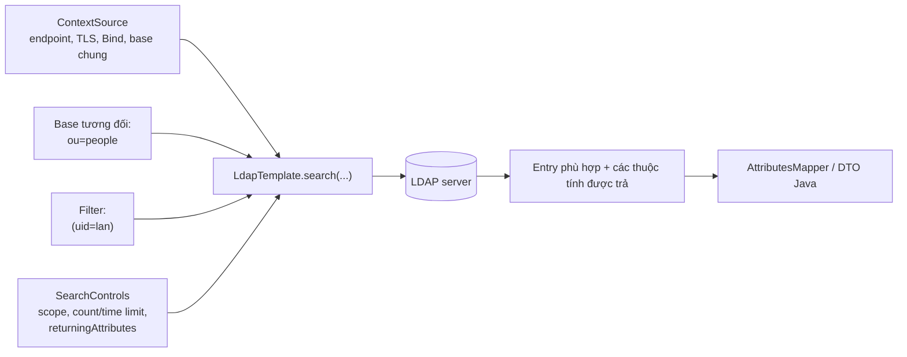

# Cấu hình SearchControls

Trong chương **Tìm kiếm** của **SPRING_DATA_LDAP**, ứng dụng Java thường dùng Spring Data LDAP repository để tìm entry theo thuộc tính và dùng Spring LDAP `LdapTemplate` khi cần điều khiển phép tìm kiếm chi tiết hơn. Một thành phần quan trọng là **`javax.naming.directory.SearchControls`** của JNDI: đối tượng cấu hình **phạm vi tìm kiếm**, **số lượng kết quả tối đa**, **thời gian**, **danh sách thuộc tính cần lấy** và một số tùy chọn xử lý đối tượng.

Ví dụ, API chỉ cần tra cứu `uid`, `cn`, `mail` của tối đa 100 nhân viên ở nhánh `ou=people`. Nếu để mặc định hoặc tìm quá rộng, ứng dụng có thể đọc nhiều entry và thuộc tính hơn cần thiết, tăng tải LDAP server hoặc vô tình đưa dữ liệu không liên quan vào bộ nhớ. Ngược lại, chọn phạm vi `ONELEVEL_SCOPE` có thể khiến nhân viên ở một OU con không xuất hiện.

**Mục tiêu của bài:** hiểu chính xác từng thuộc tính của `SearchControls`, dùng nó trong `LdapTemplate`, phân biệt với base DN và filter, xử lý giới hạn/timeout, giữ truy vấn an toàn và kiểm thử được hành vi trên directory có schema, `objectClass` và cấu trúc DN thực tế.

## 1. SearchControls nằm ở đâu trong một phép LDAP Search?

Một phép tìm kiếm LDAP cần phân biệt các đầu vào:

| Thành phần | Ví dụ | Trả lời câu hỏi |
| --- | --- | --- |
| **LDAP endpoint** | `ldaps://directory.example.org:636` | Kết nối tới máy chủ nào, theo cách bảo mật nào? |
| **Base DN** | `ou=people,dc=example,dc=org` | Bắt đầu tìm tại entry nào? |
| **Search scope** | `SUBTREE_SCOPE` | Xét bản thân base, con trực tiếp hay toàn bộ nhánh? |
| **LDAP filter** | `(&(objectClass=inetOrgPerson)(uid=lan))` | Entry nào thỏa điều kiện? |
| **Returning attributes** | `uid`, `cn`, `mail` | Cần lấy những thuộc tính nào của entry thỏa filter? |
| **Count/time limit** | `100` entry, `3000` ms | Giới hạn lượng kết quả và thời gian yêu cầu tìm kiếm thế nào? |
| **Bind identity và ACL** | Tài khoản dịch vụ chỉ đọc | Người gọi có quyền thấy entry/thuộc tính nào? |

`SearchControls` không chứa toàn bộ thông tin trên. **Base DN và filter được truyền riêng** khi gọi JNDI `DirContext.search(...)` hoặc các overload tương ứng của `LdapTemplate.search(...)`. `SearchControls` quyết định một phần cách **thực hiện** truy vấn, còn `ContextSource` quyết định endpoint, Bind, TLS và base chung cho ứng dụng.



## 2. Các hằng số và thuộc tính quan trọng của SearchControls

Class `SearchControls` nằm trong **JNDI của Java**, không phải class riêng do Spring Data LDAP định nghĩa:

```java
import javax.naming.directory.SearchControls;

SearchControls controls = new SearchControls();
controls.setSearchScope(SearchControls.SUBTREE_SCOPE);
controls.setCountLimit(100);
controls.setTimeLimit(3_000);
controls.setReturningAttributes(new String[]{"uid", "cn", "mail"});
controls.setReturningObjFlag(false);
```

| Phương thức | Giá trị/đơn vị | Ý nghĩa |
| --- | --- | --- |
| `setSearchScope(int)` | `OBJECT_SCOPE`, `ONELEVEL_SCOPE`, `SUBTREE_SCOPE` | Quy định entry nào được xét theo vị trí trong cây |
| `setCountLimit(long)` | Số entry, `0` là không yêu cầu giới hạn ở client | Giới hạn số kết quả mà client muốn nhận |
| `setTimeLimit(int)` | **Mili giây**, `0` là không yêu cầu giới hạn tại SearchControls | Giới hạn thời gian xử lý phép tìm kiếm |
| `setReturningAttributes(String[])` | Tên các thuộc tính cần trả | Giảm dữ liệu cần truyền, ánh xạ và giữ trong bộ nhớ |
| `setReturningObjFlag(boolean)` | Thường để `false` khi ánh xạ thuộc tính LDAP | Quy định có yêu cầu đối tượng JNDI trong kết quả hay không |
| `setDerefLinkFlag(boolean)` | Theo ngữ nghĩa liên kết JNDI/provider | Điều khiển cách xử lý liên kết trong cơ chế JNDI; **không nên coi là cấu hình đầy đủ cho mọi kiểu LDAP alias** |

**Giá trị mặc định cần chú ý:** một `new SearchControls()` theo JNDI mặc định dùng `ONELEVEL_SCOPE`, count/time limit bằng `0` và không yêu cầu danh sách thuộc tính riêng. Vì vậy, nếu muốn quét sâu nhiều OU hoặc chỉ nhận các field thiết yếu, hãy **đặt rõ ràng**. Với các thư viện tạo `SearchControls` thay bạn, mặc định của thư viện/query có thể khác; không suy luận từ mặc định của `new SearchControls()` khi chưa kiểm tra đường đi thực tế.

`SearchControls` là đối tượng cấu hình có setter, nên hãy **tạo mới theo từng truy vấn hoặc dùng đối tượng chỉ được cấu hình trước khi sử dụng**. Đừng chia sẻ rồi sửa một instance đang được các luồng khác dùng để tìm kiếm song song.

## 3. Search scope: điểm khác biệt dễ gây kết quả thiếu

Xét cây LDAP minh họa:

```text
dc=example,dc=org
├── ou=people
│   ├── uid=lan              (inetOrgPerson)
│   ├── uid=nam              (inetOrgPerson)
│   └── ou=contractors
│       └── uid=kim          (inetOrgPerson)
└── ou=groups
    └── cn=developers
```

Giả sử **search base** là `ou=people,dc=example,dc=org`:

| Scope | Hằng số JNDI | Entry nào được xét? |
| --- | --- | --- |
| **Base/Object** | `SearchControls.OBJECT_SCOPE` | **Chỉ** entry `ou=people` |
| **One level** | `SearchControls.ONELEVEL_SCOPE` | Các entry con **trực tiếp**: `uid=lan`, `uid=nam`, `ou=contractors` |
| **Subtree** | `SearchControls.SUBTREE_SCOPE` | Entry base **và mọi hậu duệ**, bao gồm `uid=kim` |

Nếu filter là `(objectClass=inetOrgPerson)` thì:

- Với `OBJECT_SCOPE`, có thể **không có kết quả** vì entry `ou=people` thường không có `objectClass=inetOrgPerson`.
- Với `ONELEVEL_SCOPE`, có thể tìm Lan và Nam, nhưng **không tìm Kim** ở OU con.
- Với `SUBTREE_SCOPE`, có thể tìm cả Lan, Nam và Kim, nếu tài khoản Bind có quyền đọc.

Đổi `setSearchScope(...)` **không** đổi base DN. Đổi base `ou=people` sang `ou=groups` **không** đổi scope đã chọn. Bộ lọc chỉ quyết định entry nào thỏa điều kiện trong phạm vi được xét.

### 3.1. Chọn scope theo use case

| Use case | Base hợp lý | Scope thường hợp lý |
| --- | --- | --- |
| Đọc đúng entry theo DN đã biết | DN của entry | `OBJECT_SCOPE` |
| Liệt kê các entry con trực tiếp của một OU | DN của OU | `ONELEVEL_SCOPE` |
| Tìm tài khoản trong các OU con của `people` | DN của `ou=people` | `SUBTREE_SCOPE` |
| Tìm nhóm trong nhánh quản lý nhóm | DN của `ou=groups` | `ONELEVEL_SCOPE` hoặc `SUBTREE_SCOPE` tùy cây |

Base hẹp nhất đáp ứng yêu cầu thường giảm tải và hạn chế nhầm entry. Tuy nhiên, **phạm vi truy vấn không thay thế kiểm tra phân quyền** ở API và LDAP ACL; account Bind vẫn phải được cấp quyền tối thiểu.

## 4. Count limit: chặn truy vấn trả quá nhiều entry

`controls.setCountLimit(100)` yêu cầu giới hạn lượng entry trong một lần tìm kiếm. Với API chỉ hiển thị một số kết quả, đây là một biện pháp kiểm soát hữu ích.

```java
SearchControls controls = new SearchControls();
controls.setSearchScope(SearchControls.SUBTREE_SCOPE);
controls.setCountLimit(100L);
```

Cần hiểu những giới hạn:

1. **`0` không có nghĩa directory sẽ trả vô hạn entry.** Nó chỉ không yêu cầu giới hạn ở `SearchControls`; server vẫn có giới hạn quản trị, kích thước và thời gian riêng.
2. **Chạm giới hạn không chứng minh chỉ có đúng 100 entry.** Nếu client nhận đủ 100, có thể còn dữ liệu nhưng không được trả hết.
3. **Không đồng nghĩa phân trang.** SearchControls không cung cấp page number, page size hay cookie điều khiển phân trang server-side; muốn phân trang thật phải dùng các LDAP controls/khả năng thư viện và server tương ứng (ví dụ Simple Paged Results theo RFC 2696).
4. **Không bảo đảm kết quả ổn định về thứ tự.** LDAP không hứa rằng Search không có server-side sort sẽ trả entry theo một thứ tự cố định. `countLimit=100` không phải “100 người đầu tiên theo tên”.
5. **Kết quả vượt giới hạn có thể phát sinh ngoại lệ hoặc response giới hạn.** Server có thể trả `sizeLimitExceeded` (mã LDAP 4) và client có thể đã nhận một phần dữ liệu; cách Spring LDAP/JNDI xử lý phần kết quả đó cần được kiểm chứng.

Nếu API thật sự cần phân trang, hãy thiết kế contract có page/cookie phù hợp, xử lý hoàn tất kết quả, và kiểm thử với directory cụ thể. Không tự lấy 100 entry rồi tuyên bố “không còn trang tiếp theo”.

## 5. Time limit: giới hạn tìm kiếm, khác timeout mạng

`controls.setTimeLimit(3_000)` sử dụng đơn vị **mili giây** trong API JNDI:

```java
SearchControls controls = new SearchControls();
controls.setTimeLimit(3_000); // 3000 ms = 3 giây
```

Đây là yêu cầu giới hạn thời gian **cho phép tìm kiếm** được chuyển qua provider và giao thức thích hợp; không bảo đảm toàn bộ lời gọi Java kết thúc đúng sau 3 giây. Các bước kết nối, TLS, Bind, DNS, read socket, mapper và retry có thể có thời gian riêng.

| Thời gian / giới hạn | Được cấu hình ở đâu? | Khi lỗi thường quan sát thấy |
| --- | --- | --- |
| Search time limit | `SearchControls.setTimeLimit(milliseconds)` | Có thể nhận `timeLimitExceeded` (LDAP mã 3) hoặc ngoại lệ tương ứng khi server áp dụng giới hạn |
| Connect timeout | Cấu hình JNDI/provider hoặc connection factory, ví dụ `com.sun.jndi.ldap.connect.timeout` | Không kết nối được; có thể **không có** mã LDAP response |
| Socket/read timeout | Cấu hình JNDI/provider, ví dụ `com.sun.jndi.ldap.read.timeout` | Chờ phản hồi quá lâu; thường là lỗi client/transport |
| Server admin limit | Chính sách directory | Server có thể từ chối truy vấn tốn tài nguyên |
| HTTP request timeout | Gateway, controller hoặc service | Client HTTP hết thời gian, dù LDAP request có thể còn đang xử lý |

Đừng tự gán LDAP result code `3` cho mọi timeout phía Java: chỉ gắn mã số đó khi thực sự có phản hồi giao thức tương ứng. Nếu ứng dụng dùng retry, tổng thời gian người dùng chờ có thể lớn hơn `setTimeLimit` do có nhiều attempt.

**Thực hành tốt:** dùng giới hạn hợp lý cho từng use case; phối hợp timeout ở tầng kết nối, API và giới hạn số kết quả. Thử các tình huống mạng chậm hoặc server giới hạn thay vì chỉ đo thời gian chạy trên dữ liệu nhỏ.

## 6. Returning attributes: chỉ lấy dữ liệu cần thiết

Với entry `inetOrgPerson`, LDAP có thể chứa nhiều thuộc tính ngoài `uid`, `cn` và `mail`. Nếu API chỉ cần ba trường này:

```java
controls.setReturningAttributes(new String[]{
    "uid", "cn", "mail"
});
```

Lợi ích:

- Giảm dữ liệu truyền từ server về client và chi phí ánh xạ.
- Tránh tải nhầm các thuộc tính lớn hoặc đa trị như nhóm thành viên, ảnh hoặc thuộc tính tùy biến.
- Dễ kiểm tra DTO chỉ chứa trường được phép hiển thị.

**Ý nghĩa giá trị đầu vào:**

| Giá trị | Ý nghĩa mong đợi trong JNDI |
| --- | --- |
| `new String[]{"uid", "cn", "mail"}` | Yêu cầu đúng những thuộc tính đã liệt kê, tùy ACL và khả năng server |
| `null` | Không hạn chế danh sách thuộc tính người dùng được trả theo yêu cầu mặc định của JNDI/provider |
| `new String[0]` | Không yêu cầu thuộc tính nào |

DN không đơn thuần là một thuộc tính `dn` thông thường: mỗi kết quả tìm kiếm còn có thông tin tên của entry qua lớp kết quả/context. Khi cần DN trong ứng dụng Spring LDAP, nên dùng mapper thích hợp như `ContextMapper`/`DirContextOperations` thay vì giả định `attrs.get("dn")` luôn tồn tại.

Một số **operational attributes** (ví dụ thông tin thay đổi, UUID do server sinh) thường không được trả mặc định; việc yêu cầu chúng và tên thuộc tính có thể phụ thuộc server. Danh sách thuộc tính trả về cũng còn phụ thuộc **ACL**, schema và khả năng hỗ trợ của directory. `setReturningAttributes` không cấp thêm quyền đọc.

### 6.1. Không nhầm “trả ít thuộc tính” với “đảm bảo không lộ dữ liệu”

Projection chỉ giới hạn dữ liệu của chính phép Search. Nó không thay thế kiểm soát ở các endpoint khác, log, cache hoặc logic ánh xạ. Một API vẫn có thể lộ thông tin nếu serializable entity gốc được trả thẳng, hoặc nếu server account có quyền vượt nhu cầu nghiệp vụ. Hãy tạo DTO chỉ gồm thuộc tính được công bố, dùng LDAP ACL và log có redaction phù hợp.

## 7. Tích hợp với Spring LDAP: LdapTemplate + SearchControls

Giả sử Spring Boot sử dụng LDAP server đã bật LDAPS:

```yaml
# application.yml — các giá trị chỉ để minh họa
spring:
  ldap:
    urls: ldaps://directory.example.org:636
    base: dc=example,dc=org
    username: uid=app-reader,ou=services,dc=example,dc=org
    password: ${LDAP_BIND_PASSWORD}
```

Trong ví dụ, `spring.ldap.urls` là **endpoint**, `spring.ldap.base` là **DN gốc chung** của `ContextSource` và `username` là **DN Bind**. Khi code dùng search base tương đối `ou=people`, vị trí tìm thực tế là `ou=people,dc=example,dc=org`. Không chèn lặp `dc=example,dc=org` vào các lời gọi vốn đang dùng DN tương đối.

Kết nối cần TLS hợp lệ, kiểm tra CA và hostname. Nếu dùng StartTLS thay cho LDAPS, phải cấu hình chiến lược StartTLS để bắt tay thành công trước simple Bind; URL `ldap://` một mình không đủ.

### 7.1. Ví dụ đầy đủ: tìm nhân viên với giới hạn rõ ràng

Đoạn Java dưới đây dùng `LdapTemplate.search(...)`, cấu hình `SearchControls` và một filter được xây bằng API của Spring LDAP để tránh nối chuỗi từ đầu vào:

```java
import java.util.List;
import javax.naming.NamingException;
import javax.naming.directory.Attribute;
import javax.naming.directory.Attributes;
import javax.naming.directory.SearchControls;

import org.springframework.ldap.core.AttributesMapper;
import org.springframework.ldap.core.LdapTemplate;
import org.springframework.ldap.filter.AndFilter;
import org.springframework.ldap.filter.EqualsFilter;
import org.springframework.stereotype.Repository;

@Repository
public class PersonDirectoryAdapter {
    private final LdapTemplate ldapTemplate;

    public PersonDirectoryAdapter(LdapTemplate ldapTemplate) {
        this.ldapTemplate = ldapTemplate;
    }

    public record PersonSummary(String uid, String name, String email) {}

    public List<PersonSummary> findByUid(String uid) {
        SearchControls controls = new SearchControls();
        controls.setSearchScope(SearchControls.SUBTREE_SCOPE);
        controls.setCountLimit(100L);
        controls.setTimeLimit(3_000);
        controls.setReturningAttributes(new String[]{
            "uid", "cn", "mail"
        });
        controls.setReturningObjFlag(false);

        AndFilter filter = new AndFilter();
        filter.and(new EqualsFilter("objectClass", "inetOrgPerson"));
        filter.and(new EqualsFilter("uid", uid));

        return ldapTemplate.search(
            "ou=people",       // tương đối với ContextSource.base
            filter.encode(),   // escape giá trị theo quy tắc LDAP filter
            controls,
            (AttributesMapper<PersonSummary>) attrs ->
                new PersonSummary(
                    firstString(attrs, "uid"),
                    firstString(attrs, "cn"),
                    firstString(attrs, "mail"))
        );
    }

    private static String firstString(Attributes attrs, String key)
            throws NamingException {
        Attribute attribute = attrs.get(key);
        if (attribute == null || attribute.size() == 0) {
            return null;
        }
        return String.valueOf(attribute.get());
    }
}
```

Các điểm cần đọc đúng:

1. **Base và scope:** chỉ tìm dưới `ou=people` theo `SUBTREE_SCOPE`, bao gồm người dùng trong các OU con.
2. **Filter:** cả `objectClass=inetOrgPerson` và `uid` phải khớp. Giá trị `uid` có thể đến từ HTTP request, nhưng không được ghép thẳng vào chuỗi filter.
3. **Projection:** chỉ yêu cầu `uid`, `cn`, `mail`; mapper không cố đọc thuộc tính khác.
4. **Count/time limit:** giới hạn kết quả và thời gian, nhưng không tự tạo phân trang hay bảo đảm không bị timeout kết nối.
5. **Kết quả:** là `List<PersonSummary>`. Với danh bạ mà `uid` được đảm bảo duy nhất, code nghiệp vụ có thể kiểm tra 0/1/nhiều kết quả; **không tự động lấy phần tử đầu tiên** khi có dữ liệu trùng.

Hàm `firstString` chỉ lấy **một giá trị** và trả `null` nếu thiếu thuộc tính. Đó là quyết định minh họa: thuộc tính LDAP có thể đa trị, đặc biệt với email, nhóm hoặc custom schema. Nếu use case cần tất cả giá trị, mapper phải đọc `NamingEnumeration`/collection tương ứng; nếu một trường bắt buộc cho DTO, cần kiểm tra và báo lỗi dữ liệu thay vì âm thầm chấp nhận `null`.

### 7.2. Cấu hình cùng ý tưởng bằng LdapQueryBuilder

Spring LDAP cũng có `LdapQueryBuilder`, cho phép diễn đạt phần lớn các tùy chọn bằng một đối tượng `LdapQuery`:

```java
import org.springframework.ldap.query.LdapQuery;
import org.springframework.ldap.query.LdapQueryBuilder;
import org.springframework.ldap.query.SearchScope;

LdapQuery query = LdapQueryBuilder.query()
    .base("ou=people")
    .searchScope(SearchScope.SUBTREE)
    .countLimit(100)
    .timeLimit(3_000)
    .attributes("uid", "cn", "mail")
    .where("objectClass").is("inetOrgPerson")
    .and("uid").is(uid);

List<PersonDirectoryAdapter.PersonSummary> results =
    ldapTemplate.search(
        query,
        (AttributesMapper<PersonDirectoryAdapter.PersonSummary>) attrs ->
            new PersonDirectoryAdapter.PersonSummary(
                attrs.get("uid") == null ? null
                    : String.valueOf(attrs.get("uid").get()),
                attrs.get("cn") == null ? null
                    : String.valueOf(attrs.get("cn").get()),
                attrs.get("mail") == null ? null
                    : String.valueOf(attrs.get("mail").get())
            )
    );
```

Đây là **cách thay thế** trong cùng ngữ cảnh, giả định `ldapTemplate` và `uid` đã có sẵn. Nó cho thấy `base`, `searchScope`, `countLimit`, `timeLimit`, `attributes` và điều kiện lọc được gom trong `LdapQuery`. Trong ứng dụng thực tế, nên dùng một mapper/helper nhất quán thay vì lặp code đọc thuộc tính; code minh họa ở đây để người học thấy mối quan hệ giữa hai cách cấu hình.

`LdapQueryBuilder` thường tiện khi cần ráp filter và điều kiện động đã được kiểm soát, còn `SearchControls` hữu ích khi làm việc trực tiếp với overload của `LdapTemplate` hoặc tích hợp JNDI. **Cả hai đều không thay thế LDAP ACL hoặc TLS.**

### 7.3. SearchControls khác các method của LdapRepository như thế nào?

Spring Data LDAP cung cấp repository theo entity, ví dụ:

```java
import java.util.List;
import javax.naming.Name;
import org.springframework.data.ldap.repository.LdapRepository;
import org.springframework.ldap.odm.annotations.Attribute;
import org.springframework.ldap.odm.annotations.Entry;
import org.springframework.ldap.odm.annotations.Id;

@Entry(base = "ou=people", objectClasses = {"inetOrgPerson"})
class PersonEntry {
    @Id
    private Name dn;

    @Attribute(name = "uid")
    private String uid;

    public PersonEntry() {}
    public Name getDn() { return dn; }
    public String getUid() { return uid; }
}

interface PersonRepository extends LdapRepository<PersonEntry> {
    List<PersonEntry> findByUid(String uid);
}
```

`findByUid` là **derived query** từ repository; chữ ký method không tự nhận `SearchControls` như một tham số cấu hình scope/time/attributes trong ví dụ này. Nếu một use case cần giới hạn hoặc projection rất riêng, có thể triển khai **adapter dùng `LdapTemplate`** hoặc một **repository fragment/custom implementation** theo cơ chế của dự án.

Đối tượng `PersonEntry` vẫn tuân theo schema/`objectClass` và ánh xạ DN qua `@Id`; `SearchControls` điều khiển *cách truy vấn* chứ không thay đổi schema, biến đổi entry hay tự cấp quyền sửa/xóa entry.

## 8. SearchControls với JNDI thuần: hiểu vòng đời tài nguyên

`LdapTemplate` giúp ứng dụng Spring quản lý `ContextSource` và ánh xạ kết quả. Khi dùng JNDI trực tiếp, logic SearchControls vẫn giống nhau:

```java
import javax.naming.NamingEnumeration;
import javax.naming.directory.DirContext;
import javax.naming.directory.SearchControls;
import javax.naming.directory.SearchResult;

SearchControls controls = new SearchControls();
controls.setSearchScope(SearchControls.ONELEVEL_SCOPE);
controls.setCountLimit(50);
controls.setReturningAttributes(new String[]{"uid", "cn"});

// ctx là DirContext đã mở, xác thực và bảo vệ kết nối.
NamingEnumeration<SearchResult> entries = ctx.search(
    "ou=people,dc=example,dc=org",
    "(objectClass=inetOrgPerson)", // filter hằng số
    controls
);
try {
    while (entries.hasMore()) {
        SearchResult entry = entries.next();
        // Xử lý entry.getAttributes() theo yêu cầu.
    }
} finally {
    entries.close();
}
// Đóng hoặc hoàn trả ctx đúng theo vòng đời do ứng dụng quản lý.
```

Với JNDI, cần giải phóng `NamingEnumeration` và `DirContext` theo cơ chế sở hữu tài nguyên. Với Spring `LdapTemplate`, thư viện đảm nhận vòng đời connection/context trong các thao tác chuẩn, giúp tránh lặp code đóng/mở. Dù dùng cách nào, việc nhận đủ danh sách entry không mặc nhiên chứng minh kết quả chưa bị cắt bởi giới hạn phía server.

## 9. Một số tùy chọn dễ bị hiểu sai

### 9.1. returningObjFlag và derefLinkFlag

`setReturningObjFlag(true)` liên quan đến việc trả **đối tượng JNDI** trong kết quả thay vì chỉ dựa trên bộ thuộc tính. Với ứng dụng Spring Data LDAP ánh xạ entry qua `AttributesMapper`, thường chỉ cần `false`. Không bật nhận object khi không có use case cụ thể, và không coi object flag là cách yêu cầu LDAP trả thêm các thuộc tính.

`setDerefLinkFlag(...)` liên quan đến xử lý liên kết theo JNDI/provider. **LDAP alias dereferencing** có ngữ nghĩa riêng trong LDAP Search; mức độ điều khiển alias phụ thuộc provider và cấu hình LDAP (ví dụ cách dereference alias khi tìm hoặc khi xác định base). Không giả định chỉ cần bật `setDerefLinkFlag(true)` là toàn bộ alias của mọi LDAP server sẽ được duyệt chính xác như mong muốn.

Khi hệ thống sử dụng alias, referral hoặc nhiều naming context, cần kiểm tra hành vi thực tế và chính sách của LDAP provider. Referral có thể dẫn tới truy cập endpoint khác, do đó cần cân nhắc credential, TLS và quyền truy cập ở endpoint đích.

### 9.2. SearchControls không cung cấp thứ tự, phân trang và toàn bộ điều kiện nghiệp vụ

SearchControls **không** là một `ORDER BY`, không có cursor theo chuẩn LDAP và không cấp phép ứng dụng đọc thêm dữ liệu. Muốn sort/paged results ở phía server thường cần **LDAP controls** riêng, đồng thời directory phải hỗ trợ chúng. Muốn kiểm soát quyền đọc từng thuộc tính cần ACL và application authorization, không chỉ projection.

### 9.3. Hạn chế theo count và time có thể trả kết quả chưa đầy đủ

Một lần tìm kiếm có thể đã nhận nhiều entry trước khi server trả kết quả giới hạn. Tùy provider/API, ứng dụng có thể nhận partial results, ngoại lệ `SizeLimitExceededException` hoặc `TimeLimitExceededException`. Không đổi một danh sách thiếu dữ liệu thành “đã tải đầy đủ” nếu nghiệp vụ cần độ chính xác tuyệt đối.

Trong API hiển thị danh sách, có thể quy định “trả tối đa N kết quả” và cảnh báo người dùng điều chỉnh điều kiện lọc. Trong luồng kiểm toán hoặc đồng bộ tất cả thành viên nhóm, **không** được tự coi một danh sách bị giới hạn là danh sách đầy đủ để đưa ra quyết định xóa/thu hồi quyền.

## 10. Cách kiểm chứng bằng ldapsearch

Với công cụ OpenLDAP `ldapsearch`, các tùy chọn tương ứng giúp quan sát hành vi:

| SearchControls/JNDI | Tùy chọn trong `ldapsearch` | Ghi chú |
| --- | --- | --- |
| Search base truyền cho `LdapTemplate` | `-b "ou=people,dc=example,dc=org"` | Chọn DN base |
| `OBJECT_SCOPE`, `ONELEVEL_SCOPE`, `SUBTREE_SCOPE` | `-s base`, `-s one`, `-s sub` | Chọn search scope |
| `setCountLimit(100)` | `-z 100` | Giới hạn kích thước yêu cầu |
| `setTimeLimit(3000)` | `-l 3` | **Đơn vị khác nhau:** Java là ms, `ldapsearch -l` là giây |
| `setReturningAttributes(...)` | Đặt tên thuộc tính cuối lệnh | Ví dụ `uid cn mail` |
| Filter khi tìm | `"(objectClass=inetOrgPerson)"` | Điều kiện LDAP |

Ví dụ (hostname và DN chỉ để minh họa):

```bash
ldapsearch -x -H ldaps://directory.example.org:636 \
  -D "uid=app-reader,ou=services,dc=example,dc=org" -W \
  -b "ou=people,dc=example,dc=org" \
  -s sub -z 100 -l 3 \
  "(objectClass=inetOrgPerson)" uid cn mail
```

Chạy thêm bản với `-s one` để xem entry ở các OU con sâu hơn có biến mất hay không. Đổi `-b` để kiểm tra nhánh khác trên **cùng endpoint**; đổi tên thuộc tính ở cuối lệnh để thấy payload trả về khác nhau. Có thể server giới hạn/trả lỗi ngay cả khi đã đặt `-z` và `-l` hợp lý, phụ thuộc ACL, chỉ mục và policy.

`ldapsearch` và JVM có cơ chế tin cậy CA/truststore riêng. Lệnh CLI chạy thành công không tự chứng minh cấu hình TLS hoặc quyền Bind của ứng dụng Spring đúng; hãy kiểm tra chính đường kết nối mà `ContextSource` đang dùng.

## 11. Các lỗi thường gặp khi cấu hình SearchControls

| Hiện tượng | Khả năng nguyên nhân | Hướng xử lý |
| --- | --- | --- |
| Không tìm thấy user trong OU con | Đang dùng `ONELEVEL_SCOPE` mặc định hoặc base quá hẹp | Dùng `SUBTREE_SCOPE` khi use case cần tìm sâu; kiểm tra base và ACL |
| Lệnh Search trả 0 entry dù DN đúng | Filter không khớp `objectClass`/`uid`, người dùng ở OU khác, quyền hạn chế | So sánh base, scope, filter, schema và account Bind |
| Không thấy thuộc tính `mail` trong mapper | Không yêu cầu `mail` trong returningAttributes; server không lưu hoặc ACL ẩn | Thêm `mail` vào projection, kiểm tra dữ liệu/schema/quyền |
| Mapper ném NullPointerException | Tự gọi `attrs.get("mail").get()` khi thuộc tính thiếu | Kiểm tra null/đa trị, định nghĩa rõ field bắt buộc |
| Truy vấn trả đúng 100 entry rồi dừng | `countLimit=100` hoặc giới hạn directory | Không kết luận đã lấy hết; thiết kế phân trang hoặc yêu cầu lọc hẹp |
| Lỗi `sizeLimitExceeded` (mã 4) | Client/server giới hạn lượng kết quả | Giảm phạm vi, filter chặt, dùng paging nếu được hỗ trợ |
| Lỗi `timeLimitExceeded` (mã 3) | Server dừng Search do giới hạn thời gian | Tối ưu base/scope/filter/chỉ mục, điều chỉnh limit phù hợp |
| Socket read timeout | Lỗi mạng/timeout provider; có thể không nhận mã LDAP | Kiểm tra timeout kết nối/đọc, tải server, TLS và retry |
| Truy vấn chậm dù countLimit thấp | Search base rộng, filter không được tối ưu, server phải duyệt nhiều entry | Thu hẹp nhánh, kiểm tra chỉ mục và profile query server |
| Kết quả LDAP đúng nhưng API thiếu người | Ánh xạ sai loại thuộc tính, projection quá hẹp hoặc logic lọc sau Search | So projection, mapper và hợp đồng DTO |
| DN kết quả không xuất hiện trong `Attributes` | DN không phải thuộc tính thường yêu cầu bằng tên `dn` | Dùng mapper/context cho tên entry |
| Kết quả thay đổi giữa các lần lấy 100 entry | Không có sort hoặc dữ liệu thay đổi | Thiết kế phân trang/sort phù hợp, không dựa vào thứ tự ngầm định |

Không quy tất cả lỗi Search thành “không có người dùng”. **0 kết quả với LDAP result code 0** khác **base không tồn tại với `noSuchObject` (32)**, **server giới hạn (3/4)**, **thiếu quyền (50)** hoặc **lỗi kết nối không có mã LDAP**.

## 12. Kiểm thử thực tế với directory và Spring LDAP

Để xác nhận SearchControls có hiệu lực, nên kiểm thử trên directory đã tạo dữ liệu mẫu:

```text
dc=example,dc=org
└── ou=people
    ├── uid=lan          (cn, mail)
    ├── uid=nam          (cn, không có mail)
    └── ou=contractors
        └── uid=kim      (cn, mail)
```

Các ca kiểm thử:

1. **Scope ONELEVEL:** base `ou=people` với `(objectClass=inetOrgPerson)` chỉ xét Lan/Nam trực tiếp, không thấy Kim trong OU con.
2. **Scope SUBTREE:** cùng base và filter tìm được cả Kim nếu ACL cho phép.
3. **Scope OBJECT:** base là DN của Lan và filter phù hợp, chỉ nhận chính entry Lan.
4. **Projection:** đặt `returningAttributes={"uid","cn"}`, xác nhận mapper không nhận `mail`; đổi sang `{"uid","cn","mail"}` thì thuộc tính được trả nếu server có và account có quyền.
5. **Thuộc tính tùy chọn thiếu:** entry Nam không có `mail`; mapper xử lý rõ ràng, không ném NullPointerException.
6. **Count limit:** tạo nhiều hơn giới hạn, kiểm tra kết quả/ngoại lệ thực tế và không coi số lượng nhận được là toàn bộ dữ liệu.
7. **Time limit:** dùng dữ liệu lớn hoặc giới hạn do test server hỗ trợ để quan sát sự khác nhau giữa mã LDAP 3 và socket read timeout.
8. **Filter có ký tự đặc biệt:** dùng `uid` chứa dấu ngoặc, `*` hoặc ký tự backslash theo schema cho phép; xác nhận builder escape đúng, không mở rộng điều kiện bất ngờ.
9. **Base không tồn tại:** tìm dưới `ou=missing`, kiểm tra xử lý `noSuchObject`/lỗi hạ tầng tương ứng thay vì trả rỗng thiếu căn cứ.
10. **Quyền đọc:** chạy với Bind DN chỉ được thấy một số entry/thuộc tính để xác nhận projection không vượt ACL.

Với integration test Spring Data LDAP, ngoài kiểm tra bộ lọc và số lượng, cần so **`ContextSource.base`**, **`@Entry(base=...)`**, base của query và scope thực tế. Kiểm thử bằng mock repository không chứng minh rằng server hỗ trợ đúng search scope hoặc giới hạn trả về.

### 12.1. Ví dụ test đơn vị cho cấu hình controls

Có thể cô lập phần cấu hình vào một factory nhỏ, rồi xác nhận từng thuộc tính mà không cần LDAP:

```java
import javax.naming.directory.SearchControls;

public final class PersonSearchControlsFactory {
    public static SearchControls create() {
        SearchControls c = new SearchControls();
        c.setSearchScope(SearchControls.SUBTREE_SCOPE);
        c.setCountLimit(100);
        c.setTimeLimit(3_000);
        c.setReturningAttributes(new String[]{"uid", "cn", "mail"});
        c.setReturningObjFlag(false);
        return c;
    }
}
```

Trong test, có thể assert `getSearchScope() == SearchControls.SUBTREE_SCOPE`, `getCountLimit() == 100`, `getTimeLimit() == 3000` và `getReturningAttributes()` đúng danh sách đã cấu hình. Test này chỉ xác nhận **cấu hình Java**; muốn xác nhận kết quả tìm kiếm và schema/ACL vẫn cần integration test với directory.

## 13. Câu hỏi tự kiểm tra

1. **SearchControls có quyết định host hoặc cổng LDAP không?** Không. Endpoint nằm ở `ContextSource`/URL; SearchControls quyết định một số thuộc tính của phép tìm kiếm.
2. **Mặc định của `new SearchControls()` có quét toàn bộ subtree không?** Không; JNDI dùng `ONELEVEL_SCOPE` mặc định. Cần đặt `SUBTREE_SCOPE` khi muốn quét sâu.
3. **`setCountLimit(100)` có nghĩa server chắc chắn chỉ có 100 entry không?** Không. Đó là một giới hạn yêu cầu; có thể có thêm entry, server cũng có giới hạn riêng.
4. **`setTimeLimit(3000)` và `ldapsearch -l 3` có cùng đơn vị không?** Không. Java dùng 3000 mili giây; `ldapsearch -l` dùng 3 giây.
5. **Chỉ yêu cầu `uid` và `cn` thì mapper có luôn đọc được `mail` không?** Không. Projection có thể không trả `mail`; ngoài ra thuộc tính có thể thiếu hoặc bị ACL ẩn.
6. **Search rỗng có luôn là lỗi `noSuchObject` (32) không?** Không. Search thành công nhưng không có entry khớp có thể trả LDAP mã 0.
7. **SearchControls có hỗ trợ phân trang/sort và ACL đầy đủ không?** Không. Cần LDAP controls/server hỗ trợ và chính sách quyền độc lập.
8. **Vì sao không nối chuỗi `"(uid=" + input + ")"`?** Vì có nguy cơ LDAP filter injection; dùng `LdapQueryBuilder`/filter builder để escape giá trị.
9. **Khi repository derived query thiếu người dùng trong OU con, cần kiểm tra điều gì?** Base hiệu lực, scope thực tế, filter, schema/`objectClass` và quyền Bind — không tự quy lỗi cho URL server.

**Ghi nhớ:** `SearchControls` là cấu hình **cách tìm kiếm**, tập trung vào **scope**, **count limit**, **time limit** và **returning attributes**. Trong Spring Data LDAP/Spring LDAP, phối hợp nó với đúng **LDAP endpoint, ContextSource base, DN tương đối, filter an toàn, ACL và TLS**. Hãy kiểm tra việc cắt kết quả, timeout, thuộc tính thiếu và phân trang bằng directory thực tế trước khi dùng Search để ra quyết định nghiệp vụ.
