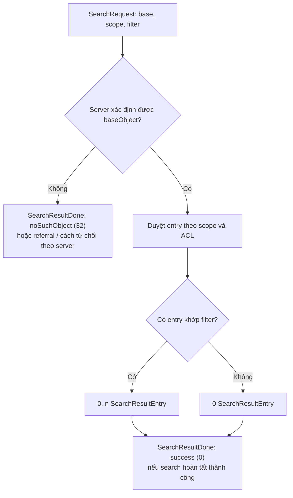
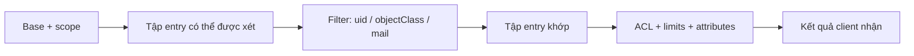
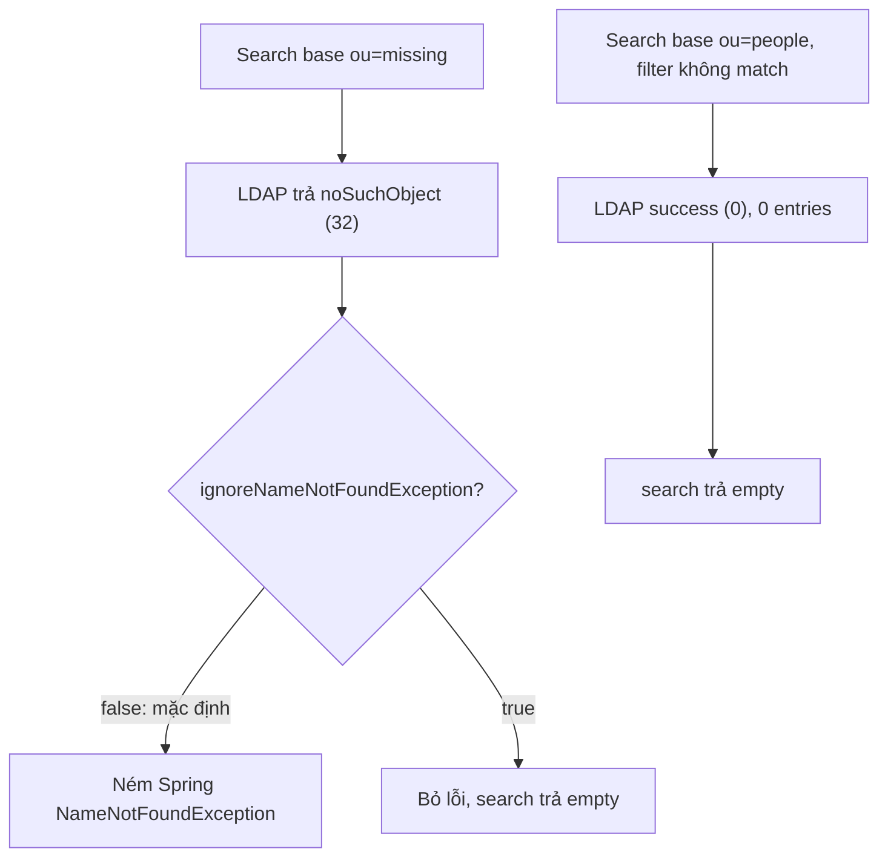
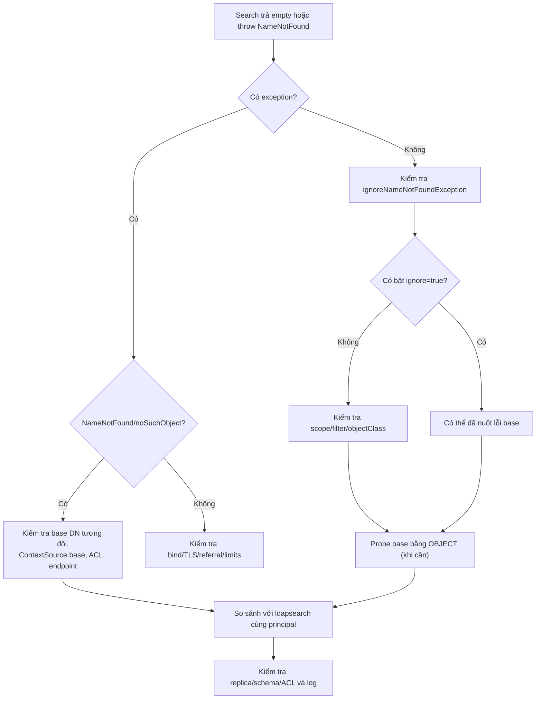

# Phân biệt không tìm thấy entry với search base không tồn tại trong Spring Data LDAP

Một API tra cứu nhân viên gọi `LdapTemplate.search(...)` và nhận danh sách rỗng. Có thể đơn giản là **không có nhân viên khớp bộ lọc**, nhưng cũng có thể ứng dụng đang tìm dưới một **search base DN không tồn tại**. Đây là hai tình huống khác nhau về mặt giao thức LDAP, và việc đánh đồng chúng có thể khiến một lỗi cấu hình directory trở thành thông báo “không tìm thấy người dùng”.

Ví dụ, trong cây `dc=example,dc=org`, nhánh `ou=people` tồn tại nhưng chưa có nhân viên `uid=unknown`. Một search với base `ou=people` và filter `(uid=unknown)` thường **thành công với 0 entry**. Ngược lại, search bắt đầu từ `ou=missing`, một DN không có trong directory, thường nhận LDAP result code **32 – noSuchObject**. Trong Spring LDAP, lỗi đó thường được biểu diễn bằng `org.springframework.ldap.NameNotFoundException` nếu không bật tùy chọn bỏ qua.

Bài thuộc chương **Tìm kiếm** của module `SPRING_DATA_LDAP`. Trong module này, Java truy cập directory LDAP bằng Spring Data LDAP repository và ánh xạ các entry phân cấp thành đối tượng Java; người học sử dụng DN, `objectClass`, schema, `LdapTemplate`, CRUD, bộ lọc an toàn, bảo mật kết nối và kiểm thử directory. Bài sẽ tập trung phân biệt **kết quả truy vấn rỗng** với **đường dẫn bắt đầu tìm kiếm không hợp lệ**, từ tầng giao thức đến mã Java, HTTP API và kiểm thử tích hợp.

## 1. Mục tiêu học tập

Sau khi học, bạn có thể:

- Giải thích vai trò của **search base DN**, **scope** và **filter** trong LDAP SearchRequest.
- Phân biệt `SearchResultDone(resultCode=success)` với danh sách entry rỗng và `noSuchObject (32)` khi base DN không tìm được.
- Hiểu `matchedDN` là gì, khi nào có thể dùng để định vị nhánh đang thiếu và vì sao không được mặc định nó luôn có giá trị.
- Giải thích tại sao `OBJECT`, `ONELEVEL` và `SUBTREE` có thể cho **0 entry** ngay cả khi search base **có tồn tại**.
- Viết truy vấn bằng `LdapTemplate` và `LdapQueryBuilder`, chọn base tương đối với `ContextSource.base` chính xác.
- Biết sự khác nhau giữa `javax.naming.NameNotFoundException` của JNDI và `org.springframework.ldap.NameNotFoundException` của Spring LDAP.
- Nhận diện tác dụng và rủi ro của `LdapTemplate.setIgnoreNameNotFoundException(true)`.
- Không nhầm lỗi ACL, referral, timeout, tên DN sai hoặc thiếu thuộc tính với một kết quả tìm kiếm bình thường.
- Thiết kế service/HTTP API phân biệt **không có tài nguyên**, **cấu hình sai vùng LDAP** và **directory đang gặp sự cố**.
- Kiểm chứng kết luận bằng `ldapsearch`, fixture LDIF và integration test trên LDAP server thật.

## 2. Cây thư mục ví dụ

Giả sử LDAP directory có cấu trúc:

```text
dc=example,dc=org
├── ou=people
│   ├── uid=lan
│   └── uid=minh
├── ou=empty-team
└── ou=groups
    └── cn=developers
```

Ở đây:

- `ou=people` **tồn tại** và có hai entry người.
- `ou=empty-team` **tồn tại** nhưng không có entry con.
- `ou=groups` **tồn tại** nhưng không chứa người trong ví dụ.
- `ou=missing` **không tồn tại**.
- `uid=unknown` **không phải** là một entry hiện có dưới `ou=people`.

Ví dụ dữ liệu LDIF:

```ldif
dn: dc=example,dc=org
objectClass: top
objectClass: domain
dc: example

dn: ou=people,dc=example,dc=org
objectClass: top
objectClass: organizationalUnit
ou: people

dn: uid=lan,ou=people,dc=example,dc=org
objectClass: top
objectClass: person
objectClass: organizationalPerson
objectClass: inetOrgPerson
uid: lan
cn: Lan Nguyen
sn: Nguyen
mail: lan@example.org

dn: uid=minh,ou=people,dc=example,dc=org
objectClass: top
objectClass: person
objectClass: organizationalPerson
objectClass: inetOrgPerson
uid: minh
cn: Minh Tran
sn: Tran

dn: ou=empty-team,dc=example,dc=org
objectClass: top
objectClass: organizationalUnit
ou: empty-team

dn: ou=groups,dc=example,dc=org
objectClass: top
objectClass: organizationalUnit
ou: groups

dn: cn=developers,ou=groups,dc=example,dc=org
objectClass: top
objectClass: groupOfNames
cn: developers
member: uid=lan,ou=people,dc=example,dc=org
```

Nếu LDAP server thử nghiệm đã tự tạo `dc=example,dc=org`, không nạp lại entry gốc. Dữ liệu nhóm không bắt buộc cho bài search, nhưng giúp quan sát trường hợp **base tồn tại mà filter theo loại entry không khớp**.

### 2.1. Hai câu hỏi khác nhau

**Câu hỏi A:** “Trong nhánh người dùng đang tồn tại, có ai có `uid=unknown` không?”

```text
base   = ou=people,dc=example,dc=org
scope  = SUBTREE
filter = (uid=unknown)
```

**Câu hỏi B:** “Tìm mọi người thuộc nhánh `ou=missing`?”

```text
base   = ou=missing,dc=example,dc=org
scope  = SUBTREE
filter = (objectClass=inetOrgPerson)
```

Câu A là một **truy vấn hợp lệ không có match**. Câu B yêu cầu server bắt đầu từ **một object không có trong cây**, nên không được xử lý tương đương một vùng đang tồn tại nhưng rỗng.

## 3. Cấu trúc một LDAP SearchRequest

Một search gồm các thành phần như:

| Thành phần | Ví dụ | Vai trò |
|---|---|---|
| `baseObject` | `ou=people,dc=example,dc=org` | Entry gốc nơi phép tìm kiếm bắt đầu. |
| `scope` | `wholeSubtree` / `SUBTREE` | Xác định có tìm trong entry gốc và cây con hay không. |
| `filter` | `(&(objectClass=inetOrgPerson)(uid=lan))` | Điều kiện khớp với entry **trong phạm vi**. |
| `attributes` | `uid, cn, mail` | Các thuộc tính cần được trả cho entry khớp. |
| `sizeLimit` | Ví dụ giới hạn 100 entry | Giới hạn số lượng; không tự có nghĩa dữ liệu rỗng. |
| `timeLimit` | Giới hạn server xử lý search | Tránh tìm kiếm quá lâu; lỗi limit khác “không có match”. |
| `typesOnly` | `false` | Điều khiển cách trả tên thuộc tính/giá trị. |

Theo RFC 4511, server xử lý yêu cầu dựa vào **baseObject** và scope, đánh giá filter với những entry thuộc phạm vi đó.



**Điểm cốt lõi:** kết quả giao thức gồm **entry response** và một **SearchResultDone** cho biết tình trạng kết thúc. **Số lượng entry bằng 0 không tương đương result code 32.**

### 3.1. Không match nhưng search thành công

Khi base `ou=people` tồn tại, filter `(uid=unknown)` không khớp ai:

```text
SearchRequest:
  baseObject: ou=people,dc=example,dc=org
  scope: wholeSubtree
  filter: (uid=unknown)

Search responses:
  0 x SearchResultEntry
  SearchResultDone:
    resultCode: success (0)
```

Đây là **tình trạng hoàn tất thành công**, chỉ đơn giản không có entry phù hợp. `LdapTemplate.search(...)` thường trả một `List` rỗng.

### 3.2. Base không tồn tại

Khi base `ou=missing` không xác định được:

```text
SearchRequest:
  baseObject: ou=missing,dc=example,dc=org
  scope: wholeSubtree
  filter: (uid=lan)

Search responses (tình huống thông thường):
  0 x SearchResultEntry
  SearchResultDone:
    resultCode: noSuchObject (32)
    matchedDN: dc=example,dc=org   # có thể có hoặc không
```

`matchedDN` trong ví dụ là **một khả năng**, không phải kết quả mặc định của mọi server. Server có thể che thông tin này theo ACL; giá trị thực phụ thuộc naming context, entry tồn tại gần nhất và cách server phản hồi.

## 4. So sánh kết quả bằng một bảng duy nhất

| Tình huống | Base có tồn tại? | Filter có match? | Phản hồi LDAP thường gặp | Spring LDAP mặc định |
|---|---|---|---|---|
| Search `uid=lan` dưới `ou=people` | Có | Có | `success (0)` + 1 entry | `List` có Lan |
| Search `uid=unknown` dưới `ou=people` | Có | Không | `success (0)` + 0 entry | `List.isEmpty() == true` |
| Search `objectClass=inetOrgPerson` dưới `ou=empty-team` | Có | Không | `success (0)` + 0 entry | `List` rỗng |
| Search dưới `ou=missing` | Không | Không thể tìm tại base | `noSuchObject (32)` thường gặp | Ném `NameNotFoundException` |
| Search `objectClass=inetOrgPerson` dưới `ou=groups` | Có | Không | `success (0)` + 0 entry | `List` rỗng |
| Search đúng base nhưng account không có quyền | Về mặt vật lý có thể có | Tùy ACL | Kết quả có thể bị ẩn hoặc lỗi | Không suy ra existence |
| Search chuyển hướng naming context khác | Tùy topology | Chưa đánh giá được | `referral (10)` hoặc reference | Tùy JNDI/referral config |
| Search bị timeout, size limit, kết nối lỗi | Không kết luận | Không kết luận | Error hoặc partial result | Exception hoặc kết quả cần kiểm tra |

**Cách nhớ:** “không có entry khớp” là một **kết quả dữ liệu**; “search base không tìm được” là một **vấn đề về đối tượng gốc, tên hoặc quyền tìm kiếm**, thường biểu diễn thành lỗi LDAP.

## 5. Search scope còn khiến kết quả rỗng dù base tồn tại

Ba scope trong LDAP:

```text
OBJECT
  -> Chỉ kiểm tra chính entry base.

ONELEVEL
  -> Kiểm tra các entry con trực tiếp của base.
     Không bao gồm base.

SUBTREE
  -> Kiểm tra base và tất cả entry bên dưới.
```

Ví dụ với base `ou=people`:

| Scope | Filter | Kết quả trên fixture |
|---|---|---|
| `OBJECT` | `(objectClass=organizationalUnit)` | Chính entry `ou=people` |
| `OBJECT` | `(uid=lan)` | 0 entry, **không phải base missing** |
| `ONELEVEL` | `(objectClass=inetOrgPerson)` | Lan, Minh |
| `SUBTREE` | `(objectClass=inetOrgPerson)` | Lan, Minh |
| `ONELEVEL` dưới `ou=empty-team` | `(objectClass=*)` | 0 entry, base vẫn tồn tại |
| `SUBTREE` dưới `ou=empty-team` | `(objectClass=organizationalUnit)` | Chính entry `ou=empty-team` |
| `SUBTREE` dưới `ou=missing` | `(objectClass=*)` | Thường lỗi `noSuchObject (32)` |

Một nguyên nhân phổ biến của “search rỗng” là chọn nhầm `OBJECT` thay vì `ONELEVEL`/`SUBTREE`: server tìm đúng base, nhưng **base là organizationalUnit**, không phải entry người cần tìm.

Tương tự, dùng `ONELEVEL` dưới `ou=people` có thể bỏ sót nhân viên ở `ou=engineering,ou=people` nếu directory có OU con.

Trong Java, lựa chọn scope là một phần tường minh của `LdapQueryBuilder`:

```java
LdapQuery directChildren = query()
    .base("ou=people")
    .searchScope(SearchScope.ONELEVEL)
    .where("objectClass").is("inetOrgPerson");
```

Chỉ các entry con **trực tiếp** được xét; đổi sang `SearchScope.SUBTREE` mới bao phủ các OU con sâu hơn. Cả hai cách vẫn cần base `ou=people` tồn tại và quyền search phù hợp.

### 5.1. Search base và search filter là hai lớp riêng

`base` cùng `scope` xác định **vùng cây**. `filter` chọn **entry khớp điều kiện** trong vùng đó.



Không dùng filter `(objectClass=*)` làm bằng chứng base chắc chắn tồn tại nếu request đang đi qua referral, ACL đặc thù hoặc client được cấu hình bỏ qua lỗi base missing.

## 6. DN đầy đủ và DN tương đối trong Spring LDAP

Trong Spring LDAP, `ContextSource` thường cấu hình một **base DN**. Những DN của `LdapTemplate` được hiểu **tương đối với root đó**.

Ví dụ Spring Boot:

```yaml
spring:
  ldap:
    urls: ldaps://ldap.example.org:636
    base: dc=example,dc=org
    username: uid=svc-directory,ou=service-accounts,dc=example,dc=org
    password: ${LDAP_BIND_PASSWORD}
```

Với cấu hình này:

| Thành phần | DN trong code Spring | DN thực ở directory |
|---|---|---|
| Configured `ContextSource.base` | — | `dc=example,dc=org` |
| Search nhân viên | `ou=people` | `ou=people,dc=example,dc=org` |
| Search nhóm | `ou=groups` | `ou=groups,dc=example,dc=org` |
| Search nhánh sai | `ou=missing` | `ou=missing,dc=example,dc=org` |
| Lookup Lan | `uid=lan,ou=people` | `uid=lan,ou=people,dc=example,dc=org` |

**Lỗi phổ biến: nối lặp connection base.**

```java
// Sai trong cấu hình ContextSource.base = dc=example,dc=org
query().base("ou=people,dc=example,dc=org");
```

Nếu context source đã xử lý base tương đối, truy vấn có thể thực tế nhắm tới:

```text
ou=people,dc=example,dc=org,dc=example,dc=org
```

DN này không tồn tại. Lỗi `noSuchObject` lúc đó là hậu quả của **sai hệ quy chiếu DN**, không phải nhân viên biến mất khỏi directory.

### 6.1. Spring Data LDAP @Entry(base) cũng cần cùng hệ quy chiếu

Entity ODM minh họa:

```java
import javax.naming.Name;
import org.springframework.ldap.odm.annotations.Attribute;
import org.springframework.ldap.odm.annotations.Entry;
import org.springframework.ldap.odm.annotations.Id;

@Entry(
    base = "ou=people",
    objectClasses = {
        "top", "person", "organizationalPerson", "inetOrgPerson"
    }
)
public class PersonEntry {

    @Id
    private Name dn;

    @Attribute(name = "uid")
    private String uid;

    @Attribute(name = "cn")
    private String fullName;

    @Attribute(name = "sn")
    private String surname;

    // Constructor không tham số, accessor được lược bớt.
}
```

`@Entry(base="ou=people")` định nghĩa nhánh ODM tương đối, trong ví dụ là con của `dc=example,dc=org`. Nó không tạo OU `ou=people` trên server. Nếu OU chưa tồn tại, repository không thể kỳ vọng một query dưới nhánh đó trả danh sách rỗng có ý nghĩa “chưa có nhân viên” trong mọi cấu hình.

Cũng không nhầm `@Id Name dn` với `uid`: `@Id` ánh xạ DN của entry trong cây; `uid` là thuộc tính nghiệp vụ.

## 7. LdapTemplate.search khi không tìm thấy entry

Viết một service tìm người bằng UID:

```java
import java.util.List;

import org.springframework.ldap.core.AttributesMapper;
import org.springframework.ldap.core.LdapTemplate;
import org.springframework.ldap.query.LdapQuery;
import org.springframework.ldap.query.SearchScope;
import org.springframework.stereotype.Service;

import static org.springframework.ldap.query.LdapQueryBuilder.query;

@Service
public class DirectoryPeopleSearch {

    private final LdapTemplate ldapTemplate;

    public DirectoryPeopleSearch(LdapTemplate ldapTemplate) {
        this.ldapTemplate = ldapTemplate;
    }

    public List<String> searchUids(String relativeBase, String uid) {
        validateUid(uid);

        LdapQuery q = query()
            .base(relativeBase)
            .searchScope(SearchScope.SUBTREE)
            .attributes("uid")
            .where("objectClass").is("inetOrgPerson")
            .and("uid").is(uid);

        return ldapTemplate.search(
            q,
            (AttributesMapper<String>) attrs ->
                attrs.get("uid").get().toString()
        );
    }

    private static void validateUid(String uid) {
        if (uid == null || uid.isBlank() || uid.length() > 64) {
            throw new IllegalArgumentException("Invalid uid");
        }
    }
}
```

Ví dụ sử dụng:

```java
List<String> result = service.searchUids(
    "ou=people", "unknown"
);
System.out.println(result.isEmpty()); // true, khi base có thật
```

Khi `ou=people` tồn tại và account có quyền search phù hợp, `search` trả `List.of()` về mặt nội dung (không nhất thiết chính object immutable đó).

Nhưng:

```java
List<String> result = service.searchUids(
    "ou=missing", "lan"
);
// Theo cấu hình mặc định hiện hành, có thể ném
// org.springframework.ldap.NameNotFoundException.
```

**Không nên viết một `catch` rộng rồi trả danh sách rỗng cho cả hai trường hợp.** Làm như vậy che giấu lỗi base, khiến hệ thống trả sai thông điệp và khó phát hiện việc cấu hình sai sau khi thay đổi OU.

### 7.1. Filter an toàn

`where("uid").is(uid)` đưa giá trị vào bộ lọc thông qua API Spring LDAP; nó tránh ghép raw LDAP filter như:

```java
// Không an toàn khi uid đến từ HTTP request:
String filter = "(&(objectClass=inetOrgPerson)(uid=" + uid + "))";
```

Nếu input có `*`, `(`, `)` hoặc ký tự đặc biệt, filter nối chuỗi có thể đổi ý nghĩa (LDAP injection). Dùng `LdapQueryBuilder` cho filter và `LdapNameBuilder` cho DN; đây là hai cú pháp escape khác nhau (RFC 4515 và RFC 4514).

**Lưu ý riêng:** trong service ví dụ, `relativeBase` là một chuỗi được truyền vào. Trong API production, **không nhận base DN tùy ý trực tiếp từ client**; chọn base theo enum/tenant đã kiểm tra và whitelist cấu trúc được phép.

## 8. Hai kiểu NameNotFoundException và hành vi mặc định

Ở tầng JNDI, LDAP `noSuchObject (32)` thường được chuyển thành:

```java
javax.naming.NameNotFoundException
```

Spring LDAP cung cấp `NamingExceptionTranslator`/cơ chế chuyển ngoại lệ để code ứng dụng thấy:

```java
org.springframework.ldap.NameNotFoundException
```

Đây là **hai kiểu exception ở hai tầng khác nhau**:

| Tầng gọi | Class thường gặp | Checked/runtime |
|---|---|---|
| JNDI trực tiếp | `javax.naming.NameNotFoundException` | Checked, kế thừa `NamingException` |
| Spring LDAP `LdapTemplate` | `org.springframework.ldap.NameNotFoundException` | Runtime, kế thừa hệ phân cấp Spring LDAP |
| Spring Data LDAP repository | Exception tùy method và conversion | Cần xem API/method, không đánh đồng mọi method với `search` |

Trong phần lớn code application sử dụng `LdapTemplate`, bắt **Spring LDAP exception**, không bắt trực tiếp một checked exception JNDI bên ngoài template.

### 8.1. Mặc định LdapTemplate KHÔNG bỏ qua base missing

`LdapTemplate` có phương thức:

```java
public void setIgnoreNameNotFoundException(boolean ignore)
```

Theo tài liệu của phương thức này:

- Giá trị mặc định là **`false`**.
- `false`: lỗi `NameNotFoundException` khi search base không tìm thấy thường được **chuyển đổi và ném lại**.
- `true`: template **bỏ qua NameNotFoundException khi search**, thay vì truyền lỗi ra, và ghi log cảnh báo theo implementation.
- Đây là một tùy chọn **tương thích ngược** với cách một số phiên bản cũ từng bỏ qua base missing.

```java
// Cấu hình minh họa; mặc định đã là false.
ldapTemplate.setIgnoreNameNotFoundException(false);
```

Một số mô tả tổng quát của các overload `search(...)` trong Javadoc có thể gây hiểu nhầm vì nhắc đến việc bỏ qua `NameNotFoundException`. Khi cần xác định hành vi phiên bản đang dùng, hãy ưu tiên **hợp đồng của `setIgnoreNameNotFoundException`** và kiểm thử thực tế với search base thiếu. Trong các phiên bản Spring LDAP hiện hành đã đối chiếu, mặc định là `false`.

### 8.2. Vì sao không nên bật true tùy tiện?

Nếu đặt:

```java
ldapTemplate.setIgnoreNameNotFoundException(true);
```

một search dưới `ou=missing` có thể trả **danh sách rỗng**, không khác `ou=people` với filter không khớp.



Bật `true` **làm mất tín hiệu phân biệt** khi code chỉ xem `List`. Đó thường là lựa chọn không tốt cho hệ thống cần xác định đúng cấu hình directory, phân quyền hoặc tình trạng account.

Có một số quy trình muốn coi một OU tùy chọn không tồn tại là “không có dữ liệu”. Nếu có lý do nghiệp vụ rõ, tốt hơn nên xử lý tình huống đó **tại service cụ thể** với một chính sách nhận diện base hợp lệ, thay vì bật bỏ lỗi trên một `LdapTemplate` dùng chung toàn ứng dụng.

### 8.3. Đừng tự coi lỗi 32 là bằng chứng vật lý tuyệt đối

LDAP server có thể **ẩn sự tồn tại của entry** theo quyền truy cập, hoặc thay mã lỗi để tránh lộ thông tin. `noSuchObject` vì vậy có thể nghĩa “không thể xác định/không được phép tiết lộ object này” trong bối cảnh bind identity đang sử dụng.

Cần kiểm tra **ACL, danh tính bind và directory endpoint** trước khi kết luận entry đã bị xóa.

## 9. Lookup DN và search theo filter: khác mô hình không tìm thấy

Hai nghiệp vụ:

1. “Đọc đúng entry có DN `uid=lan,ou=people`.”
2. “Tìm nhân viên có `uid=lan` trong `ou=people`.”

Đối với nghiệp vụ thứ nhất, có thể dùng `lookup`:

```java
import javax.naming.Name;
import org.springframework.ldap.core.AttributesMapper;
import org.springframework.ldap.core.LdapTemplate;
import org.springframework.ldap.support.LdapNameBuilder;

public String lookupCn(
        LdapTemplate ldapTemplate, String uid) {

    Name relativeDn = LdapNameBuilder
        .newInstance("ou=people")
        .add("uid", uid)
        .build();

    return ldapTemplate.lookup(
        relativeDn,
        (AttributesMapper<String>) attrs ->
            attrs.get("cn").get().toString()
    );
}
```

`lookup` nhắm **một DN cụ thể**. Nếu entry này không tồn tại, `NameNotFoundException` là kết quả thường gặp. Điều này **khác** với một search có base `ou=people` tồn tại, filter `uid=unknown` không khớp nên trả danh sách rỗng.

| API | Đối tượng tìm | Khi DN mục tiêu thiếu | Khi filter không match |
|---|---|---|---|
| `LdapTemplate.lookup(relativeDn, mapper)` | Một entry DN xác định | Thường `NameNotFoundException` | Không có filter |
| `LdapTemplate.search(query, mapper)` | Entry theo base, scope, filter | Nếu **base** thiếu, thường `NameNotFoundException`; có thể bị cấu hình bỏ qua | `List` rỗng nếu search thành công |
| `LdapRepository.findById(id)` | Entity theo ID/DN | Semantics Spring Data method cần kiểm chứng theo version | Không phải search tùy ý bằng filter |
| `LdapRepository.findByUid(uid)` | Entity theo property | Cần kiểm tra base/repository mapping | Có thể trả collection rỗng theo return type |

**Cẩn trọng:** không lấy semantics `Optional.empty()` của `findById` trong Spring Data rồi áp đặt cho mọi lời gọi `LdapTemplate.search`, hoặc suy từ `lookup` rằng filter không match sẽ ném ngoại lệ.

### 9.1. Vì sao nên tách lookup với search?

Nếu có **DN đáng tin cậy**, `lookup` phù hợp với yêu cầu đọc một entry cụ thể. Nếu chỉ có mã `uid`, nên dùng search với một vùng xác định rõ. `uid` không mặc nhiên duy nhất toàn directory: cùng `uid=lan` có thể tồn tại ở hai OU khác nhau.

Khi API trả đúng **một người** từ filter, cần kiểm tra số lượng kết quả và xử lý trường hợp nhiều entry khớp, thay vì tùy tiện chọn phần tử đầu tiên.

## 10. Kiểm tra search base tồn tại mà không trộn với filter nghiệp vụ

Trong một số tình huống, ứng dụng muốn kiểm tra **OU cấu hình** còn tồn tại trước khi nhận traffic. Cần làm một **base probe** tách biệt với tìm người.

Một phương án là search scope `OBJECT` tại đúng base với điều kiện hiện diện objectClass:

```java
import java.util.List;

import org.springframework.ldap.core.AttributesMapper;
import org.springframework.ldap.core.LdapTemplate;
import org.springframework.ldap.query.LdapQuery;
import org.springframework.ldap.query.SearchScope;

import static org.springframework.ldap.query.LdapQueryBuilder.query;

public class SearchBaseProbe {

    private final LdapTemplate ldap;

    public SearchBaseProbe(LdapTemplate ldap) {
        this.ldap = ldap;
    }

    public boolean isVisibleBase(String relativeBase) {
        LdapQuery q = query()
            .base(relativeBase)
            .searchScope(SearchScope.OBJECT)
            .attributes("objectClass")
            .where("objectClass").isPresent();

        List<Boolean> items = ldap.search(
            q,
            (AttributesMapper<Boolean>) attrs ->
                Boolean.TRUE
        );

        return !items.isEmpty();
    }
}
```

Với fixture và account đủ quyền:

```text
isVisibleBase("ou=people")     -> true
isVisibleBase("ou=empty-team") -> true
isVisibleBase("ou=missing")    -> NameNotFoundException (mặc định)
```

**Diễn giải cẩn trọng:**

- `true` nghĩa là đã tìm thấy base theo filter/quyền cụ thể.
- `false` không luôn chứng minh base vật lý không tồn tại: có thể không match filter hoặc bị quyền che.
- `NameNotFoundException` nghĩa base không tìm được theo ngữ cảnh client/server, cần chẩn đoán.
- Probe thêm một request LDAP, nên không gọi trước **mọi** search nếu chỉ làm tăng độ trễ và tạo race; phù hợp hơn cho startup readiness, health check hoặc kiểm tra cấu hình có chủ đích.

### 10.1. Không dùng OBJECT scope với filter của nhân viên để probe OU

```java
// Sai mục tiêu: OU người không mang uid=lan.
query().base("ou=people")
    .searchScope(SearchScope.OBJECT)
    .where("uid").is("lan");
```

Kết quả rỗng của truy vấn đó **không nói** OU có tồn tại hay không. Filter được kiểm tra trên **chính entry OU**; với objectClass `organizationalUnit`, entry đó không phải người Lan.

## 11. Matched DN giúp chẩn đoán ở mức giao thức

Một LDAPResult chứa các trường:

```text
resultCode
matchedDN
diagnosticMessage
referral (tùy kết quả)
```

Khi gặp `noSuchObject (32)`, `matchedDN` có thể chứa tên của **entry gần nhất mà server định vị được trong quá trình tìm target/base**, theo quy tắc RFC 4511 và quyền truy cập.

Ví dụ:

```text
Requested base:
  ou=engineering,ou=people,dc=example,dc=org

Response:
  resultCode: noSuchObject (32)
  matchedDN: ou=people,dc=example,dc=org
```

Dữ liệu này gợi ý `ou=people` có thể tồn tại, còn `ou=engineering` chưa tồn tại hoặc không thể được định vị. Tuy nhiên:

- `matchedDN` có thể rỗng vì server không muốn tiết lộ cấu trúc directory.
- Giá trị có thể phụ thuộc alias dereference hoặc naming context.
- `diagnosticMessage` là thông tin tùy chọn, **không được parse bằng chuỗi cố định** để quyết định nghiệp vụ.
- JNDI/Spring LDAP exception **không bảo đảm** mọi metadata giao thức còn nguyên và có getter trực tiếp.

Khi cần chẩn đoán ở môi trường test, có thể dùng `ldapsearch`/server access log để xem result code và matched DN. Trong production, chỉ log thông tin DN và diagnostic được cho phép theo chính sách dữ liệu.

## 12. ACL và referral khiến chẩn đoán phức tạp hơn

### 12.1. Account thiếu quyền đọc/search

Một service account có thể có quyền đọc `ou=people` nhưng không có quyền search một nhánh nhạy cảm. Directory có thể:

- Không trả entry khớp.
- Không trả một số thuộc tính được dùng cho mapping.
- Trả lỗi quyền như `insufficientAccessRights (50)`.
- Trả `noSuchObject (32)` hoặc một kết quả đã che thông tin tồn tại để tránh lộ cấu trúc.

Vì vậy, **không kết luận mọi lỗi 32 đều do OU chưa được tạo**. Kiểm tra bind identity, ACL và cách directory triển khai *disclose/search/read* rights.

### 12.2. Referral và nhiều naming context

LDAP directory có thể gồm nhiều naming context hoặc server có tham chiếu sang server khác. Khi search base thuộc nhánh không được server hiện tại quản lý nhưng server biết nơi có dữ liệu, phản hồi có thể là:

- `referral (10)`, hoặc
- `SearchResultReference` trong quá trình search, hoặc
- `PartialResultException`/lỗi referral ở client theo cấu hình JNDI, hoặc
- `noSuchObject (32)` nếu server không định vị và không có thông tin chuyển hướng phù hợp.

Đây không giống search thành công với 0 entry. Nếu có referral, cần xác minh cấu hình JNDI referral handling và bảo mật credentials khi theo referral; không bật theo tự động một cách vô điều kiện.

### 12.3. Replica, cache và sự thay đổi OU

Một OU vừa được tạo, đổi tên hoặc xóa có thể chưa đồng bộ giữa các directory replica. Request gửi tới node A thành công, node B có thể chưa thấy base mới và phản hồi `noSuchObject`.

Trong sự cố production, kiểm tra:

1. URL LDAP thực tế mà client kết nối.
2. Replica/leader và độ trễ replication.
3. Base DN và naming context server phục vụ.
4. Thời điểm OU được tạo/di chuyển/xóa.
5. ACL theo cùng principal trên các node.

Không mặc định “mã lỗi thay đổi giữa request” là bug của Spring LDAP khi topology có nhiều node.

## 13. Thiết kế service: không che lỗi search base

Một cách tổ chức rõ ràng: service biết **search root được cấu hình**, còn HTTP caller chỉ gửi UID.

```java
import java.util.List;

import org.springframework.ldap.NameNotFoundException;
import org.springframework.ldap.core.AttributesMapper;
import org.springframework.ldap.core.LdapTemplate;
import org.springframework.ldap.query.LdapQuery;
import org.springframework.ldap.query.SearchScope;
import org.springframework.stereotype.Service;

import static org.springframework.ldap.query.LdapQueryBuilder.query;

@Service
public class EmployeeDirectoryService {

    private static final String PEOPLE_BASE = "ou=people";

    private final LdapTemplate ldap;

    public EmployeeDirectoryService(LdapTemplate ldap) {
        this.ldap = ldap;
    }

    public List<String> searchUids(String uid) {
        if (uid == null || uid.isBlank() || uid.length() > 64) {
            throw new IllegalArgumentException("Invalid uid");
        }

        LdapQuery q = query()
            .base(PEOPLE_BASE)
            .searchScope(SearchScope.SUBTREE)
            .attributes("uid")
            .where("objectClass").is("inetOrgPerson")
            .and("uid").is(uid);

        try {
            return ldap.search(
                q,
                (AttributesMapper<String>) attrs ->
                    attrs.get("uid").get().toString()
            );
        } catch (NameNotFoundException ex) {
            // Đây không phải "không có nhân viên".
            // Không lộ DN nội bộ ra HTTP response.
            throw new DirectorySearchRootUnavailableException(
                "Configured directory search base is unavailable",
                ex
            );
        }
    }
}

class DirectorySearchRootUnavailableException
        extends RuntimeException {

    DirectorySearchRootUnavailableException(
            String message, Throwable cause) {
        super(message, cause);
    }
}
```

Sự phân biệt:

- **Search thành công và `List` rỗng:** không có UID khớp trong vùng tìm kiếm đang thấy.
- **`NameNotFoundException`:** vùng gốc không định vị được theo server/principal, được chuyển thành lỗi **cấu hình hoặc dependency**.
- **`CommunicationException`:** không liên lạc được với directory; đây là lỗi khác.
- **`AuthenticationException`:** bind credentials có vấn đề; không tự coi là UID của người cần tra cứu không có.

`DirectorySearchRootUnavailableException` là exception của **ứng dụng**, không phải một class do Spring LDAP định nghĩa sẵn.

### 13.1. Tại sao không dùng catch(Exception) rồi return emptyList?

```java
// Anti-pattern: che cả lỗi LDAP, ACL và cấu hình.
try {
    return ldap.search(query, mapper);
} catch (Exception e) {
    return List.of();
}
```

Với code này, một đợt di chuyển OU hoặc thay bind account khiến search trả rỗng thay vì phát hiện lỗi. Hệ quả có thể là:

- API người dùng nhận `404` hàng loạt.
- Đồng bộ danh bạ hiểu mọi nhân viên đã bị xóa.
- Scheduler dọn dữ liệu hoặc phân quyền dựa trên “không có user” đưa ra quyết định sai.
- Monitoring không thấy LDAP dependency đang hỏng vì HTTP chỉ trả response bình thường.

**Thiết kế ưu tiên an toàn:** chỉ trả “không tìm thấy” sau một search **thành công**. Lỗi khác cần được phân loại, log, theo dõi và trả status phù hợp.

## 14. Mapping sang HTTP: 404 khác 503 và 500

Giả sử API `GET /api/people/{uid}`:

| Kết quả tầng directory | Ý nghĩa ứng dụng | HTTP gợi ý |
|---|---|---|
| Search thành công và trả đúng một người | Tìm thấy | `200 OK` |
| Search thành công, không có người phù hợp | Không có tài nguyên khớp | `404 Not Found` |
| Search cho nhiều người cùng UID | Vi phạm quy tắc duy nhất của ứng dụng | Lỗi dữ liệu/`500` hoặc domain conflict theo hợp đồng |
| Base cấu hình không tìm thấy | Dependency/configuration không đáp ứng | `503` nếu dependency tạm không sẵn sàng; `500` nếu là lỗi triển khai/cấu hình |
| Mất LDAP connection | Directory không sẵn sàng | `503 Service Unavailable` |
| Bind account bị từ chối | Lỗi credential nội bộ | `500`/`503` và cảnh báo; không tự trả `401` cho caller |
| Caller không được phép đọc người | Application authorization | `403` hoặc response che giấu theo chính sách |
| Input UID sai cú pháp | Request không hợp lệ | `400 Bad Request` |

Không có quy tắc HTTP duy nhất cho mọi lỗi LDAP: ánh xạ phụ thuộc nghiệp vụ, khả năng khôi phục và cách service được triển khai. **Điều không nên làm** là biến lỗi base thành `404 user not found`.

### 14.1. Ví dụ controller dùng kết quả phân biệt

```java
import java.util.List;

import org.springframework.http.ResponseEntity;
import org.springframework.web.bind.annotation.GetMapping;
import org.springframework.web.bind.annotation.PathVariable;
import org.springframework.web.bind.annotation.RequestMapping;
import org.springframework.web.bind.annotation.RestController;

@RestController
@RequestMapping("/api/people")
class EmployeeController {

    private final EmployeeDirectoryService directory;

    EmployeeController(EmployeeDirectoryService directory) {
        this.directory = directory;
    }

    @GetMapping("/{uid}")
    ResponseEntity<String> find(@PathVariable String uid) {
        List<String> matches = directory.searchUids(uid);

        if (matches.isEmpty()) {
            return ResponseEntity.notFound().build();
        }

        if (matches.size() > 1) {
            throw new IllegalStateException(
                "Non-unique directory uid"
            );
        }

        return ResponseEntity.ok(matches.get(0));
    }
}
```

Controller này trả `404` **chỉ sau khi service search thành công**. `DirectorySearchRootUnavailableException` được để lan lên `@RestControllerAdvice`/error handler của ứng dụng.

Ví dụ status mapping tường minh:

```java
import org.springframework.http.HttpStatus;
import org.springframework.http.ProblemDetail;
import org.springframework.web.bind.annotation.ExceptionHandler;
import org.springframework.web.bind.annotation.RestControllerAdvice;
import org.springframework.web.bind.annotation.ResponseStatus;

@RestControllerAdvice
class DirectoryFailureAdvice {

    @ExceptionHandler(DirectorySearchRootUnavailableException.class)
    @ResponseStatus(HttpStatus.SERVICE_UNAVAILABLE)
    ProblemDetail missingSearchRoot(
            DirectorySearchRootUnavailableException ex) {

        return ProblemDetail.forStatusAndDetail(
            HttpStatus.SERVICE_UNAVAILABLE,
            "Directory search service is temporarily unavailable"
        );
    }

    @ExceptionHandler(org.springframework.ldap.CommunicationException.class)
    @ResponseStatus(HttpStatus.SERVICE_UNAVAILABLE)
    ProblemDetail ldapTransportFailure(Exception ex) {
        return ProblemDetail.forStatusAndDetail(
            HttpStatus.SERVICE_UNAVAILABLE,
            "Directory service cannot be reached"
        );
    }
}
```

Trong production, lỗi cấu hình ổn định có thể phù hợp với `500` và fail-readiness thay vì `503` lặp lại. Quan trọng là **không khẳng định user đã bị xóa** và không lộ nội dung đường dẫn/credential LDAP cho HTTP client.

## 15. Dùng ldapsearch để nhìn kết quả giao thức

Một cách chẩn đoán độc lập với Java là chạy `ldapsearch` trong **môi trường được phép** và dùng cùng server/bind identity với ứng dụng.

### 15.1. Search hợp lệ nhưng không match

```bash
ldapsearch -x \
  -H ldaps://ldap.example.org:636 \
  -D 'uid=svc-directory,ou=service-accounts,dc=example,dc=org' \
  -W \
  -b 'ou=people,dc=example,dc=org' \
  -s sub \
  '(&(objectClass=inetOrgPerson)(uid=unknown))' \
  uid cn
```

Với fixture, output thường cho thấy **không có entry**, nhưng phần kết thúc:

```text
# search result
result: 0 Success
# numEntries: 0
```

Dạng output chính xác tùy phiên bản `ldapsearch`, nhưng **result code 0** và **không có entry** là điều cần phân biệt.

### 15.2. Search base không tồn tại

```bash
ldapsearch -x \
  -H ldaps://ldap.example.org:636 \
  -D 'uid=svc-directory,ou=service-accounts,dc=example,dc=org' \
  -W \
  -b 'ou=missing,dc=example,dc=org' \
  -s sub \
  '(objectClass=*)' \
  dn
```

Một kết quả thường gặp:

```text
# search result
result: 32 No such object
matchedDN: dc=example,dc=org
```

`matchedDN` có thể không có hoặc có giá trị khác. Lệnh `ldapsearch` thường trả exit code khác 0 khi LDAP result code cho biết lỗi; đừng chỉ nhìn dòng `numEntries`.

**Không dùng `-LLL` nếu đang cần đọc các dòng metadata search result theo hành vi hiển thị của công cụ.** Một số tùy chọn ẩn bớt phần chú thích/result metadata hoặc thay cách hiển thị; cần biết phiên bản CLI.

### 15.3. So khớp môi trường giữa CLI và Java

Khi `ldapsearch` tìm thấy nhưng ứng dụng không tìm thấy, xác minh:

- **LDAP server URL**: host, port, SSL/TLS, replica, referral.
- **Bind identity**: hai lệnh có dùng cùng DN/account hay không?
- **Base DN**: CLI dùng DN đầy đủ; Spring query thường dùng DN tương đối với `ContextSource.base`.
- **Scope**: `-s base` / `one` / `sub` so với `OBJECT` / `ONELEVEL` / `SUBTREE`.
- **Filter**: escape input theo RFC 4515, so sánh đúng objectClass và UID.
- **ACL**: những attribute nào được dùng để lọc và trả về?
- **Directory state**: có vừa rename/move/delete OU hoặc entry không?
- **Client setting**: `setIgnoreNameNotFoundException` có được bật không?

`-W` yêu cầu nhập password tương tác; không ghi mật khẩu trong command line hoặc lịch sử shell. LDAPS cần cấu hình CA/truststore đúng và xác minh hostname; không tắt kiểm tra TLS để “thử cho chạy”.

## 16. Khi nào dùng search base là OU, khi nào lookup trực tiếp?

### 16.1. Tìm người theo thuộc tính dưới OU đã biết

Ví dụ `uid=lan` trong nhánh người dùng:

```text
base   = ou=people
scope  = SUBTREE
filter = (&(objectClass=inetOrgPerson)(uid=lan))
```

Đây là query theo **thuộc tính**. Nếu base đúng nhưng Lan không có, kết quả rỗng.

### 16.2. Đọc đúng DN của một entry

Ví dụ:

```text
uid=lan,ou=people,dc=example,dc=org
```

Đây là một **tên entry cụ thể**. `lookup` phù hợp để kiểm tra entry theo DN. Nếu không có Lan, error `noSuchObject` có thể phản ánh **target DN vắng mặt** chứ không nhất thiết “OU người dùng bị xóa”. Cần nhìn DN bị truy vấn để hiểu kết quả.

Với search scope `OBJECT` trên **DN của Lan** và filter `(objectClass=inetOrgPerson)`, nếu Lan không tồn tại thì **chính search base cũng không tồn tại**. Do đó, lỗi 32 là logic đúng cho “entry tìm theo DN bị thiếu” trong cách truy vấn này.

**Bài học:** cùng một nhân viên vắng mặt, nhưng cách chọn **baseObject** khác nhau có thể làm giao thức trả `success + 0 match` hoặc `noSuchObject`:

| Cách truy vấn Lan không tồn tại | Base | Điều kiện | Kết quả thường gặp |
|---|---|---|---|
| Search người theo UID | `ou=people` hiện có | `uid=lan` | Success, 0 entry |
| Search OBJECT ngay tại DN Lan | `uid=lan,ou=people` không có | `objectClass=*` | noSuchObject (32) |
| Lookup DN Lan | DN Lan không có | Không có filter search | NameNotFoundException |

Đây là lý do không nên suy “lỗi 32 luôn là lỗi OU” nếu code thực tế đang dùng **DN entry làm base**.

## 17. Kiểm thử tích hợp: phân biệt không match và thiếu base

Unit test Mockito giúp xác minh code service xử lý `List.of()` khác với exception, nhưng **không chứng minh directory trả LDAP result code nào**. Để kiểm chứng, cần LDAP server thực hoặc server nhúng với fixture ở mục 2.

### 17.1. Điều kiện kiểm thử

- Spring Boot profile `ldap-test` trỏ tới **LDAP test directory**, không phải production.
- Nạp một `ou=people` có Lan/Minh, một `ou=empty-team` rỗng.
- **Không** tạo `ou=missing`.
- Test account có quyền search/read dưới các nhánh đã tạo.
- `LdapTemplate` chưa bật `ignoreNameNotFoundException=true`.
- Server test dùng schema hỗ trợ `inetOrgPerson`, `organizationalUnit` và các attribute fixture.

### 17.2. JUnit 5 integration test

```java
import static org.assertj.core.api.Assertions.assertThat;
import static org.assertj.core.api.Assertions.assertThatThrownBy;

import java.util.List;

import org.junit.jupiter.api.Test;
import org.springframework.beans.factory.annotation.Autowired;
import org.springframework.boot.test.context.SpringBootTest;
import org.springframework.ldap.NameNotFoundException;
import org.springframework.ldap.core.AttributesMapper;
import org.springframework.ldap.core.LdapTemplate;
import org.springframework.ldap.query.LdapQuery;
import org.springframework.ldap.query.SearchScope;
import org.springframework.test.context.ActiveProfiles;

import static org.springframework.ldap.query.LdapQueryBuilder.query;

@SpringBootTest
@ActiveProfiles("ldap-test")
class SearchBaseSemanticsIT {

    @Autowired
    private LdapTemplate ldap;

    private List<String> searchUid(String base, String uid) {
        LdapQuery q = query()
            .base(base)
            .searchScope(SearchScope.SUBTREE)
            .attributes("uid")
            .where("objectClass").is("inetOrgPerson")
            .and("uid").is(uid);

        return ldap.search(
            q,
            (AttributesMapper<String>) attrs ->
                attrs.get("uid").get().toString()
        );
    }

    @Test
    void existingSearchBaseWithNoMatchReturnsEmptyList() {
        List<String> matches = searchUid(
            "ou=people", "does-not-exist"
        );

        assertThat(matches).isEmpty();
    }

    @Test
    void missingSearchBaseRaisesNameNotFoundByDefault() {
        assertThatThrownBy(() ->
            searchUid("ou=missing", "lan")
        ).isInstanceOf(NameNotFoundException.class);
    }

    @Test
    void existingEmptyOuIsNotAMissingBase() {
        List<String> matches = searchUid(
            "ou=empty-team", "lan"
        );

        assertThat(matches).isEmpty();
    }
}
```

Ba test dùng cùng logic search, chỉ khác **base** hoặc filter. Vì vậy, chúng thể hiện rõ ba trạng thái:

1. Nhánh có người nhưng không khớp filter → empty.
2. Nhánh không tồn tại → exception.
3. Nhánh hợp lệ chưa chứa người → empty.

Trường hợp 2 phụ thuộc việc LDAP server test thật sự trả `noSuchObject` và template giữ cấu hình mặc định. Nếu bị ACL che, có referral hoặc phiên bản có behavior khác, cần điều tra **đúng LDAP result code** thay vì xóa test.

### 17.3. Test OBJECT scope trên base tồn tại

Thêm test để chứng minh search trả empty **không đồng nghĩa base missing** ngay cả khi base có dữ liệu.

```java
@Test
void objectScopeWithWrongFilterReturnsEmpty() {
    LdapQuery q = query()
        .base("ou=people")
        .searchScope(SearchScope.OBJECT)
        .where("uid").is("lan");

    List<Boolean> results = ldap.search(
        q,
        (AttributesMapper<Boolean>) attrs ->
            Boolean.TRUE
    );

    assertThat(results).isEmpty();
}
```

Entry `ou=people` tồn tại nhưng là `organizationalUnit`, không có `uid=lan`; vì thế filter trên chính OU không khớp.

### 17.4. Test ignoreNameNotFoundException=true — có chủ đích

Không thay cấu hình singleton `ldapTemplate` chung cho toàn bộ suite vì có thể gây ảnh hưởng test khác. Tạo một template riêng dùng **cùng ContextSource**:

```java
@Test
void ignoringMissingBaseTurnsErrorIntoEmptyList() {
    LdapTemplate lenient = new LdapTemplate(
        ldap.getContextSource()
    );

    lenient.setIgnoreNameNotFoundException(true);

    LdapQuery q = query()
        .base("ou=missing")
        .searchScope(SearchScope.SUBTREE)
        .where("objectClass").is("inetOrgPerson");

    List<Boolean> result = lenient.search(
        q,
        (AttributesMapper<Boolean>) attrs ->
            Boolean.TRUE
    );

    assertThat(result).isEmpty();
}
```

**Ý nghĩa:** đây không phải bằng chứng LDAP server chấp nhận `ou=missing` như một nhánh có thật. Nó cho thấy **client đã chủ động bỏ lỗi** nên kết quả ứng dụng trông giống một search không match.

Nếu test không trả rỗng như dự kiến, kiểm tra result code và config của bản Spring LDAP đang chạy, không giả định tất cả exception LDAP được tùy chọn này bỏ qua.

### 17.5. Không để test transaction che lỗi

Không cần thêm `@Transactional` vào test chỉ để search, vì nghiệp vụ đọc không cần giao dịch bù trừ. Khi test sửa cấu trúc OU, phải tạo/cleanup dữ liệu trong directory test riêng; đừng trông chờ `@Transactional` rollback như JPA.

## 18. Unit test: service không biến lỗi base thành “user not found”

Một unit test có thể mock `LdapTemplate` để kiểm tra nhánh exception tại service. Ở ví dụ sau, mock dùng matcher phân biệt `LdapQuery` và `AttributesMapper`, sau đó xác minh lỗi được chuyển thành exception domain.

```java
import static org.assertj.core.api.Assertions.assertThatThrownBy;
import static org.mockito.ArgumentMatchers.any;
import static org.mockito.Mockito.*;

import org.junit.jupiter.api.Test;
import org.springframework.ldap.NameNotFoundException;
import org.springframework.ldap.core.AttributesMapper;
import org.springframework.ldap.core.LdapTemplate;
import org.springframework.ldap.query.LdapQuery;

class EmployeeDirectoryServiceTest {

    @Test
    void searchBaseFailureIsNotConvertedToEmptyResult() {
        LdapTemplate ldap = mock(LdapTemplate.class);

        when(ldap.search(
            any(LdapQuery.class),
            org.mockito.ArgumentMatchers.<AttributesMapper<String>>any()
        )).thenThrow(new NameNotFoundException(
            "Test base cannot be resolved"
        ));

        EmployeeDirectoryService service =
            new EmployeeDirectoryService(ldap);

        assertThatThrownBy(() -> service.searchUids("lan"))
            .isInstanceOf(
                DirectorySearchRootUnavailableException.class
            )
            .hasCauseInstanceOf(NameNotFoundException.class);
    }
}
```

Test này chứng minh **service không nuốt exception**, không chứng minh LDAP server thật trả lỗi 32. Phần đó thuộc về integration test.

Nếu Mockito có lỗi overload/generic ở phiên bản dự án, có thể tách stub thành một test double của interface service search để không phụ thuộc signature generic; bài học cần được hiểu ở **phân biệt nhánh kết quả**, không phải ở mẹo matcher.

## 19. Khi kết quả rỗng nhưng không hoàn toàn thành công

Không phải lúc nào search trả ít entry cũng là “không tìm thấy”. Các trường hợp sau cần quan sát:

| Tình huống | Dấu hiệu | Cách hiểu |
|---|---|---|
| `sizeLimitExceeded (4)` | Giới hạn số entry | Không kết luận toàn bộ vùng chỉ có số entry nhận được. |
| `timeLimitExceeded (3)` | Search vượt giới hạn thời gian | Không kết luận không có entry; có thể chưa quét xong. |
| `PartialResultException` | Referral hoặc client chưa xử lý hết kết quả | Kết quả có thể thiếu entry từ nhánh khác. |
| `CommunicationException` | TCP/TLS/socket lỗi | Không có một search hoàn chỉnh đáng tin. |
| `AuthenticationException` | Bind credentials bị từ chối | Không phải không có entry cần tìm. |
| `NoPermissionException` | ACL từ chối | Không thể kết luận dựa trên dữ liệu không được phép thấy. |
| Search result success nhưng filter sai | Không exception, 0 entry | Lỗi logic/filter có thể bị hiểu nhầm là dữ liệu vắng. |
| Search dưới OU có thật nhưng chọn `ONELEVEL` | Bỏ qua entry nằm sâu hơn | Kết quả thiếu do scope. |
| Search đến replica chưa đồng bộ | Không thấy OU/entry mới | Cần hiểu replication lag và node đang đọc. |

Spring LDAP có những cấu hình riêng để bỏ qua một số lỗi như partial result hoặc size limit; **bỏ qua exception có thể che khuất việc kết quả chưa đầy đủ**, cần kiểm tra config trước khi xem `List` trả về là đủ.

### 19.1. Truy vấn không match với lỗi bộ lọc là hai trường hợp khác nhau

Một filter hợp lệ nhưng không match:

```text
(&(objectClass=inetOrgPerson)(uid=not-here))
```

thường trả success + zero entries.

Một filter có cú pháp hỏng hoặc attribute/schema không phù hợp có thể trả lỗi như `protocolError` hoặc `filterError` tùy server, hoặc trả không match theo matching rule. Vì thế không được coi mọi `List.isEmpty()` là bằng chứng dữ liệu bị xóa nếu code vừa thay đổi cấu trúc filter.

## 20. Luồng chẩn đoán khi search đột nhiên trả rỗng



Trình tự gợi ý:

1. **Xác định đúng method** đang được gọi: `lookup`, `search`, `findById` hay repository-derived query?
2. **Lấy actual search base** gửi đến server: `ContextSource.base` cộng với base tương đối của query.
3. **Kiểm tra scope và filter**: `OBJECT`/`ONELEVEL`/`SUBTREE`, `objectClass`, `uid`, attribute được request.
4. **Kiểm tra có exception không**: `NameNotFoundException`, `CommunicationException`, `PartialResultException` hoặc lỗi khác.
5. **Kiểm tra `setIgnoreNameNotFoundException`**: có bị bật trong một custom template/legacy config không?
6. **Xác minh directory endpoint và bind identity**: dev/test/prod, TLS, replicated node, referral.
7. **Thử `ldapsearch` với cùng principal/base/scope/filter**; xem resultCode/matchedDN.
8. **Chỉ sau đó kết luận về data**: “0 match trong search thành công” khác “không thể tìm được base”.
9. **Thêm regression test**: cả base tồn tại không match và base thiếu, tránh lỗi quay lại.

### 20.1. Không phải lúc nào cần gọi probe riêng

Nếu ứng dụng đã có một search thành công nhưng không match và đang dùng đúng base, không cần một lần lookup/probe nữa chỉ để chứng minh OU có tồn tại. Search đã hoàn tất thành công thường là đủ trong điều kiện ACL/topology đã biết. Probe hữu ích khi xử lý **chẩn đoán, health checks hoặc một invariance về OU**, nhưng thêm network round-trip vào mọi request làm tăng tải, thời gian chờ và khả năng race.

## 21. Quan sát hệ thống: log và metrics

Các trường log hữu ích:

```text
operation=ldap.search
requestId=8c91a2
baseAlias=people
scope=SUBTREE
filterType=uid-equality
result=SUCCESS_EMPTY
entryCount=0
durationMs=23
```

Nếu base không tìm được:

```text
operation=ldap.search
requestId=8c91a3
baseAlias=people
result=BASE_NOT_FOUND_OR_HIDDEN
ldapCode=32
retryPolicy=REQUIRES_DIAGNOSIS
```

Đây là ví dụ cấu trúc log, không phải chuỗi log mặc định do Spring LDAP tự tạo. Nên phân biệt metric labels:

- `ldap.search.success_with_entries`.
- `ldap.search.success_empty`.
- `ldap.search.base_unresolved`.
- `ldap.search.communication_failure`.
- `ldap.search.bind_failure`.
- `ldap.search.acl_or_disclosure_failure`.
- `ldap.search.partial_or_limited`.

Không dùng `uid`/DN thô hoặc raw LDAP filter chứa PII làm metric label có cardinality cao. Nếu phải ghi DN cho debug, cân nhắc lưu có kiểm soát, che giá trị hoặc chỉ ghi tên logic của configured base.

**Lỗi 32 tăng đột biến** sau deployment có thể báo rằng `ContextSource.base` hoặc OU mới sai, hoặc replication/ACL đã đổi. Đừng để nó biến mất trong thống kê `404`.

## 22. Bảo mật và an toàn truy vấn

- **LDAPS hoặc StartTLS**: xác minh certificate chain và hostname; không gửi simple bind credential qua kết nối không mã hóa.
- **Least privilege**: account query chỉ được đọc nhánh/thuộc tính cần thiết.
- **DN validation**: dùng `LdapNameBuilder`, không ghép DN tùy ý từ input.
- **Filter escaping**: dùng `LdapQueryBuilder` hoặc parameterized filter, không nối chuỗi chứa ký tự đặc biệt.
- **Tenant isolation**: chọn search base theo dữ liệu tenant đã xác thực/allowlist, không chấp nhận DN do caller tự cung cấp.
- **Không leak cấu trúc LDAP**: đừng trả `matchedDN` hoặc raw exception chứa DN nội bộ trong HTTP error.
- **Không nhầm missing với unauthorized**: account không có quyền có thể thấy dữ liệu bị ẩn; chính sách HTTP phải tránh lộ existence ngoài ý muốn.
- **Không tự tạo OU khi search lỗi**: tạo nhánh LDAP là nghiệp vụ quản trị, không phải “fallback” mặc định của truy vấn.
- **Giới hạn query**: base/scope/filter được kiểm soát, `sizeLimit`/`timeLimit` phù hợp; xử lý lỗi limit riêng.
- **Không tự retry lỗi 32 vô hạn**: nếu DN/base cấu hình sai, retry nhiều lần chỉ tạo tải. Với replica lag đã biết, có thể dùng retry có điều kiện và giới hạn.

Cả ba lớp quyền **caller HTTP**, **bind identity LDAP** và **ACL directory** phải được hiểu riêng.

## 23. Bài tập tự luyện

### Bài 1 — Phân biệt hai trường hợp

Cho cây ở mục 2:

1. Search `uid=unknown` dưới `ou=people`.
2. Search `uid=lan` dưới `ou=missing`.
3. Search `objectClass=inetOrgPerson` dưới `ou=empty-team`.
4. Search `uid=lan` với scope `OBJECT` ngay tại `ou=people`.

Dự đoán danh sách entry và `resultCode` trong trường hợp bình thường. Giải thích vì sao chỉ câu 2 biểu thị base không tồn tại.

### Bài 2 — Sửa đường dẫn DN tương đối

`spring.ldap.base=dc=example,dc=org`. Lập trình viên viết:

```java
query().base("ou=people,dc=example,dc=org")
    .where("uid").is("lan");
```

Điều gì có thể xảy ra? Viết lại query đúng với base tương đối của `ContextSource` và nêu cách xác minh bằng `ldapsearch` dùng DN đầy đủ.

### Bài 3 — Kiểm tra scope

Nhân viên Lan nằm tại:

```text
uid=lan,ou=engineering,ou=people,dc=example,dc=org
```

Viết query để tìm Lan dưới `ou=people` với `SUBTREE`. So sánh với `ONELEVEL`. Base có biến mất nếu `ONELEVEL` không tìm thấy Lan không?

### Bài 4 — Phân biệt lookup và search

Một service gọi `lookup("uid=missing,ou=people")`, service khác search `(uid=missing)` dưới `ou=people`. Tại sao cùng một người không có trong directory lại có thể gây exception ở service đầu và empty ở service thứ hai?

### Bài 5 — Phát hiện cấu hình nuốt lỗi

Với `LdapTemplate` đã gọi `setIgnoreNameNotFoundException(true)`, thử search dưới `ou=missing`. Ứng dụng nhận dữ liệu gì? Vì sao đây có thể là rủi ro khi đồng bộ người dùng hoặc xác minh quyền?

### Bài 6 — HTTP response đúng

Thiết kế API GET một người theo UID:

- Search thành công, không match.
- LDAP trả `noSuchObject` cho search base.
- LDAP `CommunicationException`.
- UID input chứa ký tự không được phép.

Nêu response HTTP nên phân biệt ra sao và giải thích tại sao không nên catch mọi lỗi rồi trả `404`.

### Bài 7 — Kiểm tra matchedDN

Một `ldapsearch` trả:

```text
result: 32 No such object
matchedDN: ou=people,dc=example,dc=org
```

Khi base yêu cầu là `ou=engineering,ou=people,dc=example,dc=org`, giải thích `matchedDN` gợi ý điều gì. Có chắc server đang xác nhận entry gần nhất tồn tại và được công khai cho mọi người dùng không?

### Bài 8 — Integration test chống hồi quy

Tạo test với fixture LDAP thật:

- Base people + filter không match → empty.
- Base missing → `NameNotFoundException` theo mặc định.
- Base empty-team có thật → empty với filter person.
- Bật ignore trên template riêng → base missing trở thành empty.
- Scope OBJECT trên OU với filter người → empty dù OU tồn tại.

Không chạy các test ghi/xóa/move OU trên production LDAP.

## 24. Checklist khi xử lý sự cố search

| Câu hỏi | Điều cần xác nhận |
|---|---|
| Đang gọi `search` hay `lookup`? | Khác semantics khi target DN thiếu. |
| Có lấy đúng resultCode không? | `success (0)` khác `noSuchObject (32)`. |
| `ContextSource.base` là gì? | Tránh nối lặp base hoặc trỏ sai naming context. |
| Query base là DN tương đối hay đầy đủ? | Đúng hệ quy chiếu Spring LDAP. |
| Scope có hợp lý không? | OBJECT / ONELEVEL / SUBTREE. |
| Filter đúng objectClass/attribute? | Không match khác base missing. |
| LdapTemplate có ignore-name-not-found không? | Mặc định false; true có thể nuốt lỗi. |
| Search có bị giới hạn không? | Size/time limit và partial result khác empty thật. |
| Bind identity và ACL đã đúng? | Server có thể che existence. |
| Directory URL và replica đã đúng? | Tránh truy vấn nhầm node/naming context. |
| Có referral/alias đặc thù không? | Cần xử lý theo LDAP server và client. |
| MatchedDN có được dùng đúng không? | Chỉ là thông tin hỗ trợ, có thể bị ẩn. |
| HTTP error mapping hợp lý? | 404 khi không match; lỗi hệ thống riêng. |
| Log có PII/secret không? | Không công khai DN/filter/credential nhạy cảm. |
| Đã có integration test hai nhánh? | Bảo vệ semantics trước thay đổi cấu hình. |

## 25. Kết luận và tài liệu tham khảo

**“Không tìm thấy entry”** trong một search hợp lệ thường có nghĩa **LDAP SearchResultDone là `success (0)`, nhưng không có `SearchResultEntry` khớp filter**. **“Search base không tồn tại”** thường dẫn đến **LDAP `noSuchObject (32)`**; Spring LDAP mặc định có thể ném `org.springframework.ldap.NameNotFoundException` thay vì trả danh sách rỗng.

Trong thực tế, kết luận còn phụ thuộc **cách chọn base/scope/filter, bind identity, ACL, referral, replica và cấu hình `setIgnoreNameNotFoundException`**. Đặc biệt, nếu `LdapTemplate` được đặt để bỏ qua `NameNotFoundException`, lỗi base có thể bị che thành empty result. Vì thế hãy phân loại kết quả theo **response code và điều kiện search**, không chỉ theo kích thước `List`.

Khi dùng Spring Data LDAP, nên giữ DN tương đối nhất quán với `ContextSource.base`, escape filter đúng cách, tách search theo thuộc tính khỏi lookup theo DN, và viết **integration test trên directory thật** cho cả hai trường hợp. Điều này giúp API phân biệt `404` do dữ liệu không có với các sự cố cấu hình hoặc directory.

Tài liệu chính thức để đối chiếu:

- [RFC 4511 – LDAP Protocol: SearchRequest, SearchResultDone, noSuchObject, matchedDN](https://www.rfc-editor.org/rfc/rfc4511)
- [RFC 4512 – LDAP Directory Information Models](https://www.rfc-editor.org/rfc/rfc4512)
- [RFC 4514 – LDAP Distinguished Names](https://www.rfc-editor.org/rfc/rfc4514)
- [RFC 4515 – LDAP Search Filter String Representation](https://www.rfc-editor.org/rfc/rfc4515)
- [Spring LDAP – LdapTemplate API, setIgnoreNameNotFoundException](https://docs.spring.io/spring-ldap/docs/current/api/org/springframework/ldap/core/LdapTemplate.html)
- [Spring LDAP – ContextSource and LdapTemplate Configuration](https://docs.spring.io/spring-ldap/reference/configuration.html)
- [Spring LDAP – Advanced Query Builder](https://docs.spring.io/spring-ldap/reference/query-builder-advanced.html)
- [Spring Data LDAP – Reference](https://docs.spring.io/spring-data/ldap/reference/)
- [Oracle JNDI – LDAP Service Provider](https://docs.oracle.com/javase/8/docs/technotes/guides/jndi/jndi-ldap.html)
