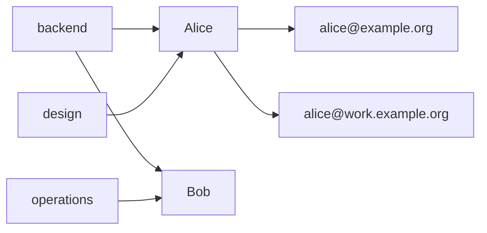

# Tìm kiếm trên thuộc tính nhiều giá trị trong LDAP và Spring Data LDAP

Trong một directory LDAP, một thuộc tính (*attribute*) có thể chứa **nhiều giá trị**. Ví dụ một người có hai địa chỉ `mail`, hoặc một nhóm `groupOfNames` chứa nhiều DN trong `member`. Khi viết truy vấn với **Spring Data LDAP** bằng repository hoặc `LdapTemplate`, chúng ta phải hiểu cách server đánh giá LDAP filter trên **tập giá trị** thay vì tưởng tượng mỗi thuộc tính chỉ chứa một chuỗi.

Điểm cốt lõi: bộ lọc bình đẳng `(member=<DN>)` thường đúng khi **ít nhất một giá trị** của `member` khớp DN được hỏi. Hai điều kiện bình đẳng kết hợp bằng `AND` trên cùng một thuộc tính có thể do **hai giá trị khác nhau** thỏa mãn. Ngược lại, kết quả trả về cho một entry khớp filter **không tự động chỉ chứa các giá trị đã khớp**: cần phân biệt bước chọn entry với bước lấy thuộc tính.

Bài học đặt trong phạm vi **Spring Data LDAP**, từ hiểu DN, schema và `objectClass` tới xây filter an toàn, ánh xạ ODM, tìm nhóm/người dùng, cập nhật membership, xử lý giới hạn directory và kiểm thử.

## 1. Mục tiêu học tập

Sau bài này, bạn có thể:

- Phân biệt thuộc tính **đơn giá trị** với **đa giá trị**, và lý do schema `SINGLE-VALUE` quyết định giới hạn đó.
- Giải thích ý nghĩa của `=`, `AND`, `OR`, `NOT`, presence filter và substring filter khi một entry có nhiều giá trị cho cùng attribute.
- Viết filter tìm nhóm có một hoặc nhiều DN thành viên, tìm người có địa chỉ email bất kỳ và xác định thuộc tính vắng mặt.
- Biết khi nào `AND` trên cùng thuộc tính đáp ứng yêu cầu **chứa cả A và B**, và khi nào nó **không** thể biểu diễn “hai điều kiện trên cùng một giá trị”.
- Tạo filter an toàn với `LdapQueryBuilder`, phân biệt **DN escaping** và **LDAP filter escaping**.
- Đọc **toàn bộ giá trị** bằng `Attributes.get("...").getAll()` hoặc ánh xạ collection với Spring Data LDAP ODM.
- Thêm/xóa **một giá trị** bằng `ModificationItem` thay vì vô tình thay thế toàn bộ attribute.
- Xây kiểm thử với directory thật, chú ý ACL, matching rule, giá trị lớn, tính nhất quán và đặc điểm riêng của Active Directory.

## 2. Attribute trong LDAP có thể chứa một tập giá trị

Mỗi entry có DN riêng và nhiều attribute. Mỗi attribute type được định nghĩa bởi **schema**, trong đó có cú pháp, matching rule và có thể có giới hạn `SINGLE-VALUE`. Nếu attribute type **không** bị giới hạn single-valued, entry có thể chứa nhiều giá trị của loại đó (trong phạm vi các quy tắc schema/ACL của server).

Ví dụ người dùng:

```ldif
dn: uid=alice,ou=people,dc=example,dc=org
objectClass: top
objectClass: person
objectClass: organizationalPerson
objectClass: inetOrgPerson
uid: alice
cn: Alice Nguyen
sn: Nguyen
mail: alice@example.org
mail: alice@work.example.org
```

Đây là **một entry**, **một attribute type `mail`**, nhưng có **hai giá trị**. Với LDIF, mỗi giá trị được ghi trên một dòng `mail:` riêng. LDAP không quy định rằng giá trị `mail` đầu tiên là “email chính” của Alice; nếu nghiệp vụ cần địa chỉ ưu tiên, phải định nghĩa quy tắc riêng hoặc thuộc tính đại diện phù hợp.

Ví dụ nhóm:

```ldif
dn: cn=backend,ou=groups,dc=example,dc=org
objectClass: top
objectClass: groupOfNames
cn: backend
member: uid=alice,ou=people,dc=example,dc=org
member: uid=bob,ou=people,dc=example,dc=org
```

Ở đây `member` có hai giá trị thuộc kiểu **DN**. Những DN đó tham chiếu các entry người dùng, không phải RDN con của group. Entry nhóm và entry người dùng có thể nằm ở hai OU khác nhau.

### 2.1. Thuộc tính nhiều giá trị không đồng nghĩa nhiều entry

| Thành phần | Ví dụ | Ý nghĩa |
| --- | --- | --- |
| Entry | `uid=alice,ou=people,dc=example,dc=org` | Một đối tượng LDAP được nhận diện bằng DN. |
| Attribute type | `mail` | Một loại thuộc tính được schema định nghĩa. |
| Attribute values | `alice@example.org` và `alice@work.example.org` | Tập giá trị của **cùng** attribute. |
| Attribute membership | `member=uid=alice,...` và `member=uid=bob,...` | Group có nhiều DN thành viên trực tiếp. |
| LDAP search result | Entry `cn=backend,...` | Một kết quả **entry**, dù có nhiều giá trị `member` khớp điều kiện. |

Một LDAP search thường trả **entry**, không trả mỗi giá trị như một bản ghi riêng. Nếu một group chứa Alice và Bob, filter khớp cả hai không tự làm group đó xuất hiện hai lần trong kết quả.

### 2.2. `MUST`, `MAY` và `SINGLE-VALUE` là các điều khác nhau

- `MUST` trong `objectClass`: một thuộc tính **bắt buộc hiện diện**.
- `MAY` trong `objectClass`: một thuộc tính **được phép**, nhưng không bắt buộc chỉ vì class đó.
- `SINGLE-VALUE` ở **attribute type**: thuộc tính không được có nhiều hơn một giá trị.

Ví dụ `member` là `MUST` của `groupOfNames` theo schema chuẩn, nhưng **vẫn có thể chứa nhiều thành viên**. Ngược lại, một thuộc tính `MAY` vẫn có thể bị hạn chế một giá trị nếu attribute type có `SINGLE-VALUE`. Không suy ra cardinality từ `MUST`/`MAY`.

## 3. Dữ liệu mẫu dùng xuyên suốt

Giả sử đã tồn tại `ou=people` và `ou=groups` bên dưới `dc=example,dc=org`, cùng các entry người dùng hợp lệ theo schema `inetOrgPerson`.

Ba người dùng:

```ldif
dn: uid=alice,ou=people,dc=example,dc=org
objectClass: top
objectClass: person
objectClass: organizationalPerson
objectClass: inetOrgPerson
uid: alice
cn: Alice Nguyen
sn: Nguyen
mail: alice@example.org
mail: alice@work.example.org

dn: uid=bob,ou=people,dc=example,dc=org
objectClass: top
objectClass: person
objectClass: organizationalPerson
objectClass: inetOrgPerson
uid: bob
cn: Bob Tran
sn: Tran
mail: bob@example.org

dn: uid=charlie,ou=people,dc=example,dc=org
objectClass: top
objectClass: person
objectClass: organizationalPerson
objectClass: inetOrgPerson
uid: charlie
cn: Charlie Le
sn: Le
```

Ba nhóm:

```ldif
dn: cn=backend,ou=groups,dc=example,dc=org
objectClass: top
objectClass: groupOfNames
cn: backend
member: uid=alice,ou=people,dc=example,dc=org
member: uid=bob,ou=people,dc=example,dc=org

dn: cn=design,ou=groups,dc=example,dc=org
objectClass: top
objectClass: groupOfNames
cn: design
member: uid=alice,ou=people,dc=example,dc=org

dn: cn=operations,ou=groups,dc=example,dc=org
objectClass: top
objectClass: groupOfNames
cn: operations
member: uid=bob,ou=people,dc=example,dc=org
```

Đây là fixture **minh họa** dùng để diễn giải kết quả. Nó chỉ hợp lệ nếu server có naming context, entry cha, schema và quyền tạo entry phù hợp. Không nạp fixture vào directory production.



## 4. Equality filter: một giá trị khớp là đủ

LDAP equality filter có dạng:

```ldap
(member=uid=alice,ou=people,dc=example,dc=org)
```

Với thuộc tính đa giá trị `member`, điều kiện này khớp một group khi **có ít nhất một giá trị `member`** so khớp với DN của Alice theo **equality matching rule** của attribute type.

Với fixture, filter trên có thể chọn:

- `cn=backend,...` vì backend chứa DN Alice.
- `cn=design,...` vì design cũng chứa DN Alice.
- Không chọn `cn=operations,...` vì operations chỉ chứa Bob.

Tương tự:

```ldap
(mail=alice@work.example.org)
```

Filter này khớp entry Alice vì **một** trong hai giá trị `mail` bằng địa chỉ được hỏi theo matching rule của `mail`.

### 4.1. Không cần lặp tên thuộc tính khi chỉ hỏi một giá trị

Không có cú pháp đặc biệt như `mail[0]`, `mail[1]` hoặc SQL `ANY(mail)` trong LDAP filter cơ bản. Chính equality matching rule áp dụng trên các giá trị của attribute giúp truy vấn một giá trị cụ thể.

**Mẫu tư duy chính xác:** “Entry có ít nhất một giá trị của attribute A khớp V?” chứ không phải “giá trị thứ nhất của A có bằng V không?”.

### 4.2. DN được so sánh theo matching rule của server

Đối với `member` của `groupOfNames`, attribute type sử dụng cú pháp/matching rule thích hợp cho DN. Không nên so sánh DN bằng cách:

```java
// Không dùng như định nghĩa đúng tuyệt đối của LDAP DN equality.
boolean same = value1.toLowerCase().equals(value2.toLowerCase());
```

DN có cú pháp escape, RDN nhiều thành phần và các quy tắc chuẩn hóa. Trong Java có thể dùng `LdapName` để parse/so sánh DN trong nhiều tình huống; tuy nhiên **server matching rule** mới quyết định filter trên directory thực sự khớp như thế nào.

## 5. AND trên cùng attribute: có thể là hai giá trị khác nhau

Giả sử muốn tìm những group chứa **cả Alice lẫn Bob**:

```ldap
(&
  (objectClass=groupOfNames)
  (member=uid=alice,ou=people,dc=example,dc=org)
  (member=uid=bob,ou=people,dc=example,dc=org)
)
```

Trong một LDAP filter gửi thực tế, biểu thức có thể viết trên một dòng; phần xuống dòng trên chỉ để dễ đọc.

Với fixture:

- `backend` có cả hai DN nên **khớp**.
- `design` chỉ có Alice nên **không khớp**.
- `operations` chỉ có Bob nên **không khớp**.

**Điều quan trọng:** Hai điều kiện `(member=AliceDN)` và `(member=BobDN)` được đánh giá **độc lập trên tập giá trị của cùng thuộc tính**. Chúng không bắt buộc một **giá trị duy nhất** đồng thời bằng cả AliceDN và BobDN.

### 5.1. Công thức trực giác

Nếu `Values(entry, member) = {AliceDN, BobDN}`:

```text
exists value in member such that value == AliceDN  -> true
exists value in member such that value == BobDN    -> true
AND của hai điều kiện                            -> true
```

Hai điều kiện `AND` này giải quyết yêu cầu **“tập thành viên chứa cả A và B”**. Nó **không** phải biểu thức ràng buộc rằng “cùng một chuỗi member vừa bắt đầu bằng A vừa kết thúc bằng B”.

### 5.2. Một bẫy: “cùng một giá trị thỏa cả hai điều kiện”

Xét email Alice:

```ldif
mail: alice@example.org
mail: alice@work.example.org
```

Nếu dùng:

```ldap
(&(mail=alice*)(mail=*@work.example.org))
```

LDAP có thể đánh giá điều kiện `mail=alice*` đúng vì một giá trị, và `mail=*@work.example.org` đúng vì một giá trị khác. Bộ lọc này **không tạo một phép kết hợp ràng buộc cùng giá trị** như người viết có thể kỳ vọng ở trường hợp tổng quát.

Nếu yêu cầu “một địa chỉ bắt đầu bằng `alice` **và** kết thúc bằng `@work.example.org`”, hãy thiết kế **một substring filter phù hợp** khi schema hỗ trợ, chẳng hạn:

```ldap
(mail=alice*@work.example.org)
```

Biểu thức này kiểm tra **một giá trị `mail`** có dạng prefix `alice` và suffix `@work.example.org` trong cùng một substring assertion. Không ghép hai điều kiện độc lập rồi giả định có sự liên kết giữa các giá trị.

## 6. OR, NOT và sự hiện diện của thuộc tính

### 6.1. OR: tìm group chứa Alice hoặc Bob

```ldap
(|
  (member=uid=alice,ou=people,dc=example,dc=org)
  (member=uid=bob,ou=people,dc=example,dc=org)
)
```

Với fixture, cả ba group `backend`, `design` và `operations` đều khớp vì mỗi group chứa **ít nhất một** trong hai người.

**OR** là hợp logic giữa các điều kiện filter, không có nghĩa server trả từng giá trị `member` thành hai entry khác nhau.

### 6.2. NOT: loại những group có Alice

```ldap
(!(member=uid=alice,ou=people,dc=example,dc=org))
```

Điều kiện phủ định loại những entry mà equality filter trên khớp Alice. Với fixture group hợp lệ, `operations` thỏa vì nó không chứa Alice; `backend` và `design` không thỏa.

Cần lưu ý:

- `NOT` **phủ định kết quả điều kiện trên entry**, không có nghĩa “tồn tại một giá trị `member` khác Alice”. Group backend có Bob khác Alice **nhưng vẫn bị loại** vì nó cũng chứa Alice.
- Nếu lọc trên attribute tùy chọn, entry thiếu attribute cũng có thể ảnh hưởng kết quả phủ định. Không giả định mô hình `NULL` của SQL áp dụng y nguyên cho LDAP; filter có các quy tắc ba giá trị `TRUE/FALSE/Undefined` tùy loại đánh giá và server/schema.
- Nếu yêu cầu group vừa **có thành viên** vừa **không chứa Alice**, có thể kết hợp presence với phủ định: `(&(member=*)(!(member=AliceDN)))`. Với `groupOfNames` chuẩn, `member` là `MUST` nên sự hiện diện đã được schema bảo đảm.

### 6.3. Presence filter: có bất kỳ giá trị nào

```ldap
(mail=*)
```

Filter này tìm những entry **có thuộc tính `mail` hiện diện**, không cần biết nó có một hay nhiều giá trị. Với ba người mẫu:

- Alice có hai giá trị `mail` → khớp.
- Bob có một giá trị `mail` → khớp.
- Charlie không có `mail` → không khớp.

Phủ định presence:

```ldap
(!(mail=*))
```

Có thể dùng để tìm những người không có `mail`, ví dụ Charlie. **Không** hiểu nó là “có giá trị mail rỗng”. Trường vắng mặt và thuộc tính có giá trị chuỗi rỗng là hai trường hợp khác nhau; server có thể không cho phép chuỗi rỗng theo cú pháp.

### 6.4. Không có toán tử đếm giá trị chuẩn trong filter cơ bản

`(mail=*)` không có nghĩa “có đúng một email” hay “có ít nhất hai email”. LDAP filter cơ bản **không cung cấp một toán tử tổng quát, portable để đếm số lượng giá trị attribute**.

Nếu nghiệp vụ yêu cầu kiểm tra chính xác số giá trị, hãy:

1. Đọc attribute với quyền thích hợp và bảo đảm danh sách không bị rút gọn.
2. Đếm các giá trị đã nhận được.
3. Nếu chuẩn bị cập nhật trong môi trường cạnh tranh, dùng cơ chế ghi có điều kiện hoặc chính sách server tương ứng, vì **đọc rồi đếm rồi ghi** có thể bị TOCTOU.

Các extension cụ thể của directory có thể có khả năng khác, nhưng không được coi chúng là một phần của cú pháp filter LDAP portable.

## 7. Substring filter trên attribute nhiều giá trị

Khi attribute type có **substring matching rule**, một substring filter có thể khớp nếu **ít nhất một giá trị** phù hợp pattern. Ví dụ tìm người có địa chỉ `mail` kết thúc bằng `@example.org`:

```ldap
(mail=*@example.org)
```

Fixture:

| Người | Giá trị `mail` | Filter `(mail=*@example.org)` |
| --- | --- | --- |
| Alice | `alice@example.org`, `alice@work.example.org` | Khớp vì giá trị thứ nhất. |
| Bob | `bob@example.org` | Khớp. |
| Charlie | Không có `mail` | Không khớp. |

Các wildcard:

| Filter | Ý nghĩa |
| --- | --- |
| `(mail=alice*)` | Một email bắt đầu với `alice`. |
| `(mail=*@example.org)` | Một email kết thúc với `@example.org`. |
| `(mail=*work*)` | Một email chứa `work` ở đâu đó. |
| `(mail=alice*@work.example.org)` | Một email đáp ứng cả prefix và suffix trong **cùng giá trị**. |

**Giới hạn:** việc server cho phép substring filter phụ thuộc định nghĩa attribute type và matching rule. `member` chứa **DN**; khi tìm một DN thành viên cụ thể, hãy ưu tiên **equality filter** `(member=DN)`, không tự thiết kế filter `(member=*alice*)` như cách tìm theo chuỗi văn bản. Cú pháp DN và tính tương thích substring có thể khác nhau, hoặc không được server hỗ trợ.

### 7.1. `*` làm wildcard khác `*` literal

Trong LDAP filter theo RFC 4515:

```text
(mail=*)          presence: có mail
(mail=a*)         substring: bắt đầu bằng a
(mail=a\2ab)      equality: giá trị chứa ký tự * literal ở giữa
```

Ký tự `*` literal được escape thành `\2a` trong filter. Bên cạnh `*`, các ký tự `(`, `)`, `\` và NUL cũng cần xử lý theo cú pháp assertion value. Không nối trực tiếp input không tin cậy vào chuỗi filter vì điều đó có thể đổi nghĩa truy vấn.

## 8. Xây filter an toàn với `LdapQueryBuilder`

Khi code Spring LDAP nhận DN từ nghiệp vụ, hãy để query builder **escape giá trị filter**. Ví dụ một service tìm nhóm có Alice:

```java
package com.example.directory;

import java.util.List;
import javax.naming.directory.Attributes;
import org.springframework.ldap.core.AttributesMapper;
import org.springframework.ldap.core.LdapTemplate;
import org.springframework.ldap.query.LdapQuery;
import org.springframework.ldap.query.SearchScope;
import org.springframework.stereotype.Service;

import static org.springframework.ldap.query.LdapQueryBuilder.query;

@Service
public class GroupSearchService {
    private final LdapTemplate ldapTemplate;

    public GroupSearchService(LdapTemplate ldapTemplate) {
        this.ldapTemplate = ldapTemplate;
    }

    public List<String> groupsContaining(String fullMemberDn) {
        // Caller đã xác định DN của principal được phép kiểm tra.
        LdapQuery q = query()
                .base("ou=groups")
                .searchScope(SearchScope.ONELEVEL)
                .attributes("cn")
                .where("objectClass").is("groupOfNames")
                .and("member").is(fullMemberDn);

        return ldapTemplate.search(
                q,
                (AttributesMapper<String>) attrs ->
                        String.valueOf(attrs.get("cn").get()));
    }
}
```

Với `spring.ldap.base=dc=example,dc=org`, `base("ou=groups")` là DN tương đối. `fullMemberDn` là **DN đầy đủ được lưu trong `member`**, ví dụ `uid=alice,ou=people,dc=example,dc=org`. Nó không được biến thành `uid=alice,ou=people` chỉ vì context có base DN: **giá trị trong attribute `member` là DN tham chiếu đầy đủ theo schema**.

Tầng service gọi:

```java
List<String> groups = groupSearchService.groupsContaining(
        "uid=alice,ou=people,dc=example,dc=org");
// Fixture: backend và design (không giả định thứ tự).
```

### 8.1. Tìm nhóm chứa cả hai người

```java
public List<String> groupsContainingBoth(
        String firstMemberDn, String secondMemberDn) {
    LdapQuery q = query()
            .base("ou=groups")
            .searchScope(SearchScope.ONELEVEL)
            .attributes("cn")
            .where("objectClass").is("groupOfNames")
            .and("member").is(firstMemberDn)
            .and("member").is(secondMemberDn);

    return ldapTemplate.search(
            q,
            (AttributesMapper<String>) attrs ->
                    String.valueOf(attrs.get("cn").get()));
}
```

Đây là **một method bổ sung trong `GroupSearchService`** ở ví dụ trước, không phải một class riêng. Với fixture, nó tìm `backend` vì group có **hai giá trị `member` riêng** cho Alice và Bob.

**Lưu ý về tính đúng đắn:** nếu hai tham số bằng nhau, `AND` của hai equality filters tương đương một điều kiện, **không** chứng minh attribute chứa hai giá trị trùng nhau. LDAP attribute đa giá trị có tính **tập**, không phải danh sách cho phép cùng giá trị lặp vô hạn.

### 8.2. Filter OR và NOT khi điều kiện phức tạp

Có thể xây tổ hợp filter bằng các lớp `AndFilter`, `OrFilter`, `NotFilter`, `EqualsFilter` và `PresentFilter` của Spring LDAP (tùy phiên bản và API), thay vì tự ghép dấu ngoặc/chèn input.

Ví dụ ý tưởng:

```java
import org.springframework.ldap.filter.AndFilter;
import org.springframework.ldap.filter.EqualsFilter;
import org.springframework.ldap.filter.OrFilter;

OrFilter eitherMember = new OrFilter();
eitherMember.or(new EqualsFilter("member", firstMemberDn));
eitherMember.or(new EqualsFilter("member", secondMemberDn));

AndFilter filter = new AndFilter();
filter.and(new EqualsFilter("objectClass", "groupOfNames"));
filter.and(eitherMember);

String encodedFilter = filter.encode();
// (&(objectClass=groupOfNames)(|(member=<escapedDN1>)(member=<escapedDN2>)))
```

`firstMemberDn` và `secondMemberDn` là biến đã được kiểm tra, không phải các literal `<escapedDN1>` trong comment. `EqualsFilter` giúp mã hóa **assertion value** theo ngữ cảnh LDAP filter; các tên attribute `member`/`objectClass` được cố định trong code tin cậy.

Nếu ứng dụng cho phép người dùng chọn trường tìm kiếm, hãy dùng **enum/allowlist thuộc tính** được phép, không truyền tên attribute, dấu ngoặc hay toàn bộ filter từ request vào API builder.

## 9. Phân biệt DN escaping và LDAP filter escaping

Đây là một nguyên nhân phổ biến gây lỗi và LDAP injection.

| Ngữ cảnh | Ví dụ | Công cụ phù hợp |
| --- | --- | --- |
| **Xây DN** của entry từ RDN | `cn=R&D Team,ou=groups,...` | `LdapNameBuilder`/`LdapName`; DN escaping theo RFC 4514. |
| **Giá trị DN trong filter** | `(member=cn=R&D Team,ou=groups,...)` | `LdapQueryBuilder.where("member").is(dn)` hoặc `EqualsFilter`; filter escaping theo RFC 4515. |
| **Đặt điều kiện substring** | `(mail=alice*@example.org)` | API hỗ trợ substring được kiểm tra đầu vào; wildcard do **code** kiểm soát. |
| **Tên thuộc tính** | `member`, `mail` | Tên cố định hoặc allowlist; không lấy raw input client. |

Không áp dụng một hàm escape chung cho cả DN và filter. Một chuỗi có dấu phẩy, dấu cộng hoặc dấu `*` có thể được biểu diễn khác nhau tùy vị trí nó xuất hiện.

**Ví dụ DN có ký tự đặc biệt:**

```java
import javax.naming.Name;
import org.springframework.ldap.support.LdapNameBuilder;

Name groupDn = LdapNameBuilder.newInstance()
        .add("dc", "org")
        .add("dc", "example")
        .add("ou", "groups")
        .add("cn", "R&D (Platform)")
        .build();
```

Lưu ý thứ tự `LdapNameBuilder.add(...)` và cách xây các thành phần có thể thay đổi theo code cụ thể; điều cần giữ là **không nối RDN chứa input người dùng thành raw DN string**. Khi muốn tìm entry có `member` bằng DN vừa tạo, truyền `groupDn.toString()` như **giá trị của `EqualsFilter`**, không nối nó vào filter.

### 9.1. Đừng tìm theo chuỗi con của DN khi cần membership chính xác

`(member=*alice*)` không phải cách đúng để kiểm tra quyền của Alice. DN chứa `alice` có thể nằm trong một OU, một RDN hoặc một nhóm khác; thậm chí query substring có thể không được hỗ trợ cho attribute DN. Hãy dùng equality trên **DN đã được xác minh đúng danh tính**, và xử lý **nhóm lồng nhau** bằng thuật toán hoặc khả năng riêng của directory nếu nghiệp vụ yêu cầu.

## 10. Lấy toàn bộ giá trị của một attribute bằng `LdapTemplate`

Khi tìm thấy một group, ứng dụng có thể cần **danh sách tất cả DN thành viên**. Một sai lầm điển hình:

```java
// Chỉ lấy một giá trị tùy thuộc provider, KHÔNG đọc toàn bộ membership.
String firstMember = String.valueOf(attrs.get("member").get());
```

Để đọc toàn bộ giá trị trả về, dùng `Attribute.getAll()` và duyệt `NamingEnumeration`:

```java
package com.example.directory;

import java.util.LinkedHashSet;
import java.util.Set;
import javax.naming.NamingEnumeration;
import javax.naming.NamingException;
import javax.naming.directory.Attribute;
import javax.naming.directory.Attributes;
import org.springframework.ldap.core.AttributesMapper;
import org.springframework.ldap.core.LdapTemplate;
import org.springframework.ldap.support.LdapNameBuilder;
import org.springframework.stereotype.Service;

@Service
public class GroupMemberReader {
    private final LdapTemplate ldapTemplate;

    public GroupMemberReader(LdapTemplate ldapTemplate) {
        this.ldapTemplate = ldapTemplate;
    }

    public Set<String> readMembers(String groupCn) {
        if (groupCn == null || groupCn.isBlank()) {
            throw new IllegalArgumentException("Tên nhóm không được rỗng");
        }

        var dn = LdapNameBuilder.newInstance()
                .add("ou", "groups")
                .add("cn", groupCn)
                .build();

        return ldapTemplate.lookup(
                dn,
                new String[]{"member"},
                (AttributesMapper<Set<String>>) attrs ->
                        allStrings(attrs, "member"));
    }

    private static Set<String> allStrings(
            Attributes attributes, String name) throws NamingException {
        Attribute values = attributes.get(name);
        if (values == null) {
            return Set.of();
        }
        Set<String> result = new LinkedHashSet<>();
        NamingEnumeration<?> e = values.getAll();
        try {
            while (e.hasMore()) {
                result.add(String.valueOf(e.next()));
            }
        } finally {
            e.close();
        }
        return Set.copyOf(result);
    }
}
```

**Giả định:** `spring.ldap.base=dc=example,dc=org` và `groupCn` là tên RDN đã được cấp quyền truy cập. `LdapNameBuilder` dựng DN tương đối tới `cn=<name>,ou=groups`. Nếu user request tự do chọn tên nhóm, service phải kiểm tra authorization trước khi trả danh sách thành viên.

`Set.copyOf(...)` phản ánh mục tiêu **không dựa vào thứ tự**; LDAP không bảo đảm thứ tự các giá trị đa trị. Nếu ứng dụng muốn hiển thị tên theo thứ tự chữ cái, hãy sắp xếp **tại tầng trình bày** theo quy tắc rõ ràng, không coi thứ tự server trả về là ổn định.

**Cảnh báo:** `getAll()` duyệt **mọi giá trị đã được server trả về trong thuộc tính**. Nó **không chứng minh** kết quả đầy đủ khi server áp dụng ACL, range retrieval hoặc giới hạn vận hành. Với Active Directory và group rất lớn, cần xem mục 13.

### 10.1. Projection khác với filter

Hai thao tác:

```text
Search: (&(objectClass=groupOfNames)(member=AliceDN))
Return attributes: cn, member
```

LDAP filter chọn **entry nhóm** chứa Alice. Nếu server trả `member`, nó thường trả **các giá trị được phép đọc của attribute đó**, **không chỉ riêng AliceDN**. Vì vậy nếu backend chứa cả Alice và Bob, kết quả có thể kèm cả AliceDN và BobDN.

Nếu API chỉ cần **tên group**, chỉ yêu cầu `cn` như `GroupSearchService`. Việc yêu cầu `member` có thể tiết lộ thông tin về các thành viên khác và tăng tải mạng. Không đánh đồng “filter chọn entry” với “filter giá trị trong attribute được trả về”.

## 11. Ánh xạ thuộc tính nhiều giá trị bằng Spring Data LDAP ODM

Spring Data LDAP cho phép ánh xạ một entry LDAP thành entity Java. Ví dụ:

```java
package com.example.directory;

import java.util.Set;
import javax.naming.Name;
import org.springframework.ldap.odm.annotations.Attribute;
import org.springframework.ldap.odm.annotations.Entry;
import org.springframework.ldap.odm.annotations.Id;

@Entry(
    base = "ou=groups",
    objectClasses = {"top", "groupOfNames"}
)
public class DirectoryGroup {
    @Id
    private Name dn;

    @Attribute(name = "cn")
    private String commonName;

    @Attribute(name = "member")
    private Set<String> memberDns;

    protected DirectoryGroup() {
        // Dành cho ODM.
    }

    public Name getDn() { return dn; }
    public String getCommonName() { return commonName; }
    public Set<String> getMemberDns() { return memberDns; }
}
```

Với một `LdapRepository<DirectoryGroup>`, các phương thức đọc entity có thể được dùng để lấy collection member tùy khả năng mapping/phiên bản Spring Data LDAP đang sử dụng. Nhưng cần hiểu:

- `@Attribute(name="member")` chỉ mô tả **mapping**; nó không tự đếm số thành viên, kiểm tra vòng lặp hoặc giải quyết nhóm lồng nhau.
- Collection nên thể hiện **tập giá trị**. LDAP không bảo đảm có thứ tự hay khái niệm “thành viên thứ nhất”.
- Một DN trong `member` không bắt buộc server bảo đảm entry đích tồn tại nếu không có cơ chế referential integrity được cấu hình.
- `@Id` chứa **DN của chính group**, khác với các DN tham chiếu **bên trong `member`**.
- Khi ghi lại cả entity, cần thận trọng tránh mất giá trị được người khác bổ sung từ lúc đọc; cập nhật một member riêng thường an toàn hơn một lệnh replace toàn bộ thuộc tính.

### 11.1. Kiểm tra nhiều giá trị trong entity

```java
DirectoryGroup group = /* kết quả đọc từ repository */;
Set<String> members = group.getMemberDns();

if (members != null) {
    for (String memberDn : members) {
        // Dùng LdapName nếu cần xử lý DN theo cấu trúc.
        // Không coi memberDn là một uid trần.
    }
}
```

Với mapping thực tế, test nên xác minh Alice và Bob đều hiện diện, kể cả khi thứ tự trả về khác nhau; nếu cần so DN một cách cấu trúc, parse chúng thành `LdapName` thay vì chỉ dựa vào chữ hoa/thường của chuỗi.

## 12. Thêm hoặc xóa một giá trị: đừng replace cả thuộc tính

Tìm kiếm và ghi multi-valued attributes thường đi cùng nhau. Ví dụ người quản trị muốn thêm Charlie vào nhóm backend. Nếu code đọc toàn bộ `member`, sửa `Set` rồi gọi `REPLACE_ATTRIBUTE` với cả danh sách, một request đồng thời khác vừa thêm một member có thể bị **ghi đè và mất**.

Để thêm **một** DN mới:

```java
import javax.naming.Name;
import javax.naming.directory.BasicAttribute;
import javax.naming.directory.DirContext;
import javax.naming.directory.ModificationItem;
import org.springframework.ldap.support.LdapNameBuilder;

Name backendDn = LdapNameBuilder.newInstance()
        .add("ou", "groups")
        .add("cn", "backend")
        .build();

String charlieFullDn = "uid=charlie,ou=people,dc=example,dc=org";

ModificationItem addCharlie = new ModificationItem(
        DirContext.ADD_ATTRIBUTE,
        new BasicAttribute("member", charlieFullDn));

ldapTemplate.modifyAttributes(
        backendDn,
        new ModificationItem[]{addCharlie});
```

Để xóa **đúng giá trị Charlie**:

```java
ModificationItem removeCharlie = new ModificationItem(
        DirContext.REMOVE_ATTRIBUTE,
        new BasicAttribute("member", charlieFullDn));

ldapTemplate.modifyAttributes(
        backendDn,
        new ModificationItem[]{removeCharlie});
```

Đoạn code này là **minh họa trong một service đã inject `LdapTemplate`**. `backendDn` là DN **tương đối** với `spring.ldap.base=dc=example,dc=org`; `charlieFullDn` là **giá trị DN đầy đủ** của thuộc tính `member`.

Điều cần lưu ý:

| Tình huống | Khả năng server phản hồi |
| --- | --- |
| Thêm một giá trị `member` chưa tồn tại. | Thành công nếu DN/value hợp schema và account có quyền. |
| Thêm lại giá trị đã có theo matching rule. | Có thể báo `attributeOrValueExists (20)`. |
| Xóa một giá trị `member` không tồn tại. | Có thể báo `noSuchAttribute (16)`. |
| Xóa **giá trị cuối cùng** của `member` khỏi `groupOfNames`. | Có thể vi phạm `MUST member` và bị từ chối (thường `objectClassViolation (65)`). |
| Replace toàn bộ `member` từ snapshot cũ. | Có rủi ro lost update khi người khác đã thay đổi cùng entry. |

Một LDAP `ModifyRequest` trên một entry có tính nguyên tử theo giao thức, nhưng **không tự giải quyết toàn bộ logic nghiệp vụ** khi nhiều người cùng đổi membership. Nếu cần “chỉ thêm/xóa khi phiên bản entry đúng”, cân nhắc Assertion Control RFC 4528 hoặc cơ chế CAS tương ứng được server hỗ trợ. Không dùng `lookup` rồi `modifyAttributes` tách rời như một transaction.

## 13. Khả năng server, giới hạn và đặc điểm riêng của Active Directory

### 13.1. Attribute rất lớn và giới hạn trả về

Một group có hàng nghìn đến hàng chục nghìn thành viên có thể khiến:

- Response LDAP chứa rất nhiều giá trị `member`, tăng bộ nhớ và độ trễ.
- ACL hạn chế thành viên được đọc.
- Provider áp dụng giới hạn về số giá trị, response hoặc cơ chế **range retrieval**.

Microsoft Active Directory có cách trả các thuộc tính đa trị lớn theo **range**, ví dụ:

```text
member;range=0-1499
member;range=1500-*
```

Đây là **cơ chế riêng của Active Directory**, không phải cú pháp chuẩn của mọi LDAP directory. Nếu mapper chỉ gọi `attrs.get("member")` trong một tình huống AD trả `member;range=0-1499`, nó có thể không nhìn thấy dữ liệu đầy đủ hoặc thấy thiếu trường. Cần thiết kế client có hiểu range retrieval, kiểm tra tên attribute được trả về và tiếp tục đọc các range theo tài liệu AD khi nghiệp vụ cần **toàn bộ thành viên**.

Đừng kết luận rằng `attrs.getAll()` một lần luôn trả mọi thành viên của mọi group lớn; cần kiểm thử trên server đúng nhà cung cấp, với account/ACL và dữ liệu thật sự tương đương.

### 13.2. Paging của search không phải paging của giá trị

`Simple Paged Results Control` (RFC 2696) giúp chia **các entry của kết quả search** thành các trang. Nó **không** tự chia hàng nghìn giá trị `member` của **một entry** thành các trang. Đây là hai bài toán khác nhau: server-side pagination cho danh sách entry, và range retrieval/giới hạn giá trị trong một entry.

### 13.3. `memberOf` và nhóm lồng nhau

`memberOf` có thể là backlink hoặc thuộc tính vận hành/được server tính tùy provider/plugin. **Không** mặc định mỗi LDAP server duy trì `memberOf` khi một group có `member`. Một filter `(memberOf=<groupDN>)` (nếu provider hỗ trợ) thường nói về membership trực tiếp theo semantics server; không mặc định bao gồm **nhóm lồng nhau**.

Trong **Active Directory Domain Services**, matching rule `LDAP_MATCHING_RULE_IN_CHAIN` có OID:

```text
1.2.840.113556.1.4.1941
```

Nó có thể hỗ trợ kiểm tra quan hệ DN qua nhiều cấp trong các trường hợp phù hợp, nhưng **không portable** cho OpenLDAP/ApacheDS. Không tự ghép extended match filter với DN từ client; cần kiểm tra escaping, phiên bản server, scope, ACL và cách giải quyết primary group/replication theo nghiệp vụ.

### 13.4. Index, matching rule và matching cost

Equality trên `member` có thể được index tùy cấu hình directory, nhưng không có bảo đảm chung rằng mọi attribute đều đã index. Với attribute nhiều giá trị, một equality filter có thể có chi phí thấp khi index phù hợp; substring trên dữ liệu lớn có thể rất đắt hoặc không được hỗ trợ. Cần đo truy vấn trên directory test mô phỏng dữ liệu và dùng search base hẹp, scope phù hợp, chỉ trả những thuộc tính cần thiết.

## 14. Kiểm thử với directory thật

Unit test có mock `LdapTemplate` chỉ xác nhận Java xây query, không kiểm tra server **thực sự** đánh giá equality trên đa giá trị, matching rule hoặc ACL. Nên dùng integration test với fixture ở mục 3 trên **directory test**.

### 14.1. Các tình huống cần có

| Trường hợp | Filter hoặc thao tác | Kết quả kỳ vọng theo fixture |
| --- | --- | --- |
| Một member | `(member=AliceDN)` | backend, design. |
| Hai member AND | `(&(member=AliceDN)(member=BobDN))` | backend. |
| Một trong hai OR | `(\|(member=AliceDN)(member=BobDN))` | backend, design, operations. |
| Không có Alice | `(!(member=AliceDN))` trên tập group | operations. |
| Email bằng alias | `(mail=alice@work.example.org)` | Alice. |
| Mail hiện diện | `(mail=*)` | Alice và Bob. |
| Mail vắng mặt | `(!(mail=*))` | Charlie. |
| Email suffix | `(mail=*@example.org)` | Alice và Bob nếu substring matching rule áp dụng. |
| Đọc group bằng `getAll()` | `lookup backend member` | Hai DN Alice, Bob; không phụ thuộc thứ tự. |
| Thêm một giá trị member | `ADD CharlieDN` | Backend có thêm Charlie, không mất Alice/Bob. |
| Xóa một giá trị member | `REMOVE CharlieDN` | Chỉ Charlie bị gỡ, Alice/Bob vẫn còn. |

**Ghi chú bảng:** Trong ô OR, ký tự `\|` được escape để Markdown không tách sai cột bảng; cú pháp filter LDAP thực tế dùng `(|(...) (...))`, không có dấu backslash trước `|`. Test nên so sánh **tập DN/uid/group name**, không suy ra thứ tự LDAP search result ổn định.

### 14.2. Khung integration test Spring Boot + JUnit 5

```java
package com.example.directory;

import static org.junit.jupiter.api.Assertions.assertEquals;

import java.util.Set;
import org.junit.jupiter.api.Test;
import org.springframework.beans.factory.annotation.Autowired;
import org.springframework.boot.test.context.SpringBootTest;
import org.springframework.test.context.ActiveProfiles;

@SpringBootTest
@ActiveProfiles("test")
class MultiValueFilterIT {
    @Autowired GroupSearchService groupSearch;
    @Autowired GroupMemberReader memberReader;

    private static final String ALICE =
            "uid=alice,ou=people,dc=example,dc=org";
    private static final String BOB =
            "uid=bob,ou=people,dc=example,dc=org";

    @Test
    void equalityMatchesAnyMemberValue() {
        assertEquals(Set.of("backend", "design"),
                Set.copyOf(groupSearch.groupsContaining(ALICE)));
    }

    @Test
    void andOnSameAttributeRequiresBothValues() {
        assertEquals(Set.of("backend"), Set.copyOf(
                groupSearch.groupsContainingBoth(ALICE, BOB)));
    }

    @Test
    void readsEveryMemberOfGroup() {
        assertEquals(Set.of(ALICE, BOB),
                memberReader.readMembers("backend"));
    }
}
```

Các test giả định thư mục test chỉ chứa fixture đã nêu, schema đã bật, tài khoản có quyền đọc, và `spring.ldap.base=dc=example,dc=org`. Nếu group list có entry ngoài fixture, cần cô lập naming context/OU riêng hoặc reset directory trước suite.

### 14.3. Kiểm tra các giá trị và lỗi cạnh

1. **Literal wildcard:** người dùng nhập `*`, `(`, `)`, `\` hoặc Unicode; đảm bảo bộ dựng filter không biến literal thành điều kiện khác.
2. **DN tương đương:** cùng DN nhưng khác cách viết/escape/hoa thường; so theo semantics server và `LdapName` phù hợp.
3. **Attribute không tồn tại:** Charlie không có `mail`; phân biệt với giá trị rỗng, NULL ở Java.
4. **Duplicate member:** thêm DN đã tồn tại; xử lý lỗi theo matching rule, không cố biểu diễn membership như list có phần tử trùng.
5. **Remove member cuối:** kiểm tra schema `groupOfNames` từ chối trạng thái thiếu `member` khi áp dụng.
6. **Access control:** service account chỉ đọc thuộc tính được phép. Đừng đồng nhất “filter khớp entry” với “caller được xem toàn bộ `member`”.
7. **Large group:** thử với số thành viên đủ lớn để phát hiện truncation/range retrieval của provider.
8. **Concurrent writes:** một writer thêm Alice, writer khác thêm Bob; tránh `REPLACE_ATTRIBUTE` từ snapshot cũ làm mất thay đổi.

## 15. Lỗi thường gặp và cách xử lý

| Triệu chứng | Nguyên nhân thường gặp | Cách xử lý |
| --- | --- | --- |
| `(member=AliceDN)` trả group có nhiều thành viên, dù chỉ tìm Alice. | Filter chọn **entry** nếu một giá trị khớp. | Đúng semantics; trả projection phù hợp hoặc chỉ hiển thị giá trị được phép. |
| `AND` của hai equality filters trả backend dù AliceDN ≠ BobDN. | Mỗi điều kiện khớp **một giá trị riêng**. | Hiểu AND trên entry; không đòi cùng một giá trị. |
| `(&(mail=a*)(mail=*org))` khớp ngoài ý muốn. | Hai substring có thể được thỏa bởi hai giá trị `mail` khác nhau. | Dùng một substring filter cho một giá trị khi nghiệp vụ yêu cầu cùng chuỗi. |
| `NOT member=AliceDN` vẫn trả group có Bob. | NOT kiểm tra Alice **không hiện diện**, không phải “có member khác Alice”. | Phân biệt phủ định với yêu cầu có ít nhất một giá trị khác. |
| Chỉ đọc được một DN từ `member`. | Dùng `Attribute.get()` thay vì `getAll()`. | Duyệt toàn bộ giá trị, lưu theo tập, không dựa vào thứ tự. |
| Filter theo DN thất bại dù nhìn chuỗi giống nhau. | Sai ngữ cảnh escape hoặc DN/RDN không hợp lệ. | Dùng `LdapNameBuilder` cho DN và `LdapQueryBuilder`/`EqualsFilter` cho filter. |
| `member` nhận giá trị `uid=alice` thay vì full DN. | Trộn naming convention với kiểu attribute DN. | Dùng DN đầy đủ theo schema và context directory. |
| `Replace member` làm mất thành viên được thêm đồng thời. | Ghi cả tập giá trị từ snapshot cũ. | Ưu tiên ADD/REMOVE một giá trị; dùng CAS khi cần điều kiện mạnh. |
| Xóa member cuối không được. | `groupOfNames` yêu cầu `MUST member`. | Thay đổi mô hình group hoặc quy trình đúng schema; không tắt schema tùy ý. |
| Search trả đủ entry nhưng mapper chỉ thấy một phần member ở AD. | Range retrieval hoặc giới hạn/ACL. | Xử lý `member;range=...` theo provider và kiểm thử large groups. |
| Tính phân trang không giải quyết thuộc tính thành viên quá lớn. | Paging chia entry, không chia giá trị của entry. | Xử lý giá trị lớn bằng cơ chế provider/đổi kiến trúc truy vấn. |
| Không tìm được nhóm tổ tiên của Alice. | Equality trên `member` chỉ tìm nhóm **trực tiếp**. | Duyệt transitive membership hoặc dùng server feature phù hợp. |

## 16. Bài thực hành

**Bài 1.** `backend.member` có AliceDN và BobDN. Filter `(member=AliceDN)` trả về bao nhiêu entry backend?

**Đáp án:** **Một entry backend**, vì filter tìm entry có ít nhất một giá trị khớp. Không phải hai dòng kết quả cho hai thành viên.

**Bài 2.** Có thể dùng `(&(member=AliceDN)(member=BobDN))` để tìm group chứa cả Alice và Bob không?

**Đáp án:** Có. Hai equality filters được đánh giá độc lập trên cùng attribute đa giá trị, nên backend có thể khớp cả hai bằng **hai giá trị khác nhau**.

**Bài 3.** Alice có `mail: alice@example.org` và `mail: alice@work.example.org`. Nếu muốn một giá trị email vừa bắt đầu `alice` vừa kết thúc `@work.example.org`, tại sao AND của hai substring filter có thể chưa đủ?

**Đáp án:** Hai điều kiện có thể do **hai giá trị khác nhau** thỏa mãn. Dùng một substring assertion trên cùng giá trị, ví dụ `(mail=alice*@work.example.org)`, nếu schema hỗ trợ.

**Bài 4.** `groupOfNames.member` là `MUST`. Có thể xóa tất cả member bằng một Modify mà vẫn giữ group hợp lệ không?

**Đáp án:** Thông thường không. Thiếu `member` sẽ vi phạm schema. Cần một mô hình group/schema phù hợp nhu cầu nhóm rỗng hoặc thay đổi quy trình; không ép directory bỏ kiểm tra schema.

**Bài 5.** Muốn đọc hết các thành viên backend, `attrs.get("member").get()` đã đủ chưa?

**Đáp án:** Chưa. `get()` chỉ lấy một giá trị. Hãy dùng `getAll()`, kiểm tra các giới hạn/ACL/range retrieval của server, và không giả định thứ tự.

**Bài 6.** Vì sao không nên nối `"(member=" + userDn + ")"` để truy vấn?

**Đáp án:** `userDn` có thể chứa ký tự đặc biệt của LDAP filter; nối raw input có thể tạo filter sai hoặc injection. Dùng `LdapQueryBuilder.where("member").is(userDn)` hoặc `EqualsFilter`, và validate danh tính/ngữ cảnh DN trước khi dùng cho authorization.

**Bài 7.** Tại sao `Simple Paged Results Control` không giải quyết việc một entry group có rất nhiều `member`?

**Đáp án:** Paged Results chia **các entry của search result**, không chia các giá trị trong một attribute của một entry. Với Active Directory phải xem range retrieval; với directory khác cần cơ chế phù hợp nhà cung cấp.

**Bài 8.** Một group chứa `cn=subgroup,ou=groups,...`, và subgroup chứa AliceDN. Filter `(member=AliceDN)` có tự tìm group cha không?

**Đáp án:** Không. Equality chỉ xét giá trị `member` của entry đang lọc, tức membership **trực tiếp**. Cần duyệt nhóm lồng nhau hoặc matching rule server-side được hỗ trợ để tìm gián tiếp.

## 17. Ghi nhớ

- LDAP attribute có thể chứa **nhiều giá trị** theo schema; `MUST`/`MAY` không quyết định single-valued hay multi-valued.
- Equality trên attribute đa trị khớp nếu **có ít nhất một giá trị phù hợp**. `AND` của hai equality filters có thể được thỏa bởi **hai giá trị khác nhau**.
- `OR` hợp các điều kiện; `NOT` phủ định sự khớp trên entry. Presence `(mail=*)` chỉ hỏi attribute có mặt, **không đếm giá trị**.
- Khi muốn **một giá trị** thỏa cả prefix và suffix, dùng **một substring filter** thích hợp, không giả định hai filter `AND` ràng buộc cùng giá trị.
- DN có quy tắc escape riêng; filter có quy tắc escape riêng. Dùng `LdapNameBuilder` để xây DN và `LdapQueryBuilder`/`EqualsFilter` để truyền giá trị an toàn.
- `LdapTemplate`/ODM có thể đọc collection đa trị; dùng `Attribute.getAll()`, không chỉ `get()`, và **không dựa vào thứ tự** giá trị.
- Tìm thấy entry không đồng nghĩa được phép trả mọi giá trị attribute. Giới hạn projection, quyền đọc, scope và lượng dữ liệu trả về.
- Thêm/xóa **một** giá trị bằng Modify thường phù hợp hơn replace toàn bộ collection từ snapshot cũ; kiểm tra schema, xung đột và khả năng server.
- LDAP paging là paging **entry**. Với group lớn và Active Directory, có thể cần **range retrieval** để đọc đầy đủ giá trị.

## Tài liệu tham khảo

- [RFC 4511 — Lightweight Directory Access Protocol (LDAP): The Protocol](https://www.rfc-editor.org/rfc/rfc4511.html): filter, search, modify và kết quả.
- [RFC 4515 — String Representation of Search Filters](https://www.rfc-editor.org/rfc/rfc4515.html): cú pháp filter và cách escape assertion value.
- [RFC 4517 — LDAP: Syntaxes and Matching Rules](https://www.rfc-editor.org/rfc/rfc4517.html): matching rule và so sánh giá trị.
- [RFC 4519 — Schema for User Applications](https://www.rfc-editor.org/rfc/rfc4519.html): `groupOfNames`, `member` cùng các thuộc tính danh bạ phổ biến.
- [RFC 4524 — COSINE LDAP/X.500 Schema](https://www.rfc-editor.org/rfc/rfc4524.html): định nghĩa thuộc tính `mail` thường dùng cho email.
- [Spring LDAP — Reference](https://docs.spring.io/spring-ldap/reference/): `LdapTemplate`, query/filter builder và ODM.
- [Microsoft Learn — Search Filter Syntax](https://learn.microsoft.com/en-us/windows/win32/adsi/search-filter-syntax): filter LDAP và các điểm mở rộng trong môi trường Active Directory.
