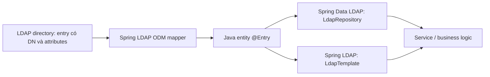
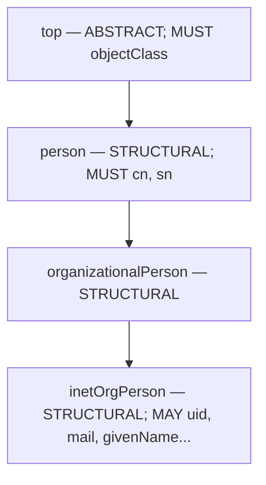

# Định nghĩa thực thể bằng @Entry và các objectClasses

> **Chương:** Ánh xạ thực thể  
> **Module:** SPRING_DATA_LDAP — truy cập directory bằng Spring Data LDAP repository và Spring LDAP, ánh xạ LDAP entry phân cấp thành đối tượng Java để truy vấn, CRUD và kiểm thử.

## Mục tiêu học tập

Sau bài này, bạn có thể:

1. Giải thích sự khác nhau giữa **LDAP entry**, **`objectClass` trong schema** và **Java entity được đánh dấu `@Entry`**.
2. Khai báo đúng `@Entry(objectClasses = {...}, base = "...")`, `@Id`, `@Attribute`, `@DnAttribute` và `@Transient` cho một entity Spring Data LDAP.
3. Đọc chuỗi lớp `top → person → organizationalPerson → inetOrgPerson`, xác định những thuộc tính `MUST` và `MAY`, từ đó tránh lỗi schema khi tạo entry.
4. Hiểu cách các thành phần DN, RDN và base DN được kết hợp khi ánh xạ hoặc tạo mới entry.
5. Sử dụng entity trong `LdapRepository` hoặc `LdapTemplate`, xác minh kết quả với directory test và chẩn đoán các lỗi mapping thường gặp.

## 1. Từ LDAP entry đến Java entity

Giả sử LDAP server quản lý người dùng dưới nhánh `ou=people,dc=example,dc=org`. Một entry có thể được biểu diễn bằng LDIF:

```ldif
dn: uid=linh,ou=people,dc=example,dc=org
objectClass: top
objectClass: person
objectClass: organizationalPerson
objectClass: inetOrgPerson
uid: linh
cn: Linh Nguyen
sn: Nguyen
mail: linh@example.org
```

Entry này gồm **DN** định vị entry trong cây (Directory Information Tree — DIT), các thuộc tính có tên/giá trị và danh sách `objectClass` xác định quy tắc schema áp dụng.

Trong Java, ta muốn làm việc với một đối tượng như `DirectoryPerson`, có các field `uid`, `commonName`, `surname` và `email`. **Object-Directory Mapping (ODM)** của Spring LDAP giúp chuyển đổi giữa field Java và attribute LDAP.



**`@Entry` không tạo ra một LDAP schema mới.** Annotation chỉ mô tả loại entry mà Java class quản lý. **Directory server** vẫn là nơi kiểm tra schema, DN, thuộc tính hợp lệ và quyền khi ghi dữ liệu.

## 2. `objectClass` là gì và vì sao entity phải khai báo đủ?

`objectClass` là thuộc tính đa trị của LDAP entry. Các lớp trong đó thuộc ba loại:

| Loại | Vai trò | Ví dụ |
| --- | --- | --- |
| `ABSTRACT` | Lớp trừu tượng cung cấp đặc tính cơ sở cho lớp khác | `top` |
| `STRUCTURAL` | Mô tả loại đối tượng chính, tham gia quy tắc tổ chức DIT | `person`, `organizationalPerson`, `inetOrgPerson` |
| `AUXILIARY` | Bổ sung thuộc tính cho structural entry nếu schema và DIT content rules cho phép | Lớp phụ trợ do directory hỗ trợ |

Mỗi định nghĩa object class có thể chỉ ra:

- `SUP`: lớp cha, nơi các quy định được **kế thừa**.
- `MUST`: những thuộc tính **bắt buộc phải hiện diện và hợp lệ**.
- `MAY`: những thuộc tính được phép có nhưng không bắt buộc theo schema.
- Cùng với đó là OID, tên lớp và các quy tắc liên quan.

Theo RFC 4512, một object entry có **một chuỗi structural class** với một lớp cụ thể nhất. Ví dụ:



Các lớp `person`, `organizationalPerson`, `inetOrgPerson` không xung đột vì chúng ở cùng một chuỗi kế thừa. Ngược lại, ghép `inetOrgPerson` và `organizationalUnit` thành hai structural class độc lập trong một entry là trái mô hình chuẩn.

### Thuộc tính bắt buộc của `inetOrgPerson`

| Thuộc tính | Vai trò | Theo schema chuẩn |
| --- | --- | --- |
| `objectClass` | Xác định các lớp mà entry thuộc về | Bắt buộc cho mọi entry qua `top` |
| `cn` | Common name | `MUST`, kế thừa từ `person` |
| `sn` | Surname | `MUST`, kế thừa từ `person` |
| `uid` | User identifier | `MAY` theo `inetOrgPerson`; cần nếu đặt RDN `uid=...` |
| `mail` | Email | `MAY` theo `inetOrgPerson` |
| `givenName` | Given name | `MAY` theo `inetOrgPerson` |

Đừng nhầm **bắt buộc theo schema** với **bắt buộc theo nghiệp vụ**. Chẳng hạn, công ty có thể yêu cầu email không được để trống dù `mail` chỉ là `MAY` trong RFC 2798. Với entry mang RDN `uid=linh`, thuộc tính `uid` còn chịu quy tắc đặt tên, dù không phải `MUST` do lớp `inetOrgPerson` quy định.

RFC LDAP cho phép server tự bổ sung thông tin lớp cha trong một số trường hợp, nhưng tài liệu ODM của Spring LDAP hướng dẫn **khai báo các object classes liên quan đến những field mà entity muốn quản lý**. Khi tạo entry mới bằng ODM, **chỉ những object classes được liệt kê trong `@Entry`** được mapper sử dụng. Vì vậy, một entity dự định quản lý `uid` và `mail` của `inetOrgPerson` nên khai báo đầy đủ chuỗi:

```java
@Entry(objectClasses = {
        "top", "person", "organizationalPerson", "inetOrgPerson"
})
```

Không thêm các class chỉ để “cho phép” một thuộc tính bất kỳ. Với attribute của một auxiliary class hoặc schema tùy chỉnh, phải kiểm tra lớp, các `MUST` đi kèm, luật kết hợp và ACL của directory.

Nguồn chuẩn: [RFC 4512 — Directory Information Models](https://www.rfc-editor.org/rfc/rfc4512.html), [RFC 4519 — Schema for User Applications](https://www.rfc-editor.org/rfc/rfc4519.html), [RFC 2798 — inetOrgPerson](https://www.rfc-editor.org/rfc/rfc2798.html).

## 3. Cấu trúc và ý nghĩa của `@Entry`

`@Entry` thuộc package **`org.springframework.ldap.odm.annotations`**. Nó dùng ở **mức class**, với hai thành phần chính:

```java
@Entry(
    objectClasses = {"top", "person", "organizationalPerson", "inetOrgPerson"},
    base = "ou=people"
)
public class DirectoryPerson {
    // ...
}
```

| Thành phần | Bắt buộc? | Ý nghĩa |
| --- | --- | --- |
| `objectClasses` | **Có** | Danh sách tên object class mà entity quản lý, dùng khi ODM ánh xạ và tạo entry |
| `base` | Không; mặc định chuỗi rỗng | DN gốc dành cho các entry của class; được thêm vào DN tính từ `@DnAttribute` khi ODM tạo/tìm entry |

`@Entry.base` là một DN có thể viết **tương đối** so với base của `ContextSource`. Ví dụ:

```yaml
spring:
  ldap:
    urls: "ldap://localhost:389"
    base: "dc=example,dc=org"
    username: "${LDAP_BIND_DN}"
    password: "${LDAP_BIND_PASSWORD}"
```

Nếu entity có `@Entry(base="ou=people")` và RDN là `uid=linh`, DN đích trong directory là:

```text
uid=linh,ou=people,dc=example,dc=org
|-- RDN --| | Entry base | | ContextSource base |
```

Không đưa lại `dc=example,dc=org` vào `@Entry.base` khi `ContextSource` đã cấu hình hậu tố đó: nếu lặp base, thao tác có thể tìm hoặc tạo sai đường dẫn.

`spring.ldap.urls` ở đây là ví dụ phát triển cục bộ; môi trường thật cần cấu hình endpoint, LDAPS/StartTLS và xác thực chứng chỉ theo directory. Các biến môi trường chứa mật khẩu không được commit hay in ra log.

### Chọn lớp và base theo loại entry

| Entity Java | `@Entry.objectClasses` | `@Entry.base` | Ví dụ DN |
| --- | --- | --- | --- |
| `DirectoryPerson` | `top`, `person`, `organizationalPerson`, `inetOrgPerson` | `ou=people` | `uid=linh,ou=people,dc=example,dc=org` |
| `DirectoryGroup` | `top`, `groupOfNames` | `ou=groups` | `cn=developers,ou=groups,dc=example,dc=org` |
| `DirectoryUnit` | `top`, `organizationalUnit` | Tùy cấu trúc | `ou=people,dc=example,dc=org` |

`@Entry` không tạo entry cha `ou=people` hoặc `ou=groups`. **Parent DN phải tồn tại** nếu muốn tạo child entry.

## 4. Định nghĩa entity hoàn chỉnh: `DirectoryPerson`

Dưới đây là một entity ODM có thể dùng để đọc và ghi entry `inetOrgPerson` theo ví dụ phía trên. Giả sử `ContextSource` được cấu hình base `dc=example,dc=org` và cây `ou=people` đã tồn tại.

```java
package com.example.directory.ldap;

import javax.naming.Name;

import org.springframework.ldap.odm.annotations.Attribute;
import org.springframework.ldap.odm.annotations.DnAttribute;
import org.springframework.ldap.odm.annotations.Entry;
import org.springframework.ldap.odm.annotations.Id;
import org.springframework.ldap.odm.annotations.Transient;

@Entry(
    base = "ou=people",
    objectClasses = {
        "top", "person", "organizationalPerson", "inetOrgPerson"
    }
)
public class DirectoryPerson {

    @Id
    private Name dn;

    // Dùng uid làm RDN; index=0 là thành phần sát Entry.base.
    @Attribute(name = "uid")
    @DnAttribute(value = "uid", index = 0)
    private String uid;

    @Attribute(name = "cn")
    private String commonName;

    @Attribute(name = "sn")
    private String surname;

    @Attribute(name = "mail")
    private String email;

    // Không có attribute displayText trong LDAP schema.
    @Transient
    private String displayText;

    public DirectoryPerson() {}

    public DirectoryPerson(String uid, String commonName,
                           String surname, String email) {
        this.uid = uid;
        this.commonName = commonName;
        this.surname = surname;
        this.email = email;
    }

    public Name getDn() { return dn; }
    public void setDn(Name dn) { this.dn = dn; }

    public String getUid() { return uid; }
    public void setUid(String uid) { this.uid = uid; }

    public String getCommonName() { return commonName; }
    public void setCommonName(String commonName) {
        this.commonName = commonName;
    }

    public String getSurname() { return surname; }
    public void setSurname(String surname) {
        this.surname = surname;
    }

    public String getEmail() { return email; }
    public void setEmail(String email) {
        this.email = email;
    }

    public String getDisplayText() { return displayText; }
    public void setDisplayText(String displayText) {
        this.displayText = displayText;
    }
}
```

### Giải thích từng annotation

| Annotation | Áp dụng lên | Ý nghĩa trong ví dụ |
| --- | --- | --- |
| `@Entry` | Class | Khai báo các object classes và base DN tương đối |
| `@Id` | Field `Name dn` | Ánh xạ **Distinguished Name**; bắt buộc với ODM entity |
| `@DnAttribute(value="uid", index=0)` | Field `String uid` | Ánh xạ thành phần RDN `uid=...`; index giúp ODM tính DN |
| `@Attribute(name="uid")` | Field `uid` | Lưu cùng giá trị vào attribute `uid` của entry |
| `@Attribute(name="cn")` | Field `commonName` | Ánh xạ tên field Java sang LDAP attribute `cn` |
| `@Attribute(name="sn")` | Field `surname` | Ánh xạ vào attribute `sn` bắt buộc |
| `@Attribute(name="mail")` | Field `email` | Ánh xạ attribute tùy chọn `mail` |
| `@Transient` | Field `displayText` | Không cố ghi field nội bộ sang LDAP |

**Import quan trọng:** `@Id` ở đây là `org.springframework.ldap.odm.annotations.Id`; không dùng `jakarta.persistence.Id` hoặc `org.springframework.data.annotation.Id`. LDAP ODM yêu cầu DN là một kiểu triển khai `javax.naming.Name`, khác khóa `Long` của JPA.

**Tại sao `@Attribute` và `@DnAttribute` cùng có mặt trên `uid`?** `@DnAttribute` dùng giá trị để tạo/đọc phần tên trong DN; nó **không ngăn field được ánh xạ thành attribute**. `@Attribute` xác định rõ tên attribute mà entity ghi là `uid`. Nếu muốn field chỉ phục vụ tính DN và **không có attribute riêng trong entry**, có thể kết hợp `@DnAttribute` với `@Transient` khi schema/naming rule cho phép, theo tài liệu ODM.

**Vì sao `@Transient` quan trọng?** Theo Spring LDAP ODM, các field của entity có thể được ánh xạ mặc định theo chính tên field ngay cả khi không có `@Attribute`. Nếu không gắn `@Transient` cho `displayText`, mapper có thể cố ghi một attribute `displayText` không được schema cho phép và bị LDAP server từ chối.

### Cẩn thận với mặc định mapping

Field Java `surname` có thể không cần `@Attribute` nếu trường LDAP thật cũng tên `surname`. Nhưng tên chuẩn trong ví dụ là `sn`, do đó phải viết `@Attribute(name="sn")`. Tương tự, `commonName` phải map sang `cn` và `email` sang `mail`.

Không xem `@Entry` là cơ chế tự kiểm tra kiểu dữ liệu đầy đủ như Bean Validation. Kiểm tra `MUST`, dạng chuỗi, giá trị đa trị, cú pháp attribute, ACL và các quy tắc tên vẫn thuộc trách nhiệm server và lớp nghiệp vụ.

## 5. DN, RDN và `@DnAttribute(index=...)`

LDAP DN được viết từ tên entry đến tên cha. Khi Spring LDAP tính DN tự động, `@DnAttribute` có thể cung cấp các thành phần tên.

Với entity trên:

```java
@Entry(base = "ou=people", objectClasses = { /* ... */ })
public class DirectoryPerson {
    @Id
    private Name dn;

    @Attribute(name = "uid")
    @DnAttribute(value = "uid", index = 0)
    private String uid;
}
```

Và giá trị `uid="linh"`, DN được tính tương đối với `ContextSource.base` là:

```text
uid=linh,ou=people
```

Khi nối với `dc=example,dc=org` của `ContextSource`, entry có DN đầy đủ `uid=linh,ou=people,dc=example,dc=org`.

**`index` bắt đầu từ 0 tại thành phần DN đứng gần `@Entry.base` nhất.** Ví dụ một entity có DN `uid=linh,ou=engineering,dc=example,dc=org` nhưng `@Entry.base` rỗng, ODM có thể định nghĩa:

```java
@DnAttribute(value = "ou", index = 0)
private String department;

@DnAttribute(value = "uid", index = 1)
private String uid;
```

Các index biểu diễn vị trí thành phần tên theo thứ tự mà Spring LDAP dùng để tính DN, **không phải index từ trái sang phải trong chuỗi DN hiển thị**. Khi có `index`, API tài liệu hóa rằng tên trong `value` có thể bị bỏ qua trong tính toán theo index; nên khai báo rõ `@Attribute(name=...)` hoặc `@Transient` để kiểm soát mapping thuộc tính song song.

Chỉ dùng `@DnAttribute` trên field kiểu `String`; nó không thay thế field `Name dn` được đánh dấu `@Id`. Nếu không khai báo `index`, mapper vẫn có thể **đọc thành phần DN**, nhưng muốn **tự tính DN khi tạo/move entry**, hãy cấu hình index nhất quán cho tất cả field `@DnAttribute`.

**Đừng tự ghép input người dùng vào chuỗi DN.** Khi cần tự xây một DN, dùng `LdapNameBuilder` hoặc API `Name`/`LdapName`, đặc biệt khi giá trị RDN chứa dấu phẩy, dấu cộng hoặc ký tự phải escape.

## 6. Tạo, đọc và cập nhật entry qua ODM

Trước khi thử ví dụ, cần có:

- LDAP server test với base `dc=example,dc=org` và OU `ou=people,dc=example,dc=org`;
- schema hỗ trợ `inetOrgPerson`;
- một `ContextSource`/`LdapTemplate` tương thích, bind identity có quyền đọc/ghi;
- dữ liệu hợp lệ: ít nhất `cn` và `sn` theo `person`, cùng `uid` cho RDN đã chọn.

### Tạo mới bằng `LdapTemplate.create(entity)`

`LdapTemplate` có phương thức ODM `create(Object entry)`, khác với các phương thức thao tác attribute cấp thấp. Ví dụ service:

```java
package com.example.directory.ldap;

import org.springframework.ldap.core.LdapTemplate;
import org.springframework.stereotype.Service;

@Service
public class DirectoryPersonService {

    private final LdapTemplate ldapTemplate;

    public DirectoryPersonService(LdapTemplate ldapTemplate) {
        this.ldapTemplate = ldapTemplate;
    }

    public void createPerson(String uid, String commonName,
                             String surname, String email) {
        if (uid == null || uid.isBlank() ||
                commonName == null || commonName.isBlank() ||
                surname == null || surname.isBlank()) {
            throw new IllegalArgumentException(
                    "uid, cn và sn phải có giá trị");
        }

        DirectoryPerson person =
                new DirectoryPerson(uid, commonName, surname, email);

        // dn ban đầu null; @DnAttribute(index=0) + @Entry.base
        // cung cấp thành phần DN để ODM tính entry mới.
        ldapTemplate.create(person);
    }
}
```

Điều cần hiểu:

1. Khi tạo entity mới, ví dụ giữ `dn` chưa gán; ODM có thể tính DN qua `@DnAttribute(index=0)` và `@Entry.base`.
2. `@Entry.objectClasses` cung cấp danh sách lớp của entry sẽ được tạo.
3. Các field `cn`, `sn` phải mang giá trị hợp lệ, nếu không LDAP server có thể trả `objectClassViolation`.
4. `@Transient` bảo đảm field `displayText` không bị ghi vào LDAP.
5. Nếu DN đã tồn tại, `create` không tự trở thành update; ứng dụng cần xử lý trùng DN và cạnh tranh giữa các request.

Khi muốn chủ động xây DN và các attribute ở mức thấp, có thể dùng `DirContextAdapter` cùng `LdapTemplate.bind(...)`, nhưng phải tự thiết lập `objectClass`, các thuộc tính bắt buộc và DN tương đối một cách rõ ràng.

### Đọc entry qua `LdapTemplate`

```java
import static org.springframework.ldap.query.LdapQueryBuilder.query;

import java.util.List;
import org.springframework.ldap.core.LdapTemplate;

public class DirectoryPersonLookup {
    private final LdapTemplate template;

    public DirectoryPersonLookup(LdapTemplate template) {
        this.template = template;
    }

    public List<DirectoryPerson> findByUid(String uid) {
        return template.find(
            query().base("ou=people")
                   .where("uid").is(uid),
            DirectoryPerson.class
        );
    }
}
```

`query().base("ou=people")` đang dùng base của `ContextSource`; đừng ghép toàn bộ `dc=example,dc=org` thêm lần nữa. `where("uid").is(uid)` tạo filter có escape an toàn cho **giá trị** người dùng, tránh nối thẳng chuỗi `"(uid=" + uid + ")"` gây LDAP filter injection.

Nếu một entity đã đọc ra từ directory, field `dn` có thể chứa tên tương ứng; khi cập nhật các thuộc tính của entry đó, có thể dùng `ldapTemplate.update(entity)` theo cơ chế ODM. Không tự sửa `dn` hoặc RDN mà không tính tác động lên đường dẫn và liên kết đến entry khác.

### Sử dụng Spring Data LDAP repository

Spring Data LDAP cung cấp `LdapRepository<T>`, với ID mặc định là `javax.naming.Name`:

```java
package com.example.directory.ldap;

import java.util.Optional;
import org.springframework.data.ldap.repository.LdapRepository;

public interface DirectoryPersonRepository
        extends LdapRepository<DirectoryPerson> {

    Optional<DirectoryPerson> findByUid(String uid);
}
```

Ví dụ dùng tại service:

```java
Optional<DirectoryPerson> person = repository.findByUid("linh");
person.ifPresent(p -> System.out.println(p.getCommonName()));
```

Spring Data LDAP xử lý repository proxy và CRUD phù hợp LDAP, nhưng **không phải JPA**: không mặc định hỗ trợ SQL joins, relational transactions, hoặc phân trang `Pageable`/`Sort` qua repository. Khi cần LDAP controls và filter phức tạp, dùng `LdapTemplate`.

Với `repository.save(entity)`, cần lưu ý cơ chế nhận diện **new/existing entity** của phiên bản Spring Data. Một entity đã có `dn` khác null có thể được nhận diện là entry cần cập nhật; đừng tự gán DN rồi mặc định `save` sẽ luôn tạo mới. Nếu mục tiêu bài tập là **create rõ ràng**, `ldapTemplate.create(entity)` là API tường minh.

## 7. Ví dụ thứ hai: định nghĩa entity nhóm LDAP

`@Entry` có thể mô tả các loại entry khác nhau. Một nhóm theo `groupOfNames` có schema yêu cầu `cn` và **ít nhất một `member`**:

```ldif
dn: cn=developers,ou=groups,dc=example,dc=org
objectClass: top
objectClass: groupOfNames
cn: developers
member: uid=linh,ou=people,dc=example,dc=org
```

Entity mô tả nhóm:

```java
import java.util.Set;
import javax.naming.Name;

import org.springframework.ldap.odm.annotations.Attribute;
import org.springframework.ldap.odm.annotations.DnAttribute;
import org.springframework.ldap.odm.annotations.Entry;
import org.springframework.ldap.odm.annotations.Id;

@Entry(
    base = "ou=groups",
    objectClasses = {"top", "groupOfNames"}
)
public class DirectoryGroup {

    @Id
    private Name dn;

    @Attribute(name = "cn")
    @DnAttribute(value = "cn", index = 0)
    private String name;

    @Attribute(name = "member")
    private Set<Name> members;

    public DirectoryGroup() {}

    public Name getDn() { return dn; }
    public void setDn(Name dn) { this.dn = dn; }

    public String getName() { return name; }
    public void setName(String name) { this.name = name; }

    public Set<Name> getMembers() { return members; }
    public void setMembers(Set<Name> members) { this.members = members; }
}
```

Spring LDAP ODM hỗ trợ giá trị attribute kiểu `javax.naming.Name`, hữu ích với `member` là DN của người dùng. Khác với `inetOrgPerson`:

- `groupOfNames` dùng structural class riêng; không thêm `person`, `organizationalPerson` hay `inetOrgPerson` vào entity nhóm.
- `member` là `MUST` theo schema chuẩn; nhóm rỗng sẽ bị từ chối khi không có member, trừ khi directory dùng loại nhóm/schema khác cho phép.
- `ou=groups` phải tồn tại. Mỗi thành viên có DN phải được xây và xác thực hợp lệ theo môi trường ứng dụng.

Một ứng dụng có thể có nhiều entity khác nhau cho người, OU, nhóm và service account; **không dùng một `@Entry` tổng quát chứa mọi object class** để ánh xạ tất cả.

## 8. Kiểm tra schema thật trước khi chọn `objectClasses`

Các ví dụ sử dụng schema chuẩn. LDAP server thực tế có thể thêm thuộc tính hoặc object class của hãng, DIT content rules, naming restrictions và ACL. Khi làm việc với một directory chưa biết, hãy thu thập:

1. **DN và objectClasses thực tế** của một entry mẫu.
2. **Các class cha** theo `SUP` và thuộc tính `MUST`/`MAY` áp dụng.
3. **Attribute names, syntax, multiplicity** (đơn trị/đa trị) và matching rules.
4. **Các lớp phụ trợ** được cho phép và những `MUST` phát sinh.
5. **Base DN/OU**, danh tính bind có quyền đọc/ghi và cơ chế kết nối bảo mật.

Nhiều directory công bố subschema thông qua attribute `subschemaSubentry`. Ví dụ OpenLDAP client trên directory test:

```bash
ldapsearch -x -H ldap://localhost:389 \
  -s base -b "" subschemaSubentry
```

Nếu server trả DN subschema `cn=Subschema`, bạn có thể thử:

```bash
ldapsearch -x -H ldap://localhost:389 \
  -s base -b "cn=Subschema" objectClasses attributeTypes
```

DN `cn=Subschema` chỉ minh họa, phải thay bằng **DN thật** từ server; có thể cần bind và quyền đọc schema. Với production, ưu tiên LDAPS/StartTLS và xác thực chứng chỉ. Active Directory hoặc directory khác có cách công bố schema và extension riêng; không suy rằng mọi sản phẩm dùng đúng một DN subschema.

## 9. Chẩn đoán các lỗi `@Entry` và schema

| Hiện tượng | Nguyên nhân có thể xảy ra | Cách kiểm tra |
| --- | --- | --- |
| `IllegalStateException`/ODM mapping exception khi tạo entity | Thiếu `@Entry` hoặc `@Id`, kiểu ID không phải `Name`, `@DnAttribute` cấu hình chưa đúng | Xem import, các annotation bắt buộc và cách tính DN |
| Repository không khởi tạo | Entity chưa có mapping phù hợp, repository ngoài phạm vi quét hoặc thiếu Spring Data LDAP starter | Kiểm tra dependency, package scan, `@EnableLdapRepositories` |
| `objectClassViolation (65)` khi create | Thiếu `cn`/`sn`, lớp không tương thích hoặc attribute không được phép | Đọc schema `MUST`/`MAY` và objectClasses thực tế |
| `undefinedAttributeType (17)` | Field mặc định bị map thành attribute chưa tồn tại trong schema | Dùng `@Transient` hoặc `@Attribute(name=...)` đúng |
| `invalidAttributeSyntax (21)` | Giá trị không đúng cú pháp LDAP của attribute | Đối chiếu type/syntax từ subschema |
| `noSuchObject (32)` | Base DN hoặc parent OU không tồn tại | Kiểm tra `spring.ldap.base`, `@Entry.base` và cây DN |
| `entryAlreadyExists (68)` | Tạo entry trùng DN | Dùng workflow create/update rõ ràng; xử lý cạnh tranh |
| `insufficientAccessRights (50)` | Bind identity không đủ quyền ghi DN/attribute | Kiểm tra ACL directory và danh tính bind |
| DN bị nhân đôi hậu tố | Ghi cả `dc=example,dc=org` trong `@Entry.base` và `spring.ldap.base` | Giữ `@Entry.base` tương đối, tránh cộng base hai lần |
| Mapping sai `uid` hoặc RDN | `@DnAttribute.index` nhầm vị trí, tên attribute Java không đúng | So sánh DN sau khi tạo/đọc và ghi chú index từ base ra ngoài |

Không suy rằng tất cả lỗi xảy ra ở repository đều do repository. LDAP server sẽ từ chối dữ liệu vi phạm schema hoặc ACL dù các bean Spring được tạo đúng. Khi xử lý sự cố, đọc `Caused by` sâu nhất, LDAP result code và thông tin phản hồi của server.

### Hai ví dụ sai cụ thể

**Thiếu `sn`:**

```ldif
dn: uid=linh,ou=people,dc=example,dc=org
objectClass: top
objectClass: person
objectClass: organizationalPerson
objectClass: inetOrgPerson
uid: linh
cn: Linh Nguyen
```

Entry này thiếu `sn` vốn là `MUST` do `person` quy định. Server có thể trả `objectClassViolation (65)`. Sửa bằng cách thêm `sn` hợp lệ, không xóa lớp cha `person`.

**Khai báo class không phù hợp:**

```java
// Sai nếu muốn ghi mail hoặc các thuộc tính của inetOrgPerson:
@Entry(objectClasses = {"top", "person"}, base = "ou=people")
public class DirectoryPerson {
    @Id private Name dn;
    @Attribute(name = "mail") private String email;
}
```

Lớp `person` chuẩn không cho phép `mail`. Khi muốn quản lý `mail` của `inetOrgPerson`, khai báo chuỗi object classes phù hợp và bổ sung đủ `cn`/`sn`. Không thêm `@Attribute` tùy tiện với kỳ vọng Java có thể thay đổi LDAP schema.

## 10. Kiểm thử đọc/ghi entity trong directory thực nghiệm

Dùng LDAP nhúng hoặc một directory test đã biết schema, tạo sẵn parent OU và một bind identity có quyền ghi tối thiểu. Những kiểm thử có giá trị:

1. **Đọc đúng mapping:** một entry `inetOrgPerson` có `uid=linh` được ánh xạ thành `DirectoryPerson` với `dn`, `commonName`, `surname` và `email` đúng.
2. **Tạo đúng DN:** gọi `ldapTemplate.create(new DirectoryPerson("mai", ...))` và xác nhận DN thực là `uid=mai,ou=people,dc=example,dc=org`.
3. **Thiếu `cn`/`sn`:** dữ liệu bị validation của service hoặc schema server từ chối; không có entry tạo dở.
4. **Không có `mail`:** entry vẫn hợp lệ theo schema chuẩn `inetOrgPerson`.
5. **Field `@Transient`:** dữ liệu `displayText` không được ghi thành một LDAP attribute.
6. **DN trùng hoặc parent thiếu:** xác định đúng code `68` hoặc `32` và thông báo rõ nguyên nhân.
7. **Filter an toàn:** tìm người dùng với một giá trị `uid` chứa ký tự filter đặc biệt; truy vấn không bị mở rộng điều kiện ngoài ý muốn.
8. **Lớp nhóm:** tạo `groupOfNames` có `member`, xác minh mapper đọc được các DN thành viên.

Có thể dùng `ldapsearch` để xác minh sau thao tác:

```bash
ldapsearch -x \
  -H ldaps://ldap.example.org:636 \
  -D "cn=test-reader,ou=services,dc=example,dc=org" \
  -W \
  -b "uid=mai,ou=people,dc=example,dc=org" \
  -s base "(objectClass=*)" dn objectClass uid cn sn mail
```

Dùng hostname và tài khoản test thật phù hợp; `-W` nhập mật khẩu tương tác. Với directory sản xuất, không dùng dữ liệu giả hoặc thử các ca lỗi ghi; các thí nghiệm nên thực hiện trên test directory và kết nối mã hóa.

## 11. Bài tập tự đánh giá

**Bài 1.** Giả sử `@Entry(objectClasses={"top","person"})` nhưng entity muốn quản lý `mail`. Cần thay đổi gì?  
**Đáp án gợi ý:** Chọn object class cho phép `mail`, ví dụ chuỗi `top`, `person`, `organizationalPerson`, `inetOrgPerson`, và bảo đảm entry có `cn`, `sn` theo schema.

**Bài 2.** Tại sao dùng `@Id private Long id` giống JPA lại sai với Spring LDAP ODM?  
**Đáp án:** `@Id` phải là annotation của Spring LDAP ODM trên field kiểu `javax.naming.Name` chứa DN, không phải numeric primary key.

**Bài 3.** `spring.ldap.base` là `dc=example,dc=org`, `@Entry.base` là `ou=people`, `@DnAttribute(value="uid", index=0)` có giá trị `mai`. DN đầy đủ là gì?  
**Đáp án:** `uid=mai,ou=people,dc=example,dc=org`.

**Bài 4.** Tại sao `@Transient` quan trọng với field tính toán như `displayText`?  
**Đáp án:** ODM có thể ánh xạ field theo tên mặc định; `@Transient` ngăn ghi một attribute không thuộc schema.

**Bài 5.** Một `groupOfNames` không có `member` có hợp lệ theo schema chuẩn không?  
**Đáp án:** Không. `groupOfNames` có `MUST cn` và `member`; muốn nhóm rỗng cần xem một object class khác hoặc chính sách server khác.

## 12. Checklist khi định nghĩa một entity LDAP

- [ ] Đã xác định **loại entry thực** và đọc các `objectClass`/schema mà server hỗ trợ.
- [ ] `@Entry` import từ `org.springframework.ldap.odm.annotations`, liệt kê đủ lớp liên quan đến những attribute được quản lý.
- [ ] Chuỗi structural class hợp lệ; không ghép hai structural class không có quan hệ kế thừa.
- [ ] Đã có giá trị cho các attribute `MUST` của toàn bộ chuỗi kế thừa.
- [ ] `@Entry.base`, `@DnAttribute.index` và `spring.ldap.base` kết hợp thành đúng DN, không lặp hậu tố.
- [ ] `@Id` dùng kiểu `javax.naming.Name`, đúng import của Spring LDAP ODM.
- [ ] Tên field Java được chuyển sang tên LDAP bằng `@Attribute` khi khác nhau; field nội bộ có `@Transient`.
- [ ] Các field `@DnAttribute` dùng `String`; hiểu rằng chúng có thể vừa tạo RDN vừa được ghi như attribute.
- [ ] Đã kiểm tra quyền bind, bảo vệ kết nối, tránh filter/DN injection.
- [ ] Đã kiểm thử create/find/update trên directory test và đọc lại objectClasses, DN, các attribute sau ghi.

## Tài liệu tham khảo

- [Spring LDAP — Object-Directory Mapping (ODM)](https://docs.spring.io/spring-ldap/reference/odm.html)
- [Spring LDAP — API `@Entry`](https://docs.spring.io/spring-ldap/reference/api/java/org/springframework/ldap/odm/annotations/Entry.html)
- [Spring LDAP — API `@DnAttribute`](https://docs.spring.io/spring-ldap/reference/api/java/org/springframework/ldap/odm/annotations/DnAttribute.html)
- [Spring LDAP — API `@Id`](https://docs.spring.io/spring-ldap/reference/api/java/org/springframework/ldap/odm/annotations/Id.html)
- [Spring Data LDAP — Configuration, repository and Name ID](https://docs.spring.io/spring-data/ldap/reference/ldap/configuration.html)
- [Spring LDAP — Repositories](https://docs.spring.io/spring-ldap/reference/repositories.html)
- [RFC 4512 — LDAP Directory Information Models](https://www.rfc-editor.org/rfc/rfc4512.html)
- [RFC 4519 — LDAP Schema for User Applications](https://www.rfc-editor.org/rfc/rfc4519.html)
- [RFC 2798 — inetOrgPerson](https://www.rfc-editor.org/rfc/rfc2798.html)

