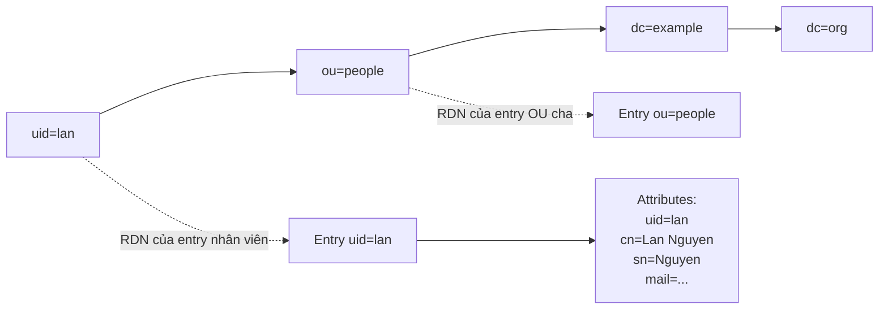

# Phân biệt tên thuộc tính LDAP với tên thành phần DN

Trong chương **Ánh xạ thực thể** của **SPRING_DATA_LDAP**, một lỗi thiết kế thường gặp là xem tên thuộc tính LDAP, thành phần của Distinguished Name (DN) và tên field Java như ba cách viết của cùng một dữ liệu. Chúng có liên hệ, nhưng **đảm nhiệm ba vai trò khác nhau**:

- **Tên thuộc tính LDAP** xác định một attribute type trên entry, ví dụ `uid`, `cn`, `mail`.
- **Thành phần DN** là một Attribute Value Assertion (AVA) nằm trong Relative Distinguished Name (RDN), ví dụ `uid=lan` trong DN `uid=lan,ou=people,dc=example,dc=org`.
- **Tên field Java** là tên thuộc tính của lớp ứng dụng, ví dụ `loginName` hoặc `emailAddress`; nó có thể khác tên attribute LDAP và được ánh xạ bằng annotation/cấu hình.

Một DN còn mô tả **vị trí của entry trong cây directory**. Trong ví dụ trên, `uid=lan` là RDN của entry nhân viên, còn `ou=people` và `dc=example,dc=org` là các thành phần thuộc đường dẫn cha. Chúng không tự động trở thành các thuộc tính `ou` và `dc` của chính entry nhân viên.

Điều này quan trọng khi dùng Spring LDAP ODM và Spring Data LDAP. `@Entry` mô tả loại entry/base; `@Id` ánh xạ DN; `@Attribute(name = "...")` ánh xạ attribute của entry; và `@DnAttribute` có thể ánh xạ một giá trị lấy từ thành phần DN vào field Java. Nếu nhầm các vai trò này, ứng dụng có thể tạo filter sai, map sai dữ liệu, ghép DN lỗi, hoặc cố sửa RDN bằng LDAP Modify thông thường.

**Mục tiêu:** đọc được cấu trúc DN/RDN/AVA; phân biệt thuộc tính của entry với thành phần tên; hiểu quan hệ giữa attribute type, schema và field Java; dùng đúng `@Id`, `@Attribute` và `@DnAttribute`; tạo Search filter an toàn; và chọn đúng LDAP Modify hay Modify DN khi thay đổi dữ liệu hoặc vị trí entry.

## 1. Ba khái niệm cần tách riêng

Xét entry:

```ldif
dn: uid=lan,ou=people,dc=example,dc=org
objectClass: top
objectClass: person
objectClass: organizationalPerson
objectClass: inetOrgPerson
uid: lan
cn: Lan Nguyen
sn: Nguyen
mail: lan@example.org
```

Ta có thể đọc entry này theo ba góc nhìn:

| Góc nhìn | Giá trị trong ví dụ | Ý nghĩa |
| --- | --- | --- |
| **DN** | `uid=lan,ou=people,dc=example,dc=org` | Tên đầy đủ xác định entry trong DIT |
| **RDN của entry** | `uid=lan` | Thành phần tương đối phân biệt entry với các entry cùng cấp |
| **Attribute của entry** | `uid: lan`, `cn: Lan Nguyen`, `sn: Nguyen`, `mail: ...` | Các attribute/value được lưu trên entry theo schema |
| **Field Java** | `loginName`, `commonName`, `emailAddress` | Tên field của lớp Java, do lập trình viên chọn |

Một điểm tinh tế: trong ví dụ, `uid=lan` xuất hiện **vừa trong DN, vừa dưới dạng attribute/value của entry**. Hai cách xuất hiện có liên hệ vì `uid` là thuộc tính dùng để đặt tên entry, nhưng chúng vẫn là hai cách nhìn:

- Trong DN, `uid=lan` là một **AVA thuộc RDN**.
- Trong nội dung entry, `uid: lan` là một **attribute/value**.

Ngược lại, `ou=people` là RDN của **entry OU cha**; nó không có nghĩa entry nhân viên phải chứa `ou: people`. Tương tự, `dc=example` và `dc=org` thuộc các entry cha trong cây.

### 1.1. Sơ đồ một DN



Chuỗi DN được viết theo thứ tự **từ entry cụ thể ra phía gốc**. Mỗi RDN là một thành phần tên; DN đầy đủ là chuỗi các RDN nối với nhau. Đừng coi DN là một chuỗi phẳng chứa mọi thuộc tính của entry.

## 2. LDAP attribute là gì?

Một LDAP entry chứa một tập các **attribute**. Mỗi attribute có:

- **Attribute description:** tên loại thuộc tính và có thể có các options.
- **Một hoặc nhiều giá trị:** số lượng giá trị phụ thuộc schema và dữ liệu.
- **Quy tắc so khớp/syntax:** định nghĩa trong schema, ví dụ Directory String, Integer, DN, Generalized Time hoặc dữ liệu binary.
- **Quyền truy cập:** directory ACL quyết định ai có thể đọc, thêm, sửa hoặc xóa.

Ví dụ:

```ldif
uid: lan
cn: Lan Nguyen
sn: Nguyen
mail: lan@example.org
telephoneNumber: +842839001234
```

Ở đây:

| Attribute type | Giá trị | Vai trò |
| --- | --- | --- |
| `uid` | `lan` | Login/định danh nghiệp vụ theo schema của hệ thống |
| `cn` | `Lan Nguyen` | Common name |
| `sn` | `Nguyen` | Surname |
| `mail` | `lan@example.org` | Email |
| `telephoneNumber` | `+842839001234` | Số điện thoại |

Attribute type được định nghĩa trong **LDAP schema**, không phải do tên field Java tạo ra. Ví dụ `mail` có thể được schema định nghĩa với syntax, equality matching rule và cardinality riêng. Đổi field Java từ `email` sang `emailAddress` không làm schema LDAP đổi tên attribute.

### 2.1. Tên attribute và OID

Schema có thể công bố một attribute type bằng descriptor và OID:

```text
NAME: "uid"
OID: 0.9.2342.19200300.100.1.1
```

Tên descriptor `uid` giúp con người đọc; OID định danh attribute type theo schema. Tên khác nhau có thể là alias của cùng loại thuộc tính theo định nghĩa schema, và server có thể xử lý descriptor/OID theo các quy tắc của nó.

Không tự tạo tên thuộc tính tùy ý như `employeeLogin` rồi gửi Search/Modify nếu server chưa có attribute type tương ứng. Server có thể trả `undefinedAttributeType (17)`. Muốn thêm attribute type mới phải quản lý schema theo quy trình của directory, không chỉ thêm một field Java.

### 2.2. Attribute description có thể có options

Trong Search/attribute selection, attribute description có thể bao gồm options:

```text
cn
cn;lang-en
userCertificate;binary
```

`cn`, `cn;lang-en` và `userCertificate;binary` minh họa attribute descriptions/options trong ngữ cảnh LDAP. Options như ngôn ngữ hoặc binary transfer có ý nghĩa ở **attribute description**, không phải một RDN component thông thường trong DN.

Theo cú pháp DN (RFC 4514), AVA dùng **attribute type** (descriptor hoặc OID) cùng giá trị; không đưa các attribute options kiểu `;lang-en` vào DN như thể chúng là thành phần RDN. Khi mapping một attribute có options, phải xác minh hỗ trợ của thư viện/server và không tự biến option thành field Java.

## 3. DN, RDN và AVA

### 3.1. DN là tên đầy đủ của entry

DN (*Distinguished Name*) xác định một entry trong Directory Information Tree (DIT). Ví dụ:

```text
uid=lan,ou=people,dc=example,dc=org
```

Đọc từ trái sang phải:

1. `uid=lan`: RDN của entry nhân viên.
2. `ou=people`: RDN của entry OU cha.
3. `dc=example`: RDN của entry domain tiếp theo.
4. `dc=org`: RDN ở cấp cao hơn trong ví dụ.

DN là tên theo cấu trúc cây; nó không phải primary key bất biến. Nếu entry được rename hoặc move, DN thay đổi.

### 3.2. RDN là thành phần phân biệt entry với các entry cùng cấp

RDN (*Relative Distinguished Name*) là tên tương đối của entry trong parent context. Trong:

```text
uid=lan,ou=people,dc=example,dc=org
uid=nam,ou=people,dc=example,dc=org
```

hai entry cùng parent `ou=people,dc=example,dc=org`, nhưng có RDN khác nhau: `uid=lan` và `uid=nam`.

RDN không bắt buộc chỉ có một AVA. Một **multi-valued RDN** có thể chứa nhiều AVA nối bằng dấu `+`:

```text
cn=Lan Nguyen+uid=lan,ou=people,dc=example,dc=org
```

Trong ví dụ này, RDN đầu tiên chứa hai assertion:

- `cn=Lan Nguyen`
- `uid=lan`

Đây vẫn là **một RDN**, không phải hai cấp entry khác nhau. Đừng tách DN bằng `+` hoặc dấu phẩy bằng string operations đơn giản.

### 3.3. AVA gồm attribute type và assertion value

AVA (*Attribute Value Assertion*) là một cặp:

```text
attributeType = attributeValue
```

Ví dụ `uid=lan` có:

- Attribute type: `uid`.
- Assertion value: `lan`.

Trong DN, `uid` không phải tên field Java; `lan` không phải một entry con. Đây là cặp tên/giá trị dùng để cấu thành RDN.

## 4. Thành phần DN không phải tất cả attribute của entry

Đây là khác biệt quan trọng nhất khi ánh xạ:

```text
DN entry nhân viên:
    uid=lan,ou=people,dc=example,dc=org

Attributes của entry nhân viên:
    objectClass
    uid
    cn
    sn
    mail
    telephoneNumber
```

Entry OU cha có DN và attribute riêng:

```ldif
dn: ou=people,dc=example,dc=org
objectClass: top
objectClass: organizationalUnit
ou: people
description: Employee directory
```

Entry domain trong ví dụ có thể là:

```ldif
dn: dc=example,dc=org
objectClass: top
objectClass: domain
dc: example
```

Vì vậy:

- `ou=people` trong DN nhân viên nói entry nằm dưới OU `people`.
- Nó **không tự thêm** attribute `ou: people` vào entry nhân viên.
- `dc=example,dc=org` trong DN nói naming context/đường dẫn cha.
- Nó **không tự thêm** hai attribute `dc` vào entry nhân viên.
- Nếu ứng dụng cần tên phòng ban/OU của nhân viên, phải xác định nguồn dữ liệu: đọc RDN/ancestor DN, đọc một attribute nghiệp vụ như `departmentNumber`, hoặc lookup entry cha. Không tự coi chúng tương đương.

### 4.1. Khi RDN attribute cũng là attribute của entry

Trong entry `uid=lan,...`, thuộc tính `uid` thường có giá trị `lan` tương ứng với RDN. Điều này cho phép Search bằng filter:

```text
(uid=lan)
```

Nhưng filter và DN lookup khác nhau:

| Cách truy vấn | Điều kiện |
| --- | --- |
| **Lookup theo DN** | Xác định chính xác tên entry `uid=lan,ou=people,...` |
| **Search filter `(uid=lan)`** | Tìm entry trong base/scope đã chọn có attribute `uid` khớp giá trị `lan` |
| **Search filter `(cn=Lan Nguyen)`** | Tìm entry có attribute `cn` khớp tên, không phụ thuộc RDN dùng `uid` hay `cn` |

Không được kết luận một entry chỉ có thể tìm bằng attribute đang nằm trong RDN. Ngược lại, một attribute như `mail` có thể được tìm dù nó không xuất hiện trong DN.

### 4.2. Attribute cùng tên ở entry cha và entry con

Nhiều entry khác cấp có thể cùng attribute type:

```text
OU entry:
    DN: ou=people,dc=example,dc=org
    attribute: ou=people

Person entry:
    DN: uid=lan,ou=people,dc=example,dc=org
    attribute: uid=lan
```

Một tên attribute như `ou` có thể xuất hiện trong DN của person như **RDN của parent**, nhưng không vì thế mà `ou` trở thành attribute của person. Khi Search tại `ou=people` với scope `SUBTREE`, kết quả có thể bao gồm entry con; mỗi kết quả vẫn có attributes riêng.

## 5. Tên field Java không nhất thiết trùng tên attribute LDAP

Lớp Java có thể dùng tên theo ngôn ngữ nghiệp vụ:

```java
public class Employee {
    private String loginName;
    private String commonName;
    private String emailAddress;
}
```

Trong LDAP schema, các attribute tương ứng có thể là `uid`, `cn` và `mail`. Spring LDAP ODM cho phép khai báo mapping tường minh:

```java
import javax.naming.Name;
import org.springframework.ldap.odm.annotations.Attribute;
import org.springframework.ldap.odm.annotations.Entry;
import org.springframework.ldap.odm.annotations.Id;

@Entry(
    base = "ou=people",
    objectClasses = {"inetOrgPerson"}
)
public class PersonEntry {
    @Id
    private Name dn;

    @Attribute(name = "uid")
    private String loginName;

    @Attribute(name = "cn")
    private String commonName;

    @Attribute(name = "sn")
    private String surname;

    @Attribute(name = "mail")
    private String emailAddress;

    public PersonEntry() {}

    public Name getDn() { return dn; }
    public String getLoginName() { return loginName; }
    public String getCommonName() { return commonName; }
    public String getSurname() { return surname; }
    public String getEmailAddress() { return emailAddress; }
}
```

Đọc mapping:

| Thành phần Java | Annotation | Attribute/DN được ánh xạ |
| --- | --- | --- |
| `dn` | `@Id` | DN của entry |
| `loginName` | `@Attribute(name="uid")` | Attribute `uid` |
| `commonName` | `@Attribute(name="cn")` | Attribute `cn` |
| `surname` | `@Attribute(name="sn")` | Attribute `sn` |
| `emailAddress` | `@Attribute(name="mail")` | Attribute `mail` |

Tên Java có thể thay đổi mà không cần đổi schema LDAP, miễn mapping được cập nhật đúng. Ngược lại, đổi `@Attribute(name="mail")` thành `@Attribute(name="emailAddress")` chỉ đúng nếu directory thực sự có attribute type `emailAddress`; tên field Java không tự tạo attribute type mới.

### 5.1. @Id ánh xạ DN, không phải một attribute tên dn

`@Id` trong Spring LDAP ODM dùng để ánh xạ **định danh DN** của entry. DN không phải một attribute thông thường có tên `dn` được lưu trong entry như `mail` hoặc `cn`.

Một entity có:

```java
@Id
private Name dn;
```

không có nghĩa directory cần:

```ldif
dn: uid=lan,ou=people,dc=example,dc=org
dn: uid=lan,ou=people,dc=example,dc=org
```

Trong LDIF, dòng `dn: ...` là **dòng chỉ định tên entry**, đứng ngoài tập attributes của entry. Không tạo thêm một attribute `dn` để lưu lại toàn bộ DN.

### 5.2. @DnAttribute ánh xạ giá trị từ RDN

Spring LDAP ODM còn có `@DnAttribute` để ánh xạ một giá trị nằm trong DN vào field Java. Nó khác `@Attribute`:

- `@Attribute(name="uid")` đọc/ghi attribute `uid` của entry theo mapping và operation tương ứng.
- `@DnAttribute` lấy một AVA trong RDN của DN, theo attribute type và vị trí RDN được cấu hình.
- `@Id` đại diện DN của entry.

Ví dụ về ý định mapping:

```text
DN:
    uid=lan,ou=people,dc=example,dc=org

@Id:
    Name dn

@DnAttribute:
    loginNameFromRdn <- giá trị "lan" của AVA uid trong RDN

@Attribute(name="uid"):
    loginName <- giá trị attribute uid của entry
```

`@DnAttribute` có tham số xác định attribute type và vị trí RDN theo API ODM. **Quy tắc chỉ số/vị trí cần đối chiếu tài liệu đúng phiên bản Spring LDAP**, đặc biệt khi DN có base context và nhiều RDN. Không tự giả định index là cùng thứ tự với chuỗi DN hiển thị; viết test cho DN thực tế của ứng dụng.

Không ánh xạ cùng một ý nghĩa vào nhiều field rồi để chúng tự cập nhật lẫn nhau. Nếu vừa cần attribute `uid` vừa cần giá trị RDN `uid`, xác định rõ field nào là nguồn dữ liệu ghi và field nào chỉ phục vụ đọc/hiển thị.

## 6. @Entry.base và ContextSource.base không phải thành phần field

Spring LDAP có thể cấu hình base DN chung:

```yaml
spring:
  ldap:
    urls: ldaps://directory.example.org:636
    base: dc=example,dc=org
    username: uid=app-reader,ou=services,dc=example,dc=org
    password: ${LDAP_BIND_PASSWORD}
```

Với entity:

```java
@Entry(
    base = "ou=people",
    objectClasses = {"inetOrgPerson"}
)
public class PersonEntry {
    @Id
    private Name dn;
}
```

Ta có thể hiểu phạm vi base theo cấu hình:

```text
ContextSource.base = dc=example,dc=org
@Entry.base        = ou=people
Effective entry base = ou=people,dc=example,dc=org
```

`ContextSource.base` và `@Entry.base` mô tả **phạm vi DN tương đối** trong mapping/search, không phải các attributes của mỗi person entry. Cần theo đúng convention relative/full DN của API đang gọi: có API nhận DN tương đối với ContextSource base, có API thao tác với DN đầy đủ. Không nối suffix bằng chuỗi thủ công nếu thư viện đã áp dụng base context, tránh nhân đôi `dc=example,dc=org`.

### 6.1. DN tương đối và DN đầy đủ

Hai biểu diễn sau có thể cùng chỉ entry trong hai ngữ cảnh API khác nhau:

```text
DN đầy đủ:
    uid=lan,ou=people,dc=example,dc=org

DN tương đối với ContextSource base dc=example,dc=org:
    uid=lan,ou=people
```

Không tự cắt suffix bằng `substring` hoặc `replace`. Hãy sử dụng `Name`/`LdapName` và quy tắc base của ContextSource/operation cụ thể. Test phải xác minh DN hiệu lực được gửi tới server.

## 7. Phân biệt attribute name trong filter với AVA trong DN

Filter LDAP và DN có cú pháp riêng:

```text
DN:
    uid=lan,ou=people,dc=example,dc=org

Search filter:
    (&(objectClass=inetOrgPerson)(uid=lan))
```

Trong DN, `uid=lan` là AVA trong RDN. Trong filter, `(uid=lan)` là assertion kiểm tra attribute `uid` của từng entry. Chúng có thể sử dụng cùng attribute type/value nhưng không thể thay thế cho nhau.

| Nhu cầu | Dữ liệu/API |
| --- | --- |
| Lấy chính xác entry theo tên | DN + Lookup/Base OBJECT search |
| Tìm entry theo UID | Filter `(uid=...)` với base/scope |
| Tìm entry theo email | Filter `(mail=...)` |
| Xác định entry thuộc OU nào | DN/parent context hoặc thuộc tính nghiệp vụ riêng |
| Đổi email | LDAP Modify `mail` |
| Đổi UID nếu UID nằm trong RDN | LDAP Modify DN, xử lý naming attribute |
| Di chuyển entry sang OU khác | LDAP Modify DN với new superior |

### 7.1. Search filter không phải phép parse DN

Ví dụ Search:

```java
LdapQuery query = LdapQueryBuilder.query()
    .base("ou=people")
    .searchScope(SearchScope.SUBTREE)
    .where("objectClass").is("inetOrgPerson")
    .and("uid").is(uid);
```

Filter ở đây tìm attribute `uid` trong các entry thuộc phạm vi Search. Giá trị `uid` đi qua builder để được xử lý như assertion value; không nối raw input vào filter.

Nếu muốn tìm đúng entry theo DN, dùng API Lookup/OBJECT scope phù hợp với DN đã xác minh. Không tạo filter bằng cách nhét cả DN vào `(uid=...)`.

### 7.2. Filter escaping khác DN escaping

| Ngữ cảnh | Chuẩn | Ví dụ ký tự cần chú ý |
| --- | --- | --- |
| LDAP Search filter assertion value | RFC 4515 | `*`, `(`, `)`, `\`, NUL |
| DN/RDN string representation | RFC 4514 | `,`, `+`, `"`, `\`, `<`, `>`, `;`, `=` và khoảng trắng ở vị trí đặc biệt |

Ví dụ DN:

```text
cn=Smith\, John,ou=people,dc=example,dc=org
```

Dấu phẩy trong `Smith\, John` là dữ liệu của RDN value, không phải dấu phẩy phân tách RDN. Nếu dùng `split(",")`, code sẽ tách sai DN.

Ví dụ filter literal:

```text
(cn=Smith\2c John)
```

Dấu phẩy trong filter value được escape theo RFC 4515. Không dùng cùng một hàm escape cho cả hai chuỗi.

## 8. Parse DN bằng Name/LdapName, không xử lý bằng string split

DN có thể chứa:

- Dấu phẩy được escape trong value.
- Dấu cộng trong multi-valued RDN.
- Backslash và chuỗi hex escape.
- Khoảng trắng đặc biệt ở đầu/cuối.
- Attribute type được viết bằng descriptor hoặc OID.
- Nhiều RDN có cùng attribute type ở các cấp khác nhau.

Ví dụ:

```text
cn=Smith\, John,ou=people,dc=example,dc=org
cn=Lan Nguyen+uid=lan,ou=people,dc=example,dc=org
uid=lan,ou=engineering,ou=people,dc=example,dc=org
```

Không được:

```java
String[] parts = dn.split(",");
String uid = parts[0].split("=")[1];
```

Code này hỏng khi value chứa dấu phẩy escaped, khi RDN có nhiều AVA, khi value có dấu bằng hoặc khi DN dùng OID.

### 8.1. Dùng javax.naming.ldap.LdapName

```java
import javax.naming.InvalidNameException;
import javax.naming.ldap.LdapName;
import javax.naming.ldap.Rdn;
import java.util.List;

public final class DnReader {
    public List<Rdn> parse(String dn) throws InvalidNameException {
        LdapName name = new LdapName(dn);
        return name.getRdns();
    }
}
```

`LdapName` parse cú pháp DN thành các RDN; `Rdn` cung cấp API để xem type/value của một RDN. Cách đánh chỉ số trong danh sách RDN của JNDI có quy ước riêng; đọc API docs và viết test thay vì tự giả định index 0 là phần bên trái nhất của chuỗi.

### 8.2. Đọc RDN có nhiều AVA

Một RDN có thể chứa nhiều thành phần. Không giả định một RDN luôn có đúng một type/value. Khi cần phân tích multi-valued RDN, dùng API `Rdn`/`Attributes` phù hợp để xem toàn bộ AVA, hoặc dùng thư viện DN có hỗ trợ rõ ràng.

Ví dụ:

```text
cn=Lan Nguyen+uid=lan,ou=people,dc=example,dc=org
```

RDN đầu tiên có cả `cn` và `uid`. Nếu code chỉ lấy “phần trước dấu bằng đầu tiên” thì nó sẽ bỏ mất AVA còn lại.

### 8.3. So sánh DN không nên dùng raw String.equals

Hai chuỗi DN có thể khác cách viết/escape nhưng biểu diễn cùng tên theo quy tắc DN. Ngoài ra, matching còn liên quan attribute type, schema và quy tắc matching của giá trị. Vì vậy:

- Không dùng raw string equality như cách duy nhất để xác định hai DN có giống nhau.
- Parse DN thành `Name`/`LdapName` và dùng API phù hợp khi so sánh cú pháp.
- Khi cần xác nhận danh tính entry, cân nhắc ID ổn định do directory cấp nếu server hỗ trợ.
- Với yêu cầu matching liên quan schema/replication/vendor, kiểm chứng trên directory đích; parser Java không thay thế toàn bộ semantics matching của server.

## 9. RDN attribute và cập nhật entry

Một quy tắc quan trọng: **nếu thay đổi giá trị đang được dùng trong RDN, bạn đang thay đổi tên entry**. Không thể luôn chỉ gửi LDAP Modify để thay attribute.

Ví dụ:

```text
DN cũ:
    uid=lan,ou=people,dc=example,dc=org

DN mới:
    uid=lan.nguyen,ou=people,dc=example,dc=org
```

Nếu `uid` là attribute dùng làm RDN, thay `uid: lan` thành `uid: lan.nguyen` bằng Modify thông thường có thể bị server từ chối với **`notAllowedOnRDN (67)`**. Cần sử dụng **LDAP Modify DN operation** để thay RDN, sau đó kiểm tra naming attribute và các tham chiếu liên quan.

### 9.1. LDAP Modify DN

Modify DN có thể:

- Thay RDN của entry.
- Di chuyển entry sang parent khác bằng new superior khi server cho phép.
- Kiểm soát việc xóa giá trị RDN cũ qua cờ `deleteOldRDN` theo protocol.

Khi `deleteOldRDN=true`, server xử lý giá trị naming attribute cũ theo semantics Modify DN; khi false, giá trị cũ có thể được giữ lại như một giá trị attribute nếu phù hợp schema. Hành vi cụ thể còn chịu schema và implementation.

Ví dụ chuyển nhân viên sang OU contractors:

```text
DN cũ:
    uid=lan,ou=people,dc=example,dc=org

DN mới:
    uid=lan,ou=contractors,dc=example,dc=org
```

Đây là **move entry**. OU đích phải tồn tại, server phải cho phép operation, ACL ở DN cũ/parent mới phải phù hợp và ứng dụng cần cập nhật các tham chiếu theo mô hình directory.

### 9.2. Spring LDAP rename

Spring LDAP cung cấp API rename qua `LdapTemplate`:

```java
import javax.naming.Name;
import org.springframework.ldap.core.LdapTemplate;

public final class PersonDnChanger {
    private final LdapTemplate ldapTemplate;

    public PersonDnChanger(LdapTemplate ldapTemplate) {
        this.ldapTemplate = ldapTemplate;
    }

    public void rename(Name oldDn, Name newDn) {
        ldapTemplate.rename(oldDn, newDn);
    }
}
```

Ví dụ là một adapter đơn giản; phải truyền đúng dạng DN theo ContextSource/base và API version đang dùng. Không dùng method này để thay email hoặc field không thuộc RDN.

### 9.3. Tham chiếu nhóm có thể bị ảnh hưởng

Nếu group dùng DN-based membership:

```ldif
dn: cn=engineering,ou=groups,dc=example,dc=org
objectClass: top
objectClass: groupOfNames
cn: engineering
member: uid=lan,ou=people,dc=example,dc=org
```

Sau khi đổi DN của Lan, giá trị `member` trong group có thể cần được directory/plugin duy trì hoặc quy trình ứng dụng đối soát. Không mặc định mọi LDAP server tự sửa mọi reference. Với POSIX `memberUid`, giá trị là username nên đổi `uid` có thể cần cập nhật các nhóm theo một luồng khác.

## 10. Spring Data LDAP: @Id, @Attribute và @DnAttribute trong cùng mô hình

Một entity minh họa:

```java
import javax.naming.Name;
import org.springframework.data.ldap.repository.LdapRepository;
import org.springframework.ldap.odm.annotations.Attribute;
import org.springframework.ldap.odm.annotations.Entry;
import org.springframework.ldap.odm.annotations.Id;

@Entry(
    base = "ou=people",
    objectClasses = {"top", "person", "organizationalPerson", "inetOrgPerson"}
)
public class PersonEntry {
    @Id
    private Name dn;

    @Attribute(name = "uid")
    private String loginName;

    @Attribute(name = "cn")
    private String commonName;

    @Attribute(name = "sn")
    private String surname;

    @Attribute(name = "mail")
    private String emailAddress;

    // Nếu cần map một RDN component riêng, có thể dùng @DnAttribute
    // với attribute type và vị trí được cấu hình theo ODM/version.

    public PersonEntry() {}
}

interface PersonRepository extends LdapRepository<PersonEntry> {
    java.util.List<PersonEntry> findByLoginName(String loginName);
}
```

Trong ví dụ này, `loginName` được map tới LDAP attribute `uid` vì `@Attribute(name="uid")` chỉ rõ. Derived query `findByLoginName` dùng tên property Java theo quy tắc repository/ODM, không có nghĩa LDAP schema phải có attribute tên `loginName`. Cần kiểm tra property resolution theo phiên bản Spring Data LDAP.

### 10.1. @DnAttribute có nên map cùng một giá trị với @Attribute?

Nếu DN có `uid=lan` và entry có `uid: lan`, cả DN và attribute có thể chứa cùng một thông tin. Nhưng hai nguồn có mục đích khác:

| Field | Nguồn | Ý nghĩa |
| --- | --- | --- |
| `dn` với `@Id` | Toàn bộ DN | Định danh entry |
| `loginName` với `@Attribute(name="uid")` | Attribute `uid` của entry | Dữ liệu LDAP có thể được truy vấn/sửa theo schema và ACL |
| Field map bằng `@DnAttribute` | AVA `uid=lan` trong RDN | Giá trị được suy ra từ tên entry |

Nếu ứng dụng chỉ cần đọc login name, một mapping có thể đủ. Nếu cần cả attribute và RDN value, xác định rõ nguồn nào là chuẩn, kiểm tra chúng nhất quán và tránh hai field cùng ghi đè nhau.

**Không suy ra** rằng cập nhật field có `@DnAttribute` sẽ tự thực hiện Modify DN trong mọi luồng `repository.save`. Muốn đổi DN, dùng API Modify DN có chủ đích và integration test hành vi ODM.

## 11. objectClass không phải DN component

Một nhầm lẫn khác là xem `objectClass` như thành phần đặt tên:

```ldif
dn: uid=lan,ou=people,dc=example,dc=org
objectClass: top
objectClass: person
objectClass: organizationalPerson
objectClass: inetOrgPerson
uid: lan
cn: Lan Nguyen
sn: Nguyen
```

Ở đây:

- `objectClass` là attribute đa trị mô tả loại entry theo schema.
- `uid`, `cn`, `sn` là attributes chứa dữ liệu.
- DN/RDN xác định tên/vị trí của entry.
- `@Entry(objectClasses=...)` khai báo loại entry cho ODM; không thay đổi DN.

Một entry có thể có `objectClass=inetOrgPerson` nhưng RDN dùng `cn` thay vì `uid`:

```text
cn=Lan Nguyen,ou=people,dc=example,dc=org
```

Vì thế, không suy ra RDN luôn là `uid` chỉ vì entity có field `uid`. Cũng không suy ra `objectClass` xuất hiện trong DN.

## 12. Attribute name, DN component và Java property trong query

Hãy xem một use case tìm nhân viên:

```text
HTTP field:        loginName
Java property:    loginName
LDAP attribute:   uid
DN AVA:           uid=lan
Entry DN:         uid=lan,ou=people,dc=example,dc=org
Search base:      ou=people
Search filter:    (&(objectClass=inetOrgPerson)(uid=lan))
```

Các tên/giá trị trên có quan hệ nhưng không thể thay thế tùy tiện:

1. HTTP contract dùng `loginName` vì đó là tên nghiệp vụ của API.
2. Java entity dùng `loginName` để code dễ hiểu.
3. `@Attribute(name="uid")` nối Java property với LDAP attribute.
4. DN có AVA `uid=lan` vì server dùng `uid` để đặt tên entry.
5. Search base `ou=people` giới hạn phạm vi cây.
6. Filter `(uid=lan)` kiểm tra attribute trên entry, không parse DN.

Nếu thay field Java thành `accountName`, mapping vẫn có thể là `uid`. Nếu directory đổi naming convention sang `cn=Lan Nguyen`, attribute `uid` vẫn có thể tồn tại và filter `(uid=lan)` vẫn có thể tìm được entry.

### 12.1. Derived query và tên property

Ví dụ:

```java
interface PersonRepository extends LdapRepository<PersonEntry> {
    java.util.List<PersonEntry> findByLoginName(String loginName);
    java.util.List<PersonEntry> findByEmailAddress(String emailAddress);
}
```

Repository method sử dụng **tên property Java** theo mapping, còn ODM xác định LDAP attribute được liên kết. Không viết:

```java
findByUid(...)
```

chỉ vì LDAP attribute tên `uid` nếu entity property thực tế tên `loginName`, trừ khi mapping/repository method của phiên bản dự án hỗ trợ rõ cách đó. Kiểm tra derived query bằng integration test.

## 13. Base DN, search scope và DN component không phải cùng một điều

Search LDAP có ba thành phần chính:

- **Base DN:** điểm bắt đầu tìm kiếm.
- **Scope:** tìm đúng entry (OBJECT), con trực tiếp (ONELEVEL) hay toàn subtree (SUBTREE).
- **Filter:** điều kiện entry phải thỏa.

Ví dụ:

```text
Base:   ou=people,dc=example,dc=org
Scope:  SUBTREE
Filter: (&(objectClass=inetOrgPerson)(uid=lan))
```

`ou=people` trong base là DN của entry OU, không phải filter attribute `ou=people` trên mọi nhân viên. Filter `(ou=people)` sẽ kiểm tra attribute `ou` của entry đang xét, và có thể không trả person entry như mong đợi.

### 13.1. Search OU cha khác Search person theo OU attribute

Ví dụ:

```text
Search base = ou=people,dc=example,dc=org
Filter = (objectClass=inetOrgPerson)
```

nghĩa là tìm các entry kiểu person dưới OU people theo scope. Còn:

```text
Search base = dc=example,dc=org
Filter = (ou=people)
```

nghĩa là tìm entry có attribute `ou` mang giá trị `people` dưới base domain. Nó có thể trả entry OU `ou=people` chứ không tự trả mọi người bên trong OU đó.

### 13.2. Tránh lặp ContextSource base

Nếu:

```text
ContextSource.base = dc=example,dc=org
Search base tương đối = ou=people
```

thì effective base thường là `ou=people,dc=example,dc=org` theo cấu hình Spring LDAP. Nếu truyền lại full DN vào API vốn mong DN tương đối, có thể tạo DN sai hoặc nhân đôi suffix. Ngược lại, API JNDI không dùng ContextSource base như Spring wrapper có thể cần DN đầy đủ. Đọc hợp đồng method đang gọi và test bằng request thực tế.

## 14. Các trường hợp DN đặc biệt và lỗi parse

### 14.1. Giá trị có dấu phẩy

```text
cn=Smith\, John,ou=people,dc=example,dc=org
```

`Smith\, John` là một giá trị CN có dấu phẩy; dấu phẩy escaped không phân tách RDN.

### 14.2. Multi-valued RDN

```text
cn=Lan Nguyen+uid=lan,ou=people,dc=example,dc=org
```

Dấu `+` nối nhiều AVA trong cùng RDN. Không coi `cn` và `uid` là hai cấp entry.

### 14.3. Attribute type dạng OID

```text
0.9.2342.19200300.100.1.1=lan,ou=people,dc=example,dc=org
```

DN có thể dùng OID thay descriptor theo schema. Code không nên chỉ chấp nhận một chuỗi tên attribute cụ thể nếu directory có thể biểu diễn bằng OID.

### 14.4. RDN cùng attribute type ở nhiều cấp

```text
ou=people,ou=departments,dc=example,dc=org
```

DN có hai AVA `ou` ở hai RDN khác nhau. Không thể lấy “giá trị ou đầu tiên” mà không xác định cấp RDN muốn đọc.

### 14.5. Khoảng trắng và escape

DN có quy tắc biểu diễn khoảng trắng ở đầu/cuối và ký tự đặc biệt. Không trim toàn bộ DN trước khi parse, không tự decode `\xx` bằng regex và không chuyển escape thành ký tự trước khi parser nhận chuỗi. Dùng parser DN phù hợp RFC 4514.

## 15. Kiểm thử entity mapping

Unit test có thể xác minh mapping annotation/logic DTO; nhưng **integration test với LDAP server** mới chứng minh schema, DN, RDN và attribute được hiểu đúng theo server.

### 15.1. Bộ dữ liệu kiểm thử

Seed một cây tối thiểu:

```ldif
dn: dc=example,dc=org
objectClass: top
objectClass: domain
dc: example

dn: ou=people,dc=example,dc=org
objectClass: top
objectClass: organizationalUnit
ou: people

dn: uid=lan,ou=people,dc=example,dc=org
objectClass: top
objectClass: person
objectClass: organizationalPerson
objectClass: inetOrgPerson
uid: lan
cn: Lan Nguyen
sn: Nguyen
mail: lan@example.org

dn: cn=Smith\, John,ou=people,dc=example,dc=org
objectClass: top
objectClass: person
objectClass: organizationalPerson
objectClass: inetOrgPerson
cn: Smith, John
sn: Smith
uid: smithj
mail: smithj@example.org
```

LDIF này minh họa person có RDN dùng `uid` và person có RDN dùng `cn`; cả hai vẫn có attribute `uid`/`cn` theo dữ liệu seed. Đảm bảo schema server cho phép các objectClass/attribute và naming attribute tương ứng.

### 15.2. Ma trận test

| Ca thử | Thao tác | Kỳ vọng |
| --- | --- | --- |
| Attribute mapping | Đọc `uid`, `cn`, `mail` vào các field Java khác tên | Mapping đúng theo `@Attribute(name=...)` |
| DN mapping | Đọc `@Id Name dn` | Nhận DN đúng theo base/context |
| RDN mapping | Đọc giá trị `uid` từ DN qua cơ chế `@DnAttribute` nếu dùng | Giá trị đúng RDN được chỉ định |
| Parent OU | Đọc person nằm dưới `ou=people` | Không tự map `ou=people` thành attribute của person |
| Parent domain | Đọc DN có `dc=example,dc=org` | Không tạo field `dc` giả trên person |
| RDN dùng cn | Entry có DN `cn=Smith\, John,...` | Không giả định mọi person có RDN `uid` |
| Multi-valued RDN | Entry `cn=Lan+uid=lan` | Parser/mapping xử lý cả AVA |
| Escaped comma | CN chứa `Smith\, John` | Parse đúng một RDN value |
| OID descriptor | DN dùng OID attribute type | Parser/schema xử lý theo server |
| Duplicate OU name | Nhiều OU có tên tương tự ở nhánh khác | Base DN phân biệt đúng entry |
| Search vs lookup | Filter `(uid=lan)` và lookup DN | Hiểu hai kết quả theo hai contract |
| Base context | ContextSource base + @Entry base | Không nhân đôi suffix |
| Derived query | `findByLoginName("lan")` | Dùng property mapping đúng |
| Modify non-RDN attr | Thay `mail` | DN giữ nguyên |
| Modify RDN attr | Thay `uid` đang nằm trong RDN | Không Modify thường; dùng Modify DN |
| Rename | Đổi `uid=lan` thành `uid=lan.nguyen` | DN mới đúng, naming attribute phù hợp |
| Move | Chuyển person sang OU khác | Parent DN mới tồn tại, quyền phù hợp |
| DN references | Rename user có group `member` tham chiếu DN | Đối soát tham chiếu theo server behavior |
| Filter escaping | UID chứa ký tự đặc biệt | Filter builder escape theo RFC 4515 |
| DN escaping | CN có dấu phẩy/backslash | Name API parse/build đúng RFC 4514 |
| Case/alias | Descriptor/OID/case theo schema | Không so sánh raw string một cách mù quáng |

### 15.3. Test Java với LdapName

Ví dụ kiểm tra DN có escaped comma:

```java
import javax.naming.ldap.LdapName;
import javax.naming.ldap.Rdn;
import org.junit.jupiter.api.Test;
import static org.junit.jupiter.api.Assertions.*;

class DistinguishedNameTest {
    @Test
    void parsesEscapedCommaAsPartOfRdnValue() throws Exception {
        LdapName name = new LdapName(
            "cn=Smith\\, John,ou=people,dc=example,dc=org");

        assertEquals(4, name.size());
        assertNotNull(name.getRdns());
    }

    @Test
    void parsesMultiValuedRdn() throws Exception {
        LdapName name = new LdapName(
            "cn=Lan Nguyen+uid=lan,ou=people,dc=example,dc=org");

        assertEquals(3, name.size());
        Rdn someRdn = name.getRdn(name.size() - 1);
        assertNotNull(someRdn);
    }
}
```

Trong Java source, `"cn=Smith\\\\, John..."` tạo chuỗi có hai backslash trước dấu phẩy ở runtime? Khi viết literal Java cho DN có một backslash escape, source cần `"cn=Smith\\, John..."`. Hãy kiểm tra chính xác literal trong test project và giữ **một backslash trong chuỗi DN runtime**. Ví dụ trên tập trung vào API parse; chỉ số RDN được chọn không được dùng làm assertion rằng phần tử đó là RDN bên trái nhất.

### 15.4. Integration test mapping repository

Một test tích hợp có thể kiểm tra:

```java
import java.util.List;
import org.junit.jupiter.api.Test;
import static org.junit.jupiter.api.Assertions.*;

class PersonMappingIntegrationTest {
    private PersonRepository repository;

    @Test
    void mapsJavaPropertiesToLdapAttributeNames() {
        List<PersonEntry> result = repository.findByLoginName("lan");

        assertEquals(1, result.size());
        assertEquals("lan", result.get(0).getLoginName());
        assertEquals("Lan Nguyen", result.get(0).getCommonName());
        assertEquals("lan@example.org", result.get(0).getEmailAddress());
        assertNotNull(result.get(0).getDn());
    }
}
```

Đây là skeleton; cần cấu hình Spring test context, repository bean, directory seed và cleanup. Ngoài kết quả đúng, phải có entry đối chứng dùng RDN `cn` để xác minh repository không giả định RDN luôn là `uid`.

## 16. Lỗi thường gặp khi nhầm tên attribute với DN component

| Hiện tượng | Nguyên nhân có thể | Cách xử lý |
| --- | --- | --- |
| Field Java `loginName` không đọc được | Mapping không chỉ rõ `@Attribute(name="uid")` hoặc derived property sai | Kiểm tra ODM annotation/property mapping |
| Code tìm attribute `ou` trên person không có kết quả | `ou=people` chỉ là RDN của parent OU | Đọc DN/OU entry cha hoặc thuộc tính nghiệp vụ đúng |
| Query filter lấy DN làm giá trị `uid` | Nhầm DN với attribute | Dùng filter attribute/value đúng hoặc lookup theo DN |
| DN bị tách sai ở dấu phẩy trong CN | Dùng `split(",")` | Parse bằng `LdapName` |
| DN multi-valued RDN bị mất thành phần | Giả định một RDN có một AVA | Dùng API hỗ trợ multi-valued RDN |
| DN tương đối bị nhân đôi base | Ghép ContextSource base thủ công | Theo đúng contract relative/full DN của API |
| Rename UID bị mã 67 | Modify thường trên attribute đang là RDN | Dùng Modify DN |
| Repository save làm DN không như mong đợi | Nhầm field attribute với RDN/Id | Kiểm tra `@Id`/`@DnAttribute` và semantics ODM |
| OU name hiển thị sai | Lấy nhầm RDN theo index | Xác định đúng cấp và test parser |
| Filter injection khi UID chứa ngoặc | Nối chuỗi raw | Dùng builder/parameterized search |
| DN injection khi UID chứa dấu phẩy | Ghép DN bằng string | Dùng `LdapNameBuilder`/`LdapName` |
| So sánh hai DN bằng String.equals cho kết quả sai | Khác cách viết/escape/case | Parse Name và hiểu matching semantics |
| Đổi attribute Java làm LDAP schema lỗi | Nghĩ field Java tự tạo attribute | Giữ mapping tên LDAP đúng schema |
| Đọc RDN value nhưng attribute không khớp | Dữ liệu naming attribute/entry không đồng bộ hoặc server/schema đặc thù | Đọc entry và kiểm tra server thực tế |

## 17. Checklist thiết kế mapping

1. **Xác định DN đầy đủ:** biết entry nằm ở RDN nào và parent path nào.
2. **Tách RDN khỏi attributes:** không map các OU/DC của parent thành field của leaf entry nếu chúng không có trong entry.
3. **Xác định attribute type theo schema:** dùng descriptor/OID đúng, matching rule và syntax phù hợp.
4. **Đặt tên Java theo domain:** dùng `@Attribute(name="...")` để ánh xạ tên LDAP khác tên field.
5. **Dùng `@Id` cho DN:** không tạo attribute giả tên `dn`.
6. **Dùng `@DnAttribute` khi thực sự cần AVA:** xác định attribute type và RDN position theo đúng ODM version.
7. **Không mặc định RDN dùng uid:** entry có thể dùng cn hoặc multi-valued RDN.
8. **Dùng Name/LdapName:** không split, replace hoặc ghép DN bằng string tùy tiện.
9. **Tách filter và DN:** RFC 4515 cho filter, RFC 4514 cho DN.
10. **Chọn đúng operation:** Modify cho attributes; Modify DN cho RDN/move.
11. **Kiểm soát base context:** tránh nối suffix hai lần.
12. **Test escaped/multi-valued DN:** dữ liệu đặc biệt và nhiều cấp OU.
13. **Kiểm tra group references:** rename/move có thể ảnh hưởng member DN.
14. **Kiểm chứng repository:** derived method dùng property Java và mapping LDAP đúng phiên bản.

## 18. Câu hỏi tự kiểm tra

1. **`uid` trong DN `uid=lan,ou=people,...` là gì?** Attribute type trong AVA của RDN, với assertion value `lan`.
2. **`ou=people` trong DN person có nghĩa person có attribute `ou: people` không?** Không. Nó thường là RDN của entry OU cha.
3. **DN khác attribute như thế nào?** DN đặt tên/vị trí entry; attribute là dữ liệu của entry theo schema.
4. **RDN khác DN như thế nào?** RDN là một thành phần tương đối; DN gồm chuỗi RDN từ entry đến gốc.
5. **AVA gồm những gì?** Attribute type và assertion value.
6. **Một RDN có thể có nhiều AVA không?** Có, multi-valued RDN dùng dấu `+`.
7. **Tên field Java có bắt buộc trùng attribute LDAP không?** Không; `@Attribute(name="uid")` có thể map field `loginName`.
8. **`@Id` đại diện cho gì?** DN của entry, không phải một attribute `dn` thông thường.
9. **`@DnAttribute` khác `@Attribute` thế nào?** Một cái lấy giá trị từ thành phần DN/RDN; cái kia map attribute của entry.
10. **Filter `(uid=lan)` có tương đương lookup DN không?** Không. Filter tìm attribute trong phạm vi base/scope; lookup DN xác định entry theo tên.
11. **Có thể dùng filter escaping để tạo DN an toàn không?** Không. Filter dùng RFC 4515; DN dùng RFC 4514.
12. **Vì sao không dùng `split(",")` để parse DN?** Dấu phẩy có thể được escape trong value và DN có multi-valued RDN.
13. **Muốn đổi attribute mail thì dùng gì?** LDAP Modify trên `mail`.
14. **Muốn đổi uid nếu uid là RDN thì dùng gì?** LDAP Modify DN, sau đó kiểm tra naming attribute và reference.
15. **`@Entry(base="ou=people")` có tạo attribute ou cho person không?** Không; nó mô tả base DN của mapping.
16. **ContextSource base và DN entry có thể ở dạng tương đối không?** Có tùy API/context; phải tuân thủ convention của operation và tránh lặp suffix.
17. **Có nên dùng raw String.equals để so DN không?** Không nên làm cách duy nhất; parse Name và hiểu matching semantics.
18. **Nếu field Java đổi từ `email` sang `emailAddress`, schema LDAP có cần đổi không?** Không nếu mapping vẫn trỏ tới cùng attribute `mail`.

**Ghi nhớ:** **Tên attribute LDAP** xác định dữ liệu nằm trên entry; **AVA/RDN** tạo thành tên của entry trong DN; **field Java** là mô hình ứng dụng và được nối với LDAP qua mapping. Trong `uid=lan,ou=people,dc=example,dc=org`, `uid=lan` là RDN của person, còn `ou=people` và `dc=example,dc=org` là đường dẫn cha, không tự biến thành attributes của person. Với Spring Data LDAP, dùng `@Id` cho DN, `@Attribute` cho attribute và `@DnAttribute` cho giá trị RDN khi cần; parse DN bằng `LdapName`, giữ filter/DN escaping riêng biệt, và dùng Modify DN khi thay RDN hoặc di chuyển entry. Kiểm thử cả mapping lẫn thao tác trên directory thật để tránh nhầm tên, mất dữ liệu và cập nhật sai vị trí.
