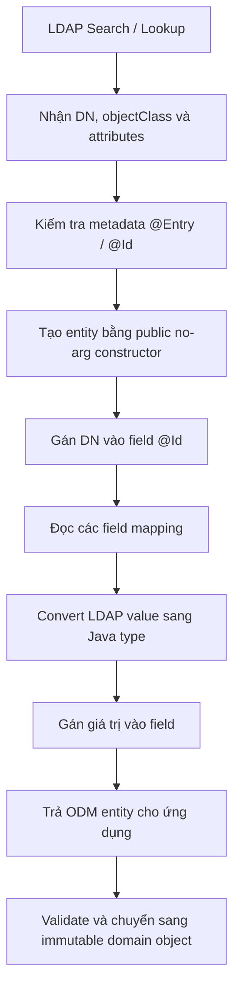

# Yêu cầu khởi tạo đối tượng và giới hạn với mô hình bất biến

> **Chương:** Ánh xạ thực thể  
> **Module:** SPRING_DATA_LDAP — truy cập dịch vụ thư mục LDAP qua Spring Data LDAP bằng mô hình repository và ánh xạ entry phân cấp sang Java; hiểu DN, objectClass, schema, truy vấn repository/LdapTemplate, CRUD, filter an toàn, bảo mật kết nối và kiểm thử với directory.

## Mục tiêu học tập

Sau bài này, bạn có thể:

1. Mô tả vòng đời Spring LDAP Object-Directory Mapping (ODM) khi đọc một LDAP entry thành Java object.
2. Xác định yêu cầu constructor và field mapping của entity ODM.
3. Giải thích vì sao Java record, constructor-only class và field final không phải lựa chọn trực tiếp phù hợp với default ODM.
4. Dùng đúng @Entry, @Id, @Attribute, @DnAttribute và @Transient.
5. Tách entity mutable dùng ở tầng LDAP khỏi domain model bất biến dùng trong nghiệp vụ.
6. Chuyển đổi giữa ODM entity, immutable record và command object một cách tường minh.
7. Xử lý DN, attribute tùy chọn, multi-valued attribute và conversion.
8. Kiểm thử việc khởi tạo, đọc, ghi, cập nhật và các giới hạn của mô hình entity.

## 1. Bài toán: domain muốn bất biến, ODM cần materialize entity

Một ứng dụng quản lý nhân viên muốn biểu diễn hồ sơ bằng một kiểu bất biến:

```java
public record Person(
    Name dn,
    String uid,
    String commonName,
    String email
) {}
```

Record có nhiều ưu điểm ở tầng domain: dữ liệu được truyền rõ ràng, các field không thay đổi sau khi tạo, equals/hashCode và accessor được sinh tự động. Tuy nhiên, khi dùng Spring LDAP ODM, câu hỏi không chỉ là Java có thể tạo object này không mà còn là:

- ODM tạo instance bằng cách nào?
- DN và LDAP attributes được ghi vào object bằng cơ chế nào?
- Object có constructor phù hợp không?
- Các field có thể được mapper gán giá trị sau khi tạo không?
- Entity có thể được ghi ngược về directory không?

Spring LDAP ODM sử dụng mô hình ánh xạ riêng của Spring LDAP. Nó không tự động dùng toàn bộ cơ chế constructor materialization của Spring Data Commons ở các module khác.

**Quyết định thiết kế của bài:** dùng một ODM entity mutable, có constructor không tham số công khai và các field có thể được mapper gán. Sau khi đọc LDAP, chuyển entity thành immutable domain record. Khi ghi, chuyển command/domain object thành ODM entity mới.

Như vậy, lớp tích hợp LDAP đáp ứng cách materialize của ODM, trong khi nghiệp vụ vẫn sử dụng kiểu bất biến.

## 2. Phân biệt Spring LDAP ODM với object mapping của các module Spring Data khác

Tên Spring Data LDAP dễ khiến người học nghĩ rằng entity sẽ được materialize giống hệt Spring Data JDBC, MongoDB hoặc các module sử dụng Spring Data Commons object mapping.

Cần tách hai cơ chế:

| Cơ chế | Vai trò | Cách khởi tạo cần hiểu |
| --- | --- | --- |
| **Spring LDAP ODM** | Map LDAP entry sang class có annotation trong org.springframework.ldap.odm.annotations | Default mapper yêu cầu entity có constructor không tham số công khai và gán dữ liệu vào field |
| **Spring Data Commons object mapping** | Cơ chế mapping chung được một số Spring Data module sử dụng | Có thể chọn constructor/factory method, record canonical constructor và property population theo quy tắc riêng |
| **Mapper tự viết** (ContextMapper, AttributesMapper) | Chuyển dữ liệu LDAP sang kiểu Java do ứng dụng định nghĩa | Ứng dụng tự gọi constructor hoặc factory method phù hợp |

Spring LDAP ODM cung cấp các phương thức object mapping trên LdapOperations, ví dụ:

- findByDn(Name dn, Class<T> clazz);
- findOne(LdapQuery query, Class<T> clazz);
- find(LdapQuery query, Class<T> clazz);
- findAll(Class<T> clazz);
- create(Object entry), update(Object entry) và delete(Object entry).

LdapTemplate sử dụng ObjectDirectoryMapper để thực hiện mapping. Các entity được quản lý phải dùng annotation ODM của Spring LDAP. Spring Data LDAP repository cũng dựa trên mô hình này; tài liệu repository yêu cầu dùng org.springframework.ldap.odm.annotations.Id, không thay bằng annotation @Id của Spring Data.

Đây là điểm quan trọng: **đừng lấy hướng dẫn immutable constructor mapping của một Spring Data module khác rồi áp thẳng vào Spring LDAP ODM.**

Nguồn: [Spring LDAP — Object-Directory Mapping](https://docs.spring.io/spring-ldap/reference/odm.html), [Spring Data LDAP — Repository Configuration](https://docs.spring.io/spring-data/ldap/reference/ldap/configuration.html), [Spring Data — Object Mapping Fundamentals](https://docs.spring.io/spring-data/ldap/reference/data-commons/4.2/object-mapping.html).

## 3. Vòng đời khởi tạo và ánh xạ của default ODM

Khi LdapTemplate materialize một entry thành ODM entity, có thể hình dung các bước chính:



Với default ObjectDirectoryMapper, entity phải có **public zero-argument constructor**. Mapper tạo object trước, sau đó gán DN và các field được ánh xạ. Cách này khác constructor materialization, nơi toàn bộ dữ liệu được truyền vào constructor ngay từ đầu.

Điều đó dẫn tới một số hệ quả:

- Constructor có tham số duy nhất không thay thế được constructor không tham số mà ODM cần.
- Field final không phải đích ghi phù hợp cho mapper gán sau khi tạo object.
- Invariant được kiểm tra trong constructor có thể chưa phản ánh trạng thái cuối cùng, vì field được populate sau đó.
- Entity cần có kiểu field tương thích với LDAP value hoặc có converter phù hợp.
- Các field không thuộc dữ liệu LDAP phải được đánh dấu @Transient.

Nên xem ODM entity như một integration data structure có lifecycle do mapper quản lý. Không nên đặt toàn bộ invariant nghiệp vụ vào constructor của entity này.

## 4. Các annotation và kiểu dữ liệu bắt buộc

### 4.1. @Entry: khai báo object classes

@Entry đặt ở cấp class để mô tả các LDAP objectClass mà entity quản lý:

```java
@Entry(
    base = "ou=people",
    objectClasses = {
        "inetOrgPerson",
        "organizationalPerson",
        "person",
        "top"
    }
)
public class PersonEntry {
    // fields
}
```

base là phần DN gốc tương đối với base path của ContextSource. objectClasses phải phù hợp với schema và loại entry cần quản lý.

Nếu class ánh xạ attribute thuộc inetOrgPerson, cần khai báo object classes tương ứng trong chuỗi kế thừa mà directory sử dụng. Khi tạo entry mới, ODM dùng object classes đã khai báo trong @Entry; server vẫn kiểm tra schema và các attribute bắt buộc.

Không khai báo object class chỉ dựa trên tên Java class. Hãy kiểm tra LDIF thực tế và schema trên directory đích.

### 4.2. @Id: DN phải dùng Name

Field @Id biểu diễn Distinguished Name của entry và phải có kiểu javax.naming.Name hoặc kiểu dẫn xuất phù hợp:

```java
@Id
private Name dn;
```

Không dùng String làm field @Id của ODM chỉ vì DN thường được hiển thị dưới dạng chuỗi. DN có cấu trúc RDN và escaping; Name giữ representation phù hợp cho thao tác LDAP.

Spring Data LDAP repository cũng dùng Name làm kiểu ID mặc định của entity ODM.

### 4.3. @Attribute: ánh xạ LDAP attribute

@Attribute dùng khi tên field Java khác tên attribute LDAP hoặc cần khai báo kiểu/syntax:

```java
@Attribute(name = "cn")
private String commonName;

@Attribute(name = "mail")
private String email;
```

Nếu không có annotation thay đổi mapping, field thường được map theo chính tên field. Vì vậy hãy kiểm tra mọi field trong class: một field nội bộ có tên trùng với attribute LDAP có thể vô tình bị ghi xuống directory.

### 4.4. @DnAttribute: lấy giá trị từ RDN

@DnAttribute lấy giá trị từ thành phần của DN thay vì chỉ đọc attribute thông thường:

```java
@DnAttribute(value = "uid")
private String uid;
```

Chỉ field kiểu String được hỗ trợ cho @DnAttribute. Có thể chọn theo tên RDN hoặc theo index. Khi dùng index, giá trị name bị bỏ qua.

@DnAttribute không tự loại field khỏi attribute mapping. Field vẫn được map thành LDAP attribute theo tên field, trừ khi được đánh dấu thêm @Transient.

Nếu bạn muốn lưu giá trị lấy từ DN nhưng không muốn ghi thành LDAP attribute riêng:

```java
@DnAttribute(value = "ou")
@Transient
private String organizationalUnit;
```

Khi cần ODM tự tính DN để create/update, phải khai báo các thành phần DN bằng @DnAttribute(index = ...) theo đúng thứ tự mà phiên bản Spring LDAP sử dụng. Nếu chưa cần cơ chế đó, cách dễ kiểm soát hơn là gán Name tường minh vào field @Id.

### 4.5. @Transient: loại field khỏi persistence mapping

```java
@Transient
private String displayLabel;
```

Dùng @Transient cho field tính toán, cache cục bộ, dữ liệu phục vụ UI hoặc field không có LDAP attribute tương ứng.

## 5. Xây dựng ODM entity có thể được khởi tạo

Ví dụ entry nhân viên:

```ldif
dn: uid=linh,ou=people,dc=example,dc=org
objectClass: top
objectClass: person
objectClass: organizationalPerson
objectClass: inetOrgPerson
uid: linh
cn: Linh Nguyen
sn: Nguyen
mail: linh@example.org
telephoneNumber: +84-28-5550-1001
```

ODM entity:

```java
package com.example.directory.ldap;

import java.util.ArrayList;
import java.util.List;

import javax.naming.Name;

import org.springframework.ldap.odm.annotations.Attribute;
import org.springframework.ldap.odm.annotations.DnAttribute;
import org.springframework.ldap.odm.annotations.Entry;
import org.springframework.ldap.odm.annotations.Id;
import org.springframework.ldap.odm.annotations.Transient;

@Entry(
    base = "ou=people",
    objectClasses = {
        "inetOrgPerson",
        "organizationalPerson",
        "person",
        "top"
    }
)
public class PersonEntry {

    @Id
    private Name dn;

    @DnAttribute(value = "uid")
    private String uid;

    @Attribute(name = "cn")
    private String commonName;

    @Attribute(name = "sn")
    private String surname;

    @Attribute(name = "mail")
    private String email;

    @Attribute(name = "telephoneNumber")
    private List<String> telephoneNumbers = new ArrayList<>();

    @Transient
    private String displayLabel;

    // Default ODM needs a public zero-argument constructor.
    public PersonEntry() {
    }

    public Name getDn() { return dn; }
    public void setDn(Name dn) { this.dn = dn; }

    public String getUid() { return uid; }
    public void setUid(String uid) { this.uid = uid; }

    public String getCommonName() { return commonName; }
    public void setCommonName(String commonName) { this.commonName = commonName; }

    public String getSurname() { return surname; }
    public void setSurname(String surname) { this.surname = surname; }

    public String getEmail() { return email; }
    public void setEmail(String email) { this.email = email; }

    public List<String> getTelephoneNumbers() { return telephoneNumbers; }
    public void setTelephoneNumbers(List<String> values) {
        this.telephoneNumbers = values;
    }

    public String getDisplayLabel() { return displayLabel; }
    public void setDisplayLabel(String displayLabel) {
        this.displayLabel = displayLabel;
    }
}
```

Các điểm cần chú ý:

- PersonEntry là public và có constructor không tham số public.
- Field dn dùng Name, không phải String.
- uid lấy từ RDN uid và đồng thời vẫn được map theo tên field thành LDAP attribute uid.
- telephoneNumbers là collection cho attribute nhiều giá trị.
- displayLabel không được ghi xuống LDAP vì có @Transient.
- Field không phải final, để mapper có thể gán giá trị sau khi tạo object.

ODM dùng field metadata để map. Getter/setter vẫn hữu ích cho code ứng dụng, nhưng không nên hiểu rằng chỉ cần có setter là có thể bỏ constructor hoặc dùng final field.

## 6. Vì sao constructor-only class và record không phù hợp trực tiếp?

### 6.1. Constructor có tham số duy nhất

Ví dụ:

```java
@Entry(objectClasses = {"inetOrgPerson", "person", "top"})
public class ImmutablePersonEntry {

    @Id
    private final Name dn;

    private final String uid;
    private final String commonName;

    public ImmutablePersonEntry(
            Name dn,
            String uid,
            String commonName) {
        this.dn = dn;
        this.uid = uid;
        this.commonName = commonName;
    }
}
```

Class này không có public constructor không tham số. Default ODM không thể khởi tạo theo lifecycle mà nó yêu cầu. Khi class được quản lý, metadata validation có thể báo entity thiếu zero-argument constructor; nếu đi đến bước instantiate, việc tạo instance cũng thất bại.

### 6.2. Java record

```java
@Entry(objectClasses = {"inetOrgPerson", "person", "top"})
public record PersonRecord(
    @Id Name dn,
    String uid,
    @Attribute(name = "cn") String commonName
) {}
```

Record chỉ có canonical constructor; các component là final. Record phù hợp khi ứng dụng tự tạo object bằng constructor, nhưng không phải entity ODM trực tiếp theo default ObjectDirectoryMapper.

### 6.3. Field final không phải giải pháp

Một số kỹ thuật reflection có thể thay đổi một số final field trong những tình huống nhất định của JVM. Không nên dựa vào hành vi đó làm contract persistence:

- ODM gán field sau constructor;
- final field được thiết kế để không thay đổi sau khi object được tạo;
- khả năng truy cập final field có thể chịu ảnh hưởng bởi runtime/module access;
- object có thể đã được constructor dùng để tính toán invariant từ giá trị ban đầu;
- kết quả có thể khác giữa JDK và môi trường triển khai.

**Không thiết kế ODM entity dựa trên giả định rằng reflection sẽ sửa được mọi final field.**

## 7. Giữ domain model bất biến bằng một lớp chuyển đổi

Không cần làm domain object mutable chỉ để tương thích với ODM. Tách hai kiểu:

- PersonEntry: mutable, thuộc adapter LDAP và tuân theo ODM.
- Person: immutable, thuộc application/domain layer.

Ví dụ domain record:

```java
package com.example.directory.domain;

import java.util.List;
import javax.naming.Name;

public record Person(
    Name dn,
    String uid,
    String commonName,
    String surname,
    String email,
    List<String> telephoneNumbers
) {
    public Person {
        telephoneNumbers = telephoneNumbers == null
            ? List.of()
            : List.copyOf(telephoneNumbers);
    }
}
```

Mapper một chiều từ ODM entity sang domain object:

```java
package com.example.directory.mapping;

import com.example.directory.domain.Person;
import com.example.directory.ldap.PersonEntry;

public final class PersonMapper {

    private PersonMapper() {
    }

    public static Person toDomain(PersonEntry entry) {
        return new Person(
            entry.getDn(),
            entry.getUid(),
            entry.getCommonName(),
            entry.getSurname(),
            entry.getEmail(),
            entry.getTelephoneNumbers()
        );
    }
}
```

Ứng dụng truy vấn bằng LdapTemplate, sau đó chuyển ngay kết quả:

```java
package com.example.directory.service;

import static org.springframework.ldap.query.LdapQueryBuilder.query;

import java.util.List;

import org.springframework.ldap.core.LdapOperations;
import org.springframework.stereotype.Service;

import com.example.directory.domain.Person;
import com.example.directory.ldap.PersonEntry;
import com.example.directory.mapping.PersonMapper;

@Service
public class PersonDirectoryService {

    private final LdapOperations ldap;

    public PersonDirectoryService(LdapOperations ldap) {
        this.ldap = ldap;
    }

    public List<Person> findBySurname(String surname) {
        List<PersonEntry> entries = ldap.find(
            query()
                .base("ou=people")
                .where("objectClass").is("inetOrgPerson")
                .and("sn").is(surname),
            PersonEntry.class
        );

        return entries.stream()
            .map(PersonMapper::toDomain)
            .toList();
    }
}
```

Từ thời điểm chuyển đổi xong, phần còn lại của ứng dụng chỉ nhận Person bất biến. Không để PersonEntry rò rỉ ra controller, message event hoặc business service.

### Vì sao cách tách này hữu ích?

1. Mapper ODM có một class phù hợp với cách khởi tạo và field population.
2. Domain object có constructor thể hiện invariant.
3. Ứng dụng không thể vô tình thay đổi dữ liệu sau khi đọc.
4. Thay đổi annotation LDAP không buộc thay đổi public domain API.
5. Có thể thay LDAP bằng nguồn dữ liệu khác mà không đổi kiểu domain.

## 8. Khi không cần ODM: map thẳng LDAP result sang immutable record

Nếu use case chỉ đọc và không cần LdapTemplate.find(..., Entity.class), bạn có thể dùng ContextMapper hoặc AttributesMapper để gọi constructor của record trực tiếp.

Ví dụ:

```java
import static org.springframework.ldap.query.LdapQueryBuilder.query;

import java.util.List;

import org.springframework.ldap.core.ContextMapper;
import org.springframework.ldap.core.DirContextOperations;
import org.springframework.ldap.core.LdapOperations;

public class PersonReadRepository {

    private final LdapOperations ldap;

    public PersonReadRepository(LdapOperations ldap) {
        this.ldap = ldap;
    }

    public List<Person> findByUid(String uid) {
        return ldap.search(
            query()
                .base("ou=people")
                .where("objectClass").is("inetOrgPerson")
                .and("uid").is(uid)
                .attributes("uid", "cn", "sn", "mail"),
            (ContextMapper<Person>) context -> {
                DirContextOperations entry =
                    (DirContextOperations) context;

                return new Person(
                    entry.getDn(),
                    entry.getStringAttribute("uid"),
                    entry.getStringAttribute("cn"),
                    entry.getStringAttribute("sn"),
                    entry.getStringAttribute("mail"),
                    List.of()
                );
            }
        );
    }
}
```

Đây là mapping do ứng dụng viết, không phải ODM. Constructor của record được gọi trực tiếp nên không cần no-argument constructor cho record đó.

Nếu cần multi-valued attributes, hãy đọc chúng qua API attribute phù hợp của DirContextOperations/JNDI và convert rõ ràng. Không thay dữ liệu nhiều giá trị bằng List.of() trong production nếu use case cần chúng.

### Chọn cách nào?

| Nhu cầu | Lựa chọn |
| --- | --- |
| CRUD entry qua LdapTemplate.create/update/delete | ODM entity |
| Spring Data LDAP repository | ODM entity theo annotation Spring LDAP |
| Read-only projection sang record | ContextMapper/AttributesMapper |
| Domain model có invariant và collection bất biến | Immutable record/class ở tầng domain |
| Mapping binary hoặc kiểu đặc thù | ODM + converter, hoặc mapper tự viết |
| Không muốn annotation LDAP xuất hiện trong domain | Giữ annotation ở adapter entity |

## 9. Tạo và cập nhật entry: chuyển command sang ODM entity

Đối với thao tác ghi, ứng dụng nên nhận một command/domain object, xác thực dữ liệu, rồi tạo PersonEntry mới.

Ví dụ command:

```java
package com.example.directory.domain;

public record CreatePersonCommand(
    String uid,
    String commonName,
    String surname,
    String email
) {}
```

Mapper từ command sang ODM entity:

```java
package com.example.directory.mapping;

import javax.naming.Name;

import org.springframework.ldap.support.LdapNameBuilder;

import com.example.directory.domain.CreatePersonCommand;
import com.example.directory.ldap.PersonEntry;

public final class PersonWriteMapper {

    private PersonWriteMapper() {
    }

    public static PersonEntry toEntry(CreatePersonCommand command) {
        PersonEntry entry = new PersonEntry();

        Name dn = LdapNameBuilder.newInstance("ou=people")
            .add("uid", command.uid())
            .build();

        entry.setDn(dn);
        entry.setUid(command.uid());
        entry.setCommonName(command.commonName());
        entry.setSurname(command.surname());
        entry.setEmail(command.email());

        return entry;
    }
}
```

Service ghi:

```java
import org.springframework.ldap.core.LdapOperations;
import org.springframework.stereotype.Service;

@Service
public class PersonWriteService {

    private final LdapOperations ldap;

    public PersonWriteService(LdapOperations ldap) {
        this.ldap = ldap;
    }

    public void create(CreatePersonCommand command) {
        validate(command);
        PersonEntry entry = PersonWriteMapper.toEntry(command);
        ldap.create(entry);
    }

    private static void validate(CreatePersonCommand command) {
        if (command.uid() == null || command.uid().isBlank()) {
            throw new IllegalArgumentException("uid is required");
        }
        if (command.commonName() == null || command.commonName().isBlank()) {
            throw new IllegalArgumentException("commonName is required");
        }
        if (command.surname() == null || command.surname().isBlank()) {
            throw new IllegalArgumentException("surname is required");
        }
    }
}
```

LdapNameBuilder tạo DN theo cấu trúc RDN; không nối chuỗi DN bằng dấu phẩy. Ví dụ trên giả định base ContextSource tương thích với DN tương đối ou=people,uid=... và schema cho phép entry đó.

Khi dùng @DnAttribute(index = ...) đầy đủ, ODM có thể tính DN từ các field RDN. Khi chưa cấu hình đủ các thành phần DN hoặc muốn kiểm soát chính xác naming context, gán Name vào @Id như ví dụ sẽ rõ ràng hơn.

### Lưu ý về update

Nếu thay đổi field tham gia DN, đây có thể là thao tác rename/move entry, không chỉ là sửa attribute. Cần kiểm tra @DnAttribute, DN hiện tại và DN đích; kiểm thử trên directory test trước khi ghi production.

Nếu field không thuộc DN như mail thay đổi, DN vẫn giữ nguyên. Không dùng email làm DN chỉ để đơn giản hóa mapper.

## 10. Attribute tùy chọn, collection và conversion

### 10.1. Attribute có thể vắng mặt

Không phải LDAP attribute nào cũng có mặt trên mọi entry. Ví dụ mail có thể tùy chọn:

```java
@Attribute(name = "mail")
private String email;
```

Mapper có thể để field là null nếu attribute không tồn tại hoặc không được trả về. Vì vậy:

- Không gọi email.toLowerCase() khi chưa kiểm tra null.
- Phân biệt attribute tùy chọn với attribute bắt buộc theo nghiệp vụ.
- Validate sau khi materialize nếu cần bảo đảm dữ liệu bắt buộc.
- Không tự tạo giá trị mặc định rồi ghi ngược về LDAP nếu chưa có policy.

### 10.2. Attribute nhiều giá trị

LDAP cho phép attribute có nhiều giá trị. Ví dụ telephoneNumber, memberOf hoặc uniqueMember có thể được biểu diễn bằng collection Java nếu schema/server và mapping type phù hợp.

```java
@Attribute(name = "telephoneNumber")
private List<String> telephoneNumbers = new ArrayList<>();
```

Không khai báo String cho attribute có thể có nhiều giá trị rồi giả định chỉ có một. Cần kiểm tra collection type và converter với version Spring LDAP đang dùng.

### 10.3. Binary và kiểu Java đặc thù

Một số attribute là binary, ví dụ ảnh/chứng thư hoặc identifier dạng byte. Không ép tất cả LDAP value thành String. @Attribute hỗ trợ khai báo mapping/syntax; ObjectDirectoryMapper cũng hỗ trợ ConversionService để đăng ký converter phù hợp.

Với Spring Boot, custom Converter bean có thể được sử dụng bởi cấu hình ODM do Boot cung cấp. Khi tự cấu hình LdapTemplate, có thể cung cấp ObjectDirectoryMapper được cấu hình ConversionService.

Ví dụ khái niệm:

```java
@Component
public class DirectoryStatusConverter
        implements Converter<String, AccountStatus> {

    @Override
    public AccountStatus convert(String source) {
        return switch (source) {
            case "active" -> AccountStatus.ACTIVE;
            case "disabled" -> AccountStatus.DISABLED;
            default -> AccountStatus.UNKNOWN;
        };
    }
}
```

AccountStatus là enum của ứng dụng. Khi dùng converter hai chiều để ghi LDAP, cần định nghĩa converter chiều ngược lại và xử lý giá trị không nhận diện được. Không giả định một converter đọc tự động đủ cho create/update.

## 11. Constructor không phải nơi duy nhất để bảo vệ invariant

Với immutable domain object, constructor có thể là nơi kiểm tra invariant vì mọi field được truyền vào cùng lúc:

```java
public record Person(
    String uid,
    String commonName,
    String email
) {
    public Person {
        if (uid == null || uid.isBlank()) {
            throw new IllegalArgumentException("uid is required");
        }
        if (commonName == null || commonName.isBlank()) {
            throw new IllegalArgumentException("commonName is required");
        }
    }
}
```

Nhưng ODM entity được populate sau khi constructor chạy. Do đó không nên giả định constructor của PersonEntry đã thấy dữ liệu LDAP hoàn chỉnh.

Có thể đặt một bước validation sau mapping:

```java
public final class PersonEntryValidator {

    private PersonEntryValidator() {
    }

    public static void validate(PersonEntry entry) {
        if (entry.getDn() == null) {
            throw new IllegalStateException("DN is missing");
        }
        if (entry.getUid() == null || entry.getUid().isBlank()) {
            throw new IllegalStateException("uid is missing");
        }
        if (entry.getCommonName() == null
                || entry.getCommonName().isBlank()) {
            throw new IllegalStateException("cn is missing");
        }
    }
}
```

Sau đó mới chuyển sang domain record:

```java
PersonEntry entry = ldap.findByDn(dn, PersonEntry.class);
PersonEntryValidator.validate(entry);
Person person = PersonMapper.toDomain(entry);
```

Điều này giúp phân biệt lỗi mapping/schema với lỗi invariant nghiệp vụ.

## 12. Repository và ODM: annotation phải đúng namespace

Ví dụ repository:

```java
import java.util.List;

import org.springframework.data.ldap.repository.LdapRepository;

public interface PersonRepository
        extends LdapRepository<PersonEntry> {

    List<PersonEntry> findBySurname(String surname);
}
```

Entity PersonEntry phải dùng annotation ODM của Spring LDAP:

- org.springframework.ldap.odm.annotations.Entry;
- org.springframework.ldap.odm.annotations.Id;
- org.springframework.ldap.odm.annotations.Attribute;
- org.springframework.ldap.odm.annotations.DnAttribute;
- org.springframework.ldap.odm.annotations.Transient.

Đừng thay @Id bằng annotation cùng tên của org.springframework.data.annotation.Id. Spring Data LDAP repository dùng mapping layer của Spring LDAP và yêu cầu ID có kiểu javax.naming.Name.

Repository giúp giảm boilerplate cho CRUD/query, nhưng không thay đổi giới hạn khởi tạo của ODM entity. Nếu PersonEntry không có constructor/field model phù hợp, việc gọi repository vẫn gặp vấn đề mapping tương tự LdapTemplate.find().

Theo tài liệu Spring Data LDAP, paging và sorting không được hỗ trợ theo cách repository thông thường do đặc thù LDAP protocol.

## 13. Các lỗi thường gặp

| Triệu chứng | Nguyên nhân | Cách xử lý |
| --- | --- | --- |
| ODM báo thiếu zero-argument constructor | Class chỉ có constructor tham số hoặc constructor không public | Thêm public no-arg constructor cho ODM entity |
| Không khởi tạo được Java record | Record không có no-arg constructor; component là final | Dùng mutable ODM entity hoặc mapper trực tiếp sang record |
| Field luôn null | Sai tên attribute, thiếu @Attribute, attribute không có hoặc ACL không trả | Kiểm tra LDAP entry, annotation và requested/visible attributes |
| Field final không được populate | ODM cần gán field sau constructor | Dùng field không final trong ODM entity |
| Field nội bộ bị ghi xuống LDAP | Mọi field thường được map theo tên mặc định | Đánh dấu @Transient |
| DN không được tính đúng | @DnAttribute thiếu index hoặc index sai | Kiểm tra thứ tự RDN/base và cung cấp Name tường minh |
| @DnAttribute không map kiểu UUID | Annotation chỉ hỗ trợ String | Lấy DN value thành String rồi convert ở mapper/domain |
| Create entry bị schema violation | objectClasses hoặc attribute bắt buộc không đúng schema | Kiểm tra schema/LDIF và @Entry |
| Multi-valued attribute mất giá trị | Dùng scalar type hoặc converter sai | Dùng collection phù hợp và test nhiều values |
| Repository không nhận ID | Dùng nhầm Spring Data @Id hoặc field ID không phải Name | Dùng ODM @Id và javax.naming.Name |
| Constructor tạo default nhưng field sau đó đổi | ODM populate field sau constructor | Không đặt invariant cuối cùng chỉ trong constructor ODM |
| Domain object bị sửa ngoài ý muốn | Trả ODM entity mutable ra ngoài service | Map sang immutable domain record |

## 14. Kiểm thử constructor và mapping

Nên có unit test kiểm tra cấu trúc entity trước khi kết nối directory.

### 14.1. Kiểm tra constructor không tham số

```java
import static org.junit.jupiter.api.Assertions.assertDoesNotThrow;
import static org.junit.jupiter.api.Assertions.assertNotNull;

import org.junit.jupiter.api.Test;

class PersonEntryConstructionTest {

    @Test
    void hasPublicNoArgumentConstructor() throws Exception {
        var constructor = PersonEntry.class.getConstructor();

        assertNotNull(constructor);
        assertDoesNotThrow(constructor::newInstance);
    }
}
```

Test này kiểm tra shape của class. Nó chưa chứng minh schema hoặc LDAP mapping hoạt động.

### 14.2. Test mapper sang immutable domain

```java
import static org.junit.jupiter.api.Assertions.assertEquals;

import java.util.List;
import javax.naming.ldap.LdapName;

import org.junit.jupiter.api.Test;

class PersonMapperTest {

    @Test
    void mapsMutableEntryToImmutablePerson() throws Exception {
        PersonEntry entry = new PersonEntry();
        entry.setDn(new LdapName(
            "uid=linh,ou=people,dc=example,dc=org"));
        entry.setUid("linh");
        entry.setCommonName("Linh Nguyen");
        entry.setSurname("Nguyen");
        entry.setEmail("linh@example.org");
        entry.setTelephoneNumbers(List.of("+84-28-5550-1001"));

        Person person = PersonMapper.toDomain(entry);

        assertEquals("linh", person.uid());
        assertEquals("Linh Nguyen", person.commonName());
        assertEquals(1, person.telephoneNumbers().size());
    }
}
```

### 14.3. Integration test với LDAP

Trên embedded LDAP hoặc directory test, kiểm tra:

1. findByDn materialize đúng entity;
2. findOne và find map đúng @Entry/@Attribute;
3. DN được gán vào field @Id;
4. @DnAttribute đọc đúng RDN;
5. Attribute tùy chọn thiếu không làm mapper crash ngoài ý muốn;
6. Multi-valued attribute map đủ giá trị;
7. create dùng object classes và attributes đúng schema;
8. update thay đổi attribute đúng;
9. delete chỉ xóa fixture trong test directory;
10. Entity thiếu public no-arg constructor bị từ chối;
11. Entity dùng final/constructor-only fields không được coi là mô hình ODM được hỗ trợ;
12. Record immutable vẫn hoạt động khi map bằng ContextMapper tự viết.

### Ma trận test

| Test | Dữ liệu/kịch bản | Kỳ vọng |
| --- | --- | --- |
| **T1** | Entity có public no-arg constructor | ODM quản lý class |
| **T2** | Entity chỉ có constructor tham số | ODM báo lỗi khởi tạo/metadata |
| **T3** | Entity là record | Không dùng trực tiếp với default ODM |
| **T4** | @Id Name hợp lệ | DN được map đúng |
| **T5** | @Id String | Metadata validation thất bại |
| **T6** | @Transient trên field nội bộ | Field không được ghi thành LDAP attribute |
| **T7** | @DnAttribute với String | RDN được map vào field |
| **T8** | @DnAttribute với kiểu khác String | Metadata validation thất bại |
| **T9** | Attribute tùy chọn không tồn tại | Field giữ trạng thái vắng mặt/null theo mapping |
| **T10** | Multi-valued attribute | Collection nhận đủ giá trị |
| **T11** | Schema thiếu object class | Create/update bị directory từ chối |
| **T12** | Mapper sang domain record | Domain object được tạo qua constructor |
| **T13** | Repository dùng sai @Id namespace | Repository mapping không hoạt động đúng |
| **T14** | Custom converter hai chiều | Read/write chuyển kiểu đúng |
| **T15** | DN field thay đổi | Kiểm tra rename/move semantics, không chỉ attribute modify |

## 15. Hướng dẫn lựa chọn mô hình theo use case

| Use case | Thiết kế phù hợp |
| --- | --- |
| Ứng dụng nhỏ, CRUD LDAP đơn giản | ODM entity mutable với public no-arg constructor |
| Domain cần bất biến nghiêm ngặt | ODM entity ở adapter, immutable domain model ở application layer |
| Chỉ đọc và muốn trả record | ContextMapper/AttributesMapper gọi constructor trực tiếp |
| Cần map attribute kiểu đặc biệt | ODM ConversionService/custom converter hoặc mapper tự viết |
| Cần logic DN phức tạp | Tạo Name bằng LdapNameBuilder, kiểm tra @DnAttribute và rename behavior |
| Entity có nhiều invariant nghiệp vụ | Validate sau ODM mapping rồi tạo domain object |
| Repository Spring Data LDAP | Entity dùng đúng annotation ODM và ID kiểu Name |

Không có yêu cầu phải dùng ODM cho mọi query. LdapTemplate.search với mapper tùy chỉnh là lựa chọn phù hợp khi entity LDAP không nên trở thành model domain.

## 16. Checklist thiết kế entity

- [ ] Entity có @Entry và khai báo object classes phù hợp schema.
- [ ] Field @Id dùng javax.naming.Name.
- [ ] Default ODM entity có public no-argument constructor.
- [ ] Các field cần mapper populate không khai báo final.
- [ ] Field không thuộc LDAP được đánh dấu @Transient.
- [ ] @Attribute chỉ rõ tên LDAP khi khác tên Java.
- [ ] @DnAttribute chỉ dùng với field String.
- [ ] Hiểu @DnAttribute cũng map thành LDAP attribute nếu không có @Transient.
- [ ] Multi-valued attribute dùng collection và converter tương thích.
- [ ] Attribute tùy chọn được xử lý null.
- [ ] Invariant nghiệp vụ được validate sau khi ODM materialize.
- [ ] Entity mutable không rò rỉ qua domain/API boundary.
- [ ] Immutable record được tạo qua mapper/constructor riêng.
- [ ] Repository dùng annotation ODM của Spring LDAP, không dùng nhầm Spring Data @Id.
- [ ] Có integration test cho constructor, DN, schema, conversion và CRUD.

## 17. Câu hỏi tự đánh giá

**Câu 1.** Vì sao một Java record không phải ODM entity trực tiếp phù hợp với default Spring LDAP ODM?  
**Đáp án:** Record chỉ có canonical constructor và component final; default ODM tạo instance bằng public constructor không tham số rồi populate field sau đó.

**Câu 2.** Field @Id của Spring LDAP ODM nên dùng kiểu gì?  
**Đáp án:** javax.naming.Name, vì ID biểu diễn DN có cấu trúc.

**Câu 3.** @DnAttribute hỗ trợ field kiểu UUID trực tiếp không?  
**Đáp án:** Không. Field @DnAttribute chỉ hỗ trợ String; có thể chuyển đổi sau ở mapper/domain layer.

**Câu 4.** @DnAttribute có tự ngăn field được ghi thành LDAP attribute không?  
**Đáp án:** Không. Field vẫn được map theo tên field, trừ khi được đánh dấu thêm @Transient.

**Câu 5.** Có nên đặt invariant cuối cùng trong constructor của ODM entity không?  
**Đáp án:** Không nên dựa vào đó, vì ODM populate các field sau constructor. Hãy validate sau mapping rồi tạo domain object.

**Câu 6.** Muốn giữ domain bất biến nhưng vẫn dùng Spring Data LDAP repository, nên làm gì?  
**Đáp án:** Dùng ODM entity mutable làm adapter/repository type, rồi chuyển sang immutable domain model ở service boundary.

**Câu 7.** @Transient có tác dụng gì?  
**Đáp án:** Loại field khỏi LDAP persistence mapping, thích hợp cho computed/internal state.

**Câu 8.** Nếu chỉ cần đọc LDAP vào record, có bắt buộc phải dùng ODM không?  
**Đáp án:** Không. Có thể dùng ContextMapper hoặc AttributesMapper và tự gọi constructor của record.

## Tài liệu tham khảo

- [Spring LDAP — Object-Directory Mapping](https://docs.spring.io/spring-ldap/reference/odm.html)
- [Spring LDAP — ObjectDirectoryMapper API](https://docs.spring.io/spring-ldap/reference/api/java/org/springframework/ldap/odm/core/ObjectDirectoryMapper.html)
- [Spring LDAP — DefaultObjectDirectoryMapper API](https://docs.spring.io/spring-ldap/reference/api/java/org/springframework/ldap/odm/core/impl/DefaultObjectDirectoryMapper.html)
- [Spring LDAP — LdapOperations API](https://docs.spring.io/spring-ldap/reference/api/java/org/springframework/ldap/core/LdapOperations.html)
- [Spring Data LDAP — Repository Configuration](https://docs.spring.io/spring-data/ldap/reference/ldap/configuration.html)
- [Spring Data — Object Mapping Fundamentals](https://docs.spring.io/spring-data/ldap/reference/data-commons/4.2/object-mapping.html)
- [RFC 4512 — LDAP Directory Information Models](https://www.rfc-editor.org/rfc/rfc4512.html)
- [RFC 4514 — LDAP Distinguished Names](https://www.rfc-editor.org/rfc/rfc4514.html)

