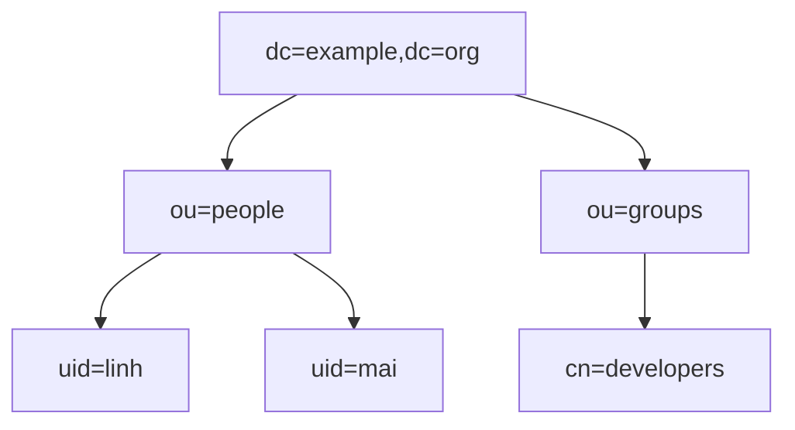
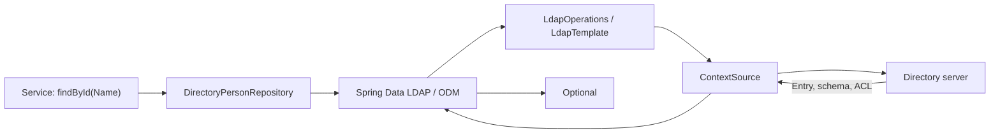
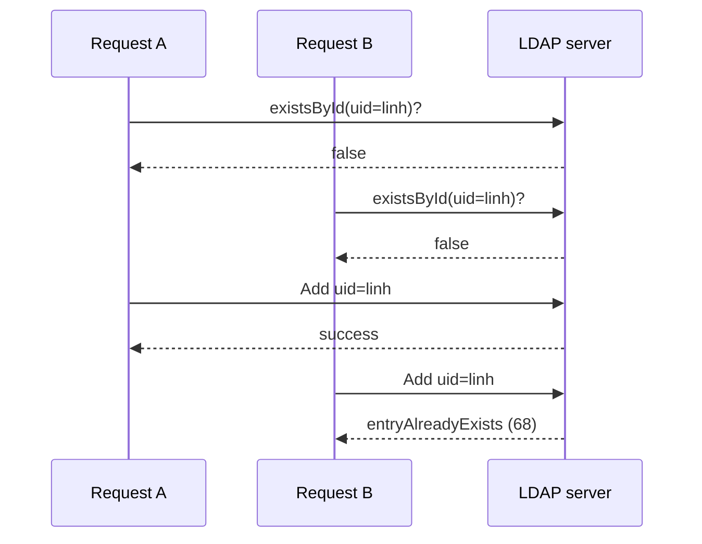

# Đọc theo DN bằng findById và kiểm tra tồn tại

> **Chương:** LDAP Repository  
> **Module:** SPRING_DATA_LDAP — làm việc với dịch vụ thư mục LDAP bằng Spring Data LDAP repository, ánh xạ entry phân cấp qua Spring LDAP ODM, truy vấn, CRUD, filter an toàn và kiểm thử directory.

## Mục tiêu học tập

Sau bài này, bạn có thể:

1. Giải thích vì sao **ID của một Spring Data LDAP entity là DN (`javax.naming.Name`)** chứ không phải số nguyên hay đơn thuần là giá trị `uid`.
2. Dùng `LdapRepository<T>.findById(Name)` để đọc entry tại một DN xác định, xử lý `Optional<T>` đúng cách.
3. Dùng `existsById(Name)` để hỏi entry có tồn tại theo repository và phân biệt kết quả `false` với **lỗi truy cập/kết nối**.
4. Tạo DN bằng `LdapNameBuilder`, hiểu sự kết hợp giữa `spring.ldap.base` và `@Entry.base`, tránh nối DN hai lần hoặc làm sai escaping.
5. Phân biệt đọc theo DN với tìm theo thuộc tính (`findByUid`, `findOne(LdapQuery)`), và chọn cách tối ưu cho từng nghiệp vụ.
6. Không dùng phép kiểm tra tồn tại để suy ra quyền ghi hoặc loại bỏ race condition; xử lý xung đột, ACL, replica chậm và trường hợp entry được rename/move.
7. Xây dựng unit test/integration test xác minh lookup đúng DN, entry thiếu, DN chứa ký tự đặc biệt và hành vi của directory test.

## 1. Bài toán: biết DN thì đọc thẳng entry

Giả sử hệ thống quản lý nhân viên đã biết DN của tài khoản:

```text
uid=linh,ou=people,dc=example,dc=org
```

Với LDAP, đây không chỉ là một chuỗi mô tả người dùng. **Distinguished Name (DN)** là tên phân biệt một entry trong cây thông tin thư mục (**Directory Information Tree — DIT**). Nếu biết chính xác DN, ứng dụng có thể yêu cầu đọc entry tại vị trí đó mà không cần duyệt toàn bộ nhánh để lọc theo thuộc tính.



Entry thử nghiệm:

```ldif
dn: uid=linh,ou=people,dc=example,dc=org
objectClass: top
objectClass: person
objectClass: organizationalPerson
objectClass: inetOrgPerson
uid: linh
cn: Linh Nguyen
sn: Nguyen
mail: linh@example.org
```

Một `inetOrgPerson` chuẩn kế thừa các lớp `person` và `organizationalPerson`; `cn` và `sn` là hai thuộc tính **bắt buộc theo schema**. `uid` và `mail` là thuộc tính được phép, trong đó `uid` được dùng làm Relative Distinguished Name (**RDN**) của entry này.

**Câu hỏi nghiệp vụ:**

- “Hãy lấy tài khoản ở đúng DN `uid=linh,ou=people,...`” → dùng **`findById(Name)`**.
- “DN này hiện có entry được repository quản lý hay không?” → dùng **`existsById(Name)`**.
- “Hãy tìm tài khoản có `uid=linh` ở bất kỳ nhánh được phép nào” → cần **truy vấn theo thuộc tính**, không thay `uid` cho DN.
- “Tôi có thể tạo lại người dùng tại DN này không?” → không thể chỉ dựa vào `existsById`, vì có thể có client khác ghi giữa lúc kiểm tra và lúc Add.

## 2. DN là identifier của Spring Data LDAP repository

Spring Data LDAP triển khai repository trên Spring LDAP Object-Directory Mapping (**ODM**). Điểm khác với Spring Data JPA là ID của LDAP entry mang kiểu **`javax.naming.Name`**.

Javadoc định nghĩa:

```java
public interface LdapRepository<T>
        extends ListCrudRepository<T, Name> {
    // Các phương thức bổ sung nhận LdapQuery ...
}
```

`LdapRepository<T>` chỉ có **một type parameter**, vì kiểu ID được cố định là `Name`. Các method `findById` và `existsById` được kế thừa từ Spring Data Commons repository interface.

| API | Tham số | Kiểu trả về | Ý nghĩa |
| --- | --- | --- | --- |
| `findById(Name dn)` | DN của entry | `Optional<T>` | Trả entity nếu tìm được và map đúng; rỗng nếu không tìm được theo semantics repository |
| `existsById(Name dn)` | DN của entry | `boolean` | Hỏi entry có hiện diện theo cách kiểm tra của repository hay không |
| `findAllById(Iterable<Name>)` | Tập DN | `List<T>` | Đọc một số entry theo DN; không mặc định là một search giao thức duy nhất |
| `findOne(LdapQuery query)` | Filter/base/scope | `Optional<T>` | Tìm **theo điều kiện** chứ không phải ID |
| `findAll(LdapQuery query)` | Filter/base/scope | `List<T>` | Lấy các entry khớp truy vấn |

**Không viết** `LdapRepository<DirectoryPerson, String>` hay `LdapRepository<DirectoryPerson, Long>` như repository JPA. Cũng không truyền `repo.findById("linh")`: `String` không phải `Name` và `linh` không phải DN.

Nguồn: [Spring Data LDAP — Repository Configuration](https://docs.spring.io/spring-data/ldap/reference/ldap/configuration.html), [Javadoc `LdapRepository`](https://docs.spring.io/spring-data/ldap/reference/api/java/org/springframework/data/ldap/repository/LdapRepository.html), [Javadoc `SimpleLdapRepository`](https://docs.spring.io/spring-data/ldap/reference/api/java/org/springframework/data/ldap/repository/support/SimpleLdapRepository.html).

### DN không nhất thiết bất biến

DN chứa vị trí của entry trong cây. Nếu tài khoản `uid=linh` được chuyển từ `ou=people` sang `ou=alumni` hoặc được đổi RDN, **DN cũ không còn định danh vị trí mới**.

Vì vậy, DN gần giống “khóa định danh” cho LDAP lookup nhưng **không phải primary key bất biến theo thời gian**. Nếu hệ thống đơn hàng/nhân sự cần liên kết dài hạn, nên chọn định danh ổn định mà directory và tổ chức thực sự hỗ trợ (ví dụ mã nội bộ có chính sách bất biến hoặc identifier chuyên dụng). Không mặc định `uid`/email hay DN luôn bất biến.

## 3. Entity `@Entry` và `@Id` đúng kiểu

Để repository map được entry trên thành Java object, cần metadata Spring LDAP ODM. Ví dụ:

```java
package com.example.directory.ldap;

import javax.naming.Name;

import org.springframework.ldap.odm.annotations.Attribute;
import org.springframework.ldap.odm.annotations.Entry;
import org.springframework.ldap.odm.annotations.Id;
import org.springframework.ldap.odm.annotations.Transient;

@Entry(
    base = "ou=people",
    objectClasses = {
        "top", "person", "organizationalPerson", "inetOrgPerson"
    }
)
public class DirectoryPerson {

    // ID LDAP chính là Distinguished Name.
    @Id
    private Name dn;

    @Attribute(name = "uid")
    private String uid;

    @Attribute(name = "cn")
    private String commonName;

    @Attribute(name = "sn")
    private String surname;

    @Attribute(name = "mail")
    private String email;

    @Transient
    private String displayText;

    public DirectoryPerson() {}

    public Name getDn() { return dn; }
    public void setDn(Name dn) { this.dn = dn; }

    public String getUid() { return uid; }
    public void setUid(String uid) { this.uid = uid; }

    public String getCommonName() { return commonName; }
    public void setCommonName(String commonName) {
        this.commonName = commonName;
    }

    public String getSurname() { return surname; }
    public void setSurname(String surname) {
        this.surname = surname;
    }

    public String getEmail() { return email; }
    public void setEmail(String email) { this.email = email; }

    public String getDisplayText() { return displayText; }
    public void setDisplayText(String displayText) {
        this.displayText = displayText;
    }
}
```

Các điểm phải nhớ:

- `@Entry`, `@Id`, `@Attribute` và `@Transient` đến từ package **`org.springframework.ldap.odm.annotations`**.
- `@Id` dùng **`javax.naming.Name`**, không dùng `jakarta.persistence.Id` hay `org.springframework.data.annotation.Id`.
- `@Attribute(name="cn")` ánh xạ field Java `commonName` sang LDAP attribute `cn`. Tương tự, `surname` phải được map sang `sn`.
- `@Entry.objectClasses` định nghĩa loại entry mà ODM quản lý. Schema của directory vẫn là nơi kiểm tra các `MUST/MAY`, và user bind phải có quyền đọc entry.
- `@Transient` ngăn field `displayText` chỉ dành cho UI bị coi là một LDAP attribute không được schema cho phép.
- **`@DnAttribute` không bắt buộc cho thao tác đọc khi đã có DN**. Nó hữu ích khi cần trích/cấu thành DN từ giá trị field, đặc biệt cho việc tạo mới entity. Đừng thêm `@DnAttribute` chỉ vì dùng `findById`.

## 4. Repository interface tối giản

Trong cùng ứng dụng Spring:

```java
package com.example.directory.ldap;

import org.springframework.data.ldap.repository.LdapRepository;

public interface DirectoryPersonRepository
        extends LdapRepository<DirectoryPerson> {

    // findById(Name), existsById(Name) đã kế thừa.
}
```

Không cần tự định nghĩa `findById(Name)` hay `existsById(Name)` trong interface; chúng đã có sẵn. Spring Data LDAP tạo implementation khi repository scanning/configuration hợp lệ.

Ứng dụng Spring Boot có thể dùng starter:

```xml
<dependency>
    <groupId>org.springframework.boot</groupId>
    <artifactId>spring-boot-starter-data-ldap</artifactId>
</dependency>
```

Ví dụ `application.yml` cho directory test:

```yaml
spring:
  ldap:
    urls: "ldap://localhost:389"
    base: "dc=example,dc=org"
    username: "${LDAP_BIND_DN}"
    password: "${LDAP_BIND_PASSWORD}"
```

`localhost` chỉ là ví dụ khi LDAP server test chạy cùng mạng/host với tiến trình ứng dụng. Khi triển khai thực, dùng **LDAPS hoặc StartTLS**, xác thực chứng chỉ và quản lý secret phù hợp; không gửi simple-bind password trên mạng không bảo vệ.

Nếu repository nằm ngoài phạm vi quét mặc định, có thể cấu hình `@EnableLdapRepositories(basePackages = "...")`. Khi có nhiều `LdapTemplate`, cần chỉ định đúng bean thông qua `ldapTemplateRef` để repository kết nối directory mà bạn định đọc.

### Luồng từ repository đến server



Repository không là LDAP server và không lưu một bản sao tài khoản trong bộ nhớ. Nó gửi thao tác thông qua Spring LDAP; directory quyết định entry có khả dụng và thuộc tính nào được trả về.

## 5. Full DN và DN tương đối với `ContextSource.base`

Đây là nguồn lỗi phổ biến nhất khi dùng `findById`.

Giả sử:

```yaml
spring:
  ldap:
    base: "dc=example,dc=org"
```

DN **đầy đủ trong directory** là:

```text
uid=linh,ou=people,dc=example,dc=org
```

Nhưng các thao tác LDAP qua `ContextSource` đã cấu hình base thường nhận **DN tương đối với base**:

```text
uid=linh,ou=people
```

Bảng đối chiếu:

| Phạm vi | DN | Dùng khi nào? |
| --- | --- | --- |
| DN đầy đủ | `uid=linh,ou=people,dc=example,dc=org` | Công cụ `ldapsearch -b` với server root, thuộc tính `member` của group |
| `ContextSource.base` | `dc=example,dc=org` | Hậu tố do cấu hình source cung cấp |
| DN cho repository | `uid=linh,ou=people` | `findById(Name)`/`existsById(Name)` khi source có base trên |
| `@Entry.base` | `ou=people` | Metadata cho loại entity, giới hạn vị trí entry tương đối |
| RDN | `uid=linh` | Tên entry so với parent |

**Không truyền lại suffix `dc=example,dc=org` vào DN tương đối** nếu `ContextSource` đã thêm suffix đó. Việc lặp base có thể khiến tìm DN sai:

```text
Sai khi ContextSource đã có base:
uid=linh,ou=people,dc=example,dc=org,dc=example,dc=org
```

Và **đừng giả định** chỉ truyền `uid=linh` vào `findById` thì `@Entry.base="ou=people"` sẽ tự được ghép trong mọi đường code/version. Hãy cung cấp **DN tương đối đầy đủ tới entry** (`uid=linh,ou=people`), đồng thời kiểm chứng cách ODM xử lý base trên phiên bản Spring Data LDAP thực tế.

### Xây DN bằng `LdapNameBuilder`

```java
import javax.naming.Name;
import org.springframework.ldap.support.LdapNameBuilder;

Name dn = LdapNameBuilder
        .newInstance("ou=people")
        .add("uid", "linh")
        .build();

System.out.println(dn);  // uid=linh,ou=people
```

Dùng builder thay vì nối chuỗi `"uid=" + uid + ",ou=people"`. Khi value có dấu phẩy, dấu cộng, khoảng trắng đặc biệt hay các ký tự cần escape, builder xử lý **cấu trúc RDN** đúng quy tắc.

**Ví dụ DN có ký tự đặc biệt:**

```java
Name escaped = LdapNameBuilder
    .newInstance("ou=people")
    .add("uid", "linh,team+a")
    .build();

// RDN được escape; dấu phẩy và dấu cộng ở đây là một phần giá trị UID.
```

Tên attribute RDN (`uid`) nên được cố định trong code hoặc allowlist. Không cho client tùy ý chọn tên attribute, base DN hay toàn bộ DN truy vấn nếu chưa có ủy quyền theo phạm vi; escaping đúng không thay thế authorization.

Nguồn: [Spring LDAP — ContextSource configuration và base LDAP path](https://docs.spring.io/spring-ldap/reference/configuration.html), [Spring LDAP — LdapNameBuilder API](https://docs.spring.io/spring-ldap/reference/api/java/org/springframework/ldap/support/LdapNameBuilder.html), [RFC 4514 — DN String Representation](https://www.rfc-editor.org/rfc/rfc4514.html).

## 6. Đọc theo DN với `findById(Name)`

Tầng service chỉ cần repository và logic chuyển input nghiệp vụ thành DN.

```java
package com.example.directory.service;

import java.util.Optional;
import javax.naming.Name;

import org.springframework.ldap.support.LdapNameBuilder;
import org.springframework.stereotype.Service;

import com.example.directory.ldap.DirectoryPerson;
import com.example.directory.ldap.DirectoryPersonRepository;

@Service
public class DirectoryPersonLookup {

    private final DirectoryPersonRepository repository;

    public DirectoryPersonLookup(DirectoryPersonRepository repository) {
        this.repository = repository;
    }

    public Optional<DirectoryPerson> findByUidRdn(String uid) {
        Name dn = dnForUid(uid);
        return repository.findById(dn);
    }

    public boolean existsByUidRdn(String uid) {
        Name dn = dnForUid(uid);
        return repository.existsById(dn);
    }

    private static Name dnForUid(String uid) {
        // Chính sách UID chỉ là ví dụ dành cho hệ thống này.
        if (uid == null || !uid.matches("[A-Za-z0-9._-]{1,64}")) {
            throw new IllegalArgumentException(
                    "UID không đáp ứng quy tắc định danh");
        }
        return LdapNameBuilder.newInstance("ou=people")
                .add("uid", uid)
                .build();
    }
}
```

Ở đây, service biết **quy tắc đặt tên** của tổ chức là tài khoản nhân viên nằm trong `ou=people` và có RDN `uid=<uid>`. Vì vậy mới có thể chuyển `uid` thành **DN xác định**.

**Không áp dụng công thức này** nếu hệ thống lưu tài khoản ở nhiều OU dựa trên phòng ban (`ou=engineering`, `ou=hr`...) hoặc RDN không phải `uid`. Khi đó `uid` **không đủ** để suy ra một DN, và phải dùng query theo thuộc tính hoặc một bảng ánh xạ/identity service có thẩm quyền.

### Đọc kết quả bằng `Optional`

```java
Optional<DirectoryPerson> person =
        lookup.findByUidRdn("linh");

person.ifPresent(p ->
        System.out.println(p.getCommonName())
);
```

Trong logic API, có thể chuyển kết quả sang DTO:

```java
package com.example.directory.service;

public record PersonSummary(String uid, String name, String email) {

    public static PersonSummary from(DirectoryPerson p) {
        return new PersonSummary(
                p.getUid(), p.getCommonName(), p.getEmail());
    }
}
```

```java
public Optional<PersonSummary> findSummary(String uid) {
    return lookup.findByUidRdn(uid).map(PersonSummary::from);
}
```

`findById` trả `Optional.empty()` khi repository không tìm được entry phù hợp theo contract. Khi đó không nên gọi `optional.get()` nếu chưa kiểm tra vì có thể phát sinh `NoSuchElementException`.

**Không trả nguyên LDAP entity hay DN nội bộ ra HTTP API** nếu người dùng chỉ cần tên/email. Việc entity có thêm attribute trong tương lai không nên vô tình làm mở rộng dữ liệu công khai; chọn DTO và kiểm tra quyền trước khi trả.

### Nếu API yêu cầu entry bắt buộc tồn tại

```java
public DirectoryPerson requirePerson(String uid) {
    return lookup.findByUidRdn(uid)
        .orElseThrow(() ->
            new PersonNotFoundException("Không tìm thấy tài khoản"));
}

public class PersonNotFoundException extends RuntimeException {
    public PersonNotFoundException(String message) {
        super(message);
    }
}
```

Các đoạn code trên là ví dụ logic service; nếu đưa lên REST endpoint cần viết lớp exception/handler phù hợp. Không trả DN hoặc đường dẫn nội bộ trong error message ra công khai.

## 7. Kiểm tra tồn tại với `existsById(Name)`

Khi chỉ cần câu trả lời có/không, dùng:

```java
Name dn = LdapNameBuilder.newInstance("ou=people")
        .add("uid", "linh")
        .build();

boolean exists = repository.existsById(dn);
```

So với:

```java
boolean exists = repository.findById(dn).isPresent();
```

Về ý định nghiệp vụ, **hai biểu thức cùng nhằm xác định entry theo DN có thể được truy cập/nhận diện bằng repository hay không**. Nhưng chúng không nhất thiết dùng cùng đường thực thi nội bộ ở mọi version; `existsById` cho phép abstraction thể hiện **kiểm tra tồn tại** mà không yêu cầu service xử lý entity.

**Không khẳng định** `existsById` luôn tốn đúng một LDAP Compare/Search hoặc luôn nhanh hơn `findById`: đây là chi tiết implementation/phụ thuộc directory. Kiểm tra hiệu năng thực tế nếu endpoint có tải cao.

### Phân biệt ba trạng thái quan trọng

| Kết quả | Có thể suy luận | Không thể suy luận |
| --- | --- | --- |
| `existsById(dn) == true` | Repository nhận diện entry ở DN đó tại thời điểm kiểm tra | Người gọi có quyền sửa/xóa, entry sẽ còn đó ở request sau |
| `existsById(dn) == false` | Không tìm thấy entry theo **view/quyền/context** hiện tại | Entry chắc chắn không tồn tại ở mọi replica hoặc không bị ACL ẩn |
| Exception/timeout | Thao tác không hoàn tất bình thường | Có thể khẳng định `false` hoặc server không có entry |

**Không viết:**

```java
// Sai: khi LDAP server hỏng, giả vờ như entry không tồn tại.
try {
    return repository.existsById(dn);
} catch (RuntimeException ex) {
    return false;
}
```

Cách đó biến lỗi mạng, sai mật khẩu bind, TLS và lỗi ACL thành một câu trả lời nghiệp vụ **không tồn tại**; có thể khiến app quyết định tạo lại tài khoản hoặc bỏ qua kiểm tra quyền. Khi directory không khả dụng, phải phân loại lỗi và trả “không xác minh được” hoặc báo lỗi hệ thống theo chính sách.

### Khi đã cần entity, đừng hỏi tồn tại hai lần

Nếu nghiệp vụ phải đọc thêm `cn`, `mail` hoặc `sn`, không cần gọi:

```java
if (repository.existsById(dn)) {
    DirectoryPerson p = repository.findById(dn).orElseThrow();
}
```

Đây là **hai thao tác riêng**, vừa tăng chi phí vừa mở rộng cửa sổ race condition. Thay bằng **một** lần `findById` và xử lý `Optional`. Chỉ dùng `existsById` khi kết quả boolean thực sự là tất cả những gì cần.

## 8. `findById` khác tìm theo `uid` và `findOne(LdapQuery)`

Các cách đọc có ý nghĩa khác nhau:

| Cách đọc | Biết trước thông tin gì? | Đặc điểm |
| --- | --- | --- |
| `findById(Name dn)` | **DN chính xác** | Không phải derived property query |
| `existsById(Name dn)` | **DN chính xác** | Kiểm tra tồn tại bằng kiểu trả về boolean |
| `findByUid(String uid)` | Giá trị LDAP attribute `uid` | Spring Data xây truy vấn theo property; vị trí có thể nằm trong base/scope được cấu hình |
| `findOne(LdapQuery query)` | Điều kiện LDAP query | Cho phép base/scope/filter chi tiết, kỳ vọng tối đa một entry |
| `LdapTemplate.findByDn(Name, Class)` | DN chính xác | API ODM trực tiếp của Spring LDAP, không qua repository |
| `LdapTemplate.lookup(Name, mapper)` | DN chính xác | API đọc attribute/DN từ JNDI, không nhất thiết cần ODM entity |

Ví dụ repository hỗ trợ cả hai kiểu tìm:

```java
import java.util.Optional;
import org.springframework.data.ldap.repository.LdapRepository;

public interface DirectoryPersonRepository
        extends LdapRepository<DirectoryPerson> {

    Optional<DirectoryPerson> findByUid(String uid);
}
```

So sánh tại service:

```java
Name exactDn = LdapNameBuilder.newInstance("ou=people")
        .add("uid", "linh")
        .build();

Optional<DirectoryPerson> fromDn =
        repository.findById(exactDn);

Optional<DirectoryPerson> fromAttribute =
        repository.findByUid("linh");
```

Nếu `uid` không unique trong search scope, một method trả `Optional<DirectoryPerson>` có thể gặp tình huống **nhiều kết quả** (exception liên quan số kết quả) hoặc cần logic quản lý ambiguity. DN, ngược lại, là tên phân biệt **một vị trí** trong cây LDAP.

**`findById` không phải alias của `findByUid`.** Chỉ vì entry trong ví dụ có `uid=linh` trong DN không có nghĩa ID của repository là giá trị `linh`. Nếu RDN dùng `cn` thay cho `uid`, sự khác biệt còn rõ hơn.

### Khi cần query tùy biến

```java
import static org.springframework.ldap.query.LdapQueryBuilder.query;

Optional<DirectoryPerson> found = repository.findOne(
    query()
        .base("ou=people")
        .where("objectClass").is("inetOrgPerson")
        .and("uid").is("linh")
);
```

`findOne(LdapQuery)` là **search theo filter**, không phải đọc theo ID. `LdapQueryBuilder` xử lý escaping giá trị filter tốt hơn tự nối `"(uid=" + uid + ")"` từ input. Với filter có nhiều match, `findOne` kỳ vọng một kết quả duy nhất và có thể báo lỗi số kết quả; không xem nó là `findFirst`.

## 9. Tương tác với `LdapTemplate` khi cần mức điều khiển thấp

Trong trường hợp đã có DN, Spring LDAP cung cấp:

```java
import org.springframework.ldap.core.LdapTemplate;

DirectoryPerson person =
        ldapTemplate.findByDn(exactDn, DirectoryPerson.class);
```

Và nếu chỉ cần một attribute:

```java
import org.springframework.ldap.core.AttributesMapper;

String name = ldapTemplate.lookup(
    exactDn,
    (AttributesMapper<String>) attrs ->
        (String) attrs.get("cn").get()
);
```

So sánh:

- `repository.findById` cho API `Optional<T>` có sẵn trong CRUD repository.
- `ldapTemplate.findByDn` trả ODM entity trực tiếp; nếu DN không tồn tại, cần xem exception semantics của phiên bản thư viện, không mặc định nó trả `Optional`.
- `ldapTemplate.lookup` giúp chọn attributes/mapper nhưng phải chú ý null, ACL và xử lý `NameNotFoundException` của Spring LDAP.

Cả repository và template thông thường dùng cùng `ContextSource` đã được cấu hình, nên **DN tương đối phải nhất quán**. Nếu app có nhiều directory, phải chọn `LdapTemplate`/repository đúng bean; cùng một DN chuỗi có thể trỏ tới dữ liệu hoàn toàn khác trên hai directories.

### DN có chứa dấu phẩy và thứ tự RDN

DN hiển thị có dạng từ lá lên gốc:

```text
uid=linh,ou=people,dc=example,dc=org
```

Nhưng `javax.naming.Name` là đối tượng có quy tắc phân tích/so sánh, không phải một String ID tùy ý. Không tách DN bằng `String.split(",")`: giá trị RDN có thể chứa dấu phẩy đã escape hoặc là một RDN nhiều thành phần (`+`). Dùng `LdapNameBuilder` hoặc `javax.naming.ldap.LdapName` khi nhận một DN từ nguồn có cấu trúc đã được kiểm soát.

Với dữ liệu do người dùng gửi lên, tốt hơn hết **không nhận DN trực tiếp**: API chỉ nên nhận ID nghiệp vụ đã được xác thực, còn service áp dụng đúng OU/tenant policy để dựng DN.

## 10. `existsById` không phải điều kiện bảo đảm tạo mới an toàn

Một lỗi rất phổ biến:

```java
if (!repository.existsById(dn)) {
    repository.save(newPerson);
}
```

**Vấn đề:** kiểm tra tồn tại và ghi là **hai operations tách biệt**. Hai request đồng thời có thể cùng nhìn thấy `false` rồi cùng cố Add tại một DN:



Vì vậy, **LDAP Add** tại server mới là nơi xác nhận xung đột tên sau cùng. Nếu nghiệp vụ là “chỉ tạo khi DN chưa tồn tại”, dùng **API create tường minh** như `LdapTemplate.create(entity)` hoặc `LdapTemplate.bind(...)`, bắt lỗi `NameAlreadyBoundException`/LDAP code 68 và không `rebind` để tự động ghi đè.

`repository.save(entity)` chọn đường tạo/cập nhật theo trạng thái entity/version và cơ chế nhận diện new/existing. Nó **không phải** thao tác create-only độc lập với `@Id`; nên không dùng `save` như một replacement cho atomic “insert if not exists” nếu chưa hiểu implementation.

### Nếu muốn bảo đảm cùng một người

Khi gặp mã 68, **không có nghĩa** người dùng cần tạo chính là entry hiện có. Có thể đây là:

- Request gửi lại sau timeout, entry trước đó đã được tạo thành công;
- Một người khác dùng cùng `uid` trong OU;
- Một tiến trình provision khác đã tạo entry hoặc chuyển DN tới cùng vị trí.

Cần lookup entry hiện có, so sánh **định danh nghiệp vụ ổn định** và các thuộc tính đủ để quyết định idempotency. Không tự `rebind`, không ghi đè `objectClass`/password/group membership nếu chưa chứng minh đúng identity.

### Nếu chỉ cần kiểm tra trước khi xóa

`if (existsById(dn)) deleteById(dn)` cũng là hai thao tác độc lập. Entry có thể bị rename/xóa giữa chúng. Thường nên gọi thao tác xóa theo nghiệp vụ và xử lý kết quả/exception thích hợp, thay vì coi exists check là lock.

## 11. ACL, privacy và ý nghĩa của một lookup trả rỗng

LDAP server quyết định identity bind nào được xem entry hoặc attribute nào. Một app không có quyền search/lookup phù hợp có thể:

- Nhận `insufficientAccessRights (50)` hay exception tương ứng;
- Nhận kết quả “không tìm thấy” do server che thông tin không được phép;
- Đọc được DN/entry nhưng không thấy một số attributes nhạy cảm;
- Bị giới hạn về search base, referral hoặc partition.

Vì vậy:

**`Optional.empty()`/`existsById()==false` là kết quả trong bối cảnh kết nối và quyền hiện tại**, không phải chứng minh không tồn tại trên toàn hệ thống LDAP.

### Không tạo endpoint dò tài khoản

Nếu công khai API:

```text
GET /api/users/{uid}/exists
```

mà trả `true/false` cho mọi caller, một người không được phép có thể dò `uid` hoặc xác định nhân viên tồn tại. Cần xác thực/ủy quyền trước khi lookup, rate limit, audit và lựa chọn response không tiết lộ thông tin khi tài khoản không có quyền.

**Quan trọng:** quyền đọc LDAP của **service bind account** không đồng nghĩa caller HTTP được quyền xem nhân viên tương ứng. Application phải kiểm tra authorization riêng.

### Gợi ý ánh xạ HTTP khi đã ủy quyền

| Trường hợp | Ý nghĩa API thường phù hợp |
| --- | --- |
| `findById` trả entity và caller được phép xem | `200 OK` kèm DTO chọn lọc |
| `Optional.empty()` trong phạm vi caller được phép truy vấn | `404 Not Found` nếu policy cho phép |
| Caller không được xem dữ liệu | `403 Forbidden` hoặc `404` có chủ ý chống enumeration, tùy policy |
| LDAP bind/TLS/connection gặp lỗi | `503 Service Unavailable` hoặc lỗi hệ thống tương ứng, **không** coi như `404` |
| DN sai quy tắc từ input | `400 Bad Request` sau validation |
| Đã có DN khi create-only | `409 Conflict` nếu caller được phép biết |

Không trả nguyên `Caused by`, full DN, bind DN, search filter hoặc nội dung nhạy cảm ra response công khai.

## 12. Xử lý lỗi đúng tầng

Spring LDAP dịch nhiều JNDI `NamingException` thành runtime exception, nhưng repository có thể xử lý “không tìm thấy” thành `Optional.empty()`. Không tự ý bắt toàn bộ exception rồi trả rỗng.

| Dấu hiệu | Khả năng | Hành động |
| --- | --- | --- |
| `Optional.empty()` | Entry tại DN không tìm được hoặc không thuộc view phù hợp | Kiểm tra DN/base/OU/ACL nếu kỳ vọng có |
| `NameNotFoundException` từ API template | DN không tìm thấy hoặc search base sai | Xác minh parent, scope và DN |
| `AuthenticationException` | Bind principal/credentials không hợp lệ | Kiểm tra secret/policy; không log password |
| `NoPermissionException` | Service account thiếu quyền | Kiểm tra ACL và loại operation |
| `CommunicationException` | Network, DNS, port, server | Timeout hữu hạn, health checks, retry có giới hạn |
| `SSLHandshakeException` / lỗi TLS được bọc | CA, hostname, truststore hoặc protocol | Sửa trust/cert; không tắt certificate validation |
| `SchemaViolationException` khi đọc qua ODM | Dữ liệu/schema/mapping có vấn đề ở đường truy cập | Xem root cause và objectClasses; không suy là “chưa tồn tại” |
| `NameAlreadyBoundException` khi ghi | Add vào DN đã tồn tại | Xử lý conflict/idempotency; không rebind |

Một số tên exception cụ thể phụ thuộc đường API và nhà cung cấp JNDI/LDAP. Khi chẩn đoán, xem `Caused by`, result code, tên server (đã mask nếu cần), DN tương đối và thời điểm. **Không lộ thông tin xác thực** trong log.

## 13. Replica, cache và đọc ngay sau khi ghi

Nếu một directory có writer A và reader B, việc ghi tại A rồi gọi `existsById(dn)` tại B có thể gặp **replication lag**:

```text
T0: Writer A và Reader B chưa có uid=mai.
T1: App Add uid=mai trên Writer A → success.
T2: App existsById(uid=mai) qua Reader B → false (replica chưa kịp).
T3: Replication hoàn tất → Reader B thấy uid=mai.
```

**Không kết luận Add thất bại chỉ vì một read replica trả `false` ngay sau write.** Với xác minh provision/identity nhạy cảm, chọn endpoint có thẩm quyền và có chính sách read-after-write rõ ràng. Nếu failover xảy ra giữa request, kết quả cũng có thể chưa xác định cho đến khi đối soát.

Trường hợp LDAP Add thành công nhưng client mất response trước khi nhận: không biết chắc thao tác đã xảy ra chưa. Lookup DN sau đó, kiểm tra identity, replication state và idempotency trước khi retry; không giả định `existsById(false)` từ replica chậm là đủ để tạo lại.

## 14. Bài thực hành: xác minh bằng LDIF và LDAP client

Dùng **directory test** có base và OU:

```ldif
dn: dc=example,dc=org
objectClass: top
objectClass: domain
dc: example

dn: ou=people,dc=example,dc=org
objectClass: top
objectClass: organizationalUnit
ou: people

dn: uid=linh,ou=people,dc=example,dc=org
objectClass: top
objectClass: person
objectClass: organizationalPerson
objectClass: inetOrgPerson
uid: linh
cn: Linh Nguyen
sn: Nguyen
mail: linh@example.org

dn: uid=mai,ou=people,dc=example,dc=org
objectClass: top
objectClass: person
objectClass: organizationalPerson
objectClass: inetOrgPerson
uid: mai
cn: Mai Tran
sn: Tran
mail: mai@example.org
```

Nếu directory test đã có `dc=example,dc=org` và `ou=people`, **không import trùng** hai entry đó. Kiểm tra quyền, schema `inetOrgPerson` và base của `ContextSource`.

### Xác minh DN trực tiếp qua `ldapsearch`

```bash
ldapsearch -x \
  -H ldaps://ldap.example.org:636 \
  -D "cn=test-reader,ou=services,dc=example,dc=org" \
  -W \
  -b "uid=linh,ou=people,dc=example,dc=org" \
  -s base "(objectClass=*)" \
  dn uid cn sn mail
```

`-s base` trong OpenLDAP `ldapsearch` có nghĩa chỉ đọc **entry đích**, không duyệt con. Cấu hình này tương tự mục tiêu truy vấn theo DN xác định, mặc dù việc repository triển khai bên dưới bằng JNDI lookup hay request khác là chi tiết API/version.

Để thử DN thiếu, đổi `uid=linh` thành `uid=missing-user`. Để thử DN chứa dấu phẩy, tạo một entry test riêng có RDN được escape đúng bằng công cụ LDAP rồi kiểm tra `LdapNameBuilder` có tạo đúng DN tương ứng.

Dùng `-W` nhập mật khẩu tương tác. Với LDAPS, JVM/tool phải tin CA của endpoint. Đừng đăng DN/credential thật lên tài liệu/log.

## 15. Integration test `findById` và `existsById`

Unit test mock có thể kiểm tra service gọi repository đúng DN, nhưng **không chứng minh** Spring LDAP thực sự tìm đúng entry hoặc schema/ACL của directory hoạt động. Cần integration test trên test directory hoặc embedded LDAP.

Giả sử profile test đã tạo bean `DirectoryPersonRepository` và import LDIF ở mục 14. Ví dụ JUnit 5 + Spring Test:

```java
package com.example.directory.ldap;

import static org.junit.jupiter.api.Assertions.*;

import java.util.Optional;
import javax.naming.Name;

import org.junit.jupiter.api.Test;
import org.springframework.beans.factory.annotation.Autowired;
import org.springframework.boot.test.context.SpringBootTest;
import org.springframework.ldap.support.LdapNameBuilder;
import org.springframework.test.context.ActiveProfiles;

@SpringBootTest
@ActiveProfiles("test")
class DirectoryPersonRepositoryIT {

    @Autowired
    private DirectoryPersonRepository repository;

    private static Name dn(String uid) {
        return LdapNameBuilder.newInstance("ou=people")
                .add("uid", uid)
                .build();
    }

    @Test
    void readsExistingEntryByDn() {
        Optional<DirectoryPerson> found =
                repository.findById(dn("linh"));

        assertTrue(found.isPresent());
        DirectoryPerson person = found.orElseThrow();
        assertEquals("linh", person.getUid());
        assertEquals("Linh Nguyen", person.getCommonName());
        assertEquals("Nguyen", person.getSurname());
        assertNotNull(person.getDn());
        assertTrue(repository.existsById(dn("linh")));
    }

    @Test
    void missingDnReturnsEmptyAndFalse() {
        Name missing = dn("missing-user");
        assertTrue(repository.findById(missing).isEmpty());
        assertFalse(repository.existsById(missing));
    }

    @Test
    void doesNotConfuseAttributeAndDn() {
        // Sử dụng DN đúng, gồm OU tương đối với ContextSource.base.
        assertTrue(repository.findById(dn("mai")).isPresent());
    }
}
```

**Giả định phải được đáp ứng:** directory test đã load LDIF, `spring.ldap.base` đúng `dc=example,dc=org`, tài khoản test có quyền đọc và repository scanning đang bật. Đoạn code **không tự khởi tạo LDAP server** nếu bạn chưa cấu hình embedded LDAP/Testcontainers hoặc server test riêng.

### Các ca mở rộng nên kiểm thử

| Ca | Input/thao tác | Kỳ vọng |
| --- | --- | --- |
| **T1** | `findById(uid=linh,ou=people)` | `Optional` chứa entity, DN/attributes đúng |
| **T2** | `existsById(uid=linh,ou=people)` | `true` |
| **T3** | DN không tồn tại dưới cùng OU | `findById` rỗng, `existsById` false |
| **T4** | Chỉ truyền RDN `uid=linh` khi root source có base `dc=...` | Thử và phát hiện lookup sai đường dẫn; dùng DN tương đối đầy đủ |
| **T5** | Full DN chứa cả `dc=example,dc=org` trong source đã có base | Tránh lặp base và truy cập sai DN |
| **T6** | UID chứa dấu phẩy/dấu cộng hợp lệ theo schema test | Builder escape đúng, tìm entry thật |
| **T7** | Bind account không có quyền đọc | Hành vi ACL phải được phân biệt với “entry chắc chắn không tồn tại” |
| **T8** | LDAP server unavailable/timeout | Method không bị chuyển lén thành kết quả false |
| **T9** | Entry được rename hoặc move | DN cũ không tìm thấy, DN mới có thể tìm thấy |
| **T10** | Hai client cùng `existsById(false)` rồi tạo | Add chỉ cho một request thành công, request còn lại xung đột |
| **T11** | Write ở writer, read ở replica chậm | Không khẳng định mất dữ liệu do replication lag |
| **T12** | Cùng `uid` ở hai OU khác nhau | `findByUid` và `findById` cho semantics khác nhau |

Trong test hiệu năng, có thể so sánh đọc theo DN với derived query tìm `uid` khi directory đủ lớn, nhưng **không mặc định** mọi LDAP server tối ưu theo một chiến lược cố định. Index, ACL, cache, network và phạm vi search ảnh hưởng kết quả.

## 16. Các lỗi thường gặp

| Triệu chứng | Nguyên nhân thường gặp | Cách xử lý |
| --- | --- | --- |
| Compile: `findById(String)` không hợp lệ | ID của repository là `Name` | Dùng `LdapNameBuilder`/`LdapName` |
| Compile: `LdapRepository<Person, Name>` sai số generic | LDAP repository chỉ nhận entity type | Dùng `LdapRepository<DirectoryPerson>` |
| `@Id` dùng `jakarta.persistence.Id` | Import sai annotation | Dùng `org.springframework.ldap.odm.annotations.Id` |
| `@Id` dùng `Long` | DN phải là `javax.naming.Name` | Sửa entity mapping |
| `findById` trả rỗng dù entry có thật | Thiếu `ou=people` hoặc lặp base DN | Soát ContextSource.base và DN tương đối |
| `findById` trả rỗng khi search theo uid trả kết quả | DN đã rename/move hoặc RDN không phải uid | Phân biệt DN chính xác và attribute query |
| `existsById` trả false trên replica sau Add | Replication chưa bắt kịp | Verify trên authoritative write source |
| LDAP 50/quyền thiếu | Bind account hoặc ACL không cho đọc | Xem ACL; không coi mọi lỗi là “không tồn tại” |
| `CommunicationException` | LDAP server, port, DNS, TLS, timeout | Kiểm tra kết nối, retry có giới hạn |
| Trả `Optional.get()` gây `NoSuchElementException` | Không xử lý Optional.empty | `map`, `ifPresent` hoặc `orElseThrow` |
| API bị dùng để dò tài khoản | Endpoint công khai boolean tồn tại | Bắt auth, authorization, rate limit, privacy |
| Check-then-Add vẫn báo LDAP 68 | Race condition | Bắt conflict từ Add, không rebind |
| Entity thiếu `cn`/`sn` lúc tạo | Vi phạm objectClass schema | Sửa mapping/dữ liệu `MUST`; không do `findById` |

## 17. Câu hỏi tự đánh giá

**Câu 1.** `LdapRepository<DirectoryPerson>` cần truyền kiểu ID `String` hay `Long` khi gọi `findById`?  
**Đáp án:** Không. ID LDAP là `javax.naming.Name` — một Distinguished Name tương đối hoặc đầy đủ theo cấu hình `ContextSource`.

**Câu 2.** Với `spring.ldap.base=dc=example,dc=org`, DN nào nên truyền cho `findById` để tìm `uid=linh,ou=people,dc=example,dc=org`?  
**Đáp án:** `uid=linh,ou=people` được dựng thành `Name`, không lặp suffix `dc=example,dc=org`.

**Câu 3.** `existsById(dn) == false` có khẳng định entry không tồn tại trên mọi server hoặc bị xóa khỏi toàn directory không?  
**Đáp án:** Không. Nó phản ánh view và quyền truy cập của repository tại thời điểm/endpoint đó; ACL và replication có thể làm kết quả khác nhau.

**Câu 4.** Khi cần `commonName` và `email` của user, nên gọi `existsById` trước `findById` không?  
**Đáp án:** Thường không. Dùng một lần `findById` và xử lý `Optional` để tránh request thừa và race.

**Câu 5.** Hai request cùng thấy `existsById==false` rồi cùng Add một DN. Điều gì xảy ra?  
**Đáp án:** Một Add có thể thành công, request còn lại gặp `entryAlreadyExists (68)`. Existence check không khóa DN và không bảo đảm create-only.

**Câu 6.** `findByUid("linh")` có giống `findById(dnForUid("linh"))` trong directory có nhiều OU không?  
**Đáp án:** Không. Một bên search theo thuộc tính, bên kia lookup đúng một DN. `uid` giống nhau có thể có ở hai OU hoặc RDN khác `uid`.

**Câu 7.** Nếu một directory không sẵn sàng, bạn có nên bắt `RuntimeException` trong `existsById` và trả `false` không?  
**Đáp án:** Không. Điều đó biến lỗi hệ thống thành kết luận nghiệp vụ sai. Phải phân biệt connection/auth/ACL errors và báo lỗi hoặc trạng thái chưa xác minh.

## 18. Checklist áp dụng

- [ ] Entity LDAP có `@Entry` và `@Id Name` đúng import Spring LDAP ODM.
- [ ] `LdapRepository<T>` dùng **một generic type**; `findById`/`existsById` nhận `javax.naming.Name`.
- [ ] Đã xác định **DN chính xác** trước khi đọc; không nhầm `uid` hay email là DN.
- [ ] `spring.ldap.base` và `@Entry.base` được hiểu đúng; DN truyền cho repository tương đối với source base và không bị ghép hậu tố hai lần.
- [ ] Dùng `LdapNameBuilder` hoặc `LdapName`; không nối chuỗi DN từ input người dùng.
- [ ] Dùng `findById`/`Optional` khi cần entity; `existsById` chỉ khi cần boolean.
- [ ] Phân biệt `findById` theo DN với `findByUid` và `findOne(LdapQuery)` theo filter.
- [ ] Không biến exception/timeout thành `Optional.empty()` hoặc `false`.
- [ ] Không dùng `existsById` làm lock trước Add, Delete hoặc Modify; xử lý race và conflict trên operation ghi.
- [ ] Kiểm tra ACL, tenant/OU boundary và quyền của HTTP caller; chống enumeration tài khoản.
- [ ] Khi dùng replica, đã định nghĩa read-after-write/replication lag và endpoint authoritative.
- [ ] Đã kiểm thử lookup đúng/thiếu DN, rename/move, UID đặc biệt, lỗi mạng, quyền truy cập và concurrency trên directory test.

## Tài liệu tham khảo

- [Spring Data LDAP — Repository Configuration](https://docs.spring.io/spring-data/ldap/reference/ldap/configuration.html)
- [Spring Data LDAP — `LdapRepository` Javadoc](https://docs.spring.io/spring-data/ldap/reference/api/java/org/springframework/data/ldap/repository/LdapRepository.html)
- [Spring Data LDAP — `SimpleLdapRepository` Javadoc, `findById` và `existsById`](https://docs.spring.io/spring-data/ldap/reference/api/java/org/springframework/data/ldap/repository/support/SimpleLdapRepository.html)
- [Spring LDAP — Repositories](https://docs.spring.io/spring-ldap/reference/repositories.html)
- [Spring LDAP — Object-Directory Mapping](https://docs.spring.io/spring-ldap/reference/odm.html)
- [Spring LDAP — `LdapTemplate` Javadoc, `findByDn` và `lookup`](https://docs.spring.io/spring-ldap/reference/api/java/org/springframework/ldap/core/LdapTemplate.html)
- [Spring LDAP — `LdapNameBuilder` Javadoc](https://docs.spring.io/spring-ldap/reference/api/java/org/springframework/ldap/support/LdapNameBuilder.html)
- [Spring LDAP — Configuration and base DN](https://docs.spring.io/spring-ldap/reference/configuration.html)
- [Spring Data Commons — Reserved Repository Method Names](https://docs.spring.io/spring-data/ldap/reference/repositories/query-methods-details.html)
- [RFC 4511 — LDAPv3 Protocol and Result Codes](https://www.rfc-editor.org/rfc/rfc4511.html)
- [RFC 4512 — LDAP Directory Information Models](https://www.rfc-editor.org/rfc/rfc4512.html)
- [RFC 4514 — Distinguished Names](https://www.rfc-editor.org/rfc/rfc4514.html)
- [RFC 4519 — LDAP Schema for User Applications](https://www.rfc-editor.org/rfc/rfc4519.html)
- [RFC 2798 — inetOrgPerson](https://www.rfc-editor.org/rfc/rfc2798.html)

