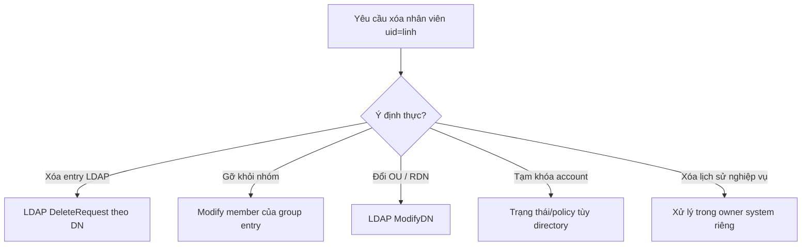
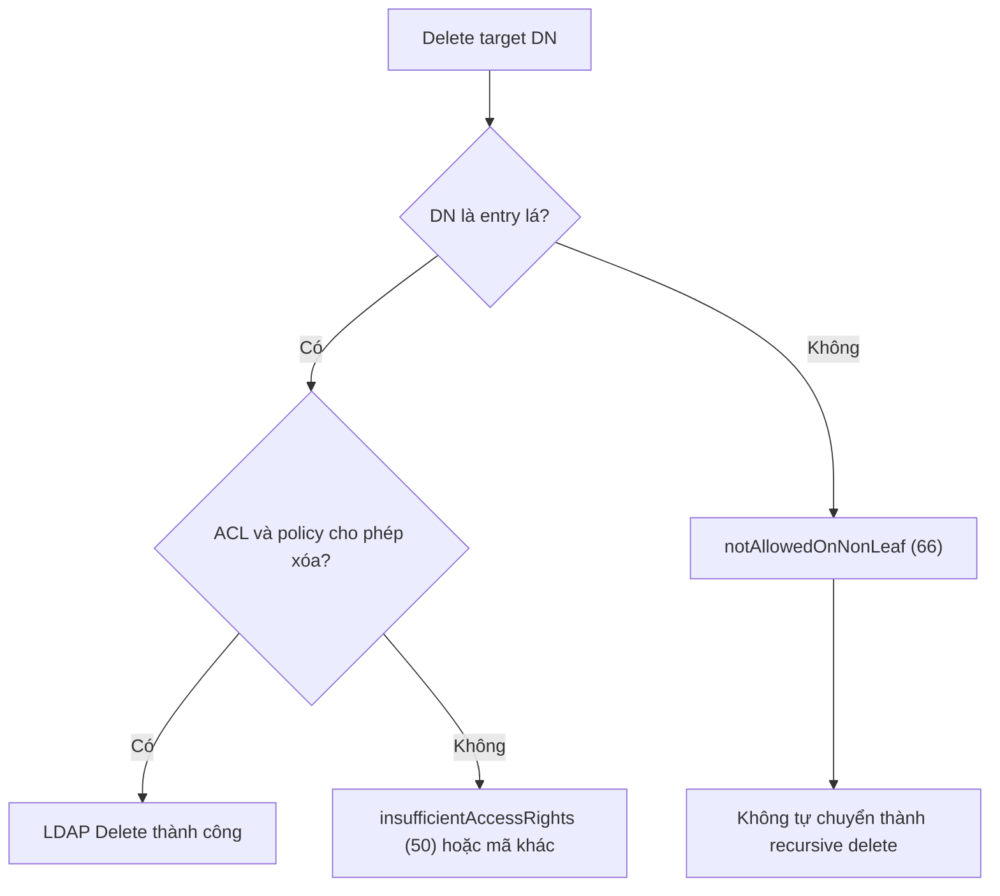
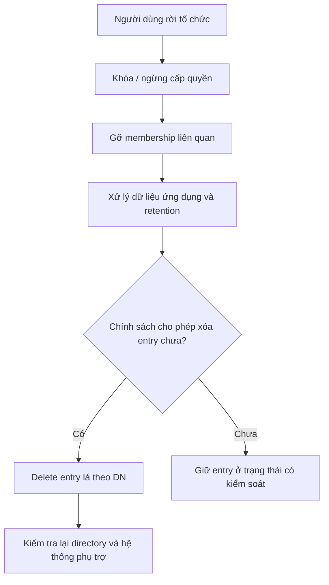
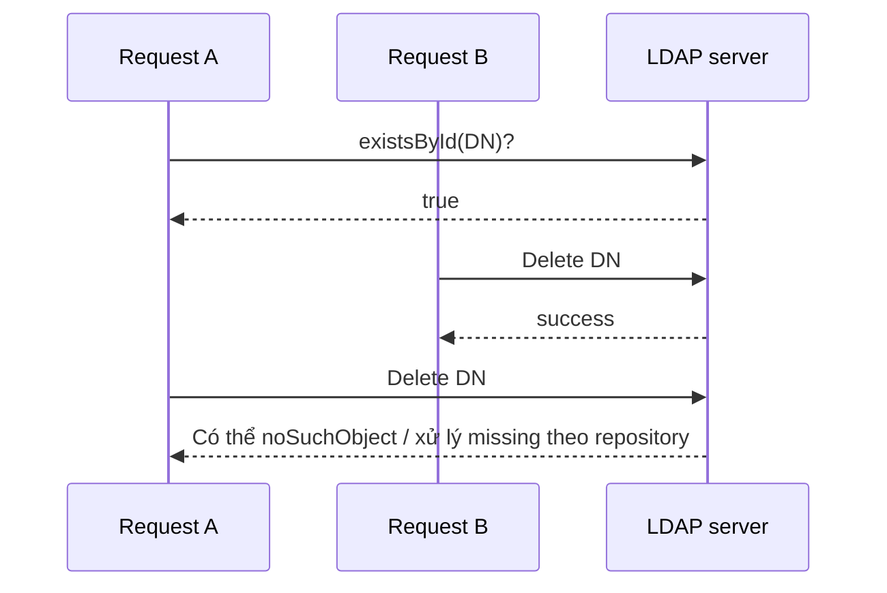
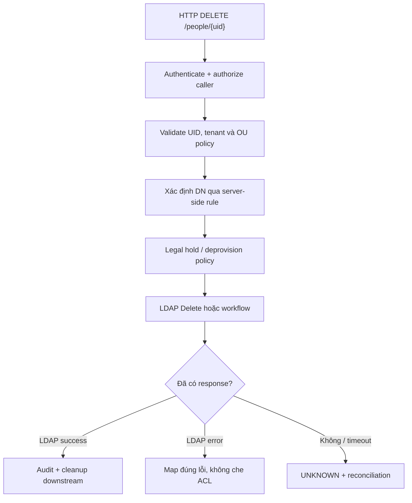

# Xóa entry theo định danh hoặc thực thể

> **Chương:** LDAP Repository  
> **Module:** SPRING_DATA_LDAP — truy cập dịch vụ thư mục LDAP qua Spring Data LDAP repository và Spring LDAP `LdapTemplate`, ánh xạ entry phân cấp sang đối tượng Java, hiểu DN, `objectClass`, schema, truy vấn, CRUD, filter an toàn, bảo mật kết nối và kiểm thử với directory.

## Mục tiêu học tập

Sau bài này, bạn có thể:

1. Phân biệt **`repository.deleteById(Name dn)`** và **`repository.delete(entity)`**, biết khi nào nên xóa bằng DN và khi nào cần đọc/kiểm tra entity trước.
2. Hiểu **identifier của entity Spring Data LDAP là DN**, được biểu diễn bằng `javax.naming.Name`; sử dụng `LdapNameBuilder` để tạo DN tương đối với `ContextSource.base`.
3. Biết Spring Data LDAP kế thừa các API `deleteAllById(...)`, `deleteAll(Iterable)`, `deleteAll()` nhưng **không mặc định** xem chúng là một LDAP transaction nguyên tử.
4. Hiểu hạn chế quan trọng của LDAP Delete theo RFC 4511: **một DeleteRequest thông thường chỉ xóa entry lá**, không tự xóa cả OU/subtree.
5. Phân biệt **xóa entry**, **xóa giá trị attribute**, **xóa liên kết group**, **rename/move** và **vô hiệu hóa tài khoản**.
6. Xử lý lỗi không tìm thấy, thiếu quyền, entry còn con, timeout/mất response; không retry hay ghi nhận thành công một cách thiếu kiểm chứng.
7. Thiết kế authorization, audit, idempotency, retention và integration tests cho thao tác xóa — đặc biệt khi directory có replication và nhiều ứng dụng cùng cập nhật.

## 1. Xóa trong LDAP có nghĩa là xóa *entry* ở một DN

Giả sử directory test của doanh nghiệp có cây:

```text
dc=example,dc=org
├── ou=people
│   ├── uid=linh
│   ├── uid=mai
│   └── uid=nam
└── ou=groups
    └── cn=developers
```

Entry người dùng `uid=linh`:

```ldif
dn: uid=linh,ou=people,dc=example,dc=org
objectClass: top
objectClass: person
objectClass: organizationalPerson
objectClass: inetOrgPerson
uid: linh
cn: Linh Nguyen
sn: Nguyen
mail: linh@example.org
```

Một LDAP **DeleteRequest** (RFC 4511, mục 4.8) yêu cầu xóa **entry tại DN đích**. Nó khác với:

- `ModifyRequest` xóa một attribute như `description` hoặc một giá trị `member`;
- `ModifyDN` đổi tên hay chuyển entry đến OU khác;
- Truy vấn `Search` với filter để *tìm* entry;
- Thay đổi trạng thái ứng dụng để tài khoản không còn hoạt động;
- Xóa các bản sao/cache của hồ sơ trong hệ thống khác.

Ví dụ, xóa entry `uid=linh,ou=people,dc=example,dc=org` **không có nghĩa** LDAP tự xóa mọi dòng đơn hàng SQL, mọi tham chiếu trong nhóm LDAP và mọi dữ liệu lưu trong Identity Provider hoặc search index.



**Tách đúng ý định trước khi viết code.** Xóa entry là một operation có tính phá hủy; nhiều nhu cầu “cho nhân viên nghỉ việc”, “ngừng cho đăng nhập” hoặc “gỡ một quyền” nên được giải quyết bằng **disable/deprovision có kiểm soát**, không phải xóa account lập tức.

Nguồn chuẩn: [RFC 4511 — Delete Operation](https://www.rfc-editor.org/rfc/rfc4511.html).

## 2. Hai API chính: `deleteById(Name)` và `delete(entity)`

Spring Data LDAP có `LdapRepository<T>`, kế thừa `ListCrudRepository<T, Name>` và qua đó có các phương thức xóa của Spring Data Commons `CrudRepository`.

```java
import org.springframework.data.ldap.repository.LdapRepository;

public interface DirectoryPersonRepository
        extends LdapRepository<DirectoryPerson> {
    // deleteById(Name) và delete(DirectoryPerson) được kế thừa.
}
```

**Kiểu `Name` là quan trọng:** repository LDAP nhận **Distinguished Name (DN)** làm ID, không phải `Long`, `UUID` hay chuỗi `uid` độc lập.

| API | Đầu vào | Ý định chính | Cần chú ý |
| --- | --- | --- | --- |
| `deleteById(Name dn)` | DN đã biết | Yêu cầu xóa entry tại DN đó | DN phải đúng phạm vi; lỗi/quyền có thể phát sinh |
| `delete(DirectoryPerson entity)` | Entity ODM | Xóa entry được định danh bởi entity | `@Id`/DN phải xác định đúng entry; field cũ không tạo precondition |
| `deleteAllById(Iterable<Name>)` | Nhiều DN | Xóa theo danh sách ID | Không giả định atomic hoặc một LDAP request |
| `deleteAll(Iterable<DirectoryPerson>)` | Nhiều entity | Xóa các entry được liệt kê | Có thể thành công một phần nếu gặp lỗi |
| `deleteAll()` | Không có | Xóa toàn bộ entity thuộc phạm vi repository | **Rủi ro rất cao**, không dùng tùy tiện trên production |

Javadoc Spring Data LDAP ghi nhận những method này trên `SimpleLdapRepository`. Contract tổng quát của `CrudRepository.deleteById` nêu entity không tồn tại có thể được bỏ qua một cách im lặng. Tuy nhiên **đừng suy luận từ contract rằng mọi đường code Spring LDAP, mọi phiên bản, mọi server đều trả kết quả giống hệt**: các lỗi LDAP về DN, ACL, transport, và kiểu entity vẫn cần được xử lý và kiểm thử.

Nguồn:
- [Spring Data LDAP — LdapRepository API](https://docs.spring.io/spring-data/ldap/reference/api/java/org/springframework/data/ldap/repository/LdapRepository.html)
- [Spring Data LDAP — SimpleLdapRepository API](https://docs.spring.io/spring-data/ldap/reference/api/java/org/springframework/data/ldap/repository/support/SimpleLdapRepository.html)
- [Spring Data Commons — CrudRepository API](https://docs.spring.io/spring-data/commons/docs/current/api/org/springframework/data/repository/CrudRepository.html)

### Chọn API nhanh

**Có DN chính xác và được phép xóa entry đó?** Dùng `deleteById(Name)`.

**Đã đọc/kiểm tra entity qua repository và cần xóa chính entry đó?** Dùng `delete(entity)`, nhưng hiểu rằng việc đọc trước không ngăn người khác sửa entry sau khi đọc.

**Cần xóa cả một nhánh OU hoặc nhiều entry?** Không nhảy thẳng sang `deleteAll()` hay `unbind(dn, true)`. Phải có kế hoạch thao tác hàng loạt, kiểm soát phạm vi, rollback/bù trừ, phân quyền và kiểm thử trên directory test.

## 3. Entity LDAP được định danh bằng `@Id Name`

Spring Data LDAP sử dụng **Spring LDAP Object-Directory Mapping (ODM)**. Entity minh họa:

```java
package com.example.directory.ldap;

import javax.naming.Name;

import org.springframework.ldap.odm.annotations.Attribute;
import org.springframework.ldap.odm.annotations.Entry;
import org.springframework.ldap.odm.annotations.Id;

@Entry(
    base = "ou=people",
    objectClasses = {
        "top", "person", "organizationalPerson", "inetOrgPerson"
    }
)
public class DirectoryPerson {

    @Id
    private Name dn;

    @Attribute(name = "uid")
    private String uid;

    @Attribute(name = "cn")
    private String commonName;

    @Attribute(name = "sn")
    private String surname;

    @Attribute(name = "mail")
    private String email;

    public DirectoryPerson() {}

    public Name getDn() { return dn; }
    public void setDn(Name dn) { this.dn = dn; }

    public String getUid() { return uid; }
    public void setUid(String uid) { this.uid = uid; }

    public String getCommonName() { return commonName; }
    public void setCommonName(String commonName) {
        this.commonName = commonName;
    }

    public String getSurname() { return surname; }
    public void setSurname(String surname) {
        this.surname = surname;
    }

    public String getEmail() { return email; }
    public void setEmail(String email) { this.email = email; }
}
```

Các annotation **`@Entry`, `@Id`, `@Attribute`** ở đây thuộc package `org.springframework.ldap.odm.annotations`. **Không dùng `jakarta.persistence.Id`** của JPA: trong LDAP, identity là DN kiểu `javax.naming.Name`.

`@Entry.objectClasses` mô tả entry kiểu `inetOrgPerson` và chuỗi lớp cha. Theo schema chuẩn, `person` yêu cầu `cn` và `sn`; điều này quan trọng lúc **tạo/sửa** entry. Khi **xóa**, DeleteRequest không cần gửi lại các thuộc tính; server quyết định có được phép xóa theo DN, ACL, trạng thái cây và chính sách hiện hành.

### `@DnAttribute` có bắt buộc cho delete không?

Không nhất thiết. Với entity được **đọc từ repository** và trường `@Id` đã có DN, đó là thông tin để xác định đích xóa. `@DnAttribute` giúp tạo/tính DN từ các field khi làm ODM create/update; không nên thêm annotation chỉ vì cần xóa entity đã đọc.

Nếu entity được tự tạo bằng `new DirectoryPerson()` mà `dn == null`, đừng coi `delete(entity)` là cách “xóa người dùng có uid giống field hiện tại”. Một số ODM API có thể tìm cách tính DN qua `@DnAttribute`; nhưng ứng dụng cần **xác định DN một cách tường minh và đáng tin cậy** trước khi cho phép xóa, không phụ thuộc vào một đối tượng chưa có identity.

## 4. Cấu hình LDAP và DN tương đối

Ví dụ Spring Boot khi dùng directory **test**:

```xml
<dependency>
    <groupId>org.springframework.boot</groupId>
    <artifactId>spring-boot-starter-data-ldap</artifactId>
</dependency>
```

```yaml
spring:
  ldap:
    urls: "ldap://localhost:389"
    base: "dc=example,dc=org"
    username: "${LDAP_BIND_DN}"
    password: "${LDAP_BIND_PASSWORD}"
```

**Đây là kết nối chỉ dùng để phát triển cục bộ.** Trong production, dùng LDAPS hoặc StartTLS phù hợp, xác thực CA và hostname server, không truyền simple-bind password trên kênh plaintext. Tài khoản bind phải có quyền xóa **đúng OU cần thiết**, không dùng quyền quản trị toàn directory chỉ vì một service có tính năng xóa nhân viên.

Với `spring.ldap.base=dc=example,dc=org`:

| Thành phần | Giá trị |
| --- | --- |
| DN đầy đủ trong directory | `uid=linh,ou=people,dc=example,dc=org` |
| Base do `ContextSource` quản lý | `dc=example,dc=org` |
| `@Entry.base` của `DirectoryPerson` | `ou=people` |
| DN tương đối truyền cho repository/template | `uid=linh,ou=people` |
| RDN của entry | `uid=linh` |

**Lỗi phổ biến:** truyền DN chứa cả `dc=example,dc=org` cho template vốn đã có `ContextSource.base`, khiến hậu tố bị cộng hai lần. Một lỗi khác là chỉ truyền `uid=linh`, giả định `@Entry.base="ou=people"` được tự thêm ở mọi method/version.

Hãy xây **DN tương đối đầy đủ tới entry**, theo quy ước của chính `ContextSource` đang được injection.

### Tạo DN bằng builder, không nối chuỗi

```java
import javax.naming.Name;
import org.springframework.ldap.support.LdapNameBuilder;

Name dn = LdapNameBuilder
        .newInstance("ou=people")
        .add("uid", "linh")
        .build();

System.out.println(dn);  // uid=linh,ou=people
```

`LdapNameBuilder` xử lý cấu trúc tên và escape các ký tự đặc biệt theo quy tắc DN. Nếu `uid` có dấu phẩy hoặc dấu cộng, **không** dùng:

```java
// Không an toàn: phần dữ liệu có thể làm thay đổi cấu trúc DN.
String dn = "uid=" + userInput + ",ou=people";
```

Hãy phân biệt **DN escaping** (RFC 4514) với **LDAP filter escaping** (RFC 4515). Trong một thao tác delete theo DN, bạn cần xử lý **DN**, không tự xây một `(uid=...)` filter rồi “xóa tất cả những gì tìm được”.

Nguồn: [Spring LDAP — LdapNameBuilder API](https://docs.spring.io/spring-ldap/reference/api/java/org/springframework/ldap/support/LdapNameBuilder.html), [RFC 4514 — LDAP Distinguished Names](https://www.rfc-editor.org/rfc/rfc4514.html).

## 5. Xóa bằng định danh: `repository.deleteById(Name)`

Repository:

```java
package com.example.directory.ldap;

import org.springframework.data.ldap.repository.LdapRepository;

public interface DirectoryPersonRepository
        extends LdapRepository<DirectoryPerson> {
}
```

Service triển khai một operation rõ ràng:

```java
package com.example.directory.service;

import javax.naming.Name;

import com.example.directory.ldap.DirectoryPersonRepository;

import org.springframework.ldap.support.LdapNameBuilder;
import org.springframework.stereotype.Service;

@Service
public final class PersonDeletionService {

    private final DirectoryPersonRepository repository;
    private final PersonDeletionPolicy deletionPolicy;

    public PersonDeletionService(
            DirectoryPersonRepository repository,
            PersonDeletionPolicy deletionPolicy) {
        this.repository = repository;
        this.deletionPolicy = deletionPolicy;
    }

    public void deleteByUidRdn(String uid, String actorId) {
        if (uid == null || !uid.matches("[A-Za-z0-9._-]{1,64}")) {
            throw new IllegalArgumentException("UID không hợp lệ");
        }

        // Authorize theo actor, target và quy tắc nghiệp vụ.
        deletionPolicy.requirePermission(actorId, uid);

        Name dn = LdapNameBuilder.newInstance("ou=people")
                .add("uid", uid)
                .build();

        repository.deleteById(dn);
    }

    public interface PersonDeletionPolicy {
        void requirePermission(String actorId, String uid);
    }
}
```

Đoạn code minh họa quy tắc **một dịch vụ chỉ xóa entry người dùng trong `ou=people`**. `PersonDeletionPolicy` là interface nghiệp vụ do **ứng dụng phải tự triển khai**, không phải lớp có sẵn trong Spring Data LDAP. Khi thực tế có nhiều OU hoặc tenant, cần chính sách chặt hơn chỉ kiểm tra UID.

Những điểm quan trọng:

1. Service **không** nhận raw DN hay tên OU tùy ý từ HTTP caller.
2. `uid` được validate theo policy của ứng dụng; `LdapNameBuilder` tránh lỗi escaping RDN.
3. Kiểm tra quyền gọi API/actor **trước khi** truy cập/xóa directory; quyền của service bind account **không** thay thế authorization của người dùng cuối.
4. `deleteById` trả `void`. Nó không trả “số entry đã bị xóa” hoặc “entry trước đó tồn tại”.
5. Không gọi `deleteAll()` để cố “xóa user có uid=linh”; đó không phải ý nghĩa của API này.

**Giới hạn mẫu:** method trên chưa triển khai audit, xác nhận xóa, idempotency key, chính sách bảo toàn hồ sơ hoặc precondition tránh delete một entry vừa bị thay thế tại cùng DN. Những yêu cầu đó cần được thiết kế riêng cho môi trường quản lý danh tính.

## 6. Xóa bằng thực thể: `repository.delete(entity)`

Nếu nghiệp vụ trước đó đã **tìm và đọc entity**, bạn có thể truyền chính object được ánh xạ vào method xóa.

```java
import java.util.Optional;
import javax.naming.Name;

import org.springframework.ldap.support.LdapNameBuilder;

public void removeExistingPerson(
        DirectoryPersonRepository repository, String uid) {

    Name dn = LdapNameBuilder.newInstance("ou=people")
            .add("uid", uid)
            .build();

    Optional<DirectoryPerson> existing = repository.findById(dn);

    if (existing.isEmpty()) {
        // Không tìm thấy theo repository và connection/ACL hiện tại.
        return;
    }

    DirectoryPerson person = existing.orElseThrow();

    // Khi có quyền xóa và đã xác minh business identity:
    repository.delete(person);
}
```

**Tại sao phải đọc entity trước?** Không phải vì LDAP DeleteRequest cần toàn bộ các attributes. Trong ví dụ, đọc trước chỉ cho phép **kiểm tra dữ liệu** (tên, ID nghiệp vụ, trạng thái quản lý) hoặc thực thi quy tắc quản trị trước khi xóa.

Ví dụ một màn hình quản trị yêu cầu xác nhận “bạn sắp xóa tài khoản Linh Nguyen” có thể dùng `findById` lấy bản tóm tắt, hiển thị/đòi xác thực lại rồi thực hiện lệnh xóa. Tuy nhiên:

> **Đọc rồi xóa là hai operations riêng.** LDAP entry có thể đổi hoặc bị thay thế tại cùng DN sau khi bạn đọc.

`repository.delete(entity)` **không mặc định** là “xóa chỉ khi mọi field hiện tại của server vẫn giống entity lúc đọc”. Spring Data LDAP ODM dùng DN để xác định đối tượng; không tự cung cấp optimistic locking tương đương SQL `DELETE ... WHERE id=? AND version=?` cho mọi entity.

Nếu cần bảo đảm trạng thái vẫn thỏa điều kiện khi xóa, nghiên cứu **LDAP Assertion Control (RFC 4528)** trên directory có hỗ trợ, hoặc quy trình lock/coordination được thiết kế riêng. **Repository delete tiêu chuẩn không nên được mô tả là đã tự thêm assertion này.**

### Khi nên chọn API nào?

| Nhu cầu | API nên bắt đầu | Điểm cần kiểm soát |
| --- | --- | --- |
| Một job có DN chính xác, đã được authorize | `deleteById(dn)` | DN đúng, không xóa nhầm subtree/root |
| Admin đã tải entity và kiểm tra identity | `delete(entity)` | Entity `@Id` phải còn đúng DN, race condition |
| Muốn delete LDAP không cần ODM | `ldapTemplate.unbind(dn)` | Không xóa entry có con |
| Có entity ODM nhưng không qua repository | `ldapTemplate.delete(entity)` | Metadata và DN; không tự kiểm tra mọi field |
| Cần xóa đúng khi một attribute/phiên bản còn hợp lệ | API LDAP cấp thấp với **conditional control được server hỗ trợ** | Không giả định repository có compare-and-delete |
| Xóa theo filter `uid` trong nhiều OU | **Đầu tiên tìm và duyệt từng DN theo quy tắc nghiệp vụ** | Tránh xóa nhầm nhiều người trùng UID |

## 7. Thao tác xóa ở mức `LdapTemplate`

Spring LDAP cung cấp cả API **ODM** và API **DN/JNDI**:

```java
import javax.naming.Name;

import org.springframework.ldap.core.LdapTemplate;
import org.springframework.ldap.support.LdapNameBuilder;

Name dn = LdapNameBuilder.newInstance("ou=people")
        .add("uid", "linh")
        .build();

// Xóa entry lá theo DN.
ldapTemplate.unbind(dn);

// Hoặc với entity ODM đã được nhận diện đúng:
ldapTemplate.delete(directoryPerson);
```

`LdapTemplate` còn có overload:

```java
ldapTemplate.unbind(dn, false);  // Chỉ entry lá; có con thì thất bại.
ldapTemplate.unbind(dn, true);   // Có thể xóa đệ quy cả descendants.
```

**Cực kỳ quan trọng:** tham số `recursive=true` không nên được dùng chỉ vì muốn “xóa chắc chắn thành công”. Đó là hành vi **xóa một subtree** và có thể ảnh hưởng nhiều account, group, thiết bị hoặc OU. Spring LDAP có cơ chế xóa các subcontexts đệ quy phía client; không đồng nghĩa một LDAP DeleteRequest nguyên tử cho toàn bộ cây.

Trong môi trường quản trị identity, không nên expose `recursive=true` từ HTTP input. Nếu cần xóa một nhánh, phải có **kế hoạch, xác nhận, giới hạn scope, backup/restore, audit và kiểm soát nhân sự phê duyệt**. Dù có dùng server-specific tree-delete control, hiệu lực giao dịch và quyền phải được xác minh trên server đó.

Tài liệu: [Spring LDAP — LdapTemplate API](https://docs.spring.io/spring-ldap/reference/api/java/org/springframework/ldap/core/LdapTemplate.html), [Spring LDAP — LdapOperations API](https://docs.spring.io/spring-ldap/reference/api/java/org/springframework/ldap/core/LdapOperations.html).

## 8. Vì sao không thể xóa OU có entry con bằng DeleteRequest thường?

LDAP directory lưu **cây phân cấp**; một entry như `ou=people,dc=example,dc=org` có thể có hàng nghìn entry con.

Theo **RFC 4511**, DeleteRequest thông thường chỉ được dùng cho **leaf entry** — entry **không có subordinate entries**. Nếu xóa một OU vẫn có con, server thường trả:

```text
resultCode = 66
notAllowedOnNonLeaf
```

Spring LDAP có thể dịch tình huống này thành `ContextNotEmptyException` hoặc một exception liên quan, tùy JNDI/provider. Không coi lỗi 66 là vấn đề thiếu `sn`/`cn`; đây là ràng buộc cấu trúc **entry chưa phải lá**.



Ví dụ:

- `uid=linh,ou=people,...` thông thường là leaf; có thể bị xóa nếu có quyền.
- `ou=people,dc=example,dc=org` có các account con; không thể xóa bằng DeleteRequest chuẩn.
- Một entry người dùng **cũng có thể có con** trong mô hình DIT tùy server/schema; đừng giả định mọi `inetOrgPerson` luôn là leaf.

Xóa OU cả nhánh là **một thao tác quản trị riêng**, không phải tiện ích CRUD thông thường của `DirectoryPersonRepository`.

Nguồn: [RFC 4511 `4.8 — Delete Operation](https://www.rfc-editor.org/rfc/rfc4511.html), [RFC 4511 result code 66](https://www.rfc-editor.org/rfc/rfc4511.html).

## 9. Xóa entry không phải xóa thuộc tính, nhóm hoặc đổi tên

Đây là những thao tác thường bị nhầm lẫn khi triển khai tính năng “xóa người dùng”.

### 9.1. Chỉ cần xóa một thuộc tính?

Muốn xóa `telephoneNumber` hoặc `description` khỏi entry người dùng, dùng LDAP **ModifyRequest**, không dùng repository delete:

```java
import javax.naming.Name;
import javax.naming.directory.BasicAttribute;
import javax.naming.directory.DirContext;
import javax.naming.directory.ModificationItem;

Name dn = LdapNameBuilder.newInstance("ou=people")
        .add("uid", "linh")
        .build();

ldapTemplate.modifyAttributes(dn, new ModificationItem[] {
    new ModificationItem(
        DirContext.REMOVE_ATTRIBUTE,
        new BasicAttribute("telephoneNumber")
    )
});
```

Đối với một attribute **`MUST`** như `cn` hoặc `sn` của `person`, việc xóa giá trị cuối cùng có thể bị từ chối với **`objectClassViolation (65)`**. Đây là lỗi **schema** của ModifyRequest, không liên quan đến quyền xóa entry bằng DeleteRequest.

### 9.2. Chỉ muốn gỡ người dùng khỏi group?

Ví dụ:

```ldif
dn: cn=developers,ou=groups,dc=example,dc=org
objectClass: top
objectClass: groupOfNames
cn: developers
member: uid=linh,ou=people,dc=example,dc=org
member: uid=mai,ou=people,dc=example,dc=org
```

Muốn Linh **không còn thuộc nhóm developers**, hãy sửa attribute `member` của **group entry**. Xóa `uid=linh` có thể **không tự gỡ** DN đó khỏi `member`. LDAP chuẩn không cung cấp cascade foreign-key như SQL; một số server có module/reference integrity hoặc thuộc tính liên kết đặc thù, nhưng đây là hành vi cần xác minh trên server thật.

Ví dụ thao tác ở LDIF:

```ldif
dn: cn=developers,ou=groups,dc=example,dc=org
changetype: modify
delete: member
member: uid=linh,ou=people,dc=example,dc=org
```

**Cẩn trọng với `groupOfNames`:** attribute `member` là `MUST`. Nếu xóa giá trị thành viên **cuối cùng**, directory áp dụng schema chuẩn có thể từ chối; ứng dụng phải chọn giải pháp phù hợp như mô hình nhóm cho phép rỗng hoặc policy chuyển nhóm, không xóa giá trị bắt buộc một cách máy móc.

**Thứ tự thao tác:** gỡ link khỏi nhóm, vô hiệu hóa tài khoản, xóa entry và cập nhật audit có thể là **nhiều operations trên các entry và hệ thống khác nhau**. Không tự có transaction chung. Cần workflow có checkpoint/idempotency, xử lý khi bước trước thành công nhưng bước sau thất bại.

### 9.3. Chỉ muốn chuyển OU hoặc đổi tên?

Dùng **ModifyDN** qua `LdapTemplate.rename(oldDn, newDn)` để chuyển hoặc đổi tên entry. Đây không phải DeleteRequest và có thể làm DN thay đổi, khiến các tham chiếu theo DN cũ trở nên không chính xác nếu directory không cập nhật chúng.

### 9.4. Chỉ muốn ngừng đăng nhập?

Cân nhắc **disable account** theo chính sách của directory/Identity Provider. Không có một attribute `active=false` phổ quát cho mọi sản phẩm LDAP. Active Directory có các cơ chế riêng; OpenLDAP và hệ thống IdP có cách quản lý khác nhau.

Nếu nội quy yêu cầu giữ account trong thời gian nghỉ việc để audit hoặc rollback, một thao tác vô hiệu hóa có kiểm soát phù hợp hơn xóa vật lý ngay lập tức. **Đừng tự thêm attribute `disabled` vào entity `inetOrgPerson` nếu schema server không định nghĩa/cho phép.**

## 10. Dữ liệu còn lại sau khi xóa: tính toàn vẹn tham chiếu

Xét một workflow:



Các dữ liệu có thể vẫn tồn tại sau một LDAP Delete:

| Dữ liệu | Được LDAP Delete tự xóa luôn? | Điều cần làm |
| --- | --- | --- |
| Entry người dùng tại DN đích | **Có, nếu DeleteRequest thành công** | Xác minh trên endpoint có thẩm quyền nếu cần |
| Giá trị `member` trong các group khác | **Không mặc định** | Kiểm tra reference integrity của server và cleanup policy |
| Ứng dụng SQL: đơn hàng, giao dịch, audit | **Không** | Xử lý theo ownership, retention, pháp lý |
| Cache ID/profile trong API | **Không** | Invalidate/TTL, che dữ liệu nhạy cảm |
| Search index, dữ liệu analytics | **Không** | Cập nhật/xóa dữ liệu phái sinh theo policy |
| Phiên đăng nhập và token đã phát | **Không** | IdP/session revocation; đánh giá expiry |
| Backup/snapshot của directory | **Không ngay lập tức** | Chính sách retention và khôi phục dữ liệu |
| Replica LDAP khác | **Phụ thuộc replication** | Đo độ trễ, tránh kết luận xóa hoàn tất ở mọi node |

**Xóa LDAP entry không phải “quyền được lãng quên” tự động cho toàn hệ thống**. Quản trị dữ liệu cá nhân cần phối hợp với nơi sở hữu mỗi bản sao, yêu cầu pháp lý, retention, audit và cơ chế phục hồi.

Tài khoản bị xóa rồi tái sử dụng cùng `uid`/DN còn có một nguy cơ khác: hệ thống thứ ba vẫn giữ tham chiếu cũ có thể hiểu nhầm đó là **cùng một chủ thể**. Nên có ID chủ thể ổn định, không tái sử dụng theo policy, và thiết kế rõ vòng đời identity.

## 11. Kiểm tra tồn tại trước khi xóa có cần không?

Một cách triển khai dễ thấy:

```java
if (repository.existsById(dn)) {
    repository.deleteById(dn);
}
```

Nhưng đây là **hai thao tác LDAP độc lập**. Giữa lúc kiểm tra và lúc delete, client khác có thể xóa, rename hoặc thay thế entry.



Vậy nên:

- Nếu **chỉ muốn entry không còn tồn tại**, không nhất thiết cần `existsById` trước.
- Nếu **cần kiểm tra identity, trạng thái pháp lý hoặc quyền** dựa trên entity, có thể `findById` rồi kiểm tra, nhưng vẫn tồn tại cửa sổ race.
- Nếu **cần đảm bảo chỉ xóa khi thuộc tính còn bằng giá trị mong muốn**, phải dùng một precondition được server hỗ trợ hoặc cơ chế coordination riêng.
- Nếu DN đang được dùng lại sau xóa, một đối tượng mới có thể xuất hiện ở cùng DN sau khi bạn đọc; chỉ kiểm tra `uid` chưa đủ để bảo đảm đó là cùng chủ thể.

**Không nên trả HTTP `404` từ một kiểm tra `existsById(false)` mà bỏ qua khả năng ACL, replica trễ hoặc directory không sẵn sàng.** Với operation phá hủy, phải phân biệt kết quả không thấy với lỗi không thể kiểm chứng.

## 12. Xóa theo ID có nghĩa “idempotent” không?

Về **trạng thái mong muốn**, mục tiêu “entry DN này không còn” có thể được xem như thao tác idempotent: thực hiện lại sau khi xóa thành công không làm entry “bị xóa thêm”. Nhưng điều đó **không đồng nghĩa mọi lần retry an toàn**.

Các vấn đề:

1. Một operation Delete có thể đã thành công nhưng client **mất response**.
2. Repository có thể xử lý DN không tồn tại theo contract; đường API thấp hơn có thể nhận `NameNotFoundException`/LDAP code 32.
3. Entry có thể được **tạo lại ở cùng DN** bởi một workflow khác; retry lúc đó có thể xóa nhầm một đối tượng mới.
4. Replica có thể chậm nên `existsById(false)` trên reader không chứng minh writer đã xóa.
5. Audit, downstream hooks, deprovisioning events hoặc quyền người dùng có thể cần xử lý chính xác một lần dù trạng thái entry cuối cùng giống nhau.

Vì vậy, **idempotency của workflow** cần dựa vào một **operation ID**, **stable business identity**, trạng thái cuối và chính sách concurrency/retry; không chỉ vào DN.

Ví dụ xử lý trạng thái:

| Outcome | Ý nghĩa | Bước tiếp |
| --- | --- | --- |
| LDAPResult `success (0)` | Server xác nhận xóa entry được yêu cầu | Ghi audit; cập nhật hệ thống khác theo policy |
| LDAPResult `noSuchObject (32)` | Target không tìm được theo server trả lời | Phân biệt request lặp lại, DN sai, replica/ACL |
| LDAPResult `notAllowedOnNonLeaf (66)` | Entry còn con | Không tự bật recursive delete |
| LDAPResult `insufficientAccessRights (50)` | Bind principal không đủ quyền | Sửa ACL/role; không retry bằng account admin vô hạn |
| Mất kết nối/timeout **trước response** | Kết quả Delete **UNKNOWN** | Đối soát trên nguồn có thẩm quyền, không retry mù |
| Read replica vẫn thấy entry | Có thể replica chưa đồng bộ | Xác minh với writer/replication health |

Một lệnh retry chỉ nên được gửi sau khi xác định **đúng chủ thể**, **đúng vai trò endpoint** và **được phép thực hiện** theo policy. Nếu không, ghi nhận trạng thái “cần đối soát”.

## 13. Xử lý lỗi LDAP khi xóa

Spring LDAP dịch các `javax.naming.NamingException` của JNDI sang **runtime exceptions** tương ứng trong `org.springframework.ldap`. Mã LDAP là nguồn chẩn đoán quan trọng, nhưng không cam kết mọi server sẽ map 1–1 vào cùng Java exception.

| LDAP result code | Tên/mô tả | Exception thường gặp ở Spring LDAP | Hành động |
| --- | --- | --- | --- |
| **32** | `noSuchObject` | `NameNotFoundException` | Kiểm tra DN, base, rename/move, ACL/replica |
| **50** | `insufficientAccessRights` | `NoPermissionException` | Kiểm tra identity bind và quyền xóa |
| **66** | `notAllowedOnNonLeaf` | `ContextNotEmptyException` hoặc lỗi LDAP liên quan | Entry có con; không xóa đệ quy ngoài ý muốn |
| **49** | `invalidCredentials` | `AuthenticationException` | Sửa mật khẩu, DN bind, policy; không log secret |
| **51/52** | `busy` / `unavailable` | `ServiceUnavailableException`/transport khác | Retry hạn chế theo load và vai trò |
| **53** | `unwillingToPerform` | `OperationNotSupportedException` hoặc exception khác tùy server | Kiểm tra directory policy, role, controls |
| **10** | `referral` | `ReferralException`/`PartialResultException` tùy provider | Đánh giá naming context và trust boundary |
| Không nhận response | TCP reset, TLS, timeout | `CommunicationException` hoặc lỗi liên quan | Outcome unknown; đối soát trước retry |

Tên exception đáng chú ý:

```java
import org.springframework.ldap.NameNotFoundException;
import org.springframework.ldap.NoPermissionException;
import org.springframework.ldap.ContextNotEmptyException;
import org.springframework.ldap.CommunicationException;
```

Một ví dụ thao tác xóa **trực tiếp theo DN** khi muốn phân biệt lỗi gốc:

```java
public void deleteOneLeaf(
        org.springframework.ldap.core.LdapTemplate ldapTemplate,
        javax.naming.Name dn) {

    try {
        ldapTemplate.unbind(dn, false);
    } catch (org.springframework.ldap.NameNotFoundException ex) {
        // Nếu hợp đồng API yêu cầu "đã vắng mặt" thì có thể
        // coi đây là kết quả phù hợp, sau khi kiểm chứng scope.
        throw ex;
    } catch (org.springframework.ldap.ContextNotEmptyException ex) {
        // Không retry bằng unbind(dn, true).
        throw ex;
    } catch (org.springframework.ldap.NoPermissionException ex) {
        // Không chuyển thành 404 khi đây là lỗi ACL rõ ràng.
        throw ex;
    } catch (org.springframework.ldap.CommunicationException ex) {
        // Server có thể đã xóa trước khi response bị mất.
        throw ex;
    }
}
```

Code này minh họa **các nhánh cần phân loại**, chưa phải REST exception handler. Trong hệ thống thật, phân loại lỗi LDAP ở tầng adapter, map sang lỗi nghiệp vụ an toàn ở service/API, ghi correlation ID và không trả nguyên `Caused by` chứa DN hoặc server internals ra client.

**Lưu ý tương thích:** các phương thức repository có thể xử lý trường hợp entity không còn tồn tại khác với `LdapTemplate.unbind`. Hãy thử với đúng **version Spring Data LDAP/JNDI và directory** mà dự án sử dụng.

Nguồn: [Spring LDAP — Exception hierarchy](https://docs.spring.io/spring-ldap/reference/api/java/org/springframework/ldap/package-summary.html), [RFC 4511 — LDAPResult](https://www.rfc-editor.org/rfc/rfc4511.html).

## 14. Bulk delete: `deleteAllById`, `deleteAll` và ranh giới nguyên tử

Khi có nhiều account cần xóa, Spring Data LDAP cung cấp các method kế thừa:

```java
import java.util.List;
import javax.naming.Name;

List<Name> targets = List.of(
    LdapNameBuilder.newInstance("ou=people")
        .add("uid", "test-01").build(),
    LdapNameBuilder.newInstance("ou=people")
        .add("uid", "test-02").build()
);

repository.deleteAllById(targets);
```

Cú pháp này thuận tiện, nhưng **không mặc định** biến hai entry khác nhau thành một LDAP DeleteRequest. LDAPv3 chuẩn xóa entry theo DN từng lần và không có atomicity xuyên chuỗi DeleteRequest.

Một kịch bản nguy hiểm:

```text
1. Delete uid=test-01 → success
2. Delete uid=test-02 → insufficientAccessRights (50)
3. Job báo lỗi
Kết quả: test-01 đã bị xóa, test-02 vẫn tồn tại
```

Vì vậy, khi xóa nhiều entry:

1. **Tạo bản kế hoạch** gồm danh sách DN/ID nghiệp vụ, OU, owner và lý do xóa.
2. **Dry run**: truy vấn và báo **những entry nào dự kiến bị ảnh hưởng**; không coi dry run là lock.
3. Yêu cầu **phê duyệt** nếu đây là dữ liệu identity nhạy cảm hoặc xóa OU.
4. Đặt hạn mức mỗi batch, concurrency, timeout và tổng số entry.
5. Xóa theo từng đơn vị có **checkpoint/audit**; lưu thành công/thất bại riêng.
6. Đối soát trạng thái sau job trên authoritative endpoint.
7. Nếu cần khôi phục, phải có **backup/restore và policy**; không kỳ vọng một `@Transactional` tự rollback tất cả.

### `deleteAll()` nguy hiểm thế nào?

`repository.deleteAll()` không nhận filter “chỉ một user”. Hành vi quét/lấy và xóa các entity thuộc phạm vi repository có thể ảnh hưởng **hàng loạt tài khoản** nếu cấu hình base rộng.

Trong application service bình thường, **không expose thao tác này qua endpoint**. Nếu admin workflow cần xóa hàng loạt, dùng một command riêng với phạm vi DN được allowlist, idempotency/audit/approval, job chạy có giới hạn và được kiểm thử. Chọn một filter LDAP **không tự làm operation xóa an toàn** vì kết quả tìm được và thao tác xóa tiếp theo vẫn là các bước riêng.

### Recursive delete không tự nguyên tử

`ldapTemplate.unbind(dn, true)` có thể xóa một subtree qua nhiều bước. Nếu bước thứ `k` lỗi, một số entry đã bị xóa và entry khác còn nguyên. Đừng dùng nó để mô phỏng “ON DELETE CASCADE” kiểu RDBMS. Nếu server có extension tree-delete riêng, phải xem transaction, ACL và độ sâu riêng của extension đó.

## 15. Khi nào vô hiệu hóa thay vì xóa vật lý?

Trong nhiều tổ chức, quy trình nghỉ việc thường gồm **ngăn truy cập ngay**, sau đó giữ dữ liệu trong thời gian retention trước khi xóa.

| Hành động | Mục tiêu | Lưu ý |
| --- | --- | --- |
| Khóa/disable account | Không cho đăng nhập hay dùng credential | Cách làm **phụ thuộc directory/IdP** |
| Thu hồi phiên/token | Dừng quyền truy cập đã cấp | LDAP Delete không tự thu hồi OIDC token/session |
| Gỡ nhóm/role | Thu hồi quyền theo nhóm | Có thể stale ở replica/cache |
| Chuyển OU quản trị | Phân loại trạng thái nhân viên | DN thay đổi, phải cập nhật tham chiếu |
| Xóa entry vật lý | Không còn entry tại DN | Cần policy về data retention, orphan references, backup |
| Xóa/anonymize dữ liệu ứng dụng | Thực thi yêu cầu quản trị dữ liệu | Không được giải quyết chỉ với LDAP |

**Không phát minh `@Attribute(name="disabled")` nếu schema không có.** Active Directory, OpenLDAP và các IdP có cơ chế disable/lock khác nhau. Cần tra tài liệu của hệ thống được triển khai và xác định **nguồn authoritative của trạng thái tài khoản**.

Ngay cả sau khi delete LDAP thành công, **OIDC access token** đã phát có thể còn hiệu lực theo thời hạn/kiến trúc xác thực, và **group cache** có thể chưa invalidated. Nếu mục tiêu là thu hồi truy cập khẩn cấp, phải thiết kế đường thu hồi token/session/authorization phù hợp.

## 16. Replication, failover và tình huống xóa bị mất response

Giả sử directory có writer A và replica B.

```text
T0: A và B có uid=linh.
T1: App gửi Delete uid=linh tới A.
T2: A xóa thành công.
T3: TCP đứt trước khi client nhận DeleteResponse.
T4: App hỏi B: uid=linh vẫn hiện diện vì B chưa replicate.
```

**Tại T4, app chưa thể kết luận “Delete chưa chạy”.** Đây là kết quả **UNKNOWN** cần đối soát, không phải bằng chứng để gửi Delete lặp lại một cách mù quáng.

```mermaid
sequenceDiagram
    participant App as Spring Boot
    participant W as LDAP writer A
    participant R as LDAP replica B
    App->>W: DeleteRequest uid=linh
    W->>W: Có thể đã xóa entry
    W--xApp: Mất kết nối trước DeleteResponse
    App->>R: existsById(uid=linh)?
    R-->>App: true (replica chưa bắt kịp)
    Note over App: Outcome=UNKNOWN; đối soát trên nguồn có thẩm quyền
```

Khi cần xử lý:

- Ghi nhận operation ID, DN/identity, thời điểm, trạng thái cần đối soát; **không lưu password**.
- Biết endpoint nào **thực sự writable/authoritative** sau failover.
- Kiểm tra trạng thái replication và ACL trước khi diễn giải kết quả read.
- Tránh xóa lần nữa nếu có khả năng **DN đã được tái sử dụng** cho identity khác.
- Dùng retry/backoff có giới hạn, precondition hoặc điều phối thủ công cho operation quan trọng.
- Nếu có audit/retention/legal hold, không tự coi “DeleteRequest success” là toàn bộ workflow đã hoàn tất.

**Không tự kết nối đến read-only replica để retry một lệnh xóa**. Một danh sách `spring.ldap.urls` có thể thử URL khác khi tạo context, nhưng không tự biến replica thành writable leader hoặc tự phát lại an toàn các write operations giữa chừng.

## 17. HTTP REST: 204, 404, 403 hay 409?

Ánh xạ LDAP Delete sang API là quyết định **authorization và hợp đồng nghiệp vụ**, không có quy tắc “mã LDAP X phải bằng HTTP Y” cho mọi ứng dụng.

| Tình huống | HTTP có thể phù hợp | Điều cần cân nhắc |
| --- | --- | --- |
| Xóa thành công một entry được phép | **204 No Content** | Không tiết lộ dữ liệu thừa |
| Xóa idempotent khi entry đã không còn | **204 No Content** | Chỉ nếu contract cho phép và không che lỗi LDAP |
| Người gọi có quyền biết entry không tồn tại | **404 Not Found** | Không tiết lộ identity ngoài phạm vi được phép |
| Người gọi không được phép xóa | **403 Forbidden**, hoặc 404 có chủ ý | Authorization trước khi kiểm tra/xóa |
| Entry còn con (`66`) | **409 Conflict** | Không tự recursive delete |
| Policy giữ hồ sơ/retention chưa cho xóa | **409 Conflict** hoặc **423 Locked** nếu phù hợp | Lý do nghiệp vụ, không phải lỗi kết nối |
| LDAP server/bind không khả dụng | **503 Service Unavailable** hoặc lỗi hệ thống | Không coi thành 404/204 |
| Delete mất response, outcome unknown | **202 Accepted** cho workflow đối soát hoặc lỗi tạm phù hợp | Không khẳng định chắc chắn đã xóa |

### Một endpoint xóa cần tối thiểu các bước gì?



Nếu không được phép công khai rằng một tài khoản tồn tại, không tạo endpoint `GET /users/{uid}/exists` hay thông báo xóa khác biệt dễ dò. Đặt rate limit, xác thực/ủy quyền, audit, xác nhận hành động nhạy cảm và nguyên tắc least privilege cho **service bind account**.

Với tác vụ bất đồng bộ `202`, ứng dụng cần có **workflow thật** lưu trạng thái để người gọi tra cứu; không dùng mã 202 như câu trả lời tiện lợi khi không có cơ chế xử lý tiếp.

## 18. Kiểm thử tích hợp với directory test

**Tuyệt đối không chạy ca xóa cố ý gây lỗi trên directory sản xuất.** Dùng test LDAP có schema `inetOrgPerson`, một OU fixture dành riêng và tài khoản bind chỉ có quyền phù hợp với test.

### 18.1. Dữ liệu LDIF tối thiểu

```ldif
dn: dc=example,dc=org
objectClass: top
objectClass: domain
dc: example

dn: ou=people,dc=example,dc=org
objectClass: top
objectClass: organizationalUnit
ou: people

dn: uid=test-delete-01,ou=people,dc=example,dc=org
objectClass: top
objectClass: person
objectClass: organizationalPerson
objectClass: inetOrgPerson
uid: test-delete-01
cn: Test Delete One
sn: One

dn: uid=test-keep-01,ou=people,dc=example,dc=org
objectClass: top
objectClass: person
objectClass: organizationalPerson
objectClass: inetOrgPerson
uid: test-keep-01
cn: Test Keep One
sn: One
```

Nếu test directory đã có base `dc=example,dc=org` và OU, **không import trùng**; chỉ tạo test entries. Với một test suite chạy song song, dùng UID riêng theo test, đừng tái sử dụng DN cố định mà không dọn fixture.

### 18.2. Kiểm tra trực tiếp bằng OpenLDAP tools

Xem entry trước:

```bash
ldapsearch -x \
  -H ldaps://ldap-test.example.org:636 \
  -D "cn=test-writer,ou=services,dc=example,dc=org" -W \
  -b "uid=test-delete-01,ou=people,dc=example,dc=org" \
  -s base "(objectClass=*)" dn uid cn sn
```

Xóa một **entry lá**:

```bash
ldapdelete -x \
  -H ldaps://ldap-test.example.org:636 \
  -D "cn=test-writer,ou=services,dc=example,dc=org" -W \
  "uid=test-delete-01,ou=people,dc=example,dc=org"
```

Hoặc dùng LDIF thay vì `ldapdelete`:

```ldif
dn: uid=test-delete-01,ou=people,dc=example,dc=org
changetype: delete
```

Gửi file LDIF thay đổi bằng `ldapmodify -f delete-test.ldif` trên directory test. `changetype: delete` trong LDIF mô tả **xóa entry**, khác với `changetype: modify` và `delete: mail` dùng để xóa attribute.

**Kiểm tra sau:** search theo DN đã xóa có thể trả `noSuchObject`/không có entry tùy client và ACL; entry `uid=test-keep-01` phải còn. Bài test tốt cần chứng minh **chỉ entry mục tiêu thay đổi**, không chỉ xác nhận method Java không ném exception.

`-W` nhập mật khẩu tương tác; không đặt password trong command line hoặc file commit. Cấu hình trust certificate cho `ldaps://` trên công cụ test; nếu dùng StartTLS cần option/cấu hình riêng.

### 18.3. Integration test với Spring Boot và JUnit 5

Ví dụ kiểm thử tạo entry test duy nhất rồi xóa bằng repository. Đoạn code giả định đã có bean `DirectoryPersonRepository` và `LdapTemplate` nối tới **directory test** với quyền ghi.

```java
package com.example.directory.ldap;

import static org.junit.jupiter.api.Assertions.*;

import java.util.UUID;
import javax.naming.Name;

import org.junit.jupiter.api.Test;
import org.springframework.beans.factory.annotation.Autowired;
import org.springframework.boot.test.context.SpringBootTest;
import org.springframework.ldap.core.DirContextAdapter;
import org.springframework.ldap.core.LdapTemplate;
import org.springframework.ldap.support.LdapNameBuilder;
import org.springframework.test.context.ActiveProfiles;

@SpringBootTest
@ActiveProfiles("test")
class PersonRepositoryDeleteIT {

    @Autowired
    DirectoryPersonRepository repository;

    @Autowired
    LdapTemplate ldapTemplate;

    private static Name personDn(String uid) {
        return LdapNameBuilder.newInstance("ou=people")
                .add("uid", uid).build();
    }

    @Test
    void deleteByIdRemovesOnlySelectedLeafEntry() {
        String uid = "test-" + UUID.randomUUID().toString()
                .substring(0, 8);
        Name dn = personDn(uid);

        DirContextAdapter ctx = new DirContextAdapter(dn);
        ctx.setAttributeValues("objectClass", new String[] {
            "top", "person", "organizationalPerson", "inetOrgPerson"
        });
        ctx.setAttributeValue("uid", uid);
        ctx.setAttributeValue("cn", "Delete Test");
        ctx.setAttributeValue("sn", "Test");

        ldapTemplate.bind(ctx);

        try {
            assertTrue(repository.existsById(dn));
            repository.deleteById(dn);
            assertFalse(repository.existsById(dn));
        } finally {
            // Dọn fixture nếu assertion thất bại trước khi delete.
            if (repository.existsById(dn)) {
                ldapTemplate.unbind(dn, false);
            }
        }
    }

    @Test
    void deleteByEntityUsesMappedDn() {
        String uid = "test-" + UUID.randomUUID().toString()
                .substring(0, 8);
        Name dn = personDn(uid);

        DirContextAdapter ctx = new DirContextAdapter(dn);
        ctx.setAttributeValues("objectClass", new String[] {
            "top", "person", "organizationalPerson", "inetOrgPerson"
        });
        ctx.setAttributeValue("uid", uid);
        ctx.setAttributeValue("cn", "Entity Delete");
        ctx.setAttributeValue("sn", "Delete");
        ldapTemplate.bind(ctx);

        try {
            DirectoryPerson person = repository.findById(dn)
                    .orElseThrow();
            assertNotNull(person.getDn());

            repository.delete(person);

            assertFalse(repository.existsById(dn));
        } finally {
            if (repository.existsById(dn)) {
                ldapTemplate.unbind(dn, false);
            }
        }
    }
}
```

**Giới hạn của ví dụ:** không có server/test profile tự động đi kèm; cần cấu hình embedded LDAP, Testcontainers hoặc directory test riêng, đồng thời bảo đảm base/OU đã tồn tại và fixture không trùng. Với lỗi mạng ở chính bước cleanup, `finally` vẫn có thể ném exception; test suite production nên có cách cô lập/khôi phục directory fixture tin cậy.

Nếu dùng embedded LDAP, kiểm tra implementation có thực thi chính xác schema, ACL và result codes như directory mục tiêu không. Test trên OpenLDAP không tự chứng minh mọi behavior của Active Directory.

### 18.4. Những ca cần kiểm thử thêm

| Ca | Thao tác | Điều cần xác minh |
| --- | --- | --- |
| **T1 — Delete by DN** | Xóa một `inetOrgPerson` leaf | Entry không còn, entry khác không đổi |
| **T2 — Delete entity** | `findById` rồi `delete(entity)` | Đúng `@Id Name`; không xóa nhầm |
| **T3 — Missing DN** | Xóa DN đã không còn | Contract/behavior của repository version; không che lỗi mạng |
| **T4 — Base DN** | Truyền DN tương đối đúng và full DN trùng base | Phát hiện lookup/xóa sai do cấu hình base |
| **T5 — Special RDN** | UID test có dấu phẩy/dấu cộng theo schema | Builder escape đúng và xóa đúng entry |
| **T6 — Non-leaf** | Thử `unbind(ou=people, false)` trên OU test có con | Lỗi 66; mọi entry con còn nguyên |
| **T7 — ACL** | Account chỉ đọc gọi Delete | Lỗi thiếu quyền, không tự đổi credential admin |
| **T8 — Stale entity** | Đọc entity, client khác rename/delete rồi mới xóa | Cửa sổ race được nhận diện, không khẳng định optimistic lock |
| **T9 — Group references** | Xóa user có DN trong `member` | Kiểm tra server có cleanup tham chiếu hay không |
| **T10 — Multi-delete** | Xóa hai test DN, tác động lỗi ở entry sau | Không giả định rollback entry trước |
| **T11 — Network** | Ngắt response sau Delete | Trạng thái UNKNOWN được đối soát, không retry vô điều kiện |
| **T12 — Replica** | Xóa trên writer, đọc ngay ở reader | Lag không bị diễn giải là Delete chắc chắn thất bại |
| **T13 — Retention** | Người dùng còn legal hold/khóa chờ xử lý | Service policy chặn delete vật lý |
| **T14 — Authorization** | Caller khác tenant yêu cầu xóa | Xóa bị từ chối trước khi truy cập DN |
| **T15 — Retry after recreation** | Tạo identity mới cùng DN sau Delete | Workflow không xóa nhầm identity mới khi retry |

### Vì sao chỉ mock repository là chưa đủ?

Unit test có thể xác minh service gọi `deleteById` đúng DN và gọi `PersonDeletionPolicy`. Nhưng mock không chứng minh:

- RFC 4511 Delete chỉ cho leaf;
- LDAP ACL/quyền bind;
- DN tương đối/`ContextSource.base` ghép đúng;
- Server trả code 32, 50, 66 như dự kiến;
- Entry đã bị xóa trên writer hay chưa được replicate;
- Group membership/reference integrity;
- Request timeout có làm kết quả unknown hay không.

Các điểm đó đòi integration test và fault-injection test với directory thật ở môi trường thử nghiệm.

## 19. Những lỗi thường gặp khi xóa LDAP

| Triệu chứng | Nguyên nhân phổ biến | Cách xử lý |
| --- | --- | --- |
| `deleteById("linh")` không biên dịch | ID LDAP là `Name`, không phải `String` | Dùng `LdapNameBuilder` tạo DN |
| `LdapRepository<Person, Name>` sai generic | `LdapRepository` chỉ nhận entity type | `LdapRepository<DirectoryPerson>` |
| `delete(entity)` không biết DN | `@Id` null/sai import hoặc mapping sai | Kiểm tra `org.springframework.ldap.odm.annotations.Id` |
| Xóa “không thấy” dù entry có thật | Thiếu `ou=people` hoặc base DN bị lặp | Soát `ContextSource.base` và DN tương đối |
| Delete OU lỗi 66 | Entry còn subordinate entries | Không tự chuyển sang recursive; kế hoạch quản trị riêng |
| Delete trả code 50 | Service bind không có quyền xóa | Cấu hình ACL/role phù hợp, không nâng quyền vô lý |
| Delete trả code 32 | DN không tồn tại, đã rename/move hoặc ACL/replication ảnh hưởng | Kiểm tra target, quyền, endpoint và policy idempotency |
| Xóa user nhưng `member` nhóm còn | Server không tự cleanup references | Kế hoạch group membership riêng |
| Xóa user nhưng token còn dùng được | Session/IdP token lifecycle độc lập | Thu hồi session/claims/token theo policy |
| Xóa nhiều entry bị thành công một phần | Chuỗi LDAP operations không là transaction chung | Checkpoint/audit/reconciliation |
| Search từ replica còn thấy user đã xóa | Replication lag | Đối soát từ authoritative writer, theo dõi lag |
| `CommunicationException` sau Delete | Response có thể đã mất | Không kết luận rollback; workflow UNKNOWN |
| `deleteAll()` khiến nhiều account biến mất | Gọi API xóa toàn bộ không có scope/approval | Hạn chế quyền API, code review, backups và guard rails |
| Tạo mới cùng UID rồi retry Delete | DN bị tái sử dụng cho chủ thể khác | Stable identity, conditional delete/idempotency |

## 20. Câu hỏi tự đánh giá

**Câu 1.** Spring Data LDAP `deleteById` nhận `String uid` hay `javax.naming.Name`?  
**Đáp án:** `Name` đại diện cho DN tương đối/phù hợp với `ContextSource`. `uid` chỉ là giá trị của một attribute/RDN trong ví dụ, không phải toàn bộ DN.

**Câu 2.** Khi đã có entity `DirectoryPerson` đọc từ repository, dùng method gì để xóa?  
**Đáp án:** `repository.delete(person)`, sau khi đã authorize và xác định đúng identity. DN thường lấy từ `@Id Name`; đọc trước không tự tạo optimistic lock.

**Câu 3.** Có thể xóa `ou=people` đang chứa 500 tài khoản bằng `ldapTemplate.unbind(dn, false)` không?  
**Đáp án:** Không. LDAP Delete thông thường chỉ xóa leaf entry; server có thể trả `notAllowedOnNonLeaf (66)`.

**Câu 4.** `ldapTemplate.unbind(dn, true)` có đồng nghĩa “server xóa cả subtree trong một transaction nguyên tử” không?  
**Đáp án:** Không. Spring LDAP có thể xóa đệ quy bằng nhiều operations; xảy ra lỗi giữa chừng có thể để lại trạng thái đã xóa một phần. Không dùng như cách tránh lỗi 66 một cách tùy tiện.

**Câu 5.** Xóa `uid=linh` có bảo đảm xóa giá trị `member: uid=linh,...` khỏi mọi nhóm không?  
**Đáp án:** Không theo bảo đảm chung của LDAPv3. Cần kiểm tra reference integrity/module/server và thực hiện cleanup theo chính sách nếu cần.

**Câu 6.** Vì sao `if (existsById) deleteById` không an toàn hơn một lệnh xóa đối với race condition?  
**Đáp án:** Đây là hai LDAP operations; entry có thể bị xóa/rename/thay thế giữa thời điểm kiểm tra và delete.

**Câu 7.** App gửi Delete, server có thể đã xử lý, nhưng TCP bị reset trước response. Trạng thái nên là gì?  
**Đáp án:** **UNKNOWN**, cần xác minh trên authoritative directory/identity và xử lý retry có điều kiện thay vì khẳng định chưa xóa.

**Câu 8.** Tại sao một REST API xóa nhân viên có thể cần disable và revoke token trước khi Delete entry?  
**Đáp án:** Thu hồi quyền truy cập, giải quyết consistency/cache/session và retention khác với việc loại bỏ LDAP entry; delete không tự vô hiệu hóa mọi token/copy ngay lập tức.

## 21. Checklist trước khi triển khai xóa entry

- [ ] Xác định thao tác nghiệp vụ cần **Delete entry**, **Modify attribute**, **gỡ group membership**, **ModifyDN** hay **disable account**.
- [ ] Entity có `@Entry`/`@Id Name` đúng package Spring LDAP ODM; repo là `LdapRepository<DirectoryPerson>`.
- [ ] Biết `deleteById(Name)` và `delete(entity)` khác nhau ở **đầu vào**, không xem field entity như optimistic locking tự động.
- [ ] Dùng `LdapNameBuilder` để tạo DN tương đối đúng `ContextSource.base` và allowlist OU/tenant.
- [ ] HTTP caller được xác thực, phân quyền cụ thể; service bind account có quyền tối thiểu.
- [ ] Không nhận raw DN hoặc cờ recursive từ input chưa được kiểm soát.
- [ ] Xác nhận target là **entry lá**; không dùng recursive delete để né lỗi `notAllowedOnNonLeaf (66)`.
- [ ] Không gọi `deleteAll()` cho endpoint nghiệp vụ; bulk delete cần scope, approval, quota, checkpoint.
- [ ] Đã xử lý group references, IdP/session/token, bản sao SQL/cache/search index và retention.
- [ ] Với delete theo entity đã đọc, hiểu **race** giữa đọc và xóa; có precondition/coordination nếu cần.
- [ ] Phân biệt DN không còn, lỗi ACL, lỗi server, lỗi network/timeout và outcome UNKNOWN.
- [ ] Không retry Delete sau timeout nếu DN có thể được tái sử dụng cho chủ thể khác.
- [ ] Chọn endpoint writer có thẩm quyền; đo replication lag trước khi xác minh trên reader.
- [ ] Không giả định `@Transactional` JDBC/JPA rollback LDAP operations trên nhiều entry.
- [ ] Có audit/correlation ID/PII redaction, backup/restore và kế hoạch đối soát khi xóa.
- [ ] Đã chạy tests xóa theo DN/entity, missing DN, OU non-leaf, ACL, group references, concurrency và failover trên **directory test**.

## Tài liệu tham khảo

- [Spring Data LDAP — LdapRepository API](https://docs.spring.io/spring-data/ldap/reference/api/java/org/springframework/data/ldap/repository/LdapRepository.html)
- [Spring Data LDAP — SimpleLdapRepository API](https://docs.spring.io/spring-data/ldap/reference/api/java/org/springframework/data/ldap/repository/support/SimpleLdapRepository.html)
- [Spring Data LDAP — Repository Configuration](https://docs.spring.io/spring-data/ldap/reference/ldap/configuration.html)
- [Spring Data Commons — CrudRepository.deleteById/delete](https://docs.spring.io/spring-data/commons/docs/current/api/org/springframework/data/repository/CrudRepository.html)
- [Spring LDAP — Object-Directory Mapping](https://docs.spring.io/spring-ldap/reference/odm.html)
- [Spring LDAP — LdapTemplate Javadoc (delete, unbind, rename)](https://docs.spring.io/spring-ldap/reference/api/java/org/springframework/ldap/core/LdapTemplate.html)
- [Spring LDAP — LdapOperations Javadoc (unbind recursive)](https://docs.spring.io/spring-ldap/reference/api/java/org/springframework/ldap/core/LdapOperations.html)
- [Spring LDAP — LdapNameBuilder API](https://docs.spring.io/spring-ldap/reference/api/java/org/springframework/ldap/support/LdapNameBuilder.html)
- [Spring LDAP — Exception hierarchy](https://docs.spring.io/spring-ldap/reference/api/java/org/springframework/ldap/package-summary.html)
- [RFC 4511 — LDAPv3, mục 4.8 Delete Operation và result code 66](https://www.rfc-editor.org/rfc/rfc4511.html)
- [RFC 4512 — LDAP Directory Information Models](https://www.rfc-editor.org/rfc/rfc4512.html)
- [RFC 4514 — Distinguished Names](https://www.rfc-editor.org/rfc/rfc4514.html)
- [RFC 4519 — Schema for User Applications](https://www.rfc-editor.org/rfc/rfc4519.html)
- [RFC 2798 — inetOrgPerson](https://www.rfc-editor.org/rfc/rfc2798.html)
- [RFC 4528 — LDAP Assertion Control](https://www.rfc-editor.org/rfc/rfc4528.html)
- [OpenLDAP — LDAP Result Codes](https://openldap.org/doc/admin25/appendix-ldap-result-codes.html)

